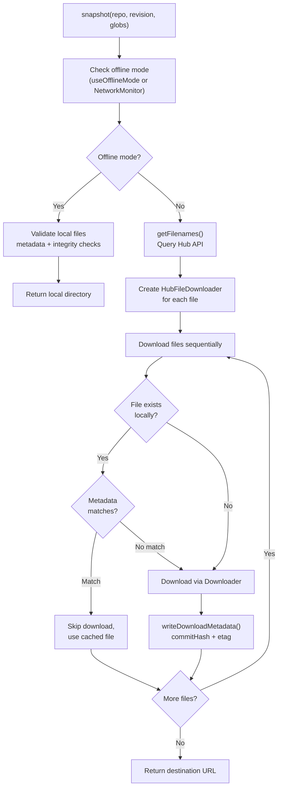
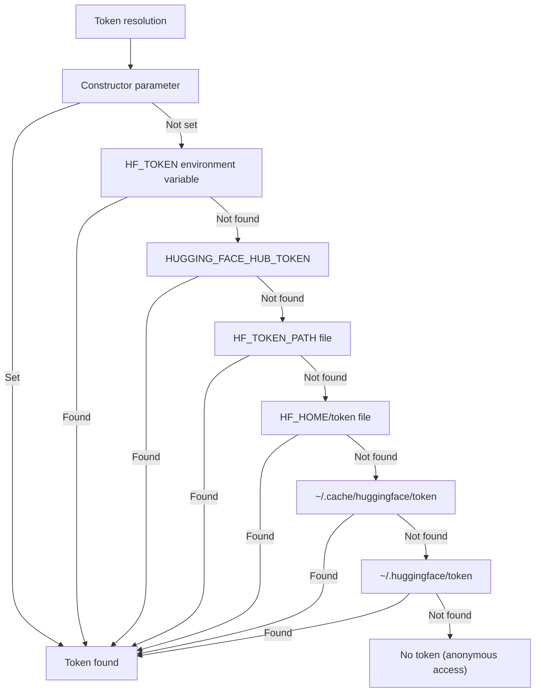
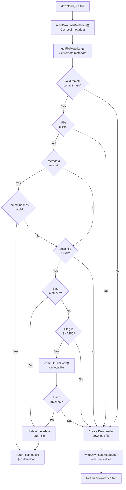
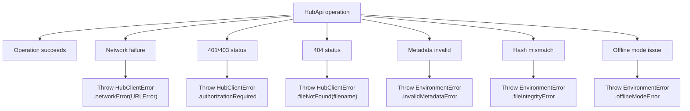

<!-- source: DeepWiki mcp.deepwiki.com · repo huggingface/swift-transformers · page 3.1 Hub API · fetched 2026-10-26 -->

# Hub API

<details>
<summary>Relevant source files</summary>

The following files were used as context for generating this wiki page:

- [Sources/Hub/Hub.swift](Sources/Hub/Hub.swift)
- [Sources/Hub/HubApi.swift](Sources/Hub/HubApi.swift)
- [Tests/HubTests/HubApiTests.swift](Tests/HubTests/HubApiTests.swift)

</details>


## Purpose and Scope

The Hub API provides the interface for interacting with the Hugging Face Hub to download models, retrieve file metadata, and manage repository snapshots. It handles authentication, network operations, file caching, metadata tracking, and offline mode support. This page documents the `HubApi` class and related types that enable repository access.

For information about model and tokenizer configuration loading, see [Configuration Loading](#3.3). For details on the download infrastructure including resumable transfers and retry logic, see [Downloader](#3.2). For caching mechanisms and metadata storage, see [Caching and Metadata](#3.4).

## HubApi Class

The `HubApi` struct is the primary client for Hub operations. It provides methods for downloading files, querying repository contents, and retrieving metadata while managing authentication, offline mode, and network monitoring.

### Initialization

```swift
public struct HubApi: Sendable {
    var downloadBase: URL
    var hfToken: String?
    var endpoint: String
    var useBackgroundSession: Bool
    var useOfflineMode: Bool?
}
```

The `HubApi` can be initialized with custom configuration or used via the shared singleton instance:

| Parameter | Default | Description |
|-----------|---------|-------------|
| `downloadBase` | `Documents/huggingface` | Local directory for downloaded files |
| `hfToken` | Environment variable | Authentication token (see Authentication section) |
| `endpoint` | `https://huggingface.co` | Hub server URL |
| `useBackgroundSession` | `false` | Whether to use background URL sessions |
| `useOfflineMode` | `nil` | Override automatic offline detection |

The shared instance `HubApi.shared` is initialized with default parameters and reused across the application.

**Sources:** [Sources/Hub/HubApi.swift:71-125]()

## Repository Reference System

### Repo Structure

```swift
public struct Repo: Codable {
    public let id: String
    public let type: RepoType
}
```

A `Repo` identifies a repository on the Hub with a unique ID and type:

**Sources:** [Sources/Hub/Hub.swift:93-108]()

### RepoType Enumeration

```swift
public enum RepoType: String, Codable {
    case models
    case datasets
    case spaces
}
```

The repository type determines the Hub section being accessed. Most operations use `.models` by default.

**Sources:** [Sources/Hub/Hub.swift:80-87]()

## Core API Operations

### Repository Snapshot Downloads

The `snapshot()` method downloads files from a repository matching glob patterns:

```swift
func snapshot(
    from repo: Repo,
    revision: String = "main",
    matching globs: [String] = [],
    progressHandler: @escaping (Progress) -> Void = { _ in }
) async throws -> URL
```

Multiple overloads support:
- Single glob pattern strings
- Repository ID strings instead of `Repo` objects
- Progress with download speed: `(Progress, Double?) -> Void`

The method returns the local directory URL where files were downloaded. Files matching the glob patterns are downloaded concurrently with progress tracking.

**Sources:** [Sources/Hub/HubApi.swift:576-697]()

#### Snapshot Operation Flow



**Sources:** [Sources/Hub/HubApi.swift:576-658]()

### File Listing Operations

The `getFilenames()` methods retrieve lists of files in a repository:

```swift
func getFilenames(
    from repo: Repo,
    revision: String = "main",
    matching globs: [String] = []
) async throws -> [String]
```

This method queries the Hub API's revision endpoint to retrieve the `siblings` array, then filters by glob patterns if provided. Multiple glob patterns are supported and results are combined without duplicates.

**Example patterns:**
- `"*.json"` - All JSON files
- `"*.mlpackage/*"` - All files in mlpackage directories
- `["config.json", "tokenizer*.json"]` - Multiple specific patterns

**Sources:** [Sources/Hub/HubApi.swift:259-284]()

### Metadata Retrieval

#### File Metadata Structure

```swift
public struct FileMetadata {
    public let commitHash: String?
    public let etag: String?
    public let location: String
    public let size: Int?
    public let xetFileData: XetFileData?
}
```

The `FileMetadata` structure contains:
- **commitHash**: Git commit hash for version tracking
- **etag**: File hash (SHA256 for LFS files, git hash for regular files)
- **location**: Download URL (may be CDN, not direct Hub URL)
- **size**: File size in bytes
- **xetFileData**: Optional Xet protocol optimization data

**Sources:** [Sources/Hub/HubApi.swift:703-718]()

#### Retrieving Metadata

```swift
func getFileMetadata(url: URL) async throws -> FileMetadata
func getFileMetadata(
    from repo: Repo,
    revision: String = "main",
    matching globs: [String] = []
) async throws -> [FileMetadata]
```

Metadata is retrieved via HTTP HEAD requests. The single-file version accepts a direct URL, while the multi-file version queries files matching glob patterns.

**Sources:** [Sources/Hub/HubApi.swift:741-814]()

### Authentication Check

```swift
func whoami() async throws -> Config
```

The `whoami()` method verifies authentication status by querying the Hub's `/api/whoami-v2` endpoint. It requires a valid `hfToken` and returns user information as a `Config` object.

**Sources:** [Sources/Hub/HubApi.swift:333-342]()

## Authentication

### Token Resolution

The `HubApi` resolves authentication tokens from multiple sources in priority order:



When a token is found, it's automatically included in HTTP requests as a Bearer token in the Authorization header.

**Sources:** [Sources/Hub/HubApi.swift:135-163]()

## HTTP Operations

### Request Methods

```swift
func httpGet(for url: URL) async throws -> (Data, HTTPURLResponse)
func httpHead(for url: URL) async throws -> HTTPURLResponse
```

Both methods handle authentication automatically and provide consistent error handling:

| Status Code | Error |
|-------------|-------|
| 200-299 | Success |
| 401, 403 | `HubClientError.authorizationRequired` |
| 404 | `HubClientError.fileNotFound` |
| Other | `HubClientError.httpStatusCode(code)` |

The `httpHead()` method uses a shared `URLSession` with custom redirect handling that only allows relative redirects. This security measure prevents absolute redirects to potentially malicious URLs during LFS file resolution.

**Sources:** [Sources/Hub/HubApi.swift:191-249](), [Sources/Hub/HubApi.swift:1031-1076]()

### HTTP Header Constants

```swift
enum HFHttpHeaders {
    static let location = "Location"
    static let etag = "Etag"
    static let contentLength = "Content-Length"
    static let repoCommit = "X-Repo-Commit"
    static let linkedEtag = "X-Linked-Etag"
    static let linkedSize = "X-Linked-Size"
    static let xetHash = "x-xet-hash"
    static let xetRefreshRoute = "X-Xet-Refresh-Route"
    static let linkXetAuthKey = "xet-auth"
}
```

These headers are used for metadata extraction and Xet protocol support. The casing follows RFC 7540 requirements.

**Sources:** [Sources/Hub/HubApi.swift:17-27]()

## Offline Mode

### Network Monitoring

```swift
private final class NetworkMonitor: Sendable {
    private let monitor: NWPathMonitor
    public let state: NetworkStateActor
    static let shared = NetworkMonitor()
}
```

The `NetworkMonitor` uses Apple's `NWPathMonitor` to detect network connectivity. It automatically starts monitoring when `HubApi` is initialized and maintains a shared instance across the application.

**Sources:** [Sources/Hub/HubApi.swift:839-871]()

### Offline Mode Behavior

When offline mode is active (either explicitly via `useOfflineMode: true` or automatically detected):

1. **File validation**: Checks all local files exist
2. **Metadata verification**: Ensures `.metadata` files are present
3. **Integrity checks**: For LFS files, verifies SHA256 hashes match
4. **Return cached location**: Returns local directory without network access

#### Offline Mode Flow

```mermaid
flowchart TD
    Snapshot["snapshot() called"]
    CheckMode{Offline mode<br/>enabled?}
    CheckRepo{Local repo<br/>exists?}
    ThrowNoRepo["Throw EnvironmentError<br/>.offlineModeError<br/>'Repository not available'"]
    GetFiles["Get local file URLs"]
    CheckEmpty{Files<br/>empty?}
    ThrowNoFiles["Throw EnvironmentError<br/>.offlineModeError<br/>'No files available'"]
    LoopFiles["For each file"]
    ReadMeta["readDownloadMetadata()"]
    MetaExists{Metadata<br/>exists?}
    ThrowNoMeta["Throw EnvironmentError<br/>.offlineModeError<br/>'Metadata not available'"]
    CheckLFS{Is LFS file<br/>(SHA256 etag)?}
    ComputeHash["computeFileHash()"]
    CheckHash{Hash<br/>matches?}
    ThrowIntegrity["Throw EnvironmentError<br/>.fileIntegrityError<br/>'Hash mismatch'"]
    NextFile{More<br/>files?}
    ReturnLocal["Return local directory"]
    
    Snapshot --> CheckMode
    CheckMode -->|Yes| CheckRepo
    CheckMode -->|No| ReturnLocal
    CheckRepo -->|No| ThrowNoRepo
    CheckRepo -->|Yes| GetFiles
    GetFiles --> CheckEmpty
    CheckEmpty -->|Yes| ThrowNoFiles
    CheckEmpty -->|No| LoopFiles
    LoopFiles --> ReadMeta
    ReadMeta --> MetaExists
    MetaExists -->|No| ThrowNoMeta
    MetaExists -->|Yes| CheckLFS
    CheckLFS -->|Yes| ComputeHash
    CheckLFS -->|No| NextFile
    ComputeHash --> CheckHash
    CheckHash -->|No| ThrowIntegrity
    CheckHash -->|Yes| NextFile
    NextFile -->|Yes| LoopFiles
    NextFile -->|No| ReturnLocal
```

**Sources:** [Sources/Hub/HubApi.swift:586-623]()

## File Metadata System

### Local Metadata Structure

```swift
public struct LocalDownloadFileMetadata {
    public let commitHash: String
    public let etag: String
    public let filename: String
    public let timestamp: Date
}
```

Local metadata files (`.metadata` extension) are stored alongside downloaded files in the `.cache/huggingface/download` directory. The metadata format is plain text with three lines:

```
<commitHash>
<etag>
<timestamp>
```

**Sources:** [Sources/Hub/HubApi.swift:721-734]()

### Metadata Operations

#### Reading Metadata

```swift
func readDownloadMetadata(metadataPath: URL) throws -> LocalDownloadFileMetadata?
```

Reads and parses metadata files. If corrupted or invalid, the file is automatically removed and `nil` is returned. The method validates:
- Minimum 3 lines present
- Valid timestamp format (Double)
- File structure integrity

**Sources:** [Sources/Hub/HubApi.swift:358-400]()

#### Writing Metadata

```swift
func writeDownloadMetadata(
    commitHash: String,
    etag: String,
    metadataPath: URL
) throws
```

Creates metadata files after successful downloads. The timestamp is automatically set to the current time. Directories are created if needed.

**Sources:** [Sources/Hub/HubApi.swift:440-448]()

## Download Decision Logic

The `HubFileDownloader` implements sophisticated logic to determine whether to download, skip, or update files:



Key points:
- **Commit hash match**: If local and remote commit hashes match and file exists, skip download
- **Etag match**: If file exists and etag matches, update metadata only
- **SHA256 verification**: For LFS files, compute and compare file hash
- **Otherwise**: Download file and create new metadata

**Sources:** [Sources/Hub/HubApi.swift:499-572]()

## File Hashing

### SHA256 Computation

```swift
func computeFileHash(file url: URL) throws -> String
```

Computes SHA256 hashes for file integrity verification using streaming to handle large files efficiently:

1. Opens file with `FileHandle`
2. Reads in 1MB chunks
3. Updates `SHA256` hasher incrementally
4. Returns hex-encoded digest

This approach prevents memory issues when hashing large model files.

**Sources:** [Sources/Hub/HubApi.swift:408-437]()

### Hash Validation

```swift
func isValidHash(hash: String, pattern: String) -> Bool
```

Validates hash formats using regex patterns:
- **SHA256**: `^[0-9a-f]{64}$` (64 hex characters)
- **Commit hash**: `^[0-9a-f]{40}$` (40 hex characters)

**Sources:** [Sources/Hub/HubApi.swift:402-406]()

## Configuration Loading

### Loading Configuration Files

```swift
func configuration(from filename: String, in repo: Repo) throws -> Config
func configuration(fileURL: URL) throws -> Config
```

Loads and parses JSON configuration files into `Config` objects. The method:
1. Reads file data
2. Uses `JSONSerialization.bomPreservingJsonObject()` to handle BOM markers
3. Validates dictionary structure
4. Returns wrapped `Config`

**Sources:** [Sources/Hub/HubApi.swift:314-328]()

## Error Handling

### HubClientError Types

```swift
public enum HubClientError: LocalizedError {
    case authorizationRequired
    case httpStatusCode(Int)
    case parse
    case jsonSerialization(fileURL: URL, message: String)
    case unexpectedError
    case downloadError(String)
    case fileNotFound(String)
    case networkError(URLError)
    case resourceNotFound(String)
    case configurationMissing(String)
    case fileSystemError(Error)
    case parseError(String)
}
```

All errors conform to `LocalizedError` and provide descriptive error messages.

**Sources:** [Sources/Hub/Hub.swift:23-77]()

### EnvironmentError Types

```swift
public enum EnvironmentError: LocalizedError {
    case invalidMetadataError(String)
    case offlineModeError(String)
    case fileIntegrityError(String)
    case fileWriteError(String)
}
```

Environment-specific errors for metadata, offline mode, integrity checks, and file operations.

**Sources:** [Sources/Hub/HubApi.swift:289-307]()

### Error Handling Pattern



**Sources:** [Sources/Hub/Hub.swift:23-77](), [Sources/Hub/HubApi.swift:289-307]()

## Convenience Static Methods

The `Hub` namespace provides static convenience methods that use the shared `HubApi` instance:

```swift
// File listing
Hub.getFilenames(from: repo, matching: globs)
Hub.getFilenames(from: repoId, matching: globs)

// Snapshot downloads
Hub.snapshot(from: repo, matching: globs, progressHandler: handler)
Hub.snapshot(from: repoId, matching: globs, progressHandler: handler)

// Metadata retrieval
Hub.getFileMetadata(fileURL: url)
Hub.getFileMetadata(from: repo, matching: globs)

// Authentication
Hub.whoami(token: token)
```

These methods provide a simplified API surface for common operations without requiring explicit `HubApi` initialization.

**Sources:** [Sources/Hub/HubApi.swift:875-991]()

## Progress Reporting

### Progress Object

The `snapshot()` method provides progress updates via Foundation's `Progress` class:

```swift
progressHandler: @escaping (Progress) -> Void
```

The `Progress` object includes:
- `fractionCompleted`: Overall completion (0.0 to 1.0)
- `completedUnitCount`: Number of files completed
- `totalUnitCount`: Total number of files
- `userInfo[.throughputKey]`: Download speed in bytes/second (when available)

### Speed Reporting

An alternate progress handler signature provides direct access to download speed:

```swift
progressHandler: @escaping (Progress, Double?) -> Void
```

The `Double?` parameter contains the current download speed in bytes per second, or `nil` if speed measurement is unavailable.

**Sources:** [Sources/Hub/HubApi.swift:641-647](), [Sources/Hub/HubApi.swift:661-697]()

## Advanced Features

### Xet Protocol Support

```swift
public struct XetFileData {
    let fileHash: String
    let refreshRoute: String
}
```

The Hub API supports the Xet protocol for optimized downloads of large files. When Xet-enabled files are detected via response headers (`x-xet-hash`, `X-Xet-Refresh-Route`), the metadata includes `XetFileData` with file hash and authentication refresh route.

**Sources:** [Sources/Hub/HubApi.swift:33-38](), [Sources/Hub/HubApi.swift:757-791]()

### Background Sessions

When `useBackgroundSession: true` is specified, downloads use `URLSession` background configuration. This enables downloads to continue when the app is suspended, but may be rate-limited by the operating system.

**Note:** Background sessions should typically download one file at a time to avoid OS rate limiting.

**Sources:** [Sources/Hub/HubApi.swift:94](), [Tests/HubTests/HubApiTests.swift:255-274]()

### Custom Endpoints

The `endpoint` parameter supports using alternative Hub mirrors:

```swift
let hubApi = HubApi(endpoint: "https://hf-mirror.com")
```

This allows routing requests through regional mirrors or enterprise Hub installations.

**Sources:** [Sources/Hub/HubApi.swift:99](), [Tests/HubTests/HubApiTests.swift:276-299]()

## File and Directory Structure

### Local Repository Layout

Downloaded files are organized in the following structure:

```
{downloadBase}/
└── models/
    └── {repo-id}/
        ├── config.json
        ├── tokenizer.json
        ├── tokenizer_config.json
        └── .cache/
            └── huggingface/
                └── download/
                    ├── config.json.metadata
                    ├── tokenizer.json.metadata
                    └── tokenizer_config.json.metadata
```

**Repository files**: Stored at `{downloadBase}/models/{repo-id}/`
**Metadata files**: Stored at `{downloadBase}/models/{repo-id}/.cache/huggingface/download/`
**Incomplete downloads**: Stored with `.{etag}.incomplete` suffix in metadata directory

**Sources:** [Sources/Hub/HubApi.swift:347-349](), [Sources/Hub/HubApi.swift:580-585]()

### URL Construction

```swift
struct HubFileDownloader {
    var source: URL {
        // https://huggingface.co/{repo-type}/{repo-id}/resolve/{revision}/{filename}
    }
    var destination: URL
    var metadataDestination: URL
}
```

Download URLs follow the Hub's resolve API pattern. For model repositories, the `models/` prefix is omitted from the URL path.

**Sources:** [Sources/Hub/HubApi.swift:461-479]()

## Testing and Validation

The test suite validates:

- **File listing**: Pattern matching, glob support
- **Metadata retrieval**: Commit hashes, etags, sizes, Xet data
- **Download operations**: Single files, multiple files, large files
- **Metadata persistence**: Writing, reading, corruption handling
- **Offline mode**: Validation, integrity checks, error cases
- **Resume capability**: Interrupted downloads, partial transfers
- **Revisions**: Specific commit hashes, branch names
- **Background sessions**: Suspend/resume behavior

**Sources:** [Tests/HubTests/HubApiTests.swift:11-1184]()

---

