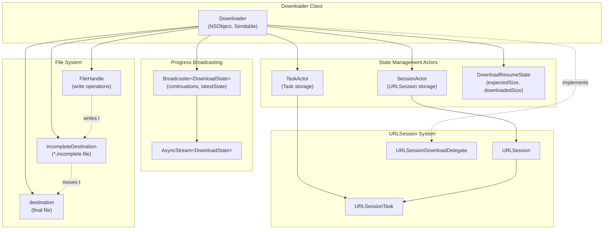
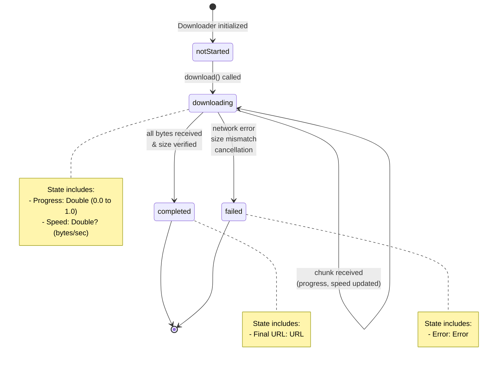
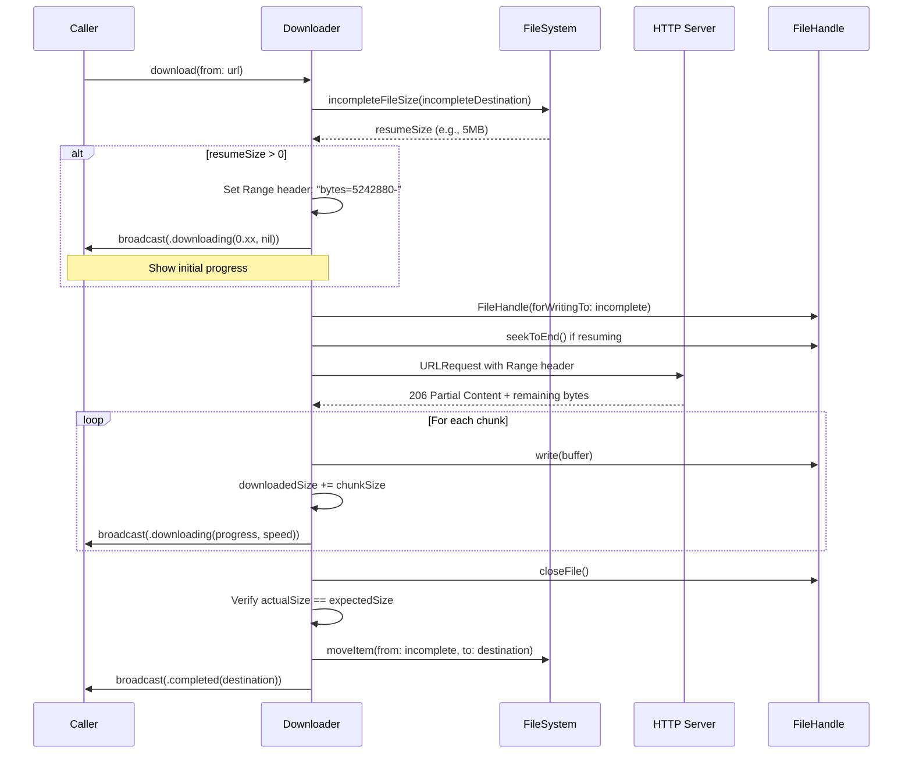
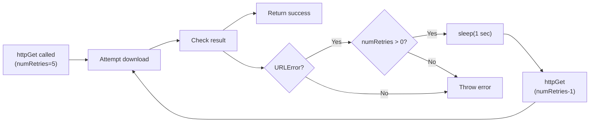
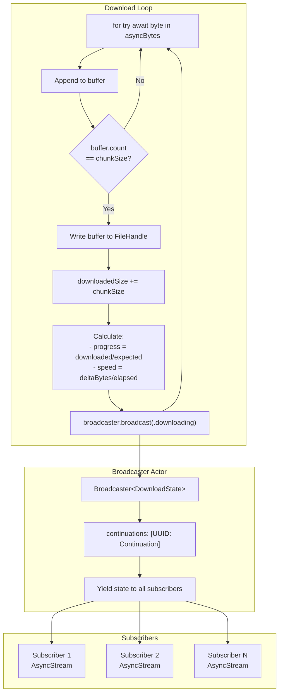
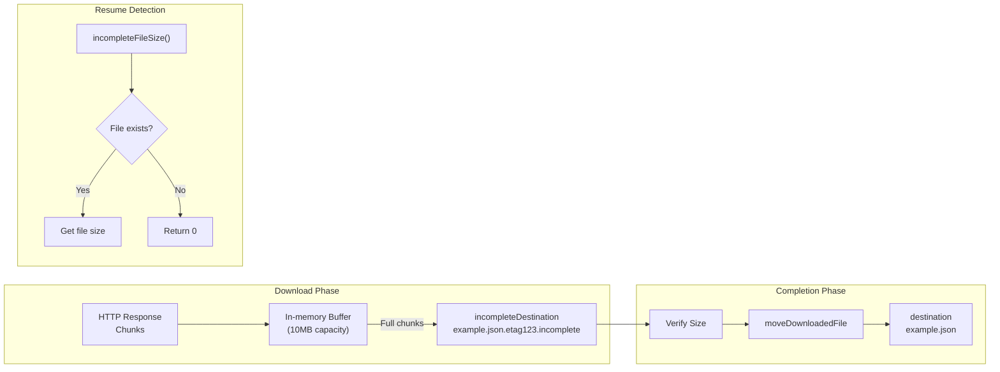
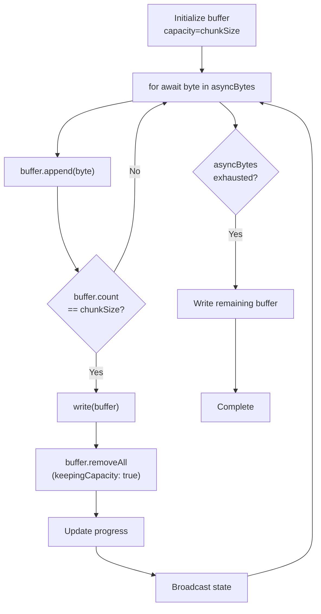
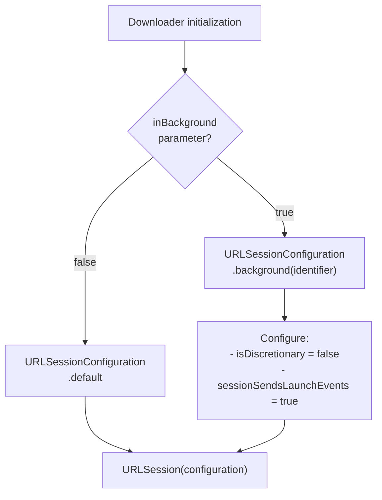
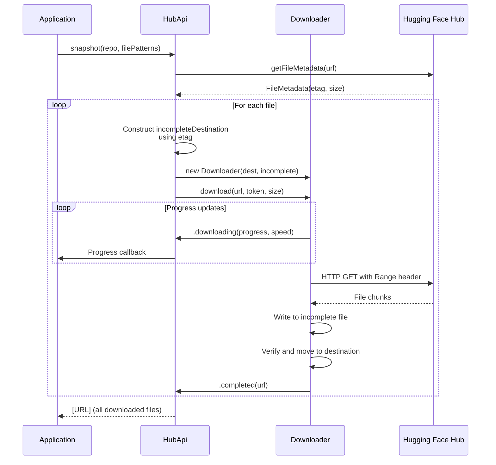

<!-- source: DeepWiki mcp.deepwiki.com · repo huggingface/swift-transformers · page 3.2 Downloader · fetched 2026-10-26 -->

# Downloader

<details>
<summary>Relevant source files</summary>

The following files were used as context for generating this wiki page:

- [Sources/Hub/Downloader.swift](Sources/Hub/Downloader.swift)
- [Tests/HubTests/DownloaderTests.swift](Tests/HubTests/DownloaderTests.swift)

</details>


The `Downloader` class provides robust, production-ready file download capabilities for the Hub module. It handles HTTP file transfers with automatic resume support, retry logic, progress tracking, and speed monitoring. The Downloader is used internally by [HubApi](#3.1) to fetch model files, tokenizer configurations, and other resources from Hugging Face Hub.

For information about the higher-level Hub API that uses Downloader, see [Hub API](#3.1). For details on how downloaded files are cached and validated, see [Caching and Metadata](#3.4).

## Overview

The Downloader system is built around the `Downloader` class ([Sources/Hub/Downloader.swift:16]()) which orchestrates file downloads through a combination of URLSession, file handle management, and state broadcasting. Key capabilities include:

| Feature | Description |
|---------|-------------|
| **Resumable Downloads** | Uses HTTP Range headers to continue interrupted downloads from where they left off |
| **Retry Logic** | Automatically retries failed downloads up to 5 times with exponential backoff |
| **Progress Reporting** | Streams download state updates including percentage and instantaneous speed |
| **Chunk-Based Transfer** | Downloads in 10MB chunks with buffering for efficient disk I/O |
| **Background Sessions** | Optional support for URLSession background downloads |
| **Cancellation** | Clean cancellation with proper resource cleanup |
| **File Integrity** | Verifies downloaded file size matches expected size |

Sources: [Sources/Hub/Downloader.swift:11-16]()

## Architecture

The Downloader is composed of several thread-safe components that work together to manage the download lifecycle:



**Diagram 1: Downloader Component Architecture**

Sources: [Sources/Hub/Downloader.swift:16-80, 389-480]()

### Core Components

**Downloader Class** ([Sources/Hub/Downloader.swift:16]())
- Main coordinator marked as `Sendable` for safe concurrent access
- Conforms to `URLSessionDownloadDelegate` for URLSession callbacks
- Manages destination URLs and configuration

**SessionActor** ([Sources/Hub/Downloader.swift:458-468]())
- Thread-safe wrapper around `URLSession`
- Provides isolated access to session instance

**TaskActor** ([Sources/Hub/Downloader.swift:470-480]())
- Thread-safe wrapper around active `Task`
- Enables cancellation from external callers

**DownloadResumeState** ([Sources/Hub/Downloader.swift:389-404]())
- Actor tracking download progress state
- Maintains `expectedSize` and `downloadedSize`
- Updates are serialized through actor isolation

**Broadcaster** ([Sources/Hub/Downloader.swift:406-456]())
- Generic actor for publishing state updates to multiple subscribers
- Manages `AsyncStream.Continuation` instances
- Ensures new subscribers receive latest state immediately

Sources: [Sources/Hub/Downloader.swift:16-80, 389-480]()

## Download State Machine

The download process is modeled as a state machine using the `DownloadState` enum:



**Diagram 2: DownloadState State Machine**

### State Definitions

| State | Definition | Data |
|-------|------------|------|
| `notStarted` | Initial state before download begins | None |
| `downloading(Double, Double?)` | Download in progress | Progress percentage (0.0-1.0), optional speed in bytes/sec |
| `completed(URL)` | Download finished successfully | Final file URL |
| `failed(Error)` | Download failed | Error instance |

The state machine is implemented at [Sources/Hub/Downloader.swift:23-32]() and transitions are broadcast through the `Broadcaster` at [Sources/Hub/Downloader.swift:44-46]().

Sources: [Sources/Hub/Downloader.swift:23-32, 44-46]()

## Resumable Downloads

The Downloader implements resumable downloads following the HTTP Range request pattern used by the Hugging Face Hub Python library.



**Diagram 3: Resumable Download Flow**

### Implementation Details

1. **Resume Detection** ([Sources/Hub/Downloader.swift:331-339]())
   - Checks if incomplete file exists at `incompleteDestination`
   - Reads file size from attributes if present
   - Returns 0 if file doesn't exist

2. **Range Header Setup** ([Sources/Hub/Downloader.swift:170-176]())
   - If `resumeSize > 0`, sets `Range: bytes={resumeSize}-`
   - Server responds with 206 Partial Content
   - Remaining bytes are appended to existing file

3. **File Handle Positioning** ([Sources/Hub/Downloader.swift:193-198]())
   - Opens `FileHandle` for writing to incomplete file
   - Seeks to end of file if resuming
   - Ensures writes append correctly

4. **Progress Calculation** ([Sources/Hub/Downloader.swift:179-184]())
   - Initial progress shown based on resumeSize / expectedSize
   - Progress updates account for already-downloaded bytes

Sources: [Sources/Hub/Downloader.swift:103-104, 134, 168-187, 331-339]()

## Retry Mechanism

The Downloader implements automatic retry with exponential backoff for transient network failures:



**Diagram 4: Retry Logic Flow**

### Retry Behavior

The retry mechanism is implemented in the `httpGet` function ([Sources/Hub/Downloader.swift:229-320]()):

1. **Initial Attempts**: Starts with `numRetries = 5` ([Sources/Hub/Downloader.swift:89]())

2. **Success Resets Counter**: When a chunk is successfully written, `newNumRetries` is reset to 5 ([Sources/Hub/Downloader.swift:275, 297]())

3. **URLError Handling** ([Sources/Hub/Downloader.swift:299-312]())
   - Catches `URLError` specifically
   - If retries exhausted (`newNumRetries <= 0`), throws error
   - Otherwise, sleeps for 1 second
   - Recreates URLSession
   - Recursively calls `httpGet` with `numRetries - 1`

4. **Non-URLErrors**: Other errors are not retried and propagate immediately

This design ensures transient network issues (timeouts, connection drops) are automatically handled while permanent errors (authentication, 404) fail fast.

Sources: [Sources/Hub/Downloader.swift:89, 229-320]()

## Progress Reporting

Progress updates are delivered through an `AsyncStream<DownloadState>` using the Broadcaster pattern:



**Diagram 5: Progress Reporting System**

### Progress Calculation

The progress reporting system ([Sources/Hub/Downloader.swift:256-288]()) includes:

1. **Percentage Progress**
   ```
   progress = totalDownloadedLocal / expectedSize
   ```
   Calculated whenever a full chunk (10MB) is written

2. **Instantaneous Speed**
   ```
   speed = deltaBytes / elapsed
   ```
   Measured between consecutive broadcasts using:
   - `lastSampleTime`: Timestamp of last broadcast
   - `lastSampleBytes`: Downloaded bytes at last broadcast
   - `deltaBytes = totalDownloadedLocal - lastSampleBytes`
   - `elapsed = now.timeIntervalSince(lastSampleTime)`

3. **Broadcasting** ([Sources/Hub/Downloader.swift:287]())
   - Called with `.downloading(progress, speed)` after each chunk
   - Broadcaster yields to all active subscribers concurrently

### Subscriber Pattern

Callers receive updates by subscribing to the AsyncStream ([Sources/Hub/Downloader.swift:91-115]()):

```swift
let stream = await downloader.download(from: url)
for await state in stream {
    switch state {
    case .downloading(let progress, let speed):
        // Update UI with progress and speed
    case .completed(let url):
        // Handle successful completion
    case .failed(let error):
        // Handle error
    }
}
```

Sources: [Sources/Hub/Downloader.swift:91-115, 256-288, 406-456]()

## File Management

The Downloader manages two file locations during the download lifecycle:



**Diagram 6: File Management Flow**

### File Locations

1. **incompleteDestination** ([Sources/Hub/Downloader.swift:18, 67]())
   - Temporary file for in-progress downloads
   - Typically named with format: `{filename}.{etag}.incomplete`
   - Preserved across download sessions for resume capability
   - Created before download starts ([Sources/Hub/Downloader.swift:193]())

2. **destination** ([Sources/Hub/Downloader.swift:17, 65]())
   - Final location for completed download
   - Only written to after successful verification
   - Atomic move from incomplete to destination ([Sources/Hub/Downloader.swift:205]())

### File Operations

**Creating Incomplete File** ([Sources/Hub/Downloader.swift:193]())
```swift
let tempFile = try FileHandle(forWritingTo: self.incompleteDestination)
```

**Writing Chunks** ([Sources/Hub/Downloader.swift:270]())
```swift
try tempFile.write(contentsOf: buffer)
```

**Verification** ([Sources/Hub/Downloader.swift:316-319]())
```swift
let actualSize = try tempFile.seekToEnd()
if let expectedSize = await downloadResumeState.expectedSize, 
   expectedSize != actualSize {
    throw DownloadError.unexpectedError
}
```

**Atomic Move** ([Sources/Hub/Downloader.swift:376-386]())
```swift
func moveDownloadedFile(from srcURL: URL, to dstURL: URL) throws {
    if fileExists(atPath: dstURL.path) {
        try removeItem(at: dstURL)  // Overwrite existing
    }
    try createDirectory(at: directoryURL, withIntermediateDirectories: true)
    try moveItem(at: srcURL, to: dstURL)
}
```

Sources: [Sources/Hub/Downloader.swift:17-18, 65-67, 193, 205, 270, 316-319, 376-386]()

## Chunked Transfer

The download process uses chunk-based buffering for efficient memory usage and responsive progress updates:

| Parameter | Value | Location |
|-----------|-------|----------|
| Default Chunk Size | 10MB (10 * 1024 * 1024 bytes) | [Sources/Hub/Downloader.swift:63]() |
| Buffer Capacity | Equal to chunk size | [Sources/Hub/Downloader.swift:256]() |
| Write Trigger | Buffer reaches chunk size | [Sources/Hub/Downloader.swift:268]() |

### Transfer Algorithm

The chunked transfer is implemented at [Sources/Hub/Downloader.swift:256-298]():



**Diagram 7: Chunked Transfer Algorithm**

### Benefits

1. **Memory Efficiency**: Limits in-memory buffer to 10MB regardless of file size
2. **Responsive Progress**: Updates broadcast every 10MB instead of per-byte
3. **I/O Optimization**: Reduces system calls by batching writes
4. **Capacity Retention**: `removeAll(keepingCapacity: true)` avoids reallocations

Sources: [Sources/Hub/Downloader.swift:63, 256-298]()

## Background Sessions

The Downloader supports URLSession background configurations for downloads that continue when the app is suspended:



**Diagram 8: Session Configuration**

### Configuration Options

**Standard Session** (default, [Sources/Hub/Downloader.swift:72]())
```swift
var config = URLSessionConfiguration.default
```

**Background Session** ([Sources/Hub/Downloader.swift:73-77]())
```swift
config = URLSessionConfiguration.background(
    withIdentifier: "swift-transformers.hub.downloader"
)
config.isDiscretionary = false  // Start immediately
config.sessionSendsLaunchEvents = true  // Wake app on completion
```

### Background Task Management

When using background sessions, the Downloader checks for existing tasks ([Sources/Hub/Downloader.swift:135-153]()) to avoid duplicate downloads:

```swift
if let existing = tasks.filter({ $0.originalRequest?.url == url }).first {
    switch existing.state {
    case .running:
        return  // Let existing task continue
    case .suspended:
        existing.resume()
        return
    case .canceling, .completed:
        existing.cancel()
    }
}
```

Sources: [Sources/Hub/Downloader.swift:59-79, 135-153]()

## Usage Example

A typical download operation using the Downloader:

```swift
// Initialize with file paths
let destination = URL(fileURLWithPath: "/path/to/model.bin")
let incomplete = URL(fileURLWithPath: "/path/to/cache/model.bin.etag.incomplete")
let downloader = Downloader(to: destination, incompleteDestination: incomplete)

// Start download with progress monitoring
let stream = await downloader.download(
    from: modelURL,
    using: authToken,
    expectedSize: fileSize,
    timeout: 30,
    numRetries: 5
)

// Consume state updates
for await state in stream {
    switch state {
    case .notStarted:
        print("Waiting to start...")
        
    case .downloading(let progress, let speed):
        print("Progress: \(progress * 100)%")
        if let speed = speed {
            print("Speed: \(speed / 1_000_000) MB/s")
        }
        
    case .completed(let url):
        print("Downloaded to: \(url.path)")
        break
        
    case .failed(let error):
        print("Failed: \(error)")
        throw error
    }
}
```

### Cancellation

Downloads can be cancelled at any time ([Sources/Hub/Downloader.swift:322-326]()):

```swift
await downloader.cancel()
// Invalidates session, cancels task, broadcasts .failed(URLError.cancelled)
```

Sources: [Sources/Hub/Downloader.swift:59-115, 322-326]()

## Error Handling

The Downloader defines specific error types and handles various failure scenarios:

### DownloadError Enum

Defined at [Sources/Hub/Downloader.swift:35-42]():

| Error Case | Description | Thrown When |
|------------|-------------|-------------|
| `invalidDownloadLocation` | Destination URL is invalid | Reserved for future use |
| `unexpectedError` | Generic unexpected error | Invalid response, non-HTTP response, bad status code |
| `tempFileNotFound` | Incomplete file missing | Resume attempted but temp file doesn't exist |

### Error Scenarios

1. **Size Mismatch** ([Sources/Hub/Downloader.swift:316-319]())
   - After download completes, actual size compared to expected size
   - Throws `DownloadError.unexpectedError` if mismatch
   - Incomplete file remains for potential debugging

2. **HTTP Errors** ([Sources/Hub/Downloader.swift:247-253]())
   - Non-HTTPURLResponse: throws `unexpectedError`
   - Status code outside 200-299: throws `unexpectedError`
   - Includes 4xx (client errors) and 5xx (server errors)

3. **Network Errors** ([Sources/Hub/Downloader.swift:299-312]())
   - URLError caught and retried up to 5 times
   - Includes timeouts, connection failures, etc.
   - Final error propagated if retries exhausted

4. **File System Errors**
   - Propagated from FileManager operations
   - Includes permission errors, disk full, etc.

### Test Coverage

The test suite validates error handling ([Tests/HubTests/DownloaderTests.swift]()):

- **Size mismatch**: [Tests/HubTests/DownloaderTests.swift:76-106]()
- **Successful completion**: [Tests/HubTests/DownloaderTests.swift:29-73]()
- **Interrupted resume**: [Tests/HubTests/DownloaderTests.swift:110-165]()
- **File path handling**: [Tests/HubTests/DownloaderTests.swift:167-189]()

Sources: [Sources/Hub/Downloader.swift:35-42, 247-253, 299-319](), [Tests/HubTests/DownloaderTests.swift:29-189]()

## Supporting Actors

The Downloader uses several actor types to ensure thread-safe state management:

### SessionActor

Thread-safe wrapper for URLSession ([Sources/Hub/Downloader.swift:458-468]()):

```swift
actor SessionActor {
    private var urlSession: URLSession?
    
    func set(_ urlSession: URLSession?)
    func get() -> URLSession?
}
```

**Purpose**: Isolates URLSession access to prevent data races when session is recreated during retries.

### TaskActor

Thread-safe wrapper for active Task ([Sources/Hub/Downloader.swift:470-480]()):

```swift
actor TaskActor {
    private var task: Task<Void, Error>?
    
    func set(_ task: Task<Void, Error>?)
    func get() -> Task<Void, Error>?
}
```

**Purpose**: Enables external cancellation of the download task from concurrent contexts.

### DownloadResumeState

Actor tracking download progress ([Sources/Hub/Downloader.swift:389-404]()):

```swift
actor DownloadResumeState {
    var expectedSize: Int?
    var downloadedSize: Int = 0
    
    func setExpectedSize(_ size: Int?)
    func setDownloadedSize(_ size: Int)
    func incDownloadedSize(_ size: Int)
}
```

**Purpose**: Serializes updates to download progress counters used for resume and progress calculation.

### Broadcaster

Generic actor for publishing state updates ([Sources/Hub/Downloader.swift:406-456]()):

```swift
actor Broadcaster<E: Sendable> {
    private let initialState: @Sendable () async -> E?
    private var latestState: E?
    private var continuations: [UUID: AsyncStream<E>.Continuation]
    
    func subscribe() -> AsyncStream<E>
    func broadcast(state: E) async
}
```

**Features**:
- Maintains dictionary of continuations indexed by UUID
- New subscribers receive `latestState` immediately
- `broadcast` yields state to all subscribers concurrently using TaskGroup
- Handles continuation cleanup on termination

Sources: [Sources/Hub/Downloader.swift:389-480]()

## Integration with Hub

The Downloader is instantiated and used by HubApi for file downloads. The typical integration pattern:



**Diagram 9: HubApi Integration Pattern**

The incomplete file naming convention includes the etag to ensure different versions don't interfere:
```
{filename}.{etag}.incomplete
```

For more details on how HubApi orchestrates downloads, see [Hub API](#3.1).

Sources: [Sources/Hub/Downloader.swift:16-115]()

---

