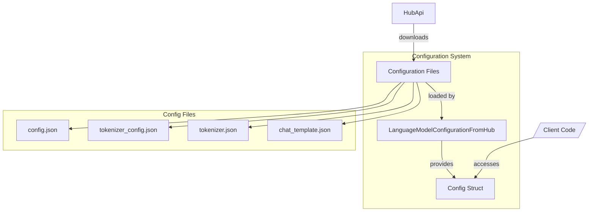
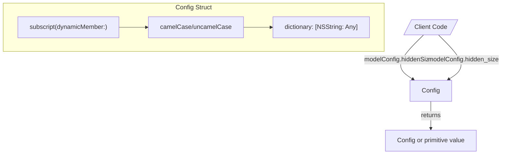
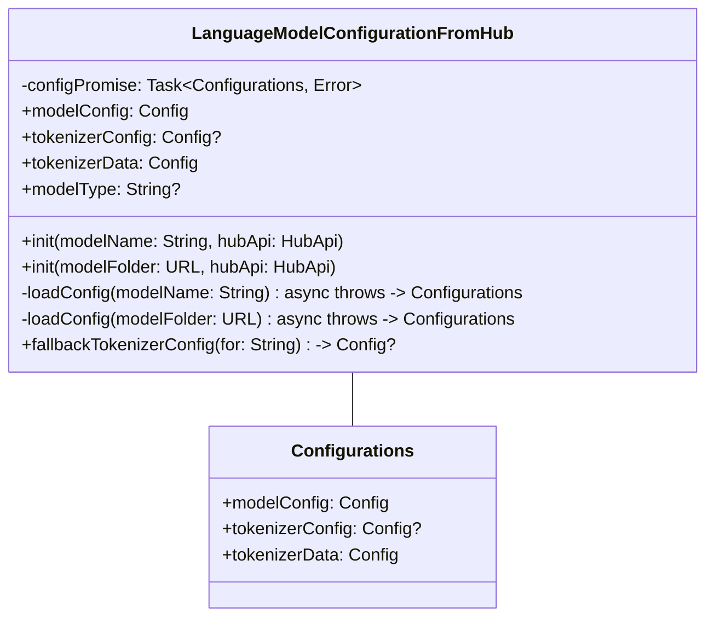
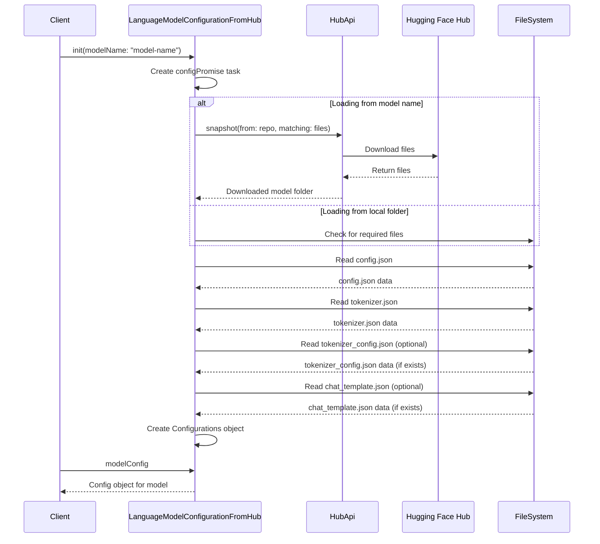
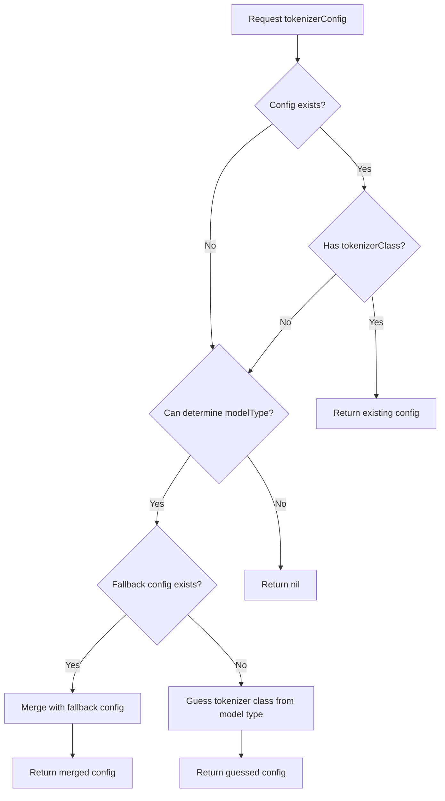

<!-- source: DeepWiki mcp.deepwiki.com · repo huggingface/swift-transformers · page 3.3 Configuration Loading · fetched 2026-10-26 -->

# Configuration

<details>
<summary>Relevant source files</summary>

The following files were used as context for generating this wiki page:

- [Sources/Hub/Hub.swift](Sources/Hub/Hub.swift)
- [Sources/Hub/HubApi.swift](Sources/Hub/HubApi.swift)
- [Tests/HubTests/HubApiTests.swift](Tests/HubTests/HubApiTests.swift)

</details>


This document explains how configuration files are structured and used within the Swift Transformers Hub system. The Hub module relies on configuration files to properly initialize and parameterize language models and tokenizers. This page focuses on the configuration system, including how configuration data is loaded, accessed, and processed.

For information about downloading model files from the Hugging Face Hub, see [Hub API](#3.1).

## Overview of the Configuration System

The configuration system in Swift Transformers enables dynamic access to model and tokenizer parameters through a flexible structure that supports both snake_case and camelCase property access. Configuration data is typically loaded from JSON files that are either downloaded from the Hugging Face Hub or loaded from local storage.



Sources: [Sources/Hub/Hub.swift:73-145](), [Sources/Hub/Hub.swift:147-325]()

## The Config Structure

The `Config` struct is the core component of the configuration system, providing a dynamic way to access configuration values. It implements `@dynamicMemberLookup` which allows accessing properties using dot notation even when they aren't defined as explicit properties.

### Dynamic Property Access

The `Config` struct stores configuration data in a dictionary and provides dynamic access to nested values. It supports both snake_case (as used in the original JSON files) and camelCase (more common in Swift) property names.



Sources: [Sources/Hub/Hub.swift:73-145]()

### Value Retrieval

The `Config` struct provides various methods to retrieve different types of values:

| Accessor | Return Type | Description |
|----------|-------------|-------------|
| `value` | `Any?` | The raw value |
| `intValue` | `Int?` | Integer representation of the value |
| `boolValue` | `Bool?` | Boolean representation of the value |
| `stringValue` | `String?` | String representation of the value |
| `arrayValue` | `[Config]?` | Array of Config objects |
| `tokenValue` | `(UInt, String)?` | Tuple representing a token ID and string value |

Sources: [Sources/Hub/Hub.swift:121-144]()

### Case Conversion

The Config struct provides methods to convert between camelCase and snake_case, allowing for more idiomatic property access in Swift while maintaining compatibility with the Python-style snake_case format used in Hugging Face models:

- `camelCase(_:)`: Converts snake_case strings to camelCase
- `uncamelCase(_:)`: Converts camelCase strings to snake_case

Sources: [Sources/Hub/Hub.swift:81-109]()

## Language Model Configuration

The `LanguageModelConfigurationFromHub` class is responsible for loading and managing configuration data for language models and tokenizers.



Sources: [Sources/Hub/Hub.swift:147-325]()

### Configuration Loading Process

The configuration loading process follows these steps:

1. Initialize `LanguageModelConfigurationFromHub` with either a model name (to download from Hugging Face Hub) or a local folder path.
2. The initialization creates an asynchronous task that loads the configurations.
3. When configurations are requested, the system waits for the loading task to complete.
4. If loading from a model name, the system downloads the required files from the Hugging Face Hub.
5. The system loads and parses the configuration files (JSON format).
6. For missing optional configurations (like tokenizer config), fallback mechanisms may be used.



Sources: [Sources/Hub/Hub.swift:217-303]()

## Configuration Files

The configuration system works with several standard configuration files:

| File | Required | Description |
|------|----------|-------------|
| `config.json` | Yes | Contains model architecture parameters |
| `tokenizer.json` | Yes | Contains tokenizer data (vocabulary, merges, etc.) |
| `tokenizer_config.json` | No | Contains tokenizer parameters |
| `chat_template.json` | No | Contains chat template formatting information |

### Required Configuration Files

The system requires at minimum:

1. `config.json` - Contains essential model parameters like hidden size, number of attention heads, model type, and architecture.
2. `tokenizer.json` - Contains tokenizer data including vocabulary, merges (for BPE tokenizers), and other tokenizer-specific data.

If these files are missing, the system will throw a `Hub.HubClientError.configurationMissing` error.

Sources: [Sources/Hub/Hub.swift:250-263]()

### Optional Configuration Files

The system can work with these optional files:

1. `tokenizer_config.json` - Contains configuration for the tokenizer class and parameters.
2. `chat_template.json` - Contains a template for formatting chat conversations.

If `tokenizer_config.json` is missing, the system will attempt to use fallback configurations based on the model type.

Sources: [Sources/Hub/Hub.swift:264-284](), [Sources/Hub/Hub.swift:305-324]()

## Accessing Configuration Values

### Basic Usage Pattern

Configuration values can be accessed using dot notation with either snake_case or camelCase property names:

```swift
// Using snake_case (original format)
let hiddenSize = config.hidden_size?.intValue

// Using camelCase (Swift convention)
let hiddenSize = config.hiddenSize?.intValue
```

Each property access returns another `Config` object, which can be chained for nested properties:

```swift
// Accessing nested properties
let maxLength = config.taskSpecificParams?.summarization?.maxLength?.intValue
```

Sources: [Sources/Hub/Hub.swift:111-119](), [Tests/HubTests/HubTests.swift:34-94]()

### Value Types and Conversion

The `Config` struct provides various value accessors that convert the raw value to specific types:

```swift
// Integer values
let vocabSize = config.vocab_size?.intValue

// String values
let modelType = config.modelType?.stringValue

// Boolean values
let isLMHeadModel = config.isLMHeadModel?.boolValue

// Array values
let architectures = config.architectures?.value as? [String]

// Nested objects
let attention = config.attention
```

Sources: [Sources/Hub/Hub.swift:121-144](), [Tests/HubTests/HubTests.swift:34-66]()

## Fallback Mechanisms

The configuration system includes fallback mechanisms for handling missing tokenizer configurations:



Sources: [Sources/Hub/Hub.swift:180-202](), [Sources/Hub/Hub.swift:305-324]()

### Fallback Tokenizer Configurations

The system includes built-in fallback tokenizer configurations for common model types. These are used when:

1. No `tokenizer_config.json` file is found
2. The existing tokenizer config doesn't specify a tokenizer class

The fallback configurations are stored as JSON files in the Swift package and are loaded when needed. They provide sensible defaults for different model architectures.

Sources: [Sources/Hub/Hub.swift:305-324]()

## Error Handling

The configuration system throws specific errors to help diagnose configuration issues:

| Error | Description |
|-------|-------------|
| `configurationMissing` | Required configuration file is missing |
| `parseError` | Error parsing JSON configuration |
| `fileNotFound` | Configuration file not found |
| `fileSystemError` | File system error when accessing configurations |
| `networkError` | Network error when downloading configurations |
| `resourceNotFound` | Model or resource not found on Hugging Face Hub |

When these errors occur, they contain descriptive error messages to help identify and resolve the issue.

Sources: [Sources/Hub/Hub.swift:13-52]()

## Practical Examples

### Loading and Accessing Model Configuration

Here's a typical pattern for loading and accessing model configuration:

```swift
// Initialize configuration from model name
let configLoader = LanguageModelConfigurationFromHub(modelName: "t5-base")

// Access model configuration properties
let modelConfig = try await configLoader.modelConfig
let hiddenSize = modelConfig.hiddenSize?.intValue
let modelType = modelConfig.modelType?.stringValue

// Access tokenizer configuration
let tokenizerConfig = try await configLoader.tokenizerConfig
let tokenizerClass = tokenizerConfig?.tokenizerClass?.stringValue
```

Sources: [Tests/HubTests/HubTests.swift:28-98]()

### Working with Nested Configuration Values

Configuration values can be nested several levels deep:

```swift
// Access deeply nested properties
let taskParams = config.taskSpecificParams
let summarizationParams = taskParams?.summarization
let maxLength = summarizationParams?.maxLength?.intValue
```

Alternatively, you can chain the property accesses in a single expression:

```swift
let maxLength = config.taskSpecificParams?.summarization?.maxLength?.intValue
```

Sources: [Tests/HubTests/HubTests.swift:55-65](), [Tests/HubTests/HubTests.swift:90-94]()

## Conclusion

The Configuration system in Swift Transformers provides a flexible way to access model and tokenizer parameters through a dynamic property lookup mechanism. It supports loading configurations from the Hugging Face Hub or local files, handling various data types, and includes fallback mechanisms for missing configurations. This system ensures that models can be properly initialized with the correct parameters, even when certain configuration files are missing or incomplete.

---

