<!-- source: DeepWiki mcp.deepwiki.com · repo huggingface/swift-transformers · page 3.4 Caching and Metadata · fetched 2026-10-26 -->

# Caching and Metadata

<details>
<summary>Relevant source files</summary>

The following files were used as context for generating this wiki page:

- [Sources/Hub/HubApi.swift](Sources/Hub/HubApi.swift)
- [Tests/HubTests/HubApiTests.swift](Tests/HubTests/HubApiTests.swift)

</details>


This document describes the local caching system and metadata management in the Hub module. It covers how downloaded files are stored on disk, how metadata is tracked for integrity verification, and how the system validates cached files for offline operation.

For information about initiating downloads and interacting with the Hugging Face Hub API, see [Hub API](#3.1). For details about the actual file transfer mechanism, see [Downloader](#3.2).

## Cache Directory Structure

The Hub module organizes downloaded files in a structured local cache. Each repository is stored in a dedicated directory, with metadata files stored separately to track file versions and integrity.

**Directory Organization**

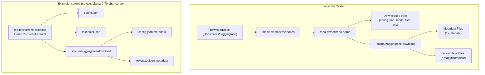

**Sources:** [Sources/Hub/HubApi.swift:347-349](), [Sources/Hub/HubApi.swift:579-584]()

The base download directory defaults to `Documents/huggingface` but can be customized via the `HubApi` initializer. Files are organized by repository type (`models`, `datasets`, or `spaces`), then by repository ID. The `.cache/huggingface/download` subdirectory mirrors the file structure but contains metadata files instead of the actual content.

**Key Components**

| Component | Type | Purpose |
|-----------|------|---------|
| `downloadBase` | URL | Root directory for all downloads |
| `localRepoLocation` | URL | Base directory for a specific repository |
| `repoDestination` | URL | Directory containing actual downloaded files |
| `repoMetadataDestination` | URL | Directory containing `.metadata` files |
| `destination` | URL | Path to a specific downloaded file |
| `metadataDestination` | URL | Path to the metadata file for a specific download |

**Sources:** [Sources/Hub/HubApi.swift:347-349](), [Sources/Hub/HubApi.swift:450-480]()

## Metadata Structures

The system maintains two types of metadata: remote metadata retrieved from the Hub API, and local metadata stored alongside downloaded files.

**Remote Metadata: FileMetadata**

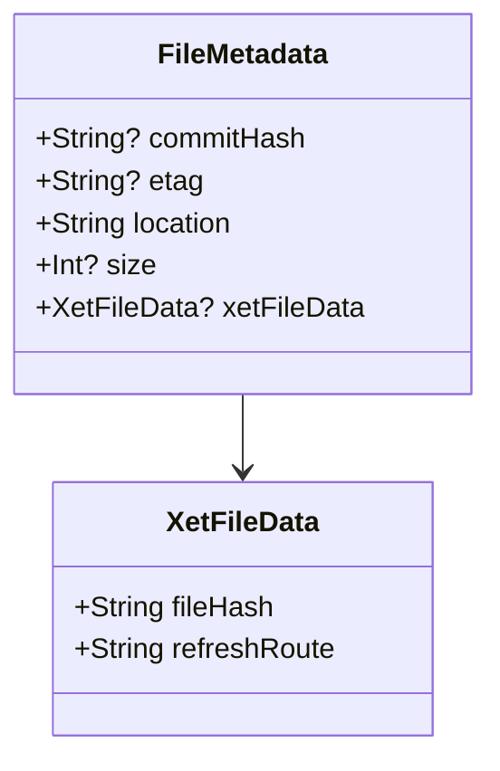

The `FileMetadata` struct represents information retrieved from the Hugging Face Hub about a specific file version. It is obtained via HTTP HEAD requests to file URLs.

**Sources:** [Sources/Hub/HubApi.swift:703-718](), [Sources/Hub/HubApi.swift:33-38](), [Sources/Hub/HubApi.swift:741-754]()

| Field | Description |
|-------|-------------|
| `commitHash` | Git commit hash of the repository revision containing this file |
| `etag` | Entity tag for cache validation. For LFS files, this is the SHA256 hash; for regular files, it's the git hash |
| `location` | Download URL, may be a CDN URL or Hub URL |
| `size` | File size in bytes. For LFS files, the actual file size (not the pointer) |
| `xetFileData` | Optional Xet protocol metadata for optimized large file downloads |

**Local Metadata: LocalDownloadFileMetadata**

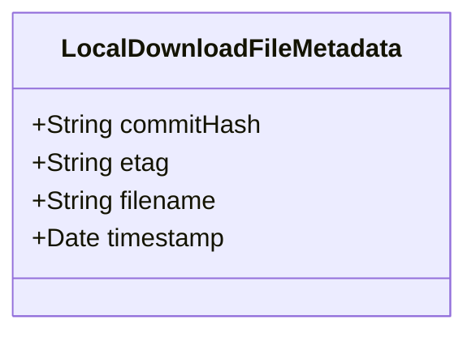

The `LocalDownloadFileMetadata` struct represents cached information about a previously downloaded file. This metadata is persisted to disk in `.metadata` files.

**Sources:** [Sources/Hub/HubApi.swift:721-734]()

| Field | Description |
|-------|-------------|
| `commitHash` | Commit hash of the repository when the file was downloaded |
| `etag` | ETag value from when the file was downloaded |
| `filename` | Path of the file relative to the repository root |
| `timestamp` | Date when the metadata was last written (i.e., when the file was last validated) |

## Metadata File Format

Metadata files use a simple three-line text format for persistence:

```
<commit_hash>\n
<etag>\n
<timestamp>\n
```

**Example Metadata File Content**

```
eaf97358a37d03fd48e5a87d15aff2e8423c1afb
d6ceb92ce9e3c83ab146dc8e92a93517ac1cc66f
1704067200.0
```

- **Line 1**: The 40-character git commit hash (validated with regex pattern `^[0-9a-f]{40}$`)
- **Line 2**: The ETag value (for LFS files, a 64-character SHA256 hash matching pattern `^[0-9a-f]{64}$`)
- **Line 3**: Unix timestamp as a floating-point number

**Sources:** [Sources/Hub/HubApi.swift:358-400](), [Sources/Hub/HubApi.swift:440-448](), [Sources/Hub/HubApi.swift:121-122]()

## Metadata Operations

The system provides functions for reading, writing, and validating metadata files.

**Reading Metadata: readDownloadMetadata**

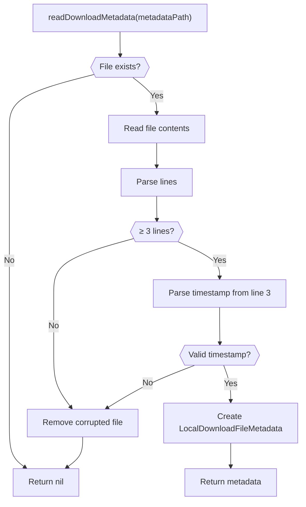

The `readDownloadMetadata` function safely reads metadata files with automatic error recovery:

1. Checks if the metadata file exists
2. Reads and parses the three-line format
3. Validates the format and content
4. On validation failure, removes the corrupted file and returns `nil`
5. On success, returns a `LocalDownloadFileMetadata` instance

**Sources:** [Sources/Hub/HubApi.swift:358-400]()

**Writing Metadata: writeDownloadMetadata**

The `writeDownloadMetadata` function persists metadata to disk:

```swift
// Format: commitHash\netag\ntimestamp\n
let metadataContent = "\(commitHash)\n\(etag)\n\(Date().timeIntervalSince1970)\n"
```

The function ensures the parent directory exists before writing and uses atomic file operations to prevent partial writes.

**Sources:** [Sources/Hub/HubApi.swift:440-448]()

## File Integrity Verification

The system uses different verification strategies depending on file type and availability.

**Hash Computation: computeFileHash**

For large files (LFS files), the system computes SHA256 hashes in memory-efficient chunks:

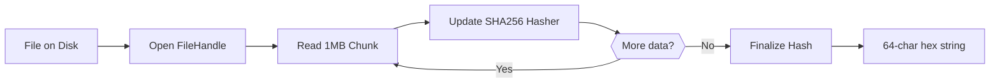

The hash computation uses a 1MB chunk size to minimize memory usage while processing large model files.

**Sources:** [Sources/Hub/HubApi.swift:408-437]()

**Hash Validation Patterns**

The system uses regex patterns to identify different hash types:

| Pattern | Regex | Usage |
|---------|-------|-------|
| `sha256Pattern` | `^[0-9a-f]{64}$` | Identifies LFS file ETags (SHA256 hashes) |
| `commitHashPattern` | `^[0-9a-f]{40}$` | Validates git commit hashes |

**Sources:** [Sources/Hub/HubApi.swift:121-122](), [Sources/Hub/HubApi.swift:402-406]()

**Integrity Verification Strategy**

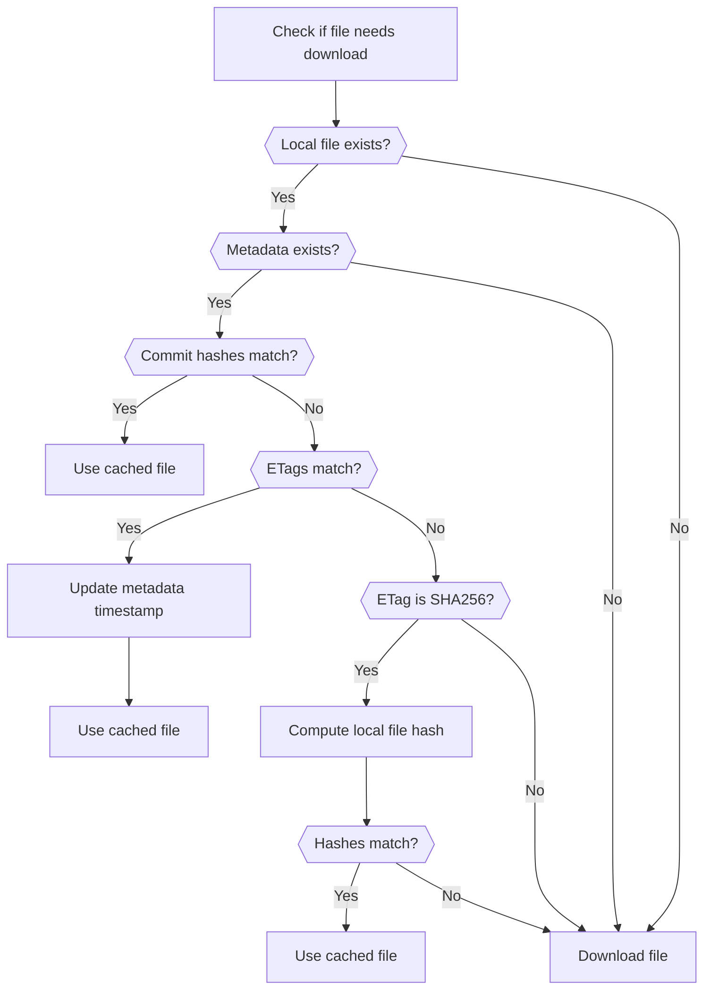

**Sources:** [Sources/Hub/HubApi.swift:499-572]()

The verification logic follows a cascade of checks:

1. **Commit Hash Validation**: If local and remote commit hashes match and are valid, the cached file is used immediately
2. **ETag Validation**: If commit hashes don't match but ETags match, metadata is updated and the cached file is used
3. **LFS Hash Verification**: For LFS files (identified by 64-character SHA256 ETags), the local file hash is computed and compared to the remote ETag
4. **Download**: If none of the above checks pass, the file is downloaded

## Cache Validation Flow

The `HubFileDownloader.download` method implements the complete cache validation and download logic.

**Decision Tree for File Downloads**

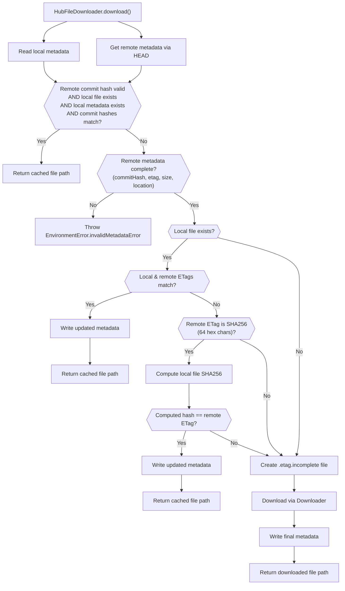

**Sources:** [Sources/Hub/HubApi.swift:499-572]()

This flow ensures that:
- Files are only downloaded when necessary
- Metadata is always kept up-to-date
- Large files (LFS) have their integrity verified via SHA256
- Incomplete downloads can be resumed

## Offline Mode

Offline mode allows the system to operate without network connectivity by validating cached files against their stored metadata.

**Offline Mode Validation Flow**

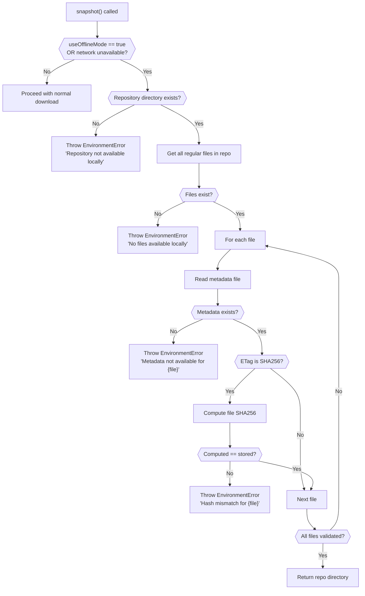

**Sources:** [Sources/Hub/HubApi.swift:586-623]()

**Network Monitoring**

The system uses a `NetworkMonitor` to automatically detect network availability:

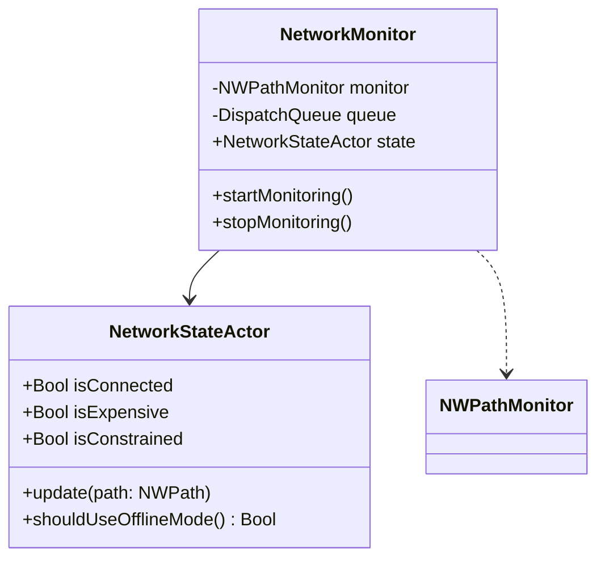

The `NetworkMonitor` is a singleton that continuously monitors network connectivity using Apple's Network framework. When `useOfflineMode` is not explicitly set, the system automatically enters offline mode when `isConnected` is false.

**Sources:** [Sources/Hub/HubApi.swift:818-872](), [Sources/Hub/HubApi.swift:586-587]()

**Offline Mode Requirements**

For offline mode to succeed, all of the following must be true:

1. Repository directory exists locally
2. At least one file exists in the repository
3. Each file has a corresponding `.metadata` file
4. For LFS files (identified by SHA256 ETags), the computed file hash must match the stored ETag

**Sources:** [Sources/Hub/HubApi.swift:586-623]()

## Error Handling

The system defines specific error types for cache and metadata operations.

**EnvironmentError Types**

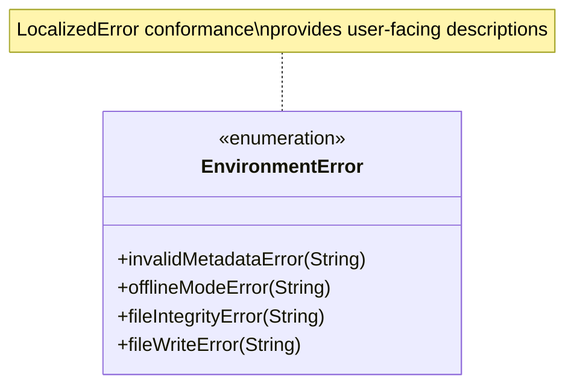

**Sources:** [Sources/Hub/HubApi.swift:289-308]()

| Error Case | When Thrown | Recovery Strategy |
|------------|-------------|-------------------|
| `invalidMetadataError` | Metadata file is corrupted or cannot be parsed | Automatic removal of corrupted metadata; file will be re-validated or re-downloaded |
| `offlineModeError` | Required files or metadata missing in offline mode | User must reconnect to network or pre-download required files |
| `fileIntegrityError` | SHA256 hash mismatch for LFS files in offline mode | File must be re-downloaded when network is available |
| `fileWriteError` | Cannot write metadata to disk | Check file system permissions and available disk space |

**Corrupted Metadata Handling**

The `readDownloadMetadata` function implements automatic recovery:

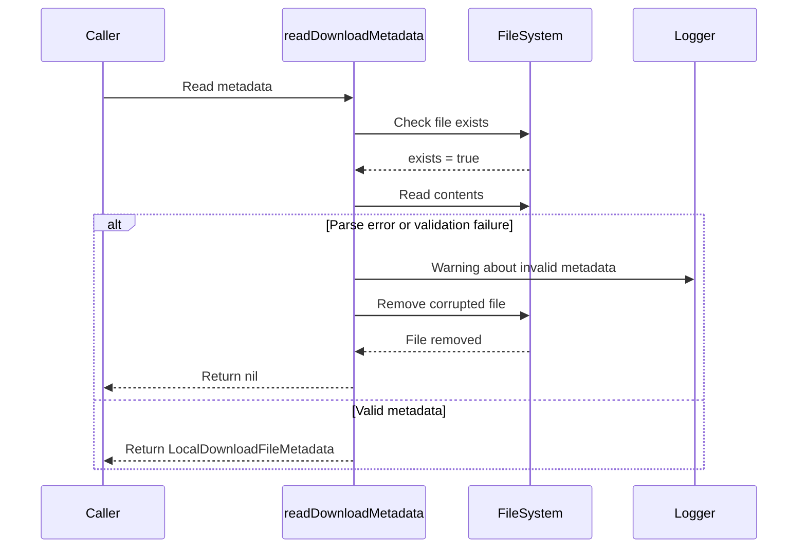

**Sources:** [Sources/Hub/HubApi.swift:358-400]()

When metadata is corrupted:
1. A warning is logged with details about the corruption
2. The corrupted file is removed from disk
3. `nil` is returned, causing the system to treat the file as if no metadata exists
4. The next validation attempt will recompute or re-download as necessary

This automatic recovery ensures that temporary file corruption doesn't permanently break the cache system.

**Sources:** [Sources/Hub/HubApi.swift:379-395]()

## Cache Behavior Summary

The following table summarizes when cached files are reused versus re-downloaded:

| Local File | Local Metadata | Commit Match | ETag Match | LFS Hash Match | Result |
|------------|----------------|--------------|------------|----------------|--------|
| ✓ | ✓ | ✓ | - | - | Use cache |
| ✓ | ✓ | ✗ | ✓ | - | Update metadata, use cache |
| ✓ | ✓ | ✗ | ✗ | ✓ (LFS only) | Update metadata, use cache |
| ✓ | ✓ | ✗ | ✗ | ✗ or N/A | Re-download |
| ✓ | ✗ | - | - | ✗ or N/A | Re-download (non-LFS) |
| ✓ | ✗ | - | - | ✓ (LFS only) | Write metadata, use cache |
| ✗ | - | - | - | - | Download |

**Sources:** [Sources/Hub/HubApi.swift:499-572]()

This tiered validation approach ensures:
- **Performance**: Files are reused when safe
- **Correctness**: Integrity is verified before use
- **Efficiency**: Large files avoid re-download via hash verification
- **Robustness**: Corrupted or missing metadata triggers re-validation

---

