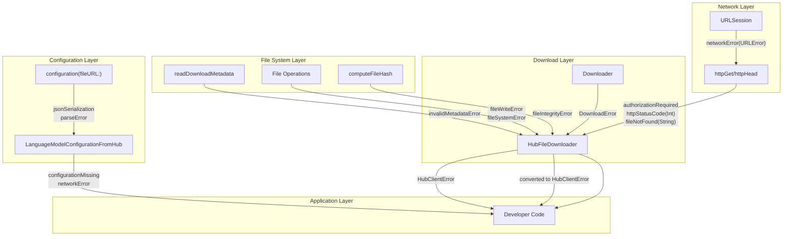
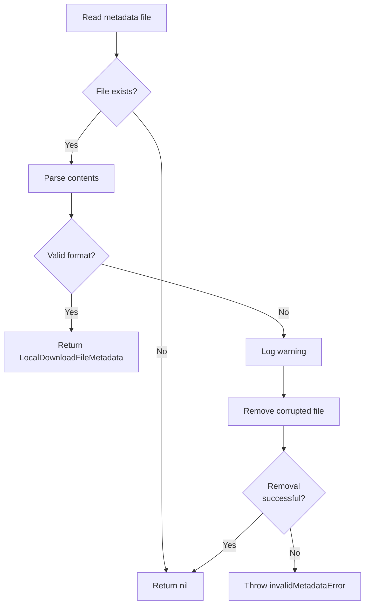
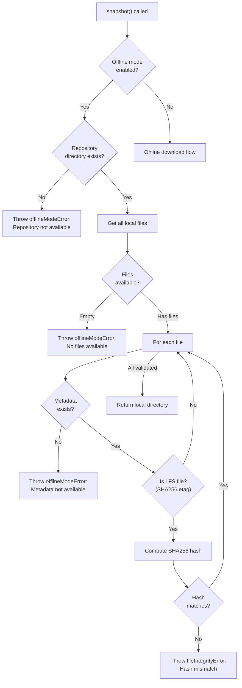
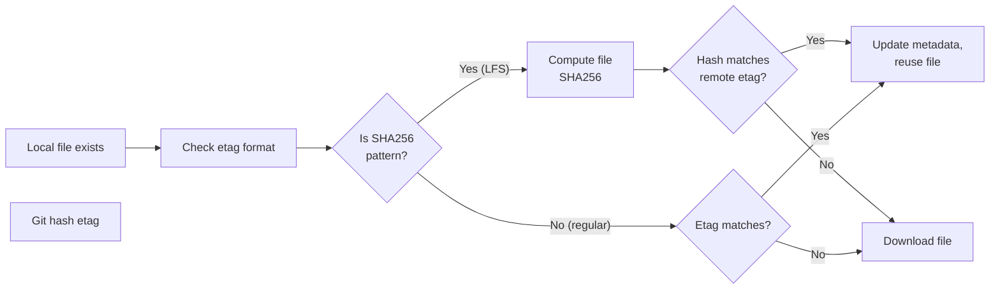
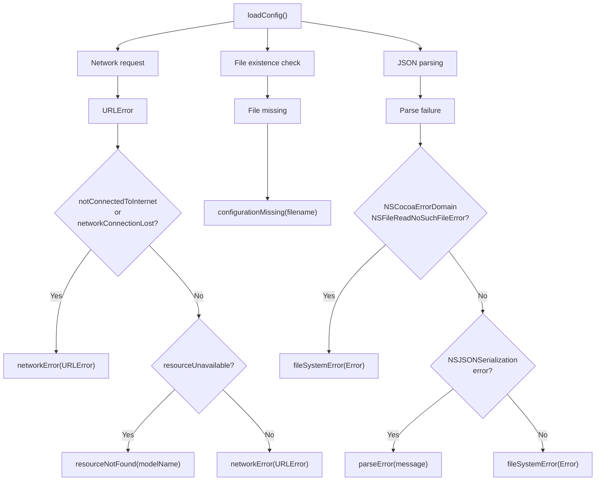

<!-- source: DeepWiki mcp.deepwiki.com · repo huggingface/swift-transformers · page 3.5 Error Handling · fetched 2026-10-26 -->

# Error Handling

<details>
<summary>Relevant source files</summary>

The following files were used as context for generating this wiki page:

- [Sources/Hub/Hub.swift](Sources/Hub/Hub.swift)
- [Sources/Hub/HubApi.swift](Sources/Hub/HubApi.swift)
- [Tests/HubTests/HubApiTests.swift](Tests/HubTests/HubApiTests.swift)

</details>


This page documents the error handling system in swift-transformers, focusing on error types, propagation patterns, and recovery strategies. It covers the Hub module's `HubClientError` and `EnvironmentError` enumerations, how errors are raised during network operations, file system access, and configuration loading, and the mechanisms for graceful error recovery.

For information about network retry mechanisms and download resumption, see [Downloader](#3.2).

## Error Type Hierarchy

The library defines two primary error enumerations for the Hub module, both conforming to Swift's `LocalizedError` protocol to provide user-friendly error messages.

### HubClientError

`HubClientError` represents errors that occur during interactions with the Hugging Face Hub API and related operations. Defined in [Sources/Hub/Hub.swift:23-77](), this enumeration covers:

| Error Case | Description | Associated Data |
|------------|-------------|-----------------|
| `authorizationRequired` | Authentication token is missing or invalid | None |
| `httpStatusCode(Int)` | HTTP request returned an error status code | Status code |
| `parse` | Failed to parse server response | None |
| `jsonSerialization(fileURL:message:)` | JSON parsing failed for a configuration file | File URL and error message |
| `unexpectedError` | An unexpected internal error occurred | None |
| `downloadError(String)` | Download operation failed | Error description |
| `fileNotFound(String)` | Requested file does not exist | Filename |
| `networkError(URLError)` | Network connectivity or transfer error | URLError details |
| `resourceNotFound(String)` | Requested repository or resource unavailable | Resource identifier |
| `configurationMissing(String)` | Required configuration file is missing | Filename |
| `fileSystemError(Error)` | File system operation failed | Underlying error |
| `parseError(String)` | Generic parsing error | Error description |

### EnvironmentError

`EnvironmentError` represents errors related to the local file system state and offline operation. Defined in [Sources/Hub/HubApi.swift:289-308](), it includes:

| Error Case | Description | Associated Data |
|------------|-------------|-----------------|
| `invalidMetadataError(String)` | Metadata file is corrupted or invalid | Error description |
| `offlineModeError(String)` | Required resources unavailable in offline mode | Error description |
| `fileIntegrityError(String)` | Downloaded file failed integrity check | Error description |
| `fileWriteError(String)` | Failed to write file or metadata to disk | Error description |

Sources: [Sources/Hub/Hub.swift:23-77](), [Sources/Hub/HubApi.swift:289-308]()

## Error Propagation Flow

The following diagram illustrates how errors flow through the system from their origin points to application code:



Sources: [Sources/Hub/HubApi.swift:191-249](), [Sources/Hub/HubApi.swift:450-573](), [Sources/Hub/Hub.swift:219-245]()

## HTTP Error Handling

### Request-Level Error Detection

HTTP operations use consistent error handling patterns across GET and HEAD requests. The `httpGet` method [Sources/Hub/HubApi.swift:191-218]() implements status code checking:

```
Status Code Range → Error Type
200-299          → Success (return data)
401, 403         → authorizationRequired
404              → fileNotFound(filename)
Other            → httpStatusCode(code)
```

The `httpHead` method [Sources/Hub/HubApi.swift:228-249]() uses similar patterns for metadata retrieval, employing a shared `URLSession` with custom redirect handling to enforce security policies.

### Network Error Conversion

When `URLError` exceptions occur during network operations, they are caught and converted to appropriate `HubClientError` types. The conversion logic in [Sources/Hub/Hub.swift:232-240]() maps:

- `notConnectedToInternet`, `networkConnectionLost` → `networkError(URLError)`
- `resourceUnavailable` → `resourceNotFound(modelName)`
- Other URLError cases → `networkError(URLError)`

Sources: [Sources/Hub/HubApi.swift:191-218](), [Sources/Hub/HubApi.swift:228-249](), [Sources/Hub/Hub.swift:232-240]()

## Metadata Error Handling and Recovery

The metadata system includes sophisticated error recovery to handle corrupted or missing metadata gracefully.

### Metadata Reading with Auto-Recovery

The `readDownloadMetadata` method [Sources/Hub/HubApi.swift:358-400]() implements a three-tier approach:



**Validation criteria:**
- Metadata must have at least 3 lines (commit hash, etag, timestamp)
- Timestamp must be parsable as Double
- File must follow expected format

**Recovery strategy:**
- Log warning about invalid metadata
- Attempt to remove corrupted file
- If removal succeeds, return `nil` (allowing redownload)
- If removal fails, throw `invalidMetadataError`

Sources: [Sources/Hub/HubApi.swift:358-400]()

### Metadata Writing Errors

The `writeDownloadMetadata` method [Sources/Hub/HubApi.swift:440-448]() wraps all file operations in error handling, converting `Error` to `fileWriteError` with descriptive context:

```swift
// Pattern from writeDownloadMetadata
do {
    try FileManager.default.createDirectory(...)
    try metadataContent.write(...)
} catch {
    throw EnvironmentError.fileWriteError("Failed to write metadata to \(path): \(error.localizedDescription)")
}
```

Sources: [Sources/Hub/HubApi.swift:440-448]()

## Offline Mode Error Handling

Offline mode enables graceful degradation when network connectivity is unavailable, but requires comprehensive validation of local resources.

### Offline Mode Validation Flow



The offline mode implementation [Sources/Hub/HubApi.swift:586-623]() performs:

1. **Repository existence check**: Ensures the local directory exists
2. **File availability check**: Verifies at least one file is present
3. **Metadata validation**: Confirms metadata exists for each file
4. **Integrity verification**: For LFS files (identified by SHA256 etag pattern), computes and verifies file hash

Sources: [Sources/Hub/HubApi.swift:586-623](), [Tests/HubTests/HubApiTests.swift:831-952]()

## Download Error Scenarios and Recovery

The download system handles various failure scenarios with specific recovery strategies.

### File Integrity Verification

For LFS (Large File Storage) files, the system uses SHA256 hashing to verify integrity. The pattern in [Sources/Hub/HubApi.swift:507-540]() implements smart reuse:

**LFS File Download Logic:**
1. Check if local file exists
2. Check if local metadata exists with matching commit hash
3. If etag is SHA256 (pattern: `^[0-9a-f]{64}$`), compute local file hash
4. If computed hash matches etag, update metadata and reuse file (no redownload)
5. Otherwise, download file again

**Non-LFS File Logic:**
1. Check if etag matches (etag is git hash, not SHA256)
2. If match, update metadata and reuse file
3. Otherwise, redownload



Sources: [Sources/Hub/HubApi.swift:507-540](), [Sources/Hub/HubApi.swift:402-437]()

### Download Cancellation Handling

The download system properly handles task cancellation through Swift's structured concurrency. The pattern in [Sources/Hub/HubApi.swift:549-567]() uses `withTaskCancellationHandler`:

```swift
try await withTaskCancellationHandler {
    // Download operation
    let sub = await downloader.download(...)
    for await state in sub {
        switch state {
        case .failed(let error):
            throw error
        // ... other cases
        }
    }
} onCancel: {
    Task {
        await downloader.cancel()
    }
}
```

This ensures that when the task is cancelled:
1. The downloader's `cancel()` method is called
2. Incomplete download files are preserved (for resume capability)
3. The cancellation propagates up the call stack

Sources: [Sources/Hub/HubApi.swift:549-567]()

## Configuration Loading Error Handling

Configuration loading handles multiple potential failure points with appropriate error types.

### Configuration Loading Error Map



The `loadConfig` methods in [Sources/Hub/Hub.swift:219-245]() and [Sources/Hub/Hub.swift:247-316]() implement cascading error handling:

1. **Network errors**: Convert URLError to specific HubClientError types
2. **Missing files**: Required files (tokenizer.json) throw `configurationMissing`
3. **Parse errors**: JSON serialization failures throw `parseError` with context
4. **File system errors**: NSError domain/code inspection routes to appropriate error type

Sources: [Sources/Hub/Hub.swift:219-316](), [Sources/Hub/HubApi.swift:314-328]()

## Error Handling Best Practices

### Pattern: Specific Error Cases Before Generic

Throughout the codebase, error handling follows a pattern of checking specific error conditions before falling back to generic cases:

```swift
// From LanguageModelConfigurationFromHub.loadConfig
do {
    // Operation
} catch let error as Hub.HubClientError {
    throw error  // Re-throw already-typed errors
} catch {
    // Convert to specific error type based on error properties
    if let urlError = error as? URLError {
        switch urlError.code {
        case .notConnectedToInternet, .networkConnectionLost:
            throw Hub.HubClientError.networkError(urlError)
        // ... specific cases
        default:
            throw Hub.HubClientError.networkError(urlError)
        }
    } else {
        throw error  // Unknown error types propagate
    }
}
```

This pattern appears in:
- [Sources/Hub/Hub.swift:227-244]() - URL error conversion
- [Sources/Hub/Hub.swift:305-316]() - File system error classification  
- [Sources/Hub/HubApi.swift:213-217]() - HTTP error wrapping

### Pattern: Logging Before Recovery

When automatic error recovery is performed, the system logs warnings to aid debugging:

```swift
// From readDownloadMetadata
catch let error as EnvironmentError {
    do {
        HubApi.logger.warning("Invalid metadata file \(metadataPath): \(error.localizedDescription). Removing it from disk and continuing.")
        try FileManager.default.removeItem(at: metadataPath)
    } catch {
        throw EnvironmentError.invalidMetadataError("Could not remove corrupted metadata file: \(error.localizedDescription)")
    }
    return nil
}
```

This pattern [Sources/Hub/HubApi.swift:379-386]() ensures that:
- Problems are visible in logs for diagnosis
- Recovery attempts are documented
- Failures during recovery are escalated with full context

### Pattern: Test Coverage for Error Paths

The test suite extensively validates error handling behavior:

| Test Category | Example Test | Validates |
|---------------|-------------|-----------|
| Offline mode errors | `testOfflineModeThrowsError` | Repository unavailability |
| Metadata corruption | `testDownloadFileMetadataCorrupted` | Automatic removal and redownload |
| File integrity | `testDownloadLargeFileMetadataCorrupted` | SHA256 verification |
| Missing metadata | `testOfflineModeWithoutMetadata` | Metadata requirement in offline mode |
| No files available | `testOfflineModeWithNoFiles` | Empty repository detection |
| Network errors | `testDownloadWithRevision` | Invalid revision handling |

Sources: [Tests/HubTests/HubApiTests.swift:859-987](), [Tests/HubTests/HubApiTests.swift:443-518](), [Tests/HubTests/HubApiTests.swift:520-579]()

## Error Recovery Strategies Summary

The following table summarizes recovery strategies for each error type:

| Error Type | Recovery Strategy | User Action Required |
|------------|-------------------|---------------------|
| `authorizationRequired` | None - requires token | Provide HF_TOKEN environment variable |
| `httpStatusCode(401/403)` | None - authentication failure | Check token validity |
| `httpStatusCode(404)` | None - resource missing | Verify model/file name |
| `httpStatusCode(other)` | Retry with exponential backoff | Wait and retry |
| `networkError` | Automatic retry (in Downloader) | Check network connectivity |
| `invalidMetadataError` | Automatic removal, redownload | None (automatic) |
| `offlineModeError` | Switch to online mode | Enable network access |
| `fileIntegrityError` | Automatic redownload | None (automatic) |
| `configurationMissing` | None - file required | Ensure complete model download |
| `fileWriteError` | None - disk issue | Check disk space/permissions |
| `downloadError` | Resume from partial download | None (automatic resume) |

Sources: [Sources/Hub/HubApi.swift:289-308](), [Sources/Hub/Hub.swift:23-77](), [Sources/Hub/HubApi.swift:358-400]()

---

