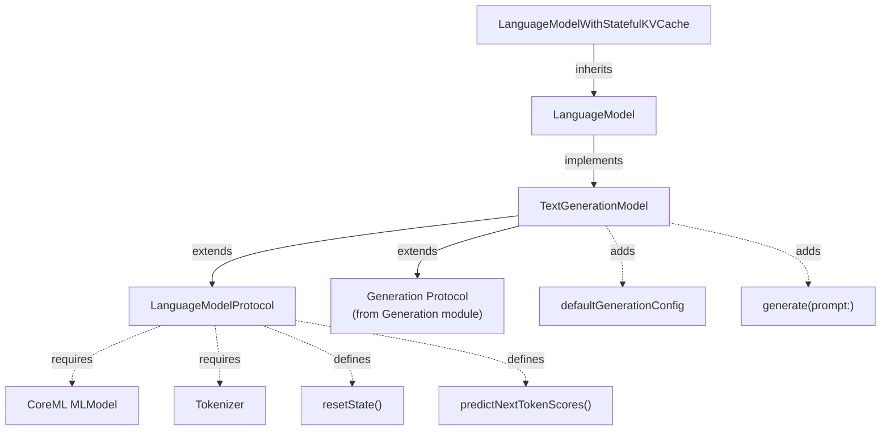
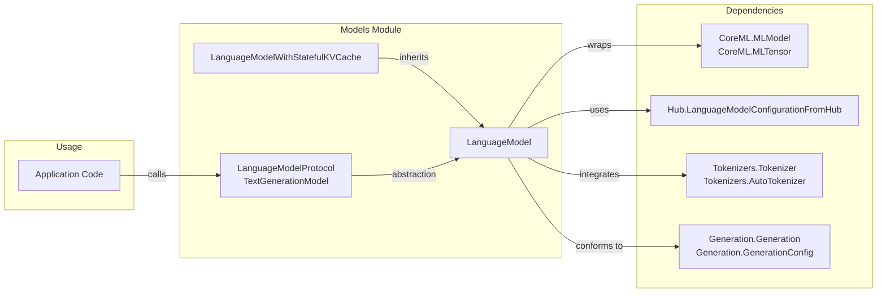
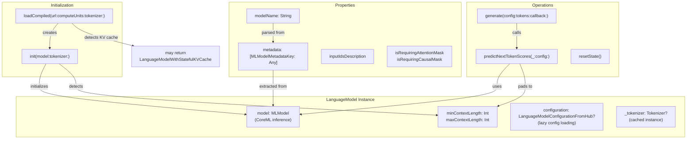
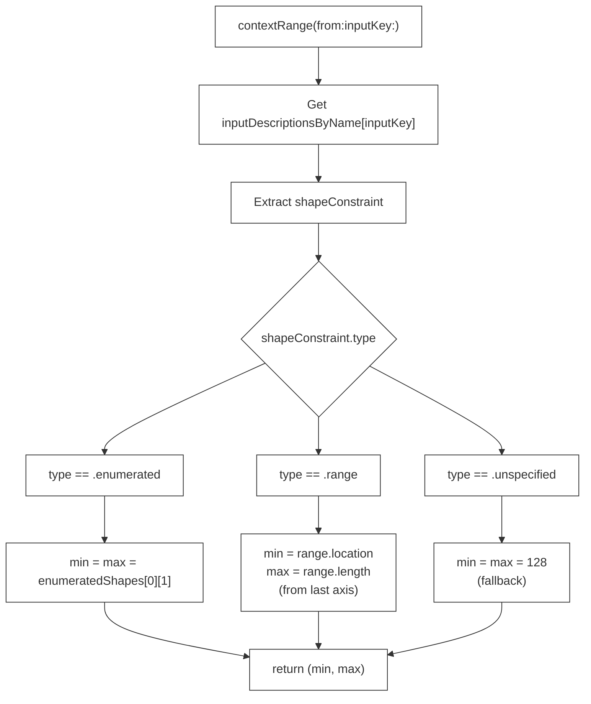
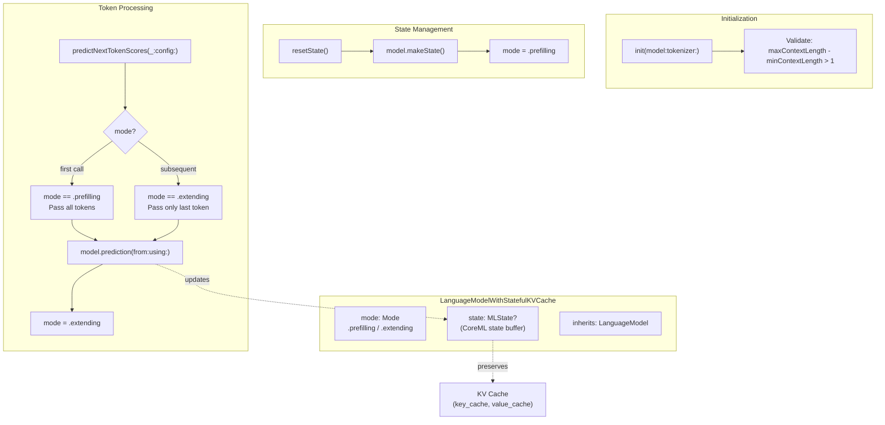
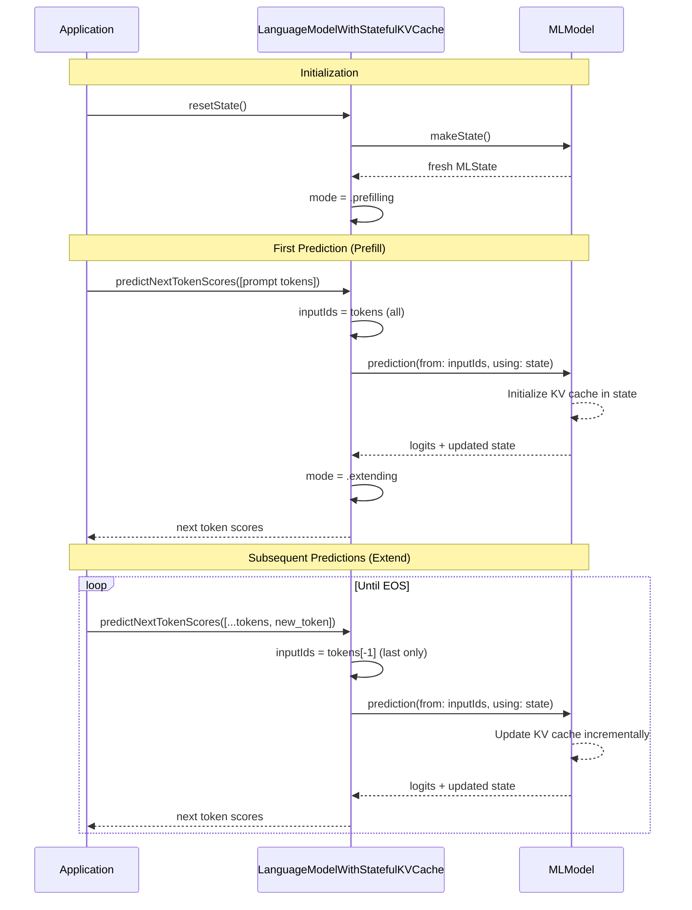
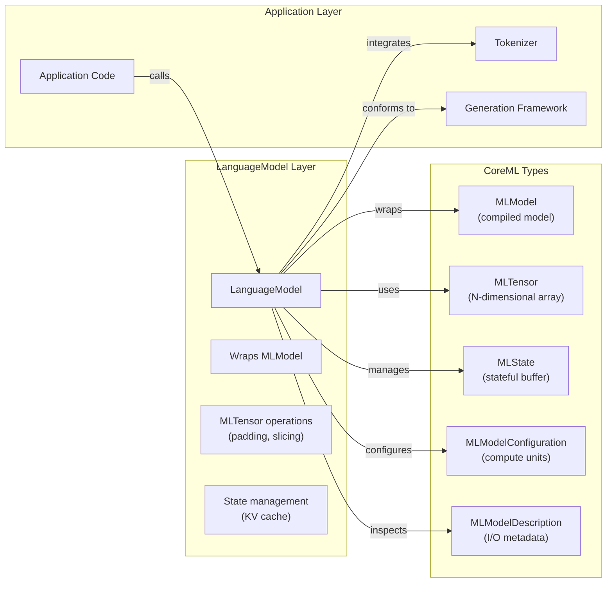
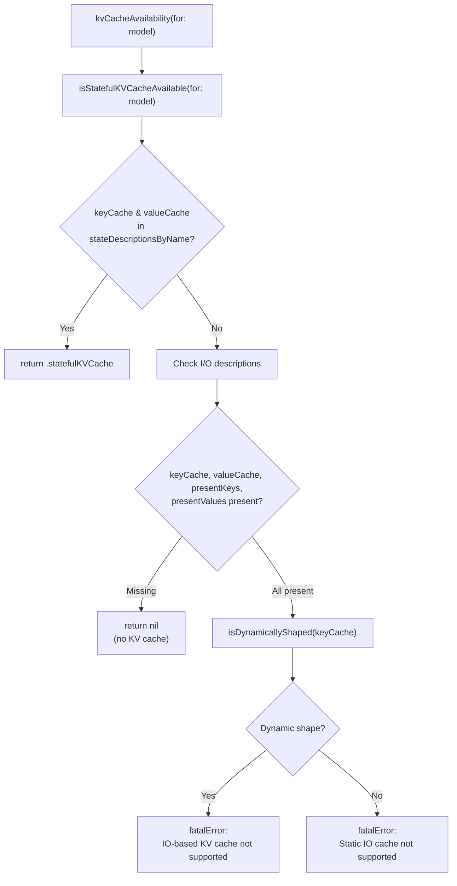
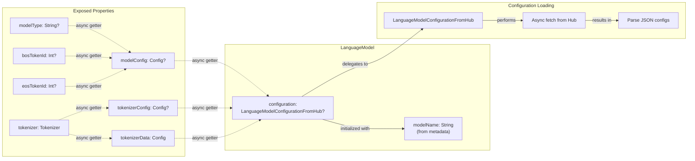

<!-- source: DeepWiki mcp.deepwiki.com · repo huggingface/swift-transformers · page 4 Models · fetched 2026-10-26 -->

# Models

<details>
<summary>Relevant source files</summary>

The following files were used as context for generating this wiki page:

- [LICENSE](LICENSE)
- [README.md](README.md)
- [Sources/Models/LanguageModel.swift](Sources/Models/LanguageModel.swift)
- [Sources/Models/LanguageModelTypes.swift](Sources/Models/LanguageModelTypes.swift)
- [Tests/TokenizersTests/Resources/tokenizer.json](Tests/TokenizersTests/Resources/tokenizer.json)
- [Tests/TokenizersTests/Resources/tokenizer_config.json](Tests/TokenizersTests/Resources/tokenizer_config.json)
- [media/swift-t-banner.png](media/swift-t-banner.png)

</details>


The Models module provides a high-level Swift interface for language model inference using Apple's CoreML framework. It wraps CoreML models in protocol-based abstractions that integrate seamlessly with the Tokenizers and Generation modules to enable text generation workflows. This module handles model loading, input/output tensor processing, context length management, and KV cache optimization.

For information about tokenization before model inference, see [Tokenizers](#2). For text generation strategies and configuration, see [Generation](#5). For downloading and managing model files, see [Hub](#3).

**Sources:** [Sources/Models/LanguageModel.swift:1-582](), [Sources/Models/LanguageModelTypes.swift:1-120]()

---

## Architecture Overview

The Models module is organized around a protocol-based architecture that separates the core inference interface from implementation details. This design enables multiple model variants (standard and KV-cache-optimized) to share a common API while optimizing for different inference patterns.

### Protocol Hierarchy



**Sources:** [Sources/Models/LanguageModelTypes.swift:14-120](), [Sources/Models/LanguageModel.swift:21-87]()

### Module Position in System



The Models module sits between CoreML and application code, providing a unified interface that coordinates tokenization, model inference, and generation strategies.

**Sources:** [Sources/Models/LanguageModel.swift:8-13](), [Sources/Models/LanguageModelTypes.swift:8-12]()

---

## Core Protocols

### LanguageModelProtocol

`LanguageModelProtocol` defines the fundamental interface that all language model implementations must provide. It establishes the contract for model initialization, state management, and token prediction.

| Property/Method | Type | Purpose |
|----------------|------|---------|
| `modelName` | `String` | Model identifier from Hub or file path |
| `tokenizer` | `Tokenizer` (async) | Associated tokenizer, lazily loaded |
| `model` | `MLModel` | Underlying CoreML model instance |
| `resetState()` | `async func` | Clears model state for new sequence |
| `init(model:)` | `required init` | Creates instance from CoreML model |
| `predictNextTokenScores(_:config:)` | `async func` | Returns logits for next token |
| `callAsFunction(_:config:)` | `async func` | Syntactic sugar for prediction |

The protocol is defined in [Sources/Models/LanguageModelTypes.swift:18-51]() and provides a callable function syntax via [Sources/Models/LanguageModelTypes.swift:63-65]().

**Sources:** [Sources/Models/LanguageModelTypes.swift:14-66]()

### TextGenerationModel

`TextGenerationModel` extends `LanguageModelProtocol` and `Generation` to provide end-to-end text generation from string prompts. It adds:

- `defaultGenerationConfig`: Model-specific generation defaults
- `generate(config:prompt:callback:)`: High-level text generation method

The default implementation [Sources/Models/LanguageModelTypes.swift:106-118]() handles the full pipeline:

1. Reset model state with `resetState()`
2. Load tokenizer asynchronously
3. Invoke generation framework with model and tokenizer
4. Return generated text

**Sources:** [Sources/Models/LanguageModelTypes.swift:72-119]()

---

## LanguageModel Class

The `LanguageModel` class is the primary implementation of `TextGenerationModel`. It wraps a CoreML `MLModel` and provides all necessary infrastructure for text generation.

### Core Components



**Sources:** [Sources/Models/LanguageModel.swift:21-87]()

### Initialization and Loading

The class provides two initialization paths:

**Direct Initialization** [Sources/Models/LanguageModel.swift:40-52]():
- Takes a `MLModel` instance and optional tokenizer
- Extracts context length range from model's input shape constraints
- Sets up lazy configuration loading if tokenizer not provided

**Static Factory Method** [Sources/Models/LanguageModel.swift:162-182]():
```swift
static func loadCompiled(
    url: URL,
    computeUnits: MLComputeUnits = .cpuAndGPU,
    tokenizer: Tokenizer? = nil
) throws -> LanguageModel
```

This method:
1. Creates `MLModelConfiguration` with specified compute units
2. Loads the compiled `.mlmodelc` model from disk
3. Detects KV cache availability using `kvCacheAvailability(for:)` [Sources/Models/LanguageModel.swift:269-320]()
4. Returns `LanguageModelWithStatefulKVCache` if stateful KV cache detected, otherwise standard `LanguageModel`

**Sources:** [Sources/Models/LanguageModel.swift:40-56](), [Sources/Models/LanguageModel.swift:162-182]()

### Context Length Detection

The system automatically detects supported context lengths from CoreML model metadata:



The implementation is in [Sources/Models/LanguageModel.swift:95-123](). It handles three constraint types:
- **Enumerated**: Fixed shape, extracts single length value
- **Range**: Variable shape, extracts min/max from dimension range
- **Unspecified**: Defaults to 128 tokens

**Sources:** [Sources/Models/LanguageModel.swift:90-124]()

### Token Prediction

The core inference method `predictNextTokenScores(_:config:)` [Sources/Models/LanguageModel.swift:60-86]() implements the standard (non-KV-cached) prediction flow:

| Step | Implementation | Purpose |
|------|---------------|---------|
| 1. Validate input | `assert(tokens.rank == 2)` | Ensure batch × sequence tensor |
| 2. Calculate padding | `padLength = maxContextLength - tokenCount` | Pad to max context |
| 3. Create padding | `MLTensor(repeating: padTokenId, shape:)` | Right-pad with pad token |
| 4. Concatenate | `MLTensor(concatenating: [tokens, padding])` | Create full-length input |
| 5. Build inputs | `inputDictionary[inputIdsName] = inputIDs` | Add input_ids |
| 6. Add attention mask | Optional based on `isRequiringAttentionMask` | 1s for tokens, 0s for padding |
| 7. Run inference | `model.prediction(from: inputDictionary)` | CoreML execution |
| 8. Extract logits | `outputs[Keys.logits]` | Get output tensor |
| 9. Slice last token | `scores[nil, tokenIndex, nil]` | Extract next-token scores |
| 10. Expand dims | `expandingShape(at: 0)` | Maintain batch dimension |

The method ensures the model always receives fixed-size inputs by padding to `maxContextLength`, which is required for CoreML models with fixed input shapes.

**Sources:** [Sources/Models/LanguageModel.swift:60-86]()

### Model Metadata Access

The class exposes CoreML model metadata through computed properties:

```swift
// From MLModel.modelDescription.metadata
var metadata: [MLModelMetadataKey: Any]           // Line 200-202
var modelDescription: MLModelDescription          // Line 207-209
var description: String                           // Line 214-221

// Parsed from metadata
var modelName: String                             // Line 227-238
  // Tries "co.huggingface.exporters.name" first
  // Falls back to modelDisplayName

// Input shape information
var inputIdsDescription: MLFeatureDescription     // Line 241-243
var inputIdsName: String                          // Line 246-248
var inputIdsShape: [Int]                          // Line 251-253

// Model capabilities
var isRequiringAttentionMask: Bool                // Line 256-258
var isRequiringCausalMask: Bool                   // Line 261-263
```

These properties allow inspection of model characteristics without directly accessing the CoreML API.

**Sources:** [Sources/Models/LanguageModel.swift:198-263]()

### Configuration Properties

The class provides asynchronous access to Hub-downloaded configurations through `LanguageModelConfigurationFromHub`:

| Property | Return Type | Source File | Purpose |
|----------|-------------|-------------|---------|
| `modelConfig` | `Config?` | config.json | Model architecture parameters |
| `tokenizerConfig` | `Config?` | tokenizer_config.json | Tokenizer settings |
| `tokenizerData` | `Config` | tokenizer.json | Vocabulary and merges |
| `modelType` | `String?` | config.json | Architecture identifier (e.g., "llama", "gpt2") |
| `textGenerationParameters` | `Config?` | config.json | Generation-specific params |
| `defaultDoSample` | `Bool` | config.json | Default sampling behavior |
| `bosTokenId` | `Int?` | config.json | Beginning-of-sequence token |
| `eosTokenId` | `Int?` | config.json | End-of-sequence token |
| `tokenizer` | `Tokenizer` | Combined configs | Lazily loaded tokenizer instance |

These properties are implemented as async getters [Sources/Models/LanguageModel.swift:332-432]() that fetch configurations from the Hub on first access, then cache the results.

**Sources:** [Sources/Models/LanguageModel.swift:326-433]()

### Generation Integration

`LanguageModel` conforms to `TextGenerationModel` [Sources/Models/LanguageModel.swift:438-453]() by implementing:

- `defaultGenerationConfig`: Provides model-specific defaults, with special handling for GPT models (enables sampling with top-k=50)
- `generate(config:tokens:callback:)`: Delegates to the Generation module's framework using `callAsFunction` as the prediction function

The generate method [Sources/Models/LanguageModel.swift:466-477]() is a thin wrapper that connects the model to the generation loop.

**Sources:** [Sources/Models/LanguageModel.swift:435-478]()

---

## Stateful KV Cache Optimization

`LanguageModelWithStatefulKVCache` [Sources/Models/LanguageModel.swift:485-563]() is a specialized subclass that leverages CoreML's stateful execution to dramatically reduce latency during sequential token generation.

### Architecture



**Sources:** [Sources/Models/LanguageModel.swift:485-563]()

### Prefill vs Extend Modes

The class operates in two distinct modes:

**Prefilling Mode** (initial prompt):
- Processes the entire prompt token sequence
- Initializes KV cache state
- Transitions to extending mode after first prediction
- Implementation: passes full `tokens` tensor [Sources/Models/LanguageModel.swift:526]()

**Extending Mode** (subsequent tokens):
- Processes only the last generated token
- Reuses cached key/value states from previous tokens
- Significantly faster than reprocessing entire sequence
- Implementation: extracts last token with `tokens[nil, -1]` [Sources/Models/LanguageModel.swift:527]()

The mode switch occurs automatically on the first prediction call [Sources/Models/LanguageModel.swift:529]().

**Sources:** [Sources/Models/LanguageModel.swift:486-529]()

### State Lifecycle



The `state` is preserved across predictions and updated in-place by CoreML, eliminating redundant computation.

**Sources:** [Sources/Models/LanguageModel.swift:492-509](), [Sources/Models/LanguageModel.swift:511-562]()

### Attention Mask Handling

When the model requires attention masks, the class creates zero-filled tensors of appropriate shape:

```swift
// Attention mask for models expecting it
let attentionMask = MLTensor(zeros: [1, 1, 1, tokenCount + 1], scalarType: Float16.self)
inputDictionary[Keys.attentionMask] = attentionMask

// Causal mask for decoder-only models
let causalMask = MLTensor(zeros: [1, 1, 1, tokenCount + 1], scalarType: Float16.self)
inputDictionary[Keys.causalMask] = causalMask
```

Note: These implementations are conditionally compiled, excluding x86_64 macOS [Sources/Models/LanguageModel.swift:535-550]().

**Sources:** [Sources/Models/LanguageModel.swift:534-551]()

### Automatic Selection

The `loadCompiled(url:computeUnits:tokenizer:)` factory method automatically detects KV cache capability and instantiates the appropriate class:

```swift
return switch kvCacheAvailability(for: model) {
case .statefulKVCache:
    LanguageModelWithStatefulKVCache(model: model, tokenizer: tokenizer)
default:
    LanguageModel(model: model, tokenizer: tokenizer)
}
```

Detection logic checks for `keyCache` and `valueCache` in the model's state descriptions [Sources/Models/LanguageModel.swift:270-276]().

**Sources:** [Sources/Models/LanguageModel.swift:170-181](), [Sources/Models/LanguageModel.swift:269-320]()

---

## CoreML Integration Details

### MLModel Wrapping

The integration with CoreML is centered around wrapping `MLModel` instances with higher-level abstractions:



**Sources:** [Sources/Models/LanguageModel.swift:8-13](), [Sources/Models/LanguageModel.swift:22-33]()

### Input/Output Key Mapping

The system defines standard key names for model inputs and outputs:

```swift
enum Keys {
    // Input keys
    static let inputIds = "inputIds"
    static let attentionMask = "attentionMask"
    static let causalMask = "causalMask"
    static let keyCache = "keyCache"
    static let valueCache = "valueCache"
    
    // Output keys
    static let logits = "logits"
    static let presentKeys = "presentKeys"
    static let presentValues = "presentValues"
}
```

These keys [Sources/Models/LanguageModel.swift:137-149]() map to the corresponding inputs/outputs in the CoreML model's interface.

**Sources:** [Sources/Models/LanguageModel.swift:136-150]()

### Tensor Operations

The code uses `MLTensor` extensively for tensor manipulation:

| Operation | Usage | Purpose |
|-----------|-------|---------|
| `MLTensor(repeating:shape:)` | [LanguageModel.swift:67]() | Create padding tokens |
| `MLTensor(concatenating:alongAxis:)` | [LanguageModel.swift:68]() | Append padding to inputs |
| `MLTensor(shape:scalars:)` | [LanguageModel.swift:72]() | Create attention masks from arrays |
| `MLTensor(zeros:scalarType:)` | [LanguageModel.swift:537]() | Zero-filled attention masks |
| `tensor[nil, index, nil]` | [LanguageModel.swift:82]() | Slice specific token position |
| `tensor.expandingShape(at:)` | [LanguageModel.swift:82]() | Add batch dimension |
| `tensor.rank` | [LanguageModel.swift:64]() | Get tensor dimensionality |
| `tensor.shape` | [LanguageModel.swift:65]() | Get dimension sizes |

These operations build the input dictionaries required by CoreML's prediction API.

**Sources:** [Sources/Models/LanguageModel.swift:60-86](), [Sources/Models/LanguageModel.swift:511-562]()

### Compute Unit Selection

The `loadCompiled` method accepts a `computeUnits` parameter [Sources/Models/LanguageModel.swift:164]() that controls where CoreML executes the model:

```swift
let config = MLModelConfiguration()
config.computeUnits = computeUnits  // .cpuAndGPU (default), .cpuOnly, .all
let model = try MLModel(contentsOf: url, configuration: config)
```

This allows applications to optimize for power efficiency (.cpuOnly), performance (.all including Neural Engine), or balanced execution (.cpuAndGPU).

**Sources:** [Sources/Models/LanguageModel.swift:167-169]()

### KV Cache Detection Logic

The `kvCacheAvailability(for:)` method [Sources/Models/LanguageModel.swift:269-320]() implements sophisticated detection:



Currently, only stateful KV cache is supported. IO-based KV cache triggers an error directing users to file a feature request.

**Sources:** [Sources/Models/LanguageModel.swift:186-320]()

---

## Configuration Management

### LanguageModelConfigurationFromHub Integration

The `LanguageModel` class integrates with `LanguageModelConfigurationFromHub` [Sources/Models/LanguageModel.swift:31]() to lazy-load configurations from the Hugging Face Hub:



**Sources:** [Sources/Models/LanguageModel.swift:31-32](), [Sources/Models/LanguageModel.swift:326-433]()

### Configuration Property Access Pattern

All configuration properties follow the same pattern:

1. Check if `configuration` is nil (happens when tokenizer was pre-supplied)
2. If not nil, await the async fetch from Hub
3. Parse and return the requested field
4. Cache the result for subsequent accesses

Example implementation [Sources/Models/LanguageModel.swift:332-336]():
```swift
var modelConfig: Config? {
    get async throws {
        guard let configuration else { return nil }
        return try await configuration.modelConfig
    }
}
```

This pattern ensures configurations are only downloaded when needed and only once per model instance.

**Sources:** [Sources/Models/LanguageModel.swift:328-432]()

### Tokenizer Lazy Loading

The `tokenizer` property [Sources/Models/LanguageModel.swift:422-432]() implements a caching pattern:

1. Return cached `_tokenizer` if available
2. Otherwise, fetch `tokenizerConfig` and `tokenizerData` from Hub
3. Construct tokenizer via `AutoTokenizer.from(tokenizerConfig:tokenizerData:)`
4. Cache in `_tokenizer` and return

This allows offline operation when tokenizer is pre-supplied via `init(model:tokenizer:)`, or automatic loading when needed.

**Sources:** [Sources/Models/LanguageModel.swift:32](), [Sources/Models/LanguageModel.swift:422-432]()

### Model Metadata Parsing

The `modelName` property [Sources/Models/LanguageModel.swift:227-238]() extracts the model identifier using a priority chain:

1. Check `metadata["creatorDefinedKey"]["co.huggingface.exporters.name"]` (Hugging Face export metadata)
2. Fall back to `model.configuration.modelDisplayName` (CoreML model name)
3. Fatal error if neither is available

This ensures consistent model identification for Hub lookups even when models are compiled locally.

**Sources:** [Sources/Models/LanguageModel.swift:199-238]()

---

## Error Handling

### TokenizerError

The module defines two tokenizer-related errors [Sources/Models/LanguageModel.swift:566-580]():

| Case | Description | When Thrown |
|------|-------------|-------------|
| `.tokenizerConfigNotFound` | Tokenizer configuration file missing | When accessing `tokenizer` property and config cannot be loaded |
| `.missingConfig` | LanguageModelConfigurationFromHub not initialized | When accessing `tokenizerData` without configuration object |

Both errors implement `LocalizedError` for user-facing error messages.

**Sources:** [Sources/Models/LanguageModel.swift:565-580]()

### Fatal Errors

The system uses fatal errors for programmer mistakes or unsupported model configurations:

- **Invalid shape constraints**: [LanguageModel.swift:99]() - Model lacks required shape information
- **Stateful KV cache validation**: [LanguageModel.swift:273-275]() - Inconsistent KV cache state configuration
- **IO-based KV cache**: [LanguageModel.swift:308-318]() - Attempting to use unsupported IO-based cache
- **Uninitialized state**: [LanguageModel.swift:518-522]() - Calling predict before resetState
- **Missing model name**: [LanguageModel.swift:235]() - Model lacks identifying metadata
- **Flexible shapes required**: [LanguageModel.swift:502]() - Stateful KV cache needs variable sequence length

These are unrecoverable conditions that indicate incorrect model export or API usage.

**Sources:** [Sources/Models/LanguageModel.swift:99](), [Sources/Models/LanguageModel.swift:273-275](), [Sources/Models/LanguageModel.swift:308-318](), [Sources/Models/LanguageModel.swift:518-522]()

---

## Usage Patterns

### Basic Model Loading and Generation

```swift
// Load compiled model
let modelURL = URL(fileURLWithPath: "/path/to/model.mlmodelc")
let model = try LanguageModel.loadCompiled(
    url: modelURL,
    computeUnits: .cpuAndGPU
)

// Generate text
let config = model.defaultGenerationConfig
let output = try await model.generate(
    config: config,
    prompt: "Translate to French: Hello",
    callback: { partial in
        print(partial, terminator: "")
    }
)
```

### Offline Model with Bundled Tokenizer

```swift
// Pre-load tokenizer from local files
let tokenizerFolder = URL(fileURLWithPath: "/app/tokenizer")
let tokenizer = try await AutoTokenizer.from(modelFolder: tokenizerFolder)

// Initialize model with tokenizer (no Hub access)
let model = try LanguageModel.loadCompiled(
    url: compiledModelURL,
    tokenizer: tokenizer
)
```

This pattern is documented in [README.md:91-119]() for bundled deployments.

### Token-Level Generation

```swift
// Reset state for new sequence
await model.resetState()

// Encode prompt
let tokenizer = try await model.tokenizer
let inputTokens = tokenizer.encode(text: prompt)
let inputTensor = MLTensor(shape: [1, inputTokens.count], scalars: inputTokens.map(Int32.init))

// Generate tokens iteratively
var generatedTokens = inputTokens
for _ in 0..<maxNewTokens {
    let logits = await model.predictNextTokenScores(inputTensor, config: config)
    // Process logits, sample next token, update tensor...
}

// Decode
let output = tokenizer.decode(tokens: generatedTokens)
```

This low-level pattern gives full control over the generation loop.

---

## Platform Availability

All types in the Models module require:

```swift
@available(macOS 15.0, iOS 18.0, tvOS 18.0, visionOS 2.0, watchOS 11.0, *)
```

This is because the module depends on:
- Modern `MLTensor` APIs introduced in these OS versions
- Stateful execution features in CoreML
- Async/await concurrency features

The entire module is conditionally compiled with `#if canImport(CoreML)` [Sources/Models/LanguageModel.swift:8](), making it unavailable on platforms without CoreML (e.g., Linux).

**Sources:** [Sources/Models/LanguageModel.swift:8](), [Sources/Models/LanguageModel.swift:15](), [Sources/Models/LanguageModelTypes.swift:18]()

---

