<!-- source: DeepWiki mcp.deepwiki.com · repo huggingface/swift-transformers · page 4.1 Language Model · fetched 2026-10-26 -->

# Language Model

<details>
<summary>Relevant source files</summary>

The following files were used as context for generating this wiki page:

- [LICENSE](LICENSE)
- [README.md](README.md)
- [Sources/Models/LanguageModel.swift](Sources/Models/LanguageModel.swift)
- [Sources/Models/LanguageModelTypes.swift](Sources/Models/LanguageModelTypes.swift)
- [Tests/TokenizersTests/Resources/tokenizer.json](Tests/TokenizersTests/Resources/tokenizer.json)
- [Tests/TokenizersTests/Resources/tokenizer_config.json](Tests/TokenizersTests/Resources/tokenizer_config.json)
- [media/swift-t-banner.png](media/swift-t-banner.png)

</details>


## Purpose and Scope

This document covers the `LanguageModel` class and related types that provide a high-level interface for language model inference using CoreML. The `LanguageModel` class wraps CoreML `MLModel` instances, handles input/output tensor processing, manages context length constraints, and integrates with tokenizers and configuration loading from Hugging Face Hub.

For information about text generation strategies and the generation loop, see [Generation](#5). For details about tokenizer integration, see [Tokenizers](#2). For configuration loading from Hub, see [Configuration Loading](#3.3).

---

## Class Hierarchy and Protocol Conformance

The Models module defines a protocol-oriented hierarchy that separates core inference capabilities from text generation features.

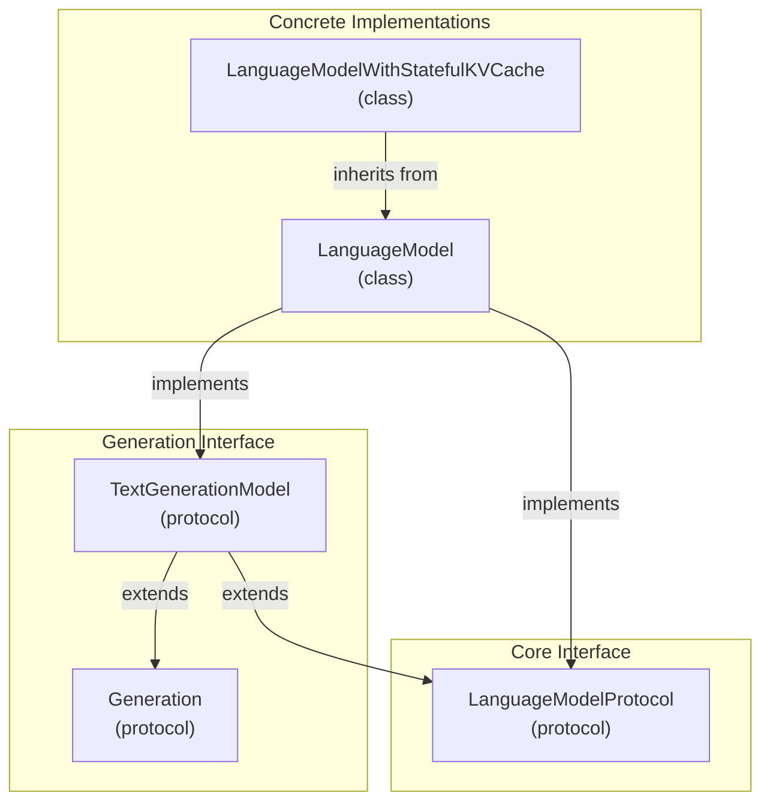

**Protocol Requirements:**

| Protocol | Key Requirements | Purpose |
|----------|-----------------|---------|
| `LanguageModelProtocol` | `predictNextTokenScores()`, `resetState()`, `tokenizer`, `model` | Core inference interface |
| `TextGenerationModel` | `defaultGenerationConfig`, `generate()` | High-level text generation |
| `Generation` | Token-level generation loop | Orchestrates inference and sampling |

Sources: [Sources/Models/LanguageModelTypes.swift:14-119](), [Sources/Models/LanguageModel.swift:21-87]()

---

## LanguageModel Class Structure

The `LanguageModel` class wraps a CoreML `MLModel` and provides language model-specific functionality.

### Core Properties

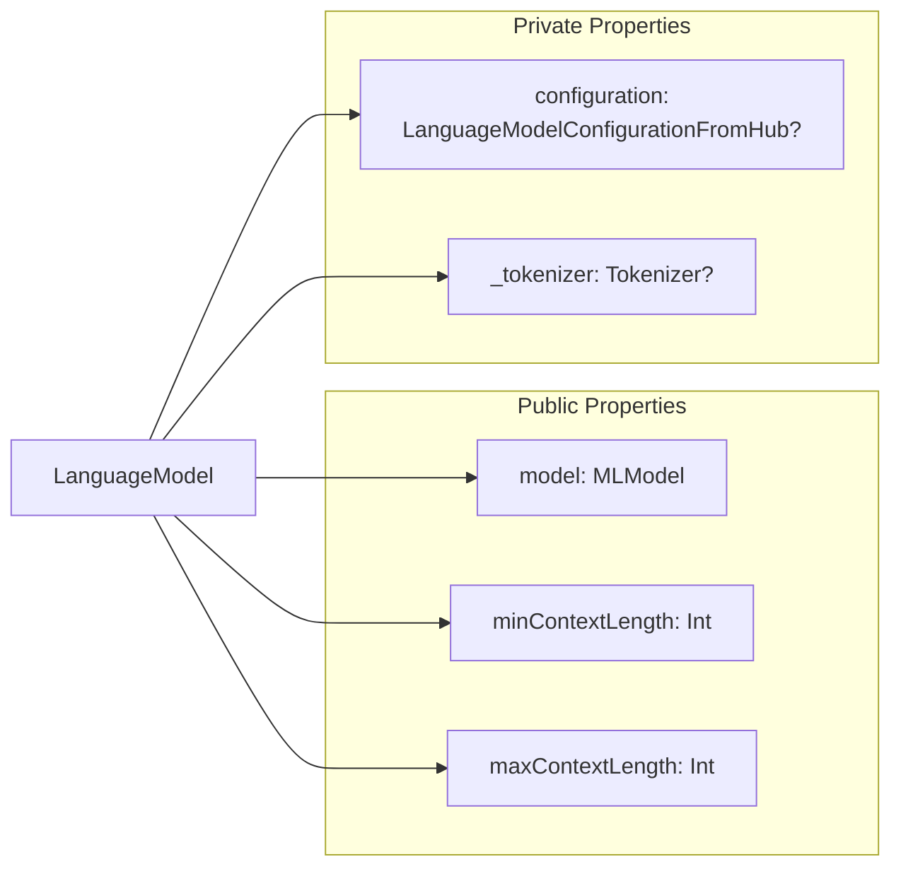

Sources: [Sources/Models/LanguageModel.swift:21-52]()

### Key Properties

| Property | Type | Description |
|----------|------|-------------|
| `model` | `MLModel` | The underlying CoreML model for inference |
| `minContextLength` | `Int` | Minimum supported input sequence length |
| `maxContextLength` | `Int` | Maximum supported input sequence length |
| `configuration` | `LanguageModelConfigurationFromHub?` | Lazy configuration loader from Hub |
| `_tokenizer` | `Tokenizer?` | Cached tokenizer instance |

The context length range is extracted from the CoreML model's input shape constraints during initialization using `contextRange(from:)` [Sources/Models/LanguageModel.swift:91-123]().

Sources: [Sources/Models/LanguageModel.swift:21-52]()

---

## Initialization Methods

### From CoreML Model

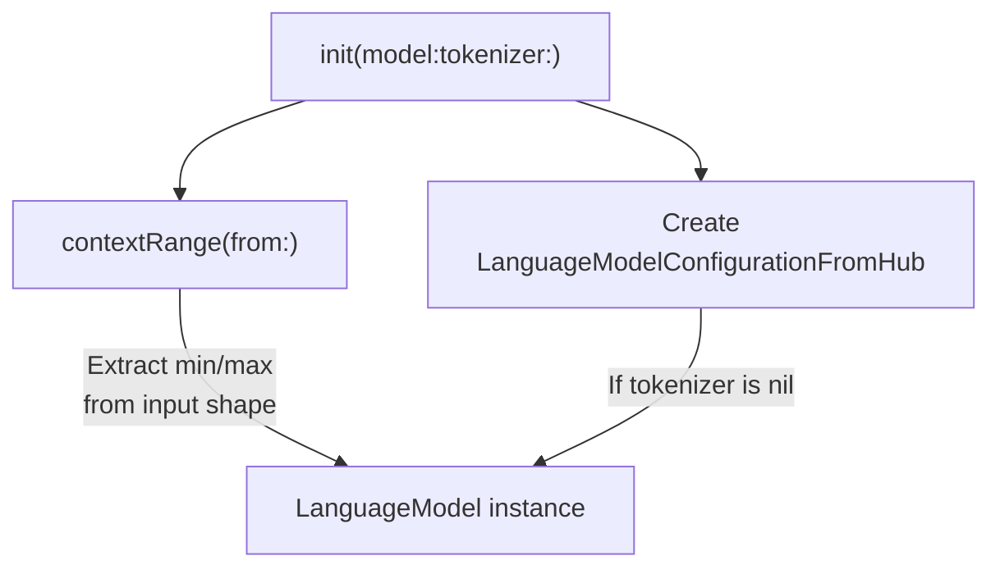

The primary initializer accepts a `MLModel` and optional `Tokenizer`:

```swift
public required init(
    model: MLModel,
    tokenizer: Tokenizer? = nil
)
```

**Initialization Steps:**
1. Store the `MLModel` reference
2. Extract `minContextLength` and `maxContextLength` from the model's input shape constraints [Sources/Models/LanguageModel.swift:91-123]()
3. If no tokenizer provided, create a `LanguageModelConfigurationFromHub` instance for lazy config loading [Sources/Models/LanguageModel.swift:48-50]()

Sources: [Sources/Models/LanguageModel.swift:40-56]()

### From Compiled Model URL

The static factory method `loadCompiled(url:computeUnits:tokenizer:)` loads a compiled CoreML model (`.mlmodelc`) and automatically detects KV cache capabilities:

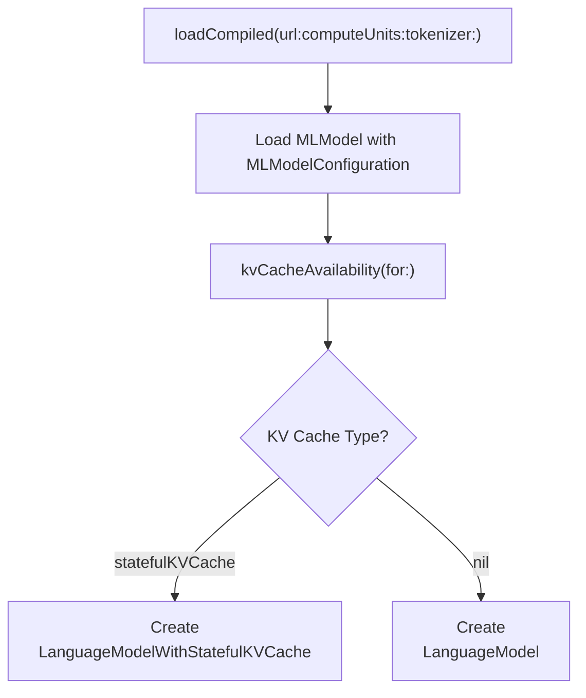

**KV Cache Detection Logic:**
- Checks for state descriptors named `keyCache` and `valueCache` [Sources/Models/LanguageModel.swift:270-277]()
- If stateful KV cache available, returns `LanguageModelWithStatefulKVCache` [Sources/Models/LanguageModel.swift:171-175]()
- Otherwise, returns standard `LanguageModel` [Sources/Models/LanguageModel.swift:177-180]()

Sources: [Sources/Models/LanguageModel.swift:162-183](), [Sources/Models/LanguageModel.swift:269-320]()

---

## Input/Output Processing

### Tensor Preparation and Inference

The `predictNextTokenScores(_:config:)` method performs the core inference operation:

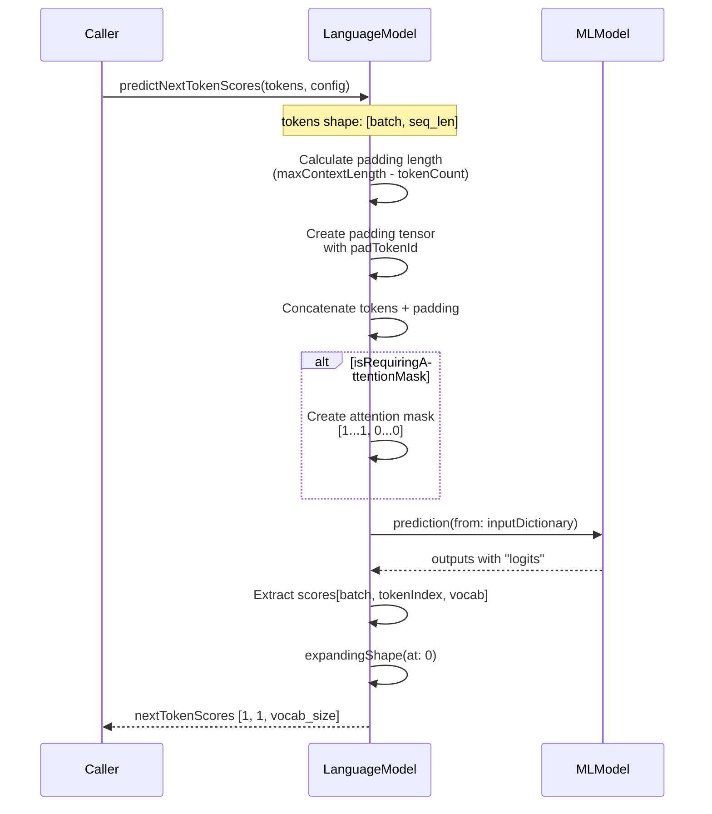

**Input Preparation:**
1. Assert input has rank 2: `[batch, current_sequence_length]` [Sources/Models/LanguageModel.swift:64]()
2. Calculate padding needed: `maxContextLength - tokenCount` [Sources/Models/LanguageModel.swift:66]()
3. Create padding tensor filled with `padTokenId` [Sources/Models/LanguageModel.swift:67]()
4. Concatenate tokens and padding along axis -1 [Sources/Models/LanguageModel.swift:68]()
5. If model requires attention mask, create binary mask `[1,1,1...0,0,0]` [Sources/Models/LanguageModel.swift:70-74]()

**Output Processing:**
1. Extract `logits` output tensor [Sources/Models/LanguageModel.swift:79]()
2. Select scores for the last input token position [Sources/Models/LanguageModel.swift:82]()
3. Expand shape to `[1, 1, vocab_size]` for consistency [Sources/Models/LanguageModel.swift:82]()

Sources: [Sources/Models/LanguageModel.swift:60-86]()

### Input/Output Keys

The model uses standardized input/output key names defined in the `Keys` enum:

| Key Type | Key Name | Description |
|----------|----------|-------------|
| **Input** | `inputIds` | Token ID sequence |
| **Input** | `attentionMask` | Binary attention mask (optional) |
| **Input** | `causalMask` | Causal attention mask (optional) |
| **Input** | `keyCache` | KV cache keys (for I/O cache models) |
| **Input** | `valueCache` | KV cache values (for I/O cache models) |
| **Output** | `logits` | Next token prediction scores |
| **Output** | `presentKeys` | Updated key cache (for I/O cache models) |
| **Output** | `presentValues` | Updated value cache (for I/O cache models) |

Sources: [Sources/Models/LanguageModel.swift:137-149]()

---

## Context Length Handling

Context length constraints are extracted from the CoreML model's input shape metadata:

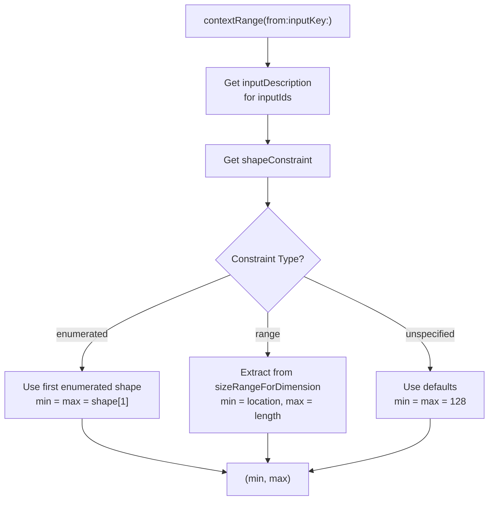

**Shape Constraint Types:**
- **Enumerated**: Fixed shape(s), uses first shape's sequence dimension [Sources/Models/LanguageModel.swift:107-108]()
- **Range**: Dynamic range, extracts min/max from last axis range [Sources/Models/LanguageModel.swift:110-115]()
- **Unspecified**: Falls back to default 128 [Sources/Models/LanguageModel.swift:116-117]()

Sources: [Sources/Models/LanguageModel.swift:90-124]()

---

## Metadata and Configuration Access

### Model Metadata Properties

The `LanguageModel` class exposes various metadata properties computed from the underlying `MLModel`:

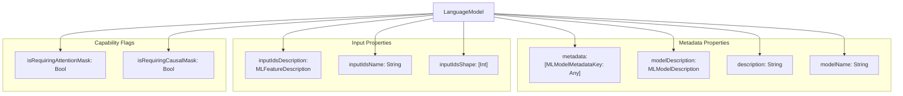

**Model Name Resolution:**
The `modelName` property attempts to extract the model identifier from Hugging Face Hub metadata, falling back to the CoreML display name:
1. Check for `co.huggingface.exporters.name` in creator-defined metadata [Sources/Models/LanguageModel.swift:228-231]()
2. Fall back to `modelDisplayName` from model configuration [Sources/Models/LanguageModel.swift:234-237]()

Sources: [Sources/Models/LanguageModel.swift:198-264]()

### Asynchronous Configuration Properties

Configuration properties are loaded lazily from Hugging Face Hub via `LanguageModelConfigurationFromHub`:

| Property | Type | Source | Description |
|----------|------|--------|-------------|
| `modelConfig` | `Config?` | `config.json` | Model architecture configuration |
| `tokenizerConfig` | `Config?` | `tokenizer_config.json` | Tokenizer configuration |
| `tokenizerData` | `Config` | `tokenizer.json` | Vocabulary and tokenization rules |
| `modelType` | `String?` | `config.json` | Model architecture type (e.g., "llama") |
| `textGenerationParameters` | `Config?` | `config.json` | Task-specific parameters |
| `defaultDoSample` | `Bool` | `config.json` | Default sampling behavior |
| `bosTokenId` | `Int?` | `config.json` | Beginning-of-sequence token ID |
| `eosTokenId` | `Int?` | `config.json` | End-of-sequence token ID |
| `tokenizer` | `Tokenizer` | Hub configs | Lazily-loaded tokenizer instance |

**Lazy Tokenizer Loading:**
The `tokenizer` property implements lazy loading:
1. Return cached `_tokenizer` if available [Sources/Models/LanguageModel.swift:424]()
2. Otherwise, fetch `tokenizerConfig` and `tokenizerData` from Hub [Sources/Models/LanguageModel.swift:425-428]()
3. Create tokenizer using `AutoTokenizer.from(tokenizerConfig:tokenizerData:)` [Sources/Models/LanguageModel.swift:429]()
4. Cache and return the tokenizer [Sources/Models/LanguageModel.swift:430]()

Sources: [Sources/Models/LanguageModel.swift:327-433]()

---

## Stateful KV Cache Optimization

### LanguageModelWithStatefulKVCache

The `LanguageModelWithStatefulKVCache` subclass optimizes sequential token generation by maintaining key-value cache state in CoreML:

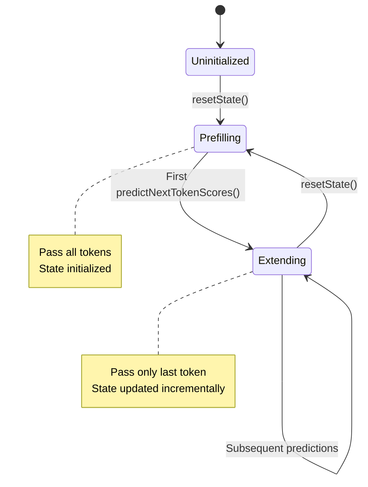

**Operating Modes:**
- **Prefilling**: Initial mode after `resetState()`, passes entire token sequence [Sources/Models/LanguageModel.swift:526]()
- **Extending**: Subsequent predictions, passes only the last token [Sources/Models/LanguageModel.swift:527]()

**State Management:**
1. `resetState()` creates a new `MLState` instance via `model.makeState()` [Sources/Models/LanguageModel.swift:507]()
2. Each prediction uses the state: `model.prediction(from:using:)` [Sources/Models/LanguageModel.swift:552]()
3. CoreML automatically updates state buffers for `keyCache` and `valueCache`

Sources: [Sources/Models/LanguageModel.swift:485-563]()

### Prefilling vs Extending Modes

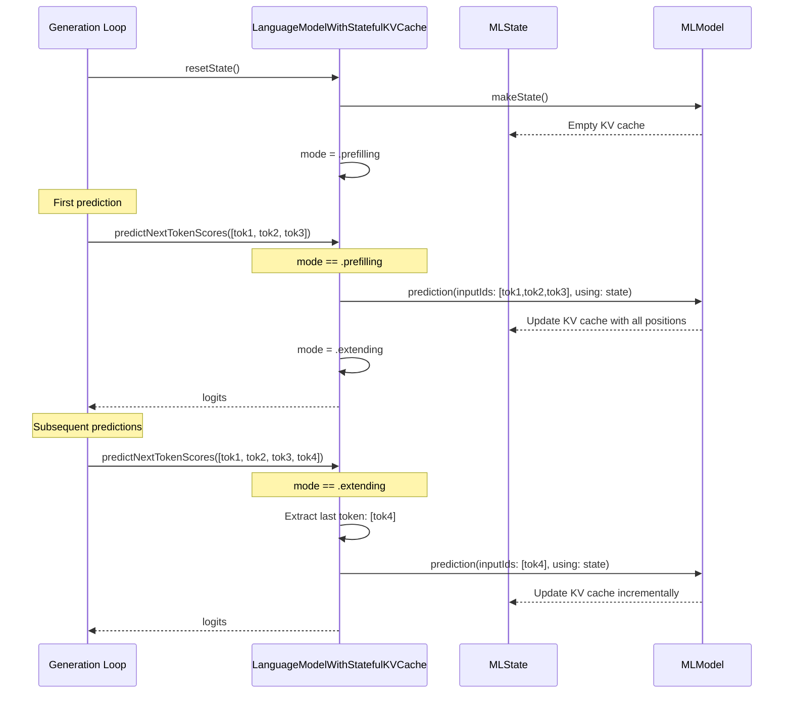

**Performance Benefits:**
- **Prefilling**: Processes entire prompt in one forward pass
- **Extending**: Only processes new token, reuses cached computations
- **Memory**: KV cache state maintained in CoreML's optimized buffers

Sources: [Sources/Models/LanguageModel.swift:511-562]()

---

## TextGenerationModel Conformance

### Default Generation Configuration

The `LanguageModel` class provides a `defaultGenerationConfig` with model-specific optimizations:

```swift
public var defaultGenerationConfig: GenerationConfig {
    var config = GenerationConfig(maxNewTokens: 2048)
    switch modelName.lowercased() {
    case let x where x.contains("gpt"):
        config.doSample = true
        config.topK = 50
    default: break
    }
    return config
}
```

**GPT Models**: Enables sampling with `topK = 50` for better diversity [Sources/Models/LanguageModel.swift:446-448]()

Sources: [Sources/Models/LanguageModel.swift:443-452]()

### Generation Method

The `generate(config:tokens:callback:)` method implements the `Generation` protocol:

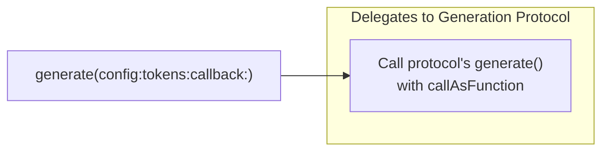

This method delegates to the `Generation` protocol's default implementation, passing `callAsFunction` as the model function [Sources/Models/LanguageModel.swift:471-476]().

**High-Level Generate (from TextGenerationModel):**
The protocol extension provides a text-to-text generation method:
1. Reset model state for new sequence [Sources/Models/LanguageModelTypes.swift:108]()
2. Tokenize input prompt using `tokenizer` [Sources/Models/LanguageModelTypes.swift:111-116]()
3. Run generation loop with `callAsFunction` [Sources/Models/LanguageModelTypes.swift:114]()
4. Return decoded text

Sources: [Sources/Models/LanguageModel.swift:466-478](), [Sources/Models/LanguageModelTypes.swift:96-119]()

---

## Error Handling

### TokenizerError

Errors specific to tokenizer operations in language models:

| Error Case | Description | When Thrown |
|------------|-------------|-------------|
| `tokenizerConfigNotFound` | Tokenizer configuration file missing | When accessing `tokenizer` property without config |
| `missingConfig` | Language model configuration not set | When `tokenizerData` accessed without `LanguageModelConfigurationFromHub` |

Sources: [Sources/Models/LanguageModel.swift:566-580]()

### Fatal Errors

The implementation uses `fatalError()` for unrecoverable conditions:
- Missing input shape information [Sources/Models/LanguageModel.swift:99]()
- Invalid KV cache configuration [Sources/Models/LanguageModel.swift:274](), [Sources/Models/LanguageModel.xml:300]()
- Unsupported KV cache I/O (not yet implemented) [Sources/Models/LanguageModel.swift:308-319]()
- Missing model display name [Sources/Models/LanguageModel.swift:235]()
- Uninitialized state in stateful model [Sources/Models/LanguageModel.swift:518-522]()

Sources: [Sources/Models/LanguageModel.swift:99](), [Sources/Models/LanguageModel.swift:274](), [Sources/Models/LanguageModel.swift:300](), [Sources/Models/LanguageModel.swift:308-319]()

---

## Complete Initialization and Inference Flow

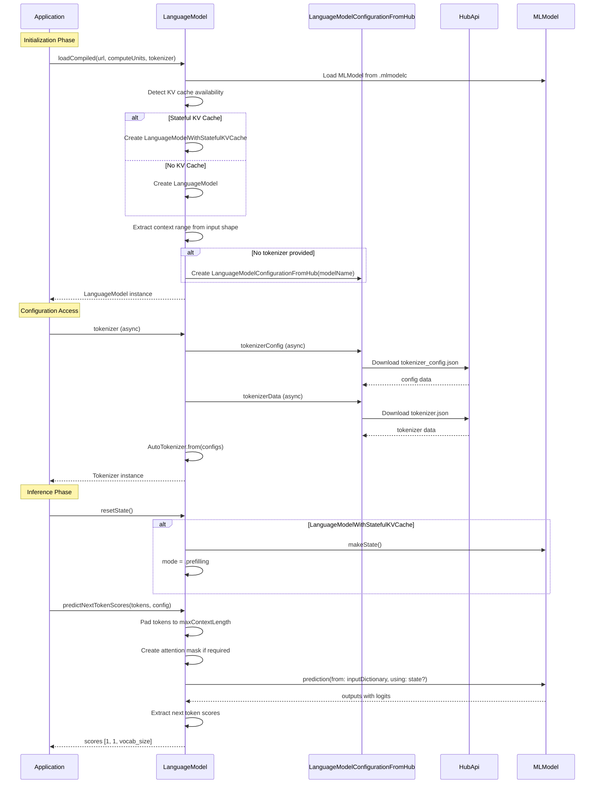

Sources: [Sources/Models/LanguageModel.swift:162-183](), [Sources/Models/LanguageModel.swift:40-56](), [Sources/Models/LanguageModel.swift:422-432](), [Sources/Models/LanguageModel.swift:506-509](), [Sources/Models/LanguageModel.swift:60-86](), [Sources/Models/LanguageModel.swift:511-562]()

---

## Platform Requirements

All language model functionality requires:
- **macOS**: 15.0+
- **iOS**: 18.0+
- **tvOS**: 18.0+
- **visionOS**: 2.0+
- **watchOS**: 11.0+

These requirements are enforced via `@available` attributes on all public types and extensions.

Sources: [Sources/Models/LanguageModel.swift:15](), [Sources/Models/LanguageModelTypes.swift:18]()

---

