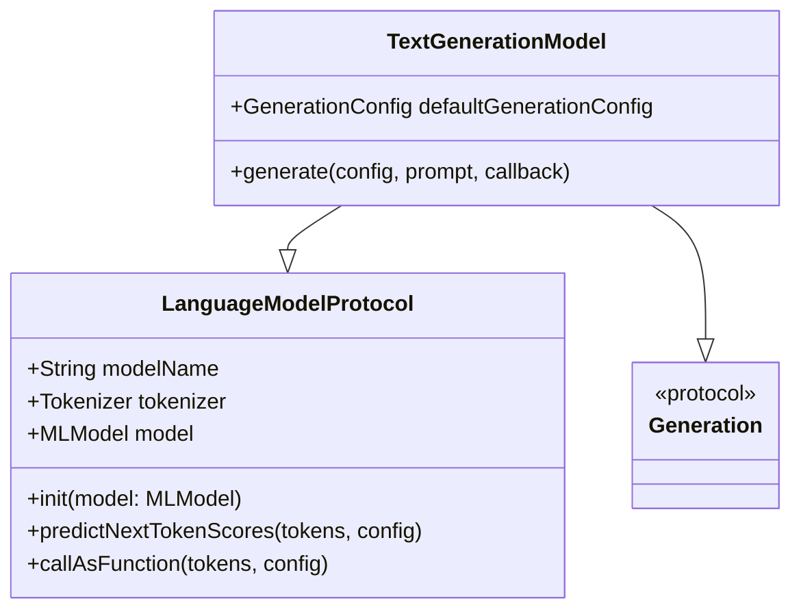
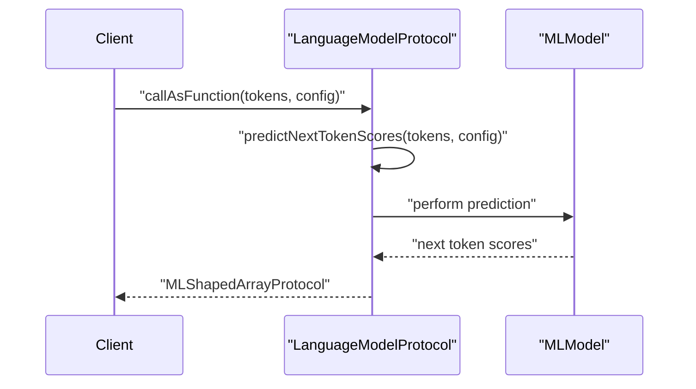
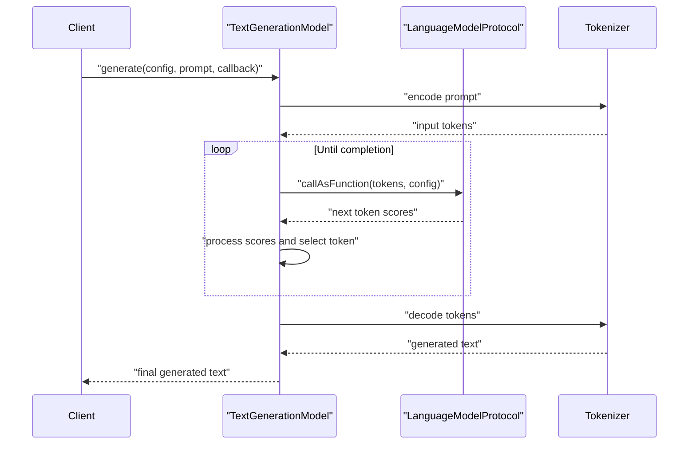
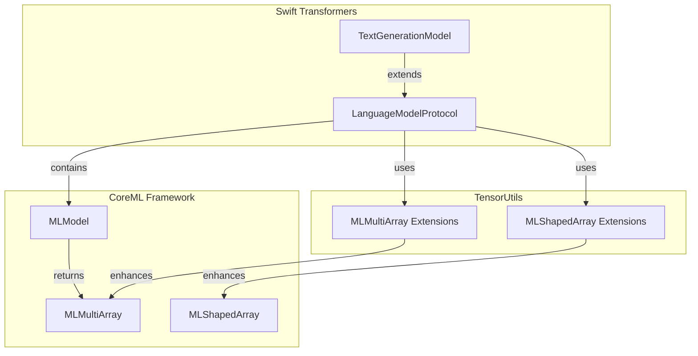
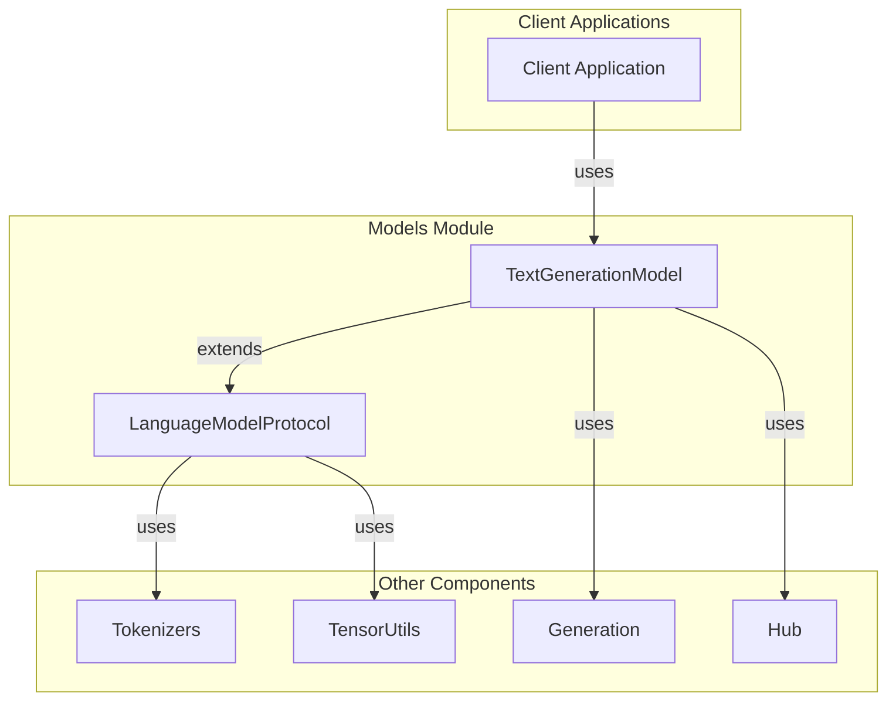

<!-- source: DeepWiki mcp.deepwiki.com · repo huggingface/swift-transformers · page 4.2 Stateful KV Cache Models · fetched 2026-10-26 -->

# Model Types

Relevant source files

The following files were used as context for generating this wiki page:

- [Sources/Models/LanguageModel.swift](Sources/Models/LanguageModel.swift)
- [Sources/Models/LanguageModelTypes.swift](Sources/Models/LanguageModelTypes.swift)

This page documents the various model types and interfaces available in the swift-transformers library. It covers the protocol hierarchy, core interfaces, and how different model types relate to each other. For information about the main `LanguageModel` class implementation details, see [Language Model](#4.1).

## Protocol Hierarchy

The swift-transformers library uses protocols to define the interface and capabilities of different model types. These protocols provide a flexible architecture that allows for different implementations while maintaining a consistent API.

Sources: [Sources/Models/LanguageModelTypes.swift:12-42]()

## Core Interfaces

### LanguageModelProtocol

The `LanguageModelProtocol` is the foundational interface for all language models in the swift-transformers library. It defines the essential properties and methods required for a model to function within the system.

Key requirements:

| Property/Method | Type | Description |
|-----------------|------|-------------|
| `modelName` | `String` | Identifier for the model (equivalent to `name_or_path` in Python) |
| `tokenizer` | `Tokenizer` | The tokenizer associated with the model |
| `model` | `MLModel` | The underlying CoreML model |
| `init(model:)` | Initializer | Constructor that takes a CoreML model |
| `predictNextTokenScores()` | Method | Makes predictions for the next token given input tokens |
| `callAsFunction()` | Method | Convenience method that calls `predictNextTokenScores()` |

The protocol includes a default implementation for the `callAsFunction` method, which simply forwards to `predictNextTokenScores`. This allows models to be callable directly as if they were functions.

Sources: [Sources/Models/LanguageModelTypes.swift:12-30]()

### TextGenerationModel

The `TextGenerationModel` protocol extends `LanguageModelProtocol` with additional capabilities specifically for text generation. It also conforms to the `Generation` protocol (defined elsewhere in the system).

Key requirements:

| Property/Method | Type | Description |
|-----------------|------|-------------|
| `defaultGenerationConfig` | `GenerationConfig` | Default configuration for text generation |
| `generate(config:prompt:callback:)` | Method | Generates text based on a prompt |

The protocol includes a default implementation of the `generate` method that leverages the model's `callAsFunction` method and tokenizer to perform the generation process.

Sources: [Sources/Models/LanguageModelTypes.swift:32-42]()

## Integration with CoreML

The model types in swift-transformers are designed to work seamlessly with Apple's CoreML framework. Each model wraps a CoreML model (`MLModel`) and uses it for inference operations.

Sources: [Sources/Models/LanguageModelTypes.swift:12-24](), [Sources/TensorUtils/MLMultiArray+Utils.swift:12-198]()

## Model Types in the System Architecture

The model interfaces described on this page form part of the broader swift-transformers architecture. Models interact with other key components such as Tokenizers, Generation, and TensorUtils to provide a complete text generation pipeline.

Sources: [Sources/Models/LanguageModelTypes.swift:12-42]()

## Usage Patterns

Implementations of these model types typically follow these patterns:

1. Create a concrete model class that implements `TextGenerationModel`
2. Initialize with a CoreML model instance
3. Implement `predictNextTokenScores` to perform model inference
4. Use the default implementations for `callAsFunction` and `generate`

The concrete model class will handle the specifics of the model architecture (e.g., Transformer, BERT, GPT, etc.) while adhering to the common interface defined by the protocols.

When using these models, clients typically:

1. Load a model via the Hub component
2. Create an instance of the appropriate model class
3. Use the model's `generate` method to produce text

Sources: [Sources/Models/LanguageModelTypes.swift:12-42]()

---

