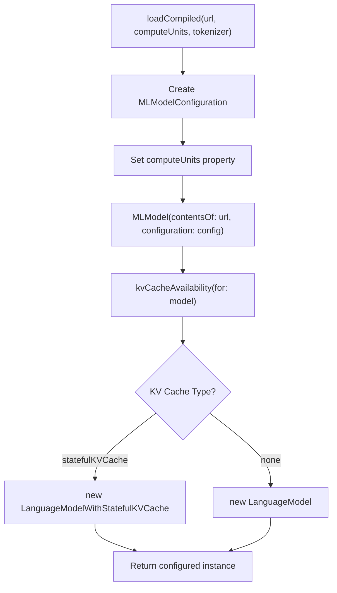
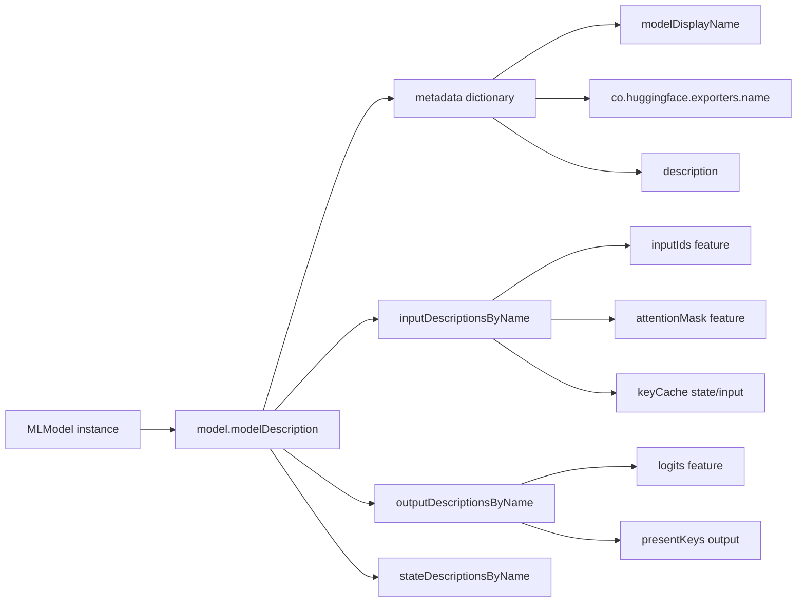
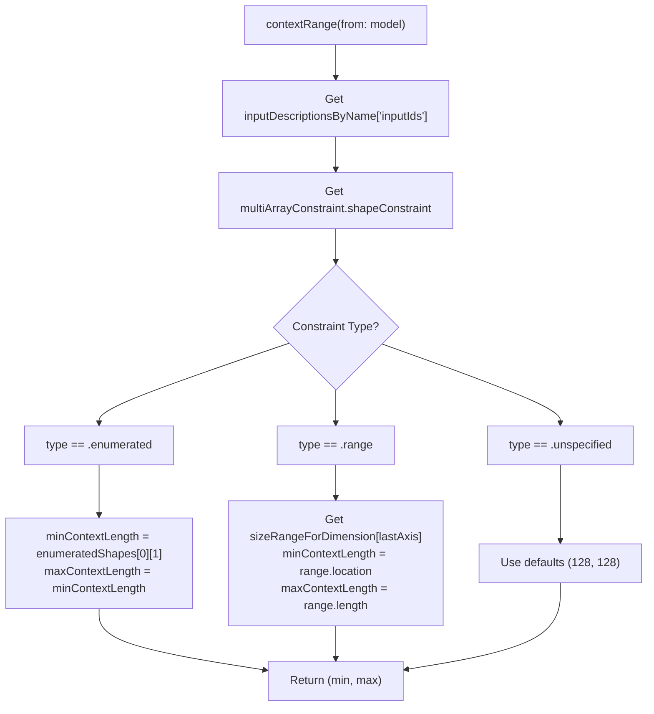
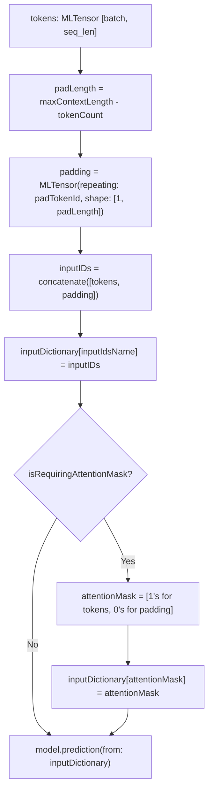
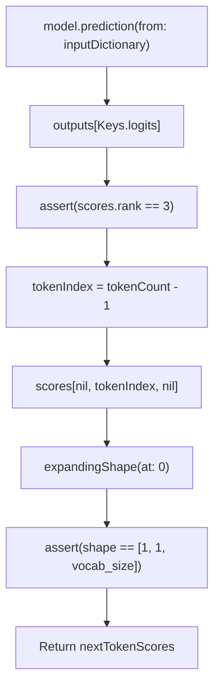
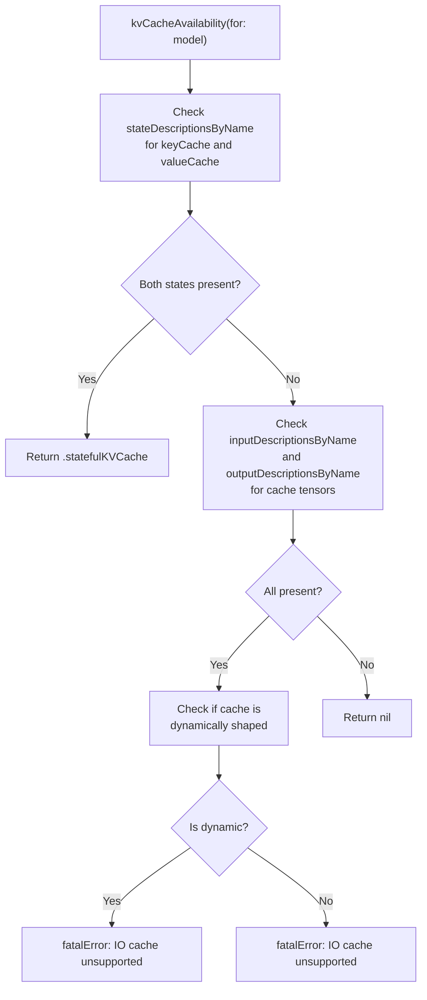
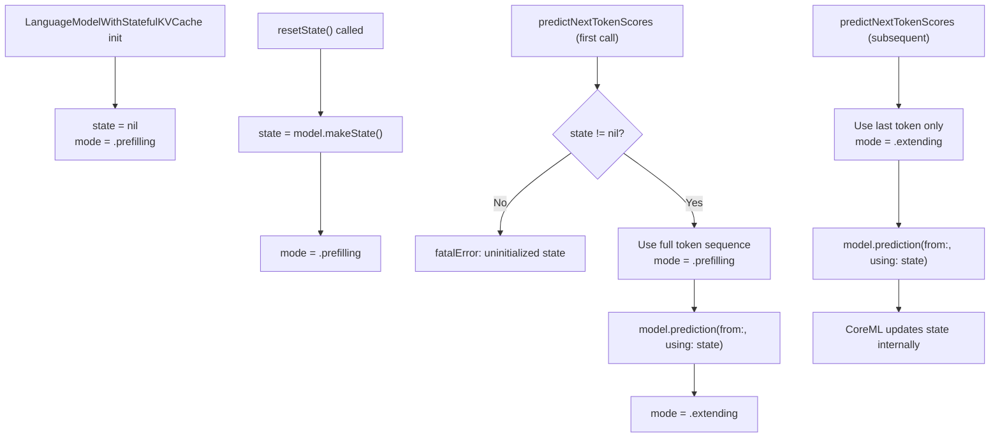
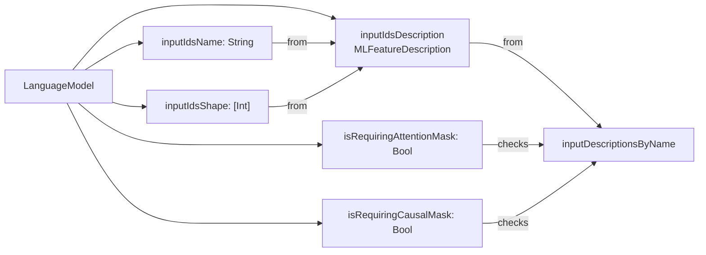

<!-- source: DeepWiki mcp.deepwiki.com · repo huggingface/swift-transformers · page 4.3 CoreML Integration · fetched 2026-10-26 -->

# CoreML Integration

<details>
<summary>Relevant source files</summary>

The following files were used as context for generating this wiki page:

- [Sources/Models/LanguageModel.swift](Sources/Models/LanguageModel.swift)
- [Sources/Models/LanguageModelTypes.swift](Sources/Models/LanguageModelTypes.swift)

</details>


## Purpose and Scope

This page documents how swift-transformers integrates with Apple's CoreML framework to enable on-device language model inference. It covers the technical details of loading MLModel instances, configuring compute units, extracting model metadata, processing input/output tensors, and detecting model capabilities. For information about the high-level `LanguageModel` class that wraps CoreML models, see [Language Model](#4.1). For details about stateful KV cache optimization, see [Stateful KV Cache Models](#4.2).

## MLModel Loading and Configuration

The system loads compiled CoreML models (`.mlmodelc` files) and configures them for inference using the `loadCompiled` factory method.

**Loading Process**



Sources: [Sources/Models/LanguageModel.swift:162-182]()

The `loadCompiled` method in [Sources/Models/LanguageModel.swift:162-182]() performs the following steps:

1. **MLModelConfiguration Creation**: Instantiates an `MLModelConfiguration` object to specify inference settings [Sources/Models/LanguageModel.swift:167]()
2. **Compute Units Selection**: Sets the `computeUnits` property to control where the model executes (CPU, GPU, Neural Engine, or combinations) [Sources/Models/LanguageModel.swift:168]()
3. **Model Loading**: Loads the compiled model from the specified URL using `MLModel(contentsOf:configuration:)` [Sources/Models/LanguageModel.swift:169]()
4. **KV Cache Detection**: Analyzes the model's input/output/state descriptions to determine optimization capabilities [Sources/Models/LanguageModel.swift:170-181]()
5. **Instance Selection**: Returns either a `LanguageModelWithStatefulKVCache` or standard `LanguageModel` based on detected capabilities

**Compute Units Configuration**

The `computeUnits` parameter accepts `MLComputeUnits` values that control execution:

| Compute Unit | Description | Use Case |
|--------------|-------------|----------|
| `.cpuOnly` | CPU execution only | Debugging, maximum compatibility |
| `.cpuAndGPU` | CPU and GPU (default) | Balanced performance |
| `.cpuAndNeuralEngine` | CPU and Neural Engine | Power efficiency on supported devices |
| `.all` | All available units | Maximum performance |

Sources: [Sources/Models/LanguageModel.swift:162-169]()

## Model Description and Metadata

The `MLModelDescription` provides programmatic access to model structure and metadata.

**Model Metadata Extraction**



Sources: [Sources/Models/LanguageModel.swift:199-263]()

**Key Metadata Properties**

The `LanguageModel` class exposes several convenience properties for accessing model metadata:

| Property | Source | Description |
|----------|--------|-------------|
| `metadata` | `model.modelDescription.metadata` | Full metadata dictionary |
| `modelDescription` | `model.modelDescription` | Complete model description object |
| `description` | `metadata[.description]` | Human-readable model description |
| `modelName` | Custom metadata or `modelDisplayName` | Model identifier from Hugging Face Hub |

Sources: [Sources/Models/LanguageModel.swift:199-238]()

The `modelName` property implements a fallback mechanism [Sources/Models/LanguageModel.swift:227-238]():
1. First checks for `co.huggingface.exporters.name` in creator-defined metadata fields
2. Falls back to `model.configuration.modelDisplayName` if custom metadata is absent
3. Triggers a fatal error if neither is available

## Shape Constraints and Context Length Detection

The system extracts context length constraints by analyzing the `inputIds` feature's shape constraint.

**Context Range Detection Flow**



Sources: [Sources/Models/LanguageModel.swift:91-123]()

**Shape Constraint Types**

The method in [Sources/Models/LanguageModel.swift:95-123]() handles three constraint types:

1. **Enumerated** [Sources/Models/LanguageModel.swift:106-108](): Fixed set of allowed shapes. Extracts the context length from the second dimension of the first enumerated shape. Sets both min and max to the same value.

2. **Range** [Sources/Models/LanguageModel.swift:109-115](): Variable-length input with specified bounds. Extracts `NSRange` from the last axis, where `location` is the minimum and `length` is the maximum context length.

3. **Unspecified** [Sources/Models/LanguageModel.swift:116-120](): No explicit constraints. Falls back to default values of 128 for both min and max.

The extracted values are stored as `minContextLength` and `maxContextLength` properties [Sources/Models/LanguageModel.swift:26-29]() for use during inference.

Sources: [Sources/Models/LanguageModel.swift:91-123]()

## Input Tensor Preparation

The system prepares input tensors by padding sequences to the model's maximum context length and adding attention masks when required.

**Input Preparation in predictNextTokenScores**



Sources: [Sources/Models/LanguageModel.swift:60-75]()

**Standard Model Input Processing**

The `predictNextTokenScores` method in [Sources/Models/LanguageModel.swift:60-86]() prepares inputs as follows:

1. **Padding Calculation**: Computes required padding to reach `maxContextLength` [Sources/Models/LanguageModel.swift:66]()
2. **Padding Tensor**: Creates a tensor filled with `padTokenId` [Sources/Models/LanguageModel.swift:67]()
3. **Concatenation**: Appends padding to input tokens [Sources/Models/LanguageModel.swift:68]()
4. **Input Dictionary**: Builds dictionary with padded `inputIDs` [Sources/Models/LanguageModel.swift:69]()
5. **Attention Mask**: If `isRequiringAttentionMask` is true, creates a mask with 1s for real tokens and 0s for padding [Sources/Models/LanguageModel.swift:70-74]()

**Stateful Model Input Processing**

For `LanguageModelWithStatefulKVCache`, the input preparation differs based on mode [Sources/Models/LanguageModel.swift:511-552]():

| Mode | Input Tokens | Attention Mask Shape | Purpose |
|------|--------------|----------------------|---------|
| `prefilling` | Full token sequence | `[1, 1, 1, tokenCount + 1]` | Process prompt |
| `extending` | Last token only | `[1, 1, 1, tokenCount + 1]` | Generate next token |

The system automatically switches from `prefilling` to `extending` mode after the first prediction [Sources/Models/LanguageModel.swift:529]().

Sources: [Sources/Models/LanguageModel.swift:60-75](), [Sources/Models/LanguageModel.swift:511-552]()

## Output Tensor Processing

The system extracts next-token scores from the model's logits output.

**Output Extraction Process**



Sources: [Sources/Models/LanguageModel.swift:75-86]()

**Logits Processing Steps**

The method extracts next-token scores from the 3D logits tensor:

1. **Output Dictionary**: Receives dictionary from `model.prediction()` [Sources/Models/LanguageModel.swift:75]()
2. **Logits Extraction**: Accesses the `logits` key using `Keys.logits` constant [Sources/Models/LanguageModel.swift:79]()
3. **Shape Validation**: Verifies logits have shape `[batch, sequence, vocab_size]` [Sources/Models/LanguageModel.swift:80]()
4. **Token Selection**: Computes index of the last real token (excluding padding) [Sources/Models/LanguageModel.swift:81]()
5. **Slicing**: Extracts scores for the last token position using advanced indexing [Sources/Models/LanguageModel.swift:82]()
6. **Shape Expansion**: Ensures output has shape `[1, 1, vocab_size]` [Sources/Models/LanguageModel.swift:82]()
7. **Final Validation**: Confirms correct output shape [Sources/Models/LanguageModel.swift:84]()

**Key Constants**

The `Keys` enum [Sources/Models/LanguageModel.swift:137-150]() defines standard tensor names:

| Category | Key | Description |
|----------|-----|-------------|
| Input | `inputIds` | Token ID tensor |
| Input | `attentionMask` | Attention mask tensor |
| Input | `causalMask` | Causal attention mask |
| Input | `keyCache`, `valueCache` | KV cache state names |
| Output | `logits` | Raw token scores |
| Output | `presentKeys`, `presentValues` | Updated KV cache |

Sources: [Sources/Models/LanguageModel.swift:75-86](), [Sources/Models/LanguageModel.swift:137-150]()

## KV Cache Detection

The system automatically detects KV cache support by analyzing model input, output, and state descriptions.

**KV Cache Availability Detection**



Sources: [Sources/Models/LanguageModel.swift:269-320]()

**Detection Logic**

The `kvCacheAvailability` method [Sources/Models/LanguageModel.swift:269-320]() implements the following detection strategy:

1. **Stateful KV Cache Detection** [Sources/Models/LanguageModel.swift:270-277]()
   - Checks for `keyCache` and `valueCache` in `model.modelDescription.stateDescriptionsByName`
   - Both states must be present or both absent; mixed configuration triggers fatal error
   - Returns `.statefulKVCache` if both are present

2. **Input/Output KV Cache Detection** [Sources/Models/LanguageModel.swift:294-304]()
   - Checks for `keyCache`, `valueCache` inputs and `presentKeys`, `presentValues` outputs
   - All four must be consistently present or absent
   - Currently unsupported and triggers fatal error with feature request message

3. **Dynamic Shape Detection** [Sources/Models/LanguageModel.swift:279-289]()
   - Helper function checks if feature description has dynamic shape constraints
   - Handles `.unspecified`, `.enumerated` (multiple shapes), and `.range` constraint types

**KVCacheAvailability Enum**

The enum [Sources/Models/LanguageModel.swift:187-195]() currently defines:

```swift
enum KVCacheAvailability {
    case statefulKVCache  // State-based KV cache (supported)
}
```

Future versions may support input/output-based KV caching if feature requests are filed.

Sources: [Sources/Models/LanguageModel.swift:269-320](), [Sources/Models/LanguageModel.swift:187-195]()

## Model State Management

For models with stateful KV cache support, the system manages `MLState` objects to maintain inference state across predictions.

**State Lifecycle**



Sources: [Sources/Models/LanguageModel.swift:485-563]()

**State Initialization**

The `LanguageModelWithStatefulKVCache` class [Sources/Models/LanguageModel.swift:485-563]() manages state through:

1. **Initialization** [Sources/Models/LanguageModel.swift:494-504]()
   - `state` property starts as `nil`
   - `mode` property starts as `.prefilling`
   - Validates that model supports flexible input shapes

2. **State Reset** [Sources/Models/LanguageModel.swift:506-509]()
   - `resetState()` creates a new `MLState` via `model.makeState()`
   - Resets mode to `.prefilling`
   - Must be called before each new generation sequence

3. **Prefilling Mode** [Sources/Models/LanguageModel.swift:525-529]()
   - First prediction passes all tokens to the model
   - CoreML initializes KV cache state
   - Mode automatically switches to `.extending`

4. **Extending Mode** [Sources/Models/LanguageModel.swift:527-528]()
   - Subsequent predictions pass only the last token
   - CoreML updates existing KV cache state
   - Significantly faster than prefilling

**State Error Handling**

If `predictNextTokenScores` is called with `state == nil`, the system triggers a fatal error [Sources/Models/LanguageModel.swift:517-523]() instructing developers to call `resetState()` first.

Sources: [Sources/Models/LanguageModel.swift:485-563]()

## Feature Description Properties

The `LanguageModel` class exposes several properties for inspecting model input requirements.

**Feature Description Access**



Sources: [Sources/Models/LanguageModel.swift:240-263]()

**Available Properties**

| Property | Return Type | Description | Source Line |
|----------|-------------|-------------|-------------|
| `inputIdsDescription` | `MLFeatureDescription` | Feature description for input_ids | [242]() |
| `inputIdsName` | `String` | Name of input_ids feature | [246]() |
| `inputIdsShape` | `[Int]` | Expected input_ids tensor shape | [251]() |
| `isRequiringAttentionMask` | `Bool` | Whether attention_mask input exists | [256]() |
| `isRequiringCausalMask` | `Bool` | Whether causal_mask input exists | [261]() |

These properties enable the system to dynamically adapt to different model architectures without hardcoding input requirements.

Sources: [Sources/Models/LanguageModel.swift:240-263]()

---

