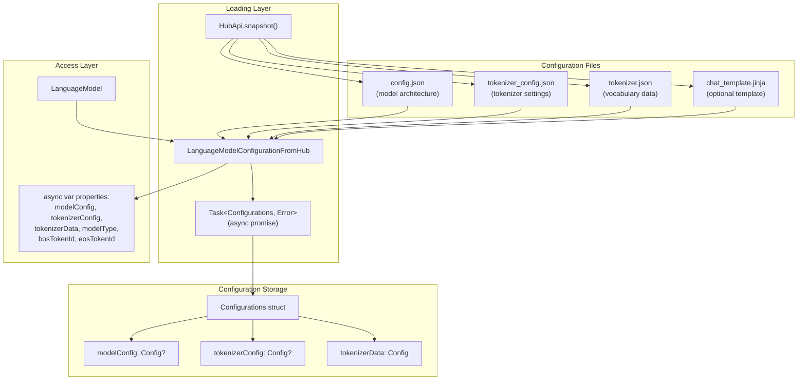
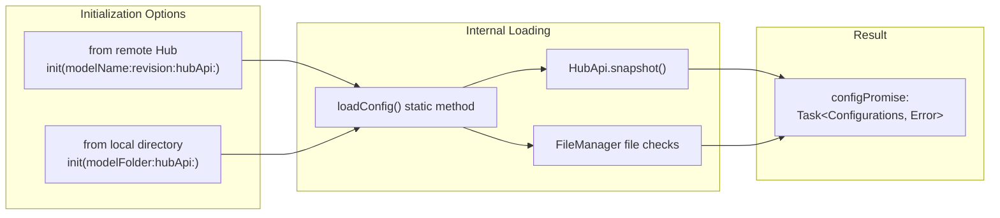
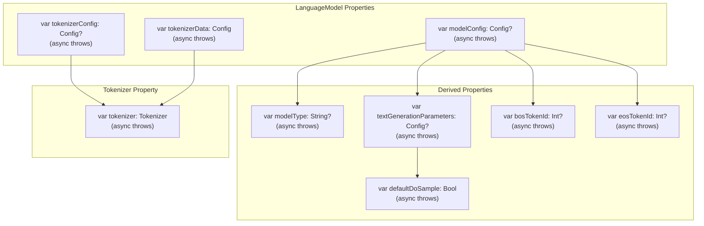
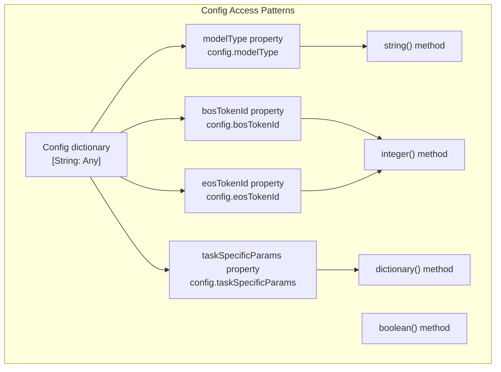
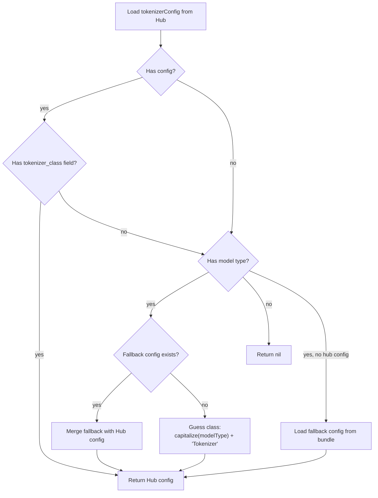
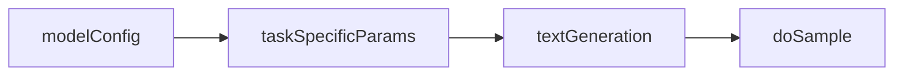
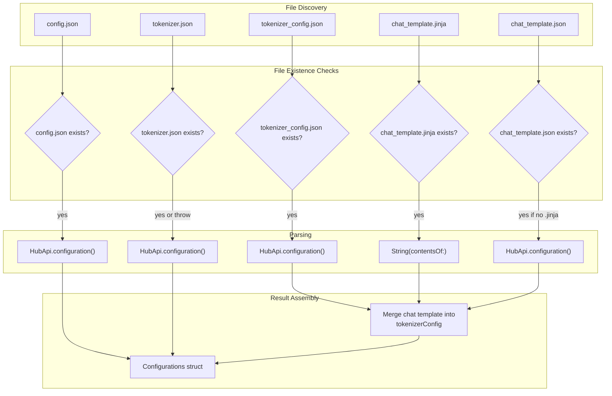
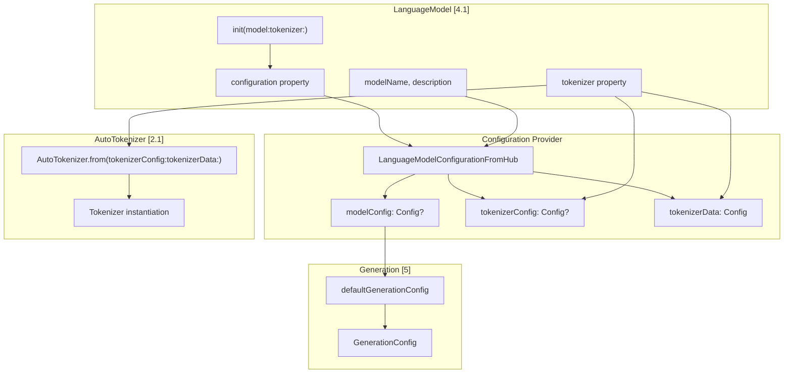
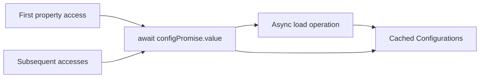

<!-- source: DeepWiki mcp.deepwiki.com · repo huggingface/swift-transformers · page 4.4 Model Configuration · fetched 2026-10-26 -->

# Model Configuration

<details>
<summary>Relevant source files</summary>

The following files were used as context for generating this wiki page:

- [Sources/Hub/Hub.swift](Sources/Hub/Hub.swift)
- [Sources/Models/LanguageModel.swift](Sources/Models/LanguageModel.swift)
- [Sources/Models/LanguageModelTypes.swift](Sources/Models/LanguageModelTypes.swift)

</details>


This document explains how model configurations are loaded, parsed, and accessed in swift-transformers. Model configuration provides essential metadata about a language model's architecture, parameters, and behavior, enabling proper initialization of tokenizers and generation settings.

For information about loading and initializing models themselves, see [Language Model](#4.1). For tokenizer-specific configuration details, see [AutoTokenizer](#2.1).

## Overview

Model configuration in swift-transformers involves three primary configuration files downloaded from the Hugging Face Hub or loaded from local directories:

| Configuration File | Purpose | Required |
|-------------------|---------|----------|
| `config.json` | Model architecture parameters, BOS/EOS tokens, model type | Optional (but recommended) |
| `tokenizer_config.json` | Tokenizer-specific settings, chat templates | Optional |
| `tokenizer.json` | Vocabulary, merge rules, pipeline components | Required |

These configurations are loaded asynchronously via the `LanguageModelConfigurationFromHub` class and accessed through properties on the `LanguageModel` instance.

**Sources:** [Sources/Hub/Hub.swift:111-340](), [Sources/Models/LanguageModel.swift:323-433]()

## Configuration Loading Architecture

The following diagram illustrates the flow of configuration data from the Hub to model components:



**Sources:** [Sources/Hub/Hub.swift:117-154](), [Sources/Models/LanguageModel.swift:31-52]()

## LanguageModelConfigurationFromHub

The `LanguageModelConfigurationFromHub` class manages asynchronous configuration loading from the Hugging Face Hub or local directories. It uses a `Task`-based promise pattern to load configurations once and cache them for subsequent access.

### Initialization Patterns



The remote initialization path downloads required files using `HubApi.snapshot()`, while the local path reads files directly from disk:

[Sources/Hub/Hub.swift:132-140]() - Remote initialization with model name and revision
[Sources/Hub/Hub.swift:147-154]() - Local initialization from model folder
[Sources/Hub/Hub.swift:219-245]() - Remote loading implementation
[Sources/Hub/Hub.swift:247-317]() - Local loading implementation

**Sources:** [Sources/Hub/Hub.swift:117-340]()

## Configuration Properties on LanguageModel

The `LanguageModel` class exposes configuration data through asynchronous computed properties. These properties are defined in the extension at [Sources/Models/LanguageModel.swift:323-433]():

### Core Configuration Access



| Property | Return Type | Description |
|----------|-------------|-------------|
| `modelConfig` | `Config?` | Complete model configuration dictionary |
| `tokenizerConfig` | `Config?` | Tokenizer settings with fallback handling |
| `tokenizerData` | `Config` | Vocabulary and tokenizer data (required) |
| `modelType` | `String?` | Architecture identifier (e.g., "llama", "gpt2") |
| `textGenerationParameters` | `Config?` | Task-specific generation parameters |
| `bosTokenId` | `Int?` | Beginning-of-sequence token ID |
| `eosTokenId` | `Int?` | End-of-sequence token ID |
| `defaultDoSample` | `Bool` | Whether to use sampling by default |
| `tokenizer` | `Tokenizer` | Lazily-loaded tokenizer instance |

**Sources:** [Sources/Models/LanguageModel.swift:327-433]()

## Config Type Structure

The `Config` type is a wrapper around a dictionary-based configuration structure. It provides type-safe access to configuration values through dynamic member lookup and subscripting:



### Accessing Configuration Values

Configuration values are accessed through a chaining pattern that handles optional values and type conversions:

[Sources/Models/LanguageModel.swift:367-371]() - `modelType` accesses `config.modelType.string()`
[Sources/Models/LanguageModel.swift:397-402]() - `bosTokenId` accesses `config.bosTokenId.integer()`
[Sources/Models/LanguageModel.swift:408-413]() - `eosTokenId` accesses `config.eosTokenId.integer()`

**Sources:** [Sources/Models/LanguageModel.swift:323-433]()

## Model Type Detection and Fallback

The system includes a fallback mechanism for tokenizer configurations when they are missing or incomplete from the Hub:



The fallback mechanism is implemented in [Sources/Hub/Hub.swift:174-196]() with the following logic:

1. If Hub config exists and contains `tokenizer_class`, return it as-is
2. If Hub config exists but lacks `tokenizer_class`, check for fallback config
3. Merge fallback config with Hub config (fallback values take precedence)
4. If no fallback exists, guess the class by capitalizing the model type
5. If no Hub config exists, attempt to load fallback config from bundle

Fallback configuration files are stored in `Sources/Hub/Resources/` with the naming pattern `{modelType}_tokenizer_config.json`.

**Sources:** [Sources/Hub/Hub.swift:174-196](), [Sources/Hub/Hub.swift:319-339]()

## Text Generation Parameters

Model configurations can include task-specific parameters for text generation, accessed through the `textGenerationParameters` property:



The access pattern follows the chain: `modelConfig.taskSpecificParams.textGeneration.doSample`

[Sources/Models/LanguageModel.swift:377-381]() - Accessing text generation parameters
[Sources/Models/LanguageModel.swift:387-391]() - Extracting `defaultDoSample` with fallback to `true`

These parameters inform the default generation configuration created in [Sources/Models/LanguageModel.swift:443-453]().

**Sources:** [Sources/Models/LanguageModel.swift:377-391](), [Sources/Models/LanguageModel.swift:443-453]()

## Configuration File Loading

The `loadConfig` method handles the actual file loading and parsing:



The loading process follows this priority for files:
1. `config.json` - Optional, parsed if present [Sources/Hub/Hub.swift:252-258]()
2. `tokenizer.json` - Required, throws if missing [Sources/Hub/Hub.swift:260-265]()
3. `tokenizer_config.json` - Optional, parsed if present [Sources/Hub/Hub.swift:267-272]()
4. Chat template - Prefers `.jinja` over `.json` [Sources/Hub/Hub.swift:274-288]()
5. Chat template merged into `tokenizerConfig` [Sources/Hub/Hub.swift:290-298]()

**Sources:** [Sources/Hub/Hub.swift:247-317]()

## Error Handling

Configuration loading includes comprehensive error handling with specific error types:

| Error Type | Scenario | Example |
|------------|----------|---------|
| `HubClientError.configurationMissing` | Required file not found | `tokenizer.json` missing |
| `HubClientError.networkError` | Network failure during download | No internet connection |
| `HubClientError.resourceNotFound` | Model repository not found | Invalid model name |
| `HubClientError.fileSystemError` | Local file read failure | Permission denied |
| `HubClientError.parseError` | JSON parsing failure | Malformed JSON |
| `TokenizerError.tokenizerConfigNotFound` | Tokenizer config unavailable | Config load failed |
| `TokenizerError.missingConfig` | Configuration not initialized | Nil configuration |

[Sources/Hub/Hub.swift:23-77]() - `HubClientError` definitions
[Sources/Hub/Hub.rst:230-243]() - Error conversion in remote loading
[Sources/Models/LanguageModel.swift:566-580]() - `TokenizerError` definitions

**Sources:** [Sources/Hub/Hub.swift:23-77](), [Sources/Hub/Hub.swift:230-243](), [Sources/Models/LanguageModel.swift:566-580]()

## Usage Patterns

### Accessing Model Configuration

```swift
// Accessing model type
let modelType = try await languageModel.modelType
// Returns: "llama", "gpt2", etc.

// Accessing special tokens
let bosToken = try await languageModel.bosTokenId
let eosToken = try await languageModel.eosTokenId

// Accessing generation parameters
let doSample = try await languageModel.defaultDoSample
```

All configuration properties are asynchronous and throw errors if configuration loading fails.

[Sources/Models/LanguageModel.swift:367-413]() - Async property implementations

### Loading from Remote vs Local

```swift
// Remote loading (automatic via LanguageModel init)
let lm = try LanguageModel.loadCompiled(url: modelURL, tokenizer: nil)
// Configuration loaded from Hub via modelName metadata

// Explicit remote configuration loading
let config = LanguageModelConfigurationFromHub(
    modelName: "microsoft/DialoGPT-medium",
    revision: "main"
)

// Local configuration loading
let config = LanguageModelConfigurationFromHub(
    modelFolder: localModelURL
)
```

[Sources/Models/LanguageModel.swift:48-51]() - Configuration initialization in `LanguageModel`
[Sources/Hub/Hub.swift:132-154]() - `LanguageModelConfigurationFromHub` initializers

**Sources:** [Sources/Models/LanguageModel.swift:48-51](), [Sources/Models/LanguageModel.swift:367-413](), [Sources/Hub/Hub.swift:132-154]()

## Configuration Integration with Other Components

The configuration system integrates with other modules through well-defined interfaces:



- **LanguageModel** stores a reference to `LanguageModelConfigurationFromHub` [Sources/Models/LanguageModel.swift:31-32]()
- **AutoTokenizer** receives parsed configurations via `from(tokenizerConfig:tokenizerData:)` [Sources/Models/LanguageModel.swift:429]()
- **Generation** uses model configuration for default parameters [Sources/Models/LanguageModel.swift:443-453]()

**Sources:** [Sources/Models/LanguageModel.swift:31-52](), [Sources/Models/LanguageModel.swift:422-433](), [Sources/Models/LanguageModel.swift:443-453]()

## Configuration Caching and Lazy Loading

Configuration loading uses a Task-based promise pattern to ensure configurations are loaded once and cached:



The `configPromise` is created during initialization [Sources/Hub/Hub.swift:137-139]() and stores a `Task<Configurations, Error>`. All property accesses await this same task, ensuring the configuration is loaded exactly once regardless of how many properties are accessed.

For the tokenizer, an additional layer of lazy loading occurs [Sources/Models/LanguageModel.swift:422-432]():
1. Check if `_tokenizer` is already initialized
2. If not, load configurations and create tokenizer via `AutoTokenizer.from()`
3. Cache the tokenizer in `_tokenizer` for future accesses

**Sources:** [Sources/Hub/Hub.swift:124-139](), [Sources/Models/LanguageModel.swift:422-432]()

---

