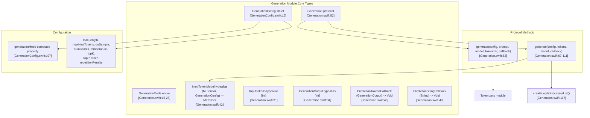
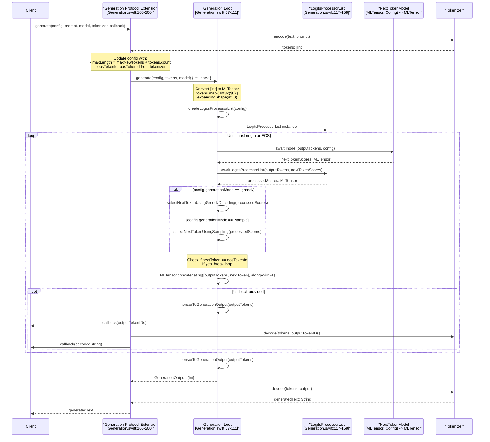
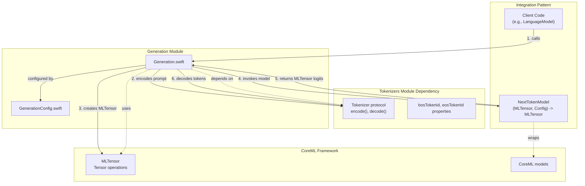

<!-- source: DeepWiki mcp.deepwiki.com · repo huggingface/swift-transformers · page 5 Generation · fetched 2026-10-26 -->

# Generation

<details>
<summary>Relevant source files</summary>

The following files were used as context for generating this wiki page:

- [Package.swift](Package.swift)
- [Sources/Generation/Generation.swift](Sources/Generation/Generation.swift)
- [Sources/Generation/GenerationConfig.swift](Sources/Generation/GenerationConfig.swift)

</details>


The Generation module orchestrates the text generation process in swift-transformers by coordinating tokenization, model inference, and token selection strategies. It implements the generation loop that repeatedly invokes the language model to predict next tokens, processes logits using configurable processors, and applies various decoding strategies (greedy, sampling) to produce coherent text outputs.

The module is structured around the `Generation` protocol, which defines the core generation methods, and the `GenerationConfig` structure, which specifies all generation parameters. The generation loop architecture supports streaming output through callbacks and integrates with the Tokenizers module for text encoding/decoding.

For configuration parameters, see [Generation Configuration](#5.1). For generation strategies, see [Generation Modes](#5.2). For logits modification techniques, see [Logits Processing](#5.3). For streaming capabilities, see [Streaming and Callbacks](#5.4).

**Platform Requirements:** macOS 15.0+, iOS 18.0+, tvOS 18.0+, visionOS 2.0+, watchOS 11.0+ (requires `MLTensor` support)

Sources: [Sources/Generation/Generation.swift:1-201](), [Package.swift:23]()

## Architecture Overview

### Module Structure

The Generation module consists of two primary files that define the generation system:

| File | Purpose |
|------|---------|
| `Generation.swift` | Defines `Generation` protocol, generation loop implementation, logits processor creation, and token selection strategies |
| `GenerationConfig.swift` | Defines `GenerationConfig` structure with all generation parameters and `GenerationMode` determination logic |

Sources: [Sources/Generation/Generation.swift:1-201](), [Sources/Generation/GenerationConfig.swift:1-124]()

### Core Type Definitions

**Generation Protocol and Related Types (Code Entity Mapping)**



**Type Definitions Summary:**

| Type | Definition | Purpose |
|------|------------|---------|
| `Generation` | Protocol | Defines generation interface with `generate()` methods |
| `GenerationMode` | Enum | Specifies strategy: `.greedy`, `.sample`, `.beam`, `.groupBeam`, `.contrastiveSearch`, `.unsupported` |
| `NextTokenModel` | `(MLTensor, GenerationConfig) async -> MLTensor` | Function type representing the model's next-token prediction |
| `InputTokens` | `[Int]` | Array of token IDs for model input |
| `GenerationOutput` | `[Int]` | Array of generated token IDs |
| `PredictionTokensCallback` | `(GenerationOutput) -> Void` | Callback for streaming token sequences |
| `PredictionStringCallback` | `(String) -> Void` | Callback for streaming decoded text |
| `GenerationConfig` | Struct | Configuration with all generation parameters |

Sources: [Sources/Generation/Generation.swift:15-63](), [Sources/Generation/GenerationConfig.swift:16-98]()

### Generation Protocol Interface

The `Generation` protocol defines the generation interface. It requires one method but provides a default implementation through a protocol extension:

**Required Method:**
```swift
func generate(
    config: GenerationConfig,
    prompt: String, 
    model: NextTokenModel,
    tokenizer: Tokenizer,
    callback: PredictionStringCallback?
) async -> String
```

**Extension-Provided Method:**
```swift
func generate(
    config: GenerationConfig,
    tokens: InputTokens,
    model: NextTokenModel,
    callback: PredictionTokensCallback?
) async -> GenerationOutput
```

The string-based `generate()` method (line 62) delegates to the token-based version (lines 67-111) after encoding the prompt. The token-based method implements the core generation loop logic.

Sources: [Sources/Generation/Generation.swift:52-63](), [Sources/Generation/Generation.swift:66-163]()

## Generation Loop Architecture

### High-Level Flow

**Generation Process Sequence Diagram**



Sources: [Sources/Generation/Generation.swift:66-200]()

### Generation Loop Implementation Details

The core generation loop (lines 67-111) implements the following steps:

**1. Initialization (lines 73-80):**
```
- Convert input tokens [Int] to MLTensor of Int32
- Expand tensor shape to add batch dimension
- Create LogitsProcessorList based on config
- Calculate maxTotalLength = min(maxLength, inputLength + maxNewTokens)
```

**2. Generation Loop (lines 82-109):**
```
while outputTokens.shape[1] < maxTotalLength:
    - Call model(outputTokens, config) to get raw logits
    - Apply logits processors to get processed scores
    - Select next token based on generation mode:
        * .greedy → selectNextTokenUsingGreedyDecoding()
        * .sample → selectNextTokenUsingSampling()
    - If next token is EOS, break loop
    - Concatenate next token to output tensor
    - If callback provided, invoke it with current tokens
```

**3. Return (line 110):**
```
- Convert final MLTensor to [Int] array using tensorToGenerationOutput()
```

The method uses `MLTensor` throughout for efficient tensor operations, only converting to standard Swift arrays at input/output boundaries.

Sources: [Sources/Generation/Generation.swift:67-163]()

### Logits Processor Creation

The `createLogitsProcessorList()` method (lines 117-158) builds a pipeline of logits processors based on the configuration:

| Processor | Condition | Order | Purpose |
|-----------|-----------|-------|---------|
| `RepetitionPenaltyLogitsProcessor` | `repetitionPenalty != 1.0` | 1st | Penalizes tokens that already appeared |
| `TemperatureLogitsWarper` | `temperature > 0 && temperature != 1.0` | 2nd | Scales logits to adjust randomness |
| `TopKLogitsWarper` | `topK > 0 && topK < Int.max` | 3rd | Filters to top K most likely tokens |
| `TopPLogitsWarper` | `topP < 1.0` | 4th | Filters to tokens in top P probability mass |
| `MinPLogitsWarper` | `minP != nil` | 5th | Filters tokens below minimum probability threshold |

The processors are applied in order, with repetition penalty first and sampling warpers (temperature, top-k, top-p, min-p) following.

Sources: [Sources/Generation/Generation.swift:117-158]()

## Token Selection Strategies

Token selection occurs after logits processing and determines which token to generate next. The strategy is determined by the `config.generationMode` property (lines 91-98).

### Implementation Status

| Mode | Implementation Status | Trigger Condition |
|------|----------------------|-------------------|
| `.greedy` | ✅ Implemented | `numBeams == 1, numBeamGroups == 1, doSample == false` |
| `.sample` | ✅ Implemented | `numBeams == 1, numBeamGroups == 1, doSample == true` |
| `.beam` | ❌ Not implemented | `numBeams >= 2, numBeamGroups == 1, doSample == false` |
| `.groupBeam` | ❌ Not implemented | `numBeams >= 2, numBeamGroups >= 2` |
| `.contrastiveSearch` | ❌ Not implemented | `topK > 1, !doSample, penaltyAlpha > 0` |

Sources: [Sources/Generation/Generation.swift:91-98](), [Sources/Generation/GenerationConfig.swift:107-121]()

### Greedy Decoding

**Method:** `selectNextTokenUsingGreedyDecoding(from: MLTensor) -> MLTensor`

Greedy decoding deterministically selects the token with the highest logit value. This produces consistent, reproducible outputs but may result in repetitive or less diverse text.

**Behavior:**
- Finds the argmax of the processed logits tensor
- Always returns the same token for the same input
- No randomness involved

**When Used:**
Set `config.doSample = false` with `numBeams = 1`

Sources: [Sources/Generation/Generation.swift:92-93]()

### Sampling

**Method:** `selectNextTokenUsingSampling(from: MLTensor) -> MLTensor`

Sampling introduces randomness by treating the processed logits as a probability distribution and randomly selecting a token according to these probabilities.

**Behavior:**
- Converts logits to probabilities (typically via softmax, handled by logits processors)
- Randomly samples from the distribution
- Produces diverse, creative outputs
- Each generation produces different results

**When Used:**
Set `config.doSample = true` with `numBeams = 1`

Sources: [Sources/Generation/Generation.swift:94-95]()

### Unimplemented Modes

Beam search, group beam search, and contrastive search will trigger a fatal error with the message: `"Generation mode {mode} not implemented yet"` (line 97).

Sources: [Sources/Generation/Generation.swift:96-98]()

## Stopping Criteria

The generation loop terminates when any of the following conditions are met:

### Maximum Length Check

```swift
while outputTokens.shape[1] < maxTotalLength
```

Where `maxTotalLength = min(config.maxLength, inputLength + config.maxNewTokens)` (line 80)

- `config.maxLength`: Absolute maximum total sequence length (input + output)
- `config.maxNewTokens`: Maximum number of new tokens to generate
- The loop uses the more restrictive limit

Sources: [Sources/Generation/Generation.swift:80-82]()

### End-of-Sequence Token

```swift
if let nextTokenId = await tensorToGenerationOutput(nextToken).first, 
   nextTokenId == config.eosTokenId {
    break
}
```

The loop breaks immediately when the model generates the EOS token, even if the maximum length has not been reached. The `eosTokenId` is typically set from the tokenizer (line 188).

Sources: [Sources/Generation/Generation.swift:100-102](), [Sources/Generation/Generation.swift:188]()

## Module Dependencies

**Generation Module Dependencies (Code Entity Mapping)**



### Dependency Summary

| Dependency | Usage | Code References |
|------------|-------|-----------------|
| **Tokenizers module** | Text encoding/decoding, special token IDs | [Generation.swift:12](), [Generation.swift:185-189]() |
| **CoreML (`MLTensor`)** | Tensor operations, model I/O | [Generation.swift:9](), [Generation.swift:74](), [Generation.swift:104]() |
| **Swift concurrency** | Async/await for model calls | [Generation.swift:42](), [Generation.swift:62]() |

The Generation module has a direct dependency on Tokenizers (specified in Package.swift line 23) and uses CoreML's `MLTensor` for tensor operations. It does not depend on the Models or Hub modules directly.

Sources: [Package.swift:23](), [Sources/Generation/Generation.swift:8-12]()

## Using the Generation Module

The primary entry point for text generation is the `generate` method:

```swift
func generate(config: GenerationConfig, prompt: String, model: NextTokenModel, tokenizer: Tokenizer, callback: PredictionStringCallback? = nil) async -> String
```

This method:
1. Encodes the input prompt to tokens
2. Configures the maximum length based on input tokens and desired new tokens
3. Selects the appropriate generation strategy based on the configuration
4. Applies the strategy to generate new tokens
5. Decodes the final token sequence back to text

If a callback is provided, it enables streaming generation, where partial results are sent back as they are generated.

Sources: [Sources/Generation/Generation.swift:71-91]()

## Conclusion

The Generation module provides a flexible and extensible system for text generation with language models. It supports multiple generation strategies with configurable parameters, allowing for a wide range of generation behaviors from deterministic to highly creative. The module is designed to work seamlessly with other components of swift-transformers, providing a complete solution for text generation tasks.

---

