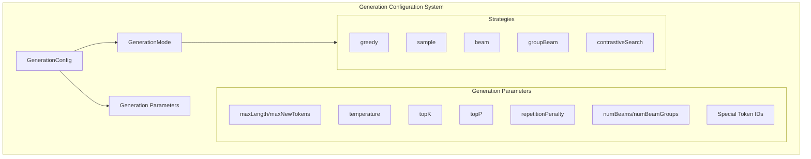
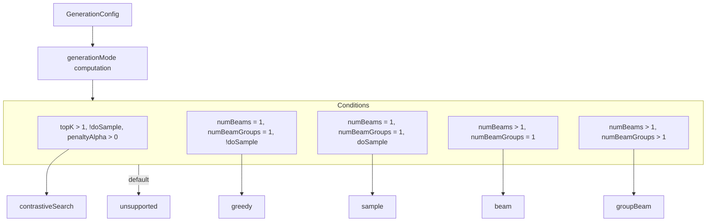
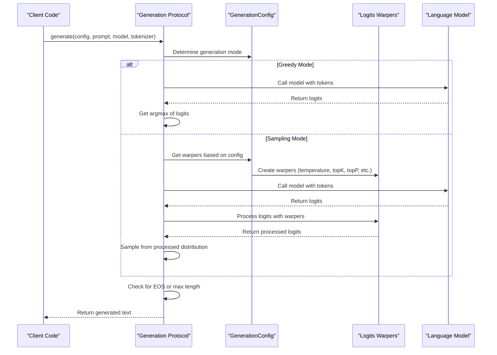
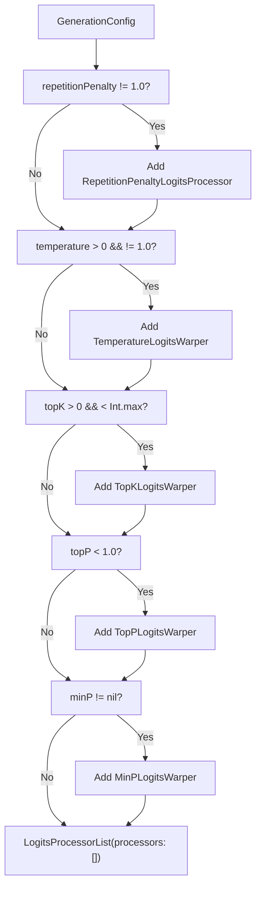
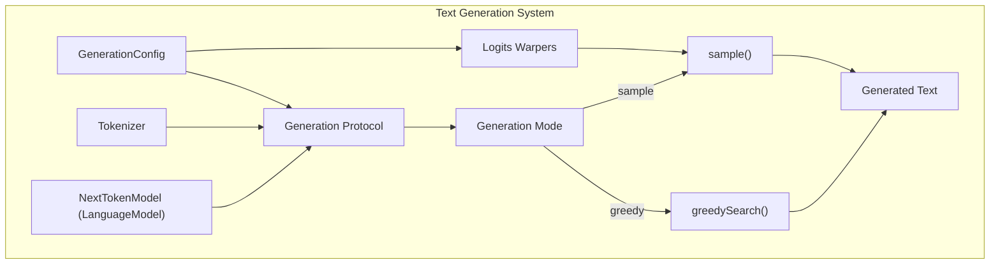

<!-- source: DeepWiki mcp.deepwiki.com · repo huggingface/swift-transformers · page 5.1 Generation Configuration · fetched 2026-10-26 -->

# Generation Configurations

<details>
<summary>Relevant source files</summary>

The following files were used as context for generating this wiki page:

- [Package.swift](Package.swift)
- [Sources/Generation/Generation.swift](Sources/Generation/Generation.swift)
- [Sources/Generation/GenerationConfig.swift](Sources/Generation/GenerationConfig.swift)

</details>


## Purpose and Scope

This document explains the configuration options available for text generation in swift-transformers. It covers the parameters that control how text is generated, the different generation strategies available, and how to use these configurations effectively. For information on how logits are processed during text generation, see [Logits Processing](#5.2).

## Overview

Generation configurations in swift-transformers allow fine-tuning of the text generation process. These configurations determine strategies such as greedy search or sampling, and control parameters like temperature and top-k filtering.



Sources: [Sources/Generation/GenerationConfig.swift:11-39](), [Sources/Generation/Generation.swift:12-19]()

## GenerationConfig Structure

The `GenerationConfig` struct contains all parameters needed to control the text generation process. It is defined in `GenerationConfig.swift` and includes the following properties:

| Parameter | Type | Default | Description |
|-----------|------|---------|-------------|
| `maxLength` | Int | 20 | Maximum total length of generated sequence (input + output tokens) |
| `maxNewTokens` | Int | - | Maximum number of new tokens to generate (required parameter) |
| `doSample` | Bool | false | Whether to use sampling instead of deterministic decoding |
| `numBeams` | Int | 1 | Number of beams for beam search (1 for greedy decoding) |
| `numBeamGroups` | Int | 1 | Number of beam groups for group beam search diversity |
| `penaltyAlpha` | Double? | nil | Penalty parameter for contrastive search |
| `temperature` | Float | 1.0 | Temperature for sampling (higher values increase randomness) |
| `topK` | Int | 50 | Number of top tokens to consider for top-k sampling |
| `topP` | Float | 1.0 | Cumulative probability threshold for top-p (nucleus) sampling |
| `minP` | Float? | nil | Minimum token probability threshold, scaled by most likely token's probability |
| `repetitionPenalty` | Float | 1.0 | Penalty for token repetition (1.0 means no penalty) |
| `padTokenId` | Int? | nil | Token ID used for padding sequences |
| `bosTokenId` | Int? | nil | Token ID for beginning of sequence |
| `eosTokenId` | Int? | nil | Token ID for end of sequence |

Sources: [Sources/Generation/GenerationConfig.swift:16-57]()

### Creating a Generation Configuration

```swift
// Basic configuration for generating 50 new tokens with greedy search
let greedyConfig = GenerationConfig(
    maxNewTokens: 50
)

// Configuration for sampling with temperature and top-p
let samplingConfig = GenerationConfig(
    maxNewTokens: 100,
    doSample: true,
    temperature: 0.7,
    topP: 0.9
)

// Configuration with repetition penalty and min-p sampling
let advancedConfig = GenerationConfig(
    maxNewTokens: 200,
    doSample: true,
    temperature: 0.8,
    topP: 0.95,
    minP: 0.05,
    repetitionPenalty: 1.2
)
```

Sources: [Sources/Generation/GenerationConfig.swift:73-97]()

## Generation Modes

The `GenerationMode` enum defines the available text generation strategies. The appropriate mode is determined automatically based on the parameters in the generation configuration.



Sources: [Sources/Generation/GenerationConfig.swift:100-121](), [Sources/Generation/Generation.swift:14-28]()

### Available Generation Modes

1. **Greedy Search** (`greedy`): Always selects the most likely next token. This is the default when `doSample` is false and `numBeams` is 1.

2. **Sampling** (`sample`): Randomly samples the next token from the probability distribution. Activated when `doSample` is true. Can be modified with `temperature`, `topK`, and `topP` parameters.

3. **Beam Search** (`beam`): Maintains multiple "beams" of possible token sequences and selects the sequence with the highest probability. Activated when `numBeams` > 1.

4. **Group Beam Search** (`groupBeam`): Extension of beam search that promotes diversity among groups of beams. Activated when `numBeamGroups` > 1.

5. **Contrastive Search** (`contrastiveSearch`): Balances high probability with diversity. Activated when `topK` > 1, `doSample` is false, and `penaltyAlpha` is set and greater than 0.

Sources: [Sources/Generation/GenerationConfig.swift:100-121](), [Sources/Generation/Generation.swift:14-28]()

### Mode Determination Logic

The `generationMode` computed property on `GenerationConfig` analyzes configuration parameters to automatically determine the appropriate generation algorithm. The logic follows this pattern:

1. **Contrastive Search Check**: First checks if `topK > 1`, `!doSample`, and `penaltyAlpha != nil && penaltyAlpha! > 0`
2. **Pattern Matching**: Then uses a switch statement on `(numBeams, numBeamGroups, doSample)` tuple:
   - `(1, 1, false)` → greedy
   - `(1, 1, true)` → sample
   - `(2..., 1, false)` → beam
   - `(2..., 2..., _)` → groupBeam
   - default → unsupported

Sources: [Sources/Generation/GenerationConfig.swift:107-120]()

## Integration with Generation Process

The generation configuration is used throughout the text generation process to control how tokens are generated.



Sources: [Sources/Generation/Generation.swift:66-111]()

## Logits Processors and Warpers

Based on the generation configuration, a series of logits processors are created and applied to modify the probability distribution before token selection. The `createLogitsProcessorList` function constructs these processors in a specific order:

### Processing Order

1. **Repetition Penalty** (`RepetitionPenaltyLogitsProcessor`): Applied first, before sampling warpers. Penalizes tokens that have already appeared in the generated sequence to reduce repetition. Only added if `repetitionPenalty != 1.0`.

2. **Temperature** (`TemperatureLogitsWarper`): Divides logits by the temperature value, making the distribution sharper (lower temperature) or more uniform (higher temperature). Only added if `temperature > 0 && temperature != 1.0`.

3. **Top-K** (`TopKLogitsWarper`): Keeps only the top K most likely tokens and sets all others to negative infinity. Only added if `topK > 0 && topK < Int.max`.

4. **Top-P/Nucleus** (`TopPLogitsWarper`): Keeps the most likely tokens whose cumulative probability exceeds the threshold P. Only added if `topP < 1.0`.

5. **Min-P** (`MinPLogitsWarper`): Applied after temperature scaling. Filters tokens based on their probability relative to the most likely token. Only added if `minP` is set.

Sources: [Sources/Generation/Generation.swift:117-158]()

### Processor Creation Logic

**Logits Processor List Creation**



This ordering is important because:
- Repetition penalty is applied before sampling warpers to affect raw logits
- Temperature scaling occurs before filtering (top-k, top-p) to properly scale the distribution
- Top-k filtering happens before top-p to reduce the candidate set
- Min-p is applied after temperature scaling, as it uses relative probabilities

Sources: [Sources/Generation/Generation.swift:117-158]()

## Special Token Handling

The `GenerationConfig` struct includes fields for special token IDs that control generation behavior:

| Token | Purpose |
|-------|---------|
| `eosTokenId` | End of sequence token - generation stops when this token is predicted |
| `bosTokenId` | Beginning of sequence token - used in some models as the first token |
| `padTokenId` | Padding token - used for alignment in batch processing |

### Token ID Assignment

Special token IDs are typically set from the tokenizer during generation initialization. The `generate` method automatically assigns `eosTokenId` and `bosTokenId` from the tokenizer:

```swift
generationConfig.eosTokenId = tokenizer.eosTokenId
generationConfig.bosTokenId = tokenizer.bosTokenId
```

The generation loop checks for the EOS token after each token prediction and terminates when it's encountered:

```swift
if let nextTokenId = await tensorToGenerationOutput(nextToken).first, 
   nextTokenId == config.eosTokenId {
    break
}
```

Sources: [Sources/Generation/GenerationConfig.swift:50-57](), [Sources/Generation/Generation.swift:100-102](), [Sources/Generation/Generation.swift:188-189]()

## Streaming Generation

The generation system supports streaming output through callback functions:

- `PredictionTokensCallback`: Called with the current sequence of tokens after each new token is generated
- `PredictionStringCallback`: Called with the decoded text after each new token is generated

This allows for real-time display of generated text, similar to the streaming interface in modern AI applications.

```swift
// Example of using streaming callbacks:
await generate(
    config: config,
    prompt: prompt,
    model: model,
    tokenizer: tokenizer
) { partialText in
    // Display or process the partial generated text
    print(partialText)
}
```

Sources: [Sources/Generation/Generation.swift:45-48](), [Sources/Generation/Generation.swift:178-199]()

## Relationship with Other Components

Generation configurations work together with other components in the swift-transformers library to enable text generation.



Sources: [Sources/Generation/Generation.swift:30-91]()

---

