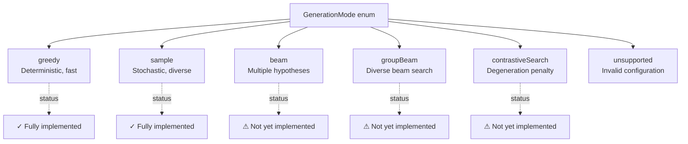
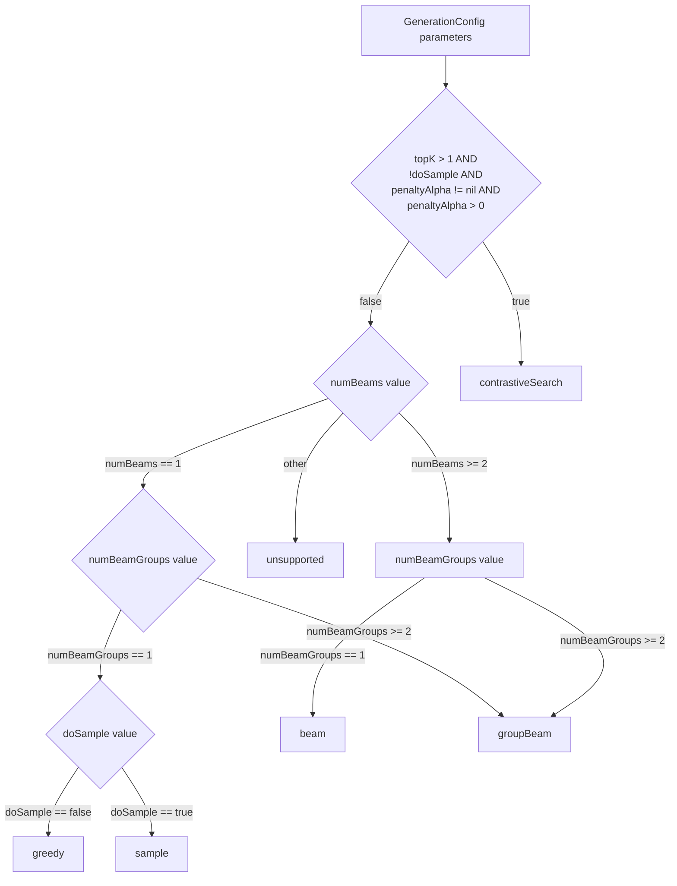
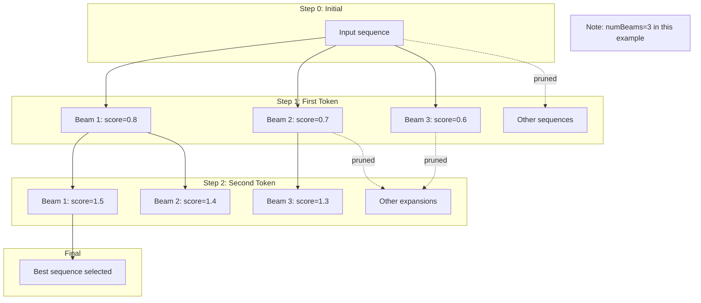
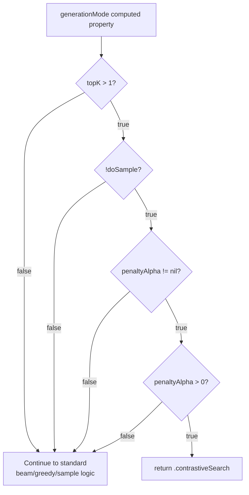
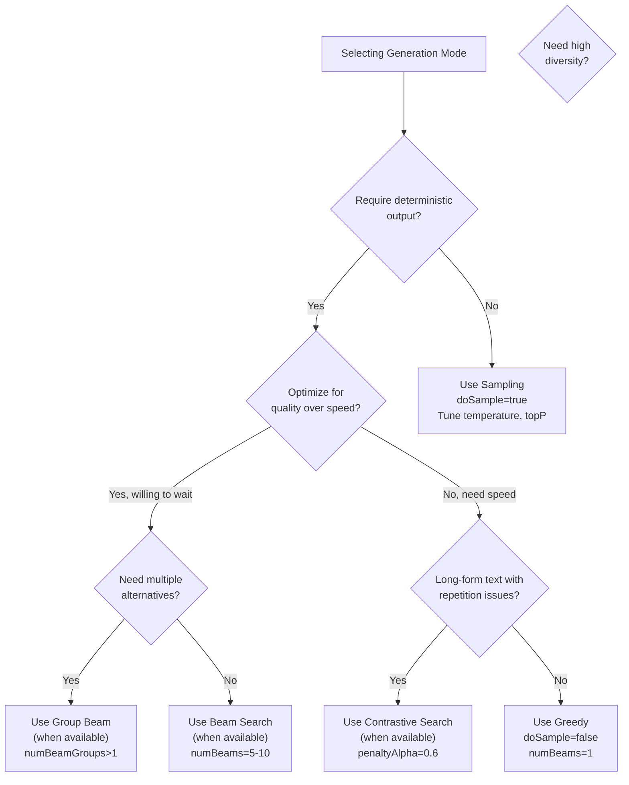

<!-- source: DeepWiki mcp.deepwiki.com · repo huggingface/swift-transformers · page 5.2 Generation Modes · fetched 2026-10-26 -->

# Generation Modes

<details>
<summary>Relevant source files</summary>

The following files were used as context for generating this wiki page:

- [Package.swift](Package.swift)
- [Sources/Generation/Generation.swift](Sources/Generation/Generation.swift)
- [Sources/Generation/GenerationConfig.swift](Sources/Generation/GenerationConfig.swift)

</details>


## Purpose and Scope

This document explains the different text generation strategies available in swift-transformers and how they are selected based on configuration parameters. Generation modes determine how the model selects the next token at each step of the generation process, affecting the quality, diversity, and computational cost of generated text.

For information about configuring generation parameters (temperature, top-k, etc.), see [Generation Configuration](#5.1). For details on how logits are processed before token selection, see [Logits Processing](#5.3). For implementing streaming output during generation, see [Streaming and Callbacks](#5.4).

## Overview

Generation modes define the strategy for selecting tokens during text generation. The system supports five distinct modes through the `GenerationMode` enum [Sources/Generation/Generation.swift:15-28]():

- **Greedy Decoding** - Always selects the most likely token
- **Sampling** - Probabilistically samples from filtered token distributions
- **Beam Search** - Maintains multiple candidate sequences
- **Group Beam Search** - Beam search with diversity constraints
- **Contrastive Search** - Balances model confidence with degeneration penalty

**Diagram: GenerationMode Enum Structure**



Sources: [Sources/Generation/Generation.swift:15-28]()

Currently, only **greedy** and **sample** modes are fully implemented. Attempting to use beam, groupBeam, or contrastiveSearch modes will result in a fatal error [Sources/Generation/Generation.swift:96-98]().

## Mode Selection Logic

The generation mode is automatically determined from `GenerationConfig` parameters through the `generationMode` computed property [Sources/Generation/GenerationConfig.swift:107-121](). The selection follows a decision tree based on three key parameters: `numBeams`, `numBeamGroups`, and `doSample`.

**Diagram: Mode Selection Decision Tree**



Sources: [Sources/Generation/GenerationConfig.swift:107-121]()

### Configuration Pattern Matching

The following table shows how parameter combinations map to generation modes:

| numBeams | numBeamGroups | doSample | penaltyAlpha | topK | Result Mode |
|----------|---------------|----------|--------------|------|-------------|
| 1 | 1 | false | - | - | **greedy** |
| 1 | 1 | true | - | - | **sample** |
| ≥2 | 1 | false | - | - | **beam** |
| ≥2 | ≥2 | any | - | - | **groupBeam** |
| any | any | false | >0 (not nil) | >1 | **contrastiveSearch** |
| other | other | other | - | - | **unsupported** |

Sources: [Sources/Generation/GenerationConfig.swift:107-121]()

## Greedy Decoding

Greedy decoding is the simplest and fastest generation mode. At each step, it selects the token with the highest probability from the model's output distribution.

### Algorithm

The greedy selection process [Sources/Generation/Generation.swift:93]() works as follows:

1. Obtain logits from the model for the current token sequence
2. Apply logits processors (temperature, repetition penalty, etc.)
3. Select the token with maximum probability using `selectNextTokenUsingGreedyDecoding`
4. Append the selected token to the sequence
5. Repeat until EOS token or max length

**Diagram: Greedy Decoding Flow**

```mermaid
sequenceDiagram
    participant Loop as "Generation Loop"
    participant Model as "NextTokenModel"
    participant Processors as "LogitsProcessorList"
    participant Selector as "selectNextTokenUsingGreedyDecoding"
    
    Loop->>Model: "await model(outputTokens, config)"
    Model-->>Loop: "nextTokenScores (MLTensor)"
    
    Loop->>Processors: "logitsProcessorList(outputTokens, scores)"
    Note over Processors: "Apply temperature,<br/>repetition penalty, etc."
    Processors-->>Loop: "processedScores"
    
    Loop->>Selector: "selectNextTokenUsingGreedyDecoding(scores)"
    Note over Selector: "argmax(processedScores)"
    Selector-->>Loop: "nextToken (highest probability)"
    
    Loop->>Loop: "Append nextToken to outputTokens"
    
    alt "nextToken == eosTokenId"
        Loop->>Loop: "Break generation loop"
    else "outputTokens.shape[1] < maxTotalLength"
        Loop->>Loop: "Continue loop"
    end
```

Sources: [Sources/Generation/Generation.swift:82-109]()

### Characteristics

**Advantages:**
- **Deterministic**: Same input always produces same output (when temperature=1.0 and no sampling)
- **Fast**: Single forward pass per token with no backtracking
- **Memory efficient**: No need to maintain multiple hypotheses

**Disadvantages:**
- **Repetitive**: Tends to generate repetitive text, especially in longer sequences
- **Low diversity**: Always chooses most likely token, limiting creative output
- **Local optimum**: May miss better sequences that start with lower-probability tokens

### When to Use

Greedy decoding is appropriate when:
- Deterministic output is required
- Generation speed is critical
- The task has a clear "correct" answer (e.g., translation, summarization)
- Memory constraints prevent beam search
- Using with strong repetition penalty to mitigate repetition issues

### Configuration Example

```swift
let config = GenerationConfig(
    maxNewTokens: 50,
    doSample: false,      // Must be false for greedy
    numBeams: 1,          // Must be 1 for greedy
    numBeamGroups: 1,     // Must be 1 for greedy
    repetitionPenalty: 1.2  // Helps reduce repetition
)
// Results in: config.generationMode == .greedy
```

Sources: [Sources/Generation/GenerationConfig.swift:113-119](), [Sources/Generation/Generation.swift:90-98]()

## Sampling

Sampling mode introduces randomness by probabilistically selecting tokens based on their likelihood rather than always choosing the most probable token. This enables diverse, creative text generation.

### Algorithm

The sampling process [Sources/Generation/Generation.swift:94-95]() follows these steps:

1. Obtain logits from the model
2. Apply logits processors in sequence:
   - Repetition penalty (discourages repeated tokens)
   - Temperature scaling (controls randomness)
   - Top-K filtering (keeps only K most likely tokens)
   - Top-P filtering (nucleus sampling - keeps tokens until cumulative probability reaches P)
   - Min-P filtering (removes tokens below minimum probability threshold)
3. Convert processed logits to probability distribution
4. Sample token from distribution using `selectNextTokenUsingSampling`
5. Append sampled token and repeat

**Diagram: Sampling Pipeline with Logits Processors**

```mermaid
flowchart LR
    subgraph "Generation Loop"
        Input["outputTokens"]
        Model["await model(outputTokens, config)"]
        Output["nextToken"]
    end
    
    subgraph "LogitsProcessorList Pipeline"
        Raw["Raw logits<br/>(MLTensor)"]
        
        RepPen["RepetitionPenaltyLogitsProcessor<br/>penalty != 1.0"]
        Temp["TemperatureLogitsWarper<br/>temperature != 1.0"]
        TopK["TopKLogitsWarper<br/>topK < Int.max"]
        TopP["TopPLogitsWarper<br/>topP < 1.0"]
        MinP["MinPLogitsWarper<br/>minP != nil"]
        
        Processed["Processed logits"]
    end
    
    subgraph "Sampling Strategy"
        Sample["selectNextTokenUsingSampling"]
        Prob["Convert to probabilities"]
        Random["Sample from distribution"]
    end
    
    Input --> Model
    Model --> Raw
    
    Raw --> RepPen
    RepPen --> Temp
    Temp --> TopK
    TopK --> TopP
    TopP --> MinP
    MinP --> Processed
    
    Processed --> Sample
    Sample --> Prob
    Prob --> Random
    Random --> Output
```



Sources: [Sources/Generation/Generation.swift:117-158](), [Sources/Generation/Generation.swift:82-109]()

### Key Parameters

Sampling behavior is controlled by parameters in `GenerationConfig`:

| Parameter | Type | Default | Effect |
|-----------|------|---------|--------|
| `temperature` | Float | 1.0 | Higher values increase randomness; lower values make distribution sharper |
| `topK` | Int | 50 | Keep only K most likely tokens; filters long tail |
| `topP` | Float | 1.0 | Nucleus sampling: keep tokens until cumulative probability reaches P |
| `minP` | Float? | nil | Keep tokens with probability ≥ minP × (max token probability) |
| `repetitionPenalty` | Float | 1.0 | Penalize tokens that already appeared; >1.0 discourages repetition |

Sources: [Sources/Generation/GenerationConfig.swift:36-48]()

### Characteristics

**Advantages:**
- **Diverse**: Generates varied outputs for same input
- **Creative**: Explores less probable but coherent continuations
- **Flexible**: Fine-tunable via temperature and filtering parameters
- **Natural**: Often produces more natural-sounding text than greedy

**Disadvantages:**
- **Non-deterministic**: Different outputs each run (unless seed is set)
- **Potentially incoherent**: May select unlikely tokens that break coherence
- **Requires tuning**: Need to experiment with parameters for optimal results

### When to Use

Sampling is appropriate for:
- Creative writing, story generation, dialogue
- Tasks requiring diverse outputs (multiple alternatives)
- Applications where slight randomness is acceptable or desirable
- Conversational AI where human-like variability is beneficial

### Configuration Examples

**High creativity (creative writing):**
```swift
let creativeConfig = GenerationConfig(
    maxNewTokens: 100,
    doSample: true,           // Enable sampling
    temperature: 0.9,         // High temperature for creativity
    topK: 50,                 // Consider top 50 tokens
    topP: 0.95,              // Nucleus sampling at 95%
    repetitionPenalty: 1.1   // Slight penalty to avoid repetition
)
// Results in: config.generationMode == .sample
```

**Focused sampling (summarization with variety):**
```swift
let focusedConfig = GenerationConfig(
    maxNewTokens: 50,
    doSample: true,           // Enable sampling
    temperature: 0.3,         // Low temperature for focus
    topK: 20,                 // Narrow to top 20 tokens
    topP: 0.9,               // Conservative nucleus sampling
    repetitionPenalty: 1.3   // Strong repetition penalty
)
// Results in: config.generationMode == .sample
```

Sources: [Sources/Generation/GenerationConfig.swift:73-97](), [Sources/Generation/GenerationConfig.swift:113-119]()

## Beam Search

Beam search maintains multiple candidate sequences (beams) simultaneously, expanding each by considering possible next tokens and keeping only the top-scoring complete sequences. This mode is **not yet implemented** in swift-transformers [Sources/Generation/Generation.swift:96-98]().

### Algorithm (Theoretical)

The beam search algorithm would work as follows:

1. Initialize with `numBeams` copies of the input sequence
2. For each position:
   - Expand each beam by considering all possible next tokens
   - Score each candidate continuation
   - Select top `numBeams` sequences by cumulative score
   - Prune lower-scoring sequences
3. Continue until all beams end with EOS or reach max length
4. Return highest-scoring complete sequence

**Diagram: Beam Search Expansion (Conceptual)**



### Configuration for Beam Search

When implemented, beam search would be triggered by:

```swift
let beamConfig = GenerationConfig(
    maxNewTokens: 50,
    doSample: false,         // Must be false
    numBeams: 5,             // Number of beams (>=2)
    numBeamGroups: 1         // Must be 1 for standard beam search
)
// Would result in: config.generationMode == .beam
```

Sources: [Sources/Generation/GenerationConfig.swift:27-30](), [Sources/Generation/GenerationConfig.swift:116]()

### When to Use (Future)

Beam search will be appropriate for:
- Tasks with objective quality metrics (translation, summarization)
- When higher quality is worth increased computation
- Applications requiring globally coherent sequences
- Scenarios where multiple alternatives should be considered

## Group Beam Search

Group beam search extends beam search by dividing beams into groups with diversity constraints, ensuring that different groups explore different parts of the search space. This mode is **not yet implemented** [Sources/Generation/Generation.swift:96-98]().

### Algorithm (Theoretical)

Group beam search would:

1. Divide `numBeams` beams into `numBeamGroups` groups
2. Apply diversity penalty to encourage groups to explore different paths
3. Within each group, perform standard beam search
4. Across groups, penalize tokens chosen by other groups
5. Return best sequence across all groups

### Configuration for Group Beam Search

When implemented, group beam search would be triggered by:

```swift
let groupBeamConfig = GenerationConfig(
    maxNewTokens: 50,
    doSample: false,         // Can be true or false
    numBeams: 6,             // Total beams (>=2)
    numBeamGroups: 3         // Groups (>=2), must divide numBeams evenly
)
// Would result in: config.generationMode == .groupBeam
```

Sources: [Sources/Generation/GenerationConfig.swift:27-30](), [Sources/Generation/GenerationConfig.swift:117]()

### When to Use (Future)

Group beam search will be appropriate for:
- Generating diverse alternatives (multiple story endings, varied translations)
- Avoiding degenerate repetitive sequences
- Applications requiring both quality and diversity
- Creative tasks where exploration of different themes is valuable

## Contrastive Search

Contrastive search combines model confidence with a degeneration penalty that discourages selecting tokens that make the sequence too similar to previous context. This mode is **not yet implemented** [Sources/Generation/Generation.swift:96-98]().

### Algorithm (Theoretical)

Contrastive search would:

1. Compute model probability for candidate tokens
2. Calculate degeneration penalty based on similarity to context
3. Combine: `score = (1 - penaltyAlpha) × P(token) - penaltyAlpha × degenerationPenalty`
4. Select token with highest combined score
5. Uses top-K to limit candidates considered

### Selection Logic

Contrastive search has special selection logic [Sources/Generation/GenerationConfig.swift:109-111]() that takes precedence over other modes when:

- `topK > 1` (considers multiple candidates)
- `doSample == false` (deterministic)
- `penaltyAlpha != nil` and `penaltyAlpha > 0` (penalty enabled)

**Diagram: Mode Selection Priority for Contrastive Search**



Sources: [Sources/Generation/GenerationConfig.swift:109-111]()

### Configuration for Contrastive Search

When implemented, contrastive search would be triggered by:

```swift
let contrastiveConfig = GenerationConfig(
    maxNewTokens: 50,
    doSample: false,         // Must be false
    topK: 4,                 // Must be >1
    penaltyAlpha: 0.6        // Degeneration penalty weight (0-1)
)
// Would result in: config.generationMode == .contrastiveSearch
```

Sources: [Sources/Generation/GenerationConfig.swift:33](), [Sources/Generation/GenerationConfig.swift:109-111]()

### When to Use (Future)

Contrastive search will be appropriate for:
- Long-form text generation where repetition is problematic
- Document completion tasks
- Scenarios requiring both coherence and non-repetitiveness
- When beam search is too expensive but greedy is too repetitive

## Implementation Architecture

The generation mode selection and execution is integrated into the core generation loop through a clean abstraction layer.

**Diagram: Generation Mode Integration in Code Flow**

```mermaid
sequenceDiagram
    participant Client as "Application Code"
    participant Gen as "Generation.generate<br/>(extension)"
    participant Config as "GenerationConfig"
    participant Loop as "Token Generation Loop"
    participant Selector as "Mode-Specific Selector"
    
    Client->>Gen: "generate(config, tokens, model, callback)"
    
    Gen->>Config: "config.generationMode"
    Note over Config: "Computed property analyzes<br/>numBeams, doSample, penaltyAlpha"
    Config-->>Gen: "GenerationMode enum value"
    
    Gen->>Loop: "Enter while loop<br/>(until EOS or maxLength)"
    
    loop "Each Generation Step"
        Loop->>Loop: "await model(outputTokens, config)"
        Loop->>Loop: "logitsProcessorList(tokens, scores)"
        
        Loop->>Selector: "switch config.generationMode"
        
        alt "case .greedy"
            Selector->>Selector: "selectNextTokenUsingGreedyDecoding"
            Selector-->>Loop: "Token with max probability"
        else "case .sample"
            Selector->>Selector: "selectNextTokenUsingSampling"
            Selector-->>Loop: "Sampled token from distribution"
        else "case .beam, .groupBeam, .contrastiveSearch"
            Selector->>Selector: "fatalError('not implemented')"
        end
        
        Loop->>Loop: "Check if nextToken == eosTokenId"
        Loop->>Loop: "Append nextToken to outputTokens"
        
        opt "If callback provided"
            Loop->>Client: "callback(outputTokens)"
        end
    end
    
    Loop-->>Gen: "Final outputTokens"
    Gen-->>Client: "GenerationOutput (tokens)"
```

Sources: [Sources/Generation/Generation.swift:67-111](), [Sources/Generation/GenerationConfig.swift:107-121]()

### Code Entities and Their Roles

| Code Entity | File Path | Role |
|-------------|-----------|------|
| `GenerationMode` | [Sources/Generation/Generation.swift:15-28]() | Enum defining available generation strategies |
| `GenerationConfig.generationMode` | [Sources/Generation/GenerationConfig.swift:107-121]() | Computed property that determines mode from config |
| `Generation.generate(tokens:)` | [Sources/Generation/Generation.swift:67-111]() | Main generation loop implementing mode selection |
| `selectNextTokenUsingGreedyDecoding` | [Sources/Generation/Generation.swift:93]() | Token selector for greedy mode |
| `selectNextTokenUsingSampling` | [Sources/Generation/Generation.swift:95]() | Token selector for sampling mode |
| `createLogitsProcessorList` | [Sources/Generation/Generation.swift:117-158]() | Builds processor pipeline based on config |

Sources: [Sources/Generation/Generation.swift:1-202](), [Sources/Generation/GenerationConfig.swift:1-124]()

## Comparison and Selection Guide

The following table summarizes the characteristics of each generation mode to guide selection:

| Mode | Status | Deterministic | Speed | Quality | Diversity | Memory | Best For |
|------|--------|---------------|-------|---------|-----------|--------|----------|
| **Greedy** | ✓ Implemented | Yes | Fastest | Good | Low | Minimal | Factual tasks, fast inference |
| **Sampling** | ✓ Implemented | No | Fast | Variable | High | Minimal | Creative writing, dialogue |
| **Beam** | Not implemented | Yes | Medium | High | Medium | High | Translation, summarization |
| **Group Beam** | Not implemented | Yes/No | Slow | High | High | Very High | Diverse alternatives |
| **Contrastive** | Not implemented | Yes | Fast | High | Medium | Minimal | Long-form text, avoiding repetition |

### Recommendation Decision Tree



## Practical Examples

### Example 1: Factual Question Answering (Greedy)

```swift
// Use greedy for deterministic, factual responses
let qaConfig = GenerationConfig(
    maxNewTokens: 50,
    doSample: false,
    repetitionPenalty: 1.2
)
// Mode: .greedy

let answer = await model.generate(
    config: qaConfig,
    prompt: "What is the capital of France?",
    model: languageModel.predictNextTokenScores,
    tokenizer: tokenizer
)
// Expected: Deterministic, factually correct answer
```

### Example 2: Creative Story Generation (Sampling)

```swift
// Use sampling for creative, diverse outputs
let storyConfig = GenerationConfig(
    maxNewTokens: 200,
    doSample: true,
    temperature: 0.8,
    topK: 50,
    topP: 0.95,
    repetitionPenalty: 1.15
)
// Mode: .sample

let story = await model.generate(
    config: storyConfig,
    prompt: "Once upon a time in a magical forest,",
    model: languageModel.predictNextTokenScores,
    tokenizer: tokenizer
)
// Expected: Creative, varied continuation with each run
```

### Example 3: Configuration That Would Use Beam Search (Not Yet Available)

```swift
// This configuration would use beam search when implemented
let translationConfig = GenerationConfig(
    maxNewTokens: 100,
    doSample: false,
    numBeams: 5  // Multiple beams
)
// Mode: .beam (but triggers fatalError currently)
```

Sources: [Sources/Generation/Generation.swift:178-199](), [Sources/Generation/GenerationConfig.swift:73-97]()

## Implementation Status and Future Work

### Currently Available

Only **greedy** and **sample** modes are production-ready:

- ✓ Greedy decoding with repetition penalty support
- ✓ Sampling with temperature, top-K, top-P, and min-P filtering
- ✓ Logits processor pipeline for both modes
- ✓ Streaming callbacks during generation

### Not Yet Implemented

The following modes will trigger a `fatalError` [Sources/Generation/Generation.swift:96-98]():

- ⚠ Beam search (`.beam`)
- ⚠ Group beam search (`.groupBeam`)
- ⚠ Contrastive search (`.contrastiveSearch`)

### Unsupported Configurations

Invalid parameter combinations result in `.unsupported` mode [Sources/Generation/GenerationConfig.swift:118](), which should be validated before calling generation.

**Example of unsupported configuration:**
```swift
let invalidConfig = GenerationConfig(
    maxNewTokens: 50,
    doSample: true,
    numBeams: 5  // Invalid: sampling with beams
)
// Mode: .unsupported
```

Sources: [Sources/Generation/Generation.swift:90-98](), [Sources/Generation/GenerationConfig.swift:107-121]()

---

