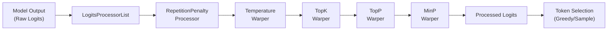
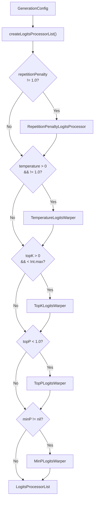
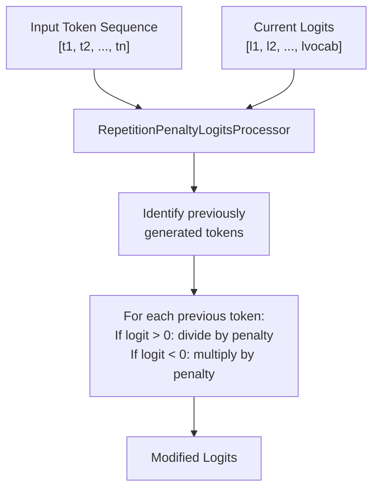
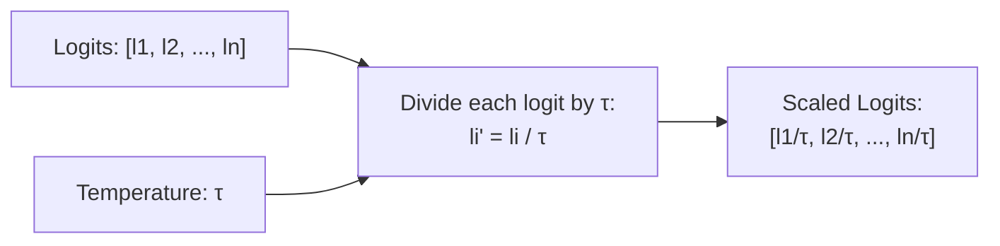
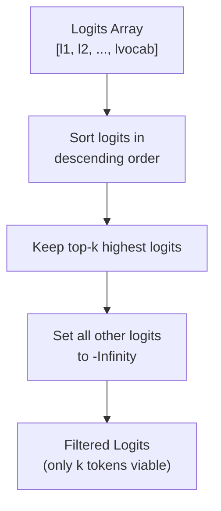
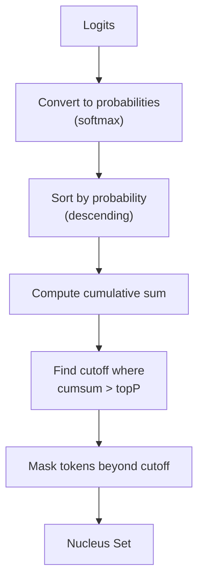
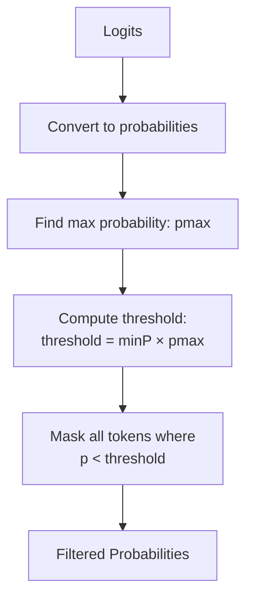
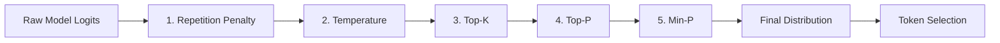
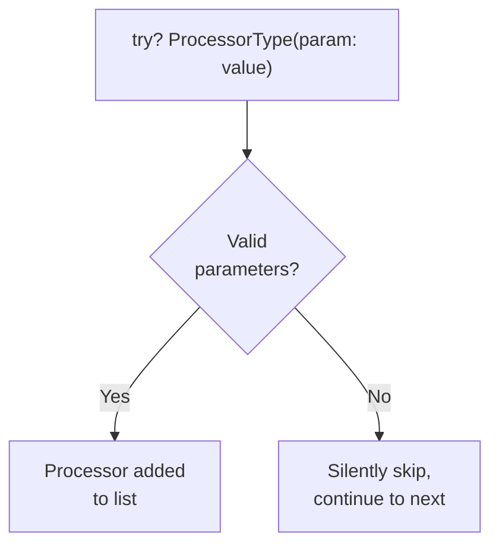
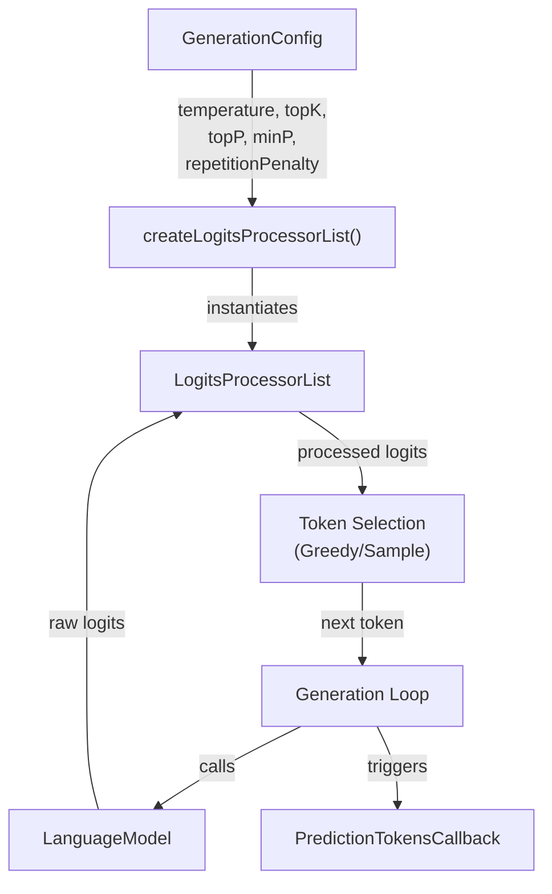

<!-- source: DeepWiki mcp.deepwiki.com · repo huggingface/swift-transformers · page 5.3 Logits Processing · fetched 2026-10-26 -->

# Logits Processing

<details>
<summary>Relevant source files</summary>

The following files were used as context for generating this wiki page:

- [Sources/Generation/Generation.swift](Sources/Generation/Generation.swift)

</details>


## Purpose and Scope

This document describes the logits processing system in swift-transformers, which modifies raw model output probabilities to control text generation behavior. Logits processors apply transformations such as temperature scaling, top-k filtering, top-p (nucleus) sampling, and repetition penalties to shape the probability distribution before token selection.

For information about configuring these processors, see [Generation Configuration](#5.1). For information about how processed logits are used in different generation strategies, see [Generation Modes](#5.2).

---

## Overview

Logits processing is a critical step between model inference and token selection. The raw logits output from a language model represent unnormalized log-probabilities for each token in the vocabulary. Logits processors modify these scores to influence the generation behavior without changing the underlying model.

The system provides:
- **LogitsProcessorList**: A container that chains multiple processors in sequence
- **Individual Processors**: Specialized transformations for temperature, top-k, top-p, min-p, and repetition penalty
- **Conditional Application**: Processors are instantiated only when their corresponding configuration parameters are active

Sources: [Sources/Generation/Generation.swift:76-110]()

---

## System Architecture

### LogitsProcessorList

The `LogitsProcessorList` acts as a pipeline coordinator, applying processors sequentially to modify logits tensors. Each processor conforms to the `LogitsProcessor` protocol and implements a call signature that takes input tokens and current logits, returning modified logits.



**Diagram: Logits Processing Pipeline Flow**

The pipeline processes logits through each active processor in a fixed order. Each processor receives the accumulated token sequence (`outputTokens`) and the current logits, allowing context-aware modifications.

Sources: [Sources/Generation/Generation.swift:76-88](), [Sources/Generation/Generation.swift:117-158]()

---

## Processor Creation and Configuration

### Factory Method

The `createLogitsProcessorList` method instantiates processors based on `GenerationConfig` parameters. This approach ensures zero overhead when features are disabled—processors are only created when their configuration values differ from defaults.



**Diagram: Processor Instantiation Logic**

| Processor Type | Configuration Parameter | Default Value | Condition for Creation |
|----------------|------------------------|---------------|------------------------|
| `RepetitionPenaltyLogitsProcessor` | `repetitionPenalty` | `1.0` | `!= 1.0` |
| `TemperatureLogitsWarper` | `temperature` | `1.0` | `> 0 && != 1.0` |
| `TopKLogitsWarper` | `topK` | `0` | `> 0 && < Int.max` |
| `TopPLogitsWarper` | `topP` | `1.0` | `< 1.0` |
| `MinPLogitsWarper` | `minP` | `nil` | `!= nil` |

**Table: Processor Creation Conditions**

Sources: [Sources/Generation/Generation.swift:117-158]()

---

## Individual Processors

### RepetitionPenaltyLogitsProcessor

Applies a penalty to tokens that have already appeared in the generated sequence, reducing the likelihood of repetitive text. The penalty is multiplicative: tokens that appeared previously have their logits divided by the penalty factor if positive, or multiplied if negative.

**Purpose**: Discourage verbatim repetition of tokens
**Order**: Applied first (before sampling warpers)
**Configuration**: `GenerationConfig.repetitionPenalty` (Float, default: 1.0)



**Diagram: Repetition Penalty Processing**

**Example**: If the sequence contains token ID 42 and `repetitionPenalty = 1.5`:
- If `logits[42] = 3.0` → modified to `3.0 / 1.5 = 2.0`
- If `logits[42] = -1.0` → modified to `-1.0 * 1.5 = -1.5`

Sources: [Sources/Generation/Generation.swift:121-125]()

---

### TemperatureLogitsWarper

Scales all logits by dividing by the temperature value. Lower temperatures make the distribution more peaked (favoring high-probability tokens), while higher temperatures flatten the distribution (increasing randomness).

**Purpose**: Control randomness of token selection
**Order**: Applied after repetition penalty, before filtering
**Configuration**: `GenerationConfig.temperature` (Double, default: 1.0)



**Diagram: Temperature Scaling**

| Temperature | Effect | Use Case |
|-------------|--------|----------|
| < 1.0 (e.g., 0.5) | Sharper distribution, more deterministic | Factual/precise generation |
| = 1.0 | No change | Default behavior |
| > 1.0 (e.g., 1.5) | Flatter distribution, more random | Creative/diverse generation |

**Table: Temperature Effects**

**Mathematical Formula**:
```
logits'[i] = logits[i] / temperature
```

Sources: [Sources/Generation/Generation.swift:127-132]()

---

### TopKLogitsWarper

Filters out all tokens except the k most probable ones by setting their logits to negative infinity. This limits the sampling space to a fixed number of top candidates.

**Purpose**: Limit sampling to k most probable tokens
**Order**: Applied after temperature, before top-p
**Configuration**: `GenerationConfig.topK` (Int, default: 0 = disabled)



**Diagram: Top-K Filtering**

**Example**: With `topK = 5` and vocabulary size 50,000:
- The 5 tokens with highest logits remain unchanged
- The remaining 49,995 tokens have logits set to `-∞`
- Only these 5 tokens can be sampled

**Special Case**: If `topK >= vocabSize`, the processor effectively does nothing (all tokens remain viable).

Sources: [Sources/Generation/Generation.swift:134-141]()

---

### TopPLogitsWarper

Implements nucleus sampling by keeping the smallest set of tokens whose cumulative probability exceeds threshold p. This allows dynamic vocabulary size based on the probability distribution.

**Purpose**: Adaptive filtering based on cumulative probability
**Order**: Applied after top-k, before min-p
**Configuration**: `GenerationConfig.topP` (Double, default: 1.0 = disabled)



**Diagram: Top-P (Nucleus) Sampling**

**Example**: With `topP = 0.9`:
- Probabilities: [0.5, 0.25, 0.15, 0.05, 0.03, 0.02]
- Cumulative: [0.5, 0.75, 0.90, 0.95, 0.98, 1.0]
- Keep tokens 0-2 (cumsum reaches 0.90), mask tokens 3-5

**Advantage over Top-K**: Adapts to the shape of the distribution. Peaked distributions use fewer tokens; flat distributions use more.

Sources: [Sources/Generation/Generation.swift:143-148]()

---

### MinPLogitsWarper

Filters out tokens whose probability falls below `minP * max_probability`. Unlike top-p which considers cumulative probability, min-p sets an absolute threshold relative to the most probable token.

**Purpose**: Filter tokens below relative probability threshold
**Order**: Applied last (after temperature and top-p)
**Configuration**: `GenerationConfig.minP` (Double?, default: nil = disabled)



**Diagram: Min-P Filtering**

**Example**: With `minP = 0.1`:
- Max probability: 0.6
- Threshold: 0.1 × 0.6 = 0.06
- Keep all tokens with probability ≥ 0.06, mask the rest

**Comparison with Top-P**:
- Top-P: "Keep tokens until we have 90% of total probability mass"
- Min-P: "Keep tokens that are at least 10% as likely as the most probable token"

Sources: [Sources/Generation/Generation.swift:150-155]()

---

## Processing Order and Rationale

The order in which processors are applied is significant:



**Diagram: Complete Processing Order**

| Stage | Processor | Rationale |
|-------|-----------|-----------|
| 1 | Repetition Penalty | Modifies logits before any sampling transformations; context-dependent |
| 2 | Temperature | Scales all logits uniformly; affects downstream probability calculations |
| 3 | Top-K | Hard cutoff filter; removes tokens before probabilistic filtering |
| 4 | Top-P | Probability-based filter; works on already-scaled and reduced set |
| 5 | Min-P | Final refinement filter; operates on temperature-scaled probabilities |

**Table: Processing Stage Rationale**

This ordering ensures:
1. Context-aware modifications happen first (repetition penalty)
2. Global scaling happens before filtering (temperature)
3. Hard filters precede soft filters (top-k before top-p)
4. Relative thresholds are applied last (min-p after temperature)

Sources: [Sources/Generation/Generation.swift:117-158]()

---

## Integration with Generation Loop

### Application in Generation

The logits processors are invoked within the main generation loop after model inference and before token selection:

```mermaid
sequenceDiagram
    participant Loop as "Generation Loop"
    participant Model as "model()"
    participant LPL as "LogitsProcessorList"
    participant Sel as "Token Selection"
    
    Loop->>Model: outputTokens
    Model-->>Loop: nextTokenScores (raw logits)
    
    Loop->>LPL: (outputTokens, nextTokenScores)
    Note over LPL: Apply each processor<br/>in sequence
    LPL-->>Loop: processedScores
    
    Loop->>Sel: processedScores, config.generationMode
    
    alt Greedy
        Sel->>Sel: argmax(processedScores)
    else Sample
        Sel->>Sel: sample from distribution
    end
    
    Sel-->>Loop: nextToken
```

**Diagram: Logits Processing in Generation Sequence**

The code flow at [Sources/Generation/Generation.swift:82-98]():

1. **Model Inference**: `await model(outputTokens, config)` produces raw logits
2. **Logits Processing**: `await logitsProcessorList(outputTokens, nextTokenScores)` applies transformations
3. **Token Selection**: Based on `config.generationMode` (greedy or sample)
4. **Output Accumulation**: Selected token appended to `outputTokens`

Sources: [Sources/Generation/Generation.swift:82-98]()

---

## Configuration Examples

### Example 1: Greedy Decoding (No Processing)

```swift
let config = GenerationConfig(
    maxNewTokens: 100,
    temperature: 1.0,        // No temperature scaling
    topK: 0,                  // No top-k filtering
    topP: 1.0,                // No top-p filtering
    repetitionPenalty: 1.0    // No repetition penalty
)
// Result: Empty LogitsProcessorList, raw logits used directly
```

### Example 2: Conservative Sampling

```swift
let config = GenerationConfig(
    maxNewTokens: 100,
    temperature: 0.7,         // Slightly more deterministic
    topK: 50,                 // Consider only top 50 tokens
    topP: 0.9,                // Within those, keep 90% probability mass
    repetitionPenalty: 1.1    // Mild penalty for repetition
)
// Result: All processors active, conservative sampling
```

### Example 3: Creative Generation

```swift
let config = GenerationConfig(
    maxNewTokens: 100,
    temperature: 1.2,         // More random
    topK: 0,                  // No hard cutoff
    topP: 0.95,               // Keep most of probability mass
    repetitionPenalty: 1.3,   // Stronger anti-repetition
    minP: 0.05                // Filter very unlikely tokens
)
// Result: Diverse, creative output with controlled floor
```

### Example 4: Deterministic Output

```swift
let config = GenerationConfig(
    maxNewTokens: 100,
    temperature: 0.1,         // Very low temperature
    topK: 5,                  // Only top 5 tokens
    topP: 0.95,
    repetitionPenalty: 1.0
)
// Result: Near-greedy behavior with slight variation
```

Sources: [Sources/Generation/Generation.swift:117-158]()

---

## Error Handling

### Processor Initialization Failures

Each processor initialization is wrapped in a `try?` expression, silently ignoring invalid configurations:



**Diagram: Processor Initialization Error Handling**

**Invalid Parameter Examples**:
- `temperature <= 0` for TemperatureLogitsWarper
- `topP < 0` or `topP > 1` for TopPLogitsWarper
- `penalty <= 0` for RepetitionPenaltyLogitsProcessor

The generation continues with remaining valid processors if any initialization fails.

Sources: [Sources/Generation/Generation.swift:121-155]()

---

## Performance Considerations

### Processor Overhead

| Processor | Complexity | Notes |
|-----------|-----------|-------|
| RepetitionPenalty | O(n × m) | n = sequence length, m = unique tokens |
| Temperature | O(v) | v = vocabulary size, simple division |
| TopK | O(v log k) | Partial sort or selection |
| TopP | O(v log v) | Requires full sort and cumulative sum |
| MinP | O(v) | Single pass with max comparison |

**Table: Computational Complexity**

### Optimization Strategies

1. **Conditional Creation**: Processors only instantiated when needed (zero overhead for defaults)
2. **Sequential Application**: Each processor sees reduced tensor after filtering
3. **Tensor Operations**: MLTensor operations leverage hardware acceleration
4. **Early Termination**: EOS token check at [Sources/Generation/Generation.swift:100-102]() prevents unnecessary processing

Sources: [Sources/Generation/Generation.swift:117-158]()

---

## Relationship to Other Components



**Diagram: Logits Processing in Overall System Context**

- **GenerationConfig** ([#5.1](#5.1)): Provides parameters for processor creation
- **Generation Loop** ([Sources/Generation/Generation.swift:82-110]()): Orchestrates processing within iteration
- **Generation Modes** ([#5.2](#5.2)): Use processed logits for greedy/sampling decisions
- **Streaming Callbacks** ([#5.4](#5.4)): Receive tokens after selection

Sources: [Sources/Generation/Generation.swift:76-158]()

---

## Summary

The logits processing system provides fine-grained control over text generation behavior through:

1. **Modular Design**: Each processor implements a single transformation
2. **Configurable Pipeline**: Processors conditionally instantiated based on GenerationConfig
3. **Fixed Ordering**: Logical sequence ensures correct interaction between processors
4. **Zero Overhead**: Disabled features incur no runtime cost
5. **Extensible Architecture**: LogitsProcessor protocol allows custom implementations

The system strikes a balance between flexibility (supporting diverse generation strategies) and performance (minimal overhead for common cases).

Sources: [Sources/Generation/Generation.swift:1-202]()

---

