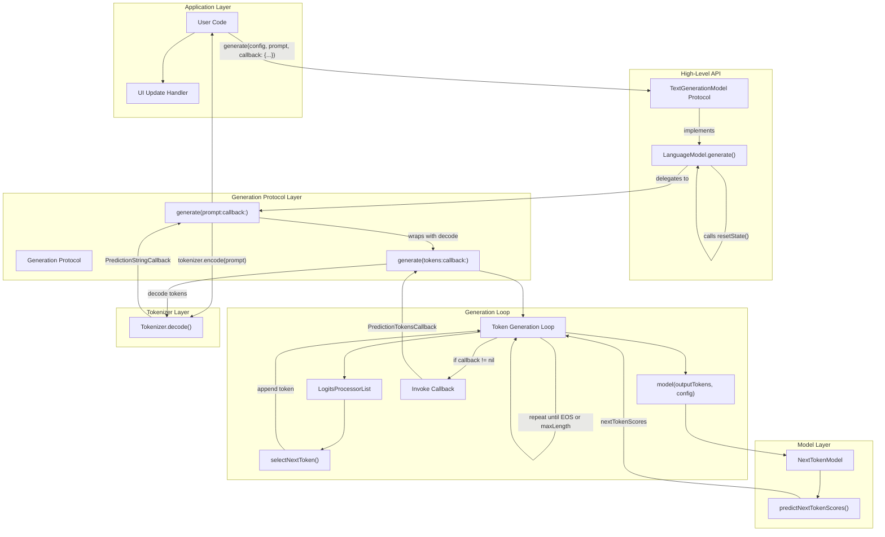
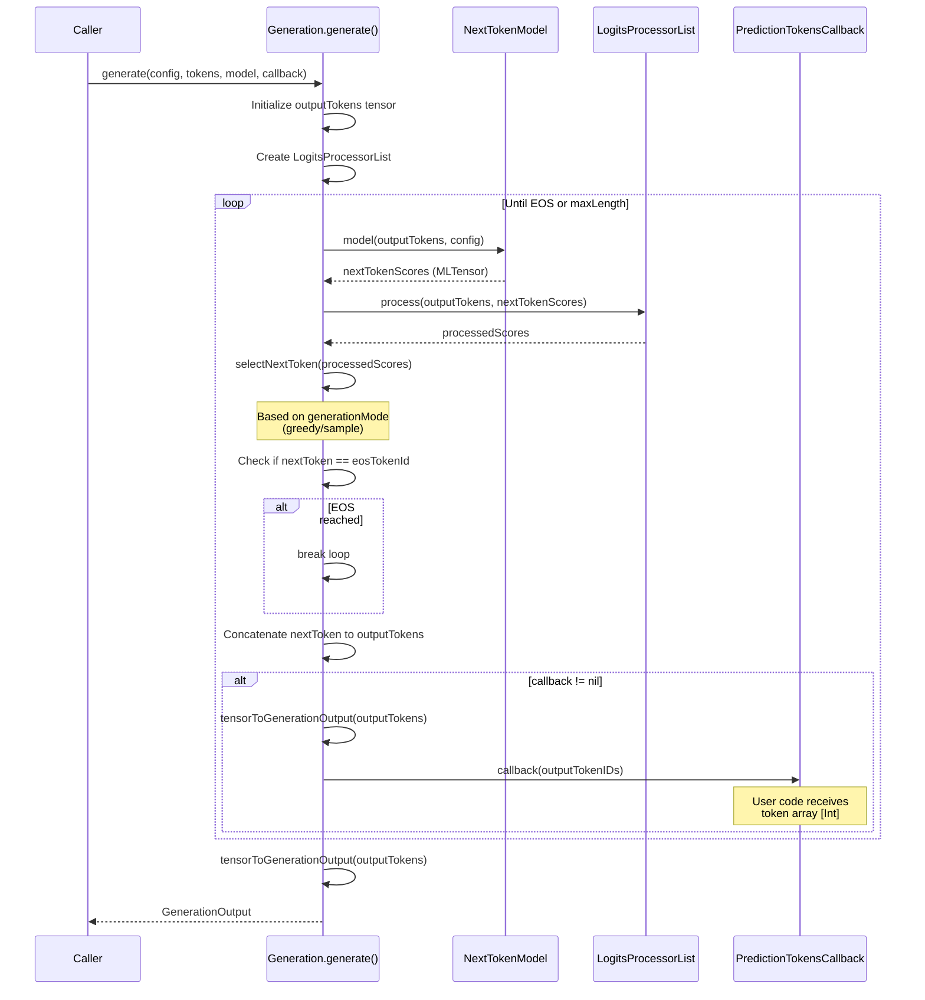
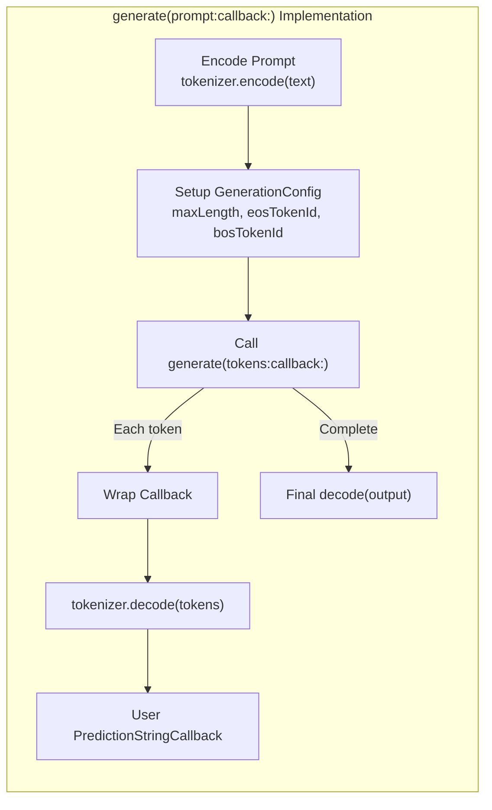
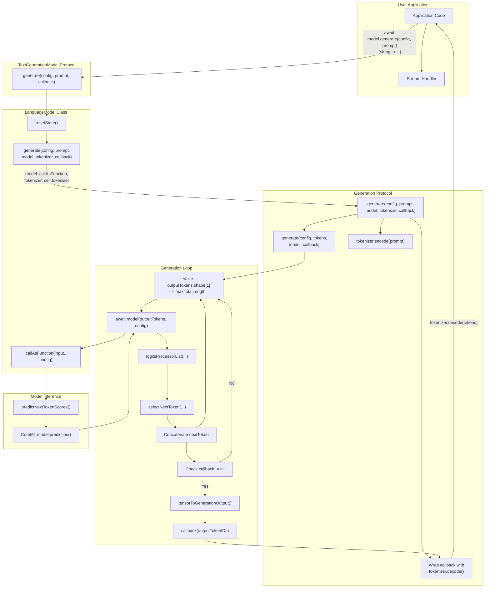

<!-- source: DeepWiki mcp.deepwiki.com · repo huggingface/swift-transformers · page 5.4 Streaming and Callbacks · fetched 2026-10-26 -->

# Streaming and Callbacks

<details>
<summary>Relevant source files</summary>

The following files were used as context for generating this wiki page:

- [Sources/Generation/Generation.swift](Sources/Generation/Generation.swift)
- [Sources/Models/LanguageModel.swift](Sources/Models/LanguageModel.swift)
- [Sources/Models/LanguageModelTypes.swift](Sources/Models/LanguageModelTypes.swift)

</details>


This document explains how to use callbacks to receive progressive output during text generation in swift-transformers. Callbacks enable streaming responses where partial results are delivered incrementally as tokens are generated, rather than waiting for the complete response.

For information about generation configuration and modes, see [Generation Configuration](#5.1) and [Generation Modes](#5.2).

## Purpose and Scope

The generation system provides two types of callbacks that allow applications to receive intermediate results during the generation loop:
- **Token-level callbacks** that receive arrays of token IDs after each new token is generated
- **String-level callbacks** that receive decoded text strings after each new token is generated

These callbacks enable real-time streaming interfaces, progress indicators, and responsive user experiences during potentially long-running generation tasks.

**Sources:** [Sources/Generation/Generation.swift:44-48]()

## Callback Type Definitions

The Generation module defines two distinct callback types as type aliases:

| Callback Type | Type Signature | Purpose |
|---------------|----------------|---------|
| `PredictionTokensCallback` | `(GenerationOutput) -> Void` | Receives token ID arrays during generation |
| `PredictionStringCallback` | `(String) -> Void` | Receives decoded text strings during generation |

Both callbacks are optional parameters in generation methods and are invoked synchronously after each token is generated.

**Sources:** [Sources/Generation/Generation.swift:44-48]()

### PredictionTokensCallback

```swift
public typealias PredictionTokensCallback = (GenerationOutput) -> Void
```

This callback receives the complete sequence of generated tokens (including the initial prompt tokens) after each generation step. The `GenerationOutput` type is defined as `[Int]`, representing an array of token IDs.

**Sources:** [Sources/Generation/Generation.swift:45]()

### PredictionStringCallback

```swift
public typealias PredictionStringCallback = (String) -> Void
```

This callback receives the decoded text representation of the generated tokens after each generation step. The string contains the complete output including both the original prompt and all generated text up to the current point.

**Sources:** [Sources/Generation/Generation.swift:48]()

## Callback Architecture

The following diagram shows how callbacks flow through the generation system:



**Sources:** [Sources/Generation/Generation.swift:66-111](), [Sources/Generation/Generation.swift:178-200](), [Sources/Models/LanguageModelTypes.swift:96-118]()

## Token-Level Callbacks in the Generation Loop

The token-level callback is invoked within the core generation loop after each token is appended to the output sequence:



The key callback invocation occurs at [Sources/Generation/Generation.swift:105-108]():

```swift
if let callback {
    let outputTokenIDs = await tensorToGenerationOutput(outputTokens)
    callback(outputTokenIDs)
}
```

**Sources:** [Sources/Generation/Generation.swift:66-111]()

## String-Level Callbacks via Tokenizer Decoding

String-level callbacks provide a higher-level interface by automatically decoding tokens to text. This is implemented as a wrapper around the token-level callback:



The implementation at [Sources/Generation/Generation.swift:184-198]() shows the wrapping pattern:

```swift
func generate(
    config: GenerationConfig,
    prompt: String,
    model: NextTokenModel,
    tokenizer: Tokenizer,
    callback: PredictionStringCallback? = nil
) async -> String {
    let tokens = tokenizer.encode(text: prompt)
    var generationConfig = config
    generationConfig.maxLength = config.maxNewTokens + tokens.count
    generationConfig.eosTokenId = tokenizer.eosTokenId
    generationConfig.bosTokenId = tokenizer.bosTokenId
    let output = await generate(
        config: generationConfig,
        tokens: tokens,
        model: model
    ) { tokens in
        callback?(tokenizer.decode(tokens: tokens))
    }
    
    return tokenizer.decode(tokens: output)
}
```

The callback wrapper at line 194-196 decodes the token array and passes the resulting string to the user's callback.

**Sources:** [Sources/Generation/Generation.swift:178-200]()

## Callback Flow in TextGenerationModel

The `TextGenerationModel` protocol provides the highest-level interface for generation with callbacks. The following diagram maps the complete callback flow from application code to the generation loop:



**Sources:** [Sources/Models/LanguageModelTypes.swift:96-118](), [Sources/Models/LanguageModel.swift:466-477](), [Sources/Generation/Generation.swift:178-200]()

## Using Callbacks in Practice

### Token-Level Callback Example

To receive raw token IDs during generation, pass a `PredictionTokensCallback` to the `generate` method that accepts token arrays:

```swift
let model = try LanguageModel.loadCompiled(url: modelURL)
await model.resetState()

let tokens = tokenizer.encode(text: "Hello world")
let output = await model.generate(
    config: config,
    tokens: tokens
) { tokenIDs in
    // Receives [Int] after each token generation
    print("Current tokens: \(tokenIDs)")
    // tokenIDs contains ALL tokens: prompt + generated so far
}
```

The callback receives the complete token sequence including the prompt on every invocation. To extract only the newly generated portion, track the prompt length separately.

**Sources:** [Sources/Models/LanguageModel.swift:466-477]()

### String-Level Callback Example

To receive decoded text during generation, use the higher-level `generate` method that accepts prompts and `PredictionStringCallback`:

```swift
let model = try LanguageModel.loadCompiled(url: modelURL)

let response = try await model.generate(
    config: config,
    prompt: "Explain quantum computing"
) { partialText in
    // Receives String after each token generation
    print("Streaming: \(partialText)")
    // Update UI with progressive output
    DispatchQueue.main.async {
        textView.text = partialText
    }
}
```

The `partialText` parameter contains the complete decoded output including the original prompt and all generated tokens up to the current point.

**Sources:** [Sources/Models/LanguageModelTypes.swift:106-118]()

## Callback Invocation Points

The following table summarizes where callbacks are invoked in the codebase:

| Location | Callback Type | Invocation Point | What Gets Passed |
|----------|---------------|------------------|------------------|
| [Sources/Generation/Generation.swift:105-108]() | `PredictionTokensCallback` | After each token is concatenated to `outputTokens` | Complete token array: `[prompt_tokens..., generated_tokens...]` |
| [Sources/Generation/Generation.swift:194-196]() | `PredictionStringCallback` | Wraps token callback and decodes | Complete decoded string from all tokens |
| [Sources/Models/LanguageModel.swift:471-476]() | `PredictionTokensCallback` | Delegates to `Generation.generate` | Passed through to generation loop |
| [Sources/Models/LanguageModelTypes.swift:111-116]() | `PredictionStringCallback` | Delegates to `Generation.generate` | Passed through with tokenizer decode wrapper |

**Sources:** [Sources/Generation/Generation.swift:66-111](), [Sources/Generation/Generation.swift:178-200](), [Sources/Models/LanguageModel.swift:466-477](), [Sources/Models/LanguageModelTypes.swift:96-118]()

## Callback Execution Characteristics

### Synchronous Execution

Callbacks are invoked synchronously within the generation loop. The generation process pauses until the callback returns. For UI updates or long-running operations, dispatch work to appropriate queues:

```swift
try await model.generate(config: config, prompt: prompt) { text in
    DispatchQueue.main.async {
        // UI updates on main queue
        self.updateStreamingText(text)
    }
}
```

### Frequency of Invocation

Callbacks are invoked exactly once per generated token. For a response generating 100 new tokens, the callback will be called 100 times. The first invocation includes the prompt tokens plus the first generated token.

### Token Array Contents

The token array passed to `PredictionTokensCallback` always contains:
1. **Prompt tokens** (positions 0 to prompt_length-1)
2. **Generated tokens** (positions prompt_length to current_length-1)

The array grows by one element on each callback invocation. To extract only new tokens, compare against the previous callback's array length or track the initial prompt length.

**Sources:** [Sources/Generation/Generation.swift:104-108]()

## Integration with Generation Modes

Callbacks work uniformly across all generation modes defined in `GenerationMode`:

| Generation Mode | Callback Behavior | Notes |
|-----------------|-------------------|-------|
| `.greedy` | Called after each greedy selection | Deterministic output, single beam |
| `.sample` | Called after each sampled token | Non-deterministic, temperature/top-k/top-p applied |
| `.beam` | Not yet implemented | Would require batch callback support |
| `.groupBeam` | Not yet implemented | Would require batch callback support |
| `.contrastiveSearch` | Not yet implemented | Would require batch callback support |

Currently, callbacks are fully functional with greedy and sampling modes. Beam search modes are not yet implemented.

**Sources:** [Sources/Generation/Generation.swift:90-98]()

## Best Practices

### 1. Minimize Callback Work

Keep callbacks lightweight since they execute synchronously in the generation loop:

```swift
// Good: Quick UI dispatch
try await model.generate(config: config, prompt: prompt) { text in
    DispatchQueue.main.async {
        self.textView.text = text
    }
}

// Avoid: Heavy processing in callback
try await model.generate(config: config, prompt: prompt) { text in
    // Don't do expensive work here
    let processed = heavyProcessing(text) // Blocks generation
}
```

### 2. Choose Appropriate Callback Type

- Use `PredictionTokensCallback` when you need token-level control (e.g., custom decoding, token filtering)
- Use `PredictionStringCallback` for typical streaming text display scenarios

### 3. Handle State Resets

Call `resetState()` before generation to ensure clean state for models with KV cache:

```swift
await model.resetState() // Important for stateful models
let output = try await model.generate(config: config, prompt: prompt) { text in
    streamHandler(text)
}
```

**Sources:** [Sources/Models/LanguageModelTypes.swift:107-108]()

### 4. Extract Incremental Changes

Since callbacks receive the complete output each time, extract only new content if needed:

```swift
var previousLength = 0
try await model.generate(config: config, prompt: prompt) { text in
    let newText = String(text.dropFirst(previousLength))
    previousLength = text.count
    streamHandler(newText) // Only the new portion
}
```

### 5. Optional Callbacks

All callback parameters are optional. Omit them for non-streaming use cases:

```swift
// No streaming, just final result
let result = try await model.generate(config: config, prompt: prompt)
```

**Sources:** [Sources/Generation/Generation.swift:183](), [Sources/Models/LanguageModelTypes.swift:106]()

## Related Components

The callback system interacts with several other generation components:

- **[GenerationConfig](#5.1)**: Determines when generation stops (maxLength, maxNewTokens, eosTokenId)
- **[LogitsProcessorList](#5.3)**: Applied before token selection, affects what callbacks receive
- **[Generation Modes](#5.2)**: Determines how tokens are selected (greedy vs sampling)
- **[TextGenerationModel Protocol](#4.0)**: Provides the high-level interface for generation with callbacks

Callbacks are invoked after logits processing and token selection, but before EOS checking. This ensures applications receive every generated token including the final EOS token (if configured).

**Sources:** [Sources/Generation/Generation.swift:82-108]()

---

