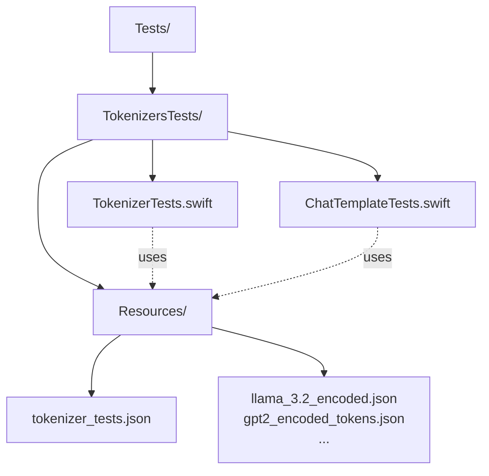
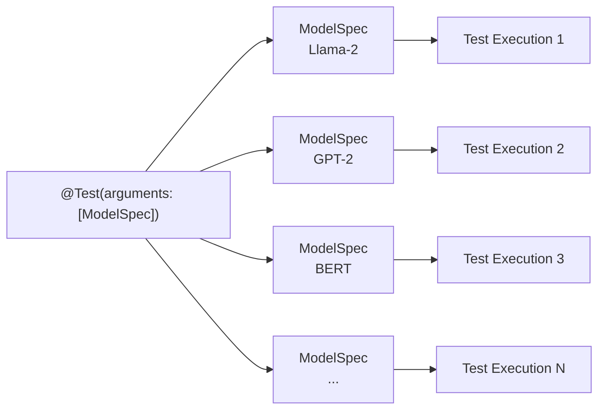
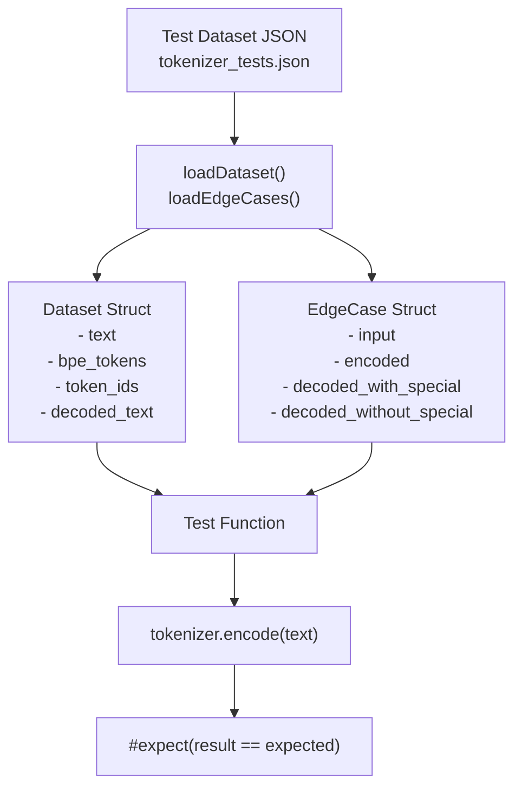
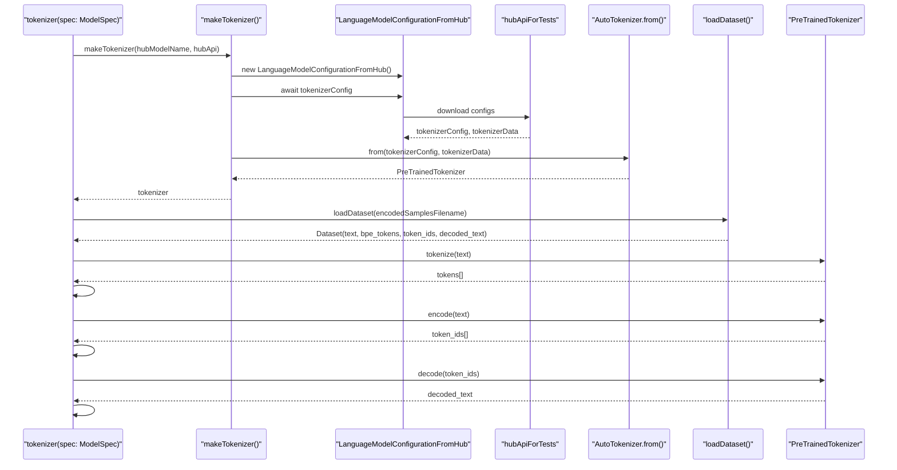
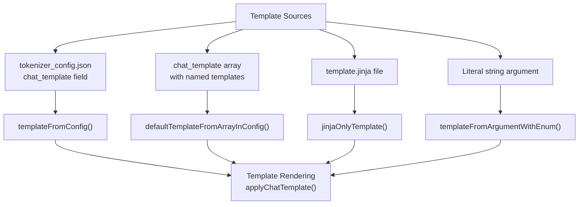

<!-- source: DeepWiki mcp.deepwiki.com · repo huggingface/swift-transformers · page 6 Testing · fetched 2026-10-26 -->

# Testing

<details>
<summary>Relevant source files</summary>

The following files were used as context for generating this wiki page:

- [Tests/TokenizersTests/ChatTemplateTests.swift](Tests/TokenizersTests/ChatTemplateTests.swift)
- [Tests/TokenizersTests/Resources/llama_3.2_encoded.json](Tests/TokenizersTests/Resources/llama_3.2_encoded.json)
- [Tests/TokenizersTests/Resources/tokenizer_tests.json](Tests/TokenizersTests/Resources/tokenizer_tests.json)
- [Tests/TokenizersTests/TokenizerTests.swift](Tests/TokenizersTests/TokenizerTests.swift)

</details>


This document covers the testing infrastructure for swift-transformers, explaining how tests are organized, the testing framework used, key test patterns, and how to run tests. The codebase uses dataset-driven testing with reference implementations to ensure tokenizers and other components produce correct results.

For information about specific tokenizer testing strategies, see [Tokenizer Testing](#6.1). For Hub integration tests, see [Hub Testing](#6.2).

---

## Testing Framework

The swift-transformers codebase uses **Swift Testing**, Apple's modern testing framework introduced in Swift 6. This framework replaces the older XCTest and provides better support for parameterized tests, async testing, and clearer test organization.

### Key Framework Features

| Feature | Usage | Example |
|---------|-------|---------|
| `@Suite` | Defines a test suite grouping related tests | `@Suite("Tokenizer Tests")` |
| `@Test` | Marks individual test functions | `@Test func tokenizer() async throws` |
| `@Test(arguments:)` | Parameterized tests with multiple inputs | `@Test(arguments: [ModelSpec(...)])` |
| `#expect()` | Assertions for test validation | `#expect(encoded == expected)` |
| `Issue.record()` | Records test failures with messages | `Issue.record("Missing fixture")` |
| `async throws` | Async test functions with error propagation | `func test() async throws { ... }` |

The framework is imported via `import Testing` and does not require test functions to be prefixed with "test" or inherit from a base class.

**Sources:** [Tests/TokenizersTests/TokenizerTests.swift:1-20]()

---

## Test Organization

Tests are organized in a parallel directory structure to the main source code, with dedicated test suites for each module.



### Test Directory Structure

- **Tests/TokenizersTests/** - All tokenizer-related tests
  - `TokenizerTests.swift` - Core tokenizer encoding/decoding tests
  - `ChatTemplateTests.swift` - Chat template functionality tests
  - **Resources/** - Test data fixtures
    - `tokenizer_tests.json` - Edge case validation data
    - `*_encoded.json` - Expected encoding samples for various models

**Sources:** [Tests/TokenizersTests/TokenizerTests.swift:1-10](), [Tests/TokenizersTests/ChatTemplateTests.swift:1-10]()

---

## Test Suites

### TokenizerTests Suite

The main tokenizer test suite validates encoding, decoding, and tokenization across multiple model types using parameterized testing.

```swift
@Suite("Tokenizer Tests")
struct TokenizerTests {
    @Test(arguments: [
        ModelSpec("coreml-projects/Llama-2-7b-chat-coreml", "llama_encoded", 0),
        ModelSpec("distilbert/distilbert-base-multilingual-cased", "distilbert_cased_encoded", 100),
        ModelSpec("distilgpt2", "gpt2_encoded_tokens", 50256),
        // ... more models
    ])
    func tokenizer(spec: ModelSpec) async throws {
        // Test implementation
    }
}
```

**Sources:** [Tests/TokenizersTests/TokenizerTests.swift:96-134]()

### ChatTemplateTests Suite

The chat template test suite validates Jinja template rendering, message formatting, and tool specification support.

```swift
@Suite("Chat Template Tests")
struct ChatTemplateTests {
    @Test("Loading template from tokenizer config")
    func templateFromConfig() async throws { ... }
    
    @Test("Template from argument with enum")
    func templateFromArgumentWithEnum() async throws { ... }
}
```

**Sources:** [Tests/TokenizersTests/ChatTemplateTests.swift:13-49]()

---

## Parameterized Testing Pattern

The codebase extensively uses parameterized tests to validate behavior across multiple models with a single test function. This pattern reduces code duplication and ensures consistent validation across different tokenizer implementations.



### ModelSpec Structure

The `ModelSpec` struct encapsulates test parameters for each model:

```swift
struct ModelSpec: Sendable, CustomStringConvertible {
    let hubModelName: String              // Hub identifier
    let encodedSamplesFilename: String    // JSON fixture file
    let unknownTokenId: Int?              // Expected unknown token ID
}
```

**Sources:** [Tests/TokenizersTests/TokenizerTests.swift:78-92]()

---

## Dataset-Driven Testing

Tests validate tokenizer correctness by comparing outputs against pre-computed reference datasets stored in JSON files. This approach ensures tokenizers match reference implementations (typically from Hugging Face's Python tokenizers).



### Dataset Structure

```swift
private struct Dataset: Decodable {
    let text: String              // Input text
    let bpe_tokens: [String]      // Expected tokens
    let token_ids: [Int]          // Expected token IDs
    let decoded_text: String      // Expected decoded output
}

private struct EdgeCase: Decodable {
    let input: String
    struct EncodedData: Decodable {
        let input_ids: [Int]
        let token_type_ids: [Int]?
        let attention_mask: [Int]
    }
    let encoded: EncodedData
    let decoded_with_special: String
    let decoded_without_special: String
}
```

**Sources:** [Tests/TokenizersTests/TokenizerTests.swift:25-53]()

### JSON Test Data Format

The `tokenizer_tests.json` file contains edge cases organized by model name:

```json
{
  "bert-base-uncased": [
    {
      "input": "hello world",
      "encoded": {
        "input_ids": [101, 7592, 2088, 102],
        "token_type_ids": [0, 0, 0, 0],
        "attention_mask": [1, 1, 1, 1]
      },
      "decoded_with_special": "[CLS] hello world [SEP]",
      "decoded_without_special": "hello world"
    }
  ]
}
```

**Sources:** [Tests/TokenizersTests/Resources/tokenizer_tests.json:1-10]()

---

## Test Execution Flow

The following diagram shows how a tokenizer test executes from initialization to validation, mapping natural language concepts to concrete code entities.



**Sources:** [Tests/TokenizersTests/TokenizerTests.swift:63-134]()

---

## Test Helpers and Utilities

### HubApi for Tests

Tests use a dedicated `HubApi` instance configured to download to a test-specific cache directory:

```swift
private let downloadDestination: URL = {
    let base = FileManager.default.urls(for: .cachesDirectory, in: .userDomainMask).first!
    return base.appending(component: "huggingface-tests")
}()

private let hubApiForTests = HubApi(downloadBase: downloadDestination)
```

This ensures test downloads don't interfere with the user's normal cache and can be cleaned up independently.

**Sources:** [Tests/TokenizersTests/TokenizerTests.swift:16-21]()

### makeTokenizer Helper

The `makeTokenizer()` helper function encapsulates the common pattern of downloading tokenizer configurations and instantiating a tokenizer:

```swift
private func makeTokenizer(hubModelName: String, hubApi: HubApi) async throws -> PreTrainedTokenizer {
    let config = LanguageModelConfigurationFromHub(modelName: hubModelName, hubApi: hubApi)
    guard let tokenizerConfig = try await config.tokenizerConfig else {
        throw TokenizerError.tokenizerConfigNotFound
    }
    let tokenizerData = try await config.tokenizerData
    let tokenizer = try AutoTokenizer.from(tokenizerConfig: tokenizerConfig, tokenizerData: tokenizerData)
    guard let pretrained = tokenizer as? PreTrainedTokenizer else {
        throw TestError.unsupportedTokenizer
    }
    return pretrained
}
```

**Sources:** [Tests/TokenizersTests/TokenizerTests.swift:63-74]()

### loadDataset and loadEdgeCases

These helper functions load test data from JSON fixtures bundled with the test target:

```swift
private func loadDataset(filename: String) throws -> Dataset {
    let url = Bundle.module.url(forResource: filename, withExtension: "json")!
    let json = try Data(contentsOf: url)
    let decoder = JSONDecoder()
    return try decoder.decode(Dataset.self, from: json)
}

private func loadEdgeCases(for hubModelName: String) throws -> [EdgeCase]? {
    let url = Bundle.module.url(forResource: "tokenizer_tests", withExtension: "json")!
    let json = try Data(contentsOf: url)
    let decoder = JSONDecoder()
    let cases = try decoder.decode([String: [EdgeCase]].self, from: json)
    return cases[hubModelName]
}
```

**Sources:** [Tests/TokenizersTests/TokenizerTests.swift:34-61]()

---

## Test Coverage Areas

### Core Tokenization Validation

The main test validates three fundamental operations for each model:

| Operation | Method | Validation |
|-----------|--------|------------|
| Tokenization | `tokenizer.tokenize(text)` | Tokens match expected string array |
| Encoding | `tokenizer.encode(text)` | Token IDs match expected integer array |
| Decoding | `tokenizer.decode(tokens)` | Decoded text matches expected string |

```swift
#expect(tokenizer.tokenize(text: dataset.text) == dataset.bpe_tokens)
#expect(tokenizer.encode(text: dataset.text) == dataset.token_ids)
#expect(tokenizer.decode(tokens: dataset.token_ids) == dataset.decoded_text)
```

**Sources:** [Tests/TokenizersTests/TokenizerTests.swift:112-114]()

### Edge Case Validation

If edge cases are available for a model, tests validate:
- Encoding matches expected token IDs
- Decoding with special tokens
- Decoding without special tokens (using `skipSpecialTokens: true`)

```swift
if let edgeCases = try? loadEdgeCases(for: spec.hubModelName) {
    for edgeCase in edgeCases {
        #expect(tokenizer.encode(text: edgeCase.input) == edgeCase.encoded.input_ids)
        #expect(tokenizer.decode(tokens: edgeCase.encoded.input_ids) == edgeCase.decoded_with_special)
        #expect(tokenizer.decode(tokens: edgeCase.encoded.input_ids, skipSpecialTokens: true) == edgeCase.decoded_without_special)
    }
}
```

**Sources:** [Tests/TokenizersTests/TokenizerTests.swift:117-123]()

### Unknown Token Handling

Tests verify that unknown token IDs are correctly configured and that non-existent tokens map to the unknown token ID:

```swift
let model = tokenizer.model
#expect(model.unknownTokenId == spec.unknownTokenId)
#expect(model.unknownTokenId == model.convertTokenToId("_this_token_does_not_exist_"))
if let unknownTokenId = model.unknownTokenId {
    #expect(model.unknownToken == model.convertIdToToken(unknownTokenId))
}
```

**Sources:** [Tests/TokenizersTests/TokenizerTests.swift:126-133]()

### Model-Specific Tests

The test suite includes targeted tests for specific models or scenarios:

| Test | Purpose | Model |
|------|---------|-------|
| `gemmaUnicode()` | Unicode normalization, BOM handling, added tokens | Gemma |
| `phi4()` | Special token handling | Phi-4 |
| `tokenizerFromLocalFolder()` | Loading from local directory | Generic |
| `legacyLlamaBehaviour()` | Legacy tokenization quirks | Llama variants |
| `robertaXLMTokenizer()` | RoBERTa-specific behavior | XLM-RoBERTa |
| `nllbTokenizer()` | Strict mode vs lenient mode | NLLB |
| `deepSeekPostProcessor()` | BOS token prepending | DeepSeek |
| `bertCased()` / `bertUncased()` | Case handling | BERT variants |
| `robertaEncodeDecode()` | Byte-level encoding | RoBERTa |

**Sources:** [Tests/TokenizersTests/TokenizerTests.swift:136-364]()

---

## Chat Template Testing

Chat template tests validate the template rendering system used for conversational AI models.

### Template Loading Tests

Tests verify templates can be loaded from various sources:



**Sources:** [Tests/TokenizersTests/ChatTemplateTests.swift:40-164]()

### Tool Specification Testing

The `qwen2_5WithTools()` test validates tool/function calling capabilities:

```swift
let getCurrentWeatherToolSpec: [String: Any] = [
    "type": "function",
    "function": [
        "name": "get_current_weather",
        "description": "Get the current weather in a given location",
        "parameters": [ /* ... */ ]
    ]
]

let encoded = try tokenizer.applyChatTemplate(
    messages: weatherQueryMessages, 
    tools: [getCurrentWeatherToolSpec]
)
```

The test verifies:
1. Tools are properly serialized into the prompt
2. The rendered prompt contains `<tools>` and `</tools>` XML tags
3. The JSON specification matches the input tool spec
4. The system message includes tool usage instructions

**Sources:** [Tests/TokenizersTests/ChatTemplateTests.swift:166-270]()

### Vision Model Template Testing

The `chatTemplateFromChatTemplateJson()` test validates vision model templates that handle multi-modal inputs:

```swift
let visionMessages = [
    [
        "role": "user",
        "content": [
            ["type": "text", "text": "What's in this image?"],
            ["type": "image", "image_url": "example.jpg"]
        ]
    ]
]
```

Tests verify that vision tokens (`<|vision_start|>`, `<|image_pad|>`, `<|vision_end|>`) are correctly inserted.

**Sources:** [Tests/TokenizersTests/ChatTemplateTests.swift:273-312]()

### Template Caching Performance

Tests measure the impact of template caching on performance:

```swift
@Test("Apply chat template performance with caching")
func applyChatTemplatePerformanceCached() async throws {
    // Prime cache once
    _ = try tokenizer.applyChatTemplate(messages: messages, chatTemplate: template)
    
    // Subsequent calls use cached compiled template
    let result = try tokenizer.applyChatTemplate(messages: messages, chatTemplate: template)
}

@Test("Apply chat template performance without caching")
func applyChatTemplatePerformanceUncached() async throws {
    // Vary the template to bypass memoization
    let uniqueTemplate = baseTemplate + "{# perf \(UUID().uuidString) #}"
    let result = try tokenizer.applyChatTemplate(messages: messages, chatTemplate: uniqueTemplate)
}
```

**Sources:** [Tests/TokenizersTests/ChatTemplateTests.swift:338-374]()

---

## Error Handling Tests

Tests validate proper error handling for invalid scenarios:

### Missing Chat Template

```swift
@Test("Apply template error handling")
func applyTemplateError() async throws {
    let tokenizer = try await AutoTokenizer.from(pretrained: "google-bert/bert-base-chinese")
    #expect(!tokenizer.hasChatTemplate)
    
    #expect(throws: TokenizerError.self) {
        try tokenizer.applyChatTemplate(messages: [])
    }
    
    do {
        _ = try tokenizer.applyChatTemplate(messages: [])
        Issue.record("Expected error was not thrown")
    } catch let tokenizerError as TokenizerError {
        if case .missingChatTemplate = tokenizerError {
            // Correct error caught
        } else {
            Issue.record("Expected .missingChatTemplate, but got \(tokenizerError)")
        }
    }
}
```

**Sources:** [Tests/TokenizersTests/ChatTemplateTests.swift:314-335]()

### Strict Mode Enforcement

The NLLB test validates strict mode enforcement in `AutoTokenizer.from()`:

```swift
@Test
func nllbTokenizer() async throws {
    do {
        _ = try await AutoTokenizer.from(pretrained: "Xenova/nllb-200-distilled-600M")
        Issue.record("Expected AutoTokenizer.from to throw for strict mode")
    } catch {
        // Expected to throw in normal (strict) mode
    }
    
    // no strict mode proceeds
    let tokenizerOpt = try await AutoTokenizer.from(
        pretrained: "Xenova/nllb-200-distilled-600M", 
        strict: false
    ) as? PreTrainedTokenizer
}
```

**Sources:** [Tests/TokenizersTests/TokenizerTests.swift:237-253]()

---

## Running Tests

### Command Line

Run all tests using Swift Package Manager:

```bash
swift test
```

Run tests for a specific module:

```bash
swift test --filter TokenizersTests
```

Run a specific test:

```bash
swift test --filter TokenizerTests.tokenizer
```

### Xcode

1. Open `Package.swift` in Xcode
2. Select the test target from the scheme selector
3. Use Product → Test (⌘U) to run all tests
4. Click the diamond icon next to individual tests to run them individually

### Test Output

Swift Testing provides detailed output including:
- Test suite and individual test names
- Parameter values for parameterized tests (e.g., `tokenizer(spec: coreml-projects/Llama-2-7b-chat-coreml)`)
- Assertion failures with actual vs expected values
- Execution time for each test

---

## Test Data Management

### Caching Strategy

Tests download models to a dedicated cache directory to avoid interfering with normal usage:

```swift
private let downloadDestination: URL = {
    let base = FileManager.default.urls(for: .cachesDirectory, in: .userDomainMask).first!
    return base.appending(component: "huggingface-tests")
}()
```

Tests that need a clean cache create their own subdirectories:

```swift
let downloadDestination = FileManager.default.urls(for: .cachesDirectory, in: .userDomainMask).first!
    .appending(component: "hf-local-pretrained-tests-downloads")

// ... run test ...

try FileManager.default.removeItem(at: downloadDestination)
```

**Sources:** [Tests/TokenizersTests/TokenizerTests.swift:16-21](), [Tests/TokenizersTests/TokenizerTests.swift:275-286]()

### Shared Tokenizer Instances

Chat template tests use shared tokenizer instances to avoid redundant downloads:

```swift
@MainActor
static let phiTokenizerTask = Task {
    try await AutoTokenizer.from(pretrained: "microsoft/Phi-3-mini-128k-instruct")
}

static func sharedPhiTokenizer() async throws -> Tokenizer {
    try await phiTokenizerTask.value
}
```

This pattern creates the tokenizer once and shares it across multiple tests in the suite.

**Sources:** [Tests/TokenizersTests/ChatTemplateTests.swift:22-29]()

---

## Best Practices

### Test Organization

1. **Group related tests in suites** using `@Suite` with descriptive names
2. **Use parameterized tests** for validating consistent behavior across models
3. **Separate edge cases** into dedicated JSON files for maintainability
4. **Use descriptive test names** that explain what is being validated

### Async Testing

1. **Mark test functions as `async throws`** when they perform async operations
2. **Use `await`** for async operations (downloads, configuration loading)
3. **Handle errors with `throws`** rather than try-catch when possible
4. **Use `@MainActor`** for shared state that must be accessed on the main thread

### Assertions

1. **Use `#expect()` for all assertions** - provides better failure messages than boolean checks
2. **Test both positive and negative cases** - verify correct behavior and error handling
3. **Validate all relevant properties** - token IDs, decoded text, special tokens, etc.
4. **Use `Issue.record()`** for custom failure messages when `#expect()` isn't sufficient

### Test Data

1. **Store expected outputs in JSON files** for complex test data
2. **Use `Bundle.module`** to access test resources
3. **Keep test data versioned** with the code that uses it
4. **Document the source** of reference data (e.g., "matches Python tokenizers output")

**Sources:** [Tests/TokenizersTests/TokenizerTests.swift:1-365](), [Tests/TokenizersTests/ChatTemplateTests.swift:1-375]()

---

