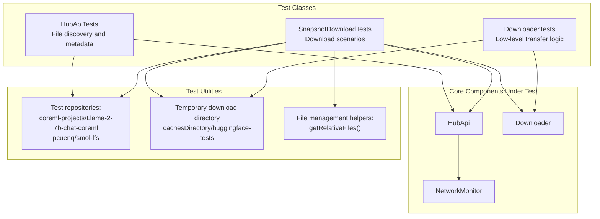
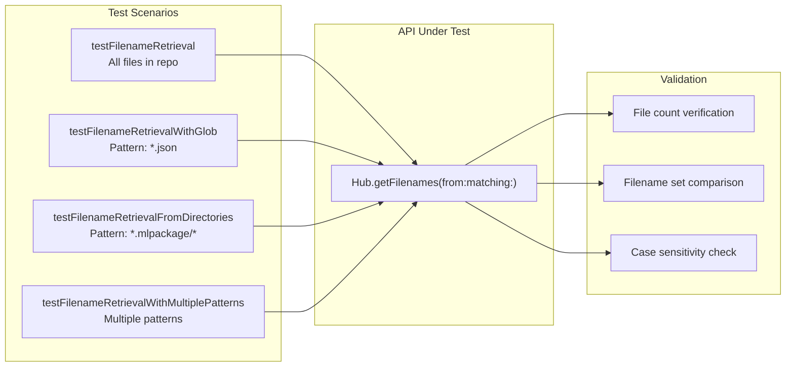
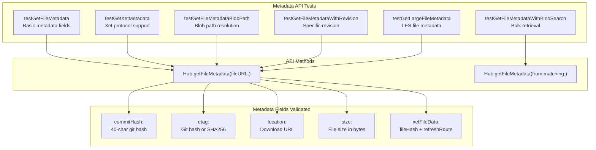
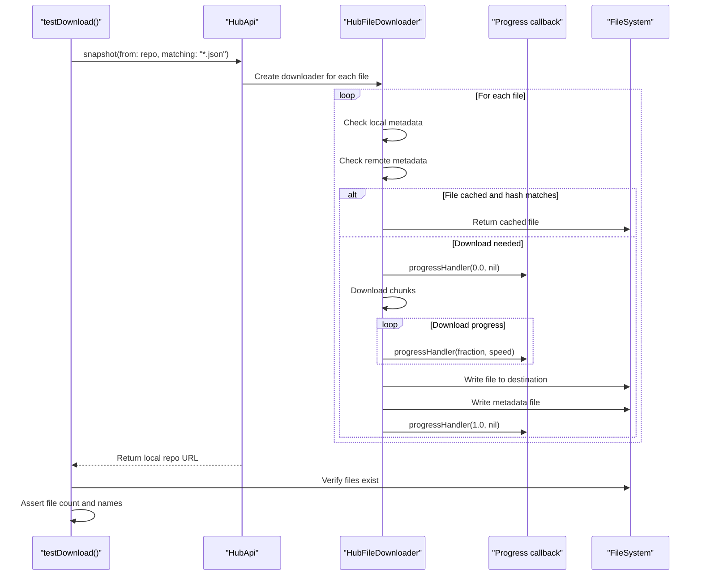
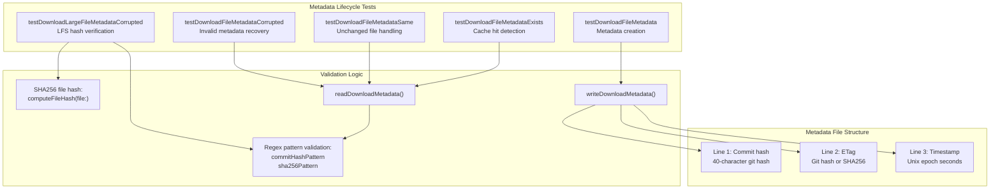
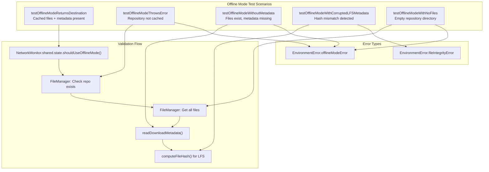
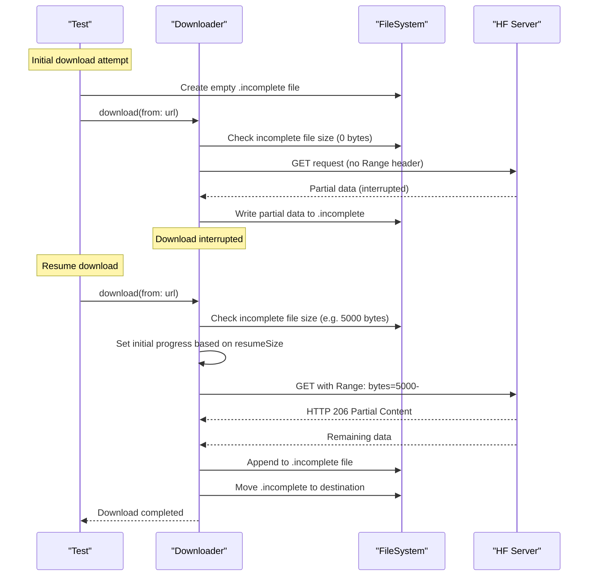
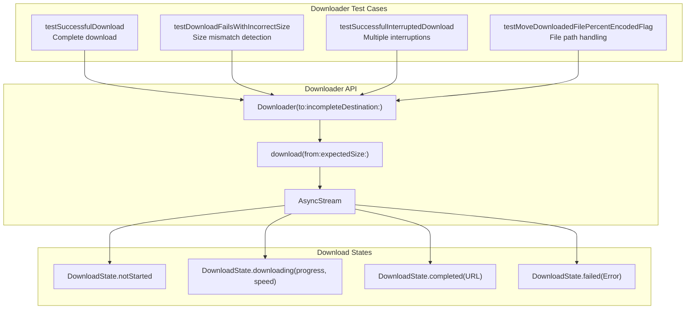
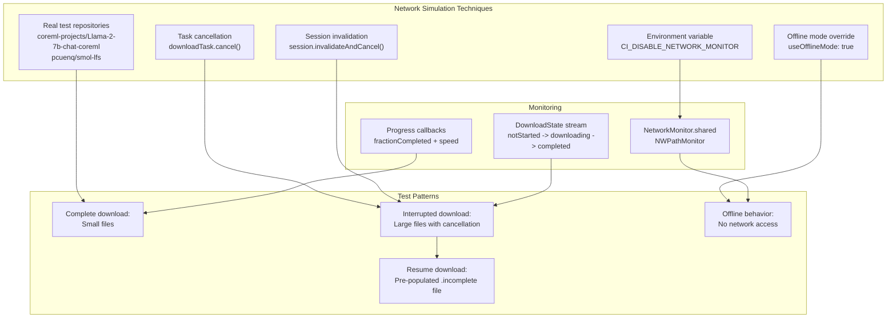

<!-- source: DeepWiki mcp.deepwiki.com · repo huggingface/swift-transformers · page 6.2 Hub Testing · fetched 2026-10-26 -->

# Hub Testing

<details>
<summary>Relevant source files</summary>

The following files were used as context for generating this wiki page:

- [Sources/Hub/Downloader.swift](Sources/Hub/Downloader.swift)
- [Sources/Hub/HubApi.swift](Sources/Hub/HubApi.swift)
- [Tests/HubTests/DownloaderTests.swift](Tests/HubTests/DownloaderTests.swift)
- [Tests/HubTests/HubApiTests.swift](Tests/HubTests/HubApiTests.swift)

</details>


This page documents the testing infrastructure for the Hub module, which validates file downloads, metadata management, offline mode behavior, and network resilience. Hub testing ensures reliable model and file acquisition from Hugging Face Hub across various network conditions and edge cases.

For information about the Hub API itself, see [Hub](#3). For tokenizer testing patterns, see [Tokenizer Testing](#6.1).

## Test Organization

The Hub testing suite is organized into three main test classes, each focusing on specific aspects of the Hub functionality:



**Sources:** [Tests/HubTests/HubApiTests.swift:11-174](), [Tests/HubTests/HubApiTests.swift:176-1160](), [Tests/HubTests/DownloaderTests.swift:12-190]()

### Test Class Responsibilities

| Test Class | Purpose | Key Methods | Lines |
|------------|---------|-------------|-------|
| `HubApiTests` | Validates file discovery, metadata retrieval, and API interactions | `testFilenameRetrieval`, `testGetFileMetadata`, `testGetXetMetadata` | [Tests/HubTests/HubApiTests.swift:11-174]() |
| `SnapshotDownloadTests` | Tests complete download workflows including caching, offline mode, and resumption | `testDownload`, `testOfflineModeReturnsDestination`, `testResumeDownloadFromEmptyIncomplete` | [Tests/HubTests/HubApiTests.swift:176-1160]() |
| `DownloaderTests` | Validates low-level download mechanics, interruption handling, and file operations | `testSuccessfulDownload`, `testSuccessfulInterruptedDownload` | [Tests/HubTests/DownloaderTests.swift:12-190]() |

**Sources:** [Tests/HubTests/HubApiTests.swift:11-12](), [Tests/HubTests/HubApiTests.swift:176-183](), [Tests/HubTests/DownloaderTests.swift:12-26]()

## File Discovery Testing

File discovery tests validate the `getFilenames` API and glob pattern matching functionality, ensuring correct file enumeration from repositories.



**Sources:** [Tests/HubTests/HubApiTests.swift:14-82]()

### Glob Pattern Test Cases

The test suite validates various glob pattern behaviors:

| Test | Pattern | Expected Result | Line Reference |
|------|---------|-----------------|----------------|
| Basic retrieval | (none) | All 13 files in repo | [Tests/HubTests/HubApiTests.swift:14-21]() |
| JSON files | `"*.json"` | 6 JSON files including nested | [Tests/HubTests/HubApiTests.swift:23-49]() |
| Case sensitivity | `"*.JSON"` | Empty array (patterns are case-sensitive) | [Tests/HubTests/HubApiTests.swift:39-45]() |
| Directory contents | `"*.mlpackage/*"` | All files within mlpackage directory | [Tests/HubTests/HubApiTests.swift:51-69]() |
| Multiple patterns | `["config.json", "tokenizer.json", "tokenizer_*.json"]` | Union of matching files | [Tests/HubTests/HubApiTests.swift:71-82]() |

**Sources:** [Tests/HubTests/HubApiTests.swift:14-82]()

## Metadata Testing

Metadata tests validate file metadata retrieval, including commit hashes, ETags, file sizes, and Xet-specific metadata for optimized downloads.



**Sources:** [Tests/HubTests/HubApiTests.swift:84-173]()

### Metadata Validation Patterns

Tests verify specific metadata characteristics:

```swift
// Commit hash format validation
XCTAssertNotNil(metadata.commitHash)  // Present for all files
XCTAssertEqual(metadata.commitHash, "eaf97358a37d03fd48e5a87d15aff2e8423c1afb")

// ETag validation (git hash for small files)
XCTAssertTrue(metadata.etag!.hasPrefix("d6ceb9"))

// ETag validation (SHA256 for LFS files)
XCTAssertEqual(metadata.etag, "fc329090bfbb2570382c9af997cffd5f4b78b39b8aeca62076db69534e020107")

// Location path verification
XCTAssertEqual(URL(string: metadata.location)?.path, "/api/resolve-cache/models...")

// Size verification
XCTAssertEqual(metadata.size, 163)  // For config.json
XCTAssertEqual(metadata.size, 504766)  // For large model.mlmodel file

// Xet protocol metadata
XCTAssertNotNil(metadata.xetFileData)
XCTAssertEqual(metadata.xetFileData?.fileHash, "6aec39639a0a2d1ca966356b8c2b8426a484f80ff80731f44fa8482040713bdf")
```

**Sources:** [Tests/HubTests/HubApiTests.swift:84-173]()

## Download Testing

Download tests validate the complete download workflow, including progress tracking, caching, and various session types.

### Basic Download Flow



**Sources:** [Tests/HubTests/HubApiTests.swift:218-251](), [Sources/Hub/HubApi.swift:499-572]()

### Download Test Categories

| Category | Tests | Purpose |
|----------|-------|---------|
| **Basic Downloads** | `testDownload` | Standard foreground download | [Tests/HubTests/HubApiTests.swift:218-251]() |
| **Background Sessions** | `testDownloadInBackground` | Background URLSession download (rate-limited by OS) | [Tests/HubTests/HubApiTests.swift:255-274]() |
| **Custom Endpoints** | `testCustomEndpointDownload` | Mirror endpoints like hf-mirror.com | [Tests/HubTests/HubApiTests.swift:276-299]() |
| **LFS Files** | `testDownloadLargeFile` | Large File Storage downloads | [Tests/HubTests/HubApiTests.swift:581-609]() |
| **Resumable Downloads** | `testResumeDownloadFromEmptyIncomplete`, `testResumeDownloadFromNonEmptyIncomplete` | Resume interrupted downloads | [Tests/HubTests/HubApiTests.swift:989-1066]() |
| **Real Interruption** | `testRealDownloadInterruptionAndResumption` | Cancel and resume large downloads | [Tests/HubTests/HubApiTests.swift:1068-1160]() |

**Sources:** [Tests/HubTests/HubApiTests.swift:218-1160]()

### Progress Tracking Validation

Tests verify that progress callbacks receive correct values:

```swift
var lastProgress: Progress? = nil

let downloadedTo = try await hubApi.snapshot(from: repo, matching: "*.json") { progress in
    print("Total Progress: \(progress.fractionCompleted)")
    print("Files Completed: \(progress.completedUnitCount) of \(progress.totalUnitCount)")
    lastProgress = progress
}

// Verify completion
XCTAssertEqual(lastProgress?.fractionCompleted, 1)
XCTAssertEqual(lastProgress?.completedUnitCount, 6)

// Verify download speed is reported
if let speed = progress.userInfo[.throughputKey] as? Double {
    // Speed in bytes/sec is available during download
}
```

**Sources:** [Tests/HubTests/HubApiTests.swift:218-251](), [Tests/HubTests/HubApiTests.swift:641-647]()

## Metadata Management Testing

Metadata management tests ensure proper creation, validation, and handling of `.metadata` files that track download state and integrity.



**Sources:** [Tests/HubTests/HubApiTests.swift:301-578](), [Sources/Hub/HubApi.swift:358-448]()

### Metadata File Format

Metadata files are stored at `.cache/huggingface/download/<filename>.metadata` and contain three lines:

```
eaf97358a37d03fd48e5a87d15aff2e8423c1afb
fc329090bfbb2570382c9af997cffd5f4b78b39b8aeca62076db69534e020107
1706123456.789
```

| Line | Content | Validation | Purpose |
|------|---------|------------|---------|
| 1 | Commit hash | Must match `^[0-9a-f]{40}$` | Identifies repo version | [Sources/Hub/HubApi.swift:122]() |
| 2 | ETag | Git hash or SHA256 pattern | Detects file changes | [Sources/Hub/HubApi.swift:121]() |
| 3 | Timestamp | Unix epoch as double | Records download time | [Sources/Hub/HubApi.swift:371-373]() |

**Sources:** [Sources/Hub/HubApi.swift:358-400](), [Sources/Hub/HubApi.swift:440-448]()

### Metadata Validation Test Cases

| Test | Scenario | Expected Behavior | Line Reference |
|------|----------|-------------------|----------------|
| `testDownloadFileMetadataExists` | Metadata exists, file unchanged | Skip download, keep original timestamp | [Tests/HubTests/HubApiTests.swift:339-394]() |
| `testDownloadFileMetadataSame` | Re-download with matching ETag | Update timestamp only, same commit/ETag | [Tests/HubTests/HubApiTests.swift:396-441]() |
| `testDownloadFileMetadataCorrupted` | Invalid metadata (missing lines) | Delete metadata, re-download file | [Tests/HubTests/HubApiTests.swift:443-518]() |
| `testDownloadLargeFileMetadataCorrupted` | LFS file with wrong ETag | Compute SHA256, update metadata if match | [Tests/HubTests/HubApiTests.swift:520-579]() |

**Sources:** [Tests/HubTests/HubApiTests.swift:339-579]()

### LFS vs Non-LFS File Handling

Tests distinguish between regular files (git-tracked) and Large File Storage files:

```swift
// LFS file: ETag is SHA256 hash
if hubApi.isValidHash(hash: remoteEtag, pattern: hubApi.sha256Pattern) {
    let fileHash = try hubApi.computeFileHash(file: destination)
    if fileHash == remoteEtag {
        // Hash matches, just update metadata
        try hubApi.writeDownloadMetadata(...)
        return destination
    }
}

// Non-LFS file: ETag is git hash (shorter)
// If local file exists but metadata missing, must re-download
```

**Sources:** [Sources/Hub/HubApi.swift:534-540](), [Tests/HubTests/HubApiTests.swift:520-579](), [Tests/HubTests/HubApiTests.swift:780-829]()

## Offline Mode Testing

Offline mode tests validate behavior when network is unavailable or explicitly disabled via `useOfflineMode` parameter.



**Sources:** [Tests/HubTests/HubApiTests.swift:831-952](), [Sources/Hub/HubApi.swift:586-623]()

### Offline Mode Validation Logic

When offline mode is active, the system performs these checks:

1. **Repository Existence**: Verify local directory exists at expected path
2. **File Enumeration**: Retrieve all non-hidden regular files recursively
3. **Metadata Validation**: Check each file has corresponding `.metadata` file
4. **Integrity Verification**: For LFS files (SHA256 ETag), compute hash and compare

**Sources:** [Sources/Hub/HubApi.swift:588-623]()

### Offline Mode Test Cases

| Test | Setup | Expected Outcome | Error Type |
|------|-------|------------------|------------|
| `testOfflineModeReturnsDestination` | Files + metadata downloaded previously | Return cached location successfully | None | [Tests/HubTests/HubApiTests.swift:831-857]() |
| `testOfflineModeThrowsError` | No prior download | Throw error: "Repository not available locally" | `offlineModeError` | [Tests/HubTests/HubApiTests.swift:859-875]() |
| `testOfflineModeWithoutMetadata` | Files exist, metadata deleted | Throw error: "Metadata not available for x.bin" | `offlineModeError` | [Tests/HubTests/HubApiTests.swift:877-912]() |
| `testOfflineModeWithCorruptedLFSMetadata` | Metadata has wrong SHA256 | Throw error: "Hash mismatch for x.bin" | `fileIntegrityError` | [Tests/HubTests/HubApiTests.swift:914-952]() |
| `testOfflineModeWithNoFiles` | Directory exists but empty | Throw error: "No files available locally" | `offlineModeError` | [Tests/HubTests/HubApiTests.swift:954-987]() |

**Sources:** [Tests/HubTests/HubApiTests.swift:831-987]()

## Resumable Download Testing

Resumable download tests validate the ability to recover from interrupted downloads using HTTP Range headers and incomplete file state.



**Sources:** [Tests/HubTests/HubApiTests.swift:989-1160](), [Sources/Hub/Downloader.swift:91-217]()

### Resume Test Scenarios

| Test | Initial State | Resume Point | Verification | Line Reference |
|------|--------------|--------------|--------------|----------------|
| `testResumeDownloadFromEmptyIncomplete` | Empty `.incomplete` file (0 bytes) | Start from beginning | Complete file content matches expected | [Tests/HubTests/HubApiTests.swift:989-1027]() |
| `testResumeDownloadFromNonEmptyIncomplete` | `.incomplete` with "X" (1 byte) | Resume from byte 1 | File starts with "X" + server data | [Tests/HubTests/HubApiTests.swift:1029-1066]() |
| `testRealDownloadInterruptionAndResumption` | Cancel at 50% and 75% progress | Resume after each cancellation | Final file size matches expected | [Tests/HubTests/HubApiTests.swift:1068-1160]() |

**Sources:** [Tests/HubTests/HubApiTests.swift:989-1160]()

### Resume Implementation Details

The downloader determines resume behavior based on incomplete file presence:

```swift
// Check for existing incomplete file
let resumeSize = Self.incompleteFileSize(at: incompleteDestination)

// Set Range header if resuming
if resumeSize > 0 {
    requestHeaders["Range"] = "bytes=\(resumeSize)-"
    
    // Calculate and show initial progress
    if let expectedSize = await self.downloadResumeState.expectedSize, expectedSize > 0 {
        let initialProgress = Double(resumeSize) / Double(expectedSize)
        await self.broadcaster.broadcast(state: .downloading(initialProgress, nil))
    }
}

// Open file handle and seek to end for appending
let tempFile = try FileHandle(forWritingTo: self.incompleteDestination)
if resumeSize > 0 {
    try tempFile.seekToEnd()
}
```

**Sources:** [Sources/Hub/Downloader.swift:133-198]()

## Downloader Unit Tests

The `DownloaderTests` class provides focused unit tests for the low-level `Downloader` class, separate from the higher-level `HubApi` integration tests.



**Sources:** [Tests/HubTests/DownloaderTests.swift:12-190](), [Sources/Hub/Downloader.swift:16-80]()

### Downloader Test Implementation

Each test follows a similar pattern of setup, execution, and state monitoring:

```swift
func testSuccessfulDownload() async throws {
    // Setup
    let url = URL(string: "https://huggingface.co/.../config.json")!
    let destination = tempDir.appendingPathComponent("config.json")
    let incompleteDestination = cacheDir.appendingPathComponent("config.json.etag.incomplete")
    
    // Create downloader
    let downloader = Downloader(to: destination, incompleteDestination: incompleteDestination)
    let sub = await downloader.download(from: url)
    
    // Monitor state stream
    listen: for await state in sub {
        switch state {
        case .notStarted: continue
        case .downloading: continue
        case let .failed(error): throw error
        case .completed: break listen
        }
    }
    
    // Verify
    XCTAssertTrue(FileManager.default.fileExists(atPath: destination.path))
    XCTAssertEqual(try String(contentsOf: destination), expectedContent)
}
```

**Sources:** [Tests/HubTests/DownloaderTests.swift:29-73]()

### Size Validation Test

The `testDownloadFailsWithIncorrectSize` test verifies that downloads fail when the actual file size doesn't match the expected size:

```swift
let sub = await downloader.download(from: url, expectedSize: 999999) // Incorrect size

listen: for await state in sub {
    switch state {
    case .failed:
        break listen  // Expected behavior
    case .completed:
        XCTFail("Download should have failed due to size mismatch")
    }
}

// Verify no file was created
XCTAssertFalse(FileManager.default.fileExists(atPath: destination.path))
```

**Sources:** [Tests/HubTests/DownloaderTests.swift:76-106](), [Sources/Hub/Downloader.swift:316-319]()

### Interruption and Resumption Test

The `testSuccessfulInterruptedDownload` test simulates real-world network interruptions:

```swift
let sub = await downloader.download(from: url, expectedSize: 73_194_001)
var threshold = 0.5  // First interrupt at 50%

listen: for await state in sub {
    case let .downloading(progress, _):
        if threshold != 1.0, progress >= threshold {
            // Move to next threshold (50% -> 75% -> 100%)
            threshold = threshold == 0.5 ? 0.75 : 1.0
            // Interrupt download
            await downloader.session.get()?.invalidateAndCancel()
        }
    case .completed:
        break listen
}
```

This test validates that downloads can be interrupted multiple times and successfully resume from the last checkpoint.

**Sources:** [Tests/HubTests/DownloaderTests.swift:110-165]()

## Network Simulation

Network conditions are simulated through controlled test scenarios rather than mock servers. The system uses environment variables and actual test repositories to validate behavior.



**Sources:** [Tests/HubTests/HubApiTests.swift:1068-1160](), [Sources/Hub/HubApi.swift:818-872]()

### Test Repository Selection

Tests use specific repositories designed for different scenarios:

| Repository | Purpose | Files | Line Reference |
|------------|---------|-------|----------------|
| `coreml-projects/Llama-2-7b-chat-coreml` | Complete model with JSON configs, tokenizer, and large .mlmodel file | 13 files including nested .mlpackage structure | [Tests/HubTests/HubApiTests.swift:177]() |
| `pcuenq/smol-lfs` | Small LFS test repository | `x.bin` (small LFS file), `config.json` (regular file) | [Tests/HubTests/HubApiTests.swift:178]() |

**Sources:** [Tests/HubTests/HubApiTests.swift:177-178]()

### Network Monitor Control

The `NetworkMonitor` class detects network availability using `NWPathMonitor`. Tests can disable automatic monitoring:

```swift
// Environment variable to disable network monitoring in CI
if ProcessInfo.processInfo.environment["CI_DISABLE_NETWORK_MONITOR"] == "1" {
    return false  // Never use offline mode in CI
}

// Manual offline mode override for testing
let hubApi = HubApi(downloadBase: downloadDestination, useOfflineMode: true)
```

**Sources:** [Sources/Hub/HubApi.swift:832-835](), [Tests/HubTests/HubApiTests.swift:846]()

## Running Tests

### Test Execution

Run Hub tests using Xcode's test navigator or command line:

```bash
# Run all Hub tests
swift test --filter HubTests

# Run specific test class
swift test --filter HubApiTests

# Run specific test method
swift test --filter HubApiTests/testFilenameRetrieval
```

### Test Environment Setup

Tests automatically manage temporary directories and cleanup:

```swift
override func setUp() {
    // Create temporary download directory
    let base = FileManager.default.urls(for: .cachesDirectory, in: .userDomainMask).first!
    downloadDestination = base.appending(component: "huggingface-tests")
}

override func tearDown() {
    // Clean up test downloads
    try FileManager.default.removeItem(at: downloadDestination)
}
```

**Sources:** [Tests/HubTests/HubApiTests.swift:184-192](), [Tests/HubTests/DownloaderTests.swift:15-26]()

### Test Isolation

Each test maintains isolation through:

- **Unique temporary directories**: Using `UUID().uuidString` or specific cache paths
- **Repository snapshots**: Tests don't modify source repositories, only local cache
- **Cleanup in tearDown**: Removing downloaded files after each test
- **Independent test repos**: Using specific test repositories that won't change

**Sources:** [Tests/HubTests/DownloaderTests.swift:15-26](), [Tests/HubTests/HubApiTests.swift:186-192]()

### Common Test Utilities

The test suite includes helper methods:

```swift
// Get relative file paths within a repository
func getRelativeFiles(url: URL, repo: String) -> [String] {
    var filenames: [String] = []
    let prefix = downloadDestination.appending(path: "models/\(repo)").path.appending("/")
    
    if let enumerator = FileManager.default.enumerator(...) {
        for case let fileURL as URL in enumerator {
            let resourceValues = try fileURL.resourceValues(forKeys: [.isRegularFileKey])
            if resourceValues.isRegularFile == true {
                filenames.append(String(fileURL.path.suffix(from: prefix.endIndex)))
            }
        }
    }
    return filenames
}
```

This helper enables tests to verify downloaded file structures without hardcoding absolute paths.

**Sources:** [Tests/HubTests/HubApiTests.swift:194-216]()

---

