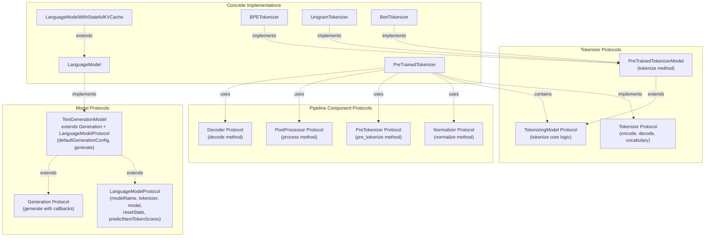
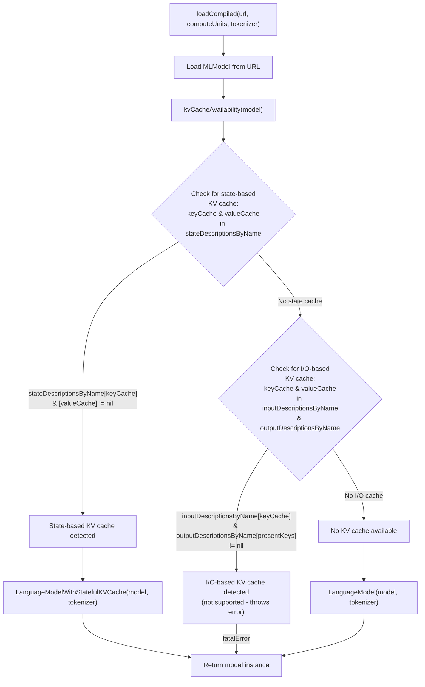
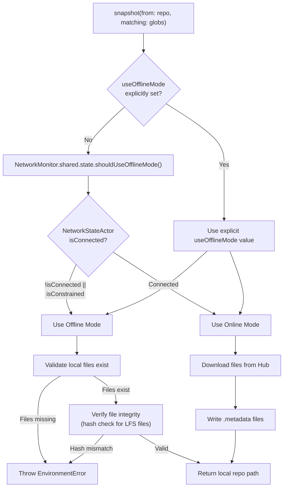
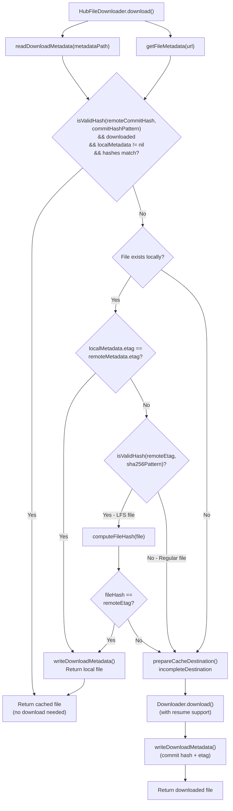
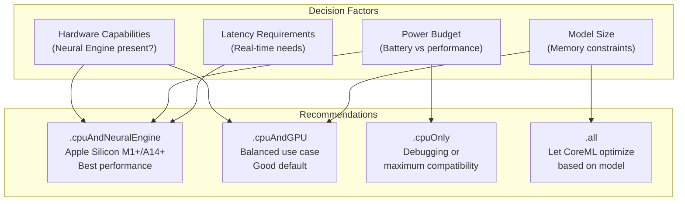
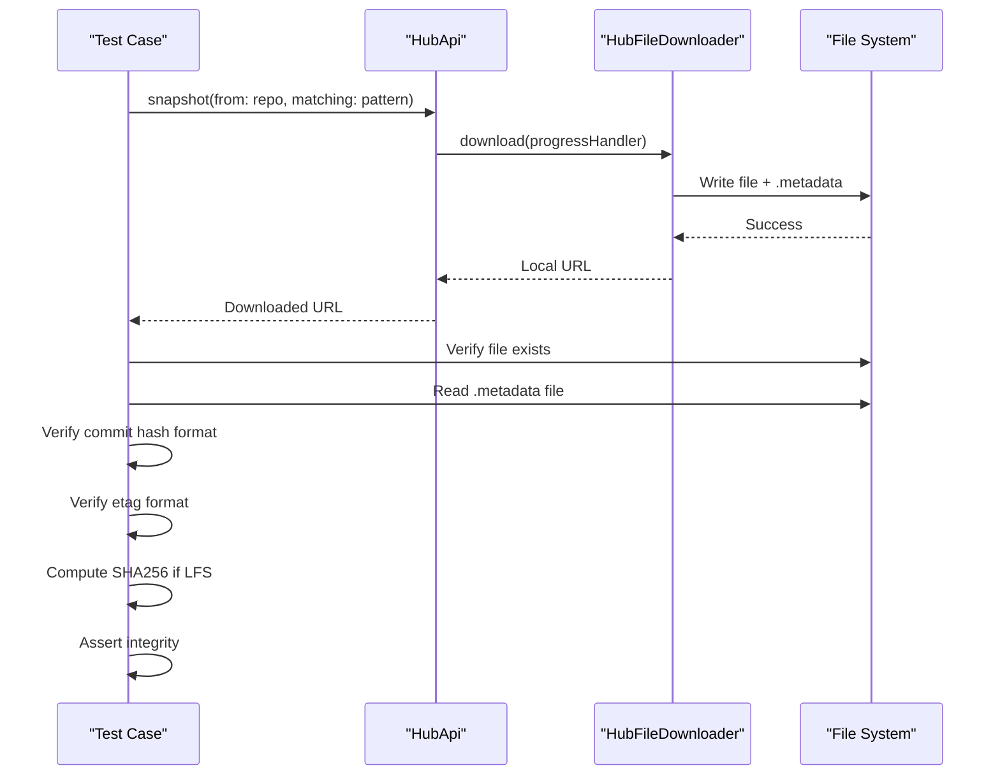
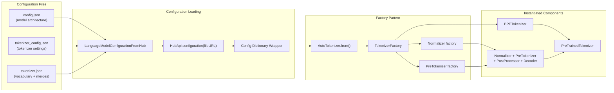
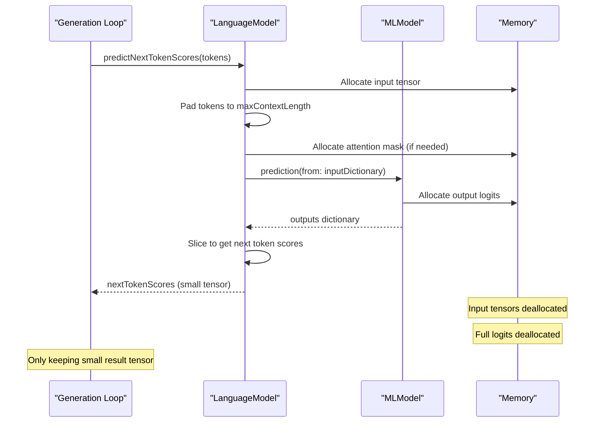
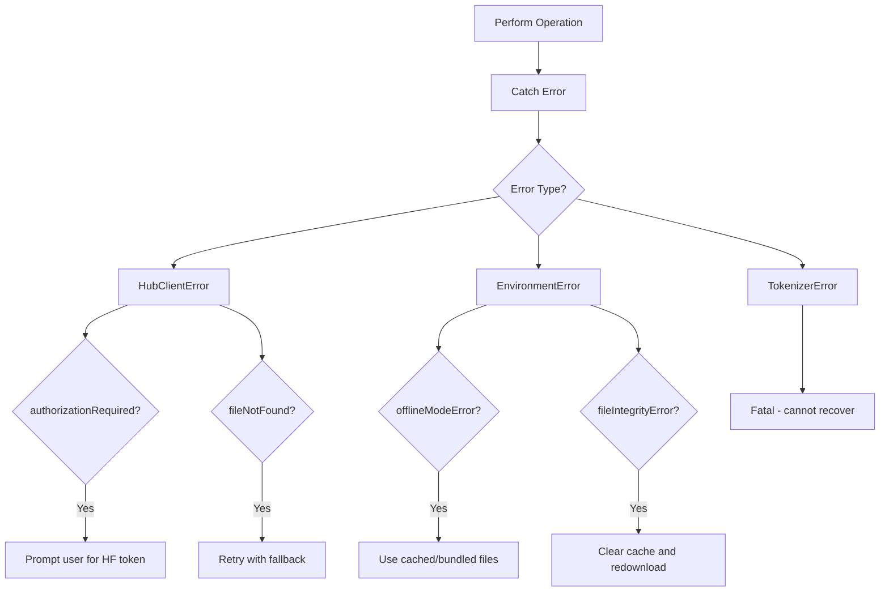
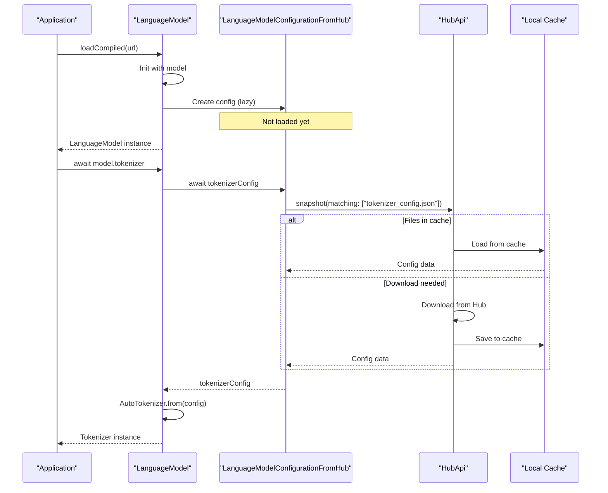

<!-- source: DeepWiki mcp.deepwiki.com · repo huggingface/swift-transformers · page 7 Advanced Topics · fetched 2026-10-26 -->

# Advanced Topics

<details>
<summary>Relevant source files</summary>

The following files were used as context for generating this wiki page:

- [Sources/Hub/HubApi.swift](Sources/Hub/HubApi.swift)
- [Sources/Models/LanguageModel.swift](Sources/Models/LanguageModel.swift)
- [Sources/Models/LanguageModelTypes.swift](Sources/Models/LanguageModelTypes.swift)
- [Tests/HubTests/HubApiTests.swift](Tests/HubTests/HubApiTests.swift)

</details>


This page covers advanced usage patterns, performance optimization techniques, and strategies for extending the swift-transformers library. These topics are intended for developers who need to customize behavior, optimize for specific deployment scenarios, or integrate the library into production applications.

For basic usage and getting started, see [Quick Start Guide](#1.3). For details on specific module implementations, see [Tokenizers](#2), [Hub](#3), [Models](#4), and [Generation](#5).

**Child Topics:**
- [Custom Tokenizers](#7.1) - Implementing custom tokenizer types
- [Performance Optimization](#7.2) - Best practices for inference performance
- [Offline Deployment](#7.3) - Bundling models for offline applications

---

## Protocol-Based Architecture

The library uses protocol-oriented design to provide multiple extension points for custom implementations. Understanding these protocols is essential for advanced customization.

### Core Protocol Hierarchy



**Protocol Extension Points**

| Protocol | Purpose | Key Methods | Custom Implementation Use Case |
|----------|---------|-------------|-------------------------------|
| `LanguageModelProtocol` | Core model interface | `predictNextTokenScores`, `resetState` | Custom inference engines beyond CoreML |
| `TextGenerationModel` | High-level generation | `generate`, `defaultGenerationConfig` | Models with specialized generation behavior |
| `Tokenizer` | Text encoding/decoding | `encode`, `decode`, `vocabulary` | Novel tokenization schemes |
| `PreTrainedTokenizerModel` | Core tokenization logic | `tokenize` | Custom tokenization algorithms |
| `Normalizer` | Text normalization | `normalize` | Language-specific normalization |
| `PreTokenizer` | Pre-tokenization splitting | `pre_tokenize` | Custom text splitting strategies |
| `PostProcessor` | Post-tokenization processing | `process` | Special token insertion patterns |
| `Decoder` | Token-to-text conversion | `decode` | Custom decoding logic |

**Sources:** [Sources/Models/LanguageModelTypes.swift:14-51](), [Sources/Models/LanguageModel.swift:21-87]()

---

## KV Cache Detection and Optimization

The library automatically detects and uses KV cache capabilities in CoreML models to optimize sequential token generation. Understanding this mechanism is crucial for performance tuning.

### KV Cache Detection Flow



**KV Cache Implementation Details**

The `LanguageModelWithStatefulKVCache` class uses a two-mode approach for optimal performance:

| Mode | When Used | Input Shape | Performance Benefit |
|------|-----------|-------------|---------------------|
| **Prefilling** | First prediction in sequence | Full prompt tokens `[batch, seq_len]` | Processes entire prompt at once |
| **Extending** | Subsequent predictions | Single token `[batch, 1]` | Minimal computation per token |

**State Management:**
```swift
// From LanguageModelWithStatefulKVCache
private var mode: Mode = .prefilling
var state: MLState?

// Reset for new sequence
public override func resetState() async {
    state = model.makeState()
    mode = .prefilling
}
```

The mode automatically switches from prefilling to extending after the first prediction, and the CoreML framework manages the KV cache state internally through `MLState`.

**Sources:** [Sources/Models/LanguageModel.swift:162-182](), [Sources/Models/LanguageModel.swift:269-320](), [Sources/Models/LanguageModel.swift:485-562]()

---

## Offline Mode and Network Strategies

The Hub module implements sophisticated offline mode support with automatic network state detection and fallback mechanisms.

### Offline Mode Decision Flow



**Metadata File Structure**

Each downloaded file has an associated `.metadata` file stored in `.cache/huggingface/download/`:

```
Line 1: Commit hash (40 character hex)
Line 2: ETag (SHA256 for LFS files, git hash otherwise)
Line 3: Timestamp (Unix epoch)
```

**Offline Mode Error Handling:**

| Error Type | When Thrown | Resolution |
|------------|-------------|------------|
| `EnvironmentError.offlineModeError` | Repository not available locally | Download files while online first |
| `EnvironmentError.offlineModeError` | Metadata files missing | Re-download affected files |
| `EnvironmentError.fileIntegrityError` | SHA256 hash mismatch for LFS files | File corrupted, re-download required |
| `EnvironmentError.invalidMetadataError` | Metadata file format invalid | Metadata automatically removed and recreated |

**Network Monitoring:**

The `NetworkMonitor` class continuously tracks network state using Apple's `NWPathMonitor`:

```swift
// State tracked by NetworkStateActor
public var isConnected: Bool = true      // Network available
public var isExpensive: Bool = false     // Cellular or expensive network
public var isConstrained: Bool = false   // Low data mode enabled
```

**Sources:** [Sources/Hub/HubApi.swift:586-623](), [Sources/Hub/HubApi.swift:358-400](), [Sources/Hub/HubApi.swift:818-871]()

---

## File Integrity and Resumable Downloads

The Hub module implements robust download mechanisms with integrity checking and resumption support.

### Download Decision Tree



**Resumable Download Implementation:**

The `Downloader` class supports resumption by:
1. Tracking incomplete downloads with `.{etag}.incomplete` files
2. Using HTTP Range headers to resume from the last byte received
3. Maintaining download state across app restarts
4. Supporting background downloads with `URLSession` background configuration

**File Hash Computation:**

For integrity verification, the system computes SHA256 hashes in 1MB chunks:

```swift
// From HubApi.computeFileHash
let chunkSize = 1024 * 1024 // 1MB chunks
var hasher = SHA256()
while autoreleasepool {
    let nextChunk = try? fileHandle.read(upToCount: chunkSize)
    guard let nextChunk, !nextChunk.isEmpty else { return false }
    hasher.update(data: nextChunk)
    return true
}
```

This chunked approach prevents memory issues when verifying large model files.

**Sources:** [Sources/Hub/HubApi.swift:494-572](), [Sources/Hub/HubApi.swift:408-437](), [Sources/Hub/HubApi.swift:440-448]()

---

## Compute Unit Selection

CoreML models can run on different compute units depending on the hardware and model characteristics. The library provides flexible compute unit selection.

### Compute Unit Options

| Compute Unit | Use Case | Performance Characteristics |
|--------------|----------|---------------------------|
| `.cpuOnly` | Maximum compatibility, debugging | Slower inference, lowest power |
| `.cpuAndGPU` | Default, balanced performance | Good performance, moderate power |
| `.cpuAndNeuralEngine` | Apple Silicon optimization | Best performance on compatible hardware |
| `.all` | Let CoreML decide | Automatic optimization |

**Configuration at Model Load:**

```swift
// From LanguageModel.loadCompiled
static func loadCompiled(
    url: URL,
    computeUnits: MLComputeUnits = .cpuAndGPU,  // Default setting
    tokenizer: Tokenizer? = nil
) throws -> LanguageModel {
    let config = MLModelConfiguration()
    config.computeUnits = computeUnits
    let model = try MLModel(contentsOf: url, configuration: config)
    // ... KV cache detection and model creation
}
```

**Compute Unit Selection Strategy:**



**Performance Implications:**

- **Neural Engine**: Best for transformer models with large matrix operations, can provide 5-10x speedup over CPU
- **GPU**: Good for parallel operations, moderate power consumption
- **CPU**: Always available, good for smaller models or when other units are busy
- **Background**: Use `.cpuOnly` for background tasks to avoid competing with user-facing GPU work

**Sources:** [Sources/Models/LanguageModel.swift:162-182]()

---

## Testing Patterns and Strategies

The codebase demonstrates several advanced testing patterns that can be applied when extending the library.

### Integration Test Patterns

**Pattern 1: Download and Metadata Validation**



**Pattern 2: Offline Mode Simulation**

The tests use explicit `useOfflineMode` parameter to test offline behavior without manipulating network state:

```swift
// Download files first
let hubApi = HubApi(downloadBase: testDestination)
_ = try await hubApi.snapshot(from: repo, matching: "*.json")

// Switch to offline mode
let offlineApi = HubApi(downloadBase: testDestination, useOfflineMode: true)
let result = try await offlineApi.snapshot(from: repo, matching: "*.json")
// Verifies cached files are used
```

**Pattern 3: Download Interruption and Resumption**

```swift
// Start download with progress tracking
let downloadTask = Task {
    try await hubApi.snapshot(from: repo, matching: largeFile) { progress in
        if progress.fractionCompleted > 0 {
            progressExpectation.fulfill()
        }
    }
}

// Wait for progress, then cancel
await fulfillment(of: [progressExpectation], timeout: 30.0)
downloadTask.cancel()

// Resume download - should continue from last position
let result = try await hubApi.snapshot(from: repo, matching: largeFile)
```

**Pattern 4: Metadata Corruption Handling**

Tests verify the system's resilience to corrupted metadata by:
1. Downloading files normally
2. Corrupting the `.metadata` file
3. Re-running the download
4. Verifying the system detects corruption and re-downloads or re-validates

**Sources:** [Tests/HubTests/HubApiTests.swift:218-251](), [Tests/HubTests/HubApiTests.swift:831-857](), [Tests/HubTests/HubApiTests.swift:1068-1105](), [Tests/HubTests/HubApiTests.swift:443-518]()

---

## Configuration-Driven Instantiation

The library extensively uses JSON configuration files to drive component instantiation. Understanding this pattern is essential for custom implementations.

### Configuration Flow



**Config Object Pattern:**

The `Config` type wraps JSON dictionaries and provides type-safe accessors:

```swift
// Config provides dynamic member lookup
let config = Config(dictionary)
let modelType = config.modelType.string()  // Returns Optional<String>
let vocabSize = config.vocabSize.integer() // Returns Optional<Int>
let doSample = config.taskSpecificParams.textGeneration.doSample.boolean()
```

This pattern allows graceful handling of missing or variant configuration fields across different model types.

**Factory Pattern for Component Creation:**

Factories use string identifiers from config to instantiate concrete types:

```swift
// Normalizer factory
func createNormalizer(type: String, config: Config) -> Normalizer? {
    switch type {
    case "NFD": return NFDNormalizer()
    case "Lowercase": return LowercaseNormalizer()
    case "BertNormalizer": return BertNormalizer(config)
    // ... additional normalizers
    default: return nil
    }
}
```

**Sources:** [Sources/Hub/HubApi.swift:311-329]()

---

## Memory Management Considerations

### MLTensor Memory Usage

CoreML's `MLTensor` is the primary data structure for model inputs and outputs. Understanding its memory characteristics is important for optimization.

**Tensor Lifecycle:**



**Memory Optimization Strategies:**

| Strategy | Implementation | Memory Savings |
|----------|----------------|----------------|
| **KV Cache** | `LanguageModelWithStatefulKVCache` | Avoids recomputing previous tokens |
| **Tensor Slicing** | `scores[nil, tokenIndex, nil]` | Only extract needed logits |
| **Batch Size = 1** | Single sequence generation | Minimal memory footprint |
| **Prompt Truncation** | Limit input to `maxContextLength` | Prevents OOM on long inputs |

**State Management with KV Cache:**

```swift
// LanguageModelWithStatefulKVCache manages state
var state: MLState?  // Holds KV cache internally in CoreML

// Reset between sequences to prevent memory leaks
public override func resetState() async {
    state = model.makeState()  // Old state released
    mode = .prefilling
}
```

The `MLState` object holds the KV cache internally in CoreML's memory space. Always call `resetState()` between independent generation sequences to prevent accumulation.

**Sources:** [Sources/Models/LanguageModel.swift:60-86](), [Sources/Models/LanguageModel.swift:506-562]()

---

## Error Handling Best Practices

The library defines structured error types for different failure scenarios. Understanding these helps with robust error handling.

### Error Type Hierarchy

| Error Type | Module | Use Cases |
|------------|--------|-----------|
| `HubClientError` | Hub | Network errors, authentication, file not found |
| `EnvironmentError` | Hub | Offline mode failures, integrity checks, file system |
| `TokenizerError` | Models | Missing tokenizer configuration |
| `DownloadError` | Hub | Download-specific failures |

**Error Recovery Patterns:**



**Graceful Degradation Example:**

```swift
do {
    let tokenizer = try await model.tokenizer
    // Use tokenizer normally
} catch TokenizerError.tokenizerConfigNotFound {
    // Fall back to manually specified tokenizer
    let manualTokenizer = try AutoTokenizer.from(
        modelFolder: localModelPath
    )
}
```

**Sources:** [Sources/Hub/HubApi.swift:288-308](), [Sources/Models/LanguageModel.swift:566-580]()

---

## Asynchronous Property Loading

The library uses Swift's `async` properties to lazily load model configurations and tokenizers. This pattern is important for understanding initialization timing.

### Lazy Configuration Loading



**Async Property Pattern:**

```swift
// Properties are computed asynchronously only when accessed
var tokenizer: Tokenizer {
    get async throws {
        guard _tokenizer == nil else { return _tokenizer! }
        // Download and parse config on first access
        guard let tokenizerConfig = try await tokenizerConfig else {
            throw TokenizerError.tokenizerConfigNotFound
        }
        let tokenizerData = try await tokenizerData
        _tokenizer = try AutoTokenizer.from(
            tokenizerConfig: tokenizerConfig, 
            tokenizerData: tokenizerData
        )
        return _tokenizer!
    }
}
```

This pattern ensures:
1. Fast model initialization without waiting for config downloads
2. Configs are only downloaded when needed
3. Results are cached after first access
4. Network errors are deferred until actual use

**Sources:** [Sources/Models/LanguageModel.xml:327-433]()

---

## Summary

This page covered advanced topics for customizing and optimizing swift-transformers:

- **Protocol-based architecture** provides extension points for custom implementations
- **KV cache detection** automatically optimizes sequential generation
- **Offline mode** enables robust operation without network connectivity
- **Compute unit selection** allows hardware-specific optimization
- **Testing patterns** demonstrate integration testing strategies
- **Configuration-driven instantiation** enables flexible component creation
- **Memory management** techniques minimize resource usage
- **Error handling patterns** support graceful degradation
- **Async property loading** optimizes initialization timing

For specific implementation guidance, see:
- [Custom Tokenizers](#7.1) for implementing novel tokenization schemes
- [Performance Optimization](#7.2) for detailed optimization techniques
- [Offline Deployment](#7.3) for bundling strategies

---

