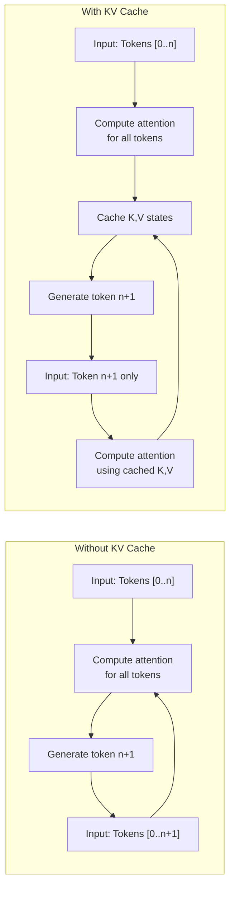
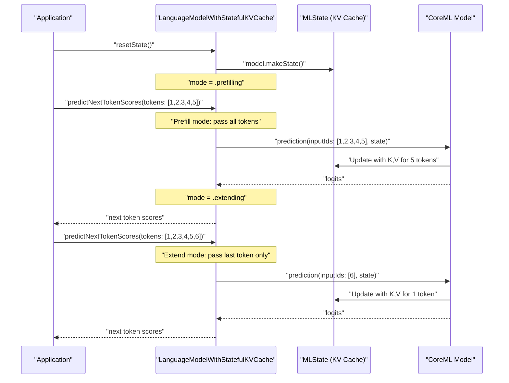
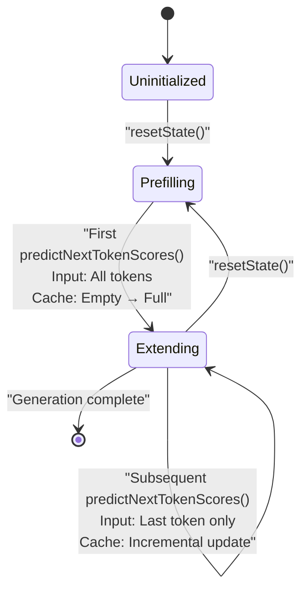
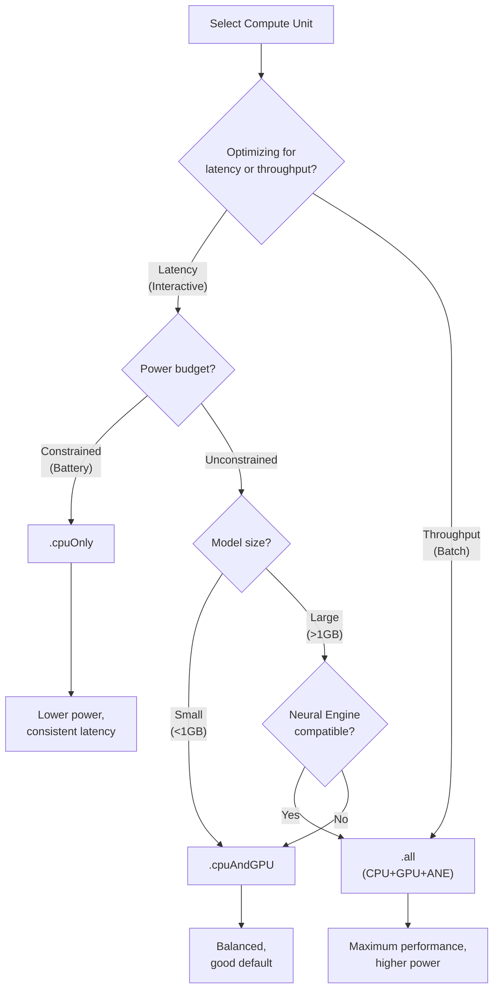
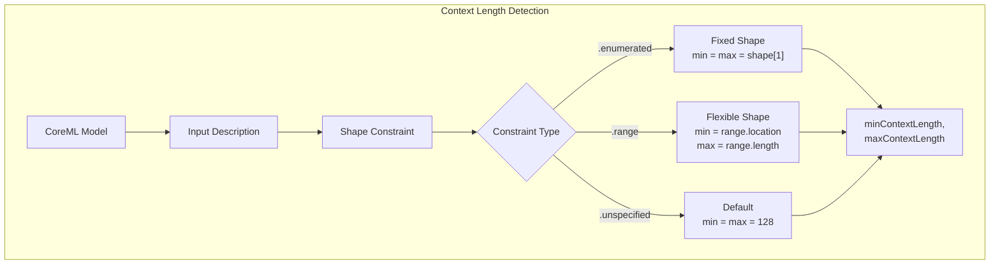
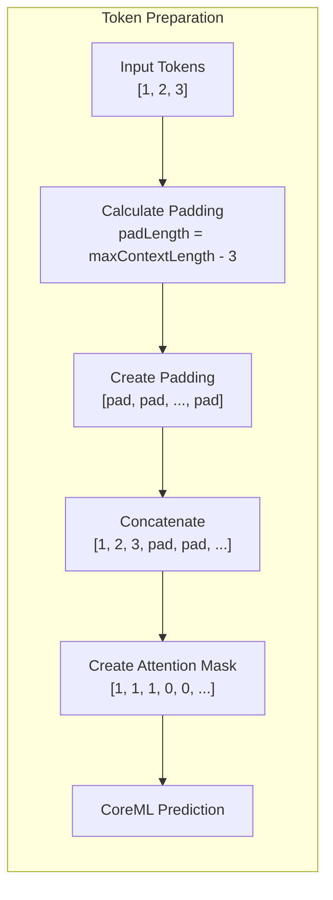
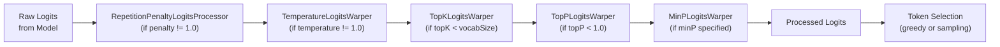
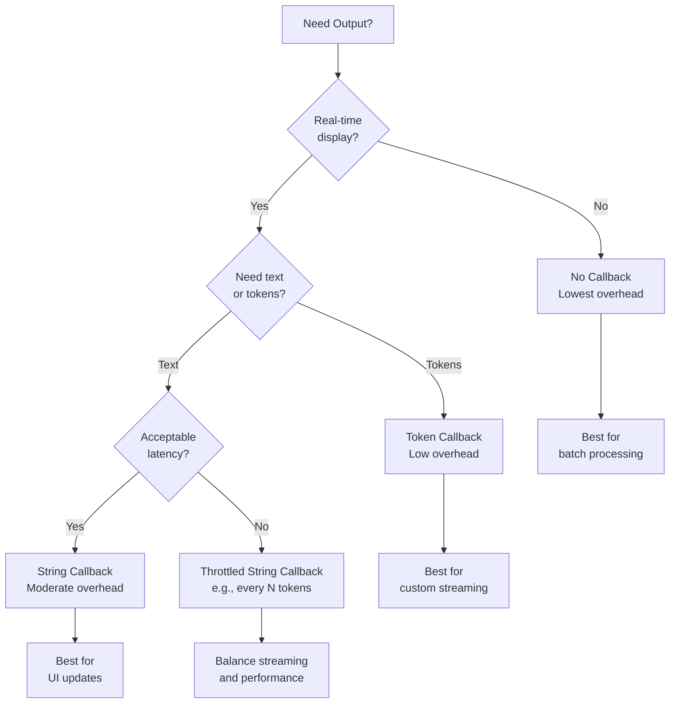
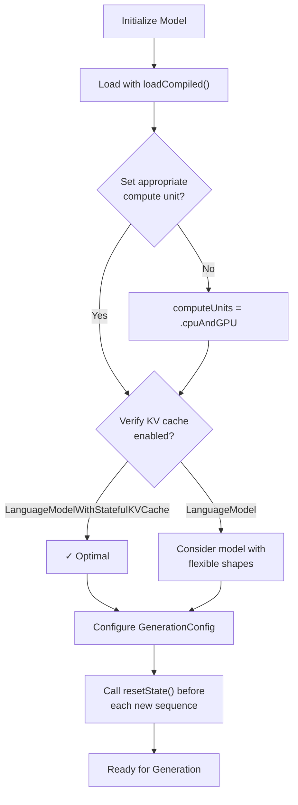

<!-- source: DeepWiki mcp.deepwiki.com · repo huggingface/swift-transformers · page 7.2 Performance Optimization · fetched 2026-10-26 -->

# Performance Optimization

<details>
<summary>Relevant source files</summary>

The following files were used as context for generating this wiki page:

- [Sources/Generation/Generation.swift](Sources/Generation/Generation.swift)
- [Sources/Models/LanguageModel.swift](Sources/Models/LanguageModel.swift)
- [Sources/Models/LanguageModelTypes.swift](Sources/Models/LanguageModelTypes.swift)

</details>


## Purpose and Scope

This document covers best practices for optimizing inference performance in swift-transformers. Topics include KV cache usage, compute unit selection, context length management, and efficient generation strategies. For information about model loading and initialization, see [Language Model](#4.1). For generation configuration parameters, see [Generation Configuration](#5.1).

---

## KV Cache Optimization

### Understanding KV Cache

Key-Value (KV) cache is a performance optimization that stores previously computed attention key and value states during autoregressive text generation. Instead of recomputing these states for all previous tokens at each step, the model can reuse cached values, significantly reducing computation time and memory bandwidth.



Sources: [Sources/Models/LanguageModel.swift:480-563]()

### Stateful KV Cache Architecture

The library supports stateful KV cache through `LanguageModelWithStatefulKVCache`, which maintains cache state internally using CoreML's `MLState` mechanism. This implementation uses two distinct modes:

| Mode | Description | Input Tokens | Cache State |
|------|-------------|--------------|-------------|
| **Prefilling** | Initial prompt processing | All prompt tokens | Empty → Populated |
| **Extending** | Subsequent token generation | Last token only | Incrementally updated |



The implementation automatically detects whether a model supports stateful KV cache during loading:

[Sources/Models/LanguageModel.swift:162-183]() - The `loadCompiled` method detects KV cache availability and instantiates the appropriate class:

```swift
// Automatic KV cache detection
return switch kvCacheAvailability(for: model) {
case .statefulKVCache:
    LanguageModelWithStatefulKVCache(model: model, tokenizer: tokenizer)
default:
    LanguageModel(model: model, tokenizer: tokenizer)
}
```

Sources: [Sources/Models/LanguageModel.swift:162-183](), [Sources/Models/LanguageModel.swift:269-321](), [Sources/Models/LanguageModel.swift:485-563]()

### Prefill and Extend Modes

The stateful KV cache implementation leverages two distinct operational modes to optimize performance:

**Prefill Mode** ([Sources/Models/LanguageModel.swift:526]())
- Occurs during the first prediction call after `resetState()`
- Processes the entire prompt sequence at once
- Populates the KV cache with attention states for all input tokens
- More computationally expensive but only happens once per generation

**Extend Mode** ([Sources/Models/LanguageModel.swift:527]())
- Activated automatically after the first token is generated
- Processes only the most recently generated token
- Updates the cache incrementally with minimal computation
- Continues until generation completes or `resetState()` is called



The mode transition logic is implemented in [Sources/Models/LanguageModel.swift:524-529]():

```swift
let inputIds = switch mode {
case .prefilling: tokens // Pass in all tokens if pre-filling prompt
case .extending: tokens[nil, -1].expandingShape(at: 0) // otherwise just the last token
}
mode = .extending
```

**Performance Impact**: For a 512-token prompt followed by 100 generated tokens, the extend mode processes only 100 individual tokens instead of recomputing attention for 512+100 = 612 tokens at each step. This represents approximately **98% reduction** in attention computation after prefilling.

Sources: [Sources/Models/LanguageModel.swift:486-563]()

### Using KV Cache in Your Application

To ensure optimal KV cache performance:

1. **Always call `resetState()` before generating a new sequence**:
   [Sources/Models/LanguageModelTypes.swift:107-108]()
   ```swift
   await model.resetState()
   ```

2. **The generation framework handles this automatically** when using high-level APIs:
   [Sources/Models/LanguageModelTypes.swift:106-118]()

3. **Model Requirements**: For KV cache to work, the model must support flexible input shapes:
   [Sources/Models/LanguageModel.swift:500-503]()
   ```swift
   guard maxContextLength - minContextLength > 1 else {
       fatalError("Expecting ranged query sequence length.")
   }
   ```

Sources: [Sources/Models/LanguageModel.swift:480-563](), [Sources/Models/LanguageModelTypes.swift:34-37](), [Sources/Models/LanguageModelTypes.swift:106-118]()

---

## Compute Unit Selection

### Available Compute Units

CoreML provides three compute unit options via `MLComputeUnits`:

| Compute Unit | Description | Best For | Power Consumption |
|--------------|-------------|----------|-------------------|
| `.cpuOnly` | CPU execution only | Debugging, consistent performance | Moderate |
| `.cpuAndGPU` | CPU + GPU (default) | Balanced performance/power | Moderate to High |
| `.all` | CPU + GPU + Neural Engine | Maximum throughput, batch processing | Highest |

The compute unit is specified during model loading:

[Sources/Models/LanguageModel.swift:162-169]()
```swift
static func loadCompiled(
    url: URL,
    computeUnits: MLComputeUnits = .cpuAndGPU,
    tokenizer: Tokenizer? = nil
) throws -> LanguageModel {
    let config = MLModelConfiguration()
    config.computeUnits = computeUnits
    let model = try MLModel(contentsOf: url, configuration: config)
    // ...
}
```

### Compute Unit Selection Strategy



### Platform-Specific Considerations

**iOS/iPadOS/visionOS**:
- Neural Engine typically provides best performance for transformer models
- Use `.all` for production deployments
- Battery impact is acceptable for short bursts of generation

**macOS (Apple Silicon)**:
- Similar to iOS, Neural Engine is highly optimized
- GPU can be more efficient for models not optimized for ANE

**macOS (Intel)**:
- No Neural Engine available
- `.cpuAndGPU` balances CPU and integrated/discrete GPU
- Some operations may fall back to CPU: [Sources/Models/LanguageModel.swift:535-551]()

Sources: [Sources/Models/LanguageModel.swift:162-183]()

---

## Context Length Management

### Understanding Context Length Constraints

Every CoreML language model has defined minimum and maximum context lengths determined by the model's input shape constraints. These are automatically detected during initialization:

[Sources/Models/LanguageModel.swift:91-124]()



The detected context lengths are accessible via:
- `model.minContextLength` - Minimum supported sequence length
- `model.maxContextLength` - Maximum supported sequence length

Sources: [Sources/Models/LanguageModel.swift:21-29](), [Sources/Models/LanguageModel.swift:91-124]()

### Padding Strategy for Standard Models

Models without KV cache require padding to `maxContextLength` for every prediction:

[Sources/Models/LanguageModel.swift:60-86]()



Implementation details:
```swift
// From LanguageModel.predictNextTokenScores
let tokenCount = tokens.shape[1]
let padLength = maxContextLength - tokenCount
let padding = MLTensor(repeating: Int32(config.padTokenId ?? 0), shape: [1, padLength])
let inputIDs = MLTensor(concatenating: [tokens, padding], alongAxis: -1)
```

**Performance Implication**: Padding to maximum context introduces computational overhead proportional to the padding size. Models with large `maxContextLength` (e.g., 8192) but short actual sequences incur significant wasted computation.

Sources: [Sources/Models/LanguageModel.swift:60-86]()

### Context Length Optimization for Stateful Models

Stateful KV cache models use flexible input shapes, eliminating padding overhead:

| Aspect | Standard Model | Stateful KV Cache Model |
|--------|---------------|------------------------|
| **Input Shape** | Always `maxContextLength` | Variable, matches actual tokens |
| **Memory Usage** | Fixed, proportional to max | Dynamic, grows with sequence |
| **Computation** | Processes padded positions | Processes only real tokens |
| **Efficiency** | Lower for short sequences | Optimal at all lengths |

[Sources/Models/LanguageModel.swift:511-561]() - The stateful implementation uses actual token count without padding in extend mode:

```swift
let inputIds = switch mode {
case .prefilling: tokens // No padding, all actual tokens
case .extending: tokens[nil, -1].expandingShape(at: 0) // Single token
}
```

Sources: [Sources/Models/LanguageModel.swift:60-86](), [Sources/Models/LanguageModel.swift:511-561]()

---

## Attention Mask Optimization

### Attention Mask Requirements

Not all models require attention masks. The requirement is detected from the CoreML model description:

[Sources/Models/LanguageModel.swift:256-263]()

```swift
var isRequiringAttentionMask: Bool {
    modelDescription.inputDescriptionsByName[Keys.attentionMask] != nil
}

var isRequiringCausalMask: Bool {
    modelDescription.inputDescriptionsByName[Keys.causalMask] != nil
}
```

### Efficient Mask Creation

For models requiring attention masks, the library constructs them efficiently:

**Standard Models** ([Sources/Models/LanguageModel.swift:70-74]()):
```swift
if isRequiringAttentionMask {
    let mask = [Int32](repeating: 1, count: tokenCount) + [Int32](repeating: 0, count: padLength)
    let attentionMask = MLTensor(shape: inputIDs.shape, scalars: mask)
    inputDictionary[Keys.attentionMask] = attentionMask
}
```

**Stateful Models** ([Sources/Models/LanguageModel.swift:534-542]()):
```swift
if isRequiringAttentionMask {
    let attentionMask = MLTensor(zeros: [1, 1, 1, tokenCount + 1], scalarType: Float16.self)
    inputDictionary[Keys.attentionMask] = attentionMask
}
```

**Optimization**: Stateful models use simpler mask shapes (zeros tensors) since the cache handles position tracking internally.

Sources: [Sources/Models/LanguageModel.swift:70-74](), [Sources/Models/LanguageModel.swift:256-263](), [Sources/Models/LanguageModel.swift:534-551]()

---

## Logits Processing Optimization

### Processor Pipeline

Logits processors modify token probabilities before selection. The order of application is critical for correctness and performance:



Sources: [Sources/Generation/Generation.swift:113-158]()

### Processor Instantiation

The generation framework creates processors conditionally based on configuration:

[Sources/Generation/Generation.swift:117-158]()

```swift
private func createLogitsProcessorList(config: GenerationConfig) -> LogitsProcessorList {
    var processors: [any LogitsProcessor] = []
    
    // Repetition penalty (applied before sampling warpers)
    if config.repetitionPenalty != 1.0 {
        if let processor = try? RepetitionPenaltyLogitsProcessor(penalty: Float(config.repetitionPenalty)) {
            processors.append(processor)
        }
    }
    
    // Temperature, TopK, TopP, MinP only if non-default
    // ...
    
    return LogitsProcessorList(processors: processors)
}
```

**Performance Best Practice**: Only non-default processors are instantiated. The processor list is created once per generation sequence, not per token.

Sources: [Sources/Generation/Generation.swift:113-158]()

### Minimizing Logits Processing Overhead

| Configuration | Processors Applied | Performance Impact |
|--------------|-------------------|-------------------|
| Default (greedy) | None | Minimal - direct argmax |
| `temperature=1.0, topK=max, topP=1.0` | None | Minimal - simple sampling |
| `temperature=0.7` | Temperature only | Low - single multiplication |
| `temperature=0.7, topK=50` | Temperature + TopK | Moderate - requires sorting |
| `temperature=0.7, topK=50, topP=0.9, repetitionPenalty=1.2` | All | Higher - multiple passes |

**Recommendation**: For lowest latency, use greedy decoding (`doSample=false`) or minimal sampling parameters.

Sources: [Sources/Generation/Generation.swift:76-111]()

---

## Generation Loop Efficiency

### Token Generation Flow

The generation loop ([Sources/Generation/Generation.swift:67-111]()) is the hot path during inference:

```mermaid
sequenceDiagram
    participant Loop as "Generation Loop"
    participant Model as "NextTokenModel"
    participant Processors as "LogitsProcessorList"
    participant Selector as "Token Selector"
    participant Callback as "PredictionCallback"
    
    Note over Loop: "Initialize outputTokens"
    
    loop "While < maxTotalLength"
        Loop->>Model: "predictNextTokenScores(outputTokens)"
        Model-->>Loop: "nextTokenScores (raw logits)"
        
        Loop->>Processors: "apply processors"
        Processors-->>Loop: "processedScores"
        
        Loop->>Selector: "selectNextToken(mode)"
        Note over Selector: "greedy or sampling"
        Selector-->>Loop: "nextToken"
        
        alt "nextToken == eosTokenId"
            Loop->>Loop: "break"
        end
        
        Loop->>Loop: "concatenate to outputTokens"
        
        opt "callback provided"
            Loop->>Callback: "callback(outputTokens)"
        end
    end
```

Sources: [Sources/Generation/Generation.swift:67-111]()

### Optimization Points

**1. Early EOS Detection** ([Sources/Generation/Generation.swift:100-102]()):
```swift
if let nextTokenId = await tensorToGenerationOutput(nextToken).first, nextTokenId == config.eosTokenId {
    break
}
```
Stops generation immediately when EOS is encountered, avoiding unnecessary iterations.

**2. Callback Overhead** ([Sources/Generation/Generation.swift:105-108]()):
```swift
if let callback {
    let outputTokenIDs = await tensorToGenerationOutput(outputTokens)
    callback(outputTokenIDs)
}
```
- Callbacks are optional - omit if streaming is not needed
- Token conversion (`tensorToGenerationOutput`) happens only when callback is present
- String callbacks incur additional decoding overhead: [Sources/Generation/Generation.swift:194-196]()

**3. Tensor Operations**:
- Concatenation happens once per token: `MLTensor(concatenating: [outputTokens, nextToken], alongAxis: -1)`
- For long sequences, this can accumulate overhead
- Stateful KV cache models mitigate this by processing single tokens

Sources: [Sources/Generation/Generation.swift:67-111](), [Sources/Generation/Generation.swift:178-199]()

---

## Streaming Output Optimization

### Callback Types

Two callback mechanisms are available:

| Callback Type | Signature | Use Case | Overhead |
|--------------|-----------|----------|----------|
| **Token Callback** | `(GenerationOutput) -> Void` | Custom processing, logging | Low - token IDs only |
| **String Callback** | `(String) -> Void` | UI updates, real-time display | Moderate - includes decoding |

### Token Callback Usage

[Sources/Generation/Generation.swift:45-46](), [Sources/Generation/Generation.swift:69-71]()

```swift
public typealias PredictionTokensCallback = (GenerationOutput) -> Void

let output = await generate(
    config: config,
    tokens: tokens,
    model: model
) { tokens in
    // Process raw token IDs
    logTokens(tokens)
}
```

**Performance Characteristic**: Minimal overhead - only tensor-to-array conversion.

### String Callback Usage

[Sources/Generation/Generation.swift:47-48](), [Sources/Generation/Generation.swift:183-199]()

```swift
public typealias PredictionStringCallback = (String) -> Void

let output = await generate(
    config: config,
    prompt: prompt,
    model: model,
    tokenizer: tokenizer
) { partialText in
    // Update UI with decoded text
    updateTextView(partialText)
}
```

**Performance Characteristic**: Moderate overhead - includes full tokenizer decode at each step. For a 100-token generation, the tokenizer decodes:
- Token 1: 1 token
- Token 2: 2 tokens
- ...
- Token 100: 100 tokens

Total: 5,050 token decodings vs. 100 for final-only decoding.

### Callback Performance Strategy



### Throttling Strategy Example

For better performance with string callbacks, throttle updates:

```swift
var tokenCount = 0
let updateInterval = 5 // Update every 5 tokens

await model.generate(config: config, prompt: prompt) { text in
    tokenCount += 1
    if tokenCount % updateInterval == 0 {
        DispatchQueue.main.async {
            updateUI(text)
        }
    }
}
```

Sources: [Sources/Generation/Generation.swift:45-48](), [Sources/Generation/Generation.swift:105-108](), [Sources/Generation/Generation.swift:183-199]()

---

## Best Practices Summary

### Performance Configuration Matrix

| Use Case | Compute Units | KV Cache | Generation Mode | Callbacks | Expected Latency |
|----------|--------------|----------|-----------------|-----------|------------------|
| Interactive chat (iOS) | `.all` | Stateful | Sample | String (throttled) | Low |
| Batch processing | `.all` | Stateful | Greedy | None | Lowest |
| Background task | `.cpuOnly` | Stateful | Greedy | Token | Moderate |
| Debugging | `.cpuOnly` | Standard | Greedy | String | Higher |
| High quality | `.cpuAndGPU` | Stateful | Sample (temp=0.7) | String | Moderate |

### Initialization Checklist



### Common Performance Pitfalls

| Issue | Symptom | Solution |
|-------|---------|----------|
| **Forgetting `resetState()`** | Incorrect output after first sequence | Call `await model.resetState()` before each generation |
| **Using standard model with long context** | High latency, memory spikes | Use stateful KV cache model |
| **Excessive logits processing** | Slower token generation | Use minimal sampling parameters |
| **Unthrottled string callbacks** | UI lag, high CPU | Throttle callback frequency or use token callbacks |
| **Wrong compute unit** | Suboptimal performance | Use `.all` on Apple Silicon for production |
| **Large max_new_tokens with no EOS** | Generation timeout | Set appropriate `maxNewTokens` and ensure model outputs EOS |

### Performance Measurement

To measure and optimize performance:

```swift
import os.signpost

let log = OSLog(subsystem: "com.example.app", category: "Generation")

// Measure total generation time
let signpostID = OSSignpostID(log: log)
os_signpost(.begin, log: log, name: "Generate", signpostID: signpostID)

let output = try await model.generate(config: config, prompt: prompt)

os_signpost(.end, log: log, name: "Generate", signpostID: signpostID)

// Measure per-token latency
var tokenTimes: [TimeInterval] = []
let startTime = Date()

await model.generate(config: config, prompt: prompt) { tokens in
    tokenTimes.append(Date().timeIntervalSince(startTime))
}

let avgTokenLatency = tokenTimes.reduce(0, +) / Double(tokenTimes.count)
print("Average tokens/sec: \(1.0 / avgTokenLatency)")
```

### Resource Monitoring

Monitor these metrics during inference:

- **Memory usage**: Watch for excessive growth indicating cache issues
- **CPU utilization**: High usage may indicate compute unit misconfiguration
- **Thermal state**: On iOS, sustained high thermals suggest `.cpuOnly` may be better
- **Battery drain**: Use Instruments' Energy Log to measure power impact

Sources: [Sources/Models/LanguageModel.swift:162-183](), [Sources/Models/LanguageModel.swift:480-563](), [Sources/Generation/Generation.swift:67-111](), [Sources/Models/LanguageModelTypes.swift:106-118]()

---

