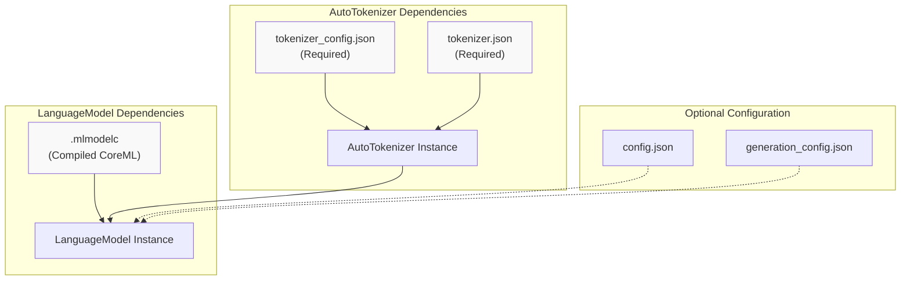
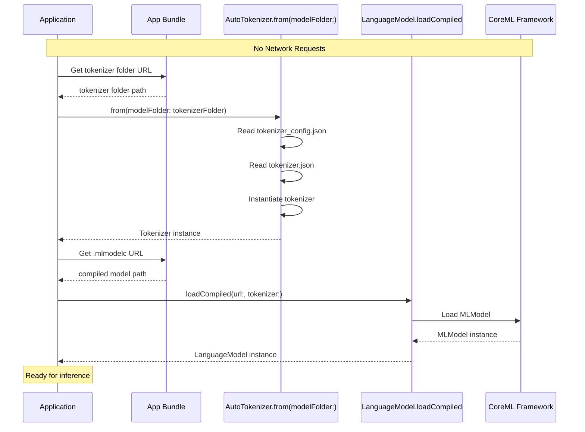
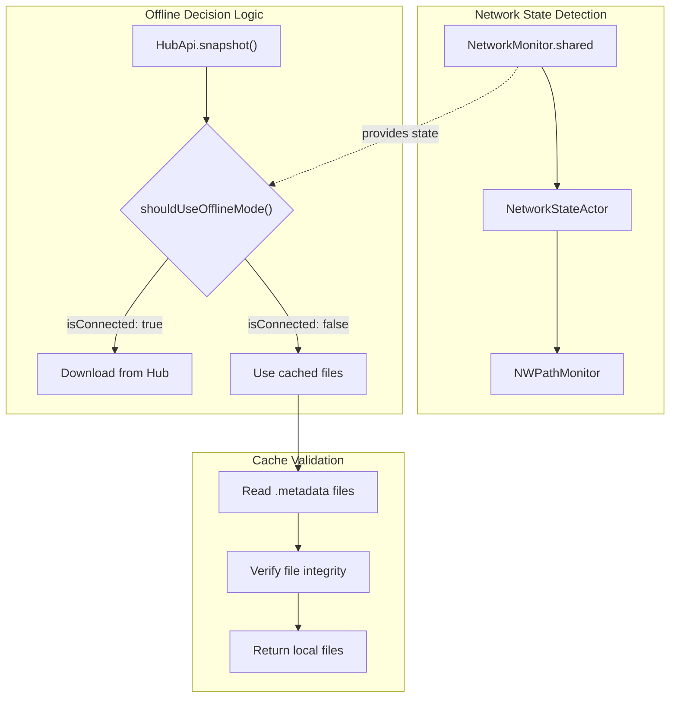
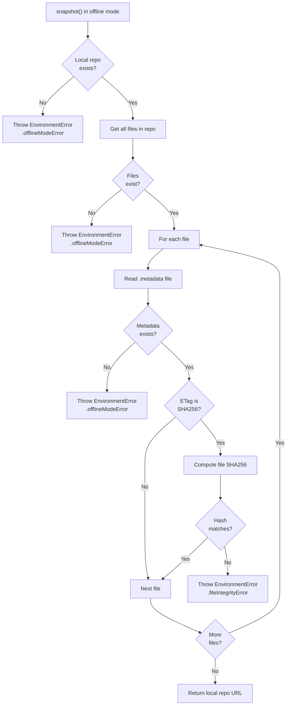

<!-- source: DeepWiki mcp.deepwiki.com · repo huggingface/swift-transformers · page 7.3 Offline Deployment · fetched 2026-10-26 -->

# Offline Deployment

<details>
<summary>Relevant source files</summary>

The following files were used as context for generating this wiki page:

- [LICENSE](LICENSE)
- [README.md](README.md)
- [Sources/Hub/HubApi.swift](Sources/Hub/HubApi.swift)
- [Tests/HubTests/HubApiTests.swift](Tests/HubTests/HubApiTests.swift)
- [Tests/TokenizersTests/Resources/tokenizer.json](Tests/TokenizersTests/Resources/tokenizer.json)
- [Tests/TokenizersTests/Resources/tokenizer_config.json](Tests/TokenizersTests/Resources/tokenizer_config.json)
- [media/swift-t-banner.png](media/swift-t-banner.png)

</details>


This document explains how to prepare and deploy swift-transformers models and tokenizers for fully offline applications. It covers asset preparation, bundling strategies, and initialization patterns that eliminate network dependencies after initial setup.

For information about downloading models during development, see [Hub API](#3.1). For performance optimization strategies during inference, see [Performance Optimization](#7.2).

## Overview

The swift-transformers library supports three deployment modes:

1. **Online Mode**: Downloads models and tokenizers from Hugging Face Hub on first use
2. **Cached Mode**: Uses previously downloaded files from the local cache
3. **Fully Offline Mode**: Uses pre-bundled assets with no network access

This page focuses on the third mode, where applications bundle all required assets and never make network requests. This is ideal for applications with strict privacy requirements, limited connectivity scenarios, or predictable resource management needs.

**Sources**: [Sources/Hub/HubApi.swift:71-128](), [README.md:91-120]()

## Components Required for Offline Deployment

### Essential Files

A complete offline deployment requires these files:

| File Type | Purpose | Required |
|-----------|---------|----------|
| `tokenizer.json` | Tokenizer vocabulary and configuration | Yes |
| `tokenizer_config.json` | Tokenizer metadata and special tokens | Yes |
| `.mlmodelc` (CoreML) | Compiled model for inference | Yes |
| `config.json` | Model configuration and metadata | Recommended |
| `generation_config.json` | Default generation parameters | Optional |

### File Dependencies



**Sources**: [Sources/Hub/HubApi.swift:312-329](), [Sources/Tokenizers/AutoTokenizer.swift]()

## Asset Preparation Workflow

### Step 1: Download Required Files

Use the Hub API or `huggingface-cli` to download files during development:

**Using swift-transformers Hub API:**

```swift
let hub = HubApi(downloadBase: URL(fileURLWithPath: "./offline-assets"))
let repo = Hub.Repo(id: "mistralai/Mistral-7B-Instruct-v0.3")

// Download tokenizer files
try await hub.snapshot(
    from: repo,
    matching: ["tokenizer.json", "tokenizer_config.json", "config.json"]
)
```

**Using huggingface-cli:**

```bash
huggingface-cli download \
  mistralai/Mistral-7B-Instruct-v0.3 \
  tokenizer.json tokenizer_config.json config.json \
  --local-dir ./offline-assets
```

### Step 2: Prepare CoreML Model

The CoreML model must be compiled before bundling. Use Xcode or `coremlcompiler`:

```bash
xcrun coremlcompiler compile MyModel.mlpackage ./CompiledModels/
# Produces MyModel.mlmodelc directory
```

### Directory Structure

Organize assets for easy bundling:

```
YourApp/
├── Resources/
│   └── Models/
│       └── mistral-7b/
│           ├── tokenizer.json
│           ├── tokenizer_config.json
│           ├── config.json
│           └── mistral-7b.mlmodelc/
│               ├── model.mil
│               ├── weights/
│               └── metadata.json
```

**Sources**: [Sources/Hub/HubApi.swift:576-658](), [README.md:111-116]()

## Bundling Assets with Your Application

### Including Files in App Bundle

Add the prepared assets to your Xcode project:

1. Drag the model directory into your project navigator
2. In "Add to targets", check your app target
3. Ensure "Create folder references" is selected (blue folder icon)

### Accessing Bundle Resources

```swift
// Get bundle resource URL
guard let modelURL = Bundle.main.url(
    forResource: "mistral-7b",
    withExtension: "mlmodelc",
    subdirectory: "Models/mistral-7b"
) else {
    fatalError("Model not found in bundle")
}

guard let tokenizerFolder = Bundle.main.url(
    forResource: "Models/mistral-7b",
    withExtension: nil
) else {
    fatalError("Tokenizer folder not found in bundle")
}
```

### Bundle Size Considerations

| Model Size | Compiled Size | Recommended Strategy |
|------------|---------------|---------------------|
| < 1 GB | ~Same | Include in app bundle |
| 1-3 GB | ~Same | Include in app bundle or on-demand resources |
| > 3 GB | ~Same | Use on-demand resources or initial download |

**Sources**: [README.md:96-106]()

## Loading Components Offline

### Complete Offline Initialization Pattern



### Tokenizer Initialization from Local Files

The `AutoTokenizer.from(modelFolder:)` initializer loads tokenizers without network access:

```swift
let tokenizerFolder = Bundle.main.url(
    forResource: "Models/mistral-7b",
    withExtension: nil
)!

// Load tokenizer from local files - no network request
let tokenizer = try await AutoTokenizer.from(modelFolder: tokenizerFolder)
```

This method reads directly from local files:
- [Sources/Tokenizers/AutoTokenizer.swift]() implements `from(modelFolder:)`
- Reads `tokenizer_config.json` for metadata
- Reads `tokenizer.json` for vocabulary and model
- No fallback to Hub download occurs

### Model Initialization with Bundled Tokenizer

```swift
let compiledModelURL = Bundle.main.url(
    forResource: "mistral-7b",
    withExtension: "mlmodelc",
    subdirectory: "Models/mistral-7b"
)!

// Pass tokenizer directly - no network lookup
let model = try LanguageModel.loadCompiled(
    url: compiledModelURL,
    tokenizer: tokenizer
)
```

When a tokenizer is provided to `loadCompiled(url:tokenizer:)`, the LanguageModel:
- Uses the provided tokenizer instance
- Never attempts to load tokenizer configuration from Hub
- Never makes network requests

**Sources**: [README.md:96-106](), [Sources/Models/LanguageModel.swift]()

## Offline Mode Detection and Behavior

### Automatic Offline Mode

The HubApi automatically detects network availability using `NetworkMonitor`:



The network monitor continuously tracks connectivity:

- [Sources/Hub/HubApi.swift:818-872]() implements `NetworkMonitor`
- Uses `NWPathMonitor` from Network framework
- Updates state in `NetworkStateActor` ([Sources/Hub/HubApi.swift:819-837]())
- `shouldUseOfflineMode()` returns `true` when `isConnected == false`

### Manual Offline Mode Override

Force offline mode regardless of network state:

```swift
let hub = HubApi(
    downloadBase: customCacheLocation,
    useOfflineMode: true  // Force offline mode
)
```

**Sources**: [Sources/Hub/HubApi.swift:96-119](), [Sources/Hub/HubApi.swift:818-872]()

## Cache Validation in Offline Mode

### Metadata File Structure

When files are downloaded, the Hub creates metadata files at `.cache/huggingface/download/`:

```
models/repo-name/
├── tokenizer.json
├── .cache/
│   └── huggingface/
│       └── download/
│           └── tokenizer.json.metadata
```

Metadata file format (3 lines):
```
<commit-hash>
<etag>
<timestamp>
```

### Offline Validation Process



The validation logic is implemented in [Sources/Hub/HubApi.swift:586-623]():

1. Checks if repository directory exists
2. Verifies each file has corresponding `.metadata` file
3. For LFS files (SHA256 etag), validates file integrity by computing hash
4. Throws specific errors for missing files or integrity failures

### Error Types

| Error | When Thrown | Recovery |
|-------|-------------|----------|
| `EnvironmentError.offlineModeError` | Repository or files not cached | Download files online first |
| `EnvironmentError.fileIntegrityError` | File hash mismatch | Re-download corrupted file |
| `EnvironmentError.invalidMetadataError` | Corrupted metadata file | System auto-removes and re-downloads |

**Sources**: [Sources/Hub/HubApi.swift:288-308](), [Sources/Hub/HubApi.swift:358-400](), [Sources/Hub/HubApi.swift:586-623]()

## Pre-populating the Cache

### During Development

Build a cache directory with all required models:

```swift
let hub = HubApi(downloadBase: URL(fileURLWithPath: "./app-cache"))

let models = [
    "mistralai/Mistral-7B-Instruct-v0.3",
    "microsoft/phi-2"
]

for modelId in models {
    try await hub.snapshot(
        from: Hub.Repo(id: modelId),
        matching: ["*.json", "*.mlmodelc/**"]
    )
}

// Copy ./app-cache to app bundle or Documents directory
```

### Cache Location Options

| Location | Use Case | Persistence |
|----------|----------|-------------|
| App Bundle (`Bundle.main`) | Pre-installed models | Permanent, read-only |
| Documents Directory | User-downloaded models | Persistent across launches |
| Caches Directory | Temporary storage | May be cleared by system |
| Custom URL | Testing, development | Depends on implementation |

### Using Custom Cache Location

```swift
// Initialize with custom cache
let documentsURL = FileManager.default.urls(
    for: .documentDirectory,
    in: .userDomainMask
).first!

let cacheURL = documentsURL.appendingPathComponent("model-cache")

let hub = HubApi(downloadBase: cacheURL)

// Files will be organized as:
// model-cache/models/repo-id/files
```

**Sources**: [Sources/Hub/HubApi.swift:96-119](), [Sources/Hub/HubApi.swift:347-349]()

## Complete Offline Deployment Example

### Project Structure

```
MyOfflineApp/
├── MyOfflineApp/
│   ├── Models/
│   │   ├── tokenizer.json
│   │   ├── tokenizer_config.json
│   │   ├── config.json
│   │   └── model.mlmodelc/
│   ├── OfflineModelManager.swift
│   └── ContentView.swift
└── MyOfflineApp.xcodeproj
```

### OfflineModelManager Implementation

```swift
import Foundation
import Transformers

class OfflineModelManager {
    private let tokenizer: Tokenizer
    private let model: LanguageModel
    
    init() async throws {
        // Get bundle URLs - no network access
        guard let tokenizerFolder = Bundle.main.url(
            forResource: "Models",
            withExtension: nil
        ) else {
            throw OfflineError.bundleResourceNotFound("Models folder")
        }
        
        guard let modelURL = Bundle.main.url(
            forResource: "model",
            withExtension: "mlmodelc",
            subdirectory: "Models"
        ) else {
            throw OfflineError.bundleResourceNotFound("model.mlmodelc")
        }
        
        // Initialize tokenizer from local files
        self.tokenizer = try await AutoTokenizer.from(
            modelFolder: tokenizerFolder
        )
        
        // Load compiled model with tokenizer
        self.model = try LanguageModel.loadCompiled(
            url: modelURL,
            tokenizer: self.tokenizer
        )
    }
    
    func generate(prompt: String) async throws -> String {
        let tokens = tokenizer.encode(text: prompt)
        
        let config = GenerationConfig(
            maxNewTokens: 100,
            temperature: 0.7
        )
        
        var generatedText = ""
        try await model.generate(
            config: config,
            input: tokens
        ) { token in
            if let text = tokenizer.decode(tokens: [token]) {
                generatedText += text
            }
        }
        
        return generatedText
    }
}

enum OfflineError: Error {
    case bundleResourceNotFound(String)
}
```

This implementation:
- Never makes network requests
- Uses only bundled resources
- Initializes synchronously from local files
- Ready for immediate inference

**Sources**: [README.md:96-106](), [Sources/Tokenizers/AutoTokenizer.swift](), [Sources/Models/LanguageModel.swift]()

## Testing Offline Deployment

### Validation Checklist

| Test | Command/Action | Expected Result |
|------|----------------|-----------------|
| Bundle inclusion | Build app, check bundle | All required files present |
| Airplane mode test | Enable airplane mode, launch app | App initializes successfully |
| Network simulation | Use Network Link Conditioner | App works without network |
| File integrity | Hash validation | All files match expected hashes |

### Programmatic Validation

```swift
func validateOfflineAssets() throws {
    let requiredFiles = [
        "Models/tokenizer.json",
        "Models/tokenizer_config.json",
        "Models/model.mlmodelc"
    ]
    
    for file in requiredFiles {
        guard Bundle.main.url(forResource: file, withExtension: nil) != nil else {
            throw ValidationError.missingFile(file)
        }
    }
}
```

### Testing with HubApi Offline Mode

Force offline mode for testing:

```swift
#if DEBUG
// Disable network monitor for testing
ProcessInfo.processInfo.environment["CI_DISABLE_NETWORK_MONITOR"] = "1"
#endif

let hub = HubApi(
    downloadBase: testCacheURL,
    useOfflineMode: true
)

// Verify all files accessible without network
let repoURL = try await hub.snapshot(
    from: Hub.Repo(id: "test/model")
)
```

The `CI_DISABLE_NETWORK_MONITOR` environment variable is checked in [Sources/Hub/HubApi.swift:832-834]() to bypass network monitoring during testing.

**Sources**: [Sources/Hub/HubApi.swift:586-623](), [Tests/HubTests/HubApiTests.swift:176-274]()

## Troubleshooting Common Issues

### Issue: "Repository not available locally"

**Cause**: HubApi entered offline mode but files not cached

**Solution**:
1. Ensure files downloaded before enabling offline mode
2. Verify cache location matches `HubApi.downloadBase`
3. Check metadata files exist in `.cache/huggingface/download/`

### Issue: "File integrity check failed"

**Cause**: Cached file corrupted or incomplete

**Solution**:
```swift
// Clear corrupted cache
let cacheURL = hub.localRepoLocation(Hub.Repo(id: "model/id"))
try? FileManager.default.removeItem(at: cacheURL)

// Re-download with offline mode disabled
let hub = HubApi(useOfflineMode: false)
try await hub.snapshot(from: Hub.Repo(id: "model/id"))
```

### Issue: "Model not found in bundle"

**Cause**: Asset not included in app target or incorrect path

**Solution**:
1. Check Xcode target membership
2. Verify "Copy Bundle Resources" build phase
3. Use correct resource subdirectory path

### Issue: Network request despite bundled assets

**Cause**: Using initializers that fetch from Hub

**Solution**: Use offline-compatible initializers:
- `AutoTokenizer.from(modelFolder:)` instead of `from(pretrained:)`
- `LanguageModel.loadCompiled(url:tokenizer:)` with explicit tokenizer

**Sources**: [Sources/Hub/HubApi.swift:288-308](), [README.md:96-120]()

## Summary

Offline deployment in swift-transformers requires:

1. **Asset Preparation**: Download tokenizer files and compile CoreML model
2. **Bundling Strategy**: Include assets in app bundle or Documents directory  
3. **Initialization Pattern**: Use `from(modelFolder:)` and explicit tokenizer passing
4. **Cache Management**: Pre-populate cache with metadata for validation
5. **Testing**: Validate with network disabled to ensure true offline operation

The key insight is that swift-transformers supports true offline operation when:
- All required files are present locally
- Offline-compatible initializers are used (`from(modelFolder:)`, not `from(pretrained:)`)
- The tokenizer is explicitly passed to `LanguageModel.loadCompiled()`

This eliminates network dependencies after initial asset preparation, enabling deployment in privacy-sensitive or connectivity-constrained environments.

**Sources**: [Sources/Hub/HubApi.swift](), [Sources/Tokenizers/AutoTokenizer.swift](), [Sources/Models/LanguageModel.swift](), [README.md:91-120]()