# Page: Overview

# Overview

<details>
<summary>Relevant source files</summary>

The following files were used as context for generating this wiki page:

- [LICENSE](LICENSE)
- [Package.swift](Package.swift)
- [README.md](README.md)
- [Sources/Generation/GenerationConfig.swift](Sources/Generation/GenerationConfig.swift)
- [Tests/TokenizersTests/Resources/tokenizer.json](Tests/TokenizersTests/Resources/tokenizer.json)
- [Tests/TokenizersTests/Resources/tokenizer_config.json](Tests/TokenizersTests/Resources/tokenizer_config.json)
- [media/swift-t-banner.png](media/swift-t-banner.png)

</details>


`swift-transformers` is a Swift library that brings language model capabilities to iOS and macOS applications through a modular architecture designed for on-device machine learning. The library provides utilities for tokenization, model management, and text generation, with seamless integration to the Hugging Face Hub for model downloads and CoreML for on-device inference.

This page covers the library's architecture, core modules, and design principles. For installation instructions, see [Installation and Setup](#1.2). For a complete working example, see [Quick Start Guide](#1.3). For detailed module documentation, see [Tokenizers](#2), [Hub](#3), [Models](#4), and [Generation](#5).

Sources: [README.md:15-21](), [Package.swift:11-18]()

## Purpose and Scope

The library addresses three key challenges in bringing language models to Swift applications:

1. **Text Processing**: Converting text to token IDs and back, with support for chat templates and special tokens
2. **Model Management**: Downloading, caching, and loading language models from Hugging Face Hub
3. **Text Generation**: Orchestrating model inference with various decoding strategies

The library is designed for applications that need to run language models locally on Apple devices using CoreML, without requiring server-side inference infrastructure.

Sources: [README.md:19-26]()

## Module Architecture

The library consists of four primary modules that build on each other in a layered dependency structure:

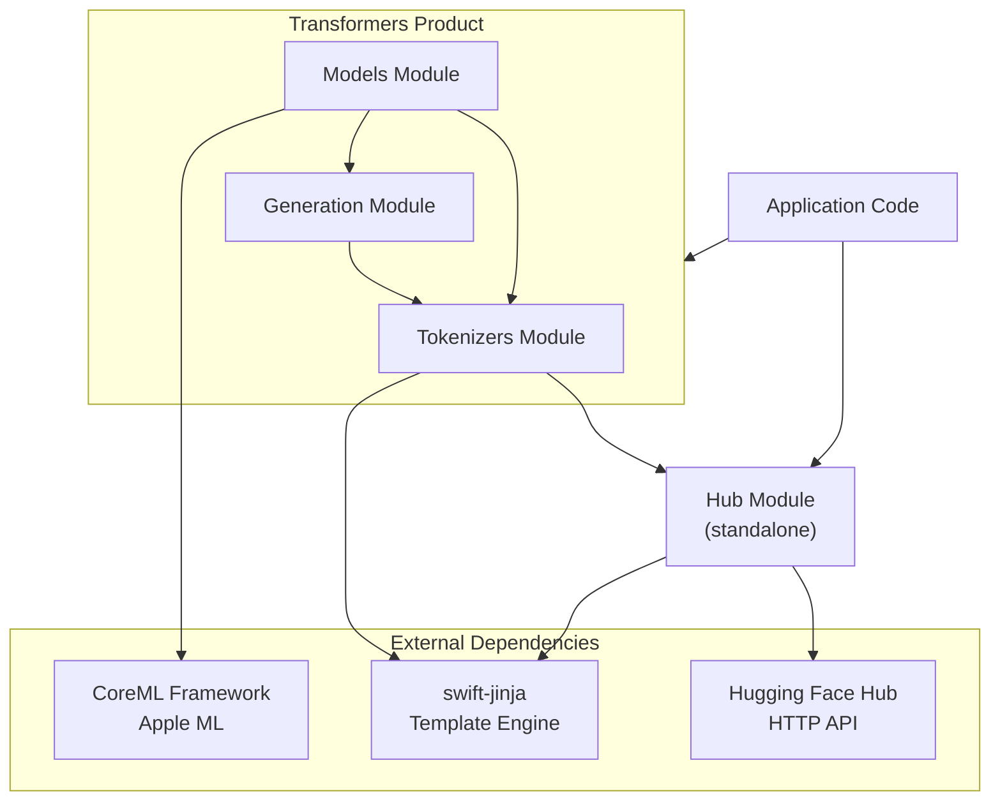

**Module Dependency Table**

| Module | Dependencies | Purpose |
|--------|-------------|---------|
| `Hub` | `swift-jinja` | Model downloads, file management, configuration loading |
| `Tokenizers` | `Hub`, `swift-jinja` | Text tokenization, chat templates, encoding/decoding |
| `Generation` | `Tokenizers` | Text generation algorithms and logits processing |
| `Models` | `Tokenizers`, `Generation` | CoreML model wrappers and inference orchestration |

Sources: [Package.swift:11-32](), [README.md:25-26]()

## Core Components and Code Entities

The following diagram maps high-level concepts to concrete Swift types in the codebase:

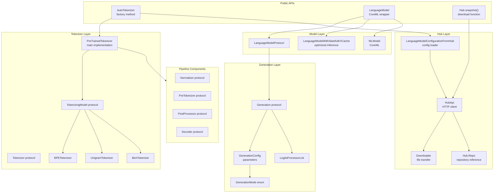

Sources: [Package.swift:14-26](), [README.md:32-37]()

## End-to-End Workflow

A typical usage flow involves three phases: initialization, template application, and generation. The following diagram shows how data flows through the system from model identifier to generated text:

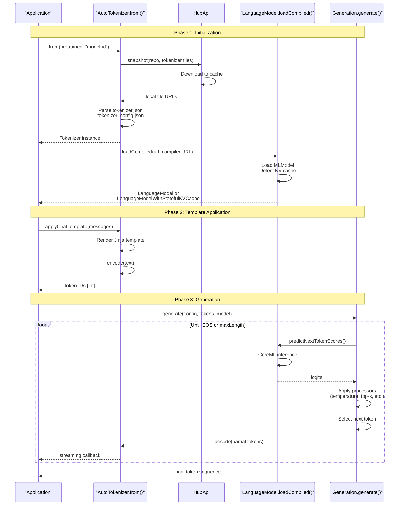

Sources: [README.md:28-106]()

## Module Responsibilities

### Hub Module

The `Hub` module provides the foundation for all model and tokenizer acquisition:

**Key Types:**
- `HubApi`: HTTP client for Hugging Face Hub API
- `Downloader`: Manages file downloads with resume capability and progress reporting
- `Hub.Repo`: Repository reference with `id` and `type` properties
- `LanguageModelConfigurationFromHub`: Lazy configuration loader

**Capabilities:**
- Resume-capable downloads with retry logic
- Local caching with integrity verification (ETag, SHA256)
- Offline mode using cached files
- Progress callbacks for download status

Sources: [Package.swift:24](), [README.md:67-82]()

### Tokenizers Module

The `Tokenizers` module handles all text processing:

**Key Types:**
- `AutoTokenizer`: Factory for creating tokenizer instances
- `PreTrainedTokenizer`: Main tokenizer implementation with full pipeline
- `TokenizingModel`: Protocol implemented by `BPETokenizer`, `UnigramTokenizer`, `BertTokenizer`
- Pipeline components: `Normalizer`, `PreTokenizer`, `PostProcessor`, `Decoder`

**Capabilities:**
- Text encoding to token IDs
- Token decoding to text
- Chat template rendering via Jinja
- Special token handling
- Tool calling format support

Sources: [Package.swift:26](), [README.md:28-64]()

### Models Module

The `Models` module wraps CoreML models for text generation:

**Key Types:**
- `LanguageModel`: Basic CoreML model wrapper
- `LanguageModelWithStatefulKVCache`: Optimized wrapper for models with stateful key-value caching
- `LanguageModelProtocol`: Common interface for both implementations

**Capabilities:**
- CoreML model loading from compiled `.mlmodelc` files
- Automatic KV cache detection
- Token score prediction
- Context length management

Sources: [Package.swift:25](), [README.md:84-106]()

### Generation Module

The `Generation` module implements text generation algorithms:

**Key Types:**
- `Generation`: Protocol implemented by model classes
- `GenerationConfig`: Configuration structure with all generation parameters
- `GenerationMode`: Enum with values `.greedy`, `.sample`, `.beam`, `.groupBeam`, `.contrastiveSearch`
- `LogitsProcessorList`: Chain of logits processors

**Capabilities:**
- Multiple generation strategies
- Temperature, top-k, top-p, min-p sampling
- Repetition penalty
- Streaming output via callbacks

Sources: [Package.swift:23](), [Sources/Generation/GenerationConfig.swift:1-124]()

## Design Principles

### Protocol-Oriented Design

The library uses Swift protocols extensively to enable flexibility and testability:

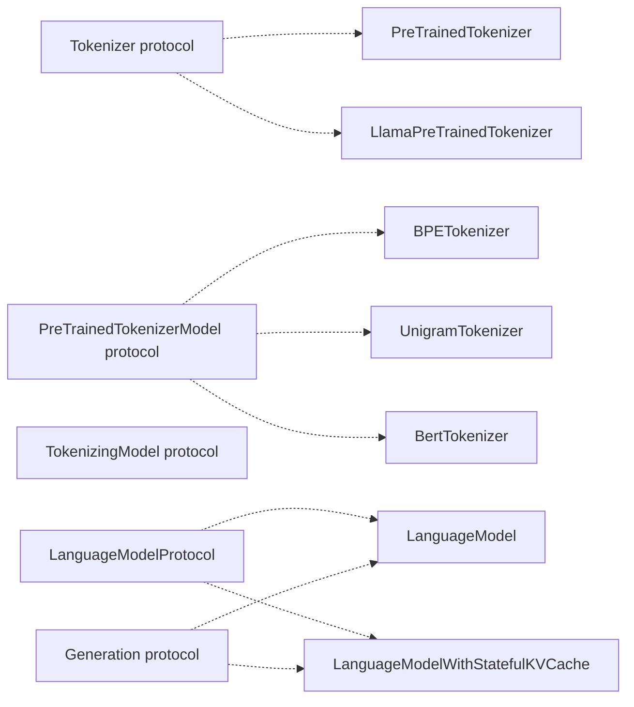

This enables:
- Easy mocking for tests
- Alternative implementations without breaking existing code
- Composition of pipeline components

Sources: [Package.swift:7-9]()

### Configuration-Driven Instantiation

Components are instantiated based on JSON configuration files downloaded from Hugging Face Hub:

| Configuration File | Purpose | Used By |
|-------------------|---------|---------|
| `tokenizer_config.json` | Tokenizer metadata and special tokens | `AutoTokenizer` |
| `tokenizer.json` | Full tokenizer specification (vocab, merges, pipeline) | `AutoTokenizer` |
| `config.json` | Model architecture and generation parameters | `LanguageModel` |

This allows the library to automatically configure itself for any model without code changes.

Sources: [Tests/TokenizersTests/Resources/tokenizer_config.json:1-9](), [Tests/TokenizersTests/Resources/tokenizer.json:1-51]()

### Offline-First Architecture

After initial download, the library operates entirely offline:

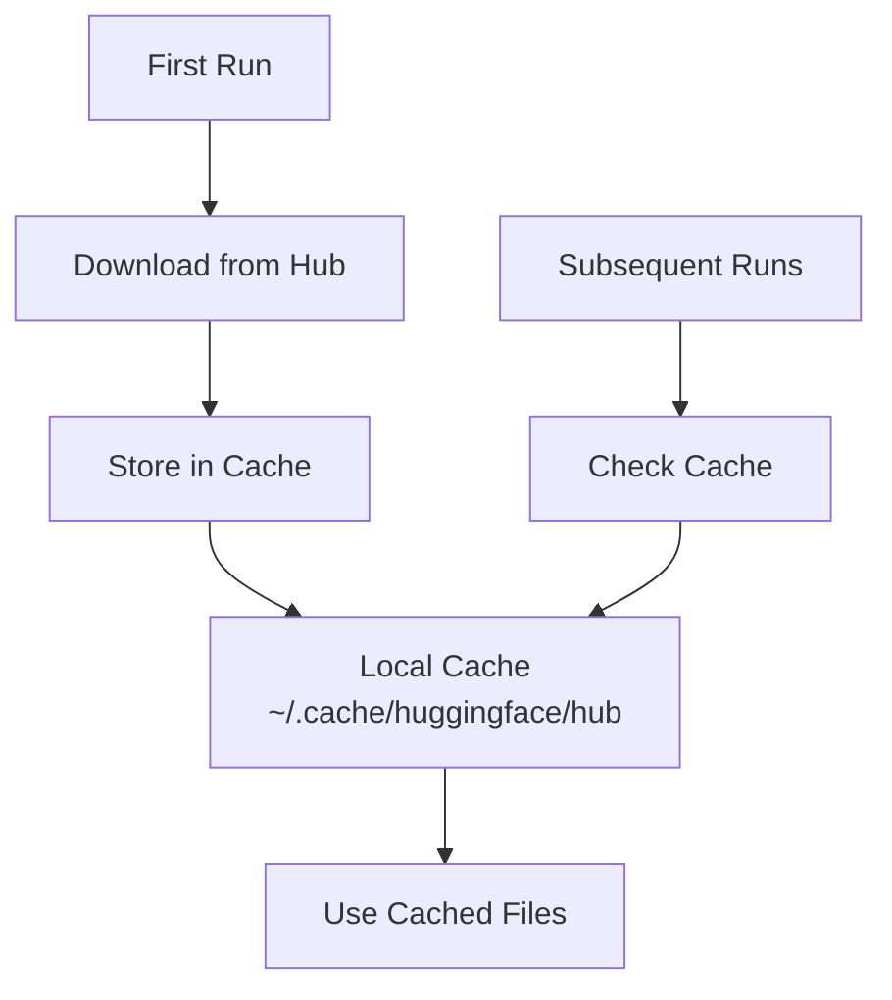

**Offline Capabilities:**
- Models and tokenizers cached locally after first download
- `AutoTokenizer.from(modelFolder:)` loads from local directory
- `LanguageModel.loadCompiled(url:tokenizer:)` uses pre-bundled assets
- Metadata stored for integrity verification

This design enables:
- Reduced latency after initial setup
- Operation without network connectivity
- Privacy-preserving on-device inference
- Ability to bundle models with app distribution

Sources: [README.md:91-119]()

### Modern Swift Concurrency

The library uses Swift's modern concurrency features throughout:

**Async/Await:**
- `AutoTokenizer.from(pretrained:)` is `async throws`
- `Hub.snapshot()` is `async throws`
- All network operations use structured concurrency

**Actor Isolation:**
- `NetworkMonitor` actor for connectivity detection
- Thread-safe state management in downloaders

**Strict Concurrency:**
- All targets compiled with `StrictConcurrency` enabled
- Sendable conformance for safe concurrent access

Sources: [Package.swift:6-9]()

## Integration Points

### Hugging Face Hub

The library integrates with Hugging Face Hub's HTTP API:

- Repository access via `https://huggingface.co/{repo-id}`
- File metadata via `/api/models/{repo-id}`
- Direct file downloads with range request support
- Redirect security policies for CDN endpoints

Sources: [README.md:67-82]()

### CoreML

Integration with Apple's CoreML framework:

- Loading compiled models (`.mlmodelc` format)
- `MLModel` wrapper for prediction
- Compute unit selection (CPU, GPU, Neural Engine)
- Stateful models with `MLState` for KV caching

Sources: [Package.swift:25]()

### swift-jinja

Integration with the `swift-jinja` template engine:

- Chat template rendering from Jinja2 templates
- Variable substitution and control flow
- Filter functions for text manipulation
- Used by `applyChatTemplate()` method

Sources: [Package.swift:20](), [README.md:32-37]()

## Typical Usage Pattern

A complete example showing initialization, template application, and generation:

```swift
// 1. Initialize tokenizer (downloads from Hub if needed)
let tokenizer = try await AutoTokenizer.from(
    pretrained: "deepseek-ai/DeepSeek-R1-Distill-Qwen-7B"
)

// 2. Load compiled CoreML model
let modelURL = URL(fileURLWithPath: "path/to/model.mlmodelc")
let model = try LanguageModel.loadCompiled(url: modelURL, tokenizer: tokenizer)

// 3. Prepare input with chat template
let messages = [["role": "user", "content": "Explain Swift concurrency"]]
let inputTokens = try tokenizer.applyChatTemplate(messages: messages)

// 4. Configure generation
let config = GenerationConfig(
    maxNewTokens: 100,
    temperature: 0.7,
    topP: 0.9
)

// 5. Generate text
let output = try model.generate(
    inputTokens: inputTokens,
    config: config
) { inProgressGeneration in
    // Stream partial results
    print(inProgressGeneration.text, terminator: "")
}
```

For detailed usage examples, see [Quick Start Guide](#1.3).

Sources: [README.md:28-106]()

## Platform Requirements

The library supports:

- **iOS**: 16.0 and later
- **macOS**: 13.0 and later
- **Swift**: 5.9 and later

All targets are compiled with strict concurrency checking enabled for thread safety.

Sources: [Package.swift:13](), [Package.swift:7-9]()

## License

The library is released under the Apache 2.0 license.

Sources: [LICENSE:1-202](), [README.md:169-171]()

---

# Page: Architecture

# Architecture

<details>
<summary>Relevant source files</summary>

The following files were used as context for generating this wiki page:

- [LICENSE](LICENSE)
- [Package.swift](Package.swift)
- [README.md](README.md)
- [Sources/Generation/GenerationConfig.swift](Sources/Generation/GenerationConfig.swift)
- [Sources/Hub/Hub.swift](Sources/Hub/Hub.swift)
- [Tests/TokenizersTests/Resources/tokenizer.json](Tests/TokenizersTests/Resources/tokenizer.json)
- [Tests/TokenizersTests/Resources/tokenizer_config.json](Tests/TokenizersTests/Resources/tokenizer_config.json)
- [media/swift-t-banner.png](media/swift-t-banner.png)

</details>


This document describes the overall system architecture of swift-transformers, explaining how the four core modules (Hub, Tokenizers, Models, Generation) interact, their dependency relationships, and the layered design pattern. For specific module details, see the individual module pages: [Hub](#3), [Tokenizers](#2), [Models](#4), and [Generation](#5).

## Module Overview

The swift-transformers library is organized into four primary modules, each with distinct responsibilities. These modules are defined as separate targets in the Swift Package Manager configuration and exposed through library products.

### Core Modules

| Module | Purpose | Primary Classes | Dependencies |
|--------|---------|-----------------|--------------|
| **Hub** | Model acquisition, file downloads, configuration management | `HubApi`, `Downloader`, `LanguageModelConfigurationFromHub` | `swift-jinja` |
| **Tokenizers** | Text-to-token conversion, chat templating | `AutoTokenizer`, `PreTrainedTokenizer`, tokenizing models | Hub, `swift-jinja` |
| **Generation** | Text generation algorithms, logits processing | `Generation` protocol, `GenerationConfig`, `LogitsProcessorList` | Tokenizers |
| **Models** | CoreML model loading and inference | `LanguageModel`, `LanguageModelWithStatefulKVCache` | Tokenizers, Generation |

The **Transformers** product aggregates Tokenizers, Generation, and Models into a single import for application developers, while Hub can be used independently for model downloads.

**Module Dependency Graph**

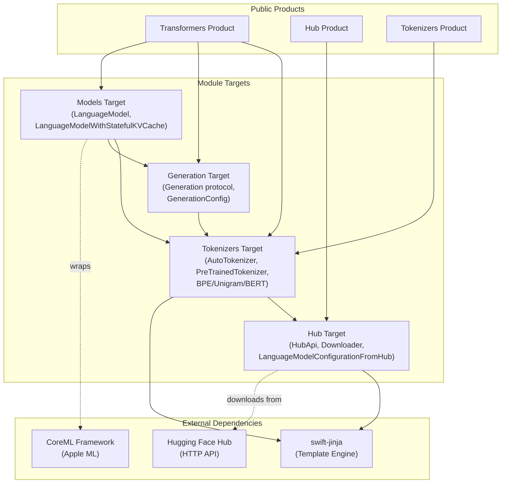

Sources: [Package.swift:11-32]()

## Layered Architecture

The system follows a layered architecture pattern where each layer builds abstractions on top of lower layers. This design enforces clear separation of concerns and enables independent testing and development of each layer.

**Layer Structure**

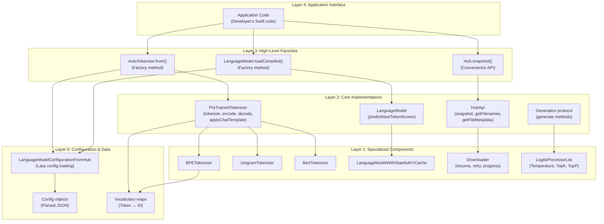

**Layer Responsibilities:**

- **Layer 0**: Raw data structures parsed from JSON files, vocabulary maps, and metadata
- **Layer 1**: Algorithm implementations (tokenizing models, download logic, generation strategies)
- **Layer 2**: Orchestration classes that compose Layer 1 components into cohesive workflows
- **Layer 3**: Factory methods and convenience APIs that simplify common initialization patterns
- **Layer 4**: Application code that consumes the library

Sources: [Package.swift:11-32](), [Sources/Hub/Hub.swift:10-109]()

## Key Abstractions and Protocols

The library uses protocol-oriented design extensively to enable flexibility and extensibility. Core abstractions define contracts that multiple implementations fulfill.

**Protocol Hierarchy**

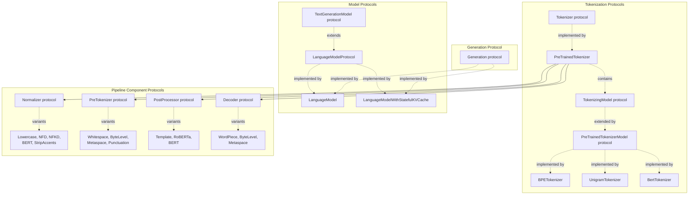

**Core Type Definitions:**

| Abstraction | Location | Purpose |
|-------------|----------|---------|
| `Tokenizer` | Tokenizers module | Base tokenization interface (encode, decode) |
| `TokenizingModel` | Tokenizers module | Core tokenization algorithm (BPE, Unigram, BERT) |
| `LanguageModelProtocol` | Models module | Model inference interface |
| `Generation` | Generation module | Text generation algorithm contract |
| `Config` | Hub module | Type-safe configuration wrapper |

Sources: [Package.swift:22-26]()

## Configuration Loading Architecture

Configuration management is centralized in the `LanguageModelConfigurationFromHub` class, which provides lazy, asynchronous loading of model and tokenizer configurations with comprehensive fallback mechanisms.

**Configuration Loading Flow**

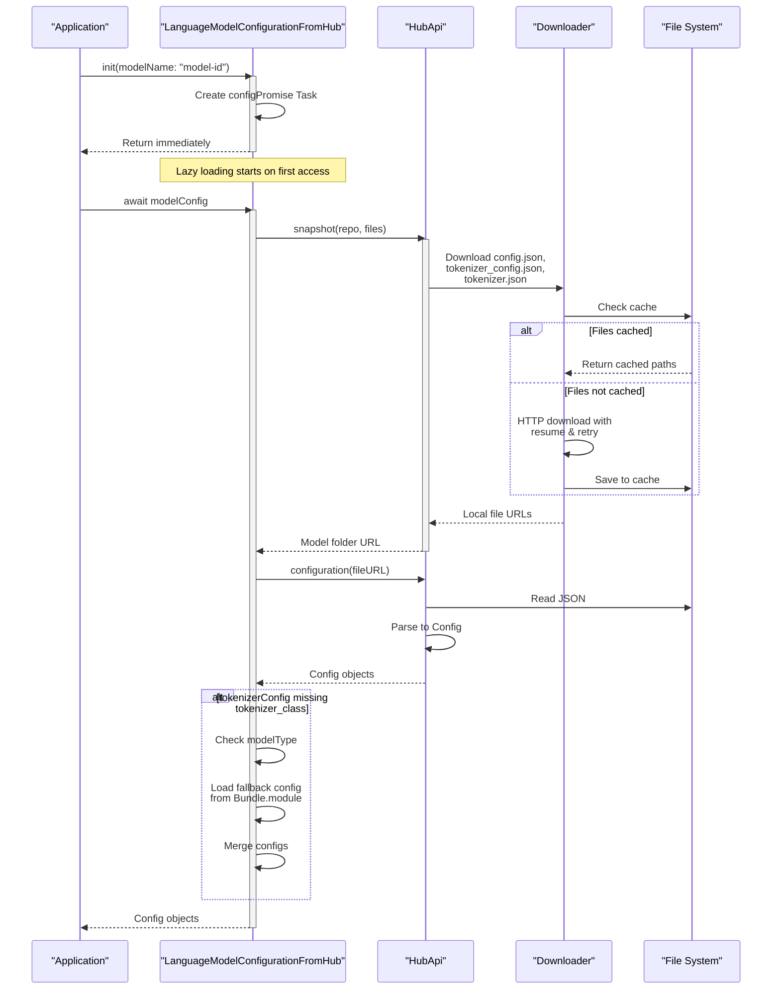

**Fallback Configuration Sources:**

1. **Primary**: `tokenizer_config.json` from Hub repository
2. **Fallback**: Bundled configurations in `Sources/Hub/Resources/`
3. **Inference**: Capitalize `model_type` to guess `tokenizer_class`

Sources: [Sources/Hub/Hub.swift:111-340]()

## Data Flow: Download to Inference

The complete data pipeline from model discovery to text generation demonstrates how all modules collaborate.

**End-to-End Data Pipeline**

```mermaid
flowchart LR
    subgraph "Phase 1: Discovery"
        A["Developer specifies<br/>model identifier"]
        B["Hub.Repo(id:)"]
        C["HubApi.snapshot()"]
    end
    
    subgraph "Phase 2: Download"
        D["Downloader instances"]
        E["Resume-capable<br/>HTTP transfers"]
        F["Local cache<br/>~/.cache/huggingface"]
    end
    
    subgraph "Phase 3: Configuration"
        G["LanguageModelConfigurationFromHub"]
        H["Parse JSON files:<br/>config.json,<br/>tokenizer_config.json,<br/>tokenizer.json"]
        I["Config objects"]
    end
    
    subgraph "Phase 4: Instantiation"
        J["AutoTokenizer.from()"]
        K["TokenizingModel.from()<br/>BPE/Unigram/BERT"]
        L["Build pipeline:<br/>Normalizer + PreTokenizer +<br/>PostProcessor + Decoder"]
        M["PreTrainedTokenizer"]
        
        N["LanguageModel.loadCompiled()"]
        O["Load .mlmodelc"]
        P["Detect KV cache"]
        Q["LanguageModel or<br/>LanguageModelWithStatefulKVCache"]
    end
    
    subgraph "Phase 5: Runtime"
        R["Text → encode()"]
        S["applyChatTemplate()"]
        T["generate() loop"]
        U["CoreML inference"]
        V["LogitsProcessorList"]
        W["Token selection"]
        X["decode() → text"]
    end
    
    A --> B --> C
    C --> D --> E --> F
    F --> G --> H --> I
    I --> J --> K --> L --> M
    I --> N --> O --> P --> Q
    M --> R --> S --> T
    Q --> T
    T --> U --> V --> W
    W --> T
    W --> X
```

Sources: [Sources/Hub/Hub.swift:219-245](), [README.md:32-106]()

## Module Interaction Patterns

The modules interact through well-defined interfaces, with each module exposing specific classes and protocols for cross-module communication.

**Module Communication**

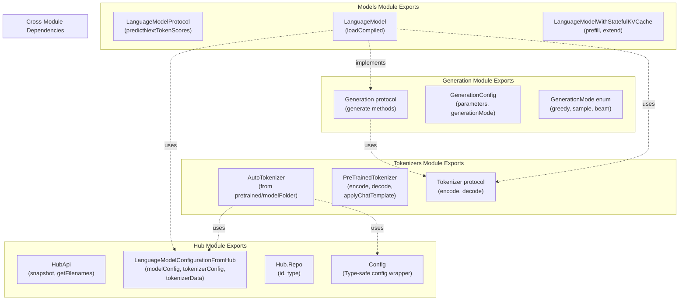

**Key Interaction Points:**

1. **Hub → Tokenizers**: `LanguageModelConfigurationFromHub` provides parsed configurations
2. **Tokenizers → Models**: `Tokenizer` protocol enables token encoding/decoding
3. **Generation → Tokenizers**: `Generation` protocol requires tokenizer for EOS detection
4. **Models → Generation**: `LanguageModel` implements `Generation` protocol

Sources: [Package.swift:22-26](), [Sources/Hub/Hub.swift:111-154]()

## Concurrency and Threading Model

The library uses Swift's modern concurrency features (`async`/`await`) throughout, with strict concurrency checking enabled at the package level.

**Concurrency Configuration:**

- **Strict Concurrency**: Enabled via `StrictConcurrency` experimental feature
- **Sendable Conformance**: Core types marked `Sendable` for safe cross-actor usage
- **Async Initialization**: Configuration loading uses `Task` for lazy evaluation
- **Actor Isolation**: Thread-safe state management in `Downloader` and cache systems

```swift
// Example: Lazy async configuration loading
let configPromise: Task<Configurations, Error>
public var modelConfig: Config? {
    get async throws {
        try await configPromise.value.modelConfig
    }
}
```

Sources: [Package.swift:6-9](), [Sources/Hub/Hub.swift:117-164]()

## Error Handling Strategy

The library defines structured error types for each module, enabling precise error handling and recovery strategies.

**Error Type Hierarchy**

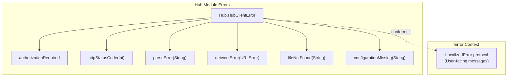

**Error Categories:**

| Category | Error Types | Recovery Strategy |
|----------|-------------|-------------------|
| Network | `networkError`, `httpStatusCode` | Retry with exponential backoff |
| Authentication | `authorizationRequired` | Prompt for Hub token |
| Parsing | `parseError`, `jsonSerialization` | Check configuration format |
| File System | `fileNotFound`, `fileSystemError` | Verify cache integrity |
| Configuration | `configurationMissing` | Use fallback configurations |

Sources: [Sources/Hub/Hub.swift:18-77]()

## Extension Points

The architecture provides several extension points for customization:

**Extensibility Mechanisms:**

| Extension Point | Protocol/Factory | Use Case |
|-----------------|------------------|----------|
| Custom Tokenizers | `Tokenizer`, `TokenizingModel` | Add new tokenization algorithms |
| Pipeline Components | `Normalizer`, `PreTokenizer`, `PostProcessor`, `Decoder` | Customize text processing |
| Generation Strategies | `Generation` protocol | Implement new generation modes |
| Configuration Formats | `Config` parsing | Support custom configuration schemas |

**Factory Pattern Usage:**

- `AutoTokenizer.from()`: Automatic tokenizer instantiation based on configuration
- `TokenizingModel.from()`: Factory for BPE, Unigram, BERT tokenizers
- Component factories: `Normalizer.from()`, `PreTokenizer.from()`, etc.

Sources: [Sources/Generation/GenerationConfig.swift:100-121]()

## Summary

The swift-transformers architecture achieves several design goals:

1. **Modularity**: Clear separation between Hub (acquisition), Tokenizers (processing), Models (inference), and Generation (synthesis)
2. **Layered Design**: Each layer builds abstractions on lower layers with minimal coupling
3. **Protocol-Oriented**: Extensive use of protocols enables flexibility and testing
4. **Offline-First**: Comprehensive caching and fallback mechanisms for reliable offline operation
5. **Modern Swift**: Full adoption of async/await, strict concurrency, and type safety

The dependency flow (Hub → Tokenizers → Generation/Models) ensures that higher-level modules can rely on stable lower-level abstractions, while protocol-oriented design enables customization without modifying core implementations.

---

# Page: Installation and Setup

# Installation and Setup

<details>
<summary>Relevant source files</summary>

The following files were used as context for generating this wiki page:

- [LICENSE](LICENSE)
- [Package.swift](Package.swift)
- [README.md](README.md)
- [Sources/Generation/GenerationConfig.swift](Sources/Generation/GenerationConfig.swift)
- [Tests/TokenizersTests/Resources/tokenizer.json](Tests/TokenizersTests/Resources/tokenizer.json)
- [Tests/TokenizersTests/Resources/tokenizer_config.json](Tests/TokenizersTests/Resources/tokenizer_config.json)
- [media/swift-t-banner.png](media/swift-t-banner.png)

</details>


This page covers the installation of swift-transformers via Swift Package Manager, including platform requirements, dependency configuration, and available library products. For architectural details about how the modules interact, see [Architecture](#1.1). For complete usage examples, see [Quick Start Guide](#1.3).

---

## Platform Requirements

swift-transformers requires:

| Requirement | Minimum Version |
|------------|----------------|
| Swift Tools | 5.9 |
| iOS | 16.0 |
| macOS | 13.0 |

The library depends on Apple's CoreML framework for model inference, which is only available on Apple platforms. All targets are built with strict concurrency checking enabled to ensure thread safety.

**Sources:** [Package.swift:1-13]()

---

## Swift Package Manager Integration

### Adding to Package.swift

To add swift-transformers as a dependency to a Swift package, add the following to your `Package.swift` file:

```swift
dependencies: [
    .package(url: "https://github.com/huggingface/swift-transformers", from: "0.1.17")
]
```

Then add the appropriate product to your target's dependencies. The library provides three products with different module combinations (see [Available Products](#available-products) below).

**Example: Using the Transformers Product**

```swift
targets: [
    .target(
        name: "YourTargetName",
        dependencies: [
            .product(name: "Transformers", package: "swift-transformers")
        ]
    )
]
```

**Sources:** [README.md:121-142](), [Package.swift:11-18]()

### Adding to Xcode Project

For Xcode projects:

1. Navigate to **File → Add Package Dependencies...**
2. Enter the repository URL: `https://github.com/huggingface/swift-transformers`
3. Select version `0.1.17` or later
4. Choose the appropriate product for your target (see below)

---

## Available Products

swift-transformers exposes three distinct products, allowing you to include only the functionality your application needs:

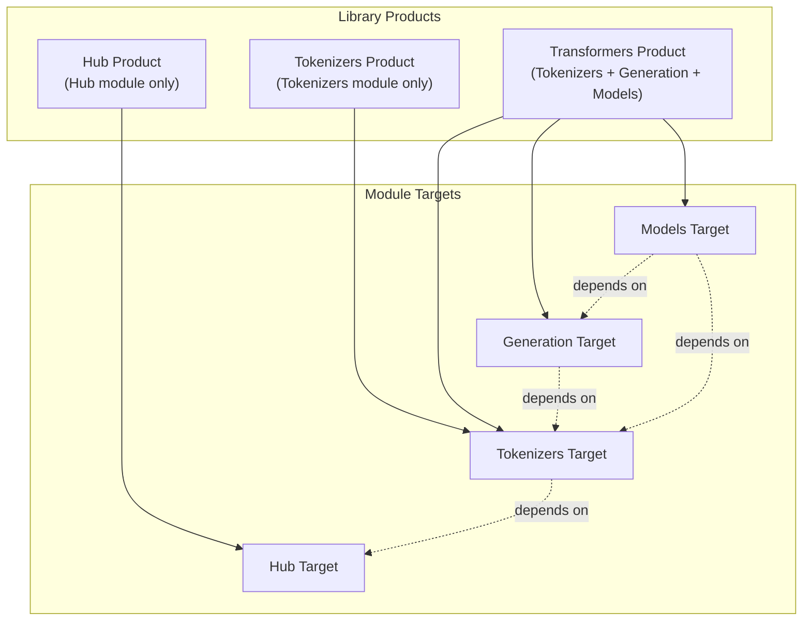

**Product Comparison**

| Product | Modules Included | Use Case |
|---------|-----------------|----------|
| `Hub` | Hub | Download and cache models from Hugging Face Hub only |
| `Tokenizers` | Tokenizers (+ Hub) | Text tokenization and chat templating |
| `Transformers` | Tokenizers, Generation, Models (+ Hub) | Complete language model inference pipeline |

### Hub Product

Use when you only need to download files from Hugging Face Hub:

```swift
dependencies: [
    .product(name: "Hub", package: "swift-transformers")
]
```

Import with: `import Hub`

### Tokenizers Product

Use when you need tokenization but not model inference:

```swift
dependencies: [
    .product(name: "Tokenizers", package: "swift-transformers")
]
```

Import with: `import Tokenizers` (Hub is automatically available)

### Transformers Product

The complete product for language model applications. This is the most commonly used option:

```swift
dependencies: [
    .product(name: "Transformers", package: "swift-transformers")
]
```

Import with: `import Hub`, `import Tokenizers`, `import Generation`, and/or `import Models` as needed.

**Sources:** [Package.swift:14-18](), [README.md:25-26]()

---

## Module Dependency Structure

Understanding the internal dependency graph helps when troubleshooting build issues or selecting the appropriate product:

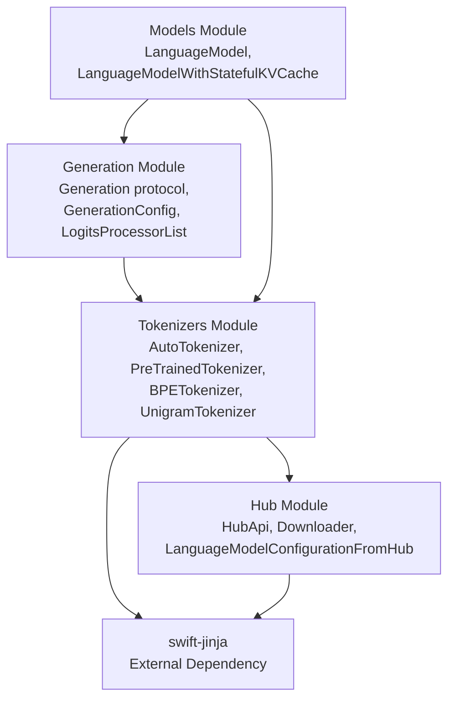

**Dependency Details**

- **Hub**: Foundation module with no internal dependencies. Depends on `swift-jinja` for template processing.
- **Tokenizers**: Depends on Hub for configuration loading and on `swift-jinja` for chat template rendering.
- **Generation**: Depends on Tokenizers for token encoding/decoding.
- **Models**: Depends on both Tokenizers and Generation to provide complete inference capabilities.

The dependency on `swift-jinja` (version 2.0.0+) is managed automatically by Swift Package Manager and does not require manual configuration.

**Sources:** [Package.swift:19-26]()

---

## External Dependencies

swift-transformers has a single external dependency:

| Package | Version | Purpose |
|---------|---------|---------|
| [swift-jinja](https://github.com/huggingface/swift-jinja) | 2.0.0+ | Jinja2 template engine for chat template rendering |

The `Jinja` product from swift-jinja is used by:
- **Hub module**: For processing configuration templates
- **Tokenizers module**: For applying chat templates via `AutoTokenizer.applyChatTemplate()`

This dependency is automatically resolved by Swift Package Manager.

**Sources:** [Package.swift:19-21]()

---

## Concurrency Settings

All targets are built with Swift's strict concurrency checking enabled:

```swift
let swiftSettings: [SwiftSetting] = [
    .enableExperimentalFeature("StrictConcurrency")
]
```

This ensures thread-safe operation when using async/await patterns throughout the library. The setting is applied at the package level and does not require configuration in consuming projects.

**Sources:** [Package.swift:6-9]()

---

## Verification

After adding the dependency, verify the installation by importing the modules in your Swift code:

```swift
import Hub
import Tokenizers
import Generation
import Models
```

For a minimal verification that the library is correctly installed:

```swift
import Tokenizers

// This will compile if the installation succeeded
let config = GenerationConfig(maxNewTokens: 50)
print("swift-transformers installed successfully")
```

---

## License

swift-transformers is licensed under the Apache License 2.0. See [LICENSE]() for the complete license text.

**Sources:** [LICENSE:1-201]()

---

## Next Steps

Now that swift-transformers is installed, proceed to:

- **[Quick Start Guide](#1.3)**: Complete working example of downloading a model and generating text
- **[Architecture](#1.1)**: Understand how the modules interact
- **[Hub](#3)**: Learn about downloading and caching models
- **[Tokenizers](#2)**: Learn about text tokenization and chat templates

**Sources:** [README.md:1-172](), [Package.swift:1-33]()

---

# Page: Quick Start Guide

# Quick Start Guide

<details>
<summary>Relevant source files</summary>

The following files were used as context for generating this wiki page:

- [LICENSE](LICENSE)
- [README.md](README.md)
- [Sources/Hub/HubApi.swift](Sources/Hub/HubApi.swift)
- [Sources/Models/LanguageModel.swift](Sources/Models/LanguageModel.swift)
- [Sources/Models/LanguageModelTypes.swift](Sources/Models/LanguageModelTypes.swift)
- [Sources/Tokenizers/Tokenizer.swift](Sources/Tokenizers/Tokenizer.swift)
- [Tests/HubTests/HubApiTests.swift](Tests/HubTests/HubApiTests.swift)
- [Tests/TokenizersTests/Resources/tokenizer.json](Tests/TokenizersTests/Resources/tokenizer.json)
- [Tests/TokenizersTests/Resources/tokenizer_config.json](Tests/TokenizersTests/Resources/tokenizer_config.json)
- [media/swift-t-banner.png](media/swift-t-banner.png)

</details>


This guide provides a complete working example demonstrating the end-to-end workflow of using swift-transformers: downloading a model from Hugging Face Hub, initializing a tokenizer, loading a CoreML model, and generating text. 

For detailed information about installation and package setup, see [Installation and Setup](#1.2). For in-depth coverage of individual modules, see [Tokenizers](#2), [Hub](#3), [Models](#4), and [Generation](#5).

## Overview

The swift-transformers workflow consists of four main phases that build upon each other. Each phase uses a dedicated module to provide clean separation of concerns:

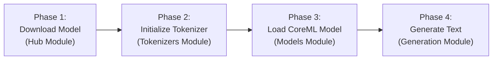

**Sources:** [README.md:23-120]()

## Prerequisites

Before starting, ensure:

- **Platform Requirements:** macOS 15.0+, iOS 18.0+, tvOS 18.0+, visionOS 2.0+, or watchOS 11.0+
- **CoreML Model:** A compiled CoreML language model (`.mlmodelc` format)
- **Network Access:** Internet connectivity for initial model download (optional for bundled models)
- **Swift Package:** swift-transformers added to your project (see [Installation and Setup](#1.2))

**Sources:** [Sources/Models/LanguageModel.swift:15](), [README.md:121-142]()

## Basic Workflow

The following diagram maps the conceptual workflow to specific code entities in swift-transformers:

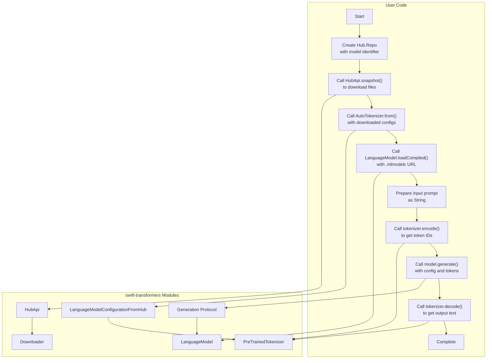

**Sources:** [Sources/Hub/HubApi.swift:346-698](), [Sources/Tokenizers/Tokenizer.swift:851-972](), [Sources/Models/LanguageModel.swift:153-183]()

## Step-by-Step Implementation

### Phase 1: Download Model Files

Use `HubApi.snapshot()` to download required files from Hugging Face Hub. The method handles progress reporting, resumable downloads, and offline caching.

```swift
import Hub

let repo = Hub.Repo(id: "your-model-id")
let modelDirectory = try await HubApi.shared.snapshot(
    from: repo,
    matching: ["config.json", "tokenizer.json", "tokenizer_config.json", "*.mlmodelc/*"]
) { progress in
    print("Download progress: \(progress.fractionCompleted * 100)%")
}
```

| Parameter | Type | Description |
|-----------|------|-------------|
| `from` | `Hub.Repo` | Repository identifier containing the model |
| `matching` | `[String]` | Glob patterns for files to download |
| `progressHandler` | `(Progress) -> Void` | Closure called with download progress |

**Key Classes:**
- `HubApi` [Sources/Hub/HubApi.swift:71-128]() - Main API client for Hub interactions
- `Hub.Repo` [Sources/Hub/HubApi.swift:80]() - Repository identifier structure
- `Downloader` [Sources/Hub/HubApi.swift:547]() - Handles individual file downloads with resume capability

**Sources:** [Sources/Hub/HubApi.swift:575-658](), [README.md:67-82]()

### Phase 2: Initialize Tokenizer

Use `AutoTokenizer.from()` to create a tokenizer instance. This factory method automatically selects the appropriate tokenizer type based on configuration files.

```swift
import Tokenizers

let tokenizer = try await AutoTokenizer.from(
    pretrained: "your-model-id"
)
```

For offline scenarios with bundled files:

```swift
let tokenizerFolder: URL = // path to folder containing tokenizer files
let tokenizer = try await AutoTokenizer.from(
    modelFolder: tokenizerFolder
)
```

**Key Classes:**
- `AutoTokenizer` [Sources/Tokenizers/Tokenizer.swift:851]() - Factory for creating tokenizer instances
- `PreTrainedTokenizer` [Sources/Tokenizers/Tokenizer.swift:454-842]() - Main tokenizer implementation
- `LanguageModelConfigurationFromHub` - Loads tokenizer configuration files

**Sources:** [Sources/Tokenizers/Tokenizer.swift:861-932](), [README.md:91-119]()

### Phase 3: Load CoreML Model

Use `LanguageModel.loadCompiled()` to load a compiled CoreML model. The method automatically detects KV cache support and returns the appropriate model type.

```swift
import Models

let modelURL: URL = // path to compiled .mlmodelc file
let model = try LanguageModel.loadCompiled(
    url: modelURL,
    computeUnits: .cpuAndGPU,
    tokenizer: tokenizer  // Optional: reuse tokenizer to avoid re-downloading
)
```

**Model Detection Flow:**

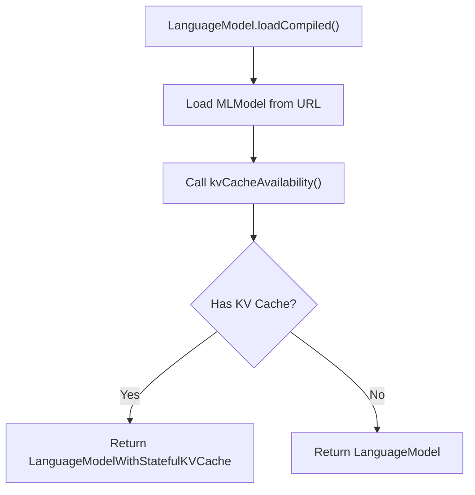

**Key Classes:**
- `LanguageModel` [Sources/Models/LanguageModel.swift:21-87]() - Standard model wrapper
- `LanguageModelWithStatefulKVCache` [Sources/Models/LanguageModel.swift:485-563]() - Optimized model with state management
- `MLModel` - CoreML framework's model class

**Sources:** [Sources/Models/LanguageModel.swift:162-183](), [Sources/Models/LanguageModel.swift:269-321]()

### Phase 4: Generate Text

Use the `generate()` method with a `GenerationConfig` to produce text. The method supports streaming output via callbacks.

```swift
import Generation

let config = GenerationConfig(
    maxNewTokens: 100,
    temperature: 0.7,
    topK: 50,
    doSample: true
)

let output = try await model.generate(
    config: config,
    prompt: "Explain the Swift programming language in one sentence.",
    callback: { token, probability in
        // Optional: handle streaming tokens
        print(token, terminator: "")
    }
)

print("Generated text: \(output)")
```

**Generation Process:**

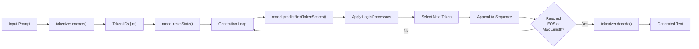

**Key Components:**
- `GenerationConfig` - Configuration parameters for generation behavior
- `Generation` protocol - Defines the generation interface
- `LogitsProcessorList` - Applies temperature, top-k, top-p sampling
- `PredictionStringCallback` - Callback type for streaming output

**Sources:** [Sources/Models/LanguageModel.swift:456-478](), [Sources/Models/LanguageModelTypes.swift:96-119]()

## Complete Working Example

Here is a minimal, complete example combining all phases:

```swift
import Foundation
import Hub
import Tokenizers
import Models
import Generation

// Phase 1: Download Model
let repo = Hub.Repo(id: "mlx-community/Qwen2.5-0.5B-Instruct-2bit-mlx")
let modelDirectory = try await HubApi.shared.snapshot(
    from: repo,
    matching: ["config.json", "tokenizer*.json", "*.mlmodelc/*"]
)

// Phase 2: Initialize Tokenizer
let tokenizer = try await AutoTokenizer.from(pretrained: repo.id)

// Phase 3: Load CoreML Model
let modelURL = modelDirectory.appending(path: "model.mlmodelc")
let model = try LanguageModel.loadCompiled(
    url: modelURL,
    tokenizer: tokenizer
)

// Phase 4: Generate Text
let config = GenerationConfig(
    maxNewTokens: 50,
    temperature: 0.8,
    doSample: true
)

let prompt = "What is Swift?"
let output = try await model.generate(
    config: config,
    prompt: prompt
) { token, _ in
    print(token, terminator: "")
    fflush(stdout)
}

print("\n\nFinal output: \(output)")
```

**Sources:** [README.md:23-88](), [Tests/HubTests/HubApiTests.swift:218-251]()

## Chat Template Support

For conversational models, use `applyChatTemplate()` to format messages according to the model's template:

```swift
let messages: [[String: Any]] = [
    ["role": "system", "content": "You are a helpful assistant."],
    ["role": "user", "content": "Explain async/await in Swift."]
]

let tokenIds = try tokenizer.applyChatTemplate(messages: messages)
let output = try await model.generate(
    config: config,
    tokens: .tensor(MLTensor(tokenIds))
)
```

**Sources:** [Sources/Tokenizers/Tokenizer.swift:696-841](), [README.md:28-64]()

## Data Flow Summary

The following table summarizes the data transformations through each phase:

| Phase | Input | Processing | Output | Key Class |
|-------|-------|------------|--------|-----------|
| **Download** | Model ID (String) | HTTP download with retry | Local file URLs | `HubApi` |
| **Tokenization** | Text (String) | Normalize, pre-tokenize, encode | Token IDs ([Int]) | `PreTrainedTokenizer` |
| **Model Loading** | .mlmodelc URL | Load MLModel, detect capabilities | `LanguageModel` instance | `LanguageModel` |
| **Generation** | Token IDs, Config | Iterative prediction, sampling | Token IDs ([Int]) | `Generation` protocol |
| **Decoding** | Token IDs ([Int]) | Decode, post-process | Text (String) | `PreTrainedTokenizer` |

**Sources:** [Sources/Tokenizers/Tokenizer.swift:614-673](), [Sources/Models/LanguageModel.swift:60-86]()

## Offline Usage

For bundled models that don't require network access:

```swift
// Use local file paths
let tokenizerFolder: URL = Bundle.main.url(forResource: "tokenizer", withExtension: nil)!
let modelURL: URL = Bundle.main.url(forResource: "model", withExtension: "mlmodelc")!

// Initialize without network calls
let tokenizer = try await AutoTokenizer.from(modelFolder: tokenizerFolder)
let model = try LanguageModel.loadCompiled(url: modelURL, tokenizer: tokenizer)

// Generate as normal
let output = try await model.generate(config: config, prompt: "Hello")
```

**Key Points:**
- Pass `tokenizer` parameter to `loadCompiled()` to prevent Hub configuration fetching
- Ensure tokenizer files (`tokenizer.json`, `tokenizer_config.json`) are bundled with the app
- Model initialization is synchronous after initial loading

**Sources:** [README.md:91-119](), [Sources/Models/LanguageModel.swift:40-56]()

## Error Handling

Common errors and their handling:

| Error Type | Cause | Resolution |
|------------|-------|------------|
| `HubClientError.authorizationRequired` | Gated model without token | Set `HF_TOKEN` environment variable |
| `HubClientError.fileNotFound` | Missing model file | Verify model ID and file patterns |
| `TokenizerError.missingConfig` | Missing tokenizer files | Ensure `tokenizer.json` is downloaded |
| `TokenizerError.unsupportedTokenizer` | Unknown tokenizer type | Use `strict: false` in AutoTokenizer |
| `EnvironmentError.offlineModeError` | Missing cache in offline mode | Download files before going offline |

**Sources:** [Sources/Hub/HubApi.swift:288-308](), [Sources/Tokenizers/Tokenizer.swift:18-52]()

## Next Steps

- **Tokenizer Details:** Learn about chat templates, special tokens, and custom tokenizers in [Tokenizers](#2)
- **Hub Configuration:** Explore offline mode, authentication, and custom endpoints in [Hub](#3)
- **Model Optimization:** Understand KV cache and compute unit selection in [Models](#4)
- **Generation Strategies:** Configure sampling, beam search, and streaming in [Generation](#5)
- **Testing:** See how to validate tokenization and model behavior in [Testing](#6)

**Sources:** [README.md:144-168]()

---

# Page: Tokenizers

# Tokenizers

<details>
<summary>Relevant source files</summary>

The following files were used as context for generating this wiki page:

- [Sources/Tokenizers/BPETokenizer.swift](Sources/Tokenizers/BPETokenizer.swift)
- [Sources/Tokenizers/PostProcessor.swift](Sources/Tokenizers/PostProcessor.swift)
- [Sources/Tokenizers/Tokenizer.swift](Sources/Tokenizers/Tokenizer.swift)
- [Sources/Tokenizers/UnigramTokenizer.swift](Sources/Tokenizers/UnigramTokenizer.swift)

</details>


## Purpose and Scope

This document provides an overview of the tokenization system in swift-transformers. Tokenizers convert raw text into sequences of token IDs that language models can process, and decode token IDs back into human-readable text. The system implements a modular pipeline architecture with pluggable components for normalization, pre-tokenization, tokenization, post-processing, and decoding.

For details on automatically loading tokenizers from pre-trained models, see [AutoTokenizer](#2.1). For information on formatting conversational inputs, see [Chat Templates](#2.2). Specific tokenizer implementations are covered in [Tokenizer Types](#2.3), and individual pipeline components are documented in [Tokenizer Components](#2.4).

**Sources:** [Sources/Tokenizers/Tokenizer.swift:1-1020]()

## Architecture Overview

The tokenization system is built on a protocol-oriented architecture with three main abstraction layers:

1. **`TokenizingModel`** - Core tokenization interface for converting text to tokens and tokens to IDs
2. **`PreTrainedTokenizerModel`** - Extension of `TokenizingModel` with Hub configuration support
3. **`Tokenizer`** - Complete tokenizer interface including encoding, decoding, and chat templates

The `PreTrainedTokenizer` class implements the full pipeline by orchestrating multiple components:

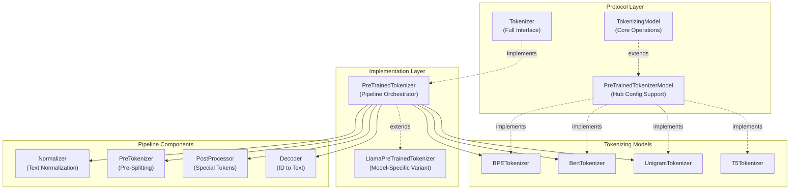

**Tokenizer Protocol Hierarchy**

**Sources:** [Sources/Tokenizers/Tokenizer.swift:54-218](), [Sources/Tokenizers/Tokenizer.swift:449-842]()

## Tokenization Pipeline

The tokenization process flows through multiple stages, each handled by a specialized component. This pipeline architecture allows for flexible composition of different tokenization strategies:

```mermaid
flowchart LR
    subgraph "Input Processing"
        RawText["Raw Text<br/>Input"]
        AddedTokenSplit["Split by<br/>Added Tokens"]
    end
    
    subgraph "Normalization Stage"
        Normalize["Normalizer<br/>normalize()"]
    end
    
    subgraph "Pre-Tokenization Stage"
        PreTokenize["PreTokenizer<br/>preTokenize()"]
    end
    
    subgraph "Main Tokenization Stage"
        Model["TokenizingModel<br/>tokenize()"]
        ConvertToIds["convertTokensToIds()"]
    end
    
    subgraph "Post-Processing Stage"
        PostProcess["PostProcessor<br/>postProcess()"]
        SpecialTokens["Add BOS/EOS<br/>CLS/SEP"]
    end
    
    subgraph "Decoding Stage"
        IdsToTokens["convertIdsToTokens()"]
        DecodeTokens["Decoder<br/>decode()"]
        CleanUp["cleanUp()"]
        FinalText["Decoded<br/>Text"]
    end
    
    RawText --> AddedTokenSplit
    AddedTokenSplit --> Normalize
    Normalize --> PreTokenize
    PreTokenize --> Model
    Model --> ConvertToIds
    ConvertToIds --> PostProcess
    PostProcess --> SpecialTokens
    
    SpecialTokens -.->|"Decoding Path"| IdsToTokens
    IdsToTokens --> DecodeTokens
    DecodeTokens --> CleanUp
    CleanUp --> FinalText
```

**Processing Flow Through PreTrainedTokenizer**

**Sources:** [Sources/Tokenizers/Tokenizer.swift:561-630](), [Sources/Tokenizers/Tokenizer.swift:640-673]()

### Pipeline Stage Responsibilities

| Stage | Component | Purpose | Example Implementations |
|-------|-----------|---------|------------------------|
| **Normalization** | `Normalizer` | Unicode normalization, lowercasing, accent removal | NFD, NFKD, Lowercase, StripAccents, BERT |
| **Pre-Tokenization** | `PreTokenizer` | Split text into initial chunks before main tokenization | Whitespace, ByteLevel, Metaspace, Punctuation |
| **Tokenization** | `TokenizingModel` | Apply core tokenization algorithm (BPE, Unigram, WordPiece) | BPETokenizer, UnigramTokenizer, BertTokenizer |
| **Post-Processing** | `PostProcessor` | Add special tokens, format for model input | TemplateProcessing, RobertaProcessing, BertProcessing |
| **Decoding** | `Decoder` | Convert tokens back to readable text | ByteLevel, WordPiece, Metaspace, ByteFallback |

**Sources:** [Sources/Tokenizers/Tokenizer.swift:469-473](), [Sources/Tokenizers/Tokenizer.swift:526-529]()

## Core Protocols and Classes

### TokenizingModel Protocol

The foundational protocol defining token-to-ID conversions. Implementations must provide vocabulary lookups and tokenization logic:

```mermaid
classDiagram
    class TokenizingModel {
        <<protocol>>
        +tokenize(text: String) [String]
        +convertTokenToId(token: String) Int?
        +convertIdToToken(id: Int) String?
        +convertTokensToIds(tokens: [String]) [Int?]
        +convertIdsToTokens(ids: [Int]) [String?]
        +bosToken: String?
        +bosTokenId: Int?
        +eosToken: String?
        +eosTokenId: Int?
        +unknownToken: String?
        +unknownTokenId: Int?
        +fuseUnknownTokens: Bool
    }
    
    class PreTrainedTokenizerModel {
        <<protocol>>
        +init(tokenizerConfig, tokenizerData, addedTokens)
    }
    
    class BPETokenizer {
        -bpeRanks: [BytePair: Int]
        -tokensToIds: [NSString: Int]
        -idsToTokens: [Int: NSString]
        +tokenize(text: String) [String]
        +bpe(token: String) String
    }
    
    class UnigramTokenizer {
        -vocab: [SentencePieceToken]
        -trie: Trie~Character~
        -tokensToIds: [NSString: Int]
        +tokenize(text: String) [String]
    }
    
    class BertTokenizer {
        -vocab: [String: Int]
        -basicTokenizer: BasicTokenizer
        -wordpieceTokenizer: WordpieceTokenizer
        +tokenize(text: String) [String]
    }
    
    TokenizingModel <|-- PreTrainedTokenizerModel
    PreTrainedTokenizerModel <|.. BPETokenizer
    PreTrainedTokenizerModel <|.. UnigramTokenizer
    PreTrainedTokenizerModel <|.. BertTokenizer
```

**TokenizingModel Protocol and Implementations**

**Sources:** [Sources/Tokenizers/Tokenizer.swift:58-141](), [Sources/Tokenizers/Tokenizer.swift:146-155]()

### Tokenizer Protocol

The complete tokenizer interface used by application code. Extends `TokenizingModel` with encoding/decoding and chat template support:

```mermaid
classDiagram
    class Tokenizer {
        <<protocol>>
        +tokenize(text: String) [String]
        +encode(text: String, addSpecialTokens: Bool) [Int]
        +decode(tokens: [Int], skipSpecialTokens: Bool) String
        +convertTokenToId(token: String) Int?
        +convertIdToToken(id: Int) String?
        +bosToken: String?
        +eosToken: String?
        +unknownToken: String?
        +hasChatTemplate: Bool
        +applyChatTemplate(messages, tools, additionalContext) [Int]
    }
    
    class PreTrainedTokenizer {
        -model: TokenizingModel
        -normalizer: Normalizer?
        -preTokenizer: PreTokenizer?
        -postProcessor: PostProcessor?
        -decoder: Decoder?
        -tokenizerConfig: Config
        -addedTokens: Set~String~
        -specialTokens: [String: Int]
        -compiledChatTemplateCache: [String: Template]
        +tokenize(text: String) [String]
        +encode(text: String, addSpecialTokens: Bool) [Int]
        +decode(tokens: [Int], skipSpecialTokens: Bool) String
        +applyChatTemplate(messages, chatTemplate, tools) [Int]
    }
    
    class LlamaPreTrainedTokenizer {
        -isLegacy: Bool
        +tokenize(text: String) [String]
    }
    
    Tokenizer <|.. PreTrainedTokenizer
    PreTrainedTokenizer <|-- LlamaPreTrainedTokenizer
```

**Tokenizer Protocol and PreTrainedTokenizer Class**

**Sources:** [Sources/Tokenizers/Tokenizer.swift:218-393](), [Sources/Tokenizers/Tokenizer.swift:454-842]()

### PreTrainedTokenizer Class

The `PreTrainedTokenizer` class is the main implementation that orchestrates the entire tokenization pipeline. It holds references to all pipeline components and coordinates their execution:

**Key Components:**

| Property | Type | Purpose |
|----------|------|---------|
| `model` | `TokenizingModel` | Core tokenization algorithm (BPE/Unigram/BERT) |
| `normalizer` | `Normalizer?` | Text normalization (optional) |
| `preTokenizer` | `PreTokenizer?` | Pre-tokenization splitting (optional) |
| `postProcessor` | `PostProcessor?` | Special token handling (optional) |
| `decoder` | `Decoder?` | Token-to-text conversion (optional) |
| `addedTokens` | `Set<String>` | Special tokens to preserve during tokenization |
| `addedTokensRegex` | `NSRegularExpression?` | Pattern for splitting on added tokens |
| `compiledChatTemplateCache` | `[String: Template]` | Cached Jinja templates for chat formatting |

**Sources:** [Sources/Tokenizers/Tokenizer.swift:454-534]()

## Tokenizer Initialization

Tokenizers are initialized from configuration files loaded from the Hugging Face Hub or local directories. Two primary configuration files are required:

| File | Purpose | Key Contents |
|------|---------|--------------|
| `tokenizer_config.json` | High-level configuration | `tokenizer_class`, `bos_token`, `eos_token`, `unk_token`, `chat_template`, `model_max_length` |
| `tokenizer.json` | Detailed tokenizer data | `model` (vocab, merges), `normalizer`, `pre_tokenizer`, `post_processor`, `decoder`, `added_tokens` |

```mermaid
sequenceDiagram
    participant App as "Application Code"
    participant Auto as "AutoTokenizer"
    participant Config as "LanguageModelConfigurationFromHub"
    participant Factory as "TokenizerModel.from()"
    participant PT as "PreTrainedTokenizer"
    
    App->>Auto: from(pretrained: "model-name")
    Auto->>Config: load configs
    Config->>Config: fetch tokenizer_config.json
    Config->>Config: fetch tokenizer.json
    Config-->>Auto: tokenizerConfig, tokenizerData
    
    Auto->>Auto: tokenizerClass(for: config)
    Note over Auto: Determines PreTrainedTokenizer<br/>or LlamaPreTrainedTokenizer
    
    Auto->>PT: init(tokenizerConfig, tokenizerData)
    
    PT->>PT: extract addedTokens from data
    PT->>PT: build addedTokensRegex
    PT->>Factory: from(tokenizerConfig, tokenizerData)
    
    Factory->>Factory: Check tokenizer_class
    Factory->>Factory: Select BPETokenizer/UnigramTokenizer/BertTokenizer
    Factory-->>PT: TokenizingModel instance
    
    PT->>PT: Create Normalizer from config
    PT->>PT: Create PreTokenizer from config
    PT->>PT: Create PostProcessor from config
    PT->>PT: Create Decoder from config
    
    PT-->>Auto: Configured Tokenizer
    Auto-->>App: Tokenizer instance
```

**Tokenizer Initialization Flow**

**Sources:** [Sources/Tokenizers/Tokenizer.swift:490-534](), [Sources/Tokenizers/Tokenizer.swift:861-932](), [Sources/Tokenizers/Tokenizer.swift:157-199]()

### Factory Pattern

The system uses factory functions to instantiate appropriate tokenizer types based on configuration:

```mermaid
graph TB
    subgraph "TokenizerModel Factory"
        knownTokenizers["knownTokenizers<br/>[String: PreTrainedTokenizerModel.Type]"]
        
        BertTokenizer_Entry["'BertTokenizer' → BertTokenizer.self"]
        GPT2Tokenizer_Entry["'GPT2Tokenizer' → BPETokenizer.self"]
        LlamaTokenizer_Entry["'LlamaTokenizer' → BPETokenizer.self"]
        XLMRobertaTokenizer_Entry["'XLMRobertaTokenizer' → UnigramTokenizer.self"]
        
        knownTokenizers --> BertTokenizer_Entry
        knownTokenizers --> GPT2Tokenizer_Entry
        knownTokenizers --> LlamaTokenizer_Entry
        knownTokenizers --> XLMRobertaTokenizer_Entry
    end
    
    subgraph "PreTrainedTokenizerClasses"
        tokenizerClasses["tokenizerClasses<br/>[String: PreTrainedTokenizer.Type]"]
        
        LlamaEntry["'LlamaTokenizer' → LlamaPreTrainedTokenizer.self"]
        
        tokenizerClasses --> LlamaEntry
    end
    
    Config["tokenizer_class in config"] --> knownTokenizers
    Config --> tokenizerClasses
```

**Factory Pattern for Tokenizer Instantiation**

**Sources:** [Sources/Tokenizers/Tokenizer.swift:157-199](), [Sources/Tokenizers/Tokenizer.swift:853-878]()

## Encoding and Decoding

### Encoding Flow

The `encode()` method converts text to token IDs through the complete pipeline:

```mermaid
flowchart TD
    Input["Input: 'Hello world!'"]
    
    SplitAdded["Split by Added Tokens<br/>using addedTokensRegex"]
    Normalize["normalize('Hello world!')<br/>→ 'hello world!'"]
    PreTokenize["preTokenize('hello world!')<br/>→ ['hello', ' world', '!']"]
    
    Tokenize1["model('hello')<br/>→ ['hel', 'lo']"]
    Tokenize2["model(' world')<br/>→ [' world']"]
    Tokenize3["model('!')<br/>→ ['!']"]
    
    Fuse["fuseUnknown()<br/>Merge consecutive UNK tokens"]
    PostProcess["postProcess(tokens)<br/>Add BOS/EOS if needed"]
    
    Convert["convertTokensToIds()<br/>['hel', 'lo', ' world', '!']<br/>→ [1234, 5678, 9012, 3456]"]
    
    Output["Output: [1234, 5678, 9012, 3456]"]
    
    Input --> SplitAdded
    SplitAdded --> Normalize
    Normalize --> PreTokenize
    PreTokenize --> Tokenize1
    PreTokenize --> Tokenize2
    PreTokenize --> Tokenize3
    Tokenize1 --> Fuse
    Tokenize2 --> Fuse
    Tokenize3 --> Fuse
    Fuse --> PostProcess
    PostProcess --> Convert
    Convert --> Output
```

**Text Encoding Pipeline**

**Sources:** [Sources/Tokenizers/Tokenizer.swift:614-650]()

### Decoding Flow

The `decode()` method converts token IDs back to text:

```mermaid
flowchart TD
    Input["Input: [1234, 5678, 9012, 3456]"]
    
    Filter["skipSpecialTokens?<br/>Filter out special token IDs"]
    
    ConvertIds["convertIdsToTokens()<br/>[1234, 5678, 9012, 3456]<br/>→ ['hel', 'lo', ' world', '!']"]
    
    DecodeTokens["decodeTokens()<br/>Apply Decoder transformations"]
    
    Join["Join tokens<br/>['hel', 'lo', ' world', '!']<br/>→ 'hello world!'"]
    
    CleanUp["cleanUp()<br/>Fix spacing artifacts<br/>' .' → '.'<br/>' n't' → 'n't'"]
    
    Output["Output: 'Hello world!'"]
    
    Input --> Filter
    Filter --> ConvertIds
    ConvertIds --> DecodeTokens
    DecodeTokens --> Join
    Join --> CleanUp
    CleanUp --> Output
```

**Token Decoding Pipeline**

**Sources:** [Sources/Tokenizers/Tokenizer.swift:658-673](), [Sources/Tokenizers/Tokenizer.swift:582-597]()

## Special Tokens

Special tokens are predefined tokens with specific semantic meanings. The tokenizer tracks both their string representations and numeric IDs:

| Token | Property | Purpose |
|-------|----------|---------|
| **BOS** (Beginning of Sequence) | `bosToken`, `bosTokenId` | Marks the start of a sequence |
| **EOS** (End of Sequence) | `eosToken`, `eosTokenId` | Marks the end of a sequence, used to stop generation |
| **UNK** (Unknown) | `unknownToken`, `unknownTokenId` | Represents out-of-vocabulary words |
| **SEP** (Separator) | N/A | Separates different segments in BERT-style models |
| **CLS** (Classification) | N/A | Classification token for BERT-style models |
| **PAD** (Padding) | N/A | Pads sequences to uniform length |
| **MASK** | N/A | Masked token for masked language modeling |

### Special Token Handling

The system maintains a set of special tokens that are preserved during tokenization and handled specially during decoding:

```mermaid
graph TB
    subgraph "Special Token Registry"
        tokenizerConfig["tokenizerConfig<br/>(tokenizer_config.json)"]
        tokenizerData["tokenizerData<br/>(tokenizer.json)"]
        
        tokenizerConfig --> specialTokenAttributes["specialTokenAttributes<br/>['bos_token', 'eos_token',<br/>'unk_token', 'sep_token',<br/>'pad_token', 'cls_token',<br/>'mask_token']"]
        
        tokenizerData --> addedTokens["addedTokens<br/>from tokenizer.json"]
        addedTokens --> specialFlag["Filter by 'special': true"]
        specialFlag --> specialTokens["specialTokens: [String: Int]"]
    end
    
    subgraph "Usage in Pipeline"
        addedTokensRegex["addedTokensRegex<br/>Split before tokenization"]
        skipSpecialTokens["skipSpecialTokens<br/>Filter during decode"]
    end
    
    specialTokens --> addedTokensRegex
    specialTokens --> skipSpecialTokens
```

**Special Token Management**

**Sources:** [Sources/Tokenizers/Tokenizer.swift:438-447](), [Sources/Tokenizers/Tokenizer.swift:490-524](), [Sources/Tokenizers/Tokenizer.swift:658-673]()

## Added Tokens

Added tokens are tokens explicitly added to the vocabulary beyond the base model training. They are preserved as atomic units during tokenization:

**Process:**
1. Extract added tokens from `tokenizer.json` with their IDs
2. Build a regex pattern sorted by length (longest first) to match them
3. Split input text using the regex before normalization
4. Pass through added tokens unchanged, process other segments normally

**Sources:** [Sources/Tokenizers/Tokenizer.swift:493-524](), [Sources/Tokenizers/Tokenizer.swift:619-630]()

## Chat Template Support

The `PreTrainedTokenizer` integrates with the swift-jinja library to render chat templates. Templates are compiled once and cached for reuse:

```mermaid
sequenceDiagram
    participant App as "Application"
    participant PT as "PreTrainedTokenizer"
    participant Cache as "compiledChatTemplateCache"
    participant Jinja as "Template (swift-jinja)"
    
    App->>PT: applyChatTemplate(messages)
    
    PT->>PT: Select template from config
    Note over PT: Check chatTemplate argument<br/>Check tool_use template<br/>Fall back to default
    
    PT->>Cache: Check cache for template
    
    alt Template not cached
        PT->>Jinja: Template(templateString)
        Jinja-->>PT: Compiled template
        PT->>Cache: Store compiled template
    end
    
    PT->>Jinja: render(context)
    Note over Jinja: Context includes:<br/>- messages<br/>- add_generation_prompt<br/>- tools<br/>- special tokens
    
    Jinja-->>PT: Rendered text
    
    PT->>PT: encode(renderedText, addSpecialTokens: false)
    
    PT->>PT: Apply truncation if needed
    
    PT-->>App: Token IDs [Int]
```

**Chat Template Rendering Flow**

**Sources:** [Sources/Tokenizers/Tokenizer.swift:477-481](), [Sources/Tokenizers/Tokenizer.swift:536-559](), [Sources/Tokenizers/Tokenizer.swift:737-841]()

### Template Context Variables

The template rendering context includes:

| Variable | Source | Purpose |
|----------|--------|---------|
| `messages` | Function argument | Array of message dictionaries with role/content |
| `add_generation_prompt` | Function argument | Whether to add prompt for model to generate response |
| `tools` | Function argument | Tool specifications for function calling |
| `bos_token`, `eos_token`, etc. | `tokenizerConfig` | Special token strings injected into context |
| Custom variables | `additionalContext` | Application-specific variables (e.g., `tools_in_user_message`) |

**Sources:** [Sources/Tokenizers/Tokenizer.swift:794-824]()

## Error Handling

The `TokenizerError` enum defines all tokenization-related errors:

| Error Case | When Thrown | Recovery Strategy |
|------------|-------------|-------------------|
| `missingConfig` | `tokenizer_config.json` not found | Verify model name/path, check network connectivity |
| `missingTokenizerClassInConfig` | `tokenizer_class` field missing | Config file may be corrupted |
| `unsupportedTokenizer(String)` | Unknown tokenizer type (strict mode) | Use `strict: false` to fall back to BPE |
| `missingVocab` | Vocabulary not in `tokenizer.json` | Re-download tokenizer files |
| `malformedVocab` | Vocabulary structure invalid | Re-download tokenizer files |
| `chatTemplate(String)` | Jinja template rendering failed | Check template syntax, verify message format |
| `missingChatTemplate` | No template configured | Provide template explicitly or use model with template |
| `tooLong(String)` | Token sequence exceeds max length | Enable truncation or reduce input length |
| `mismatchedConfig(String)` | Configuration inconsistency | Review tokenizer config for contradictions |

**Sources:** [Sources/Tokenizers/Tokenizer.swift:19-52]()

## Loading from Hub vs Local

The `AutoTokenizer` provides two loading methods:

```mermaid
graph TB
    subgraph "AutoTokenizer.from()"
        FromPretrained["from(pretrained: String)"]
        FromModelFolder["from(modelFolder: URL)"]
    end
    
    subgraph "Hub Loading"
        FromPretrained --> HubConfig["LanguageModelConfigurationFromHub<br/>(modelName)"]
        HubConfig --> Download["Download from Hub"]
        Download --> tokenizerConfigHub["tokenizer_config.json"]
        Download --> tokenizerJsonHub["tokenizer.json"]
    end
    
    subgraph "Local Loading"
        FromModelFolder --> LocalConfig["LanguageModelConfigurationFromHub<br/>(modelFolder)"]
        LocalConfig --> ReadFiles["Read local files"]
        ReadFiles --> tokenizerConfigLocal["tokenizer_config.json"]
        ReadFiles --> tokenizerJsonLocal["tokenizer.json"]
    end
    
    tokenizerConfigHub --> Init["PreTrainedTokenizer.init()"]
    tokenizerJsonHub --> Init
    tokenizerConfigLocal --> Init
    tokenizerJsonLocal --> Init
    
    Init --> TokenizerInstance["Tokenizer instance"]
```

**Hub vs Local Loading Paths**

**Sources:** [Sources/Tokenizers/Tokenizer.swift:893-932]()

## Strict vs Lenient Mode

The `strict` parameter controls tokenizer instantiation behavior:

| Mode | Behavior | Use Case |
|------|----------|----------|
| `strict: true` | Throws `TokenizerError.unsupportedTokenizer` for unknown types | Development, debugging |
| `strict: false` | Falls back to `BPETokenizer` with warning | Production, experimental models |

**Example:**
```swift
// Strict mode - throws on unknown tokenizer
let tokenizer = try await AutoTokenizer.from(pretrained: "model", strict: true)

// Lenient mode - falls back to BPE
let tokenizer = try await AutoTokenizer.from(pretrained: "model", strict: false)
// Prints: "Warning: Tokenizer model class XYZ is not registered, 
//          falling back to a standard BPE implementation."
```

**Sources:** [Sources/Tokenizers/Tokenizer.swift:181-198](), [Sources/Tokenizers/Tokenizer.swift:885-891]()

## Thread Safety

The `PreTrainedTokenizer` class is marked `@unchecked Sendable` and uses `NSLock` to protect the chat template cache from concurrent access. This allows safe use across multiple threads while compiling templates only once:

```swift
private var compiledChatTemplateCache: [String: Template] = [:]
private let cacheLock = NSLock()
```

The caching implementation uses double-checked locking to minimize lock contention:
1. Check cache under lock
2. If not found, release lock and compile template
3. Re-acquire lock and store result (checking again for race conditions)

**Sources:** [Sources/Tokenizers/Tokenizer.swift:477-559]()

---

# Page: AutoTokenizer

# AutoTokenizer

<details>
<summary>Relevant source files</summary>

The following files were used as context for generating this wiki page:

- [LICENSE](LICENSE)
- [README.md](README.md)
- [Sources/Tokenizers/Tokenizer.swift](Sources/Tokenizers/Tokenizer.swift)
- [Tests/TokenizersTests/Resources/llama_3.2_encoded.json](Tests/TokenizersTests/Resources/llama_3.2_encoded.json)
- [Tests/TokenizersTests/Resources/tokenizer.json](Tests/TokenizersTests/Resources/tokenizer.json)
- [Tests/TokenizersTests/Resources/tokenizer_config.json](Tests/TokenizersTests/Resources/tokenizer_config.json)
- [Tests/TokenizersTests/Resources/tokenizer_tests.json](Tests/TokenizersTests/Resources/tokenizer_tests.json)
- [Tests/TokenizersTests/TokenizerTests.swift](Tests/TokenizersTests/TokenizerTests.swift)
- [media/swift-t-banner.png](media/swift-t-banner.png)

</details>


## Purpose and Scope

`AutoTokenizer` is a factory pattern implementation that automatically selects and instantiates the appropriate tokenizer for a given pre-trained model. It provides a unified interface for loading tokenizers from the Hugging Face Hub, local directories, or explicit configuration objects, abstracting away the complexity of determining the correct tokenizer type and its configuration.

For information about the tokenizer implementations themselves (BPE, BERT, Unigram), see [Tokenizer Types](#2.3). For details on chat template functionality, see [Chat Templates](#2.2). For information on tokenizer pipeline components (normalizers, pre-tokenizers, decoders), see [Tokenizer Components](#2.4).

## Overview

`AutoTokenizer` is implemented as an enum namespace containing static factory methods. It does not instantiate directly; instead, it returns instances of `PreTrainedTokenizer` or specialized subclasses like `LlamaPreTrainedTokenizer`. The factory automatically:

- Fetches tokenizer configuration files from Hugging Face Hub or local storage
- Determines the appropriate tokenizer class from the `tokenizer_class` field in configuration
- Instantiates the correct `TokenizingModel` implementation (BPE, BERT, Unigram)
- Assembles the complete tokenization pipeline with normalizers, pre-tokenizers, post-processors, and decoders
- Returns a fully configured tokenizer ready for use

**Sources:** [Sources/Tokenizers/Tokenizer.swift:846-972]()

## Factory Architecture

```mermaid
graph TB
    subgraph "Entry Points"
        FromPretrained["AutoTokenizer.from(pretrained:)"]
        FromFolder["AutoTokenizer.from(modelFolder:)"]
        FromConfigs["AutoTokenizer.from(tokenizerConfig:tokenizerData:)"]
    end
    
    subgraph "Configuration Loading"
        LMConfig["LanguageModelConfigurationFromHub"]
        TokConfig["tokenizerConfig: Config"]
        TokData["tokenizerData: Config"]
    end
    
    subgraph "Class Resolution"
        GetClass["tokenizerClass(for:)"]
        PTTClasses["PreTrainedTokenizerClasses.tokenizerClasses"]
        LlamaClass["LlamaPreTrainedTokenizer.Type"]
        DefaultClass["PreTrainedTokenizer.Type"]
    end
    
    subgraph "Instantiation"
        Constructor["init(tokenizerConfig:tokenizerData:strict:)"]
        TokenizerInstance["PreTrainedTokenizer or subclass"]
    end
    
    FromPretrained --> LMConfig
    FromFolder --> LMConfig
    LMConfig --> TokConfig
    LMConfig --> TokData
    
    FromConfigs --> TokConfig
    FromConfigs --> TokData
    
    TokConfig --> GetClass
    TokData --> GetClass
    
    GetClass --> PTTClasses
    PTTClasses -->|"Custom class exists"| LlamaClass
    PTTClasses -->|"No custom class"| DefaultClass
    
    LlamaClass --> Constructor
    DefaultClass --> Constructor
    TokConfig --> Constructor
    TokData --> Constructor
    
    Constructor --> TokenizerInstance
```

**Diagram: AutoTokenizer Factory Method Flow** - Shows how the factory methods route through configuration loading, class resolution, and instantiation to produce a tokenizer instance.

**Sources:** [Sources/Tokenizers/Tokenizer.swift:846-972](), [Sources/Hub/LanguageModelConfigurationFromHub.swift]()

## Loading Methods

### from(pretrained:hubApi:strict:)

Loads a tokenizer from a model identifier on the Hugging Face Hub.

```swift
let tokenizer = try await AutoTokenizer.from(
    pretrained: "microsoft/phi-4",
    hubApi: HubApi.shared,
    strict: true
)
```

**Method signature:**
[Sources/Tokenizers/Tokenizer.swift:889-907]()

This method:
1. Creates a `LanguageModelConfigurationFromHub` with the model name
2. Fetches `tokenizer_config.json` and `tokenizer.json` from the Hub
3. Calls `from(tokenizerConfig:tokenizerData:strict:)` with the fetched configs
4. Returns the instantiated tokenizer

**Parameters:**
- `pretrained`: Model identifier (e.g., "microsoft/phi-4", "google-bert/bert-base-uncased")
- `hubApi`: Optional `HubApi` instance for custom download configuration
- `strict`: Whether to throw errors for unsupported tokenizer types (default: true)

**Sources:** [Sources/Tokenizers/Tokenizer.swift:889-907](), [Tests/TokenizersTests/TokenizerTests.swift:98-134]()

### from(modelFolder:)

Loads a tokenizer from a local directory containing tokenizer configuration files.

```swift
let tokenizer = try await AutoTokenizer.from(
    modelFolder: URL(fileURLWithPath: "/path/to/model")
)
```

**Method signature:**
[Sources/Tokenizers/Tokenizer.swift:909-926]()

This method:
1. Creates a `LanguageModelConfigurationFromHub` pointing to the local folder
2. Reads `tokenizer_config.json` and `tokenizer.json` from the directory
3. Calls `from(tokenizerConfig:tokenizerData:strict:)` with the loaded configs
4. Returns the instantiated tokenizer

This is useful for offline deployment where model files are bundled with the application, or when testing with local tokenizer files.

**Sources:** [Sources/Tokenizers/Tokenizer.swift:909-926](), [Tests/TokenizersTests/TokenizerTests.swift:181-211]()

### from(tokenizerConfig:tokenizerData:strict:)

Loads a tokenizer from explicit configuration objects. This is the core method that all other factory methods delegate to.

```swift
let tokenizer = try AutoTokenizer.from(
    tokenizerConfig: tokenizerConfig,
    tokenizerData: tokenizerData,
    strict: false
)
```

**Method signature:**
[Sources/Tokenizers/Tokenizer.swift:928-972]()

This method:
1. Calls `tokenizerClass(for:)` to determine the appropriate tokenizer class
2. Looks up custom implementations in `PreTrainedTokenizerClasses.tokenizerClasses`
3. Instantiates the tokenizer with the provided configurations
4. Returns a `Tokenizer` protocol instance (typically `PreTrainedTokenizer` or subclass)

**Sources:** [Sources/Tokenizers/Tokenizer.swift:928-972]()

## Tokenizer Class Resolution

```mermaid
graph TD
    ConfigInput["tokenizerConfig: Config"]
    ReadClass["Read tokenizer_class field"]
    ClassValue["tokenizer_class value e.g. 'LlamaTokenizer'"]
    
    LookupCustom["Check PreTrainedTokenizerClasses.tokenizerClasses"]
    CustomFound{"Custom class found?"}
    UseCustom["Use custom class e.g. LlamaPreTrainedTokenizer"]
    UseDefault["Use PreTrainedTokenizer"]
    
    Instantiate["Call init(tokenizerConfig:tokenizerData:strict:)"]
    
    ConfigInput --> ReadClass
    ReadClass --> ClassValue
    ClassValue --> LookupCustom
    LookupCustom --> CustomFound
    CustomFound -->|"Yes"| UseCustom
    CustomFound -->|"No"| UseDefault
    UseCustom --> Instantiate
    UseDefault --> Instantiate
```

**Diagram: Tokenizer Class Resolution Process** - Determines which tokenizer class to instantiate based on configuration.

The `tokenizerClass(for:)` method extracts the `tokenizer_class` field from `tokenizer_config.json` and uses it to select the appropriate tokenizer implementation.

**Mapping table:**

| tokenizer_class in config | Custom Class | Default Behavior |
|---------------------------|--------------|------------------|
| LlamaTokenizer | LlamaPreTrainedTokenizer | Handles legacy whitespace behavior |
| BertTokenizer | None | PreTrainedTokenizer + BertTokenizer model |
| GPT2Tokenizer | None | PreTrainedTokenizer + BPETokenizer model |
| DistilbertTokenizer | None | PreTrainedTokenizer + BertTokenizer model |
| RobertaTokenizer | None | PreTrainedTokenizer + BPETokenizer model |
| XLMRobertaTokenizer | None | PreTrainedTokenizer + UnigramTokenizer model |
| (any other) | None | Falls back based on strict mode |

**Sources:** [Sources/Tokenizers/Tokenizer.swift:853-887](), [Sources/Tokenizers/Tokenizer.swift:853-859]()

## Strict vs Lenient Mode

The `strict` parameter controls how `AutoTokenizer` handles unsupported or unrecognized tokenizer types.

### Strict Mode (default: true)

When `strict: true`:
- Throws `TokenizerError.missingTokenizerClassInConfig` if `tokenizer_class` is missing
- Throws `TokenizerError.unsupportedTokenizer(name)` if tokenizer type is not in `TokenizerModel.knownTokenizers`
- Ensures type safety and prevents silent failures

**Example:**
```swift
// Throws error for unknown tokenizer type
do {
    let tokenizer = try await AutoTokenizer.from(
        pretrained: "Xenova/nllb-200-distilled-600M",
        strict: true
    )
} catch TokenizerError.unsupportedTokenizer(let name) {
    print("Unsupported tokenizer: \(name)")
}
```

### Lenient Mode (strict: false)

When `strict: false`:
- Falls back to `BPETokenizer` for unknown tokenizer types
- Prints a warning message to console
- Allows experimentation with new or uncommon tokenizer types

**Example:**
```swift
// Falls back to BPE for unknown type
let tokenizer = try await AutoTokenizer.from(
    pretrained: "Xenova/nllb-200-distilled-600M",
    strict: false
)
// Prints: "Warning: Tokenizer model class NllbTokenizer is not registered, 
//          falling back to a standard BPE implementation."
```

**Sources:** [Sources/Tokenizers/Tokenizer.swift:181-198](), [Tests/TokenizersTests/TokenizerTests.swift:237-253]()

## TokenizingModel Resolution

After determining the tokenizer class, `AutoTokenizer` must also resolve the underlying `TokenizingModel` implementation (BPE, BERT, or Unigram). This is handled by `TokenizerModel.from()`.

```mermaid
graph TB
    TokConfig["tokenizerConfig"]
    TokData["tokenizerData"]
    
    FromMethod["TokenizerModel.from(tokenizerConfig:tokenizerData:addedTokens:strict:)"]
    
    ReadClass["Read tokenizer_class from config"]
    Lookup["Lookup in TokenizerModel.knownTokenizers"]
    
    KnownMap["Known Tokenizers Map:<br/>BertTokenizer → BertTokenizer.Type<br/>GPT2Tokenizer → BPETokenizer.Type<br/>LlamaTokenizer → BPETokenizer.Type<br/>XLMRobertaTokenizer → UnigramTokenizer.Type"]
    
    StrictCheck{"strict mode?"}
    ThrowError["Throw TokenizerError.unsupportedTokenizer"]
    FallbackBPE["Fallback to BPETokenizer with warning"]
    
    Instantiate["Instantiate model:<br/>BPETokenizer, BertTokenizer, or UnigramTokenizer"]
    
    TokConfig --> FromMethod
    TokData --> FromMethod
    FromMethod --> ReadClass
    ReadClass --> Lookup
    Lookup --> KnownMap
    
    KnownMap -->|"Not found"| StrictCheck
    KnownMap -->|"Found"| Instantiate
    
    StrictCheck -->|"Yes"| ThrowError
    StrictCheck -->|"No"| FallbackBPE
    FallbackBPE --> Instantiate
```

**Diagram: TokenizingModel Selection** - Shows how the factory determines which tokenizing model implementation to use.

**TokenizingModel mapping:**

| tokenizer_class | TokenizingModel Implementation | Description |
|----------------|-------------------------------|-------------|
| BertTokenizer | BertTokenizer | WordPiece tokenization with BasicTokenizer |
| DistilbertTokenizer | BertTokenizer | Same as BERT |
| CodeGenTokenizer | BPETokenizer | Byte-Pair Encoding |
| GPT2Tokenizer | BPETokenizer | Byte-Pair Encoding |
| LlamaTokenizer | BPETokenizer | Byte-Pair Encoding |
| RobertaTokenizer | BPETokenizer | Byte-Pair Encoding |
| GemmaTokenizer | BPETokenizer | Byte-Pair Encoding |
| FalconTokenizer | BPETokenizer | Byte-Pair Encoding |
| WhisperTokenizer | BPETokenizer | Byte-Pair Encoding |
| XLMRobertaTokenizer | UnigramTokenizer | SentencePiece Unigram |
| T5Tokenizer | T5Tokenizer | SentencePiece-based (extends UnigramTokenizer) |

**Sources:** [Sources/Tokenizers/Tokenizer.swift:157-199]()

## Complete Instantiation Flow

```mermaid
sequenceDiagram
    participant App as Application Code
    participant AT as AutoTokenizer
    participant LMC as LanguageModelConfigurationFromHub
    participant Hub as HubApi
    participant PTTClasses as PreTrainedTokenizerClasses
    participant TM as TokenizerModel
    participant PTT as PreTrainedTokenizer
    
    App->>AT: from(pretrained: "microsoft/phi-4")
    AT->>LMC: new(modelName: "microsoft/phi-4")
    
    AT->>LMC: tokenizerConfig
    LMC->>Hub: snapshot(from: repo, matching: ["tokenizer_config.json"])
    Hub-->>LMC: local file path
    LMC-->>AT: Config object
    
    AT->>LMC: tokenizerData
    LMC->>Hub: snapshot(from: repo, matching: ["tokenizer.json"])
    Hub-->>LMC: local file path
    LMC-->>AT: Config object
    
    AT->>AT: tokenizerClass(for: configs)
    AT->>PTTClasses: lookup "Qwen2Tokenizer"
    PTTClasses-->>AT: nil (not custom)
    AT->>AT: Use PreTrainedTokenizer.Type
    
    AT->>PTT: init(tokenizerConfig:tokenizerData:strict:)
    PTT->>TM: from(tokenizerConfig:tokenizerData:addedTokens:)
    TM-->>PTT: BPETokenizer instance
    
    PTT->>PTT: Build pipeline components<br/>(normalizer, pre-tokenizer,<br/>post-processor, decoder)
    PTT-->>AT: PreTrainedTokenizer instance
    AT-->>App: Tokenizer
```

**Diagram: Complete AutoTokenizer Instantiation Sequence** - End-to-end flow from factory method call to tokenizer instance.

**Sources:** [Sources/Tokenizers/Tokenizer.swift:889-972](), [Sources/Tokenizers/Tokenizer.swift:490-534]()

## Usage Examples

### Loading from Hugging Face Hub

```swift
// Load a BERT tokenizer
let bertTokenizer = try await AutoTokenizer.from(
    pretrained: "google-bert/bert-base-uncased"
)

// Load a Llama tokenizer with custom HubApi
let customHub = HubApi(downloadBase: customCacheDir)
let llamaTokenizer = try await AutoTokenizer.from(
    pretrained: "meta-llama/Llama-2-7b-chat-hf",
    hubApi: customHub
)

// Load in lenient mode for experimental tokenizers
let experimentalTokenizer = try await AutoTokenizer.from(
    pretrained: "some-org/experimental-model",
    strict: false
)
```

### Loading from Local Folder

```swift
// Load tokenizer from bundled app resources
let bundle = Bundle.main
guard let tokenizerFolder = bundle.url(
    forResource: "tokenizer_config",
    withExtension: "json"
)?.deletingLastPathComponent() else {
    throw TokenizerError.missingConfig
}

let tokenizer = try await AutoTokenizer.from(
    modelFolder: tokenizerFolder
)
```

### Loading from Explicit Configs

```swift
// Load configs manually
let configData = LanguageModelConfigurationFromHub(
    modelFolder: localDirectory
)
let tokenizerConfig = try await configData.tokenizerConfig
let tokenizerData = try await configData.tokenizerData

// Create tokenizer from configs
guard let tokenizerConfig = tokenizerConfig else {
    throw TokenizerError.missingConfig
}
let tokenizer = try AutoTokenizer.from(
    tokenizerConfig: tokenizerConfig,
    tokenizerData: tokenizerData
)
```

**Sources:** [Tests/TokenizersTests/TokenizerTests.swift:98-211](), [Tests/TokenizersTests/TokenizerTests.swift:274-287]()

## Error Handling

`AutoTokenizer` can throw the following errors:

| Error | Condition | Strict Mode Only |
|-------|-----------|------------------|
| `TokenizerError.missingConfig` | Configuration files not found | No |
| `TokenizerError.missingTokenizerClassInConfig` | `tokenizer_class` field missing from config | Yes |
| `TokenizerError.unsupportedTokenizer(name)` | Tokenizer type not in known list | Yes |
| `TokenizerError.missingVocab` | Vocabulary data missing from tokenizer.json | No |
| `TokenizerError.malformedVocab` | Vocabulary data is corrupted or invalid | No |

**Example error handling:**

```swift
do {
    let tokenizer = try await AutoTokenizer.from(
        pretrained: "unknown/model"
    )
} catch TokenizerError.missingConfig {
    print("Configuration files not found")
} catch TokenizerError.unsupportedTokenizer(let name) {
    print("Tokenizer \(name) is not supported - try strict: false")
} catch TokenizerError.missingVocab {
    print("Vocabulary data is missing from tokenizer.json")
} catch {
    print("Unexpected error: \(error)")
}
```

**Sources:** [Sources/Tokenizers/Tokenizer.swift:19-52](), [Tests/TokenizersTests/TokenizerTests.swift:237-253]()

## Return Type

All `AutoTokenizer.from()` methods return an instance conforming to the `Tokenizer` protocol. The concrete type is typically:

- `PreTrainedTokenizer` - for most tokenizer types
- `LlamaPreTrainedTokenizer` - for Llama-based models (handles legacy whitespace behavior)

Both classes provide the complete tokenization interface:
- `encode(text:)` - convert text to token IDs
- `decode(tokens:)` - convert token IDs to text  
- `tokenize(text:)` - split text into tokens
- `applyChatTemplate(messages:)` - format conversations
- Special token accessors (`bosToken`, `eosToken`, `unknownToken`)

**Sources:** [Sources/Tokenizers/Tokenizer.swift:218-436](), [Sources/Tokenizers/Tokenizer.swift:454-842]()

## Relationship to Configuration System

```mermaid
graph LR
    subgraph "AutoTokenizer Factory"
        AT["AutoTokenizer"]
    end
    
    subgraph "Configuration Layer"
        LMC["LanguageModelConfigurationFromHub"]
        TokConfig["tokenizerConfig: Config"]
        TokData["tokenizerData: Config"]
    end
    
    subgraph "Hub Layer"
        HubApi["HubApi"]
        Snapshot["snapshot()"]
        LocalCache["Local Cache"]
    end
    
    subgraph "Remote/Local Storage"
        HFHub["Hugging Face Hub"]
        LocalFiles["Local File System"]
    end
    
    AT --> LMC
    LMC --> TokConfig
    LMC --> TokData
    
    LMC --> HubApi
    HubApi --> Snapshot
    Snapshot --> LocalCache
    
    LocalCache -->|"Download if needed"| HFHub
    LocalCache -->|"Read directly"| LocalFiles
```

**Diagram: Configuration Loading Dependencies** - Shows how AutoTokenizer integrates with the Hub module for configuration management.

`AutoTokenizer` relies on `LanguageModelConfigurationFromHub` to handle the complexity of locating and loading tokenizer configuration files, whether from remote repositories or local directories. This separation of concerns allows the factory to focus on instantiation logic while delegating file I/O and caching to the Hub module.

**Sources:** [Sources/Tokenizers/Tokenizer.swift:889-926](), [Sources/Hub/LanguageModelConfigurationFromHub.swift]()

---

# Page: Chat Templates

# Chat Templates

<details>
<summary>Relevant source files</summary>

The following files were used as context for generating this wiki page:

- [LICENSE](LICENSE)
- [README.md](README.md)
- [Sources/Tokenizers/Tokenizer.swift](Sources/Tokenizers/Tokenizer.swift)
- [Tests/TokenizersTests/ChatTemplateTests.swift](Tests/TokenizersTests/ChatTemplateTests.swift)
- [Tests/TokenizersTests/Resources/tokenizer.json](Tests/TokenizersTests/Resources/tokenizer.json)
- [Tests/TokenizersTests/Resources/tokenizer_config.json](Tests/TokenizersTests/Resources/tokenizer_config.json)
- [media/swift-t-banner.png](media/swift-t-banner.png)

</details>


Chat templates are a mechanism in swift-transformers to format conversational data into the specific structure expected by different language models. They provide a standardized way to convert messages between users and assistants into properly formatted prompts that models can understand.

This page explains how to use chat templates with tokenizers to format conversations for text generation. For information about tokenization in general, see [Tokenizers](#2).

## Overview of Chat Templates

Chat templates use the Jinja templating engine to define how conversations should be formatted. Each language model typically has its own chat template that defines the required structure, including special tokens and formatting that the model was trained with.

```mermaid
graph TD
    subgraph "Chat Template System"
        Messages["Messages Array<br>[user/assistant/system]"] --> TemplateEngine["Jinja Template Engine"]
        ChatTemplate["Chat Template<br>(Jinja syntax)"] --> TemplateEngine
        TemplateEngine --> FormattedText["Formatted Text"]
        FormattedText --> Tokenizer["Tokenizer.encode()"]
        Tokenizer --> TokenIds["Token IDs"]
    end
```

Sources: [Sources/Tokenizers/Tokenizer.swift:137-142](), [Sources/Tokenizers/Tokenizer.swift:169-205]()

Chat templates are typically defined in the model's configuration and loaded automatically when you initialize a tokenizer using AutoTokenizer. The templates can handle various conversation formats, including:

- Simple user/assistant exchanges
- Conversations with system messages
- Conversations with tools/functions
- Multimodal conversations (e.g., with images)

## Chat Template Structure

Chat templates are written in Jinja syntax and use model-specific formatting. Here's how the components are structured:

```mermaid
graph TD
    subgraph "Chat Template Components"
        CT["Chat Template"] --> JV["Jinja Variables"]
        CT --> JL["Jinja Logic"]
        CT --> ST["Special Tokens"]
        
        JV --> MV["messages Array"]
        JV --> ATP["add_generation_prompt Boolean"]
        JV --> TLS["tools Array"]
        JV --> STK["Special Token Variables<br>bos_token, eos_token, etc."]
        
        JL --> Loops["For loops<br>"]
        JL --> Conditionals["Conditionals<br>"]
        
        ST --> BOS["Beginning of Sequence"]
        ST --> EOS["End of Sequence"] 
        ST --> RoleMarkers["Role Markers<br>(model-specific)"]
    end
```

Sources: [Sources/Tokenizers/Tokenizer.swift:487-550]()

Different models use different formats for their chat templates:

| Model Family | Chat Template Format Example |
|--------------|------------------------------|
| Llama        | `<s>[INST] {{message.content}} [/INST]` |
| Phi          | `<\|user\|>{{message.content}}<\|end\|><\|assistant\|>` |
| Qwen         | `<\|im_start\|>user\n{{message.content}}<\|im_end\|>` |
| Mistral      | `<s>[INST] {{message.content}} [/INST]` |

## Using Chat Templates

The Tokenizer protocol provides several methods for applying chat templates to messages:

```mermaid
sequenceDiagram
    participant App as "Client Application"
    participant Tok as "Tokenizer"
    participant CT as "Chat Template Engine"
    
    App->>Tok: applyChatTemplate(messages: [...])
    Tok->>Tok: Check for template in config
    Tok->>CT: Render template with context
    CT-->>Tok: Formatted text
    Tok->>Tok: encode(text:)
    Tok-->>App: Token IDs
```

Sources: [Sources/Tokenizers/Tokenizer.swift:427-563]()

### Basic Usage

To use chat templates, first load a tokenizer for your model:

```swift
let tokenizer = try await AutoTokenizer.from(pretrained: "microsoft/Phi-3-mini-128k-instruct")
```

Then format a conversation using the chat template:

```swift
let messages = [
    ["role": "user", "content": "Hello, how are you?"]
]

// Apply the chat template from the model's configuration
let encoded = try tokenizer.applyChatTemplate(messages: messages)
```

The `applyChatTemplate` method automatically formats the conversation according to the model's expected format and returns the token IDs ready for model input.

Sources: [Tests/TokenizersTests/ChatTemplateTests.swift:17-25]()

### Custom Templates

You can also provide a custom chat template instead of using the one from the model's configuration:

```swift
// Using string literal
let customTemplate = "{{bos_token}}{{ ' [USER] ' + message['content'] + ' [/USER] ' }}{{ ' [ASSISTANT] ' + message['content'] + ' ' + eos_token}}"

let encoded = try tokenizer.applyChatTemplate(messages: messages, chatTemplate: customTemplate)
```

Alternatively, you can use the `ChatTemplateArgument` enum:

```swift
// Using ChatTemplateArgument.literal
let encoded = try tokenizer.applyChatTemplate(
    messages: messages, 
    chatTemplate: .literal(customTemplate)
)
```

Sources: [Tests/TokenizersTests/ChatTemplateTests.swift:48-68]()

### Named Templates

Some models provide multiple templates in their configuration. You can select a specific template by name:

```swift
// Using a named template from the configuration
let encoded = try tokenizer.applyChatTemplate(
    messages: messages, 
    chatTemplate: .name("default")
)
```

Most models with multiple templates include a "default" template and possibly a "tool_use" template for function calling.

Sources: [Tests/TokenizersTests/ChatTemplateTests.swift:72-81](), [Sources/Tokenizers/Tokenizer.swift:487-518]()

### Checking Template Availability

You can check if a tokenizer has a chat template available:

```swift
if tokenizer.hasChatTemplate {
    // Use chat template
    let encoded = try tokenizer.applyChatTemplate(messages: messages)
} else {
    // Fall back to regular encoding
    let encoded = tokenizer.encode(text: "Your regular text here")
}
```

Sources: [Tests/TokenizersTests/ChatTemplateTests.swift:174-180](), [Sources/Tokenizers/Tokenizer.swift:428-430]()

## Advanced Features

### Tool/Function Calling

Many modern language models support tool calling (function calling), allowing the model to use external tools or APIs. Chat templates can include tool specifications that are rendered into the prompt:

```swift
// Define a tool for getting weather information
let weatherTool: [String: Any] = [
    "type": "function",
    "function": [
        "name": "get_current_weather",
        "description": "Get the current weather",
        "parameters": [
            "type": "object",
            "properties": [
                "location": [
                    "type": "string",
                    "description": "The city and state"
                ],
                "unit": [
                    "type": "string",
                    "enum": ["celsius", "fahrenheit"]
                ]
            ],
            "required": ["location"]
        ]
    ]
]

// Apply template with tool specification
let encoded = try tokenizer.applyChatTemplate(
    messages: messages,
    tools: [weatherTool]
)
```

When tools are provided, the tokenizer automatically selects the appropriate template (usually named "tool_use") from the model's configuration, if available.

Sources: [Tests/TokenizersTests/ChatTemplateTests.swift:83-172](), [Sources/Tokenizers/Tokenizer.swift:435-448]()

### Multimodal Content

Some models support multimodal inputs, combining text with other modalities like images. Chat templates can handle these multimodal conversations:

```swift
let visionMessages = [
    [
        "role": "user",
        "content": [
            ["type": "text", "text": "What's in this image?"],
            ["type": "image", "image_url": "example.jpg"]
        ]
    ]
]

let encoded = try tokenizer.applyChatTemplate(messages: visionMessages)
```

For vision models, the chat template properly formats the text and includes placeholders for images.

Sources: [Tests/TokenizersTests/ChatTemplateTests.swift:182-218]()

### Additional Context and Configuration

You can provide additional context and configuration when applying chat templates:

```swift
let encoded = try tokenizer.applyChatTemplate(
    messages: messages,
    chatTemplate: nil,           // Use model's template
    addGenerationPrompt: true,   // Add special tokens for generation
    truncation: true,            // Truncate if too long
    maxLength: 1024,             // Maximum sequence length
    tools: [weatherTool],        // Tool specifications
    additionalContext: ["tools_in_user_message": false]  // Additional context variables
)
```

The `additionalContext` parameter allows passing custom variables to the Jinja template engine, which can be useful for fine-tuning the template behavior.

Sources: [Sources/Tokenizers/Tokenizer.swift:196-205](), [Sources/Tokenizers/Tokenizer.swift:531-537]()

## Error Handling

When working with chat templates, several errors can occur:

```mermaid
graph TD
    subgraph "Chat Template Errors"
        Start["Chat Template Operation"] --> Check["Check Template Availability"]
        Check -->|Template Missing| E1["TokenizerError.chatTemplate<br>'No template available'"]
        Check -->|Template Available| Render["Render Template"]
        Render -->|Render Error| E2["TokenizerError.chatTemplate<br>'Template rendering error'"]
        Render -->|Success| Encode["Encode Text"]
        Encode -->|Too Long| E3["TokenizerError.tooLong<br>'Input exceeds maximum length'"]
        Encode -->|Success| Return["Return Token IDs"]
    end
```

Sources: [Sources/Tokenizers/Tokenizer.swift:15-45](), [Tests/TokenizersTests/ChatTemplateTests.swift:220-232]()

Common error scenarios include:
- The tokenizer doesn't have a chat template and none was provided
- The template contains invalid Jinja syntax
- The template expects variables that aren't provided
- The encoded output exceeds the maximum allowed length

You can handle these errors with standard Swift error handling:

```swift
do {
    let encoded = try tokenizer.applyChatTemplate(messages: messages)
    // Use encoded tokens
} catch let TokenizerError.chatTemplate(message) {
    // Handle chat template error
    print("Chat template error: \(message)")
} catch let TokenizerError.tooLong(message) {
    // Handle sequence too long error
    print("Sequence too long: \(message)")
} catch {
    // Handle other errors
    print("Error: \(error)")
}
```

Sources: [Sources/Tokenizers/Tokenizer.swift:37-39](), [Tests/TokenizersTests/ChatTemplateTests.swift:227-231]()

## Implementation Details

Internally, the chat template system uses the Jinja template engine, which is included as a dependency in `Package.swift`. The chat template is rendered with a context that includes:

- `messages`: The array of message dictionaries
- `add_generation_prompt`: Boolean that indicates whether to add a prompt for model generation
- `tools`: Optional array of tool specifications
- Special token variables (`bos_token`, `eos_token`, etc.) from the tokenizer configuration
- Any additional context variables provided

After the template is rendered, the resulting text is encoded into token IDs using the tokenizer's `encode` method.

Sources: [Sources/Tokenizers/Tokenizer.swift:520-553](), [Package.swift:16]()

---

# Page: Tokenizer Types

# Tokenizer Types

<details>
<summary>Relevant source files</summary>

The following files were used as context for generating this wiki page:

- [Sources/Tokenizers/BPETokenizer.swift](Sources/Tokenizers/BPETokenizer.swift)
- [Sources/Tokenizers/PostProcessor.swift](Sources/Tokenizers/PostProcessor.swift)
- [Sources/Tokenizers/Tokenizer.swift](Sources/Tokenizers/Tokenizer.swift)
- [Sources/Tokenizers/UnigramTokenizer.swift](Sources/Tokenizers/UnigramTokenizer.swift)

</details>


This document provides an overview of the different tokenizing model implementations in swift-transformers and explains how the library selects the appropriate tokenizer type for a given model. For detailed information about the tokenization pipeline and components that work with these tokenizer types, see [Tokenizer Components](#2.4). For information about the factory pattern used to instantiate tokenizers, see [AutoTokenizer](#2.1).

## Purpose and Scope

The swift-transformers library supports three main tokenization algorithms, each implementing different approaches to splitting text into tokens. This page documents the core protocols that define tokenizer behavior, the factory pattern used to select the appropriate tokenizer implementation based on model configuration, and provides brief overviews of each tokenizer type. Detailed documentation for each specific tokenizer implementation can be found in the child pages:
- [BPE Tokenizer](#2.3.1) - Byte-Pair Encoding algorithm
- [BERT Tokenizer](#2.3.2) - WordPiece algorithm  
- [Unigram Tokenizer](#2.3.3) - SentencePiece/Unigram algorithm

## Core Protocol Hierarchy

The tokenizer type system is built on two key protocols that define the interface all tokenizing models must implement.

### TokenizingModel Protocol

The `TokenizingModel` protocol defines the fundamental operations required for any tokenization algorithm. All tokenizer implementations must conform to this protocol.

```mermaid
classDiagram
    class TokenizingModel {
        <<protocol>>
        +tokenize(text: String) [String]
        +callAsFunction(_ text: String) [String]
        +convertTokenToId(_ token: String) Int?
        +convertTokensToIds(_ tokens: [String]) [Int?]
        +convertIdToToken(_ id: Int) String?
        +convertIdsToTokens(_ ids: [Int]) [String?]
        +bosToken: String?
        +bosTokenId: Int?
        +eosToken: String?
        +eosTokenId: Int?
        +unknownToken: String?
        +unknownTokenId: Int?
        +fuseUnknownTokens: Bool
    }
    
    class PreTrainedTokenizerModel {
        <<protocol>>
        +init(tokenizerConfig, tokenizerData, addedTokens)
    }
    
    class BPETokenizer {
        -bpeRanks: [BytePair: Int]
        -tokensToIds: [NSString: Int]
        -idsToTokens: [Int: NSString]
        +tokenize(text: String) [String]
        +bpe(token: String) String
    }
    
    class BertTokenizer {
        -vocab: [String: Int]
        -basicTokenizer: BasicTokenizer
        -wordpieceTokenizer: WordpieceTokenizer
        +tokenize(text: String) [String]
    }
    
    class UnigramTokenizer {
        -vocab: [SentencePieceToken]
        -trie: Trie~Character~
        -tokensToIds: [NSString: Int]
        +tokenize(text: String) [String]
    }
    
    class T5Tokenizer {
    }
    
    TokenizingModel <|.. PreTrainedTokenizerModel
    PreTrainedTokenizerModel <|.. BPETokenizer
    PreTrainedTokenizerModel <|.. BertTokenizer
    PreTrainedTokenizerModel <|.. UnigramTokenizer
    UnigramTokenizer <|-- T5Tokenizer
```

**Key Responsibilities:**
- **Text Tokenization**: Convert raw text into token strings via `tokenize(text:)`
- **Token-ID Conversion**: Bidirectional mapping between token strings and numeric IDs
- **Special Token Management**: Define and provide access to special tokens (BOS, EOS, UNK)
- **Unknown Token Handling**: Specify behavior for out-of-vocabulary tokens via `fuseUnknownTokens`

Sources: [Sources/Tokenizers/Tokenizer.swift:54-115]()

### PreTrainedTokenizerModel Protocol

The `PreTrainedTokenizerModel` protocol extends `TokenizingModel` with the ability to initialize from Hugging Face Hub configuration files. This enables dynamic instantiation of the correct tokenizer type based on model metadata.

**Required Initialization:**
```swift
init(tokenizerConfig: Config, tokenizerData: Config, addedTokens: [String: Int]) throws
```

**Parameters:**
- `tokenizerConfig`: Parsed content from `tokenizer_config.json`
- `tokenizerData`: Parsed content from `tokenizer.json`
- `addedTokens`: Dictionary mapping additional token strings to their assigned IDs

Sources: [Sources/Tokenizers/Tokenizer.swift:142-155]()

## Factory Pattern and Type Selection

The `TokenizerModel` enum provides a factory method that automatically selects and instantiates the appropriate tokenizer implementation based on the `tokenizer_class` field in the model's configuration.

```mermaid
flowchart TB
    Config["Config Objects<br/>(tokenizerConfig + tokenizerData)"]
    Extract["Extract tokenizer_class<br/>from tokenizerConfig"]
    Lookup["Look up in knownTokenizers<br/>dictionary"]
    Decision{"Found?"}
    UseClass["Use registered<br/>tokenizer class"]
    Fallback["Fallback to<br/>BPETokenizer"]
    StrictCheck{"strict mode?"}
    ThrowError["Throw<br/>unsupportedTokenizer error"]
    Instantiate["Instantiate tokenizer<br/>with configuration"]
    Return["Return TokenizingModel<br/>instance"]
    
    Config --> Extract
    Extract --> Lookup
    Lookup --> Decision
    Decision -->|Yes| UseClass
    Decision -->|No| StrictCheck
    StrictCheck -->|Yes| ThrowError
    StrictCheck -->|No| Fallback
    UseClass --> Instantiate
    Fallback --> Instantiate
    Instantiate --> Return
```

### Known Tokenizer Mappings

The factory maintains a mapping from Hugging Face tokenizer class names to Swift implementation types. The following table shows the complete mapping:

| Tokenizer Class Name | Implementation | Algorithm Type |
|---------------------|----------------|----------------|
| `BertTokenizer` | `BertTokenizer` | WordPiece |
| `DistilbertTokenizer` | `BertTokenizer` | WordPiece |
| `DistilBertTokenizer` | `BertTokenizer` | WordPiece |
| `CodeGenTokenizer` | `BPETokenizer` | BPE |
| `CodeLlamaTokenizer` | `BPETokenizer` | BPE |
| `CohereTokenizer` | `BPETokenizer` | BPE |
| `FalconTokenizer` | `BPETokenizer` | BPE |
| `GemmaTokenizer` | `BPETokenizer` | BPE |
| `GPT2Tokenizer` | `BPETokenizer` | BPE |
| `LlamaTokenizer` | `BPETokenizer` | BPE |
| `RobertaTokenizer` | `BPETokenizer` | BPE |
| `PreTrainedTokenizer` | `BPETokenizer` | BPE |
| `Qwen2Tokenizer` | `BPETokenizer` | BPE |
| `WhisperTokenizer` | `BPETokenizer` | BPE |
| `T5Tokenizer` | `T5Tokenizer` | Unigram |
| `XLMRobertaTokenizer` | `UnigramTokenizer` | Unigram |

Sources: [Sources/Tokenizers/Tokenizer.swift:157-199]()

### Strict vs Lenient Mode

The factory method supports two modes of operation controlled by the `strict` parameter:

**Strict Mode (`strict: true`)**:
- Throws `TokenizerError.unsupportedTokenizer` if the tokenizer class is not in the `knownTokenizers` dictionary
- Ensures type safety and prevents silent fallback behavior
- Recommended for production use where model compatibility is critical

**Lenient Mode (`strict: false`)**:
- Falls back to `BPETokenizer` for unknown tokenizer classes
- Prints a warning message to console
- Useful for experimental models or when compatibility issues are acceptable

Sources: [Sources/Tokenizers/Tokenizer.swift:181-198]()

## Tokenizer Type Overview

### BPE Tokenizer

The `BPETokenizer` class implements the Byte-Pair Encoding algorithm, which iteratively merges the most frequently occurring pairs of bytes or characters. This is the most widely used tokenization algorithm in modern transformer models.

**Key Characteristics:**
- Uses a learned vocabulary of merge rules stored in `bpeRanks: [BytePair: Int]`
- Supports byte-level encoding for handling arbitrary Unicode text
- Handles unknown tokens via hexadecimal fallback encoding
- Used by GPT-2, RoBERTa, Llama, and many other models

**Core Data Structures:**
- `bpeRanks`: Priority map of byte pairs to merge order
- `tokensToIds`: Vocabulary mapping from tokens to IDs
- `idsToTokens`: Reverse vocabulary mapping

For detailed information about the BPE algorithm implementation, merge operations, and byte-level encoding, see [BPE Tokenizer](#2.3.1).

Sources: [Sources/Tokenizers/BPETokenizer.swift:36-240]()

### BERT Tokenizer

The `BertTokenizer` class implements the WordPiece algorithm used in BERT and its variants. This algorithm uses subword tokenization with a greedy longest-match-first strategy.

**Key Characteristics:**
- Uses a fixed vocabulary with WordPiece subword tokens
- Employs a two-stage tokenization process: basic tokenization followed by WordPiece tokenization
- Special handling for Chinese characters
- Specific support for [CLS], [SEP], [MASK], and other BERT special tokens

**Typical Models:**
- BERT (all variants)
- DistilBERT
- Other BERT-based models

For detailed information about the WordPiece algorithm, BasicTokenizer, and special token handling, see [BERT Tokenizer](#2.3.2).

Sources: [Sources/Tokenizers/Tokenizer.swift:159,163-164]()

### Unigram Tokenizer

The `UnigramTokenizer` class implements the Unigram language model approach used in SentencePiece. This probabilistic method finds the most likely tokenization by treating tokenization as a segmentation problem.

**Key Characteristics:**
- Each token has an associated score representing its probability
- Uses dynamic programming with a lattice structure to find optimal segmentation
- Employs a Trie data structure for efficient prefix matching
- Common in multilingual models and models requiring robust subword tokenization

**Core Data Structures:**
- `vocab: [SentencePieceToken]`: Array of tokens with their scores
- `trie: Trie<Character>`: Efficient prefix search structure
- `unknownPiece`: Special token for handling out-of-vocabulary text

**Typical Models:**
- T5 (via `T5Tokenizer` subclass)
- XLM-RoBERTa
- mT5 and other multilingual models

For detailed information about the Unigram algorithm, score-based selection, and the Trie-based tokenization process, see [Unigram Tokenizer](#2.3.3).

Sources: [Sources/Tokenizers/UnigramTokenizer.swift:12-161](), [Sources/Tokenizers/Tokenizer.swift:936]()

## Tokenizer Selection Flow

The following diagram illustrates how a tokenizer is selected and instantiated when loading a model from the Hugging Face Hub:

```mermaid
sequenceDiagram
    participant Client as "Client Code"
    participant Auto as "AutoTokenizer"
    participant Config as "LanguageModelConfiguration"
    participant Factory as "TokenizerModel.from()"
    participant Registry as "knownTokenizers<br/>Dictionary"
    participant Impl as "Tokenizer Implementation"
    
    Client->>Auto: from(pretrained: "model-name")
    Auto->>Config: Load configs from Hub
    Config-->>Auto: tokenizerConfig + tokenizerData
    
    Auto->>Factory: from(tokenizerConfig, tokenizerData, strict)
    Factory->>Factory: Extract tokenizer_class
    Note over Factory: tokenizerConfig.tokenizerClass.string()
    
    Factory->>Factory: Remove "Fast" suffix if present
    Factory->>Registry: Lookup tokenizer class
    
    alt Class found in registry
        Registry-->>Factory: BPETokenizer.Type / BertTokenizer.Type / etc
        Factory->>Impl: init(tokenizerConfig, tokenizerData, addedTokens)
    else Class not found + strict=false
        Note over Factory: Print warning message
        Registry-->>Factory: Default to BPETokenizer.Type
        Factory->>Impl: init(tokenizerConfig, tokenizerData, addedTokens)
    else Class not found + strict=true
        Factory-->>Auto: Throw unsupportedTokenizer error
    end
    
    Impl-->>Factory: Initialized tokenizer
    Factory-->>Auto: TokenizingModel instance
    Auto-->>Client: Tokenizer instance
```

Sources: [Sources/Tokenizers/Tokenizer.swift:157-199](), [Sources/Tokenizers/Tokenizer.swift:861-932]()

## Configuration-Driven Instantiation

Each tokenizer type reads different parts of the configuration files to initialize its vocabulary and behavior:

| Configuration Element | Used By | Purpose |
|----------------------|---------|---------|
| `model.vocab` | All types | Token-to-ID mapping (BPE/BERT) or token-score pairs (Unigram) |
| `model.merges` | BPE only | Byte-pair merge rules in priority order |
| `model.unkId` | Unigram only | Numeric ID of the unknown token |
| `addedTokens` | All types | Additional special tokens beyond base vocabulary |
| `unk_token` / `unkToken` | All types | Unknown token string |
| `bos_token` / `bosToken` | All types | Beginning-of-sequence token |
| `eos_token` / `eosToken` | All types | End-of-sequence token |
| `fuse_unk` / `fuseUnk` | All types | Whether to merge consecutive unknown tokens |

```mermaid
graph TB
    subgraph "Configuration Files"
        TC["tokenizer_config.json<br/>- tokenizer_class<br/>- unk_token<br/>- bos_token<br/>- eos_token<br/>- fuse_unk"]
        TD["tokenizer.json<br/>- model.vocab<br/>- model.merges<br/>- model.unkId<br/>- addedTokens"]
    end
    
    subgraph "Tokenizer Implementations"
        BPE["BPETokenizer<br/>Reads: vocab, merges"]
        BERT["BertTokenizer<br/>Reads: vocab"]
        UNI["UnigramTokenizer<br/>Reads: vocab (with scores),<br/>unkId"]
    end
    
    Factory["TokenizerModel.from()"]
    
    TC --> Factory
    TD --> Factory
    
    Factory -->|"tokenizerClass='GPT2Tokenizer'"| BPE
    Factory -->|"tokenizerClass='BertTokenizer'"| BERT
    Factory -->|"tokenizerClass='XLMRobertaTokenizer'"| UNI
```

Sources: [Sources/Tokenizers/BPETokenizer.swift:94-131](), [Sources/Tokenizers/UnigramTokenizer.swift:69-112]()

## Special Token Handling

All tokenizer types support special tokens through a consistent interface, but each implements them differently:

**Common Special Tokens:**
- `bosToken` / `bosTokenId`: Beginning-of-sequence marker
- `eosToken` / `eosTokenId`: End-of-sequence marker
- `unknownToken` / `unknownTokenId`: Out-of-vocabulary token

**Type-Specific Behavior:**

| Feature | BPE | BERT | Unigram |
|---------|-----|------|---------|
| Unknown token handling | Hexadecimal fallback | `[UNK]` token | Character-level fallback |
| BOS token | Configurable | Not typically used | Hardcoded as space " " |
| Token fusion | Optional via `fuseUnk` | Optional via `fuseUnk` | Always enabled |
| Additional special tokens | Extracted from `addedTokens` | Includes `[CLS]`, `[SEP]`, `[MASK]` | Extracted from `addedTokens` |

Sources: [Sources/Tokenizers/BPETokenizer.swift:116-131](), [Sources/Tokenizers/UnigramTokenizer.swift:45-58]()

## Integration with PreTrainedTokenizer

The tokenizer types described in this document are the "model" layer that performs the actual tokenization algorithm. They are wrapped by `PreTrainedTokenizer`, which adds the complete tokenization pipeline including normalization, pre-tokenization, post-processing, and decoding stages. For information about this integration, see [Tokenizers](#2).

The relationship is shown below:

```mermaid
graph LR
    subgraph "PreTrainedTokenizer Pipeline"
        N["Normalizer"]
        PT["PreTokenizer"]
        TM["TokenizingModel<br/>(BPE/BERT/Unigram)"]
        PP["PostProcessor"]
        D["Decoder"]
        
        N --> PT
        PT --> TM
        TM --> PP
        PP --> D
    end
    
    Input["Raw Text"] --> N
    D --> Output["Token IDs / Decoded Text"]
    
    style TM fill:#f9f9f9,stroke:#333,stroke-width:2px
```

Sources: [Sources/Tokenizers/Tokenizer.swift:449-534]()

---

# Page: BPE Tokenizer

# BPE Tokenizer

<details>
<summary>Relevant source files</summary>

The following files were used as context for generating this wiki page:

- [Sources/Tokenizers/BPETokenizer.swift](Sources/Tokenizers/BPETokenizer.swift)
- [Sources/Tokenizers/PostProcessor.swift](Sources/Tokenizers/PostProcessor.swift)
- [Sources/Tokenizers/UnigramTokenizer.swift](Sources/Tokenizers/UnigramTokenizer.swift)
- [Tests/TokenizersTests/Resources/llama_3.2_encoded.json](Tests/TokenizersTests/Resources/llama_3.2_encoded.json)
- [Tests/TokenizersTests/Resources/tokenizer_tests.json](Tests/TokenizersTests/Resources/tokenizer_tests.json)
- [Tests/TokenizersTests/TokenizerTests.swift](Tests/TokenizersTests/TokenizerTests.swift)

</details>


The BPE (Byte-Pair Encoding) Tokenizer is a tokenizing model implementation that uses merge-based subword tokenization. It is one of three core tokenizer types in swift-transformers (see [Tokenizer Types](#2.3) for overview, [BERT Tokenizer](#2.3.2) and [Unigram Tokenizer](#2.3.3) for alternatives). This tokenizer is used by many popular transformer models including GPT-2, RoBERTa, Llama, Falcon, Gemma, and Whisper.

**Sources:** [Sources/Tokenizers/BPETokenizer.swift:1-241]()

---

## Core Concepts

### Byte-Pair Encoding Algorithm

BPE tokenization works by iteratively merging the most frequent pairs of bytes or characters in the training corpus. The algorithm learns a vocabulary of subword units and a set of merge operations with associated priorities (ranks). During tokenization, the algorithm:

1. Splits input text into initial character sequences
2. Identifies all adjacent pairs (bigrams) in the sequence
3. Finds the pair with the highest priority (lowest rank number) from the learned merges
4. Merges that pair into a single token
5. Repeats until no more merges are possible

This approach balances vocabulary size with the ability to handle out-of-vocabulary words by decomposing them into known subword units.

**Sources:** [Sources/Tokenizers/BPETokenizer.swift:36-40](), [Sources/Tokenizers/BPETokenizer.swift:177-221]()

### BytePair Structure

```mermaid
classDiagram
    class BytePair {
        +String a
        +String b
        +init(_ a: String, _ b: String)
        +init(tuple: [String])
        +hash(into hasher: inout Hasher)
    }
    
    class BPETokenizer {
        -Dictionary~BytePair, Int~ bpeRanks
        -Dictionary~NSString, Int~ tokensToIds
        -Dictionary~Int, NSString~ idsToTokens
        +tokenize(text: String) [String]
        +bpe(token: String) String
        -getPairs(word: [String]) Set~BytePair~
    }
    
    BPETokenizer --> BytePair : "uses for merge lookups"
    
    note for BytePair "Hashable struct representing\na pair of strings to merge"
    note for BPETokenizer "Maps BytePairs to merge\npriority ranks"
```

**Diagram: BytePair and BPETokenizer Relationship**

The `BytePair` struct represents a pair of adjacent token strings that can be merged. It implements `Hashable` to enable efficient lookups in the `bpeRanks` dictionary, which maps each pair to its merge priority.

**Sources:** [Sources/Tokenizers/BPETokenizer.swift:13-34](), [Sources/Tokenizers/BPETokenizer.swift:42]()

---

## Class Architecture

### BPETokenizer Class Structure

```mermaid
classDiagram
    class PreTrainedTokenizerModel {
        <<protocol>>
        +convertTokenToId(String) Int?
        +convertIdToToken(Int) String?
        +tokenize(text: String) [String]
        +unknownToken String?
        +unknownTokenId Int?
        +bosToken String?
        +bosTokenId Int?
        +eosToken String?
        +eosTokenId Int?
    }
    
    class BPETokenizer {
        -[BytePair: Int] bpeRanks
        -[NSString: Int] tokensToIds
        -[Int: NSString] idsToTokens
        +Int vocabCount
        +String? bosToken
        +Int? bosTokenId
        +String? eosToken
        +Int? eosTokenId
        +String? unknownToken
        +Int? unknownTokenId
        +Bool fuseUnknownTokens
        +init(tokenizerConfig: Config, tokenizerData: Config, addedTokens: [String: Int])
        +convertTokenToId(_ token: String) Int?
        +convertIdToToken(_ id: Int) String?
        +tokenize(text: String) [String]
        +bpe(token: String) String
        -getPairs(word: [String]) Set~BytePair~
        -byteEncode(text: String) [String]
        -hexaEncode(text: String) [String]
        +static mergesFromConfig(_ config: Config?) [[String]]?
    }
    
    PreTrainedTokenizerModel <|.. BPETokenizer : implements
```

**Diagram: BPETokenizer Class Hierarchy**

The `BPETokenizer` class conforms to `PreTrainedTokenizerModel` protocol and provides concrete implementations for vocabulary lookups, special token management, and the core BPE algorithm.

**Sources:** [Sources/Tokenizers/BPETokenizer.swift:41-132]()

### Vocabulary Management

The `BPETokenizer` maintains three critical data structures for vocabulary management:

| Data Structure | Type | Purpose |
|---------------|------|---------|
| `bpeRanks` | `[BytePair: Int]` | Maps token pairs to merge priority (lower rank = higher priority) |
| `tokensToIds` | `[NSString: Int]` | Forward lookup: token string to numeric ID |
| `idsToTokens` | `[Int: NSString]` | Reverse lookup: numeric ID to token string |

The `tokensToIds` dictionary is constructed by merging the base vocabulary from configuration with any added tokens (such as special tokens added after training). The reverse mapping `idsToTokens` is generated using the `Utils.invert()` function.

**Sources:** [Sources/Tokenizers/BPETokenizer.swift:42-44](), [Sources/Tokenizers/BPETokenizer.swift:94-113]()

### Special Tokens

```mermaid
graph TB
    Config["Config (tokenizerConfig)"]
    
    BosToken["bosToken: String?<br/>bosTokenId: Int?"]
    EosToken["eosToken: String?<br/>eosTokenId: Int?"]
    UnkToken["unknownToken: String?<br/>unknownTokenId: Int?"]
    FuseUnk["fuseUnknownTokens: Bool"]
    
    Config -->|"addedTokenAsString()"| BosToken
    Config -->|"addedTokenAsString()"| EosToken
    Config -->|"TokenizerModel.unknownToken(from:)"| UnkToken
    Config -->|"fuseUnk.boolean(or: false)"| FuseUnk
    
    TokensToIds["tokensToIds[token]"]
    BosToken -.->|"lookup ID"| TokensToIds
    EosToken -.->|"lookup ID"| TokensToIds
    UnkToken -.->|"lookup ID"| TokensToIds
```

**Diagram: Special Token Initialization Flow**

BPE tokenizers support three types of special tokens:
- **Beginning-of-Sequence (BOS)**: Marks the start of a sequence
- **End-of-Sequence (EOS)**: Marks the end of a sequence  
- **Unknown Token (UNK)**: Represents out-of-vocabulary tokens

The `fuseUnknownTokens` flag controls whether consecutive unknown tokens should be merged into a single unknown token during tokenization.

**Sources:** [Sources/Tokenizers/BPETokenizer.swift:49-68](), [Sources/Tokenizers/BPETokenizer.swift:116-131]()

---

## BPE Algorithm Implementation

### Merge Process Overview

```mermaid
flowchart TD
    Input["Input: token string"]
    CharArray["Convert to character array:<br/>word = [char1, char2, ...]"]
    GetPairs["getPairs(word)<br/>Generate all adjacent pairs"]
    FilterPairs["Filter pairs that exist<br/>in bpeRanks"]
    
    CheckEmpty{"Any valid<br/>pairs?"}
    FindMin["Find pair with<br/>minimum rank (highest priority)"]
    
    MergePair["Merge selected pair:<br/>first + second → single token"]
    UpdateWord["Update word array<br/>with merged token"]
    CheckLength{"word.count<br/>== 1?"}
    
    JoinTokens["Join tokens with spaces:<br/>word.joined(separator: ' ')"]
    Return["Return: BPE-processed string"]
    
    Input --> CharArray
    CharArray --> GetPairs
    GetPairs --> FilterPairs
    FilterPairs --> CheckEmpty
    
    CheckEmpty -->|"No"| JoinTokens
    CheckEmpty -->|"Yes"| FindMin
    FindMin --> MergePair
    MergePair --> UpdateWord
    UpdateWord --> CheckLength
    
    CheckLength -->|"Yes"| JoinTokens
    CheckLength -->|"No"| GetPairs
    
    JoinTokens --> Return
```

**Diagram: BPE Merge Algorithm Flow**

The core BPE algorithm is implemented in the `bpe(token:)` method. It performs iterative merging of character pairs based on learned merge priorities.

**Sources:** [Sources/Tokenizers/BPETokenizer.swift:177-221]()

### Key Methods

#### getPairs Method

The `getPairs(word:)` method generates all adjacent pairs in a token sequence:

```mermaid
graph LR
    Word["word = ['h', 'e', 'l', 'l', 'o']"]
    
    Pair1["BytePair('h', 'e')"]
    Pair2["BytePair('e', 'l')"]
    Pair3["BytePair('l', 'l')"]
    Pair4["BytePair('l', 'o')"]
    
    Result["Set&lt;BytePair&gt;"]
    
    Word --> Pair1
    Word --> Pair2
    Word --> Pair3
    Word --> Pair4
    
    Pair1 --> Result
    Pair2 --> Result
    Pair3 --> Result
    Pair4 --> Result
```

**Diagram: getPairs Token Pair Generation**

This method iterates through the word array and creates `BytePair` instances for each adjacent token combination, returning them as a `Set` for efficient membership testing.

**Sources:** [Sources/Tokenizers/BPETokenizer.swift:165-175]()

#### bpe Method Implementation

The `bpe(token:)` method implements the core merge logic:

1. **Early exit**: Returns immediately if token has ≤1 character
2. **Initialize**: Converts token to character array
3. **Main loop**: Repeatedly identifies and merges highest-priority pairs
4. **Bigram selection**: Filters pairs that exist in `bpeRanks`, selects one with minimum rank
5. **Merge operation**: Scans the word array, replacing occurrences of the selected pair with their concatenation
6. **Termination**: Stops when no valid pairs remain or only one token remains

**Sources:** [Sources/Tokenizers/BPETokenizer.swift:177-221]()

---

## Encoding Strategies

### Token-to-ID Conversion

```mermaid
sequenceDiagram
    participant Client
    participant BPETokenizer
    participant tokensToIds
    participant unknownTokenId
    
    Client->>BPETokenizer: convertTokenToId("hello")
    BPETokenizer->>tokensToIds: lookup "hello"
    
    alt Token exists
        tokensToIds-->>BPETokenizer: return tokenId
        BPETokenizer-->>Client: return tokenId
    else Token not found
        tokensToIds-->>BPETokenizer: return nil
        BPETokenizer->>unknownTokenId: fallback lookup
        unknownTokenId-->>BPETokenizer: return unkId
        BPETokenizer-->>Client: return unkId
    end
```

**Diagram: Token to ID Conversion with Unknown Token Fallback**

The `convertTokenToId(_:)` method uses nil-coalescing to provide the unknown token ID when a token is not in the vocabulary.

**Sources:** [Sources/Tokenizers/BPETokenizer.swift:137-139]()

### Byte Encoding vs Hexadecimal Encoding

BPE tokenizers support two strategies for handling text at the byte level:

#### byteEncode Method

The `byteEncode(text:)` method:
1. Uses regex pattern to split text: `'s|'t|'re|'ve|'m|'ll|'d| ?\p{L}+| ?\p{N}+| ?[^\s\p{L}\p{N}]+|\s+(?!\S)|\s+`
2. Converts each matched segment to UTF-8 bytes
3. Maps bytes through `byteEncoder` dictionary
4. Joins mapped values into token strings

This approach is used by models like GPT-2 that employ byte-level BPE with a special character mapping.

**Sources:** [Sources/Tokenizers/BPETokenizer.swift:149-155]()

#### hexaEncode Method

The `hexaEncode(text:)` method:
1. Uses the same regex pattern for splitting
2. Converts each matched segment to UTF-8 bytes
3. Represents each byte as hexadecimal: `<0xXX>`
4. Returns array of hex-formatted tokens

This is used for fallback encoding when tokens are not found in the vocabulary and `byte_fallback` configuration is enabled.

**Sources:** [Sources/Tokenizers/BPETokenizer.swift:157-163]()

### Unknown Token Handling in Tokenization

```mermaid
flowchart TD
    Start["tokenize(text) called"]
    BPEProcess["Run bpe(token: text)"]
    Split["Split result by spaces"]
    
    IterateTokens["For each token in bpeTokens"]
    CheckVocab{"Token in<br/>vocabulary?"}
    
    AppendToken["Append token to result"]
    HexEncode["hexaEncode(text: token)"]
    AppendHex["Append hex tokens to result"]
    
    MoreTokens{"More<br/>tokens?"}
    Return["Return token array"]
    
    Start --> BPEProcess
    BPEProcess --> Split
    Split --> IterateTokens
    IterateTokens --> CheckVocab
    
    CheckVocab -->|"Yes"| AppendToken
    CheckVocab -->|"No"| HexEncode
    HexEncode --> AppendHex
    
    AppendToken --> MoreTokens
    AppendHex --> MoreTokens
    
    MoreTokens -->|"Yes"| IterateTokens
    MoreTokens -->|"No"| Return
```

**Diagram: Tokenization with Unknown Token Handling**

The `tokenize(text:)` method applies BPE merging first, then handles unknown tokens by falling back to hexadecimal encoding. The comment at line 234 notes that when `byte_fallback` is `false`, the unknown token should be appended instead.

**Sources:** [Sources/Tokenizers/BPETokenizer.swift:227-239]()

---

## Configuration and Initialization

### Initialization Process

```mermaid
sequenceDiagram
    participant Factory as AutoTokenizer
    participant BPEInit as BPETokenizer.init
    participant Config as Config Objects
    participant Vocab as Vocabulary Data
    
    Factory->>BPEInit: init(tokenizerConfig, tokenizerData, addedTokens)
    
    BPEInit->>Config: mergesFromConfig(tokenizerData.model.merges)
    Config-->>BPEInit: [[String]] merge pairs
    
    BPEInit->>Config: tokenizerData.model.vocab.dictionary()
    Config-->>BPEInit: [String: Int] base vocab
    
    BPEInit->>BPEInit: Build bpeRanks from merges
    Note over BPEInit: Map each merge pair to index
    
    BPEInit->>BPEInit: Merge base vocab + addedTokens
    Note over BPEInit: Create tokensToIds dictionary
    
    BPEInit->>BPEInit: Utils.invert(tokensToIds)
    Note over BPEInit: Create idsToTokens dictionary
    
    BPEInit->>Config: Extract special tokens
    Config-->>BPEInit: unknownToken, eosToken, bosToken
    
    BPEInit->>Vocab: Look up special token IDs
    Vocab-->>BPEInit: unknownTokenId, eosTokenId, bosTokenId
    
    BPEInit-->>Factory: BPETokenizer instance
```

**Diagram: BPETokenizer Initialization Sequence**

The initialization process requires both `tokenizerConfig` and `tokenizerData` configuration objects, plus any additional tokens to add to the vocabulary.

**Sources:** [Sources/Tokenizers/BPETokenizer.swift:94-131]()

### Merge Configuration Parsing

The static method `mergesFromConfig(_:)` handles two merge formats:

| Format | Structure | Example | Tokenizers Version |
|--------|-----------|---------|-------------------|
| New Format | Array of 2-element arrays | `[["h", "e"], ["l", "l"]]` | ≥ 0.20.0 |
| Legacy Format | Array of space-separated strings | `["h e", "l l"]` | < 0.20.0 |

The method uses type checking to determine the format and converts legacy strings by splitting on space characters.

**Sources:** [Sources/Tokenizers/BPETokenizer.swift:70-85]()

---

## Integration with Tokenization Pipeline

### PreTrainedTokenizer Integration

```mermaid
graph TB
    subgraph "PreTrainedTokenizer Pipeline"
        Input["Raw Text Input"]
        Normalizer["Normalizer<br/>(NFD, Lowercase, etc.)"]
        PreTokenizer["PreTokenizer<br/>(Whitespace, ByteLevel, etc.)"]
        BPEModel["BPETokenizer<br/>tokenize()"]
        PostProcessor["PostProcessor<br/>(Template, RoBERTa, etc.)"]
        Decoder["Decoder<br/>(ByteLevel, WordPiece, etc.)"]
        Output["Token IDs"]
    end
    
    Input --> Normalizer
    Normalizer -->|"normalized text"| PreTokenizer
    PreTokenizer -->|"pre-split tokens"| BPEModel
    BPEModel -->|"BPE tokens"| PostProcessor
    PostProcessor -->|"tokens with special tokens"| Output
    
    Output -.->|"decode()"| Decoder
    Decoder -.->|"decoded text"| Input
    
    style BPEModel fill:#f9f9f9,stroke:#333,stroke-width:3px
```

**Diagram: BPE Tokenizer Position in Processing Pipeline**

The `BPETokenizer` serves as the core tokenizing model within the broader `PreTrainedTokenizer` pipeline. It receives pre-processed text from the normalizer and pre-tokenizer stages, applies BPE merging, and outputs tokens for post-processing.

**Sources:** [Sources/Tokenizers/BPETokenizer.swift:41](), [Sources/Tokenizers/PostProcessor.swift:16-39]()

### Usage in Model Configurations

BPE tokenizers are instantiated through the `AutoTokenizer` factory pattern when the tokenizer configuration specifies BPE as the model type. The following models in the test suite use BPE tokenization:

| Model | Vocabulary Size | Special Characteristics |
|-------|----------------|------------------------|
| `distilgpt2` | ~50,257 tokens | GPT-2 style byte-level BPE |
| `coreml-projects/Llama-2-7b-chat-coreml` | ~32,000 tokens | Llama-specific BPE with BOS token |
| `tiiuae/falcon-7b` | Variable | Falcon BPE implementation |
| `pcuenq/gemma-tokenizer` | 256,000 tokens | Large vocabulary with Unicode handling |
| `openai/whisper-tiny.en` | ~50,257 tokens | Whisper with start/end transcription tokens |
| `pcuenq/Llama-3.2-1B-Instruct-tokenizer` | ~128,000 tokens | Llama 3.2 with begin_of_text token |

**Sources:** [Tests/TokenizersTests/TokenizerTests.swift:98-107](), [Tests/TokenizersTests/TokenizerTests.swift:137-167]()

---

## Testing and Validation

### Test Coverage

The BPE tokenizer is validated against reference implementations through dataset-driven tests:

```mermaid
graph LR
    TestData["Test Dataset JSON<br/>(text, token_ids, decoded_text)"]
    TokenizerInit["Initialize BPETokenizer<br/>from model config"]
    
    TestData --> Encode["encode(text)"]
    TestData --> Tokenize["tokenize(text)"]
    TestData --> Decode["decode(token_ids)"]
    
    Encode --> CompareIDs["Compare with<br/>expected token_ids"]
    Tokenize --> CompareTokens["Compare with<br/>expected bpe_tokens"]
    Decode --> CompareText["Compare with<br/>decoded_text"]
    
    TokenizerInit --> Encode
    TokenizerInit --> Tokenize
    TokenizerInit --> Decode
```

**Diagram: BPE Tokenizer Test Validation Flow**

Tests verify:
1. **Encoding correctness**: `encode(text)` produces expected token IDs
2. **Tokenization correctness**: `tokenize(text)` produces expected token strings
3. **Decoding correctness**: `decode(tokens)` reconstructs expected text
4. **Unknown token handling**: Out-of-vocabulary tokens map to `unknownTokenId`
5. **Special token behavior**: BOS/EOS tokens added correctly by post-processor

**Sources:** [Tests/TokenizersTests/TokenizerTests.swift:108-134](), [Tests/TokenizersTests/TokenizerTests.swift:25-39]()

### Edge Case Handling

The test suite includes edge cases that validate BPE tokenizer behavior with:

| Edge Case | Description | Test Purpose |
|-----------|-------------|--------------|
| Unicode characters | Chinese, accented characters | Verifies byte-level encoding handles all Unicode |
| BOM sequences | Byte-order mark prefixes | Tests handling of special Unicode sequences (issue #88) |
| Multiple spaces | Trailing/leading whitespace | Validates space normalization |
| Special symbols | Currency symbols, mathematical operators | Checks vocabulary coverage and fallback |
| Added tokens | User-defined special tokens | Ensures vocabulary extension works correctly |

**Sources:** [Tests/TokenizersTests/TokenizerTests.swift:137-167](), [Tests/TokenizersTests/Resources/tokenizer_tests.json:1]()

---

## Code Reference Summary

### Primary Implementation
- **BPETokenizer class**: [Sources/Tokenizers/BPETokenizer.swift:41-241]()
- **BytePair struct**: [Sources/Tokenizers/BPETokenizer.swift:13-34]()

### Key Methods
- **init**: [Sources/Tokenizers/BPETokenizer.swift:94-131]()
- **tokenize**: [Sources/Tokenizers/BPETokenizer.swift:227-239]()
- **bpe**: [Sources/Tokenizers/BPETokenizer.swift:177-221]()
- **getPairs**: [Sources/Tokenizers/BPETokenizer.swift:165-175]()
- **convertTokenToId**: [Sources/Tokenizers/BPETokenizer.swift:137-139]()
- **convertIdToToken**: [Sources/Tokenizers/BPETokenizer.swift:145-147]()
- **byteEncode**: [Sources/Tokenizers/BPETokenizer.swift:149-155]()
- **hexaEncode**: [Sources/Tokenizers/BPETokenizer.swift:157-163]()
- **mergesFromConfig**: [Sources/Tokenizers/BPETokenizer.swift:70-85]()

### Testing
- **Test suite**: [Tests/TokenizersTests/TokenizerTests.swift:96-365]()
- **Test datasets**: [Tests/TokenizersTests/Resources/tokenizer_tests.json:1]()
- **Example encoding data**: [Tests/TokenizersTests/Resources/llama_3.2_encoded.json:1]()

---

# Page: BERT Tokenizer

# BERT Tokenizer

<details>
<summary>Relevant source files</summary>

The following files were used as context for generating this wiki page:

- [Sources/Tokenizers/BertTokenizer.swift](Sources/Tokenizers/BertTokenizer.swift)
- [Tests/TokenizersTests/BertTokenizerTests.swift](Tests/TokenizersTests/BertTokenizerTests.swift)
- [Tests/TokenizersTests/NormalizerTests.swift](Tests/TokenizersTests/NormalizerTests.swift)
- [Tests/TokenizersTests/PostProcessorTests.swift](Tests/TokenizersTests/PostProcessorTests.swift)

</details>


The BERT Tokenizer implements the WordPiece tokenization algorithm used by BERT and related models. It performs a two-stage tokenization process: basic tokenization (whitespace and punctuation splitting with optional lowercasing) followed by WordPiece subword tokenization. This tokenizer is automatically instantiated by `AutoTokenizer` when loading BERT-family models from the Hugging Face Hub.

For information about other tokenizer types, see [Tokenizer Types](#2.3). For details on how tokenizers are automatically loaded and configured, see [AutoTokenizer](#2.1).

## Overview

The `BertTokenizer` class combines two specialized tokenizers to convert text into token IDs suitable for BERT models. The two-stage approach first splits text into word-level tokens, then further decomposes words into subword units using the WordPiece algorithm.

```mermaid
graph TB
    Input["Input Text:<br/>'Hello, world!'"]
    
    subgraph "Stage 1: BasicTokenizer"
        Basic["BasicTokenizer"]
        Strip["Strip Accents<br/>(if doLowerCase)"]
        Lower["Lowercase<br/>(if doLowerCase)"]
        Chinese["Add Spaces Around<br/>Chinese Characters<br/>(if tokenizeChineseChars)"]
        Split["Split on Whitespace<br/>and Punctuation"]
    end
    
    subgraph "Stage 2: WordpieceTokenizer"
        WP["WordpieceTokenizer"]
        Greedy["Greedy Longest-Match<br/>Algorithm"]
        Vocab["Vocabulary Lookup:<br/>token → ID"]
        UNK["Unknown Token<br/>[UNK]"]
    end
    
    Output["Token IDs:<br/>[7592, 1010, 2088, 999]"]
    
    Input --> Basic
    Basic --> Strip
    Strip --> Lower
    Lower --> Chinese
    Chinese --> Split
    Split --> WP
    WP --> Greedy
    Greedy --> Vocab
    Vocab --> UNK
    UNK --> Output
    
    style Input fill:#f9f9f9
    style Output fill:#f9f9f9
```

**Sources:** [Sources/Tokenizers/BertTokenizer.swift:17-195]()

## Class Structure

The `BertTokenizer` class is the primary interface, containing instances of both `BasicTokenizer` and `WordpieceTokenizer`. It implements the `PreTrainedTokenizerModel` protocol, making it compatible with the broader tokenization system.

```mermaid
classDiagram
    class BertTokenizer {
        -BasicTokenizer basicTokenizer
        -WordpieceTokenizer wordpieceTokenizer
        -Dictionary~String,Int~ vocab
        -Dictionary~Int,String~ ids_to_tokens
        +String? bosToken
        +Int? bosTokenId
        +String? eosToken
        +Int? eosTokenId
        +Bool fuseUnknownTokens
        +tokenize(text: String) [String]
        +encode(text: String) [Int]
        +decode(tokens: [Int]) String
        +convertTokenToId(token: String) Int?
        +convertIdToToken(id: Int) String?
    }
    
    class BasicTokenizer {
        -Bool doLowerCase
        -[String] neverSplit
        +tokenize(text: String) [String]
        -maybeStripAccents(text: String) String
        -maybeLowercase(text: String) String
    }
    
    class WordpieceTokenizer {
        -Dictionary~String,Int~ vocab
        -String unkToken
        -Int maxInputCharsPerWord
        +tokenize(word: String) [String]
    }
    
    class PreTrainedTokenizerModel {
        <<protocol>>
        +String? unknownToken
        +Int? unknownTokenId
        +encode(text: String) [Int]
        +decode(tokens: [Int]) String
        +convertTokenToId(token: String) Int?
        +convertIdToToken(id: Int) String?
    }
    
    BertTokenizer --> BasicTokenizer
    BertTokenizer --> WordpieceTokenizer
    BertTokenizer ..|> PreTrainedTokenizerModel
```

**Sources:** [Sources/Tokenizers/BertTokenizer.swift:17-226]()

## Basic Tokenizer

The `BasicTokenizer` performs the initial text preprocessing and word-level tokenization. It operates in several sequential steps:

### Processing Pipeline

1. **Accent Stripping** (conditional): If `doLowerCase` is enabled, diacritical marks are removed using Unicode normalization
2. **Lowercasing** (conditional): Text is converted to lowercase if configured
3. **Whitespace Splitting**: Text is split on whitespace characters
4. **Punctuation Splitting**: Each token is further split around punctuation marks

The tokenizer maintains a `neverSplit` list of special tokens (`[UNK]`, `[SEP]`, `[PAD]`, `[CLS]`, `[MASK]`) that are preserved as-is.

```mermaid
graph LR
    Input["'Hello, World!'"]
    
    subgraph BasicTokenizer
        Step1["maybeStripAccents:<br/>'Hello, World!'"]
        Step2["Split on whitespace:<br/>['Hello,', 'World!']"]
        Step3["maybeLowercase:<br/>['hello,', 'world!']"]
        Step4["Split punctuation:<br/>['hello', ',', 'world', '!']"]
    end
    
    Output["['hello', ',', 'world', '!']"]
    
    Input --> Step1
    Step1 --> Step2
    Step2 --> Step3
    Step3 --> Step4
    Step4 --> Output
```

### Punctuation Detection

The tokenizer uses an extended punctuation definition beyond Swift's standard `isPunctuation`. It checks for specific Unicode ranges to match the Python implementation:

| Range | Description |
|-------|-------------|
| 33-47 | ASCII punctuation (!, ", #, etc.) |
| 58-64 | ASCII punctuation (:, ;, <, =, >, ?, @) |
| 91-96 | ASCII punctuation ([, \, ], ^, _, `) |
| 123-126 | ASCII punctuation ({, \|, }, ~) |

**Sources:** [Sources/Tokenizers/BertTokenizer.swift:228-292](), [Tests/TokenizersTests/BertTokenizerTests.swift:107-117]()

## WordPiece Tokenizer

The `WordpieceTokenizer` implements the greedy longest-match WordPiece algorithm. For each word from the `BasicTokenizer`, it attempts to find the longest substring in the vocabulary, adding the `##` prefix to non-initial subwords.

### Algorithm

```mermaid
flowchart TD
    Start["Input: word from BasicTokenizer"]
    Check1{"word.count ><br/>maxInputCharsPerWord<br/>(100)"}
    Init["start = 0<br/>subTokens = []<br/>isBad = false"]
    Loop{"start < word.count"}
    Inner["end = word.count"]
    InnerLoop{"start < end"}
    Extract["substr = word[start..<end]"]
    Prefix{"start > 0"}
    AddPrefix["substr = '##' + substr"]
    VocabCheck{"vocab[substr]<br/>exists?"}
    Found["cur_substr = substr<br/>break"]
    Decrement["end -= 1"]
    CheckFound{"cur_substr<br/>found?"}
    Append["subTokens.append(cur_substr)<br/>start = end"]
    SetBad["isBad = true<br/>break"]
    FinalCheck{"isBad?"}
    ReturnUNK["return ['[UNK]']"]
    ReturnTokens["return subTokens"]
    
    Start --> Check1
    Check1 -->|yes| ReturnUNK
    Check1 -->|no| Init
    Init --> Loop
    Loop -->|yes| Inner
    Loop -->|no| FinalCheck
    Inner --> InnerLoop
    InnerLoop -->|yes| Extract
    InnerLoop -->|no| CheckFound
    Extract --> Prefix
    Prefix -->|yes| AddPrefix
    Prefix -->|no| VocabCheck
    AddPrefix --> VocabCheck
    VocabCheck -->|yes| Found
    VocabCheck -->|no| Decrement
    Found --> Append
    Decrement --> InnerLoop
    CheckFound -->|yes| Append
    CheckFound -->|no| SetBad
    Append --> Loop
    SetBad --> FinalCheck
    FinalCheck -->|yes| ReturnUNK
    FinalCheck -->|no| ReturnTokens
```

### Example Tokenization

Consider the word "playing":

| Iteration | Start | End | Substring | In Vocab? | Action |
|-----------|-------|-----|-----------|-----------|--------|
| 1 | 0 | 7 | "playing" | No | Decrease end |
| 1 | 0 | 4 | "play" | Yes | Add "play", start=4 |
| 2 | 4 | 7 | "##ing" | Yes | Add "##ing", start=7 |
| Done | 7 | 7 | - | - | Return ["play", "##ing"] |

If no substring is found in the vocabulary, the entire word is replaced with `[UNK]`.

**Sources:** [Sources/Tokenizers/BertTokenizer.swift:294-342](), [Tests/TokenizersTests/BertTokenizerTests.swift:138-153]()

## Initialization and Configuration

The `BertTokenizer` can be initialized in two ways:

### Direct Initialization

```swift
public init(
    vocab: [String: Int],
    merges: [String]?,
    tokenizeChineseChars: Bool = true,
    bosToken: String? = nil,
    eosToken: String? = nil,
    fuseUnknownTokens: Bool = false,
    doLowerCase: Bool = true
)
```

Parameters:
- `vocab`: Token-to-ID mapping dictionary
- `merges`: Unused in BERT (kept for interface compatibility)
- `tokenizeChineseChars`: Whether to add spaces around Chinese characters
- `bosToken`: Beginning-of-sequence token
- `eosToken`: End-of-sequence token
- `fuseUnknownTokens`: Whether to merge consecutive `[UNK]` tokens
- `doLowerCase`: Whether to apply lowercasing

### Configuration-Based Initialization

```swift
public required convenience init(
    tokenizerConfig: Config,
    tokenizerData: Config,
    addedTokens: [String: Int]
) throws
```

This initializer is used by `AutoTokenizer` and constructs the tokenizer from:
- `tokenizerData.model.vocab`: The vocabulary dictionary
- `tokenizerConfig.handleChineseChars`: Chinese character handling flag
- `tokenizerConfig.eosToken`: End-of-sequence token
- `tokenizerConfig.bosToken`: Beginning-of-sequence token
- `tokenizerConfig.fuseUnk`: Unknown token fusion flag
- `tokenizerConfig.doLowerCase`: Lowercasing flag
- `tokenizerData.addedTokens`: Additional tokens to merge into vocabulary

**Sources:** [Sources/Tokenizers/BertTokenizer.swift:44-117]()

## Chinese Character Processing

When `tokenizeChineseChars` is enabled, the tokenizer adds spaces around Chinese characters to ensure they are properly segmented. This is critical for models that need to handle mixed Chinese-English text.

The implementation uses the `Utils.isChineseChar()` function to detect CJK Unified Ideographs and related Unicode blocks:

```mermaid
graph LR
    Input["'你好world'"]
    Process["tokenizeChineseCharsIfNeed"]
    Check{"Is character<br/>Chinese?"}
    AddSpaces["Add spaces:<br/>' 你  好 world'"]
    NoChange["Keep character:<br/>'world'"]
    Output["' 你  好 world'"]
    
    Input --> Process
    Process --> Check
    Check -->|yes| AddSpaces
    Check -->|no| NoChange
    AddSpaces --> Output
    NoChange --> Output
```

This preprocessing ensures that Chinese characters are treated as separate tokens by the `BasicTokenizer`'s whitespace splitting.

**Sources:** [Sources/Tokenizers/BertTokenizer.swift:182-194](), [Tests/TokenizersTests/BertTokenizerTests.swift:155-193]()

## Encoding and Decoding

### Encoding Process

The complete encoding pipeline combines both tokenization stages:

```mermaid
sequenceDiagram
    participant Client
    participant BT as BertTokenizer
    participant Basic as BasicTokenizer
    participant WP as WordpieceTokenizer
    
    Client->>BT: encode("Hello, world!")
    BT->>BT: tokenizeChineseCharsIfNeed
    BT->>Basic: tokenize("Hello, world!")
    Basic->>Basic: maybeStripAccents
    Basic->>Basic: split on whitespace
    Basic->>Basic: maybeLowercase
    Basic->>Basic: split on punctuation
    Basic-->>BT: ["hello", ",", "world", "!"]
    
    loop For each basic token
        BT->>WP: tokenize("hello")
        WP->>WP: greedy longest match
        WP-->>BT: ["hello"]
    end
    
    BT->>BT: convertTokensToIds
    BT->>BT: vocab lookup
    BT-->>Client: [7592, 1010, 2088, 999]
```

### Decoding Process

Decoding reverses the tokenization:

1. **ID to Token Conversion**: Map token IDs back to strings using `ids_to_tokens`
2. **WordPiece Reconstruction**: Merge tokens starting with `##` back into words
3. **Space Joining**: Join tokens with spaces

```mermaid
flowchart LR
    Input["[7592, 1010, 2088, 999]"]
    Lookup["ids_to_tokens lookup:<br/>['hello', ',', 'world', '!']"]
    Reconstruct["convertWordpieceToBasicTokenList:<br/>Merge '##' prefixes"]
    Output["'hello , world !'"]
    
    Input --> Lookup
    Lookup --> Reconstruct
    Reconstruct --> Output
```

Note that decoding is lossy - original spacing and casing may not be preserved.

**Sources:** [Sources/Tokenizers/BertTokenizer.swift:119-180](), [Sources/Tokenizers/BertTokenizer.swift:197-226](), [Tests/TokenizersTests/BertTokenizerTests.swift:222-253]()

## Special Token Handling

The tokenizer manages several special tokens through its configuration:

| Token Type | Property | Description |
|------------|----------|-------------|
| Unknown | `unknownToken` | Replaces out-of-vocabulary tokens (typically `[UNK]`) |
| Unknown ID | `unknownTokenId` | Numeric ID for unknown token |
| Beginning of Sequence | `bosToken` | Start of sequence marker (optional) |
| BOS ID | `bosTokenId` | Numeric ID for BOS token |
| End of Sequence | `eosToken` | End of sequence marker (optional) |
| EOS ID | `eosTokenId` | Numeric ID for EOS token |

Special tokens in the `BasicTokenizer.neverSplit` list are protected from punctuation splitting:
- `[UNK]` - Unknown token
- `[SEP]` - Separator token
- `[PAD]` - Padding token
- `[CLS]` - Classification token
- `[MASK]` - Masked token

### Unknown Token Fusion

When `fuseUnknownTokens` is enabled, consecutive unknown tokens are merged into a single `[UNK]` token. This behavior is configured during initialization but the fusion logic is typically handled by the decoder components in the broader tokenization pipeline.

**Sources:** [Sources/Tokenizers/BertTokenizer.swift:29-42](), [Sources/Tokenizers/BertTokenizer.swift:197-203](), [Sources/Tokenizers/BertTokenizer.swift:228-237]()

## Integration with PreTrainedTokenizerModel

The `BertTokenizer` conforms to the `PreTrainedTokenizerModel` protocol through an extension, implementing the required methods:

```mermaid
classDiagram
    class PreTrainedTokenizerModel {
        <<protocol>>
        +String? unknownToken
        +Int? unknownTokenId
        +encode(text: String) [Int]
        +decode(tokens: [Int]) String
        +convertTokenToId(token: String) Int?
        +convertIdToToken(id: Int) String?
    }
    
    class BertTokenizer {
        +String? unknownToken
        +Int? unknownTokenId
        +encode(text: String) [Int]
        +decode(tokens: [Int]) String
        +convertTokenToId(token: String) Int?
        +convertIdToToken(id: Int) String?
    }
    
    BertTokenizer ..|> PreTrainedTokenizerModel
```

This protocol conformance allows `BertTokenizer` to be used interchangeably with other tokenizer implementations (BPE, Unigram) in the `PreTrainedTokenizer` pipeline. The `AutoTokenizer` factory uses this protocol to instantiate the correct tokenizer type based on model configuration.

**Key Protocol Methods:**

- `unknownToken`: Returns `wordpieceTokenizer.unkToken` (typically `[UNK]`)
- `unknownTokenId`: Returns the vocabulary ID for the unknown token
- `encode(text:)`: Delegates to `tokenizeToIds(text:)`
- `decode(tokens:)`: Converts IDs to tokens and reconstructs text
- `convertTokenToId(_:)`: Performs vocabulary lookup with unknown token fallback
- `convertIdToToken(_:)`: Performs reverse vocabulary lookup

**Sources:** [Sources/Tokenizers/BertTokenizer.swift:197-226]()

## Vocabulary Management

The `BertTokenizer` maintains two vocabulary mappings for bidirectional conversion:

```mermaid
graph LR
    subgraph "Vocabulary Structures"
        Vocab["vocab:<br/>Dictionary&lt;String, Int&gt;<br/>token → ID"]
        IdsToTokens["ids_to_tokens:<br/>Dictionary&lt;Int, String&gt;<br/>ID → token"]
    end
    
    Init["Initialization"]
    Invert["Utils.invert(vocab)"]
    
    Init --> Vocab
    Vocab --> Invert
    Invert --> IdsToTokens
    
    Encode["encode() operations"]
    Decode["decode() operations"]
    
    Vocab -.->|used by| Encode
    IdsToTokens -.->|used by| Decode
```

The `ids_to_tokens` dictionary is automatically generated from `vocab` using `Utils.invert()` during initialization. This ensures efficient bidirectional lookup without manual maintenance.

**Vocabulary Construction:**

1. Base vocabulary from `tokenizerData.model.vocab`
2. Added tokens from `tokenizerData.addedTokens` (merged with priority to new values)
3. Explicitly provided `addedTokens` parameter (final merge)

The merge strategy uses `uniquingKeysWith: { $1 }`, which means later additions take precedence over earlier ones.

**Sources:** [Sources/Tokenizers/BertTokenizer.swift:23-27](), [Sources/Tokenizers/BertTokenizer.swift:64-112]()

## Testing and Validation

The tokenizer is validated against the SQuAD dataset with reference outputs from the Python transformers library. Tests verify:

| Test Category | Coverage |
|---------------|----------|
| Basic Tokenization | Whitespace/punctuation splitting, lowercasing, accent stripping |
| Full BERT Tokenization | Complete two-stage pipeline matching Python output |
| Chinese Character Handling | Mixed Chinese/English, pure Chinese, numerals |
| Special Token Processing | `[CLS]`, `[SEP]`, `[MASK]` preservation |
| Round-trip Encoding | encode → decode consistency (with expected lossiness) |
| WordPiece Reconstruction | Correct merging of `##` prefixes |

**Sources:** [Tests/TokenizersTests/BertTokenizerTests.swift:1-255]()

---

# Page: Unigram Tokenizer

# Unigram Tokenizer

<details>
<summary>Relevant source files</summary>

The following files were used as context for generating this wiki page:

- [Sources/Tokenizers/BPETokenizer.swift](Sources/Tokenizers/BPETokenizer.swift)
- [Sources/Tokenizers/PostProcessor.swift](Sources/Tokenizers/PostProcessor.swift)
- [Sources/Tokenizers/UnigramTokenizer.swift](Sources/Tokenizers/UnigramTokenizer.swift)
- [Tests/TokenizersTests/Resources/llama_3.2_encoded.json](Tests/TokenizersTests/Resources/llama_3.2_encoded.json)
- [Tests/TokenizersTests/Resources/tokenizer_tests.json](Tests/TokenizersTests/Resources/tokenizer_tests.json)
- [Tests/TokenizersTests/TokenizerTests.swift](Tests/TokenizersTests/TokenizerTests.swift)

</details>


This page documents the Unigram Tokenizer implementation in the swift-transformers library. The Unigram Tokenizer is a probabilistic subword tokenization algorithm based on the SentencePiece framework that segments text by finding the most likely sequence of tokens according to a unigram language model.

For information about other tokenizer types, see [Tokenizer Types](#2.3), and for specific details about BPE tokenization, see [BPE Tokenizer](#2.3.1) or [BERT Tokenizer](#2.3.2).

## Overview

The Unigram Tokenizer works by:
1. Maintaining a vocabulary of tokens with associated probability scores
2. Using a trie data structure for efficient token lookup
3. Finding the optimal segmentation of text using a lattice search algorithm
4. Handling unknown tokens with a special token mechanism

```mermaid
flowchart TD
    subgraph "Natural Language" 
        A["Input Text"]
    end
    
    subgraph "Unigram Tokenization Process"
        B["Build Token Lattice"]
        C["Find Optimal Path"]
        D["Extract Tokens"]
        E["Convert to IDs"]
    end
    
    subgraph "Code Entities"
        F["UnigramTokenizer.tokenize()"]
        G["TokenLattice"]
        H["convertTokenToId()"]
    end
    
    A --> B
    B --> C
    C --> D
    D --> E
    
    F -.- B
    G -.- C
    H -.- E
```

Sources: [Sources/Tokenizers/UnigramTokenizer.swift:89-115]()

## Implementation Details

The `UnigramTokenizer` class is implemented as a subclass of `PreTrainedTokenizerModel` in Swift. It maintains a vocabulary of tokens with associated scores and uses a trie data structure for efficiently finding tokens in input text.

```mermaid
classDiagram
    class "PreTrainedTokenizerModel" {
        <<protocol>>
        convertTokenToId(token: String) -> Int?
        convertIdToToken(id: Int) -> String?
        tokenize(text: String) -> [String]
    }
    
    class "UnigramTokenizer" {
        vocab: [SentencePieceToken]
        unknownPiece: SentencePieceToken
        unknownTokenId: Int?
        trie: Trie<Character>
        minScore: Float
        tokensToIds: [NSString: Int]
        bosToken: String?
        bosTokenId: Int?
        eosToken: String?
        eosTokenId: Int?
        fuseUnknownTokens: Bool
        init(tokenizerConfig: Config, tokenizerData: Config, addedTokens: [String: Int])
        convertTokenToId(token: String) -> Int?
        convertIdToToken(id: Int) -> String?
        tokenize(text: String) -> [String]
    }
    
    class "SentencePieceToken" {
        token: String
        score: Float
    }
    
    "PreTrainedTokenizerModel" <|-- "UnigramTokenizer"
    "UnigramTokenizer" *-- "SentencePieceToken"
```

Sources: [Sources/Tokenizers/UnigramTokenizer.swift:12-38]()

### Core Data Structures

The `UnigramTokenizer` has several key data structures:

1. `SentencePieceToken`: A struct to hold a token and its associated score
2. `vocab`: An array of `SentencePieceToken` objects
3. `tokensToIds`: A dictionary mapping tokens to their corresponding IDs
4. `trie`: A trie data structure for efficient prefix searching

These structures work together to enable the tokenizer to quickly find valid tokens in text and compute the optimal segmentation.

Sources: [Sources/Tokenizers/UnigramTokenizer.swift:13-38]()

### Initialization

The tokenizer is initialized from a configuration object that contains the vocabulary and related parameters:

```mermaid
sequenceDiagram
    participant "AutoTokenizer" as Auto
    participant "UnigramTokenizer" as Unigram
    participant "Config" as Config
    
    Auto->>Config: Load configuration
    Auto->>Unigram: init(tokenizerConfig, tokenizerData, addedTokens)
    Unigram->>Config: Extract vocab
    Unigram->>Unigram: Create SentencePieceToken objects
    Unigram->>Unigram: Calculate minimum score
    Unigram->>Unigram: Set up unknown token handling
    Unigram->>Unigram: Build token-to-id mapping
    Unigram->>Unigram: Initialize trie with vocabulary
```

During initialization, the tokenizer:
1. Extracts vocabulary from the configuration
2. Creates `SentencePieceToken` objects for each token
3. Determines the minimum score in the vocabulary
4. Sets up the unknown token with a score lower than the minimum
5. Builds a dictionary mapping tokens to their IDs
6. Initializes a trie data structure with all tokens for efficient lookup

Sources: [Sources/Tokenizers/UnigramTokenizer.swift:39-79]()

### Tokenization Process

The tokenization algorithm works as follows:

1. Create a token lattice for the input text
2. Iterate through each position in the text
3. Find all possible tokens starting at the current position using the trie
4. Insert each valid token into the lattice with its score
5. If no valid token is found at a position, insert an unknown token
6. Extract the optimal path through the lattice to get the final tokens

```mermaid
flowchart TD
    A["Input Text"] --> B["Create TokenLattice"]
    B --> C["For each position in text"]
    C --> D["Find possible tokens using trie.commonPrefixSearch"]
    D --> E{"Found tokens?"}
    E -->|"Yes"| F["Insert tokens into lattice"]
    E -->|"No"| G["Insert unknown token"]
    F --> H["Move to next position"]
    G --> H
    H --> I{"Reached end?"}
    I -->|"No"| C
    I -->|"Yes"| J["Extract tokens from lattice"]
    J --> K["Return tokens"]
```

Sources: [Sources/Tokenizers/UnigramTokenizer.swift:89-115]()

## Token Handling

The `UnigramTokenizer` includes special mechanisms for handling various token types:

### Unknown Tokens

The tokenizer designates one token in the vocabulary as the "unknown token" used when encountering out-of-vocabulary text:

```
unknownPiece = SentencePieceToken(token: vocab[unknownTokenId].token, score: minScore - 10)
```

This token is assigned a score lower than any other token in the vocabulary to ensure it's only used when necessary.

Sources: [Sources/Tokenizers/UnigramTokenizer.swift:69]()

### Special Tokens

The tokenizer supports several special tokens:

1. Beginning-of-sentence (BOS) token: Fixed as a space character `" "` in the implementation
2. End-of-sentence (EOS) token: Configured from the tokenizer configuration

These special tokens are used to mark the boundaries of sentences and aid in the tokenization process.

Sources: [Sources/Tokenizers/UnigramTokenizer.swift:29-32]()

## Integration with Tokenizers Module

The `UnigramTokenizer` is part of the broader tokenization system in swift-transformers:

```mermaid
flowchart LR
    A["Client Application"] --> B["AutoTokenizer"]
    B --> C["PreTrainedTokenizer"]
    C --> D["TokenizerModel"]
    D --> E{{"Tokenizer Implementations"}}
    E --> F["UnigramTokenizer"]
    E --> G["BPETokenizer"]
    E --> H["BertTokenizer"]
    E --> I["Other Tokenizers"]
    
    J["Hub"] --> B
    K["Jinja"] --> C
    
    F --> L["TokenLattice"]
    F --> M["Trie"]
```

The `AutoTokenizer` class provides a high-level interface for creating tokenizers based on model configurations. It selects the appropriate tokenizer implementation (such as `UnigramTokenizer`) based on the model type.

Sources: [Sources/Tokenizers/UnigramTokenizer.swift:12](), [Tests/TokenizersTests/TokenizerTests.swift:307]()

## Usage Examples

The `UnigramTokenizer` is typically used through the `AutoTokenizer` interface rather than directly instantiated:

```swift
// Load a tokenizer that uses Unigram algorithm (like T5 or Whisper)
let tokenizer = try await AutoTokenizer.from(pretrained: "openai/whisper-large-v2")

// Tokenize text
let tokens = tokenizer.tokenize(text: "Hello world")

// Encode text to token IDs
let ids = tokenizer.encode(text: "Hello world")

// Decode token IDs back to text
let text = tokenizer.decode(tokens: ids)
```

While direct use of the `UnigramTokenizer` class is not typical in client code, understanding its implementation helps in debugging tokenization issues and customizing tokenization behavior.

Sources: [Tests/TokenizersTests/TokenizerTests.swift:45-49](), [Tests/TokenizersTests/TokenizerTests.swift:100-107]()

## Common Models Using Unigram Tokenizer

Several popular model families use the Unigram tokenization algorithm:

| Model Family | Notes |
|--------------|-------|
| T5           | Text-to-Text Transfer Transformer |
| Whisper      | Speech recognition model |
| XLM          | Cross-lingual language model |

These models benefit from the Unigram algorithm's probabilistic approach to tokenization, particularly for handling multilingual text and speech transcription.

Sources: [Tests/TokenizersTests/TokenizerTests.swift:57-61](), [Tests/TokenizersTests/TokenizerTests.swift:45-49]()

## Performance Considerations

The Unigram tokenizer implementation uses several optimizations:

1. A trie data structure for efficient token lookup
2. Prefix search to quickly find all possible tokens at a position
3. A lattice structure to find the optimal segmentation in a single pass

These optimizations make the Unigram tokenizer efficient even for large vocabularies and long input texts.

Sources: [Sources/Tokenizers/UnigramTokenizer.swift:37](), [Sources/Tokenizers/UnigramTokenizer.swift:100]()

---

# Page: Tokenizer Components

# Tokenizer Components

<details>
<summary>Relevant source files</summary>

The following files were used as context for generating this wiki page:

- [Sources/Tokenizers/BPETokenizer.swift](Sources/Tokenizers/BPETokenizer.swift)
- [Sources/Tokenizers/PostProcessor.swift](Sources/Tokenizers/PostProcessor.swift)
- [Sources/Tokenizers/Tokenizer.swift](Sources/Tokenizers/Tokenizer.swift)
- [Sources/Tokenizers/UnigramTokenizer.swift](Sources/Tokenizers/UnigramTokenizer.swift)

</details>


The tokenization pipeline in swift-transformers consists of five modular components that are composed within `PreTrainedTokenizer`. Each component is defined by a protocol and instantiated via factory methods from configuration data. For specific tokenizer implementations (BPE, BERT, Unigram), see [Tokenizer Types](#2.3).

## Pipeline Architecture

Diagram: Tokenization Pipeline Data Flow

```mermaid
flowchart LR
    InputText["Input: String"] --> normalize
    normalize["normalize(_:)"] --> preTokenize
    preTokenize["preTokenize(_:options:)"] --> tokenize
    tokenize["model.tokenize(_:)"] --> fuseUnknown
    fuseUnknown["fuseUnknown(_:)"] --> postProcess
    postProcess["postProcess(_:addSpecialTokens:)"] --> convertToIds
    convertToIds["convertTokensToIds(_:)"] --> TokenIDs["Output: [Int]"]
    
    TokenIDs --> convertToTokens["convertIdsToTokens(_:)"]
    convertToTokens --> decodeTokens
    decodeTokens["decodeTokens(_:)"] --> cleanUp
    cleanUp["cleanUp(text:)"] --> OutputText["Output: String"]
```

Sources: [Sources/Tokenizers/Tokenizer.swift:618-630](), [Sources/Tokenizers/Tokenizer.swift:640-642](), [Sources/Tokenizers/Tokenizer.swift:658-673]()

The `PreTrainedTokenizer` class orchestrates these components through specific methods:

| Pipeline Stage | Method | Component | Purpose |
|---------------|---------|-----------|---------|
| 1. Normalization | `normalize(_:)` | `Normalizer?` | Unicode normalization, case folding, accent removal |
| 2. Pre-tokenization | `preTokenize(_:options:)` | `PreTokenizer?` | Split text into chunks (whitespace, punctuation, etc.) |
| 3. Tokenization | `model.tokenize(_:)` | `TokenizingModel` | Convert chunks to tokens (BPE merges, WordPiece, Unigram) |
| 4. Token Fusion | `fuseUnknown(_:)` | N/A | Merge consecutive unknown tokens if configured |
| 5. Post-processing | `postProcess(_:addSpecialTokens:)` | `PostProcessor?` | Add special tokens (BOS, EOS, CLS, SEP) |
| 6. Decoding | `decodeTokens(_:)` | `Decoder?` | Convert tokens back to text, handle byte-level encoding |
| 7. Cleanup | `cleanUp(text:)` | N/A | Fix spacing around punctuation |

Sources: [Sources/Tokenizers/Tokenizer.swift:454-473](), [Sources/Tokenizers/Tokenizer.swift:561-597]()

## Component Instantiation

Diagram: Factory Pattern for Component Instantiation

```mermaid
classDiagram
    class PreTrainedTokenizer {
        -model: TokenizingModel
        -normalizer: Normalizer?
        -preTokenizer: PreTokenizer?
        -postProcessor: PostProcessor?
        -decoder: Decoder?
        +init(tokenizerConfig: Config, tokenizerData: Config)
    }
    
    class NormalizerFactory {
        +fromConfig(config: Config?) Normalizer?
    }
    
    class PreTokenizerFactory {
        +fromConfig(config: Config?) PreTokenizer?
    }
    
    class PostProcessorFactory {
        +fromConfig(config: Config?) PostProcessor?
    }
    
    class DecoderFactory {
        +fromConfig(config: Config?, addedTokens: Set~String~) Decoder?
    }
    
    class TokenizerModel {
        +from(tokenizerConfig: Config, tokenizerData: Config, addedTokens: [String: Int]) TokenizingModel
    }
    
    PreTrainedTokenizer ..> NormalizerFactory : creates from tokenizerData["normalizer"]
    PreTrainedTokenizer ..> PreTokenizerFactory : creates from tokenizerData["preTokenizer"]
    PreTrainedTokenizer ..> PostProcessorFactory : creates from tokenizerData["postProcessor"]
    PreTrainedTokenizer ..> DecoderFactory : creates from tokenizerData["decoder"]
    PreTrainedTokenizer ..> TokenizerModel : creates model
```

Sources: [Sources/Tokenizers/Tokenizer.swift:490-534]()

Components are instantiated during `PreTrainedTokenizer.init()` using factory methods that parse the `tokenizerData` configuration:

```swift
preTokenizer = PreTokenizerFactory.fromConfig(config: tokenizerData["preTokenizer"])
normalizer = NormalizerFactory.fromConfig(config: tokenizerData["normalizer"])
postProcessor = PostProcessorFactory.fromConfig(config: tokenizerData["postProcessor"])
decoder = DecoderFactory.fromConfig(config: tokenizerData["decoder"], addedTokens: self.addedTokens)
model = try TokenizerModel.from(tokenizerConfig: tokenizerConfig, tokenizerData: tokenizerData, addedTokens: addedTokens, strict: strict)
```

Sources: [Sources/Tokenizers/Tokenizer.swift:526-533]()

All components are optional except `model`, which implements the core `TokenizingModel` protocol. If a component is `nil`, the pipeline stage is skipped.

## Normalizer

The `Normalizer` protocol defines text normalization operations applied before pre-tokenization. The `normalize(_:)` method returns the original text if no normalizer is configured:

```swift
func normalize(_ text: String) -> String {
    guard let normalizer else { return text }
    return normalizer(text: text)
}
```

Sources: [Sources/Tokenizers/Tokenizer.swift:566-569]()

Common normalizer implementations include:
- `Lowercase`: Convert all text to lowercase
- `NFD`, `NFC`, `NFKD`, `NFKC`: Unicode normalization forms
- `BertNormalizer`: BERT-specific normalization (clean text, handle Chinese chars, strip accents)
- `StripAccents`: Remove diacritical marks
- `Precompiled`: Apply regex-based replacements
- `Sequence`: Chain multiple normalizers

These implementations are instantiated by `NormalizerFactory.fromConfig()` based on the `type` field in configuration.

Sources: [Sources/Tokenizers/Tokenizer.swift:527]()

## PreTokenizer

The `PreTokenizer` protocol defines how normalized text is split into chunks before tokenization. The `preTokenize(_:options:)` method returns a single-element array if no pre-tokenizer is configured:

```swift
func preTokenize(_ text: String, options: PreTokenizerOptions) -> [String] {
    guard let preTokenizer else { return [text] }
    return preTokenizer(text: text, options: options)
}
```

Sources: [Sources/Tokenizers/Tokenizer.swift:561-564]()

The `PreTokenizerOptions` parameter allows passing behavioral flags. For example, the `.firstSection` option is used when processing the first section of text to handle special cases:

```swift
preTokenize(normalize(x), options: section == 0 ? [.firstSection] : [])
```

Sources: [Sources/Tokenizers/Tokenizer.swift:628]()

Common pre-tokenizer implementations include:
- `WhitespacePreTokenizer`: Split on whitespace characters
- `ByteLevelPreTokenizer`: Split using BPE byte-level regex pattern
- `MetaspacePreTokenizer`: Replace spaces with a special character (▁)
- `PunctuationPreTokenizer`: Split on punctuation
- `DigitsPreTokenizer`: Split individual digits
- `SplitPreTokenizer`: Split on a specified pattern
- `SequencePreTokenizer`: Apply multiple pre-tokenizers in sequence

These implementations are instantiated by `PreTokenizerFactory.fromConfig()` based on the `type` field in configuration.

Sources: [Sources/Tokenizers/Tokenizer.swift:526]()

## TokenizingModel

The `TokenizingModel` protocol is the only required component and handles the core tokenization algorithm. It defines the vocabulary and conversion methods:

```swift
public protocol TokenizingModel {
    func tokenize(text: String) -> [String]
    func convertTokenToId(_ token: String) -> Int?
    func convertIdToToken(_ id: Int) -> String?
    var bosToken: String? { get }
    var eosToken: String? { get }
    var unknownToken: String? { get }
    var fuseUnknownTokens: Bool { get }
}
```

Sources: [Sources/Tokenizers/Tokenizer.swift:58-115]()

Concrete implementations are defined for different tokenization algorithms:
- `BPETokenizer`: Byte-Pair Encoding with merge operations
- `UnigramTokenizer`: Unigram language model with score-based segmentation
- `BertTokenizer`: WordPiece tokenization with BasicTokenizer and WordpieceTokenizer

The `PreTrainedTokenizerModel` protocol extends `TokenizingModel` with configuration-based initialization:

```swift
public protocol PreTrainedTokenizerModel: TokenizingModel {
    init(tokenizerConfig: Config, tokenizerData: Config, addedTokens: [String: Int]) throws
}
```

Sources: [Sources/Tokenizers/Tokenizer.swift:146-155]()

The `TokenizerModel.from()` factory method instantiates the appropriate implementation based on the `tokenizer_class` field in configuration. The mapping is defined in `knownTokenizers`:

| Tokenizer Class | Implementation |
|----------------|----------------|
| `BertTokenizer`, `DistilBertTokenizer` | `BertTokenizer` |
| `GPT2Tokenizer`, `LlamaTokenizer`, `FalconTokenizer`, etc. | `BPETokenizer` |
| `XLMRobertaTokenizer` | `UnigramTokenizer` |
| `T5Tokenizer` | `T5Tokenizer` (subclass of `UnigramTokenizer`) |

Sources: [Sources/Tokenizers/Tokenizer.swift:157-199](), [Sources/Tokenizers/BPETokenizer.swift:41-131](), [Sources/Tokenizers/UnigramTokenizer.swift:17-112]()

## PostProcessor

The `PostProcessor` protocol adds special tokens after tokenization. The `postProcess(_:addSpecialTokens:)` method returns tokens unchanged if no post-processor is configured:

```swift
func postProcess(_ tokens: [String], addSpecialTokens: Bool = true) -> [String] {
    guard let postProcessor else { return tokens }
    return postProcessor(tokens: tokens, addSpecialTokens: addSpecialTokens)
}
```

Sources: [Sources/Tokenizers/Tokenizer.swift:571-574]()

Diagram: PostProcessor Implementations

```mermaid
classDiagram
    class PostProcessor {
        <<protocol>>
        +postProcess(tokens: [String], tokensPair: [String]?, addSpecialTokens: Bool) [String]
        +init(config: Config)
    }
    
    class TemplateProcessing {
        -single: [Config]
        -pair: [Config]
    }
    
    class BertProcessing {
        -sep: (UInt, String)
        -cls: (UInt, String)
    }
    
    class RobertaProcessing {
        -sep: (UInt, String)
        -cls: (UInt, String)
        -trimOffset: Bool
        -addPrefixSpace: Bool
    }
    
    class ByteLevelPostProcessor {
    }
    
    class SequenceProcessing {
        -processors: [PostProcessor]
    }
    
    PostProcessor <|.. TemplateProcessing
    PostProcessor <|.. BertProcessing
    PostProcessor <|.. RobertaProcessing
    PostProcessor <|.. ByteLevelPostProcessor
    PostProcessor <|.. SequenceProcessing
```

Sources: [Sources/Tokenizers/PostProcessor.swift:16-39](), [Sources/Tokenizers/PostProcessor.swift:71-214]()

**TemplateProcessing**: Applies a template defined by `single` and `pair` configurations. Templates specify the arrangement of special tokens and sequences:

```swift
// Example single template: [CLS] + tokens + [SEP]
// Example pair template: [CLS] + tokens_a + [SEP] + tokens_b + [SEP]
```

Sources: [Sources/Tokenizers/PostProcessor.swift:71-100]()

**BertProcessing**: Adds `[CLS]` at the beginning and `[SEP]` at the end of sequences:

```swift
// Single: [CLS] + tokens + [SEP]
// Pair: [CLS] + tokens_a + [SEP] + tokens_b + [SEP]
```

Sources: [Sources/Tokenizers/PostProcessor.swift:168-189]()

**RobertaProcessing**: Similar to BERT but includes additional trimming logic for whitespace handling based on `trimOffset` and `addPrefixSpace` configuration.

Sources: [Sources/Tokenizers/PostProcessor.swift:107-166]()

**ByteLevelPostProcessor**: No-op processor that returns tokens unchanged.

Sources: [Sources/Tokenizers/PostProcessor.swift:102-105]()

**SequenceProcessing**: Chains multiple post-processors together, applying them sequentially.

Sources: [Sources/Tokenizers/PostProcessor.swift:191-214]()

## Decoder

The `Decoder` protocol converts token sequences back to readable text. The `decodeTokens(_:)` method returns tokens unchanged if no decoder is configured:

```swift
func decodeTokens(_ tokens: [String]) -> [String] {
    guard let tokenDecoder = decoder else { return tokens }
    return tokenDecoder(tokens: tokens)
}
```

Sources: [Sources/Tokenizers/Tokenizer.swift:576-579]()

Common decoder implementations include:
- `WordPieceDecoder`: Joins tokens, removing `##` prefix markers
- `ByteLevelDecoder`: Converts byte-level tokens back to UTF-8 strings
- `ReplaceDecoder`: Replaces specific patterns in decoded text
- `ByteFallbackDecoder`: Handles byte fallback tokens (e.g., `<0x20>`)
- `FuseDecoder`: Fuses consecutive tokens together
- `StripDecoder`: Removes leading/trailing characters
- `MetaspaceDecoder`: Replaces metaspace character (▁) with spaces
- `SequenceDecoder`: Chains multiple decoders together

These implementations are instantiated by `DecoderFactory.fromConfig()` based on the `type` field in configuration.

After decoding, the `cleanUp(text:)` method fixes spacing around punctuation and contractions if `cleanUpTokenizationSpaces` is enabled:

```swift
func cleanUp(text: String) -> String {
    guard cleanUpTokenizationSpaces else { return text }
    
    return text
        .replacingOccurrences(of: " .", with: ".")
        .replacingOccurrences(of: " ?", with: "?")
        .replacingOccurrences(of: " !", with: "!")
        .replacingOccurrences(of: " ,", with: ",")
        .replacingOccurrences(of: " ' ", with: "'")
        .replacingOccurrences(of: " n't", with: "n't")
        .replacingOccurrences(of: " 'm", with: "'m")
        .replacingOccurrences(of: " 's", with: "'s")
        .replacingOccurrences(of: " 've", with: "'ve")
        .replacingOccurrences(of: " 're", with: "'re")
}
```

Sources: [Sources/Tokenizers/Tokenizer.swift:582-597](), [Sources/Tokenizers/Tokenizer.swift:529-530]()

## Configuration Loading

Diagram: Configuration to Component Flow

```mermaid
flowchart TB
    HubApi["HubApi.snapshot()"] --> ConfigFiles["tokenizer_config.json<br/>tokenizer.json"]
    ConfigFiles --> LMCFH["LanguageModelConfigurationFromHub"]
    LMCFH --> TokConfig["tokenizerConfig: Config"]
    LMCFH --> TokData["tokenizerData: Config"]
    
    TokData --> Normalizer["tokenizerData['normalizer']"]
    TokData --> PreTok["tokenizerData['preTokenizer']"]
    TokData --> Model["tokenizerData['model']"]
    TokData --> PostProc["tokenizerData['postProcessor']"]
    TokData --> Dec["tokenizerData['decoder']"]
    
    Normalizer --> NormFactory["NormalizerFactory.fromConfig()"]
    PreTok --> PreTokFactory["PreTokenizerFactory.fromConfig()"]
    Model --> ModelFactory["TokenizerModel.from()"]
    PostProc --> PostFactory["PostProcessorFactory.fromConfig()"]
    Dec --> DecFactory["DecoderFactory.fromConfig()"]
    
    NormFactory --> PTT["PreTrainedTokenizer.init()"]
    PreTokFactory --> PTT
    ModelFactory --> PTT
    PostFactory --> PTT
    DecFactory --> PTT
```

Sources: [Sources/Tokenizers/Tokenizer.swift:490-534]()

Each factory method parses the `type` field from configuration to determine which concrete class to instantiate. For example, `PostProcessorFactory.fromConfig()`:

```swift
static func fromConfig(config: Config?) -> PostProcessor? {
    guard let config else { return nil }
    guard let typeName = config.type.string() else { return nil }
    let type = PostProcessorType(rawValue: typeName)
    switch type {
    case .TemplateProcessing: return TemplateProcessing(config: config)
    case .ByteLevel: return ByteLevelPostProcessor(config: config)
    case .RobertaProcessing: return RobertaProcessing(config: config)
    case .BertProcessing: return BertProcessing(config: config)
    case .Sequence: return SequenceProcessing(config: config)
    default: fatalError("Unsupported PostProcessor type: \(typeName)")
    }
}
```

Sources: [Sources/Tokenizers/PostProcessor.swift:55-69]()

## Model-Specific Component Handling

The `LlamaPreTrainedTokenizer` subclass demonstrates model-specific component configuration. It modifies the component configuration based on the `legacy` flag:

```swift
required init(tokenizerConfig: Config, tokenizerData: Config, strict: Bool = true) throws {
    isLegacy = tokenizerConfig.legacy.boolean(or: true)
    var configDictionary = tokenizerData.dictionary(or: [:])
    if !isLegacy {
        _ = configDictionary.removeValue(forKey: "normalizer")
        configDictionary["pre_tokenizer"] = [
            "type": "Metaspace", 
            "replacement": .init(sentencePieceUnderline), 
            "add_prefix_space": true, 
            "prepend_scheme": "first"
        ]
    }
    
    if let postProcessorConfig = try maybeUpdatePostProcessor(tokenizerConfig: tokenizerConfig, processorConfig: tokenizerData["postProcessor"]) {
        configDictionary["post_processor"] = .init(postProcessorConfig.dictionary(or: [:]))
    }
    
    let updatedData = Config(configDictionary)
    try super.init(tokenizerConfig: tokenizerConfig, tokenizerData: updatedData, strict: strict)
}
```

Sources: [Sources/Tokenizers/Tokenizer.swift:988-1004]()

The `maybeUpdatePostProcessor()` function updates the `PostProcessor` configuration for Llama tokenizers to use `TemplateProcessing` instead of `ByteLevel`, adding BOS/EOS tokens based on `add_bos_token` and `add_eos_token` flags:

Sources: [Sources/Tokenizers/Tokenizer.swift:944-982]()

This pattern allows subclasses to customize component behavior while maintaining compatibility with the base `PreTrainedTokenizer` implementation.

## Complete Encoding/Decoding Flow

Diagram: End-to-End Tokenization Sequence

```mermaid
sequenceDiagram
    participant App as Application
    participant PTT as PreTrainedTokenizer
    participant Norm as normalizer?.callAsFunction()
    participant Pre as preTokenizer?.callAsFunction()
    participant Model as model.tokenize()
    participant Post as postProcessor?.postProcess()
    participant Dec as decoder?.callAsFunction()
    
    Note over App,Dec: Encoding Flow
    App->>PTT: encode(text: "Hello world!", addSpecialTokens: true)
    PTT->>PTT: tokenize(text)
    PTT->>PTT: Split by addedTokensRegex
    PTT->>Norm: normalize("Hello world!")
    Norm-->>PTT: "hello world!"
    PTT->>Pre: preTokenize("hello world!", options: [.firstSection])
    Pre-->>PTT: ["hello", " world", "!"]
    loop For each pre-token
        PTT->>Model: tokenize("hello")
        Model-->>PTT: ["hello"]
    end
    PTT->>PTT: fuseUnknown(tokens)
    PTT->>Post: postProcess(tokens, addSpecialTokens: true)
    Post-->>PTT: ["<s>", "hello", "Ġworld", "!", "</s>"]
    PTT->>Model: convertTokensToIds(tokens)
    Model-->>PTT: [1, 15043, 995, 106, 2]
    PTT-->>App: [1, 15043, 995, 106, 2]
    
    Note over App,Dec: Decoding Flow
    App->>PTT: decode(tokens: [1, 15043, 995, 106, 2], skipSpecialTokens: true)
    PTT->>Model: convertIdsToTokens([15043, 995, 106])
    Model-->>PTT: ["hello", "Ġworld", "!"]
    PTT->>Dec: decodeTokens(["hello", "Ġworld", "!"])
    Dec-->>PTT: ["hello", " world", "!"]
    PTT->>PTT: cleanUp(text: "hello world!")
    PTT-->>App: "hello world!"
```

Sources: [Sources/Tokenizers/Tokenizer.swift:618-673]()

The `encode()` method chains all encoding components:

1. Split input by `addedTokensRegex` to preserve special added tokens
2. For each section: normalize → pre-tokenize → model.tokenize
3. Fuse consecutive unknown tokens if `fuseUnknownTokens` is true
4. Apply post-processor to add special tokens
5. Convert tokens to IDs using model vocabulary

Sources: [Sources/Tokenizers/Tokenizer.swift:618-642]()

The `decode()` method reverses the process:

1. Convert IDs to tokens using model vocabulary
2. Filter special token IDs if `skipSpecialTokens` is true
3. Apply decoder to convert tokens back to text
4. Join decoded strings and apply cleanup

Sources: [Sources/Tokenizers/Tokenizer.swift:658-673]()

## Summary

Tokenizer components in swift-transformers provide a modular approach to text tokenization, with clear separation of concerns:

- **Normalizer**: Text normalization
- **PreTokenizer**: Initial text splitting
- **TokenizingModel**: Core tokenization logic
- **PostProcessor**: Adding special tokens
- **Decoder**: Converting tokens back to text

This architecture allows for flexibility in supporting different tokenizer types while maintaining a consistent API for client applications.

Each component can be configured through the tokenizer configuration loaded from Hugging Face Hub models, enabling seamless integration with pretrained models.

---

# Page: Pre-Tokenizers

# Pre-Tokenizers

<details>
<summary>Relevant source files</summary>

The following files were used as context for generating this wiki page:

- [Sources/Tokenizers/Decoder.swift](Sources/Tokenizers/Decoder.swift)
- [Sources/Tokenizers/PreTokenizer.swift](Sources/Tokenizers/PreTokenizer.swift)
- [Tests/TokenizersTests/BertTokenizerTests.swift](Tests/TokenizersTests/BertTokenizerTests.swift)
- [Tests/TokenizersTests/NormalizerTests.swift](Tests/TokenizersTests/NormalizerTests.swift)
- [Tests/TokenizersTests/PostProcessorTests.swift](Tests/TokenizersTests/PostProcessorTests.swift)

</details>


Pre-tokenizers perform the initial splitting of text into chunks before the main tokenization algorithm is applied. They handle operations like splitting on whitespace, punctuation, applying byte-level encoding, and managing special spacing rules. Pre-tokenizers are the second stage in the tokenization pipeline, after normalization and before the main tokenizing model.

For information about text normalization that occurs before pre-tokenization, see [Normalizers](#2.4.2). For post-tokenization processing and decoding, see [PostProcessors](#2.4.3) and [Decoders](#2.4.4). For the main tokenization models that process pre-tokenized chunks, see [Tokenizer Types](#2.3).

## Pipeline Position

Pre-tokenizers sit between normalizers and the main tokenizing model in the processing pipeline:

```mermaid
graph LR
    Input["Raw Text"] --> Norm["Normalizer"]
    Norm --> PreTok["PreTokenizer"]
    PreTok --> Model["TokenizingModel<br/>(BPE/Unigram/BERT)"]
    Model --> Post["PostProcessor"]
    Post --> Output["Token IDs"]
```

**Pipeline Flow: Pre-tokenizer in the Tokenization Process**

Sources: [Sources/Tokenizers/PreTokenizer.swift:1-279]()

## PreTokenizer Protocol

The `PreTokenizer` protocol defines the interface for all pre-tokenization implementations:

```mermaid
classDiagram
    class PreTokenizer {
        <<protocol>>
        +preTokenize(text: String, options: PreTokenizerOptions) [String]
        +preTokenize(texts: [String], options: PreTokenizerOptions) [String]
        +callAsFunction(text: String, options: PreTokenizerOptions) [String]
        +callAsFunction(texts: [String], options: PreTokenizerOptions) [String]
        +init(config: Config)
    }
    
    class PreTokenizerSequence {
        -preTokenizers: [PreTokenizer]
        +preTokenize(text: String, options: PreTokenizerOptions) [String]
    }
    
    class WhitespacePreTokenizer {
        -re: String
        +preTokenize(text: String, options: PreTokenizerOptions) [String]
    }
    
    class ByteLevelPreTokenizer {
        -addPrefixSpace: Bool
        -trimOffsets: Bool
        -useRegex: Bool
        -RE: String
        +preTokenize(text: String, options: PreTokenizerOptions) [String]
    }
    
    class MetaspacePreTokenizer {
        -addPrefixSpace: Bool
        -replacement: String
        -stringReplacement: String
        -prependScheme: PrependScheme
        +preTokenize(text: String, options: PreTokenizerOptions) [String]
    }
    
    class PunctuationPreTokenizer {
        -re: String
        +preTokenize(text: String, options: PreTokenizerOptions) [String]
    }
    
    class DigitsPreTokenizer {
        -re: String
        +preTokenize(text: String, options: PreTokenizerOptions) [String]
    }
    
    class SplitPreTokenizer {
        -pattern: StringSplitPattern?
        -invert: Bool
        +preTokenize(text: String, options: PreTokenizerOptions) [String]
    }
    
    class BertPreTokenizer {
        -re: String
        +preTokenize(text: String, options: PreTokenizerOptions) [String]
    }
    
    PreTokenizer <|.. PreTokenizerSequence
    PreTokenizer <|.. WhitespacePreTokenizer
    PreTokenizer <|.. ByteLevelPreTokenizer
    PreTokenizer <|.. MetaspacePreTokenizer
    PreTokenizer <|.. PunctuationPreTokenizer
    PreTokenizer <|.. DigitsPreTokenizer
    PreTokenizer <|.. SplitPreTokenizer
    PreTokenizer <|.. BertPreTokenizer
    
    PreTokenizerSequence o-- PreTokenizer : contains
```

**Protocol and Implementation Hierarchy**

The protocol defines two core methods:
- `preTokenize(text:options:)` - processes a single text string
- `preTokenize(texts:options:)` - processes multiple texts

Function call syntax (`callAsFunction`) provides convenience access to these methods.

Sources: [Sources/Tokenizers/PreTokenizer.swift:20-76]()

## Pre-tokenization Options

Pre-tokenization behavior can be controlled via `PreTokenizerOptions`:

| Option | Description | Usage |
|--------|-------------|-------|
| `.firstSection` | Indicates this is the first section of text | Used by `MetaspacePreTokenizer` to control prefix space prepending based on `prependScheme` |

The `PreTokenizerOptions` type is defined as `Set<PreTokenizerOption>`, allowing multiple options to be combined.

Sources: [Sources/Tokenizers/PreTokenizer.swift:12-18]()

## Factory Pattern and Configuration

Pre-tokenizers are instantiated via the `PreTokenizerFactory` using configuration objects:

```mermaid
graph TB
    Config["Config Object<br/>(from tokenizer.json)"] --> Factory["PreTokenizerFactory.fromConfig()"]
    
    Factory --> Type{"config.type?"}
    
    Type -->|"Sequence"| Seq["PreTokenizerSequence"]
    Type -->|"ByteLevel"| Byte["ByteLevelPreTokenizer"]
    Type -->|"Punctuation"| Punct["PunctuationPreTokenizer"]
    Type -->|"Digits"| Dig["DigitsPreTokenizer"]
    Type -->|"Split"| Split["SplitPreTokenizer"]
    Type -->|"Whitespace/WhitespaceSplit"| White["WhitespacePreTokenizer"]
    Type -->|"Metaspace"| Meta["MetaspacePreTokenizer"]
    Type -->|"BertPreTokenizer"| Bert["BertPreTokenizer"]
    
    Seq --> Instance["PreTokenizer Instance"]
    Byte --> Instance
    Punct --> Instance
    Dig --> Instance
    Split --> Instance
    White --> Instance
    Meta --> Instance
    Bert --> Instance
```

**Factory Pattern for Pre-tokenizer Instantiation**

The `PreTokenizerType` enum defines recognized types:

```swift
enum PreTokenizerType: String {
    case Sequence
    case ByteLevel
    case Punctuation
    case Digits
    case Split
    case Whitespace
    case WhitespaceSplit
    case Metaspace
    case BertPreTokenizer
    case Unknown = ""
}
```

Sources: [Sources/Tokenizers/PreTokenizer.swift:78-109]()

## Pre-tokenizer Implementations

### WhitespacePreTokenizer

Splits text on whitespace boundaries, keeping non-whitespace sequences intact.

**Configuration:**
- No configuration options required

**Behavior:**
- Uses regex pattern `\S+` to match non-whitespace sequences
- Returns array of all matched sequences

**Example:**
```
Input:  "Hello world  example"
Output: ["Hello", "world", "example"]
```

Sources: [Sources/Tokenizers/PreTokenizer.swift:139-149]()

### ByteLevelPreTokenizer

Implements the GPT-2 byte-level pre-tokenization with optional regex splitting.

**Configuration:**
- `addPrefixSpace: Bool` - adds space prefix to tokens (default: false)
- `trimOffsets: Bool` - controls offset trimming (default: true)
- `useRegex: Bool` - enables regex-based splitting (default: true)

**Behavior:**
- Regex pattern: `'s|'t|'re|'ve|'m|'ll|'d| ?\p{L}+| ?\p{N}+| ?[^\s\p{L}\p{N}]+|\s+(?!\S)|\s+`
- Converts each byte to a printable character using `byteEncoder` mapping
- Optionally adds prefix space if token doesn't already start with space

**Example:**
```
Input:  "Hello world"
Output: ["Hello", " world"]  (after byte encoding)
```

Sources: [Sources/Tokenizers/PreTokenizer.swift:213-237]()

### MetaspacePreTokenizer

Replaces spaces with a special replacement character and manages prefix spacing.

**Configuration:**
- `addPrefixSpace: Bool` - whether to add prefix space (default: false)
- `replacement: String` - character to replace spaces with (default: " ")
- `stringReplacement: String` - optional string representation of replacement (default: same as `replacement`)
- `prependScheme: PrependScheme` - controls prefix prepending behavior (default: `.always`)

**PrependScheme Values:**
- `.always` - always prepend the replacement character
- `.first` - prepend only for first section (when `.firstSection` option is set)
- `.never` - never prepend

**Behavior:**
1. Replaces all spaces in text with `stringReplacement`
2. Conditionally prepends `stringReplacement` based on `prependScheme` and options
3. Splits on `replacement` character using `.mergedWithNext` behavior

**Example with `replacement="▁"`, `addPrefixSpace=true`, `prependScheme=.always`:**
```
Input:  "Hello world"
Output: ["▁Hello", "▁world"]
```

Sources: [Sources/Tokenizers/PreTokenizer.swift:152-211]()

### PunctuationPreTokenizer

Splits text on punctuation boundaries.

**Configuration:**
- No configuration options required

**Behavior:**
- Uses regex pattern `[^\{PUNCTUATION}]+|[\{PUNCTUATION}]+`
- Splits into sequences of non-punctuation and sequences of punctuation
- `PUNCTUATION_REGEX` is defined in `Constants`

**Example:**
```
Input:  "Hello, world!"
Output: ["Hello", ",", " world", "!"]
```

Sources: [Sources/Tokenizers/PreTokenizer.swift:239-250]()

### DigitsPreTokenizer

Splits text to separate digits from non-digits.

**Configuration:**
- `individualDigits: Bool` - whether to split each digit individually (default: false)

**Behavior:**
- Pattern when `individualDigits=false`: `[^\d]+|\d+`
- Pattern when `individualDigits=true`: `[^\d]+|\d`
- Keeps digit sequences together or separates them based on configuration

**Example with `individualDigits=false`:**
```
Input:  "abc123def456"
Output: ["abc", "123", "def", "456"]
```

**Example with `individualDigits=true`:**
```
Input:  "abc123"
Output: ["abc", "1", "2", "3"]
```

Sources: [Sources/Tokenizers/PreTokenizer.swift:252-263]()

### SplitPreTokenizer

Generic splitter using configurable string patterns.

**Configuration:**
- `pattern: StringSplitPattern` - defines the split pattern
- `invert: Bool` - inverts the split behavior (default: false)

**Behavior:**
- Delegates to `StringSplitPattern` for actual splitting logic
- `invert` parameter controls whether to keep or discard matched segments

Sources: [Sources/Tokenizers/PreTokenizer.swift:265-278]()

### BertPreTokenizer

Splits text according to BERT pre-tokenization rules.

**Configuration:**
- No configuration options required

**Behavior:**
- Uses regex pattern `[^\s\{PUNCTUATION}]+|[\{PUNCTUATION}]`
- Matches sequences of non-whitespace/non-punctuation OR individual punctuation marks
- Preserves BERT's specific handling of punctuation and whitespace

**Example:**
```
Input:  "Don't split words!"
Output: ["Don", "'", "t", " ", "split", " ", "words", "!"]
```

Sources: [Sources/Tokenizers/PreTokenizer.swift:111-122](), [Tests/TokenizersTests/BertTokenizerTests.swift:107-117]()

### PreTokenizerSequence

Composes multiple pre-tokenizers to apply them sequentially.

**Configuration:**
- `pretokenizers: [Config]` - array of pre-tokenizer configurations

**Behavior:**
- Instantiates each pre-tokenizer from its configuration
- Applies pre-tokenizers in order, passing output of each as input to the next
- Uses `reduce` to chain operations: `preTokenizers.reduce([text]) { current, preTokenizer in preTokenizer(texts: current, options: options) }`

```mermaid
graph LR
    Input["Input Text"] --> PT1["PreTokenizer 1"]
    PT1 --> PT2["PreTokenizer 2"]
    PT2 --> PT3["PreTokenizer N"]
    PT3 --> Output["Pre-tokenized Chunks"]
```

**Sequence Composition Flow**

**Example Configuration:**
```json
{
  "type": "Sequence",
  "pretokenizers": [
    {"type": "Whitespace"},
    {"type": "Punctuation"}
  ]
}
```

This would first split on whitespace, then split each chunk on punctuation.

Sources: [Sources/Tokenizers/PreTokenizer.swift:124-137]()

## Integration with Tokenization Pipeline

Pre-tokenizers are instantiated and used by `PreTrainedTokenizer`:

```mermaid
sequenceDiagram
    participant PT as PreTrainedTokenizer
    participant Config as Config Object
    participant Factory as PreTokenizerFactory
    participant PreTok as PreTokenizer
    participant Model as TokenizingModel
    
    PT->>Config: Load tokenizer.json
    Config->>Factory: fromConfig(config)
    Factory->>PreTok: init(config)
    Factory-->>PT: PreTokenizer instance
    
    Note over PT: Tokenization Request
    PT->>PreTok: preTokenize(text, options)
    PreTok-->>PT: [pre-tokenized chunks]
    
    loop For each chunk
        PT->>Model: tokenize(chunk)
        Model-->>PT: [tokens]
    end
    
    PT->>PT: Combine tokens
```

**Pre-tokenizer Usage in Full Tokenization Pipeline**

The pre-tokenizer is called early in the tokenization process, after normalization but before the main tokenizing model processes each chunk.

Sources: [Sources/Tokenizers/PreTokenizer.swift:92-109]()

## Testing Pre-tokenizers

Pre-tokenizer behavior is validated through unit tests and integration tests:

| Test Type | Focus | Example |
|-----------|-------|---------|
| Basic Tokenization | Individual pre-tokenizer behavior | `BasicTokenizer` tests in `BertTokenizerTests.swift` |
| Integration Tests | End-to-end tokenization with pre-tokenizers | Full BERT tokenization tests matching Python output |
| Edge Cases | Unicode, punctuation, spacing | Chinese character handling, mixed scripts |

The test suite includes verification against reference implementations (Python tokenizers) to ensure compatibility.

Sources: [Tests/TokenizersTests/BertTokenizerTests.swift:107-136]()

## Common Pre-tokenization Patterns

Different tokenizer types use different pre-tokenization strategies:

| Tokenizer Type | Common Pre-tokenizer | Purpose |
|----------------|---------------------|---------|
| GPT-2/GPT-J | `ByteLevelPreTokenizer` | Byte-level encoding with regex splitting |
| Llama/Mistral | `MetaspacePreTokenizer` | Space replacement with special character |
| BERT | `BertPreTokenizer` | BERT-specific punctuation and whitespace handling |
| T5 | `MetaspacePreTokenizer` | SentencePiece-style space handling |
| RoBERTa | `ByteLevelPreTokenizer` | Similar to GPT-2 |

Pre-tokenizers are configured via `tokenizer.json` and automatically instantiated by `AutoTokenizer` based on the model's requirements.

Sources: [Sources/Tokenizers/PreTokenizer.swift:1-279]()

---

# Page: Normalizers

# Normalizers

<details>
<summary>Relevant source files</summary>

The following files were used as context for generating this wiki page:

- [Sources/Tokenizers/Decoder.swift](Sources/Tokenizers/Decoder.swift)
- [Sources/Tokenizers/PreTokenizer.swift](Sources/Tokenizers/PreTokenizer.swift)
- [Tests/TokenizersTests/BertTokenizerTests.swift](Tests/TokenizersTests/BertTokenizerTests.swift)
- [Tests/TokenizersTests/NormalizerTests.swift](Tests/TokenizersTests/NormalizerTests.swift)
- [Tests/TokenizersTests/PostProcessorTests.swift](Tests/TokenizersTests/PostProcessorTests.swift)

</details>


Normalizers perform text preprocessing operations before tokenization. They transform raw input text into a standardized form by applying operations such as Unicode normalization, case conversion, accent removal, and whitespace handling. Normalizers are the first component in the tokenization pipeline.

Related components: [Pre-Tokenizers](#2.4.1), [Post-Processors](#2.4.3), [Decoders](#2.4.4).

## Pipeline Position

Normalizers execute as the first stage in the tokenization pipeline. Text flows through the following sequence:

**Tokenization Pipeline Flow**
```mermaid
flowchart LR
    RawText["Raw Text"] --> Normalizer
    Normalizer --> PreTokenizer
    PreTokenizer --> TokenizingModel["TokenizingModel<br/>(BPE/Unigram/BERT)"]
    TokenizingModel --> PostProcessor
    PostProcessor --> FinalTokens["Token IDs"]
```

Sources: [Sources/Tokenizers/Normalizer.swift:11-22]()

## Normalizer Protocol

The `Normalizer` protocol defines the interface for all normalizer implementations:

**Normalizer Protocol Definition**
```mermaid
classDiagram
    class Normalizer {
        <<protocol>>
        +normalize(text: String) String
        +callAsFunction(text: String) String
        +init(config: Config)
    }
```

Protocol requirements:
- `normalize(text:)`: Transforms input text and returns normalized output
- `callAsFunction(text:)`: Enables function-call syntax (e.g., `normalizer(text)`)
- `init(config:)`: Initializes from a `Config` object

Sources: [Sources/Tokenizers/Normalizer.swift:11-22]()

## Implementation Types

The library provides the following normalizer implementations:

**Normalizer Class Hierarchy**
```mermaid
classDiagram
    class Normalizer {
        <<protocol>>
        +normalize(text: String) String
        +init(config: Config)
    }
    
    class NormalizerSequence {
        -normalizers: [Normalizer]
    }
    
    class LowercaseNormalizer {
    }
    
    class BertNormalizer {
        -shouldCleanText: Bool
        -shouldHandleChineseChars: Bool
        -shouldStripAccents: Bool
        -shouldLowercase: Bool
    }
    
    class PrependNormalizer {
        -prepend: String
    }
    
    class ReplaceNormalizer {
        -pattern: StringReplacePattern?
    }
    
    class NFDNormalizer {
    }
    
    class NFCNormalizer {
    }
    
    class NFKDNormalizer {
    }
    
    class NFKCNormalizer {
    }
    
    class PrecompiledNormalizer {
        -precompiledCharsMap: [String: String]
    }
    
    class StripAccentsNormalizer {
    }
    
    class StripNormalizer {
        -stripLeft: Bool
        -stripRight: Bool
    }
    
    Normalizer <|.. NormalizerSequence
    Normalizer <|.. LowercaseNormalizer
    Normalizer <|.. BertNormalizer
    Normalizer <|.. PrependNormalizer
    Normalizer <|.. ReplaceNormalizer
    Normalizer <|.. NFDNormalizer
    Normalizer <|.. NFCNormalizer
    Normalizer <|.. NFKDNormalizer
    Normalizer <|.. NFKCNormalizer
    Normalizer <|.. PrecompiledNormalizer
    Normalizer <|.. StripAccentsNormalizer
    Normalizer <|.. StripNormalizer
```

Sources: [Sources/Tokenizers/Normalizer.swift:11-337]()

### LowercaseNormalizer

Converts all characters to lowercase using Swift's `lowercased()` method.

| Input | Output |
|-------|--------|
| `"Hello World"` | `"hello world"` |
| `"Café"` | `"café"` |
| `"Ωmega"` | `"ωmega"` |

Sources: [Sources/Tokenizers/Normalizer.swift:106-112](), [Tests/TokenizersTests/NormalizerTests.swift:9-31]()

### Unicode Normalizers

Four Unicode normalization forms are implemented, each applying Swift's `String.precomposedStringWith*` methods:

| Class | Normalization Form | Description |
|-------|-------------------|-------------|
| `NFDNormalizer` | NFD (Canonical Decomposition) | Decomposes characters to canonical form |
| `NFCNormalizer` | NFC (Canonical Composition) | Decomposes then recomposes to canonical form |
| `NFKDNormalizer` | NFKD (Compatibility Decomposition) | Decomposes to compatibility equivalents |
| `NFKCNormalizer` | NFKC (Compatibility Composition) | Decomposes to compatibility form then recomposes |

Example transformations:

| Input | NFD | NFKD |
|-------|-----|------|
| `"Å"` (`\u{00C5}`) | `"Å"` (`\u{0041}\u{030A}`) | `"Å"` |
| `"𝔄𝔅ℭ⓵⓶⓷"` | No change | `"ABC⓵⓶⓷"` |

Sources: [Sources/Tokenizers/Normalizer.swift:114-144](), [Tests/TokenizersTests/NormalizerTests.swift:33-127]()

### StripNormalizer

Removes whitespace from text boundaries. Configurable via `stripLeft` and `stripRight` boolean flags.

| stripLeft | stripRight | Input | Output |
|-----------|------------|-------|--------|
| `true` | `true` | `"  hello  "` | `"hello"` |
| `true` | `false` | `"  hello  "` | `"hello  "` |
| `false` | `true` | `"  hello  "` | `"  hello"` |
| `false` | `false` | `"  hello  "` | `"  hello  "` |

Both flags default to `true` when not specified.

Sources: [Sources/Tokenizers/Normalizer.swift:279-301](), [Tests/TokenizersTests/NormalizerTests.swift:242-266]()

### BertNormalizer

Specialized normalizer for BERT-style models with four configurable behaviors:

| Property | Default | Function |
|----------|---------|----------|
| `shouldCleanText` | `true` | Removes control characters, normalizes whitespace |
| `shouldHandleChineseChars` | `true` | Adds spaces around CJK characters |
| `shouldStripAccents` | `true` | Removes Unicode accent marks (combining characters) |
| `shouldLowercase` | `true` | Converts to lowercase |

Example with default settings:

| Input | Output |
|-------|--------|
| `"Café"` | `"cafe"` |
| `"Häagen\tDazs"` | `"haagen dazs"` |
| `"你好!"` | `" 你  好 !"` |

The normalizer applies operations in sequence: clean → handle Chinese → strip accents → lowercase.

Sources: [Sources/Tokenizers/Normalizer.swift:146-227](), [Tests/TokenizersTests/NormalizerTests.swift:144-190]()

### ReplaceNormalizer

Performs string substitutions using either literal string matching or regular expressions. Uses `StringReplacePattern` internally.

Configuration requires:
- `pattern`: Dictionary with either `"String"` or `"Regex"` key
- `content`: Replacement text

| Pattern Type | Config Example | Input | Output |
|--------------|----------------|-------|--------|
| String | `["String": "hello"]` | `"hello world"` | `"hi world"` |
| Regex | `["Regex": "\\d+"]` | `"I have 42 apples"` | `"I have [NUM] apples"` |

Sources: [Sources/Tokenizers/Normalizer.swift:93-104]()

### PrependNormalizer

Adds a fixed prefix string to the input text.

| Property | Type | Description |
|----------|------|-------------|
| `prepend` | `String` | Text to prepend |

Sources: [Sources/Tokenizers/Normalizer.swift:81-91]()

### PrecompiledNormalizer

Applies a precomputed character mapping for normalization. Uses a hardcoded dictionary `precompiledCharsMap` that maps specific characters to their normalized forms. This normalizer applies NFKC normalization followed by character-level replacements for special symbols.

Example mappings:
- `"™"` → `"TM"`
- Control characters (e.g., `\u{001e}`) → empty string
- Full-width characters remain unchanged

Sources: [Sources/Tokenizers/Normalizer.swift:229-277](), [Tests/TokenizersTests/NormalizerTests.swift:192-216]()

### StripAccentsNormalizer

Removes Unicode accent marks by:
1. Applying NFD decomposition
2. Filtering out combining characters (Unicode category Mn)
3. Reconstructing the string

| Input | Output |
|-------|--------|
| `"café"` | `"cafe"` |
| `"naïve"` | `"naive"` |

Sources: [Sources/Tokenizers/Normalizer.swift:303-337](), [Tests/TokenizersTests/NormalizerTests.swift:218-240]()

### NormalizerSequence

Chains multiple normalizers, applying them sequentially. Each normalizer receives the output of the previous one.

Configuration structure:
```
{
    "type": "Sequence",
    "normalizers": [
        {"type": "Lowercase"},
        {"type": "Strip", "stripLeft": true, "stripRight": true}
    ]
}
```

The `normalizers` array is processed left-to-right.

Sources: [Sources/Tokenizers/Normalizer.swift:64-79]()

## Factory Pattern

`NormalizerFactory.fromConfig(config:)` creates normalizer instances from configuration objects. The factory maps `NormalizerType` enum values to concrete classes.

**Factory Creation Flow**
```mermaid
flowchart LR
    Config["Config<br/>{type: String}"] --> NormalizerFactory
    NormalizerFactory --> NormalizerType["NormalizerType enum<br/>rawValue match"]
    NormalizerType --> Constructor["Normalizer.init(config:)"]
    Constructor --> Instance["Normalizer instance"]
```

The `NormalizerType` enum defines supported normalizer types:

| Enum Case | Raw Value | Class |
|-----------|-----------|-------|
| `.Sequence` | `"Sequence"` | `NormalizerSequence` |
| `.Lowercase` | `"Lowercase"` | `LowercaseNormalizer` |
| `.NFD` | `"NFD"` | `NFDNormalizer` |
| `.NFC` | `"NFC"` | `NFCNormalizer` |
| `.NFKD` | `"NFKD"` | `NFKDNormalizer` |
| `.NFKC` | `"NFKC"` | `NFKCNormalizer` |
| `.Bert` | `"Bert"` | `BertNormalizer` |
| `.Prepend` | `"Prepend"` | `PrependNormalizer` |
| `.Replace` | `"Replace"` | `ReplaceNormalizer` |
| `.Precompiled` | `"Precompiled"` | `PrecompiledNormalizer` |
| `.StripAccents` | `"StripAccents"` | `StripAccentsNormalizer` |
| `.Strip` | `"Strip"` | `StripNormalizer` |

The factory is used by `AutoTokenizer` when loading tokenizers from the Hub.

Sources: [Sources/Tokenizers/Normalizer.swift:24-62]()

## Configuration Structure

Normalizers are instantiated from `Config` objects containing type and parameter information:

| Normalizer | Required Config Keys | Example |
|------------|---------------------|---------|
| `LowercaseNormalizer` | `type` | `{"type": "Lowercase"}` |
| `BertNormalizer` | `type`, optional: `cleanText`, `handleChineseChars`, `stripAccents`, `lowercase` | `{"type": "Bert", "stripAccents": true}` |
| `StripNormalizer` | `type`, optional: `stripLeft`, `stripRight` | `{"type": "Strip", "stripLeft": true, "stripRight": true}` |
| `ReplaceNormalizer` | `type`, `pattern`, `content` | `{"type": "Replace", "pattern": {"String": "x"}, "content": "y"}` |
| `NormalizerSequence` | `type`, `normalizers` (array) | `{"type": "Sequence", "normalizers": [{"type": "Lowercase"}]}` |

Configuration objects are typically loaded from `tokenizer.json` files when using `AutoTokenizer.from(pretrained:)`.

Sources: [Sources/Tokenizers/Normalizer.swift:41-62](), [Tests/TokenizersTests/NormalizerTests.swift:1-267]()

## Processing Example

The following demonstrates sequential normalization transformations:

**Multi-Stage Normalization**
```mermaid
flowchart TD
    Input["'  Café Français  '"] --> Strip["StripNormalizer<br/>stripLeft=true, stripRight=true"]
    Strip --> AfterStrip["'Café Français'"]
    AfterStrip --> Lower["LowercaseNormalizer"]
    Lower --> AfterLower["'café français'"]
    AfterLower --> StripAccents["StripAccentsNormalizer"]
    StripAccents --> Output["'cafe francais'"]
    
    Input2["'  Café Français  '"] --> Seq["NormalizerSequence<br/>[Strip, Lowercase, StripAccents]"]
    Seq --> Output2["'cafe francais'"]
```

Both approaches produce identical results. `NormalizerSequence` simplifies configuration when multiple normalizations are required.

Sources: [Sources/Tokenizers/Normalizer.swift:64-79](), [Tests/TokenizersTests/NormalizerTests.swift:129-141]()

## Usage in Tokenization Pipeline

Normalizers are invoked by `PreTrainedTokenizer` during the `encode()` operation:

**Tokenization Sequence**
```mermaid
sequenceDiagram
    participant Client
    participant PreTrainedTokenizer
    participant Normalizer
    participant PreTokenizer
    participant TokenizingModel
    
    Client->>PreTrainedTokenizer: encode(text: String)
    PreTrainedTokenizer->>Normalizer: normalize(text)
    Normalizer-->>PreTrainedTokenizer: normalized text
    PreTrainedTokenizer->>PreTokenizer: preTokenize(normalized text)
    PreTokenizer-->>PreTrainedTokenizer: [String] pre-tokens
    PreTrainedTokenizer->>TokenizingModel: tokenize(pre-tokens)
    TokenizingModel-->>PreTrainedTokenizer: [Int] token IDs
    PreTrainedTokenizer-->>Client: [Int] encoded IDs
```

The normalizer is accessed via the tokenizer's `normalizer` property, which is initialized from configuration by `NormalizerFactory`.

Sources: [Sources/Tokenizers/Normalizer.swift:11-22](), [Sources/Tokenizers/PreTokenizer.swift:1-279]()

## Summary

Normalizers in swift-transformers provide a flexible and extensible way to preprocess text before tokenization. They help standardize text input and make tokenization more consistent across different types of text. By combining different normalizers, you can create complex normalization pipelines tailored to specific requirements.

Key points:
- Normalizers transform raw text into a standardized form
- Multiple normalizer types are available for different preprocessing needs
- The `NormalizerFactory` creates normalizers from configuration
- Normalizers can be chained together using `NormalizerSequence`
- They form the first step in the tokenization pipeline

---

# Page: Post-Processors

# Post-Processors

<details>
<summary>Relevant source files</summary>

The following files were used as context for generating this wiki page:

- [Sources/Tokenizers/BPETokenizer.swift](Sources/Tokenizers/BPETokenizer.swift)
- [Sources/Tokenizers/PostProcessor.swift](Sources/Tokenizers/PostProcessor.swift)
- [Sources/Tokenizers/UnigramTokenizer.swift](Sources/Tokenizers/UnigramTokenizer.swift)
- [Tests/TokenizersTests/BertTokenizerTests.swift](Tests/TokenizersTests/BertTokenizerTests.swift)
- [Tests/TokenizersTests/NormalizerTests.swift](Tests/TokenizersTests/NormalizerTests.swift)
- [Tests/TokenizersTests/PostProcessorTests.swift](Tests/TokenizersTests/PostProcessorTests.swift)

</details>


Post-processors are the final stage of the tokenization pipeline, responsible for adding special tokens (such as `[CLS]` and `[SEP]` for BERT) and formatting token sequences according to model-specific requirements. They operate after normalization, pre-tokenization, tokenizing model processing, and before decoding.

For information about other pipeline stages, see Normalizers ([2.4.2](#2.4.2)), Pre-Tokenizers ([2.4.1](#2.4.1)), and Decoders ([2.4.4](#2.4.4)). For the overall tokenization flow, see Tokenizers ([2](#2)).

## Pipeline Position

Post-processors execute after the core tokenizing model has produced tokens but before the final token IDs are returned. They modify the token sequence by inserting special tokens and applying formatting rules specific to each model architecture.

```mermaid
flowchart LR
    Input["Input Text"]
    Norm["Normalizer"]
    PreTok["PreTokenizer"]
    Model["TokenizingModel"]
    Post["PostProcessor"]
    Decode["Decoder"]
    Output["Token IDs"]
    
    Input --> Norm
    Norm --> PreTok
    PreTok --> Model
    Model --> Post
    Post --> Decode
    Decode --> Output
    
    Note1["Stage 1-3:<br/>Text transformation"]
    Note2["Stage 4:<br/>Token insertion<br/>and formatting"]
    Note3["Stage 5-6:<br/>Final processing"]
    
    Note1 -.-> Norm
    Note2 -.-> Post
    Note3 -.-> Decode
```

**Diagram: Post-processor position in tokenization pipeline**

Sources: [Sources/Tokenizers/PostProcessor.swift:1-215]()

## PostProcessor Protocol

The `PostProcessor` protocol defines the interface for all post-processing implementations. It provides a single method for transforming token sequences and supports both single-sequence and sequence-pair inputs.

```mermaid
classDiagram
    class PostProcessor {
        <<protocol>>
        +postProcess(tokens: [String], tokensPair: [String]?, addSpecialTokens: Bool) [String]
        +callAsFunction(tokens: [String], tokensPair: [String]?, addSpecialTokens: Bool) [String]
        +init(config: Config)
    }
    
    class TemplateProcessing {
        -single: [Config]
        -pair: [Config]
        +postProcess(tokens, tokensPair, addSpecialTokens) [String]
    }
    
    class RobertaProcessing {
        -sep: (UInt, String)
        -cls: (UInt, String)
        -trimOffset: Bool
        -addPrefixSpace: Bool
        +postProcess(tokens, tokensPair, addSpecialTokens) [String]
        -trimExtraSpaces(token: String) String
    }
    
    class BertProcessing {
        -sep: (UInt, String)
        -cls: (UInt, String)
        +postProcess(tokens, tokensPair, addSpecialTokens) [String]
    }
    
    class ByteLevelPostProcessor {
        +postProcess(tokens, tokensPair, addSpecialTokens) [String]
    }
    
    class SequenceProcessing {
        -processors: [PostProcessor]
        +postProcess(tokens, tokensPair, addSpecialTokens) [String]
    }
    
    class PostProcessorFactory {
        +fromConfig(config: Config?) PostProcessor?
    }
    
    PostProcessor <|.. TemplateProcessing
    PostProcessor <|.. RobertaProcessing
    PostProcessor <|.. BertProcessing
    PostProcessor <|.. ByteLevelPostProcessor
    PostProcessor <|.. SequenceProcessing
    
    PostProcessorFactory ..> PostProcessor : creates
```

**Diagram: PostProcessor protocol and implementations**

The protocol defines three key elements:
- **postProcess**: The primary method that transforms token sequences
- **callAsFunction**: Convenience method enabling function call syntax
- **init(config:)**: Required initializer for configuration-based instantiation

Sources: [Sources/Tokenizers/PostProcessor.swift:11-45]()

## TemplateProcessing

`TemplateProcessing` applies template-based formatting using configuration-defined patterns for single and paired sequences. It interprets template items as either special tokens or sequence references.

### Template Configuration Structure

Templates consist of arrays of configuration items that specify:
- **SpecialToken.id**: A special token string to insert (e.g., `"[CLS]"`)
- **Sequence.id**: A reference to input sequence "A" or "B"

```mermaid
flowchart TB
    subgraph "Single Sequence Template"
        S1["SpecialToken<br/>[CLS]"]
        S2["Sequence A<br/>input tokens"]
        S3["SpecialToken<br/>[SEP]"]
        
        S1 --> S2 --> S3
    end
    
    subgraph "Paired Sequence Template"
        P1["SpecialToken<br/>[CLS]"]
        P2["Sequence A<br/>first tokens"]
        P3["SpecialToken<br/>[SEP]"]
        P4["Sequence B<br/>second tokens"]
        P5["SpecialToken<br/>[SEP]"]
        
        P1 --> P2 --> P3 --> P4 --> P5
    end
    
    Config["Config.single<br/>Config.pair"]
    
    Config -.-> S1
    Config -.-> P1
```

**Diagram: Template structure for single and paired sequences**

The implementation iterates through the template configuration and constructs the output by:
1. Checking if `addSpecialTokens` is true before inserting special tokens
2. Appending the appropriate sequence (A or B) when referenced
3. Selecting between `single` and `pair` templates based on whether `tokensPair` is provided

Sources: [Sources/Tokenizers/PostProcessor.swift:71-100]()

### Example Transformation

| Input | Configuration | Output |
|-------|---------------|--------|
| `tokens: ["Hello", "world"]` | `single: [SpecialToken("[CLS]"), Sequence("A"), SpecialToken("[SEP]")]` | `["[CLS]", "Hello", "world", "[SEP]"]` |
| `tokens: ["Hello"]`<br/>`tokensPair: ["world"]` | `pair: [SpecialToken("[CLS]"), Sequence("A"), SpecialToken("[SEP]"), Sequence("B"), SpecialToken("[SEP]")]` | `["[CLS]", "Hello", "[SEP]", "world", "[SEP]"]` |

Sources: [Sources/Tokenizers/PostProcessor.swift:83-99]()

## RobertaProcessing

`RobertaProcessing` implements RoBERTa-specific post-processing, which includes special handling for whitespace trimming and prefix spaces. This processor adds `cls` and `sep` tokens with specific formatting rules.

### Token Insertion Pattern

RoBERTa uses a distinctive pattern where the separator token appears multiple times in paired sequences:

```
Single: [cls] tokens [sep]
Paired: [cls] tokens [sep] [sep] tokensPair [sep]
```

The doubled `sep` token between sequences is intentional and matches the behavior in the reference implementation.

Sources: [Sources/Tokenizers/PostProcessor.swift:124-144]()

### Whitespace Handling

The processor supports two modes controlled by `trimOffset` and `addPrefixSpace`:

| trimOffset | addPrefixSpace | Behavior |
|------------|----------------|----------|
| `false` | any | Preserve all whitespace unchanged |
| `true` | `false` | Remove all leading and trailing whitespace |
| `true` | `true` | Normalize to exactly one space on each side |

```mermaid
flowchart TB
    Input["Token: '  hello  '"]
    
    CheckTrim{"trimOffset?"}
    Input --> CheckTrim
    
    CheckTrim -->|false| NoTrim["Return: '  hello  '"]
    CheckTrim -->|true| CheckPrefix{"addPrefixSpace?"}
    
    CheckPrefix -->|false| TrimAll["trim()<br/>Return: 'hello'"]
    CheckPrefix -->|true| TrimExtra["trimExtraSpaces()<br/>Return: ' hello '"]
    
    TrimExtra -.-> FindPrefix["findPrefixIndex"]
    TrimExtra -.-> FindSuffix["findSuffixIndex"]
```

**Diagram: RobertaProcessing whitespace handling logic**

The `trimExtraSpaces` method normalizes whitespace by:
1. Finding the index where leading whitespace reduces to one space
2. Finding the index where trailing whitespace reduces to one space
3. Extracting the substring between these indices

Sources: [Sources/Tokenizers/PostProcessor.swift:107-166](), [Tests/TokenizersTests/PostProcessorTests.swift:12-106]()

## BertProcessing

`BertProcessing` provides BERT-specific formatting, which is simpler than RoBERTa processing with no special whitespace handling.

### Token Insertion Pattern

```
Single: [cls] tokens [sep]
Paired: [cls] tokens [sep] tokensPair [sep]
```

Unlike RoBERTa, BERT uses only one separator between sequences:

```mermaid
flowchart LR
    subgraph "Single Sequence"
        S1["[cls]"] --> S2["token1, token2, ..."] --> S3["[sep]"]
    end
    
    subgraph "Paired Sequence"
        P1["[cls]"] --> P2["tokens A"] --> P3["[sep]"] --> P4["tokens B"] --> P5["[sep]"]
    end
    
    AddSpecial{"addSpecialTokens?"}
    AddSpecial -->|true| S1
    AddSpecial -->|true| P1
    AddSpecial -->|false| Concat["tokens + tokensPair"]
```

**Diagram: BertProcessing token insertion logic**

When `addSpecialTokens` is false, the processor simply concatenates tokens and tokensPair without adding special tokens.

Sources: [Sources/Tokenizers/PostProcessor.swift:168-189]()

## ByteLevelPostProcessor

`ByteLevelPostProcessor` is a pass-through implementation that returns tokens unchanged. It exists for models that perform byte-level encoding without requiring additional post-processing.

```swift
func postProcess(tokens: [String], tokensPair: [String]? = nil, addSpecialTokens: Bool = true) -> [String] {
    tokens
}
```

This processor is typically used in combination with `ByteLevelDecoder` when the model handles special tokens internally or doesn't require them.

Sources: [Sources/Tokenizers/PostProcessor.swift:102-105]()

## SequenceProcessing

`SequenceProcessing` chains multiple post-processors, allowing complex formatting by composing simpler processors. Each processor in the sequence operates on the output of the previous one.

```mermaid
flowchart LR
    Input["tokens,<br/>tokensPair"]
    
    P1["Processor 1"]
    P2["Processor 2"]
    P3["Processor N"]
    
    Output["Final tokens"]
    
    Input --> P1
    P1 -->|"tokens,<br/>tokensPair"| P2
    P2 -->|"tokens,<br/>nil"| P3
    P3 --> Output
    
    Note["After first processor,<br/>tokensPair becomes nil"]
    Note -.-> P2
```

**Diagram: SequenceProcessing chain execution**

Key behavior:
- The first processor receives both `tokens` and `tokensPair`
- Subsequent processors receive only `tokens` (with `tokensPair` set to nil)
- Each processor's output becomes the input for the next processor
- The `addSpecialTokens` flag is passed to all processors

Sources: [Sources/Tokenizers/PostProcessor.swift:191-214]()

### Example Use Case

A sequence processor might combine:
1. `ByteLevelPostProcessor` for byte-level handling
2. `TemplateProcessing` for adding model-specific special tokens

This allows models to reuse processing logic while customizing the final format.

Sources: [Sources/Tokenizers/PostProcessor.swift:194-213]()

## Factory Pattern and Configuration

Post-processors are instantiated using the factory pattern via `PostProcessorFactory.fromConfig`, which reads the configuration and creates the appropriate implementation.

### Configuration Structure

```mermaid
flowchart TB
    Config["Config object"]
    Factory["PostProcessorFactory.fromConfig"]
    
    Config -->|"type field"| Factory
    
    Factory -->|"TemplateProcessing"| Template["TemplateProcessing"]
    Factory -->|"ByteLevel"| ByteLevel["ByteLevelPostProcessor"]
    Factory -->|"RobertaProcessing"| Roberta["RobertaProcessing"]
    Factory -->|"BertProcessing"| Bert["BertProcessing"]
    Factory -->|"Sequence"| Sequence["SequenceProcessing"]
    
    Template -.-> TConfig["single: [...]<br/>pair: [...]"]
    Roberta -.-> RConfig["sep: [id, token]<br/>cls: [id, token]<br/>trimOffset: bool<br/>addPrefixSpace: bool"]
    Bert -.-> BConfig["sep: [id, token]<br/>cls: [id, token]"]
    Sequence -.-> SConfig["processors: [Config]"]
```

**Diagram: PostProcessorFactory configuration dispatch**

### PostProcessorType Enum

The `PostProcessorType` enum maps configuration strings to processor types:

| Type String | Implementation |
|-------------|----------------|
| `"TemplateProcessing"` | `TemplateProcessing` |
| `"ByteLevel"` | `ByteLevelPostProcessor` |
| `"RobertaProcessing"` | `RobertaProcessing` |
| `"BertProcessing"` | `BertProcessing` |
| `"Sequence"` | `SequenceProcessing` |

Sources: [Sources/Tokenizers/PostProcessor.swift:47-69]()

### Token Configuration Helper

Configurations that require special tokens use a tuple format `(UInt, String)` representing the token ID and token string. The `Config.token()` helper method extracts these tuples:

```swift
guard let sep = config.sep.token() else { 
    fatalError("Missing `sep` processor configuration") 
}
// sep: (UInt, String) = (token_id, token_string)
```

Sources: [Sources/Tokenizers/PostProcessor.swift:116-119](), [Sources/Tokenizers/PostProcessor.swift:173-176]()

## Integration with PreTrainedTokenizer

Post-processors are integrated into the tokenization pipeline through `PreTrainedTokenizer`, which applies them after the core tokenizing model produces tokens:

```mermaid
sequenceDiagram
    participant App as "Application"
    participant PTT as "PreTrainedTokenizer"
    participant Model as "TokenizingModel"
    participant Post as "PostProcessor"
    
    App->>PTT: encode(text)
    PTT->>PTT: normalizer.normalize(text)
    PTT->>PTT: preTokenizer.preTokenize(text)
    PTT->>Model: tokenize(text)
    Model-->>PTT: tokens
    PTT->>Post: postProcess(tokens, tokensPair, addSpecialTokens)
    Post-->>PTT: processed tokens
    PTT->>PTT: convert tokens to IDs
    PTT-->>App: token IDs
```

**Diagram: Post-processor invocation in encoding flow**

The `addSpecialTokens` parameter allows applications to control whether special tokens are added, which is useful when:
- Manually constructing sequences with pre-determined special token positions
- Concatenating multiple encoded sequences
- Testing or debugging tokenizer behavior

Sources: [Sources/Tokenizers/PostProcessor.swift:16-44]()

## Common Patterns and Examples

### BERT-Style Models

BERT and similar models use `BertProcessing` or `TemplateProcessing`:

```
Input: "Hello world"
Tokens: ["Hello", "world"]
Output: ["[CLS]", "Hello", "world", "[SEP]"]
```

For sentence pairs (e.g., question answering):

```
Input A: "What is AI?"
Input B: "Artificial Intelligence"
Tokens A: ["What", "is", "AI", "?"]
Tokens B: ["Artificial", "Intelligence"]
Output: ["[CLS]", "What", "is", "AI", "?", "[SEP]", "Artificial", "Intelligence", "[SEP]"]
```

Sources: [Sources/Tokenizers/PostProcessor.swift:168-189]()

### RoBERTa-Style Models

RoBERTa uses the doubled separator pattern with whitespace normalization:

```
Input: "  Hello   world  "
Tokens: ["  Hello  ", "  world  "]
Output (with trimOffset=true, addPrefixSpace=true): ["<s>", " Hello ", " world ", "</s>"]
```

For sentence pairs:

```
Output: ["<s>", " Hello ", "</s>", "</s>", " world ", "</s>"]
```

Sources: [Sources/Tokenizers/PostProcessor.swift:107-166](), [Tests/TokenizersTests/PostProcessorTests.swift:73-106]()

### GPT-Style Models

GPT models often use `ByteLevelPostProcessor` with no special tokens:

```
Input: "Hello world"
Tokens: ["Hello", "Ġworld"]  # Ġ represents a space in byte-level encoding
Output: ["Hello", "Ġworld"]  # Unchanged
```

Sources: [Sources/Tokenizers/PostProcessor.swift:102-105]()

## Testing and Validation

The test suite validates post-processor behavior across various scenarios:

| Test Category | Coverage |
|---------------|----------|
| Space handling | Multiple whitespace configurations and trimming behaviors |
| Token pairs | Empty pairs, non-empty pairs, single sequences |
| Special tokens | Presence/absence of special tokens based on `addSpecialTokens` |
| CJK text | Unicode handling and space normalization for Asian languages |

Key test patterns demonstrate expected behavior:
- RoBERTa space normalization with uneven whitespace
- BERT special token insertion with and without pairs
- Sequence processor chaining

Sources: [Tests/TokenizersTests/PostProcessorTests.swift:1-109]()

---

**Summary**: Post-processors transform tokenized sequences by adding model-specific special tokens and applying formatting rules. The system provides five implementations (`TemplateProcessing`, `RobertaProcessing`, `BertProcessing`, `ByteLevelPostProcessor`, `SequenceProcessing`) that handle different model requirements through a unified protocol interface and configuration-driven factory pattern.

---

# Page: Decoders

# Decoders

<details>
<summary>Relevant source files</summary>

The following files were used as context for generating this wiki page:

- [Sources/Tokenizers/Decoder.swift](Sources/Tokenizers/Decoder.swift)
- [Sources/Tokenizers/PreTokenizer.swift](Sources/Tokenizers/PreTokenizer.swift)

</details>


This document describes the Decoder system in swift-transformers, which converts token strings back into human-readable text. Decoders are the final stage in the tokenization pipeline, performing operations like removing special prefixes (e.g., `##` in WordPiece), converting byte-level encodings back to characters, and replacing metaspace characters with spaces.

For information about other tokenization pipeline stages, see:
- Pre-tokenization: [Pre-Tokenizers](#2.4.1)
- Normalization: [Normalizers](#2.4.2)
- Post-processing: [Post-Processors](#2.4.3)
- Overall tokenization: [Tokenizers](#2)

## Decoder Protocol

The `Decoder` protocol defines the interface for all decoding operations. It provides a simple abstraction: converting an array of token strings into an array of decoded text components.

```swift
protocol Decoder {
    func decode(tokens: [String]) -> [String]
    func callAsFunction(tokens: [String]) -> [String]
    init(config: Config)
}
```

Key characteristics:
- **Input**: Array of token strings (`[String]`)
- **Output**: Array of decoded text components (`[String]`)
- **Configuration-driven**: All decoders are instantiated from `Config` objects
- **Functional syntax**: Supports `decoder(tokens)` via `callAsFunction`

The protocol is intentionally simple, allowing decoders to focus on their specific transformation logic. Unlike pre-tokenizers which may split text into more pieces, decoders typically maintain or reduce the number of components by joining or transforming them.

**Sources:** [Sources/Tokenizers/Decoder.swift:11-39]()

## Decoder Architecture

The following diagram shows the relationship between the protocol, factory, and implementations:

**Decoder Type Hierarchy**

```mermaid
graph TB
    Protocol["Decoder Protocol<br/>decode(tokens)"]
    Factory["DecoderFactory<br/>fromConfig(config)"]
    
    subgraph "Core Implementations"
        WordPiece["WordPieceDecoder<br/>prefix removal"]
        ByteLevel["ByteLevelDecoder<br/>byte-to-character"]
        Replace["ReplaceDecoder<br/>string replacement"]
        ByteFallback["ByteFallbackDecoder<br/>hex byte decoding"]
        Fuse["FuseDecoder<br/>token joining"]
        Strip["StripDecoder<br/>character trimming"]
        Metaspace["MetaspaceDecoder<br/>space restoration"]
    end
    
    Sequence["DecoderSequence<br/>decoder chaining"]
    
    Protocol -.->|"implements"| WordPiece
    Protocol -.->|"implements"| ByteLevel
    Protocol -.->|"implements"| Replace
    Protocol -.->|"implements"| ByteFallback
    Protocol -.->|"implements"| Fuse
    Protocol -.->|"implements"| Strip
    Protocol -.->|"implements"| Metaspace
    Protocol -.->|"implements"| Sequence
    
    Factory -->|"creates"| WordPiece
    Factory -->|"creates"| ByteLevel
    Factory -->|"creates"| Replace
    Factory -->|"creates"| ByteFallback
    Factory -->|"creates"| Fuse
    Factory -->|"creates"| Strip
    Factory -->|"creates"| Metaspace
    Factory -->|"creates"| Sequence
    
    Sequence -->|"contains"| Protocol
```

**Sources:** [Sources/Tokenizers/Decoder.swift:11-71]()

## Decoder Factory

The `DecoderFactory` uses a factory pattern to instantiate decoders based on configuration type. It maps configuration type names to concrete decoder implementations.

**Decoder Type Enumeration**

| Enum Value | Decoder Class | Primary Purpose |
|------------|---------------|-----------------|
| `WordPiece` | `WordPieceDecoder` | Remove WordPiece prefix and clean up punctuation |
| `ByteLevel` | `ByteLevelDecoder` | Convert byte-level encoding to UTF-8 text |
| `Replace` | `ReplaceDecoder` | Apply string replacement patterns |
| `ByteFallback` | `ByteFallbackDecoder` | Decode `<0xXX>` hex byte tokens |
| `Fuse` | `FuseDecoder` | Join all tokens into single string |
| `Strip` | `StripDecoder` | Remove characters from token boundaries |
| `Metaspace` | `MetaspaceDecoder` | Replace metaspace character with spaces |
| `Sequence` | `DecoderSequence` | Chain multiple decoders together |

The factory method `fromConfig(config:addedTokens:)` reads the `type` field from the configuration and instantiates the appropriate decoder:

```swift
static func fromConfig(config: Config?, addedTokens: Set<String>? = nil) -> Decoder?
```

The optional `addedTokens` parameter is used by `ByteLevelDecoder` to identify special tokens that should not be byte-decoded.

**Sources:** [Sources/Tokenizers/Decoder.swift:41-71]()

## Token Decoding Flow

The following diagram illustrates how tokens flow through the decoding process:

**Token-to-Text Decoding Pipeline**

```mermaid
sequenceDiagram
    participant Tokenizer as PreTrainedTokenizer
    participant Decoder as Decoder Protocol
    participant Impl as Decoder Implementation
    
    Note over Tokenizer: Decoding Phase
    Tokenizer->>Decoder: decode(tokens: ["##hello", "##world"])
    Decoder->>Impl: decode(tokens)
    
    alt WordPieceDecoder
        Impl->>Impl: Remove "##" prefix
        Impl->>Impl: Apply cleanup regex
        Impl-->>Decoder: ["hello", "world"]
    else ByteLevelDecoder
        Impl->>Impl: Convert byte chars to UTF-8
        Impl->>Impl: Handle added tokens specially
        Impl-->>Decoder: [decoded_text]
    else DecoderSequence
        loop For each decoder
            Impl->>Impl: Apply decoder transformation
        end
        Impl-->>Decoder: [final_tokens]
    end
    
    Decoder-->>Tokenizer: [decoded_components]
    Tokenizer->>Tokenizer: Join components
    Tokenizer-->>Tokenizer: Final text
```

**Sources:** [Sources/Tokenizers/Decoder.swift:11-39]()

## Decoder Implementations

### WordPieceDecoder

The `WordPieceDecoder` removes the WordPiece continuation prefix (typically `##`) and optionally applies cleanup transformations to fix spacing around punctuation.

**Configuration:**
- `prefix`: The prefix string to remove (e.g., `##`)
- `cleanup`: Boolean flag to apply cleanup regex

**Behavior:**
1. First token is kept as-is (after optional cleanup)
2. Subsequent tokens have prefix removed, or space prepended if no prefix
3. Cleanup regex fixes spacing: `" ."` → `"."`, `" n't"` → `"n't"`, etc.

Example transformation:
```
Input:  ["Hello", "##world", "!", "How", "##'s"]
Output: ["Hello", "world", " !", " How", "'s"]
```

**Sources:** [Sources/Tokenizers/Decoder.swift:73-101]()

### ByteLevelDecoder

The `ByteLevelDecoder` converts byte-level encoded text back to UTF-8 characters. It uses the `byteDecoder` mapping (inverse of `byteEncoder`) to transform special characters back to their original bytes.

**Configuration:**
- `addedTokens`: Set of special tokens that should not be byte-decoded

**Behavior:**
1. Groups consecutive tokens that are not in `addedTokens`
2. Concatenates grouped tokens and maps each character through `byteDecoder`
3. Decodes resulting bytes as UTF-8
4. Special tokens are preserved as-is

This is the inverse operation of `ByteLevelPreTokenizer`.

**Sources:** [Sources/Tokenizers/Decoder.swift:118-158]()

### ReplaceDecoder

The `ReplaceDecoder` applies string replacement patterns to each token. It uses `StringReplacePattern` which can be either a simple string replacement or a regex-based pattern.

**Configuration:**
- `pattern`: The replacement pattern (via `StringReplacePattern.from`)

**Behavior:**
Each token is independently transformed by the replacement pattern.

**Sources:** [Sources/Tokenizers/Decoder.swift:160-171]()

### ByteFallbackDecoder

The `ByteFallbackDecoder` handles tokens that represent raw bytes in hexadecimal format, typically `<0xXX>` where `XX` is a hex byte value.

**Behavior:**
1. Scans tokens for byte pattern: `<0xXX>` where XX is hexadecimal
2. Accumulates consecutive byte tokens
3. When non-byte token encountered, decodes accumulated bytes as UTF-8
4. Non-byte tokens are preserved as-is

Example transformation:
```
Input:  ["Hello", "<0x20>", "<0x77>", "<0x6f>", "<0x72>", "<0x6c>", "<0x64>"]
Output: ["Hello", " world"]
```

**Sources:** [Sources/Tokenizers/Decoder.swift:173-204]()

### FuseDecoder

The `FuseDecoder` is the simplest decoder: it joins all tokens into a single string without any separator.

**Behavior:**
```swift
func decode(tokens: [String]) -> [String] {
    [tokens.joined(separator: "")]
}
```

Example transformation:
```
Input:  ["Hello", "world", "!"]
Output: ["Helloworld!"]
```

**Sources:** [Sources/Tokenizers/Decoder.swift:206-212]()

### StripDecoder

The `StripDecoder` removes a specified number of characters from the start and/or end of each token.

**Configuration:**
- `content`: The character to strip (typically space)
- `start`: Number of characters to strip from start
- `stop`: Number of characters to strip from end

**Behavior:**
Each token is independently trimmed according to the configuration.

**Sources:** [Sources/Tokenizers/Decoder.swift:214-233]()

### MetaspaceDecoder

The `MetaspaceDecoder` reverses the transformation applied by `MetaspacePreTokenizer`, replacing the metaspace character (typically `▁` or `_`) back with spaces.

**Configuration:**
- `addPrefixSpace`: Whether to remove leading space
- `replacement`: The metaspace character to replace (default: `_`)

**Behavior:**
1. Replace all instances of `replacement` with space
2. If `addPrefixSpace` is true and result starts with space, remove it

This is the inverse operation of `MetaspacePreTokenizer`.

**Sources:** [Sources/Tokenizers/Decoder.swift:235-253]()

## Decoder Sequence

The `DecoderSequence` chains multiple decoders together, applying them sequentially. This enables complex decoding pipelines composed of simpler transformations.

**Configuration:**
- `decoders`: Array of decoder configurations

**Behavior:**
The sequence applies decoders using a functional fold operation:
```swift
func decode(tokens: [String]) -> [String] {
    decoders.reduce(tokens) { current, decoder in
        decoder(tokens: current)
    }
}
```

Example pipeline:
1. `ByteLevelDecoder` - convert bytes to characters
2. `StripDecoder` - remove boundary spaces
3. `FuseDecoder` - join into single string

**Decoder Sequence Execution Flow**

```mermaid
graph LR
    Input["Input Tokens<br/>['Ġhello', 'Ġworld']"]
    
    subgraph "DecoderSequence"
        D1["Decoder 1<br/>ByteLevelDecoder"]
        D2["Decoder 2<br/>MetaspaceDecoder"]
        D3["Decoder 3<br/>FuseDecoder"]
    end
    
    Output["Output Text<br/>['hello world']"]
    
    Input --> D1
    D1 -->|"[' hello', ' world']"| D2
    D2 -->|"['hello', 'world']"| D3
    D3 --> Output
```

**Sources:** [Sources/Tokenizers/Decoder.swift:103-116]()

## Decoder Usage Patterns

### Configuration-Driven Instantiation

Decoders are typically instantiated through the factory pattern from JSON configuration:

```json
{
  "type": "WordPiece",
  "prefix": "##",
  "cleanup": true
}
```

The `DecoderFactory.fromConfig(config:)` method reads the `type` field and instantiates the appropriate decoder class.

### Integration with PreTrainedTokenizer

Decoders are used in the `PreTrainedTokenizer` as part of the decoding pipeline:

1. Token IDs → Token strings (via vocabulary lookup)
2. Post-processor (adds special tokens)
3. **Decoder** (converts tokens to text)
4. Join components into final string

The decoder receives an array of token strings and returns an array of decoded text components, which are then joined to produce the final output text.

**Tokenization Pipeline: Encoding vs Decoding**

```mermaid
graph TB
    subgraph "Encoding Direction"
        Text1["Raw Text"]
        Norm1["Normalizer"]
        PreTok1["PreTokenizer"]
        Model1["TokenizingModel<br/>(BPE/Unigram/BERT)"]
        Post1["PostProcessor"]
        Tokens1["Token IDs"]
        
        Text1 --> Norm1 --> PreTok1 --> Model1 --> Post1 --> Tokens1
    end
    
    subgraph "Decoding Direction"
        Tokens2["Token IDs"]
        Vocab["Vocabulary Lookup"]
        TokenStrs["Token Strings"]
        Decoder2["Decoder"]
        Join["Join Components"]
        Text2["Final Text"]
        
        Tokens2 --> Vocab --> TokenStrs --> Decoder2 --> Join --> Text2
    end
    
    style Decoder2 fill:#ffe1e1
```

**Sources:** [Sources/Tokenizers/Decoder.swift:11-39]()

## Common Decoder Combinations

Different tokenizer types use different decoder configurations:

### GPT-2 / RoBERTa (ByteLevel)
```
DecoderSequence:
  1. ByteLevelDecoder
```

### BERT / WordPiece
```
DecoderSequence:
  1. WordPieceDecoder (prefix: "##", cleanup: true)
```

### LLaMA / SentencePiece
```
DecoderSequence:
  1. MetaspaceDecoder (replacement: "▁")
  2. ByteFallbackDecoder (optional, for byte tokens)
```

### Custom Pipeline
```
DecoderSequence:
  1. ReplaceDecoder (pattern-based cleanup)
  2. StripDecoder (remove boundary characters)
  3. FuseDecoder (join into single string)
```

## Implementation Details

### Error Handling

Decoder initialization uses `fatalError` for invalid configurations, as decoders are instantiated during tokenizer loading when configuration errors should be caught immediately:

```swift
guard let prefix = config.prefix.string() else { 
    fatalError("Missing `prefix` configuration for WordPieceDecoder.") 
}
```

### Performance Considerations

- **ByteLevelDecoder**: Builds intermediate arrays to group tokens before decoding
- **WordPieceDecoder**: Uses precompiled regex (`NSRegularExpression`) for cleanup
- **DecoderSequence**: Sequential application means O(n * d) where n is tokens and d is decoder count
- **String operations**: Extensive use of `replacingOccurrences`, `hasPrefix`, and regex matching

### Thread Safety

Decoders are designed to be immutable after initialization, making them safe to use from multiple threads. All configuration is captured during `init(config:)` and stored in `let` properties.

**Sources:** [Sources/Tokenizers/Decoder.swift:1-277]()

---

# Page: Model-Specific Tokenizers

# Model-Specific Tokenizers

<details>
<summary>Relevant source files</summary>

The following files were used as context for generating this wiki page:

- [Sources/Tokenizers/Tokenizer.swift](Sources/Tokenizers/Tokenizer.swift)
- [Tests/TokenizersTests/Resources/llama_3.2_encoded.json](Tests/TokenizersTests/Resources/llama_3.2_encoded.json)
- [Tests/TokenizersTests/Resources/tokenizer_tests.json](Tests/TokenizersTests/Resources/tokenizer_tests.json)
- [Tests/TokenizersTests/TokenizerTests.swift](Tests/TokenizersTests/TokenizerTests.swift)

</details>


Model-specific tokenizers are specialized implementations that extend the standard tokenization pipeline to handle model-specific behaviors, legacy compatibility requirements, and configuration quirks that cannot be addressed through generic tokenization components alone.

For information about the core tokenization model types (BPE, Unigram, BERT), see [Tokenizer Types](#2.3). For information about the standard tokenization components (pre-tokenizers, normalizers, post-processors, decoders), see [Tokenizer Components](#2.4).

## Purpose and Scope

Model-specific tokenizers solve two primary problems:

1. **Legacy Compatibility**: Some model families have evolved their tokenization behavior over time, requiring backward-compatible implementations that preserve original behavior while supporting newer models
2. **Configuration Overrides**: Certain models require programmatic modifications to their tokenizer configuration that cannot be expressed solely through the `tokenizer.json` and `tokenizer_config.json` files

The most prominent example is `LlamaPreTrainedTokenizer`, which handles multiple generations of Llama models with different tokenization behaviors.

Sources: [Sources/Tokenizers/Tokenizer.swift:853-859](), [Sources/Tokenizers/Tokenizer.swift:985-1019]()

## Architecture Overview

```mermaid
graph TB
    AutoTokenizer["AutoTokenizer"]
    tokenizerClass["AutoTokenizer.tokenizerClass()"]
    PreTrainedTokenizerClasses["PreTrainedTokenizerClasses.tokenizerClasses"]
    
    PreTrainedTokenizer["PreTrainedTokenizer"]
    LlamaPreTrainedTokenizer["LlamaPreTrainedTokenizer"]
    
    TokenizerModel["TokenizerModel.from()"]
    BPETokenizer["BPETokenizer"]
    BertTokenizer["BertTokenizer"]
    UnigramTokenizer["UnigramTokenizer"]
    
    AutoTokenizer --> tokenizerClass
    tokenizerClass --> PreTrainedTokenizerClasses
    
    PreTrainedTokenizerClasses -->|"Default"| PreTrainedTokenizer
    PreTrainedTokenizerClasses -->|"LlamaTokenizer"| LlamaPreTrainedTokenizer
    
    PreTrainedTokenizer --> TokenizerModel
    LlamaPreTrainedTokenizer --> TokenizerModel
    
    TokenizerModel --> BPETokenizer
    TokenizerModel --> BertTokenizer
    TokenizerModel --> UnigramTokenizer
    
    LlamaPreTrainedTokenizer -.->|"overrides tokenize()"| PreTrainedTokenizer
    LlamaPreTrainedTokenizer -.->|"modifies tokenizerData"| TokenizerModel
```

**Model-Specific Tokenizer Selection Flow**

The `AutoTokenizer` uses a two-level selection mechanism:

1. **Tokenizer Class Selection**: Determines which `PreTrainedTokenizer` subclass to instantiate based on `tokenizer_class` in the configuration
2. **Tokenizing Model Selection**: Determines which underlying tokenization algorithm (BPE, BERT, Unigram) to use

This separation allows model-specific tokenizers to wrap and modify the behavior of any underlying tokenization algorithm.

Sources: [Sources/Tokenizers/Tokenizer.swift:861-891]()

## Registration System

```mermaid
graph LR
    Config["tokenizerConfig<br/>'tokenizer_class': 'LlamaTokenizer'"]
    
    tokenizerClass["AutoTokenizer.tokenizerClass(for: config)"]
    
    Dict["PreTrainedTokenizerClasses.tokenizerClasses<br/>['LlamaTokenizer': LlamaPreTrainedTokenizer.self]"]
    
    Instance["LlamaPreTrainedTokenizer instance"]
    
    Config --> tokenizerClass
    tokenizerClass --> Dict
    Dict --> Instance
```

**Tokenizer Class Registration and Lookup**

Model-specific tokenizers are registered in the `PreTrainedTokenizerClasses.tokenizerClasses` dictionary, which maps tokenizer class names from configuration files to Swift types.

| Configuration Key | Swift Type | Purpose |
|------------------|-----------|---------|
| `"LlamaTokenizer"` | `LlamaPreTrainedTokenizer.self` | Handles Llama model family tokenization with legacy mode support |

The lookup process:

1. Extract `tokenizer_class` from `tokenizer_config.json`
2. Strip `"Fast"` suffix if present (e.g., `"LlamaTokenizerFast"` → `"LlamaTokenizer"`)
3. Look up the tokenizer class in `PreTrainedTokenizerClasses.tokenizerClasses`
4. Fall back to `PreTrainedTokenizer` if no specialized class is registered

Sources: [Sources/Tokenizers/Tokenizer.swift:853-878]()

## LlamaPreTrainedTokenizer

`LlamaPreTrainedTokenizer` is the primary model-specific tokenizer implementation, handling behavioral differences across Llama model generations.

### Legacy Mode Behavior

```mermaid
graph TB
    init["LlamaPreTrainedTokenizer.init()"]
    checkLegacy["Read tokenizerConfig.legacy<br/>(default: true)"]
    
    legacy["isLegacy = true"]
    modern["isLegacy = false"]
    
    legacyConfig["Use original normalizer<br/>Use original pre_tokenizer"]
    modernConfig["Remove normalizer<br/>Set pre_tokenizer:<br/>type: Metaspace<br/>replacement: ▁<br/>add_prefix_space: true<br/>prepend_scheme: first"]
    
    postProc["maybeUpdatePostProcessor()"]
    
    superInit["super.init()"]
    
    init --> checkLegacy
    checkLegacy -->|"legacy = true or null"| legacy
    checkLegacy -->|"legacy = false"| modern
    
    legacy --> legacyConfig
    modern --> modernConfig
    
    legacyConfig --> postProc
    modernConfig --> postProc
    
    postProc --> superInit
```

**LlamaPreTrainedTokenizer Initialization Flow**

The `isLegacy` flag controls two major behavioral differences:

1. **Configuration Modification** (applied during initialization):
   - **Legacy Mode (`isLegacy = true`)**: Uses the original `normalizer` and `pre_tokenizer` from `tokenizer.json`
   - **Modern Mode (`isLegacy = false`)**: Removes the normalizer and replaces the pre-tokenizer with a Metaspace pre-tokenizer

2. **Token Prefix Handling** (applied during tokenization):
   - **Legacy Mode**: Does not add a prefix to the input text
   - **Modern Mode**: Prepends a SentencePiece underline (`▁`) to the input text, unless the first token is a special token

Sources: [Sources/Tokenizers/Tokenizer.swift:985-1004]()

### Tokenization Override

```mermaid
graph TB
    tokenize["tokenize(text: String)"]
    
    checkEmpty["text.isEmpty?"]
    checkLegacy["isLegacy?"]
    
    superCall["super.tokenize(text)"]
    
    addPrefix["prepend ▁ to text<br/>replace existing ▁ with space"]
    superCallModified["super.tokenize(modified_text)"]
    
    checkFirstToken["tokens.first == ▁ &&<br/>tokens[1] is special token?"]
    
    dropFirst["Array(tokens[1...])"]
    returnTokens["return tokens"]
    
    tokenize --> checkEmpty
    checkEmpty -->|"Yes"| superCall
    checkEmpty -->|"No"| checkLegacy
    
    checkLegacy -->|"true"| superCall
    checkLegacy -->|"false"| addPrefix
    
    addPrefix --> superCallModified
    superCallModified --> checkFirstToken
    
    checkFirstToken -->|"Yes"| dropFirst
    checkFirstToken -->|"No"| returnTokens
    
    superCall --> returnTokens
    dropFirst --> returnTokens
```

**LlamaPreTrainedTokenizer Tokenization Logic**

The override of the `tokenize` method implements the modern Llama behavior:

1. If `isLegacy` is `true` or text is empty, delegate directly to the parent implementation
2. If `isLegacy` is `false`:
   - Prepend the SentencePiece underline (`▁`) to the text
   - Replace any existing `▁` in the text with spaces
   - Call the parent `tokenize` method
   - If the first token is `▁` and the second token is a special token, remove the first token

This ensures that special tokens at the beginning of the text are not preceded by an unwanted prefix token.

Sources: [Sources/Tokenizers/Tokenizer.swift:1008-1018]()

### Example Usage

The test suite demonstrates the expected behavior:

```swift
// Legacy mode (Phi-3)
let tokenizer = try await AutoTokenizer.from(
    pretrained: "mlx-community/Phi-3-mini-4k-instruct-4bit-no-q-embed"
)
let inputIds = tokenizer(" Hi")
// Expected: [1, 29871, 6324] (includes prefix token 29871)
```

In legacy mode, a space at the beginning of the input produces an additional token (the prefix token `29871`) before the actual content token.

Sources: [Tests/TokenizersTests/TokenizerTests.swift:215-222]()

## Post-Processor Customization

The `maybeUpdatePostProcessor` function provides runtime modification of post-processor configuration for Llama tokenizers.

### Configuration Analysis

```mermaid
graph TB
    maybeUpdate["maybeUpdatePostProcessor()"]
    
    checkType["Current post-processor<br/>is TemplateProcessing?"]
    returnNil["return nil<br/>(no modification needed)"]
    
    readBos["Read tokenizerConfig.add_bos_token"]
    readEos["Read tokenizerConfig.add_eos_token"]
    
    validateBos["add_bos_token = true<br/>but bosToken = nil?"]
    validateEos["add_eos_token = true<br/>but eosToken = nil?"]
    
    throwError["throw TokenizerError.mismatchedConfig"]
    
    buildSingle["Build 'single' template:<br/>[bos] + [Sequence A] + [eos]"]
    buildPair["Build 'pair' template:<br/>[bos] + [Sequence A] + [eos] +<br/>[bos] + [Sequence B] + [eos]"]
    
    createConfig["Create PostProcessorConfig<br/>type: TemplateProcessing"]
    
    returnConfig["return updated config"]
    
    maybeUpdate --> checkType
    checkType -->|"Yes"| returnNil
    checkType -->|"No"| readBos
    
    readBos --> readEos
    readEos --> validateBos
    validateBos -->|"Invalid"| throwError
    validateBos -->|"Valid"| validateEos
    validateEos -->|"Invalid"| throwError
    validateEos -->|"Valid"| buildSingle
    
    buildSingle --> buildPair
    buildPair --> createConfig
    createConfig --> returnConfig
```

**Post-Processor Update Logic**

The function addresses a mismatch between Llama tokenizers that use a `ByteLevel` post-processor in their `tokenizer.json` but should actually use a `TemplateProcessing` post-processor to correctly add BOS/EOS tokens.

### Template Structure

The generated `TemplateProcessing` configuration uses the following structure:

**Single Sequence Template**:
```
[BOS if add_bos_token] + [Sequence A] + [EOS if add_eos_token]
```

**Pair Sequence Template** (for dual-input scenarios):
```
[BOS if add_bos_token] + [Sequence A] + [EOS if add_eos_token] +
[BOS if add_bos_token] + [Sequence B] + [EOS if add_eos_token]
```

Each component is represented as a dictionary with either:
- `"SpecialToken"`: `{"id": token_string, "type_id": sequence_index}`
- `"Sequence"`: `{"id": "A" or "B", "type_id": sequence_index}`

Sources: [Sources/Tokenizers/Tokenizer.swift:944-982]()

## Test Coverage

The test suite includes several tests demonstrating model-specific tokenizer behavior:

| Test Name | Model | Purpose |
|-----------|-------|---------|
| `legacyLlamaBehaviour` | `mlx-community/Phi-3-mini-4k-instruct-4bit-no-q-embed` | Verifies legacy mode adds prefix token for leading space |
| `deepSeekPostProcessor` | `deepseek-ai/DeepSeek-R1-Distill-Qwen-7B` | Confirms post-processor override adds BOS token |
| `llamaPostProcessor` | `coreml-projects/Llama-2-7b-chat-coreml` | Verifies models with existing Template post-processor work correctly |

### DeepSeek Example

DeepSeek models require the post-processor override to function correctly:

```swift
let tokenizer = try await AutoTokenizer.from(
    pretrained: "deepseek-ai/DeepSeek-R1-Distill-Qwen-7B"
)
// Expected: [151646, 15191, 525, 498, 30]
//           ^BOS    ^Who  ^are ^you ^?
```

Without the post-processor override, the BOS token (151646) would be missing.

Sources: [Tests/TokenizersTests/TokenizerTests.swift:257-262](), [Tests/TokenizersTests/TokenizerTests.swift:266-271]()

## Creating Custom Model-Specific Tokenizers

To add a new model-specific tokenizer:

1. **Create a subclass** of `PreTrainedTokenizer`:
```swift
class CustomPreTrainedTokenizer: PreTrainedTokenizer {
    required init(tokenizerConfig: Config, tokenizerData: Config, strict: Bool = true) throws {
        // Modify tokenizerData if needed
        var configDictionary = tokenizerData.dictionary(or: [:])
        // ... apply modifications ...
        let updatedData = Config(configDictionary)
        
        try super.init(tokenizerConfig: tokenizerConfig, tokenizerData: updatedData, strict: strict)
    }
    
    // Override methods as needed
    override func tokenize(text: String) -> [String] {
        // Custom tokenization logic
    }
}
```

2. **Register the tokenizer** in `PreTrainedTokenizerClasses.tokenizerClasses`:
```swift
static let tokenizerClasses: [String: PreTrainedTokenizer.Type] = [
    "LlamaTokenizer": LlamaPreTrainedTokenizer.self,
    "CustomTokenizer": CustomPreTrainedTokenizer.self  // Add new entry
]
```

3. **Ensure the configuration** in `tokenizer_config.json` specifies the correct `tokenizer_class`:
```json
{
    "tokenizer_class": "CustomTokenizer"
}
```

Sources: [Sources/Tokenizers/Tokenizer.swift:853-859](), [Sources/Tokenizers/Tokenizer.swift:985-1004]()

## Relationship to Core Components

Model-specific tokenizers wrap and modify the behavior of core tokenization components:

```mermaid
graph TB
    subgraph "Model-Specific Layer"
        LlamaTok["LlamaPreTrainedTokenizer"]
    end
    
    subgraph "Core Tokenizer Layer"
        PreTrained["PreTrainedTokenizer"]
        normalize["normalize()"]
        preTokenize["preTokenize()"]
        postProcess["postProcess()"]
        decode["decodeTokens()"]
    end
    
    subgraph "Algorithm Layer"
        BPE["BPETokenizer<br/>(TokenizingModel)"]
    end
    
    subgraph "Component Layer"
        Normalizer["Normalizer<br/>(e.g., NFKC, Lowercase)"]
        PreTokenizer["PreTokenizer<br/>(e.g., Metaspace, ByteLevel)"]
        PostProcessor["PostProcessor<br/>(e.g., TemplateProcessing)"]
        Decoder["Decoder<br/>(e.g., ByteLevel, Metaspace)"]
    end
    
    LlamaTok -->|"calls super.tokenize()<br/>with modified input"| PreTrained
    LlamaTok -->|"modifies tokenizerData<br/>during initialization"| PreTokenizer
    LlamaTok -->|"updates via<br/>maybeUpdatePostProcessor()"| PostProcessor
    
    PreTrained --> normalize
    PreTrained --> preTokenize
    PreTrained --> postProcess
    PreTrained --> decode
    
    normalize --> Normalizer
    preTokenize --> PreTokenizer
    postProcess --> PostProcessor
    decode --> Decoder
    
    preTokenize --> BPE
    PreTrained --> BPE
```

**Component Interaction Hierarchy**

Model-specific tokenizers can:
- **Modify configuration**: Change which components are used (e.g., removing normalizer, replacing pre-tokenizer)
- **Override methods**: Alter tokenization behavior before/after calling parent methods
- **Validate configuration**: Ensure consistency between settings (e.g., `add_bos_token` requires `bos_token`)

Sources: [Sources/Tokenizers/Tokenizer.swift:985-1019](), [Sources/Tokenizers/Tokenizer.swift:944-982]()

---

# Page: Hub

# Hub

<details>
<summary>Relevant source files</summary>

The following files were used as context for generating this wiki page:

- [LICENSE](LICENSE)
- [README.md](README.md)
- [Sources/Hub/Hub.swift](Sources/Hub/Hub.swift)
- [Sources/Hub/HubApi.swift](Sources/Hub/HubApi.swift)
- [Tests/HubTests/HubApiTests.swift](Tests/HubTests/HubApiTests.swift)
- [Tests/TokenizersTests/Resources/tokenizer.json](Tests/TokenizersTests/Resources/tokenizer.json)
- [Tests/TokenizersTests/Resources/tokenizer_config.json](Tests/TokenizersTests/Resources/tokenizer_config.json)
- [media/swift-t-banner.png](media/swift-t-banner.png)

</details>


## Purpose and Scope

The Hub module provides the foundational infrastructure for interacting with the Hugging Face Model Hub. It handles model discovery, file downloads with resume capability, local caching, metadata management, configuration loading, and offline mode support. The module abstracts the complexities of network operations, file integrity verification, and configuration parsing, enabling other modules (Tokenizers, Models, Generation) to seamlessly access models from the Hub.

The Hub module consists of three main components:
- **HubApi** - The primary client for HTTP operations, file downloads, and metadata retrieval
- **LanguageModelConfigurationFromHub** - Lazy loading of model and tokenizer configurations
- **Downloader** - Robust file transfer with resume, retry, and progress tracking (see [Downloader](#3.2))

For snapshot downloads and file retrieval, see [Hub API](#3.1). For configuration loading details, see [Configuration Loading](#3.3).

## Architecture Overview

The Hub module is organized into several interconnected components that handle different aspects of Hub interaction:

**Diagram: Hub Module Component Architecture**

```mermaid
graph TB
    subgraph "Public API"
        HubNamespace["Hub (namespace)"]
        HubApi["HubApi"]
        LMCFH["LanguageModelConfigurationFromHub"]
    end
    
    subgraph "Core Types"
        Repo["Hub.Repo"]
        RepoType["Hub.RepoType"]
        Config["Config"]
        HubClientError["Hub.HubClientError"]
        EnvironmentError["HubApi.EnvironmentError"]
    end
    
    subgraph "Internal Components"
        Downloader["Downloader"]
        NetworkMonitor["NetworkMonitor"]
        RedirectSession["RedirectSessionActor"]
        FileMetadata["FileMetadata"]
        LocalMetadata["LocalDownloadFileMetadata"]
    end
    
    subgraph "External"
        HFHub["Hugging Face Hub\n(HTTP API)"]
        URLSession["URLSession"]
        FileSystem["FileManager"]
    end
    
    HubNamespace --> Repo
    HubNamespace --> RepoType
    HubNamespace --> HubClientError
    
    HubApi --> Repo
    HubApi --> HubClientError
    HubApi --> EnvironmentError
    HubApi --> Downloader
    HubApi --> NetworkMonitor
    HubApi --> RedirectSession
    HubApi --> FileMetadata
    HubApi --> LocalMetadata
    
    LMCFH --> HubApi
    LMCFH --> Config
    LMCFH --> HubClientError
    
    Downloader --> URLSession
    HubApi --> URLSession
    HubApi --> HFHub
    HubApi --> FileSystem
    Downloader --> FileSystem
    
    Client["Developer"] --> HubApi
    Client --> LMCFH
```

Sources: [Sources/Hub/Hub.swift:1-341](), [Sources/Hub/HubApi.swift:1-873]()

## Core Components

### Hub Namespace

The `Hub` enum serves as a namespace for Hub-related types and provides convenience methods that use the shared `HubApi` instance. It doesn't contain instance data but organizes types and static methods for Hub interaction.

**Key Types in Hub Namespace:**

| Type | Purpose | Location |
|------|---------|----------|
| `Hub.Repo` | Represents a repository with ID and type | [Sources/Hub/Hub.swift:93-108]() |
| `Hub.RepoType` | Enum for repository types (models, datasets, spaces) | [Sources/Hub/Hub.swift:80-87]() |
| `Hub.HubClientError` | Comprehensive error types for Hub operations | [Sources/Hub/Hub.swift:23-77]() |

Sources: [Sources/Hub/Hub.swift:10-16](), [Sources/Hub/Hub.swift:875-929]()

### HubApi Class

`HubApi` is the primary client for interacting with the Hugging Face Hub. It handles HTTP requests, file downloads, metadata retrieval, and local caching.

**HubApi Configuration:**

```mermaid
graph LR
    Init["HubApi.init()"]
    DownloadBase["downloadBase: URL\n(~/Documents/huggingface)"]
    Token["hfToken: String?\n(from env or files)"]
    Endpoint["endpoint: String\n(https://huggingface.co)"]
    BackgroundSession["useBackgroundSession: Bool"]
    OfflineMode["useOfflineMode: Bool?"]
    
    Init --> DownloadBase
    Init --> Token
    Init --> Endpoint
    Init --> BackgroundSession
    Init --> OfflineMode
```

**Token Resolution Priority:**
1. `HF_TOKEN` environment variable
2. `HUGGING_FACE_HUB_TOKEN` environment variable
3. `HF_TOKEN_PATH` file
4. `HF_HOME/token` file
5. `~/.cache/huggingface/token` file
6. `~/.huggingface/token` file

Sources: [Sources/Hub/HubApi.swift:71-128](), [Sources/Hub/HubApi.swift:130-164]()

### Repository References

The `Hub.Repo` struct identifies a repository on the Hub:

```swift
// Models repository (default type)
let repo = Hub.Repo(id: "microsoft/phi-2")

// Dataset repository
let dataset = Hub.Repo(id: "squad", type: .datasets)

// Spaces repository
let space = Hub.Repo(id: "stabilityai/stable-diffusion", type: .spaces)
```

The `localRepoLocation()` method computes the local cache path:
```
downloadBase / {type} / {id}
// Example: ~/Documents/huggingface/models/microsoft/phi-2
```

Sources: [Sources/Hub/Hub.swift:93-108](), [Sources/Hub/HubApi.swift:347-349]()

## Snapshot Downloads

The snapshot system downloads multiple files from a repository with progress tracking, resume capability, and integrity verification.

**Diagram: Snapshot Download Flow**

```mermaid
sequenceDiagram
    participant Client
    participant HubApi
    participant NetworkMonitor
    participant HubFileDownloader
    participant Downloader
    participant FileSystem
    
    Client->>HubApi: snapshot(from: repo, matching: globs)
    HubApi->>NetworkMonitor: shouldUseOfflineMode()
    
    alt Offline Mode
        HubApi->>FileSystem: Check local files
        HubApi->>HubApi: Verify metadata & integrity
        HubApi-->>Client: Return cached location
    else Online Mode
        HubApi->>HubApi: getFilenames(from: repo, matching: globs)
        
        loop For each file
            HubApi->>HubFileDownloader: Create downloader
            HubFileDownloader->>HubFileDownloader: Check local metadata
            HubFileDownloader->>HubApi: getFileMetadata(url)
            
            alt File up-to-date
                HubFileDownloader->>HubFileDownloader: Update metadata only
            else File needs download
                HubFileDownloader->>Downloader: download(from: url)
                Downloader->>Client: Progress callbacks
                Downloader->>FileSystem: Write to destination
            end
            
            HubFileDownloader->>FileSystem: Write metadata
        end
        
        HubApi-->>Client: Return repo location
    end
```

**Snapshot Method Signatures:**

```swift
// Basic snapshot
func snapshot(
    from repo: Repo,
    revision: String = "main",
    matching globs: [String] = [],
    progressHandler: @escaping (Progress) -> Void = { _ in }
) async throws -> URL

// With download speed
func snapshot(
    from repo: Repo,
    revision: String = "main",
    matching globs: [String] = [],
    progressHandler: @escaping (Progress, Double?) -> Void
) async throws -> URL
```

**Glob Pattern Examples:**

| Pattern | Matches |
|---------|---------|
| `"*.json"` | All JSON files in root |
| `"*.safetensors"` | All SafeTensors weight files |
| `"config.json"` | Specific file |
| `["config.json", "tokenizer.json"]` | Multiple specific files |
| `"**/*.bin"` | All .bin files recursively |

Sources: [Sources/Hub/HubApi.swift:576-698](), [Sources/Hub/HubApi.swift:450-573]()

## File Metadata and Caching

The Hub module implements a sophisticated caching and metadata system to minimize downloads and ensure file integrity.

**Diagram: Metadata and Caching System**

```mermaid
graph TB
    subgraph "Local Cache Structure"
        RepoDir["models/{owner}/{name}/"]
        Files["config.json\ntokenizer.json\nweights.bin"]
        CacheDir[".cache/huggingface/download/"]
        Metadata["config.json.metadata\ntokenizer.json.metadata\nweights.bin.metadata"]
    end
    
    subgraph "Metadata Content"
        CommitHash["Line 1: Commit Hash\n(40-char hex)"]
        ETag["Line 2: ETag\n(git hash or SHA256)"]
        Timestamp["Line 3: Unix Timestamp"]
    end
    
    subgraph "Validation Logic"
        LocalCheck["Local file exists?"]
        MetadataCheck["Metadata exists?"]
        CommitMatch["Commit hash matches?"]
        ETagMatch["ETag matches?"]
        SHA256Check["Is ETag a SHA256?"]
        HashCompute["Compute file hash"]
        HashMatch["Hash matches ETag?"]
    end
    
    RepoDir --> Files
    RepoDir --> CacheDir
    CacheDir --> Metadata
    Metadata --> CommitHash
    Metadata --> ETag
    Metadata --> Timestamp
    
    LocalCheck -->|Yes| MetadataCheck
    MetadataCheck -->|Yes| CommitMatch
    CommitMatch -->|Yes| ETagMatch
    ETagMatch -->|No| SHA256Check
    SHA256Check -->|Yes| HashCompute
    HashCompute --> HashMatch
    HashMatch -->|Yes| Skip["Skip download,\nupdate metadata"]
```

**FileMetadata Structure:**

| Field | Type | Purpose |
|-------|------|---------|
| `commitHash` | `String?` | Git commit hash from `X-Repo-Commit` header |
| `etag` | `String?` | File version identifier (git hash or SHA256) |
| `location` | `String` | Download URL (may be CDN) |
| `size` | `Int?` | File size in bytes |
| `xetFileData` | `XetFileData?` | Xet protocol optimization data |

**LocalDownloadFileMetadata Structure:**

| Field | Type | Purpose |
|-------|------|---------|
| `commitHash` | `String` | Commit hash when file was downloaded |
| `etag` | `String` | ETag of downloaded file |
| `filename` | `String` | Relative path in repository |
| `timestamp` | `Date` | When metadata was last updated |

Sources: [Sources/Hub/HubApi.swift:351-448](), [Sources/Hub/HubApi.swift:701-815]()

### Download Decision Logic

**Diagram: File Download Decision Tree**

```mermaid
graph TD
    Start["Check if file needs download"]
    
    LocalExists{"Local file exists?"}
    MetadataExists{"Local metadata exists?"}
    CommitValid{"Remote commit hash valid?"}
    CommitMatch{"Commit hashes match?"}
    
    ETagMatch{"Local & remote\nETags match?"}
    IsSHA256{"Is ETag a SHA256\n(LFS file)?"}
    ComputeHash["Compute local file SHA256"]
    HashMatch{"Computed hash\nmatches ETag?"}
    
    UseLocal["Use local file,\nupdate metadata"]
    Download["Download file"]
    
    Start --> LocalExists
    
    LocalExists -->|Yes| MetadataExists
    LocalExists -->|No| Download
    
    MetadataExists -->|Yes| CommitValid
    MetadataExists -->|No| Download
    
    CommitValid -->|Yes| CommitMatch
    CommitValid -->|No| Download
    
    CommitMatch -->|Yes| UseLocal
    CommitMatch -->|No| ETagMatch
    
    ETagMatch -->|Yes| UseLocal
    ETagMatch -->|No| IsSHA256
    
    IsSHA256 -->|Yes| ComputeHash
    IsSHA256 -->|No| Download
    
    ComputeHash --> HashMatch
    HashMatch -->|Yes| UseLocal
    HashMatch -->|No| Download
```

Sources: [Sources/Hub/HubApi.swift:499-572]()

### Integrity Verification

For large files (LFS), the Hub uses SHA256 hashing for integrity verification:

```swift
// SHA256 computation in chunks to avoid memory issues
func computeFileHash(file url: URL) throws -> String {
    let fileHandle = try FileHandle(forReadingFrom: url)
    var hasher = SHA256()
    let chunkSize = 1024 * 1024 // 1MB chunks
    
    while autoreleasepool(invoking: {
        let chunk = try? fileHandle.read(upToCount: chunkSize)
        guard let chunk, !chunk.isEmpty else { return false }
        hasher.update(data: chunk)
        return true
    }) {}
    
    return hasher.finalize().hex // 64-character hex string
}
```

Sources: [Sources/Hub/HubApi.swift:408-437]()

## Network Monitoring and Offline Mode

The Hub module includes automatic network monitoring to determine when to use offline mode.

**NetworkMonitor Architecture:**

```mermaid
graph TB
    subgraph "NetworkMonitor (Singleton)"
        Monitor["NWPathMonitor"]
        StateActor["NetworkStateActor"]
        Queue["DispatchQueue"]
    end
    
    subgraph "State Tracking"
        IsConnected["isConnected: Bool"]
        IsExpensive["isExpensive: Bool"]
        IsConstrained["isConstrained: Bool"]
    end
    
    subgraph "Decision Logic"
        EnvCheck["CI_DISABLE_NETWORK_MONITOR?"]
        ConnCheck["Network satisfied?"]
        Decision["shouldUseOfflineMode()"]
    end
    
    Monitor --> StateActor
    Monitor --> Queue
    StateActor --> IsConnected
    StateActor --> IsExpensive
    StateActor --> IsConstrained
    
    Decision --> EnvCheck
    EnvCheck -->|No| ConnCheck
    EnvCheck -->|Yes| ForceOnline["Return false"]
    ConnCheck -->|No| ReturnTrue["Return true"]
    ConnCheck -->|Yes| ReturnFalse["Return false"]
```

**Offline Mode Validation:**

When in offline mode, the Hub validates cached files:

1. **Check repository directory exists** - Throw `offlineModeError` if missing
2. **Check files exist** - Throw `offlineModeError` if empty
3. **For each file:**
   - Check metadata exists
   - If ETag is SHA256 (LFS file), compute file hash
   - Verify hash matches ETag
   - Throw `fileIntegrityError` on mismatch

Sources: [Sources/Hub/HubApi.swift:818-872](), [Sources/Hub/HubApi.swift:586-623]()

## HTTP Operations

The `HubApi` class provides HTTP methods for interacting with the Hub API.

### Request Methods

**GET Requests:**

```swift
func httpGet(for url: URL) async throws -> (Data, HTTPURLResponse) {
    // Adds Authorization header if hfToken present
    // Throws HubClientError for 401/403/404/other HTTP errors
}
```

**HEAD Requests (Metadata):**

```swift
func httpHead(for url: URL) async throws -> HTTPURLResponse {
    // Uses shared RedirectSessionActor
    // Only allows relative redirects (security)
    // Returns response with headers
}
```

**Redirect Handling:**

The Hub uses a shared `RedirectSessionActor` for HEAD requests to:
- Prevent creating multiple URLSession instances
- Allow only relative redirects (blocks absolute redirects for security)
- Handle LFS (Large File Storage) redirects properly

Sources: [Sources/Hub/HubApi.swift:186-249](), [Sources/Hub/HubApi.swift:82-86]()

### Repository File Listing

**getFilenames() Method:**

```swift
func getFilenames(
    from repo: Repo,
    revision: String = "main",
    matching globs: [String] = []
) async throws -> [String]
```

**Implementation:**
1. Queries Hub API: `GET /api/{type}/{id}/revision/{revision}`
2. Parses response for `siblings` array
3. Applies glob pattern filtering
4. Returns matching filenames

**Response Structure:**

```json
{
  "siblings": [
    {"rfilename": "config.json"},
    {"rfilename": "pytorch_model.bin"},
    {"rfilename": "tokenizer.json"}
  ]
}
```

Sources: [Sources/Hub/HubApi.swift:166-285](), [Sources/Hub/HubApi.swift:172-184]()

## Configuration System

The `Config` struct provides flexible access to JSON configuration data with support for both snake_case and camelCase property access.

**Diagram: Config Access and Conversion**

```mermaid
graph LR
    subgraph "Configuration Loading"
        JSONFile["config.json"]
        BOMDetect["BOM Detection"]
        JSONParse["JSONSerialization"]
        ConfigDict["[NSString: Any]"]
        ConfigStruct["Config"]
    end
    
    subgraph "Access Methods"
        DynamicLookup["@dynamicMemberLookup"]
        SnakeCaseAccess["config.model_type"]
        CamelCaseAccess["config.modelType"]
        TypedAccess["?.stringValue\n?.intValue\n?.boolValue\n?.arrayValue"]
    end
    
    JSONFile --> BOMDetect
    BOMDetect --> JSONParse
    JSONParse --> ConfigDict
    ConfigDict --> ConfigStruct
    
    ConfigStruct --> DynamicLookup
    DynamicLookup --> SnakeCaseAccess
    DynamicLookup --> CamelCaseAccess
    SnakeCaseAccess --> TypedAccess
    CamelCaseAccess --> TypedAccess
```

### Dynamic Member Lookup

The `Config` struct uses `@dynamicMemberLookup` to enable flexible property access:

```swift
// Both snake_case and camelCase work
let modelType = config.model_type?.stringValue  // snake_case from JSON
let modelType = config.modelType?.stringValue   // camelCase converted

// Nested access
let maxLength = config.task_specific_params?.summarization?.max_length?.intValue
```

**Case Conversion:**
- Converts camelCase → snake_case for dictionary lookup
- Example: `modelType` → `model_type`
- Implemented in `subscript(dynamicMember:)` via `camelToSnake()`

### Type Conversion Methods

| Method | Return Type | Description |
|--------|-------------|-------------|
| `.value` | `Any` | Raw value from dictionary |
| `.stringValue` | `String?` | Converts to String if possible |
| `.string()` | `String?` | Alias for stringValue |
| `.intValue` | `Int?` | Converts to Int if possible |
| `.boolValue` | `Bool?` | Converts to Bool if possible |
| `.arrayValue` | `[Config]?` | Returns array of Config objects |
| `.tokenValue` | `(UInt, String)?` | Parses token ID and content |
| `.dictionary()` | `[NSString: Any]?` | Returns underlying dictionary |
| `.dictionary(or:)` | `[NSString: Any]` | Returns dictionary with fallback |

### BOM (Byte Order Mark) Handling

The Hub module handles JSON files with BOM prefixes (common in files from Python):

```swift
extension JSONSerialization {
    static func bomPreservingJsonObject(with data: Data) throws -> Any {
        var parseData = data
        // Skip UTF-8 BOM (0xEF, 0xBB, 0xBF) if present
        if data.count >= 3,
           data[0] == 0xEF,
           data[1] == 0xBB,
           data[2] == 0xBF {
            parseData = data.dropFirst(3)
        }
        return try jsonObject(with: parseData, options: [])
    }
}
```

Sources: [Sources/Hub/Hub.swift:73-145](), [Sources/Hub/HubApi.swift:311-329]()

## Language Model Configuration Loading

`LanguageModelConfigurationFromHub` handles lazy loading of model and tokenizer configurations with fallback mechanisms.

**Diagram: Configuration Loading Process**

```mermaid
sequenceDiagram
    participant Client
    participant LMCFH as LanguageModelConfigurationFromHub
    participant Task as configPromise Task
    participant HubApi
    participant FileSystem
    
    Client->>LMCFH: init(modelName: "meta-llama/Llama-2-7b")
    LMCFH->>Task: Create Task { loadConfig() }
    Note over Task: Task starts executing
    
    Task->>HubApi: snapshot(from: repo, matching: configFiles)
    HubApi-->>Task: modelFolder URL
    
    Task->>FileSystem: Check config.json exists?
    FileSystem-->>Task: Yes
    Task->>HubApi: configuration(fileURL: config.json)
    HubApi-->>Task: Config (modelConfig)
    
    Task->>FileSystem: Check tokenizer.json exists?
    FileSystem-->>Task: Yes (required)
    Task->>HubApi: configuration(fileURL: tokenizer.json)
    HubApi-->>Task: Config (tokenizerData)
    
    Task->>FileSystem: Check tokenizer_config.json?
    FileSystem-->>Task: Optional
    Task->>HubApi: configuration(fileURL: tokenizer_config.json)
    HubApi-->>Task: Config? (tokenizerConfig)
    
    Task->>FileSystem: Check chat_template.jinja?
    alt Jinja template exists
        FileSystem-->>Task: chat_template.jinja
        Task->>Task: Read as string
    else JSON template exists
        FileSystem-->>Task: chat_template.json
        Task->>Task: Parse and extract template
    end
    
    Task->>Task: Merge chat template into tokenizerConfig
    Task-->>LMCFH: Configurations ready
    
    Client->>LMCFH: await modelConfig
    LMCFH->>Task: await configPromise.value
    Task-->>Client: Config
```

### Configuration Properties

The class exposes three async properties backed by a single `Task`:

| Property | Type | Required | Description |
|----------|------|----------|-------------|
| `modelConfig` | `Config?` | No | Architecture and parameters from config.json |
| `tokenizerConfig` | `Config?` | No | Tokenizer settings from tokenizer_config.json |
| `tokenizerData` | `Config` | Yes | Vocabulary and data from tokenizer.json |
| `modelType` | `String?` | No | Extracted from modelConfig.model_type |

### Initialization Methods

**From Hub (Downloads files):**

```swift
let configLoader = LanguageModelConfigurationFromHub(
    modelName: "microsoft/phi-2",
    revision: "main",  // default
    hubApi: .shared    // default
)
```

**From Local Folder:**

```swift
let configLoader = LanguageModelConfigurationFromHub(
    modelFolder: URL(fileURLWithPath: "/path/to/model"),
    hubApi: .shared    // default
)
```

### Files Downloaded

The snapshot request downloads these files if they exist:

```swift
let filesToDownload = [
    "config.json",           // Model configuration
    "tokenizer_config.json", // Tokenizer settings
    "chat_template.jinja",   // Jinja chat template
    "chat_template.json",    // JSON chat template
    "tokenizer.json"         // Tokenizer data (required)
]
```

Sources: [Sources/Hub/Hub.swift:117-155](), [Sources/Hub/Hub.swift:219-245]()

### Tokenizer Config Fallback Logic

When `tokenizerConfig` is missing or incomplete, the class applies fallback strategies:

**Diagram: Tokenizer Config Resolution**

```mermaid
graph TD
    Start["Access tokenizerConfig"]
    
    HubConfigExists{"Hub config exists?"}
    HasTokenizerClass{"Has tokenizer_class?"}
    ReturnHubConfig["Return hub config"]
    
    HasModelType{"Has modelType?"}
    FallbackExists{"Fallback config for\nmodelType exists?"}
    MergeFallback["Merge fallback with\nhub config"]
    ReturnMerged["Return merged config"]
    
    CapitalizeGuess["Create config with\ncapitalized modelType"]
    ReturnGuess["Return guessed config"]
    
    NoHubConfig["No hub config"]
    FallbackExists2{"Fallback config\nexists?"}
    ReturnFallback["Return fallback config"]
    ReturnNil["Return nil"]
    
    Start --> HubConfigExists
    
    HubConfigExists -->|Yes| HasTokenizerClass
    HubConfigExists -->|No| NoHubConfig
    
    HasTokenizerClass -->|Yes| ReturnHubConfig
    HasTokenizerClass -->|No| HasModelType
    
    HasModelType -->|Yes| FallbackExists
    HasModelType -->|No| ReturnHubConfig
    
    FallbackExists -->|Yes| MergeFallback
    FallbackExists -->|No| CapitalizeGuess
    
    MergeFallback --> ReturnMerged
    CapitalizeGuess --> ReturnGuess
    
    NoHubConfig --> HasModelType
    FallbackExists2 -->|Yes| ReturnFallback
    FallbackExists2 -->|No| ReturnNil
```

**Fallback Configuration Files:**

Bundled in `Sources/Hub/Resources/`:
- `llama_tokenizer_config.json`
- `gpt2_tokenizer_config.json`
- Additional model-specific configs

These provide default tokenizer settings when the repository doesn't include them.

Sources: [Sources/Hub/Hub.swift:174-197](), [Sources/Hub/Hub.swift:319-340]()

### Chat Template Integration

Chat templates are loaded with preference order:

1. **chat_template.jinja** - Raw Jinja template file (preferred)
2. **chat_template.json** - JSON file with template string
3. **tokenizer_config.json** - Template embedded in tokenizer config

The template is automatically merged into `tokenizerConfig`:

```swift
if let chatTemplate {
    if var configDict = tokenizerConfig?.dictionary() {
        configDict["chat_template"] = .init(chatTemplate)
        tokenizerConfig = Config(configDict)
    } else {
        tokenizerConfig = Config(["chat_template": chatTemplate])
    }
}
```

Sources: [Sources/Hub/Hub.swift:274-298]()

## Error Handling

The Hub module defines comprehensive error types for different failure scenarios.

### Hub.HubClientError

Primary error enum for Hub operations:

| Error Case | Trigger | Common Causes |
|------------|---------|---------------|
| `authorizationRequired` | 401 or 403 HTTP status | Missing/invalid token for private repos |
| `httpStatusCode(Int)` | Non-success HTTP status | Server errors, rate limiting |
| `fileNotFound(String)` | 404 HTTP status | Incorrect filename or repo path |
| `networkError(URLError)` | Network failures | No internet, connection timeout |
| `resourceNotFound(String)` | Model/resource missing | Typo in model name |
| `configurationMissing(String)` | Required file absent | Incomplete repository |
| `fileSystemError(Error)` | File I/O failure | Permission issues, disk full |
| `parseError(String)` | JSON parsing failure | Corrupted/malformed config files |
| `jsonSerialization(URL, String)` | JSON decode failure | Invalid JSON format |
| `parse` | Generic parse error | Unexpected response format |
| `unexpectedError` | Unknown failure | Rare edge cases |
| `downloadError(String)` | Download failure | Network issues, cancellation |

### HubApi.EnvironmentError

Errors related to local environment and file validation:

| Error Case | Description |
|------------|-------------|
| `invalidMetadataError(String)` | Metadata file corrupted or missing required fields |
| `offlineModeError(String)` | Required files not available locally in offline mode |
| `fileIntegrityError(String)` | File hash doesn't match expected ETag |
| `fileWriteError(String)` | Failed to write file or metadata to disk |

**Diagram: Error Flow in Snapshot Download**

```mermaid
graph TD
    SnapshotCall["snapshot() called"]
    
    NetworkCheck{"Network available?"}
    OfflineMode["Use offline mode"]
    LocalCheck{"Local files exist?"}
    MetadataCheck{"Metadata valid?"}
    IntegrityCheck{"File integrity OK?"}
    
    OnlineMode["Use online mode"]
    GetFilenames["getFilenames()"]
    FilenamesError{"Error?"}
    DownloadFiles["Download files"]
    DownloadError{"Error?"}
    
    Success["Return URL"]
    
    OfflineModeError["Throw offlineModeError"]
    IntegrityError["Throw fileIntegrityError"]
    NetworkError["Throw networkError"]
    DownloadFail["Throw downloadError"]
    
    SnapshotCall --> NetworkCheck
    
    NetworkCheck -->|No| OfflineMode
    NetworkCheck -->|Yes| OnlineMode
    
    OfflineMode --> LocalCheck
    LocalCheck -->|No| OfflineModeError
    LocalCheck -->|Yes| MetadataCheck
    MetadataCheck -->|No| OfflineModeError
    MetadataCheck -->|Yes| IntegrityCheck
    IntegrityCheck -->|No| IntegrityError
    IntegrityCheck -->|Yes| Success
    
    OnlineMode --> GetFilenames
    GetFilenames --> FilenamesError
    FilenamesError -->|Yes| NetworkError
    FilenamesError -->|No| DownloadFiles
    DownloadFiles --> DownloadError
    DownloadError -->|Yes| DownloadFail
    DownloadError -->|No| Success
```

Sources: [Sources/Hub/Hub.swift:23-77](), [Sources/Hub/HubApi.swift:288-308]()

## Usage Examples

### Basic Snapshot Download

```swift
let hubApi = HubApi()
let repo = Hub.Repo(id: "microsoft/phi-2")

do {
    let localPath = try await hubApi.snapshot(
        from: repo,
        matching: ["*.json", "*.safetensors"]
    ) { progress in
        print("Progress: \(progress.fractionCompleted * 100)%")
    }
    print("Model files at: \(localPath)")
} catch let error as Hub.HubClientError {
    print("Hub error: \(error.localizedDescription)")
} catch {
    print("Unexpected error: \(error)")
}
```

### Configuration Loading

```swift
// From Hub
let config = LanguageModelConfigurationFromHub(
    modelName: "meta-llama/Llama-2-7b-chat-hf"
)

// Access configurations
let modelType = try await config.modelType
let vocabSize = try await config.modelConfig?.vocab_size?.intValue
let tokenizerClass = try await config.tokenizerConfig?.tokenizer_class?.stringValue

// From local folder
let localConfig = LanguageModelConfigurationFromHub(
    modelFolder: URL(fileURLWithPath: "/path/to/model")
)
```

### File Metadata Retrieval

```swift
let hubApi = HubApi()
let repo = Hub.Repo(id: "microsoft/phi-2")

// Get all JSON files metadata
let metadataList = try await hubApi.getFileMetadata(
    from: repo,
    matching: "*.json"
)

for metadata in metadataList {
    print("File: \(metadata.location)")
    print("Size: \(metadata.size ?? 0) bytes")
    print("ETag: \(metadata.etag ?? "unknown")")
    print("Commit: \(metadata.commitHash ?? "unknown")")
}
```

### Custom Endpoint and Token

```swift
// Use custom HF endpoint (e.g., for mirrors)
let hubApi = HubApi(
    downloadBase: URL(fileURLWithPath: "/custom/cache"),
    hfToken: "hf_...",
    endpoint: "https://hf-mirror.com",
    useBackgroundSession: false
)

// Download with progress and speed tracking
let url = try await hubApi.snapshot(
    from: repo,
    matching: "*.safetensors"
) { progress, speed in
    let percent = progress.fractionCompleted * 100
    let mbps = (speed ?? 0) / 1_000_000
    print("Progress: \(percent)% at \(mbps) MB/s")
}
```

### Offline Mode Usage

```swift
// Force offline mode
let hubApi = HubApi(useOfflineMode: true)

do {
    // This will use cached files or fail if not available
    let path = try await hubApi.snapshot(
        from: Hub.Repo(id: "microsoft/phi-2"),
        matching: ["*.json"]
    )
    print("Using cached files at: \(path)")
} catch HubApi.EnvironmentError.offlineModeError(let message) {
    print("Offline mode error: \(message)")
} catch HubApi.EnvironmentError.fileIntegrityError(let message) {
    print("File integrity error: \(message)")
}
```

Sources: [Tests/HubTests/HubApiTests.swift:14-83](), [Tests/HubTests/HubApiTests.swift:176-299]()

## Error Handling

The Hub module includes comprehensive error handling through the `HubClientError` enum. Errors are categorized by type and provide descriptive messages:

| Error Type | Description | Common Scenarios |
|------------|-------------|-----------------|
| `authorizationRequired` | Authentication failed | Private repositories |
| `httpStatusCode` | HTTP error occurred | Server errors |
| `networkError` | Network communication failed | Connectivity issues |
| `resourceNotFound` | Requested model doesn't exist | Typos in model names |
| `configurationMissing` | Required config file is missing | Incomplete model repos |
| `fileSystemError` | File operation failed | Permissions issues |
| `parseError` | JSON parsing failed | Malformed config files |

Sources: [Sources/Hub/Hub.swift:12-52]()

## Integration with Other Components

The Hub module serves as a foundation for other components in the Swift Transformers library:

```mermaid
graph TD
    subgraph "Swift Transformers"
        Hub["Hub Module"]
        Tokenizers["Tokenizers"]
        Models["Models"]
        Generation["Generation"]
    end
    
    Client["Client Application"] --> Models
    Client --> Tokenizers
    
    Tokenizers --> Hub
    Models --> Hub
    Hub --> HuggingFace["Hugging Face Hub"]
```

The Hub module is used by:
- The Tokenizers module to download tokenizer configurations and data
- The Models module to download model configurations and weights
- Client applications directly when they need to access model configurations

Sources: [Sources/Hub/Hub.swift:147-303]()

---

# Page: Hub API

# Hub API

<details>
<summary>Relevant source files</summary>

The following files were used as context for generating this wiki page:

- [Sources/Hub/Hub.swift](Sources/Hub/Hub.swift)
- [Sources/Hub/HubApi.swift](Sources/Hub/HubApi.swift)
- [Tests/HubTests/HubApiTests.swift](Tests/HubTests/HubApiTests.swift)

</details>


## Purpose and Scope

The Hub API provides the interface for interacting with the Hugging Face Hub to download models, retrieve file metadata, and manage repository snapshots. It handles authentication, network operations, file caching, metadata tracking, and offline mode support. This page documents the `HubApi` class and related types that enable repository access.

For information about model and tokenizer configuration loading, see [Configuration Loading](#3.3). For details on the download infrastructure including resumable transfers and retry logic, see [Downloader](#3.2). For caching mechanisms and metadata storage, see [Caching and Metadata](#3.4).

## HubApi Class

The `HubApi` struct is the primary client for Hub operations. It provides methods for downloading files, querying repository contents, and retrieving metadata while managing authentication, offline mode, and network monitoring.

### Initialization

```swift
public struct HubApi: Sendable {
    var downloadBase: URL
    var hfToken: String?
    var endpoint: String
    var useBackgroundSession: Bool
    var useOfflineMode: Bool?
}
```

The `HubApi` can be initialized with custom configuration or used via the shared singleton instance:

| Parameter | Default | Description |
|-----------|---------|-------------|
| `downloadBase` | `Documents/huggingface` | Local directory for downloaded files |
| `hfToken` | Environment variable | Authentication token (see Authentication section) |
| `endpoint` | `https://huggingface.co` | Hub server URL |
| `useBackgroundSession` | `false` | Whether to use background URL sessions |
| `useOfflineMode` | `nil` | Override automatic offline detection |

The shared instance `HubApi.shared` is initialized with default parameters and reused across the application.

**Sources:** [Sources/Hub/HubApi.swift:71-125]()

## Repository Reference System

### Repo Structure

```swift
public struct Repo: Codable {
    public let id: String
    public let type: RepoType
}
```

A `Repo` identifies a repository on the Hub with a unique ID and type:

**Sources:** [Sources/Hub/Hub.swift:93-108]()

### RepoType Enumeration

```swift
public enum RepoType: String, Codable {
    case models
    case datasets
    case spaces
}
```

The repository type determines the Hub section being accessed. Most operations use `.models` by default.

**Sources:** [Sources/Hub/Hub.swift:80-87]()

## Core API Operations

### Repository Snapshot Downloads

The `snapshot()` method downloads files from a repository matching glob patterns:

```swift
func snapshot(
    from repo: Repo,
    revision: String = "main",
    matching globs: [String] = [],
    progressHandler: @escaping (Progress) -> Void = { _ in }
) async throws -> URL
```

Multiple overloads support:
- Single glob pattern strings
- Repository ID strings instead of `Repo` objects
- Progress with download speed: `(Progress, Double?) -> Void`

The method returns the local directory URL where files were downloaded. Files matching the glob patterns are downloaded concurrently with progress tracking.

**Sources:** [Sources/Hub/HubApi.swift:576-697]()

#### Snapshot Operation Flow

```mermaid
flowchart TD
    Start["snapshot(repo, revision, globs)"]
    CheckOffline["Check offline mode<br/>(useOfflineMode or NetworkMonitor)"]
    IsOffline{Offline mode?}
    ValidateLocal["Validate local files<br/>metadata + integrity checks"]
    ReturnLocal["Return local directory"]
    GetFilenames["getFilenames()<br/>Query Hub API"]
    CreateDownloaders["Create HubFileDownloader<br/>for each file"]
    DownloadLoop["Download files sequentially"]
    FileExists{File exists<br/>locally?}
    CheckMetadata{Metadata<br/>matches?}
    SkipDownload["Skip download,<br/>use cached file"]
    PerformDownload["Download via Downloader"]
    WriteMetadata["writeDownloadMetadata()<br/>commitHash + etag"]
    NextFile{More files?}
    ReturnDestination["Return destination URL"]
    
    Start --> CheckOffline
    CheckOffline --> IsOffline
    IsOffline -->|Yes| ValidateLocal
    ValidateLocal --> ReturnLocal
    IsOffline -->|No| GetFilenames
    GetFilenames --> CreateDownloaders
    CreateDownloaders --> DownloadLoop
    DownloadLoop --> FileExists
    FileExists -->|Yes| CheckMetadata
    FileExists -->|No| PerformDownload
    CheckMetadata -->|Match| SkipDownload
    CheckMetadata -->|No match| PerformDownload
    SkipDownload --> NextFile
    PerformDownload --> WriteMetadata
    WriteMetadata --> NextFile
    NextFile -->|Yes| DownloadLoop
    NextFile -->|No| ReturnDestination
```

**Sources:** [Sources/Hub/HubApi.swift:576-658]()

### File Listing Operations

The `getFilenames()` methods retrieve lists of files in a repository:

```swift
func getFilenames(
    from repo: Repo,
    revision: String = "main",
    matching globs: [String] = []
) async throws -> [String]
```

This method queries the Hub API's revision endpoint to retrieve the `siblings` array, then filters by glob patterns if provided. Multiple glob patterns are supported and results are combined without duplicates.

**Example patterns:**
- `"*.json"` - All JSON files
- `"*.mlpackage/*"` - All files in mlpackage directories
- `["config.json", "tokenizer*.json"]` - Multiple specific patterns

**Sources:** [Sources/Hub/HubApi.swift:259-284]()

### Metadata Retrieval

#### File Metadata Structure

```swift
public struct FileMetadata {
    public let commitHash: String?
    public let etag: String?
    public let location: String
    public let size: Int?
    public let xetFileData: XetFileData?
}
```

The `FileMetadata` structure contains:
- **commitHash**: Git commit hash for version tracking
- **etag**: File hash (SHA256 for LFS files, git hash for regular files)
- **location**: Download URL (may be CDN, not direct Hub URL)
- **size**: File size in bytes
- **xetFileData**: Optional Xet protocol optimization data

**Sources:** [Sources/Hub/HubApi.swift:703-718]()

#### Retrieving Metadata

```swift
func getFileMetadata(url: URL) async throws -> FileMetadata
func getFileMetadata(
    from repo: Repo,
    revision: String = "main",
    matching globs: [String] = []
) async throws -> [FileMetadata]
```

Metadata is retrieved via HTTP HEAD requests. The single-file version accepts a direct URL, while the multi-file version queries files matching glob patterns.

**Sources:** [Sources/Hub/HubApi.swift:741-814]()

### Authentication Check

```swift
func whoami() async throws -> Config
```

The `whoami()` method verifies authentication status by querying the Hub's `/api/whoami-v2` endpoint. It requires a valid `hfToken` and returns user information as a `Config` object.

**Sources:** [Sources/Hub/HubApi.swift:333-342]()

## Authentication

### Token Resolution

The `HubApi` resolves authentication tokens from multiple sources in priority order:

```mermaid
graph TD
    Check["Token resolution"]
    Param["Constructor parameter"]
    EnvToken["HF_TOKEN environment variable"]
    EnvAlt["HUGGING_FACE_HUB_TOKEN"]
    TokenPath["HF_TOKEN_PATH file"]
    HFHome["HF_HOME/token file"]
    CacheToken["~/.cache/huggingface/token"]
    LegacyToken["~/.huggingface/token"]
    Found["Token found"]
    NotFound["No token (anonymous access)"]
    
    Check --> Param
    Param -->|Set| Found
    Param -->|Not set| EnvToken
    EnvToken -->|Found| Found
    EnvToken -->|Not found| EnvAlt
    EnvAlt -->|Found| Found
    EnvAlt -->|Not found| TokenPath
    TokenPath -->|Found| Found
    TokenPath -->|Not found| HFHome
    HFHome -->|Found| Found
    HFHome -->|Not found| CacheToken
    CacheToken -->|Found| Found
    CacheToken -->|Not found| LegacyToken
    LegacyToken -->|Found| Found
    LegacyToken -->|Not found| NotFound
```

When a token is found, it's automatically included in HTTP requests as a Bearer token in the Authorization header.

**Sources:** [Sources/Hub/HubApi.swift:135-163]()

## HTTP Operations

### Request Methods

```swift
func httpGet(for url: URL) async throws -> (Data, HTTPURLResponse)
func httpHead(for url: URL) async throws -> HTTPURLResponse
```

Both methods handle authentication automatically and provide consistent error handling:

| Status Code | Error |
|-------------|-------|
| 200-299 | Success |
| 401, 403 | `HubClientError.authorizationRequired` |
| 404 | `HubClientError.fileNotFound` |
| Other | `HubClientError.httpStatusCode(code)` |

The `httpHead()` method uses a shared `URLSession` with custom redirect handling that only allows relative redirects. This security measure prevents absolute redirects to potentially malicious URLs during LFS file resolution.

**Sources:** [Sources/Hub/HubApi.swift:191-249](), [Sources/Hub/HubApi.swift:1031-1076]()

### HTTP Header Constants

```swift
enum HFHttpHeaders {
    static let location = "Location"
    static let etag = "Etag"
    static let contentLength = "Content-Length"
    static let repoCommit = "X-Repo-Commit"
    static let linkedEtag = "X-Linked-Etag"
    static let linkedSize = "X-Linked-Size"
    static let xetHash = "x-xet-hash"
    static let xetRefreshRoute = "X-Xet-Refresh-Route"
    static let linkXetAuthKey = "xet-auth"
}
```

These headers are used for metadata extraction and Xet protocol support. The casing follows RFC 7540 requirements.

**Sources:** [Sources/Hub/HubApi.swift:17-27]()

## Offline Mode

### Network Monitoring

```swift
private final class NetworkMonitor: Sendable {
    private let monitor: NWPathMonitor
    public let state: NetworkStateActor
    static let shared = NetworkMonitor()
}
```

The `NetworkMonitor` uses Apple's `NWPathMonitor` to detect network connectivity. It automatically starts monitoring when `HubApi` is initialized and maintains a shared instance across the application.

**Sources:** [Sources/Hub/HubApi.swift:839-871]()

### Offline Mode Behavior

When offline mode is active (either explicitly via `useOfflineMode: true` or automatically detected):

1. **File validation**: Checks all local files exist
2. **Metadata verification**: Ensures `.metadata` files are present
3. **Integrity checks**: For LFS files, verifies SHA256 hashes match
4. **Return cached location**: Returns local directory without network access

#### Offline Mode Flow

```mermaid
flowchart TD
    Snapshot["snapshot() called"]
    CheckMode{Offline mode<br/>enabled?}
    CheckRepo{Local repo<br/>exists?}
    ThrowNoRepo["Throw EnvironmentError<br/>.offlineModeError<br/>'Repository not available'"]
    GetFiles["Get local file URLs"]
    CheckEmpty{Files<br/>empty?}
    ThrowNoFiles["Throw EnvironmentError<br/>.offlineModeError<br/>'No files available'"]
    LoopFiles["For each file"]
    ReadMeta["readDownloadMetadata()"]
    MetaExists{Metadata<br/>exists?}
    ThrowNoMeta["Throw EnvironmentError<br/>.offlineModeError<br/>'Metadata not available'"]
    CheckLFS{Is LFS file<br/>(SHA256 etag)?}
    ComputeHash["computeFileHash()"]
    CheckHash{Hash<br/>matches?}
    ThrowIntegrity["Throw EnvironmentError<br/>.fileIntegrityError<br/>'Hash mismatch'"]
    NextFile{More<br/>files?}
    ReturnLocal["Return local directory"]
    
    Snapshot --> CheckMode
    CheckMode -->|Yes| CheckRepo
    CheckMode -->|No| ReturnLocal
    CheckRepo -->|No| ThrowNoRepo
    CheckRepo -->|Yes| GetFiles
    GetFiles --> CheckEmpty
    CheckEmpty -->|Yes| ThrowNoFiles
    CheckEmpty -->|No| LoopFiles
    LoopFiles --> ReadMeta
    ReadMeta --> MetaExists
    MetaExists -->|No| ThrowNoMeta
    MetaExists -->|Yes| CheckLFS
    CheckLFS -->|Yes| ComputeHash
    CheckLFS -->|No| NextFile
    ComputeHash --> CheckHash
    CheckHash -->|No| ThrowIntegrity
    CheckHash -->|Yes| NextFile
    NextFile -->|Yes| LoopFiles
    NextFile -->|No| ReturnLocal
```

**Sources:** [Sources/Hub/HubApi.swift:586-623]()

## File Metadata System

### Local Metadata Structure

```swift
public struct LocalDownloadFileMetadata {
    public let commitHash: String
    public let etag: String
    public let filename: String
    public let timestamp: Date
}
```

Local metadata files (`.metadata` extension) are stored alongside downloaded files in the `.cache/huggingface/download` directory. The metadata format is plain text with three lines:

```
<commitHash>
<etag>
<timestamp>
```

**Sources:** [Sources/Hub/HubApi.swift:721-734]()

### Metadata Operations

#### Reading Metadata

```swift
func readDownloadMetadata(metadataPath: URL) throws -> LocalDownloadFileMetadata?
```

Reads and parses metadata files. If corrupted or invalid, the file is automatically removed and `nil` is returned. The method validates:
- Minimum 3 lines present
- Valid timestamp format (Double)
- File structure integrity

**Sources:** [Sources/Hub/HubApi.swift:358-400]()

#### Writing Metadata

```swift
func writeDownloadMetadata(
    commitHash: String,
    etag: String,
    metadataPath: URL
) throws
```

Creates metadata files after successful downloads. The timestamp is automatically set to the current time. Directories are created if needed.

**Sources:** [Sources/Hub/HubApi.swift:440-448]()

## Download Decision Logic

The `HubFileDownloader` implements sophisticated logic to determine whether to download, skip, or update files:

```mermaid
flowchart TD
    Start["download() called"]
    ReadLocal["readDownloadMetadata()<br/>Get local metadata"]
    GetRemote["getFileMetadata()<br/>Get remote metadata"]
    ValidCommit{Valid remote<br/>commit hash?}
    FileExists{File<br/>exists?}
    MetaExists{Metadata<br/>exists?}
    CommitMatch{Commit hashes<br/>match?}
    ReturnCached["Return cached file<br/>(no download)"]
    CheckEtag{Local file<br/>exists?}
    EtagMatch{Etag<br/>matches?}
    UpdateMeta["Update metadata<br/>return file"]
    IsSHA256{Etag is<br/>SHA256?}
    ComputeLocal["computeFileHash()<br/>on local file"]
    HashMatch{Hash<br/>matches?}
    Download["Create Downloader<br/>download file"]
    WriteNew["writeDownloadMetadata()<br/>with new values"]
    ReturnNew["Return downloaded file"]
    
    Start --> ReadLocal
    ReadLocal --> GetRemote
    GetRemote --> ValidCommit
    ValidCommit -->|Yes| FileExists
    ValidCommit -->|No| Download
    FileExists -->|Yes| MetaExists
    FileExists -->|No| Download
    MetaExists -->|Yes| CommitMatch
    MetaExists -->|No| CheckEtag
    CommitMatch -->|Yes| ReturnCached
    CommitMatch -->|No| CheckEtag
    CheckEtag -->|Yes| EtagMatch
    CheckEtag -->|No| Download
    EtagMatch -->|Yes| UpdateMeta
    EtagMatch -->|No| IsSHA256
    UpdateMeta --> ReturnCached
    IsSHA256 -->|Yes| ComputeLocal
    IsSHA256 -->|No| Download
    ComputeLocal --> HashMatch
    HashMatch -->|Yes| UpdateMeta
    HashMatch -->|No| Download
    Download --> WriteNew
    WriteNew --> ReturnNew
```

Key points:
- **Commit hash match**: If local and remote commit hashes match and file exists, skip download
- **Etag match**: If file exists and etag matches, update metadata only
- **SHA256 verification**: For LFS files, compute and compare file hash
- **Otherwise**: Download file and create new metadata

**Sources:** [Sources/Hub/HubApi.swift:499-572]()

## File Hashing

### SHA256 Computation

```swift
func computeFileHash(file url: URL) throws -> String
```

Computes SHA256 hashes for file integrity verification using streaming to handle large files efficiently:

1. Opens file with `FileHandle`
2. Reads in 1MB chunks
3. Updates `SHA256` hasher incrementally
4. Returns hex-encoded digest

This approach prevents memory issues when hashing large model files.

**Sources:** [Sources/Hub/HubApi.swift:408-437]()

### Hash Validation

```swift
func isValidHash(hash: String, pattern: String) -> Bool
```

Validates hash formats using regex patterns:
- **SHA256**: `^[0-9a-f]{64}$` (64 hex characters)
- **Commit hash**: `^[0-9a-f]{40}$` (40 hex characters)

**Sources:** [Sources/Hub/HubApi.swift:402-406]()

## Configuration Loading

### Loading Configuration Files

```swift
func configuration(from filename: String, in repo: Repo) throws -> Config
func configuration(fileURL: URL) throws -> Config
```

Loads and parses JSON configuration files into `Config` objects. The method:
1. Reads file data
2. Uses `JSONSerialization.bomPreservingJsonObject()` to handle BOM markers
3. Validates dictionary structure
4. Returns wrapped `Config`

**Sources:** [Sources/Hub/HubApi.swift:314-328]()

## Error Handling

### HubClientError Types

```swift
public enum HubClientError: LocalizedError {
    case authorizationRequired
    case httpStatusCode(Int)
    case parse
    case jsonSerialization(fileURL: URL, message: String)
    case unexpectedError
    case downloadError(String)
    case fileNotFound(String)
    case networkError(URLError)
    case resourceNotFound(String)
    case configurationMissing(String)
    case fileSystemError(Error)
    case parseError(String)
}
```

All errors conform to `LocalizedError` and provide descriptive error messages.

**Sources:** [Sources/Hub/Hub.swift:23-77]()

### EnvironmentError Types

```swift
public enum EnvironmentError: LocalizedError {
    case invalidMetadataError(String)
    case offlineModeError(String)
    case fileIntegrityError(String)
    case fileWriteError(String)
}
```

Environment-specific errors for metadata, offline mode, integrity checks, and file operations.

**Sources:** [Sources/Hub/HubApi.swift:289-307]()

### Error Handling Pattern

```mermaid
graph TB
    Operation["HubApi operation"]
    Success["Operation succeeds"]
    NetworkFail["Network failure"]
    AuthFail["401/403 status"]
    NotFound["404 status"]
    MetadataFail["Metadata invalid"]
    IntegrityFail["Hash mismatch"]
    OfflineFail["Offline mode issue"]
    
    Operation --> Success
    Operation --> NetworkFail
    Operation --> AuthFail
    Operation --> NotFound
    Operation --> MetadataFail
    Operation --> IntegrityFail
    Operation --> OfflineFail
    
    NetworkFail --> ThrowNetwork["Throw HubClientError<br/>.networkError(URLError)"]
    AuthFail --> ThrowAuth["Throw HubClientError<br/>.authorizationRequired"]
    NotFound --> ThrowNotFound["Throw HubClientError<br/>.fileNotFound(filename)"]
    MetadataFail --> ThrowMeta["Throw EnvironmentError<br/>.invalidMetadataError"]
    IntegrityFail --> ThrowIntegrity["Throw EnvironmentError<br/>.fileIntegrityError"]
    OfflineFail --> ThrowOffline["Throw EnvironmentError<br/>.offlineModeError"]
```

**Sources:** [Sources/Hub/Hub.swift:23-77](), [Sources/Hub/HubApi.swift:289-307]()

## Convenience Static Methods

The `Hub` namespace provides static convenience methods that use the shared `HubApi` instance:

```swift
// File listing
Hub.getFilenames(from: repo, matching: globs)
Hub.getFilenames(from: repoId, matching: globs)

// Snapshot downloads
Hub.snapshot(from: repo, matching: globs, progressHandler: handler)
Hub.snapshot(from: repoId, matching: globs, progressHandler: handler)

// Metadata retrieval
Hub.getFileMetadata(fileURL: url)
Hub.getFileMetadata(from: repo, matching: globs)

// Authentication
Hub.whoami(token: token)
```

These methods provide a simplified API surface for common operations without requiring explicit `HubApi` initialization.

**Sources:** [Sources/Hub/HubApi.swift:875-991]()

## Progress Reporting

### Progress Object

The `snapshot()` method provides progress updates via Foundation's `Progress` class:

```swift
progressHandler: @escaping (Progress) -> Void
```

The `Progress` object includes:
- `fractionCompleted`: Overall completion (0.0 to 1.0)
- `completedUnitCount`: Number of files completed
- `totalUnitCount`: Total number of files
- `userInfo[.throughputKey]`: Download speed in bytes/second (when available)

### Speed Reporting

An alternate progress handler signature provides direct access to download speed:

```swift
progressHandler: @escaping (Progress, Double?) -> Void
```

The `Double?` parameter contains the current download speed in bytes per second, or `nil` if speed measurement is unavailable.

**Sources:** [Sources/Hub/HubApi.swift:641-647](), [Sources/Hub/HubApi.swift:661-697]()

## Advanced Features

### Xet Protocol Support

```swift
public struct XetFileData {
    let fileHash: String
    let refreshRoute: String
}
```

The Hub API supports the Xet protocol for optimized downloads of large files. When Xet-enabled files are detected via response headers (`x-xet-hash`, `X-Xet-Refresh-Route`), the metadata includes `XetFileData` with file hash and authentication refresh route.

**Sources:** [Sources/Hub/HubApi.swift:33-38](), [Sources/Hub/HubApi.swift:757-791]()

### Background Sessions

When `useBackgroundSession: true` is specified, downloads use `URLSession` background configuration. This enables downloads to continue when the app is suspended, but may be rate-limited by the operating system.

**Note:** Background sessions should typically download one file at a time to avoid OS rate limiting.

**Sources:** [Sources/Hub/HubApi.swift:94](), [Tests/HubTests/HubApiTests.swift:255-274]()

### Custom Endpoints

The `endpoint` parameter supports using alternative Hub mirrors:

```swift
let hubApi = HubApi(endpoint: "https://hf-mirror.com")
```

This allows routing requests through regional mirrors or enterprise Hub installations.

**Sources:** [Sources/Hub/HubApi.swift:99](), [Tests/HubTests/HubApiTests.swift:276-299]()

## File and Directory Structure

### Local Repository Layout

Downloaded files are organized in the following structure:

```
{downloadBase}/
└── models/
    └── {repo-id}/
        ├── config.json
        ├── tokenizer.json
        ├── tokenizer_config.json
        └── .cache/
            └── huggingface/
                └── download/
                    ├── config.json.metadata
                    ├── tokenizer.json.metadata
                    └── tokenizer_config.json.metadata
```

**Repository files**: Stored at `{downloadBase}/models/{repo-id}/`
**Metadata files**: Stored at `{downloadBase}/models/{repo-id}/.cache/huggingface/download/`
**Incomplete downloads**: Stored with `.{etag}.incomplete` suffix in metadata directory

**Sources:** [Sources/Hub/HubApi.swift:347-349](), [Sources/Hub/HubApi.swift:580-585]()

### URL Construction

```swift
struct HubFileDownloader {
    var source: URL {
        // https://huggingface.co/{repo-type}/{repo-id}/resolve/{revision}/{filename}
    }
    var destination: URL
    var metadataDestination: URL
}
```

Download URLs follow the Hub's resolve API pattern. For model repositories, the `models/` prefix is omitted from the URL path.

**Sources:** [Sources/Hub/HubApi.swift:461-479]()

## Testing and Validation

The test suite validates:

- **File listing**: Pattern matching, glob support
- **Metadata retrieval**: Commit hashes, etags, sizes, Xet data
- **Download operations**: Single files, multiple files, large files
- **Metadata persistence**: Writing, reading, corruption handling
- **Offline mode**: Validation, integrity checks, error cases
- **Resume capability**: Interrupted downloads, partial transfers
- **Revisions**: Specific commit hashes, branch names
- **Background sessions**: Suspend/resume behavior

**Sources:** [Tests/HubTests/HubApiTests.swift:11-1184]()

---

# Page: Downloader

# Downloader

<details>
<summary>Relevant source files</summary>

The following files were used as context for generating this wiki page:

- [Sources/Hub/Downloader.swift](Sources/Hub/Downloader.swift)
- [Tests/HubTests/DownloaderTests.swift](Tests/HubTests/DownloaderTests.swift)

</details>


The `Downloader` class provides robust, production-ready file download capabilities for the Hub module. It handles HTTP file transfers with automatic resume support, retry logic, progress tracking, and speed monitoring. The Downloader is used internally by [HubApi](#3.1) to fetch model files, tokenizer configurations, and other resources from Hugging Face Hub.

For information about the higher-level Hub API that uses Downloader, see [Hub API](#3.1). For details on how downloaded files are cached and validated, see [Caching and Metadata](#3.4).

## Overview

The Downloader system is built around the `Downloader` class ([Sources/Hub/Downloader.swift:16]()) which orchestrates file downloads through a combination of URLSession, file handle management, and state broadcasting. Key capabilities include:

| Feature | Description |
|---------|-------------|
| **Resumable Downloads** | Uses HTTP Range headers to continue interrupted downloads from where they left off |
| **Retry Logic** | Automatically retries failed downloads up to 5 times with exponential backoff |
| **Progress Reporting** | Streams download state updates including percentage and instantaneous speed |
| **Chunk-Based Transfer** | Downloads in 10MB chunks with buffering for efficient disk I/O |
| **Background Sessions** | Optional support for URLSession background downloads |
| **Cancellation** | Clean cancellation with proper resource cleanup |
| **File Integrity** | Verifies downloaded file size matches expected size |

Sources: [Sources/Hub/Downloader.swift:11-16]()

## Architecture

The Downloader is composed of several thread-safe components that work together to manage the download lifecycle:

```mermaid
graph TB
    subgraph "Downloader Class"
        D["Downloader<br/>(NSObject, Sendable)"]
    end
    
    subgraph "State Management Actors"
        SA["SessionActor<br/>(URLSession storage)"]
        TA["TaskActor<br/>(Task storage)"]
        DRS["DownloadResumeState<br/>(expectedSize, downloadedSize)"]
    end
    
    subgraph "Progress Broadcasting"
        B["Broadcaster&lt;DownloadState&gt;<br/>(continuations, latestState)"]
        AS["AsyncStream&lt;DownloadState&gt;"]
    end
    
    subgraph "URLSession System"
        US["URLSession"]
        UST["URLSessionTask"]
        USDEL["URLSessionDownloadDelegate"]
    end
    
    subgraph "File System"
        INC["incompleteDestination<br/>(*.incomplete file)"]
        DEST["destination<br/>(final file)"]
        FH["FileHandle<br/>(write operations)"]
    end
    
    D --> SA
    D --> TA
    D --> DRS
    D --> B
    D -.implements.-> USDEL
    
    SA --> US
    TA --> UST
    US --> UST
    
    B --> AS
    
    D --> INC
    D --> DEST
    D --> FH
    
    INC -.moves to.-> DEST
    FH -.writes to.-> INC
```

**Diagram 1: Downloader Component Architecture**

Sources: [Sources/Hub/Downloader.swift:16-80, 389-480]()

### Core Components

**Downloader Class** ([Sources/Hub/Downloader.swift:16]())
- Main coordinator marked as `Sendable` for safe concurrent access
- Conforms to `URLSessionDownloadDelegate` for URLSession callbacks
- Manages destination URLs and configuration

**SessionActor** ([Sources/Hub/Downloader.swift:458-468]())
- Thread-safe wrapper around `URLSession`
- Provides isolated access to session instance

**TaskActor** ([Sources/Hub/Downloader.swift:470-480]())
- Thread-safe wrapper around active `Task`
- Enables cancellation from external callers

**DownloadResumeState** ([Sources/Hub/Downloader.swift:389-404]())
- Actor tracking download progress state
- Maintains `expectedSize` and `downloadedSize`
- Updates are serialized through actor isolation

**Broadcaster** ([Sources/Hub/Downloader.swift:406-456]())
- Generic actor for publishing state updates to multiple subscribers
- Manages `AsyncStream.Continuation` instances
- Ensures new subscribers receive latest state immediately

Sources: [Sources/Hub/Downloader.swift:16-80, 389-480]()

## Download State Machine

The download process is modeled as a state machine using the `DownloadState` enum:

```mermaid
stateDiagram-v2
    [*] --> notStarted: Downloader initialized
    
    notStarted --> downloading: download() called
    
    downloading --> downloading: chunk received<br/>(progress, speed updated)
    downloading --> completed: all bytes received<br/>& size verified
    downloading --> failed: network error<br/>size mismatch<br/>cancellation
    
    completed --> [*]
    failed --> [*]
    
    note right of downloading
        State includes:
        - Progress: Double (0.0 to 1.0)
        - Speed: Double? (bytes/sec)
    end note
    
    note right of completed
        State includes:
        - Final URL: URL
    end note
    
    note right of failed
        State includes:
        - Error: Error
    end note
```

**Diagram 2: DownloadState State Machine**

### State Definitions

| State | Definition | Data |
|-------|------------|------|
| `notStarted` | Initial state before download begins | None |
| `downloading(Double, Double?)` | Download in progress | Progress percentage (0.0-1.0), optional speed in bytes/sec |
| `completed(URL)` | Download finished successfully | Final file URL |
| `failed(Error)` | Download failed | Error instance |

The state machine is implemented at [Sources/Hub/Downloader.swift:23-32]() and transitions are broadcast through the `Broadcaster` at [Sources/Hub/Downloader.swift:44-46]().

Sources: [Sources/Hub/Downloader.swift:23-32, 44-46]()

## Resumable Downloads

The Downloader implements resumable downloads following the HTTP Range request pattern used by the Hugging Face Hub Python library.

```mermaid
sequenceDiagram
    participant C as Caller
    participant D as Downloader
    participant FS as FileSystem
    participant HTTP as HTTP Server
    participant FH as FileHandle
    
    C->>D: download(from: url)
    D->>FS: incompleteFileSize(incompleteDestination)
    FS-->>D: resumeSize (e.g., 5MB)
    
    alt resumeSize > 0
        D->>D: Set Range header: "bytes=5242880-"
        D->>C: broadcast(.downloading(0.xx, nil))
        Note over D,C: Show initial progress
    end
    
    D->>FH: FileHandle(forWritingTo: incomplete)
    D->>FH: seekToEnd() if resuming
    
    D->>HTTP: URLRequest with Range header
    HTTP-->>D: 206 Partial Content + remaining bytes
    
    loop For each chunk
        D->>FH: write(buffer)
        D->>D: downloadedSize += chunkSize
        D->>C: broadcast(.downloading(progress, speed))
    end
    
    D->>FH: closeFile()
    D->>D: Verify actualSize == expectedSize
    D->>FS: moveItem(from: incomplete, to: destination)
    D->>C: broadcast(.completed(destination))
```

**Diagram 3: Resumable Download Flow**

### Implementation Details

1. **Resume Detection** ([Sources/Hub/Downloader.swift:331-339]())
   - Checks if incomplete file exists at `incompleteDestination`
   - Reads file size from attributes if present
   - Returns 0 if file doesn't exist

2. **Range Header Setup** ([Sources/Hub/Downloader.swift:170-176]())
   - If `resumeSize > 0`, sets `Range: bytes={resumeSize}-`
   - Server responds with 206 Partial Content
   - Remaining bytes are appended to existing file

3. **File Handle Positioning** ([Sources/Hub/Downloader.swift:193-198]())
   - Opens `FileHandle` for writing to incomplete file
   - Seeks to end of file if resuming
   - Ensures writes append correctly

4. **Progress Calculation** ([Sources/Hub/Downloader.swift:179-184]())
   - Initial progress shown based on resumeSize / expectedSize
   - Progress updates account for already-downloaded bytes

Sources: [Sources/Hub/Downloader.swift:103-104, 134, 168-187, 331-339]()

## Retry Mechanism

The Downloader implements automatic retry with exponential backoff for transient network failures:

```mermaid
graph LR
    Start["httpGet called<br/>(numRetries=5)"]
    Try["Attempt download"]
    Check["Check result"]
    Success["Return success"]
    Error{"URLError?"}
    Retries{"numRetries > 0?"}
    Wait["sleep(1 sec)"]
    Retry["httpGet<br/>(numRetries-1)"]
    Fail["Throw error"]
    
    Start --> Try
    Try --> Check
    Check --> Success
    Check --> Error
    Error -->|Yes| Retries
    Error -->|No| Fail
    Retries -->|Yes| Wait
    Retries -->|No| Fail
    Wait --> Retry
    Retry --> Try
```

**Diagram 4: Retry Logic Flow**

### Retry Behavior

The retry mechanism is implemented in the `httpGet` function ([Sources/Hub/Downloader.swift:229-320]()):

1. **Initial Attempts**: Starts with `numRetries = 5` ([Sources/Hub/Downloader.swift:89]())

2. **Success Resets Counter**: When a chunk is successfully written, `newNumRetries` is reset to 5 ([Sources/Hub/Downloader.swift:275, 297]())

3. **URLError Handling** ([Sources/Hub/Downloader.swift:299-312]())
   - Catches `URLError` specifically
   - If retries exhausted (`newNumRetries <= 0`), throws error
   - Otherwise, sleeps for 1 second
   - Recreates URLSession
   - Recursively calls `httpGet` with `numRetries - 1`

4. **Non-URLErrors**: Other errors are not retried and propagate immediately

This design ensures transient network issues (timeouts, connection drops) are automatically handled while permanent errors (authentication, 404) fail fast.

Sources: [Sources/Hub/Downloader.swift:89, 229-320]()

## Progress Reporting

Progress updates are delivered through an `AsyncStream<DownloadState>` using the Broadcaster pattern:

```mermaid
graph TB
    subgraph "Download Loop"
        Loop["for try await byte in asyncBytes"]
        Buffer["Append to buffer"]
        Full{"buffer.count<br/>== chunkSize?"}
        Write["Write buffer to FileHandle"]
        Update["downloadedSize += chunkSize"]
        Calc["Calculate:<br/>- progress = downloaded/expected<br/>- speed = deltaBytes/elapsed"]
        Broadcast["broadcaster.broadcast(.downloading)"]
    end
    
    subgraph "Broadcaster Actor"
        BC["Broadcaster&lt;DownloadState&gt;"]
        Cont["continuations: [UUID: Continuation]"]
        Yield["Yield state to all subscribers"]
    end
    
    subgraph "Subscribers"
        Sub1["Subscriber 1<br/>AsyncStream"]
        Sub2["Subscriber 2<br/>AsyncStream"]
        SubN["Subscriber N<br/>AsyncStream"]
    end
    
    Loop --> Buffer
    Buffer --> Full
    Full -->|Yes| Write
    Full -->|No| Loop
    Write --> Update
    Update --> Calc
    Calc --> Broadcast
    Broadcast --> Loop
    
    Broadcast --> BC
    BC --> Cont
    Cont --> Yield
    
    Yield --> Sub1
    Yield --> Sub2
    Yield --> SubN
```

**Diagram 5: Progress Reporting System**

### Progress Calculation

The progress reporting system ([Sources/Hub/Downloader.swift:256-288]()) includes:

1. **Percentage Progress**
   ```
   progress = totalDownloadedLocal / expectedSize
   ```
   Calculated whenever a full chunk (10MB) is written

2. **Instantaneous Speed**
   ```
   speed = deltaBytes / elapsed
   ```
   Measured between consecutive broadcasts using:
   - `lastSampleTime`: Timestamp of last broadcast
   - `lastSampleBytes`: Downloaded bytes at last broadcast
   - `deltaBytes = totalDownloadedLocal - lastSampleBytes`
   - `elapsed = now.timeIntervalSince(lastSampleTime)`

3. **Broadcasting** ([Sources/Hub/Downloader.swift:287]())
   - Called with `.downloading(progress, speed)` after each chunk
   - Broadcaster yields to all active subscribers concurrently

### Subscriber Pattern

Callers receive updates by subscribing to the AsyncStream ([Sources/Hub/Downloader.swift:91-115]()):

```swift
let stream = await downloader.download(from: url)
for await state in stream {
    switch state {
    case .downloading(let progress, let speed):
        // Update UI with progress and speed
    case .completed(let url):
        // Handle successful completion
    case .failed(let error):
        // Handle error
    }
}
```

Sources: [Sources/Hub/Downloader.swift:91-115, 256-288, 406-456]()

## File Management

The Downloader manages two file locations during the download lifecycle:

```mermaid
graph LR
    subgraph "Download Phase"
        HTTP["HTTP Response<br/>Chunks"]
        Buffer["In-memory Buffer<br/>(10MB capacity)"]
        INC["incompleteDestination<br/>example.json.etag123.incomplete"]
    end
    
    subgraph "Completion Phase"
        Verify["Verify Size"]
        Move["moveDownloadedFile"]
        DEST["destination<br/>example.json"]
    end
    
    subgraph "Resume Detection"
        Check["incompleteFileSize()"]
        Exists{"File exists?"}
        Size["Get file size"]
        Zero["Return 0"]
    end
    
    HTTP --> Buffer
    Buffer -->|Full chunks| INC
    INC --> Verify
    Verify --> Move
    Move --> DEST
    
    Check --> Exists
    Exists -->|Yes| Size
    Exists -->|No| Zero
```

**Diagram 6: File Management Flow**

### File Locations

1. **incompleteDestination** ([Sources/Hub/Downloader.swift:18, 67]())
   - Temporary file for in-progress downloads
   - Typically named with format: `{filename}.{etag}.incomplete`
   - Preserved across download sessions for resume capability
   - Created before download starts ([Sources/Hub/Downloader.swift:193]())

2. **destination** ([Sources/Hub/Downloader.swift:17, 65]())
   - Final location for completed download
   - Only written to after successful verification
   - Atomic move from incomplete to destination ([Sources/Hub/Downloader.swift:205]())

### File Operations

**Creating Incomplete File** ([Sources/Hub/Downloader.swift:193]())
```swift
let tempFile = try FileHandle(forWritingTo: self.incompleteDestination)
```

**Writing Chunks** ([Sources/Hub/Downloader.swift:270]())
```swift
try tempFile.write(contentsOf: buffer)
```

**Verification** ([Sources/Hub/Downloader.swift:316-319]())
```swift
let actualSize = try tempFile.seekToEnd()
if let expectedSize = await downloadResumeState.expectedSize, 
   expectedSize != actualSize {
    throw DownloadError.unexpectedError
}
```

**Atomic Move** ([Sources/Hub/Downloader.swift:376-386]())
```swift
func moveDownloadedFile(from srcURL: URL, to dstURL: URL) throws {
    if fileExists(atPath: dstURL.path) {
        try removeItem(at: dstURL)  // Overwrite existing
    }
    try createDirectory(at: directoryURL, withIntermediateDirectories: true)
    try moveItem(at: srcURL, to: dstURL)
}
```

Sources: [Sources/Hub/Downloader.swift:17-18, 65-67, 193, 205, 270, 316-319, 376-386]()

## Chunked Transfer

The download process uses chunk-based buffering for efficient memory usage and responsive progress updates:

| Parameter | Value | Location |
|-----------|-------|----------|
| Default Chunk Size | 10MB (10 * 1024 * 1024 bytes) | [Sources/Hub/Downloader.swift:63]() |
| Buffer Capacity | Equal to chunk size | [Sources/Hub/Downloader.swift:256]() |
| Write Trigger | Buffer reaches chunk size | [Sources/Hub/Downloader.swift:268]() |

### Transfer Algorithm

The chunked transfer is implemented at [Sources/Hub/Downloader.swift:256-298]():

```mermaid
graph TD
    Start["Initialize buffer<br/>capacity=chunkSize"]
    Loop["for await byte in asyncBytes"]
    Append["buffer.append(byte)"]
    Check{"buffer.count<br/>== chunkSize?"}
    Write["write(buffer)"]
    Clear["buffer.removeAll<br/>(keepingCapacity: true)"]
    Update["Update progress"]
    Broadcast["Broadcast state"]
    Final{"asyncBytes<br/>exhausted?"}
    Flush["Write remaining buffer"]
    Done["Complete"]
    
    Start --> Loop
    Loop --> Append
    Append --> Check
    Check -->|Yes| Write
    Check -->|No| Loop
    Write --> Clear
    Clear --> Update
    Update --> Broadcast
    Broadcast --> Loop
    Loop --> Final
    Final -->|Yes| Flush
    Flush --> Done
```

**Diagram 7: Chunked Transfer Algorithm**

### Benefits

1. **Memory Efficiency**: Limits in-memory buffer to 10MB regardless of file size
2. **Responsive Progress**: Updates broadcast every 10MB instead of per-byte
3. **I/O Optimization**: Reduces system calls by batching writes
4. **Capacity Retention**: `removeAll(keepingCapacity: true)` avoids reallocations

Sources: [Sources/Hub/Downloader.swift:63, 256-298]()

## Background Sessions

The Downloader supports URLSession background configurations for downloads that continue when the app is suspended:

```mermaid
graph TB
    Init["Downloader initialization"]
    Param{"inBackground<br/>parameter?"}
    Default["URLSessionConfiguration<br/>.default"]
    Background["URLSessionConfiguration<br/>.background(identifier)"]
    Config["Configure:<br/>- isDiscretionary = false<br/>- sessionSendsLaunchEvents = true"]
    Create["URLSession(configuration)"]
    
    Init --> Param
    Param -->|false| Default
    Param -->|true| Background
    Default --> Create
    Background --> Config
    Config --> Create
```

**Diagram 8: Session Configuration**

### Configuration Options

**Standard Session** (default, [Sources/Hub/Downloader.swift:72]())
```swift
var config = URLSessionConfiguration.default
```

**Background Session** ([Sources/Hub/Downloader.swift:73-77]())
```swift
config = URLSessionConfiguration.background(
    withIdentifier: "swift-transformers.hub.downloader"
)
config.isDiscretionary = false  // Start immediately
config.sessionSendsLaunchEvents = true  // Wake app on completion
```

### Background Task Management

When using background sessions, the Downloader checks for existing tasks ([Sources/Hub/Downloader.swift:135-153]()) to avoid duplicate downloads:

```swift
if let existing = tasks.filter({ $0.originalRequest?.url == url }).first {
    switch existing.state {
    case .running:
        return  // Let existing task continue
    case .suspended:
        existing.resume()
        return
    case .canceling, .completed:
        existing.cancel()
    }
}
```

Sources: [Sources/Hub/Downloader.swift:59-79, 135-153]()

## Usage Example

A typical download operation using the Downloader:

```swift
// Initialize with file paths
let destination = URL(fileURLWithPath: "/path/to/model.bin")
let incomplete = URL(fileURLWithPath: "/path/to/cache/model.bin.etag.incomplete")
let downloader = Downloader(to: destination, incompleteDestination: incomplete)

// Start download with progress monitoring
let stream = await downloader.download(
    from: modelURL,
    using: authToken,
    expectedSize: fileSize,
    timeout: 30,
    numRetries: 5
)

// Consume state updates
for await state in stream {
    switch state {
    case .notStarted:
        print("Waiting to start...")
        
    case .downloading(let progress, let speed):
        print("Progress: \(progress * 100)%")
        if let speed = speed {
            print("Speed: \(speed / 1_000_000) MB/s")
        }
        
    case .completed(let url):
        print("Downloaded to: \(url.path)")
        break
        
    case .failed(let error):
        print("Failed: \(error)")
        throw error
    }
}
```

### Cancellation

Downloads can be cancelled at any time ([Sources/Hub/Downloader.swift:322-326]()):

```swift
await downloader.cancel()
// Invalidates session, cancels task, broadcasts .failed(URLError.cancelled)
```

Sources: [Sources/Hub/Downloader.swift:59-115, 322-326]()

## Error Handling

The Downloader defines specific error types and handles various failure scenarios:

### DownloadError Enum

Defined at [Sources/Hub/Downloader.swift:35-42]():

| Error Case | Description | Thrown When |
|------------|-------------|-------------|
| `invalidDownloadLocation` | Destination URL is invalid | Reserved for future use |
| `unexpectedError` | Generic unexpected error | Invalid response, non-HTTP response, bad status code |
| `tempFileNotFound` | Incomplete file missing | Resume attempted but temp file doesn't exist |

### Error Scenarios

1. **Size Mismatch** ([Sources/Hub/Downloader.swift:316-319]())
   - After download completes, actual size compared to expected size
   - Throws `DownloadError.unexpectedError` if mismatch
   - Incomplete file remains for potential debugging

2. **HTTP Errors** ([Sources/Hub/Downloader.swift:247-253]())
   - Non-HTTPURLResponse: throws `unexpectedError`
   - Status code outside 200-299: throws `unexpectedError`
   - Includes 4xx (client errors) and 5xx (server errors)

3. **Network Errors** ([Sources/Hub/Downloader.swift:299-312]())
   - URLError caught and retried up to 5 times
   - Includes timeouts, connection failures, etc.
   - Final error propagated if retries exhausted

4. **File System Errors**
   - Propagated from FileManager operations
   - Includes permission errors, disk full, etc.

### Test Coverage

The test suite validates error handling ([Tests/HubTests/DownloaderTests.swift]()):

- **Size mismatch**: [Tests/HubTests/DownloaderTests.swift:76-106]()
- **Successful completion**: [Tests/HubTests/DownloaderTests.swift:29-73]()
- **Interrupted resume**: [Tests/HubTests/DownloaderTests.swift:110-165]()
- **File path handling**: [Tests/HubTests/DownloaderTests.swift:167-189]()

Sources: [Sources/Hub/Downloader.swift:35-42, 247-253, 299-319](), [Tests/HubTests/DownloaderTests.swift:29-189]()

## Supporting Actors

The Downloader uses several actor types to ensure thread-safe state management:

### SessionActor

Thread-safe wrapper for URLSession ([Sources/Hub/Downloader.swift:458-468]()):

```swift
actor SessionActor {
    private var urlSession: URLSession?
    
    func set(_ urlSession: URLSession?)
    func get() -> URLSession?
}
```

**Purpose**: Isolates URLSession access to prevent data races when session is recreated during retries.

### TaskActor

Thread-safe wrapper for active Task ([Sources/Hub/Downloader.swift:470-480]()):

```swift
actor TaskActor {
    private var task: Task<Void, Error>?
    
    func set(_ task: Task<Void, Error>?)
    func get() -> Task<Void, Error>?
}
```

**Purpose**: Enables external cancellation of the download task from concurrent contexts.

### DownloadResumeState

Actor tracking download progress ([Sources/Hub/Downloader.swift:389-404]()):

```swift
actor DownloadResumeState {
    var expectedSize: Int?
    var downloadedSize: Int = 0
    
    func setExpectedSize(_ size: Int?)
    func setDownloadedSize(_ size: Int)
    func incDownloadedSize(_ size: Int)
}
```

**Purpose**: Serializes updates to download progress counters used for resume and progress calculation.

### Broadcaster

Generic actor for publishing state updates ([Sources/Hub/Downloader.swift:406-456]()):

```swift
actor Broadcaster<E: Sendable> {
    private let initialState: @Sendable () async -> E?
    private var latestState: E?
    private var continuations: [UUID: AsyncStream<E>.Continuation]
    
    func subscribe() -> AsyncStream<E>
    func broadcast(state: E) async
}
```

**Features**:
- Maintains dictionary of continuations indexed by UUID
- New subscribers receive `latestState` immediately
- `broadcast` yields state to all subscribers concurrently using TaskGroup
- Handles continuation cleanup on termination

Sources: [Sources/Hub/Downloader.swift:389-480]()

## Integration with Hub

The Downloader is instantiated and used by HubApi for file downloads. The typical integration pattern:

```mermaid
sequenceDiagram
    participant App as Application
    participant HA as HubApi
    participant D as Downloader
    participant HF as Hugging Face Hub
    
    App->>HA: snapshot(repo, filePatterns)
    HA->>HF: getFileMetadata(url)
    HF-->>HA: FileMetadata(etag, size)
    
    loop For each file
        HA->>HA: Construct incompleteDestination<br/>using etag
        HA->>D: new Downloader(dest, incomplete)
        HA->>D: download(url, token, size)
        
        loop Progress updates
            D->>HA: .downloading(progress, speed)
            HA->>App: Progress callback
        end
        
        D->>HF: HTTP GET with Range header
        HF-->>D: File chunks
        D->>D: Write to incomplete file
        D->>D: Verify and move to destination
        D->>HA: .completed(url)
    end
    
    HA-->>App: [URL] (all downloaded files)
```

**Diagram 9: HubApi Integration Pattern**

The incomplete file naming convention includes the etag to ensure different versions don't interfere:
```
{filename}.{etag}.incomplete
```

For more details on how HubApi orchestrates downloads, see [Hub API](#3.1).

Sources: [Sources/Hub/Downloader.swift:16-115]()

---

# Page: Configuration Loading

# Configuration

<details>
<summary>Relevant source files</summary>

The following files were used as context for generating this wiki page:

- [Sources/Hub/Hub.swift](Sources/Hub/Hub.swift)
- [Sources/Hub/HubApi.swift](Sources/Hub/HubApi.swift)
- [Tests/HubTests/HubApiTests.swift](Tests/HubTests/HubApiTests.swift)

</details>


This document explains how configuration files are structured and used within the Swift Transformers Hub system. The Hub module relies on configuration files to properly initialize and parameterize language models and tokenizers. This page focuses on the configuration system, including how configuration data is loaded, accessed, and processed.

For information about downloading model files from the Hugging Face Hub, see [Hub API](#3.1).

## Overview of the Configuration System

The configuration system in Swift Transformers enables dynamic access to model and tokenizer parameters through a flexible structure that supports both snake_case and camelCase property access. Configuration data is typically loaded from JSON files that are either downloaded from the Hugging Face Hub or loaded from local storage.

```mermaid
flowchart TB
    subgraph "Configuration System"
        Config["Config Struct"]
        LMCFH["LanguageModelConfigurationFromHub"]
        Files["Configuration Files"]
        
        Files --> |"loaded by"| LMCFH
        LMCFH --> |"provides"| Config
    end
    
    Client[/"Client Code"/] --> |"accesses"| Config
    Hub["HubApi"] --> |"downloads"| Files
    
    subgraph "Config Files"
        ModelConfig["config.json"]
        TokenizerConfig["tokenizer_config.json"]
        TokenizerData["tokenizer.json"]
        ChatTemplate["chat_template.json"]
    end
    
    Files --> ModelConfig
    Files --> TokenizerConfig
    Files --> TokenizerData
    Files --> ChatTemplate
```

Sources: [Sources/Hub/Hub.swift:73-145](), [Sources/Hub/Hub.swift:147-325]()

## The Config Structure

The `Config` struct is the core component of the configuration system, providing a dynamic way to access configuration values. It implements `@dynamicMemberLookup` which allows accessing properties using dot notation even when they aren't defined as explicit properties.

### Dynamic Property Access

The `Config` struct stores configuration data in a dictionary and provides dynamic access to nested values. It supports both snake_case (as used in the original JSON files) and camelCase (more common in Swift) property names.

```mermaid
flowchart TD
    Client[/"Client Code"/] --> |"modelConfig.hiddenSize"| Config
    Client --> |"modelConfig.hidden_size"| Config
    
    subgraph "Config Struct"
        dict["dictionary: [NSString: Any]"]
        dynamicMember["subscript(dynamicMember:)"]
        conversion["camelCase/uncamelCase"]
        
        dynamicMember --> conversion
        conversion --> dict
    end
    
    Config --> |"returns"| Value["Config or primitive value"]
```

Sources: [Sources/Hub/Hub.swift:73-145]()

### Value Retrieval

The `Config` struct provides various methods to retrieve different types of values:

| Accessor | Return Type | Description |
|----------|-------------|-------------|
| `value` | `Any?` | The raw value |
| `intValue` | `Int?` | Integer representation of the value |
| `boolValue` | `Bool?` | Boolean representation of the value |
| `stringValue` | `String?` | String representation of the value |
| `arrayValue` | `[Config]?` | Array of Config objects |
| `tokenValue` | `(UInt, String)?` | Tuple representing a token ID and string value |

Sources: [Sources/Hub/Hub.swift:121-144]()

### Case Conversion

The Config struct provides methods to convert between camelCase and snake_case, allowing for more idiomatic property access in Swift while maintaining compatibility with the Python-style snake_case format used in Hugging Face models:

- `camelCase(_:)`: Converts snake_case strings to camelCase
- `uncamelCase(_:)`: Converts camelCase strings to snake_case

Sources: [Sources/Hub/Hub.swift:81-109]()

## Language Model Configuration

The `LanguageModelConfigurationFromHub` class is responsible for loading and managing configuration data for language models and tokenizers.

```mermaid
classDiagram
    class LanguageModelConfigurationFromHub {
        -configPromise: Task~Configurations, Error~
        +init(modelName: String, hubApi: HubApi)
        +init(modelFolder: URL, hubApi: HubApi)
        +modelConfig: Config
        +tokenizerConfig: Config?
        +tokenizerData: Config
        +modelType: String?
        -loadConfig(modelName: String) async throws -> Configurations
        -loadConfig(modelFolder: URL) async throws -> Configurations
        +fallbackTokenizerConfig(for: String) -> Config?
    }

    class Configurations {
        +modelConfig: Config
        +tokenizerConfig: Config?
        +tokenizerData: Config
    }

    LanguageModelConfigurationFromHub -- Configurations
```

Sources: [Sources/Hub/Hub.swift:147-325]()

### Configuration Loading Process

The configuration loading process follows these steps:

1. Initialize `LanguageModelConfigurationFromHub` with either a model name (to download from Hugging Face Hub) or a local folder path.
2. The initialization creates an asynchronous task that loads the configurations.
3. When configurations are requested, the system waits for the loading task to complete.
4. If loading from a model name, the system downloads the required files from the Hugging Face Hub.
5. The system loads and parses the configuration files (JSON format).
6. For missing optional configurations (like tokenizer config), fallback mechanisms may be used.

```mermaid
sequenceDiagram
    participant Client
    participant LMCFH as LanguageModelConfigurationFromHub
    participant HubApi
    participant HF as Hugging Face Hub
    participant FileSystem
    
    Client->>LMCFH: init(modelName: "model-name")
    LMCFH->>LMCFH: Create configPromise task
    
    alt Loading from model name
        LMCFH->>HubApi: snapshot(from: repo, matching: files)
        HubApi->>HF: Download files
        HF-->>HubApi: Return files
        HubApi-->>LMCFH: Downloaded model folder
    else Loading from local folder
        LMCFH->>FileSystem: Check for required files
    end
    
    LMCFH->>FileSystem: Read config.json
    FileSystem-->>LMCFH: config.json data
    LMCFH->>FileSystem: Read tokenizer.json
    FileSystem-->>LMCFH: tokenizer.json data
    LMCFH->>FileSystem: Read tokenizer_config.json (optional)
    FileSystem-->>LMCFH: tokenizer_config.json data (if exists)
    LMCFH->>FileSystem: Read chat_template.json (optional)
    FileSystem-->>LMCFH: chat_template.json data (if exists)
    
    LMCFH->>LMCFH: Create Configurations object
    
    Client->>LMCFH: modelConfig
    LMCFH-->>Client: Config object for model
```

Sources: [Sources/Hub/Hub.swift:217-303]()

## Configuration Files

The configuration system works with several standard configuration files:

| File | Required | Description |
|------|----------|-------------|
| `config.json` | Yes | Contains model architecture parameters |
| `tokenizer.json` | Yes | Contains tokenizer data (vocabulary, merges, etc.) |
| `tokenizer_config.json` | No | Contains tokenizer parameters |
| `chat_template.json` | No | Contains chat template formatting information |

### Required Configuration Files

The system requires at minimum:

1. `config.json` - Contains essential model parameters like hidden size, number of attention heads, model type, and architecture.
2. `tokenizer.json` - Contains tokenizer data including vocabulary, merges (for BPE tokenizers), and other tokenizer-specific data.

If these files are missing, the system will throw a `Hub.HubClientError.configurationMissing` error.

Sources: [Sources/Hub/Hub.swift:250-263]()

### Optional Configuration Files

The system can work with these optional files:

1. `tokenizer_config.json` - Contains configuration for the tokenizer class and parameters.
2. `chat_template.json` - Contains a template for formatting chat conversations.

If `tokenizer_config.json` is missing, the system will attempt to use fallback configurations based on the model type.

Sources: [Sources/Hub/Hub.swift:264-284](), [Sources/Hub/Hub.swift:305-324]()

## Accessing Configuration Values

### Basic Usage Pattern

Configuration values can be accessed using dot notation with either snake_case or camelCase property names:

```swift
// Using snake_case (original format)
let hiddenSize = config.hidden_size?.intValue

// Using camelCase (Swift convention)
let hiddenSize = config.hiddenSize?.intValue
```

Each property access returns another `Config` object, which can be chained for nested properties:

```swift
// Accessing nested properties
let maxLength = config.taskSpecificParams?.summarization?.maxLength?.intValue
```

Sources: [Sources/Hub/Hub.swift:111-119](), [Tests/HubTests/HubTests.swift:34-94]()

### Value Types and Conversion

The `Config` struct provides various value accessors that convert the raw value to specific types:

```swift
// Integer values
let vocabSize = config.vocab_size?.intValue

// String values
let modelType = config.modelType?.stringValue

// Boolean values
let isLMHeadModel = config.isLMHeadModel?.boolValue

// Array values
let architectures = config.architectures?.value as? [String]

// Nested objects
let attention = config.attention
```

Sources: [Sources/Hub/Hub.swift:121-144](), [Tests/HubTests/HubTests.swift:34-66]()

## Fallback Mechanisms

The configuration system includes fallback mechanisms for handling missing tokenizer configurations:

```mermaid
flowchart TD
    Start["Request tokenizerConfig"] --> CheckExists{"Config exists?"}
    CheckExists -->|"Yes"| CheckTokenizerClass{"Has tokenizerClass?"}
    CheckExists -->|"No"| CheckModelType{"Can determine modelType?"}
    
    CheckTokenizerClass -->|"Yes"| ReturnConfig["Return existing config"]
    CheckTokenizerClass -->|"No"| CheckModelType
    
    CheckModelType -->|"Yes"| CheckFallback{"Fallback config exists?"}
    CheckModelType -->|"No"| ReturnNil["Return nil"]
    
    CheckFallback -->|"Yes"| MergeFallback["Merge with fallback config"]
    CheckFallback -->|"No"| GuessClass["Guess tokenizer class from model type"]
    
    MergeFallback --> ReturnMerged["Return merged config"]
    GuessClass --> ReturnGuessed["Return guessed config"]
```

Sources: [Sources/Hub/Hub.swift:180-202](), [Sources/Hub/Hub.swift:305-324]()

### Fallback Tokenizer Configurations

The system includes built-in fallback tokenizer configurations for common model types. These are used when:

1. No `tokenizer_config.json` file is found
2. The existing tokenizer config doesn't specify a tokenizer class

The fallback configurations are stored as JSON files in the Swift package and are loaded when needed. They provide sensible defaults for different model architectures.

Sources: [Sources/Hub/Hub.swift:305-324]()

## Error Handling

The configuration system throws specific errors to help diagnose configuration issues:

| Error | Description |
|-------|-------------|
| `configurationMissing` | Required configuration file is missing |
| `parseError` | Error parsing JSON configuration |
| `fileNotFound` | Configuration file not found |
| `fileSystemError` | File system error when accessing configurations |
| `networkError` | Network error when downloading configurations |
| `resourceNotFound` | Model or resource not found on Hugging Face Hub |

When these errors occur, they contain descriptive error messages to help identify and resolve the issue.

Sources: [Sources/Hub/Hub.swift:13-52]()

## Practical Examples

### Loading and Accessing Model Configuration

Here's a typical pattern for loading and accessing model configuration:

```swift
// Initialize configuration from model name
let configLoader = LanguageModelConfigurationFromHub(modelName: "t5-base")

// Access model configuration properties
let modelConfig = try await configLoader.modelConfig
let hiddenSize = modelConfig.hiddenSize?.intValue
let modelType = modelConfig.modelType?.stringValue

// Access tokenizer configuration
let tokenizerConfig = try await configLoader.tokenizerConfig
let tokenizerClass = tokenizerConfig?.tokenizerClass?.stringValue
```

Sources: [Tests/HubTests/HubTests.swift:28-98]()

### Working with Nested Configuration Values

Configuration values can be nested several levels deep:

```swift
// Access deeply nested properties
let taskParams = config.taskSpecificParams
let summarizationParams = taskParams?.summarization
let maxLength = summarizationParams?.maxLength?.intValue
```

Alternatively, you can chain the property accesses in a single expression:

```swift
let maxLength = config.taskSpecificParams?.summarization?.maxLength?.intValue
```

Sources: [Tests/HubTests/HubTests.swift:55-65](), [Tests/HubTests/HubTests.swift:90-94]()

## Conclusion

The Configuration system in Swift Transformers provides a flexible way to access model and tokenizer parameters through a dynamic property lookup mechanism. It supports loading configurations from the Hugging Face Hub or local files, handling various data types, and includes fallback mechanisms for missing configurations. This system ensures that models can be properly initialized with the correct parameters, even when certain configuration files are missing or incomplete.

---

# Page: Caching and Metadata

# Caching and Metadata

<details>
<summary>Relevant source files</summary>

The following files were used as context for generating this wiki page:

- [Sources/Hub/HubApi.swift](Sources/Hub/HubApi.swift)
- [Tests/HubTests/HubApiTests.swift](Tests/HubTests/HubApiTests.swift)

</details>


This document describes the local caching system and metadata management in the Hub module. It covers how downloaded files are stored on disk, how metadata is tracked for integrity verification, and how the system validates cached files for offline operation.

For information about initiating downloads and interacting with the Hugging Face Hub API, see [Hub API](#3.1). For details about the actual file transfer mechanism, see [Downloader](#3.2).

## Cache Directory Structure

The Hub module organizes downloaded files in a structured local cache. Each repository is stored in a dedicated directory, with metadata files stored separately to track file versions and integrity.

**Directory Organization**

```mermaid
graph TB
    subgraph "Local File System"
        Base["downloadBase<br/>(Documents/huggingface)"]
        Base --> RepoType["models/datasets/spaces"]
        RepoType --> RepoId["repo-owner/repo-name"]
        RepoId --> Files["Downloaded Files<br/>(config.json, model files, etc)"]
        RepoId --> Cache[".cache/huggingface/download"]
        Cache --> Metadata["Metadata Files<br/>(*.metadata)"]
        Cache --> Incomplete["Incomplete Files<br/>(*.etag.incomplete)"]
    end
    
    subgraph "Example: coreml-projects/Llama-2-7b-chat-coreml"
        ExRepo["models/coreml-projects/<br/>Llama-2-7b-chat-coreml"]
        ExRepo --> ExFile1["config.json"]
        ExRepo --> ExFile2["tokenizer.json"]
        ExRepo --> ExCache[".cache/huggingface/download"]
        ExCache --> ExMeta1["config.json.metadata"]
        ExCache --> ExMeta2["tokenizer.json.metadata"]
    end
```

**Sources:** [Sources/Hub/HubApi.swift:347-349](), [Sources/Hub/HubApi.swift:579-584]()

The base download directory defaults to `Documents/huggingface` but can be customized via the `HubApi` initializer. Files are organized by repository type (`models`, `datasets`, or `spaces`), then by repository ID. The `.cache/huggingface/download` subdirectory mirrors the file structure but contains metadata files instead of the actual content.

**Key Components**

| Component | Type | Purpose |
|-----------|------|---------|
| `downloadBase` | URL | Root directory for all downloads |
| `localRepoLocation` | URL | Base directory for a specific repository |
| `repoDestination` | URL | Directory containing actual downloaded files |
| `repoMetadataDestination` | URL | Directory containing `.metadata` files |
| `destination` | URL | Path to a specific downloaded file |
| `metadataDestination` | URL | Path to the metadata file for a specific download |

**Sources:** [Sources/Hub/HubApi.swift:347-349](), [Sources/Hub/HubApi.swift:450-480]()

## Metadata Structures

The system maintains two types of metadata: remote metadata retrieved from the Hub API, and local metadata stored alongside downloaded files.

**Remote Metadata: FileMetadata**

```mermaid
classDiagram
    class FileMetadata {
        +String? commitHash
        +String? etag
        +String location
        +Int? size
        +XetFileData? xetFileData
    }
    
    class XetFileData {
        +String fileHash
        +String refreshRoute
    }
    
    FileMetadata --> XetFileData
```

The `FileMetadata` struct represents information retrieved from the Hugging Face Hub about a specific file version. It is obtained via HTTP HEAD requests to file URLs.

**Sources:** [Sources/Hub/HubApi.swift:703-718](), [Sources/Hub/HubApi.swift:33-38](), [Sources/Hub/HubApi.swift:741-754]()

| Field | Description |
|-------|-------------|
| `commitHash` | Git commit hash of the repository revision containing this file |
| `etag` | Entity tag for cache validation. For LFS files, this is the SHA256 hash; for regular files, it's the git hash |
| `location` | Download URL, may be a CDN URL or Hub URL |
| `size` | File size in bytes. For LFS files, the actual file size (not the pointer) |
| `xetFileData` | Optional Xet protocol metadata for optimized large file downloads |

**Local Metadata: LocalDownloadFileMetadata**

```mermaid
classDiagram
    class LocalDownloadFileMetadata {
        +String commitHash
        +String etag
        +String filename
        +Date timestamp
    }
```

The `LocalDownloadFileMetadata` struct represents cached information about a previously downloaded file. This metadata is persisted to disk in `.metadata` files.

**Sources:** [Sources/Hub/HubApi.swift:721-734]()

| Field | Description |
|-------|-------------|
| `commitHash` | Commit hash of the repository when the file was downloaded |
| `etag` | ETag value from when the file was downloaded |
| `filename` | Path of the file relative to the repository root |
| `timestamp` | Date when the metadata was last written (i.e., when the file was last validated) |

## Metadata File Format

Metadata files use a simple three-line text format for persistence:

```
<commit_hash>\n
<etag>\n
<timestamp>\n
```

**Example Metadata File Content**

```
eaf97358a37d03fd48e5a87d15aff2e8423c1afb
d6ceb92ce9e3c83ab146dc8e92a93517ac1cc66f
1704067200.0
```

- **Line 1**: The 40-character git commit hash (validated with regex pattern `^[0-9a-f]{40}$`)
- **Line 2**: The ETag value (for LFS files, a 64-character SHA256 hash matching pattern `^[0-9a-f]{64}$`)
- **Line 3**: Unix timestamp as a floating-point number

**Sources:** [Sources/Hub/HubApi.swift:358-400](), [Sources/Hub/HubApi.swift:440-448](), [Sources/Hub/HubApi.swift:121-122]()

## Metadata Operations

The system provides functions for reading, writing, and validating metadata files.

**Reading Metadata: readDownloadMetadata**

```mermaid
flowchart TD
    Start["readDownloadMetadata(metadataPath)"]
    Exists{{"File exists?"}}
    Read["Read file contents"]
    Parse["Parse lines"]
    ValidLines{{"≥ 3 lines?"}}
    ParseTimestamp["Parse timestamp from line 3"]
    ValidTimestamp{{"Valid timestamp?"}}
    CreateMetadata["Create LocalDownloadFileMetadata"]
    Return["Return metadata"]
    Remove["Remove corrupted file"]
    ReturnNil["Return nil"]
    
    Start --> Exists
    Exists -->|Yes| Read
    Exists -->|No| ReturnNil
    Read --> Parse
    Parse --> ValidLines
    ValidLines -->|No| Remove
    ValidLines -->|Yes| ParseTimestamp
    ParseTimestamp --> ValidTimestamp
    ValidTimestamp -->|No| Remove
    ValidTimestamp -->|Yes| CreateMetadata
    CreateMetadata --> Return
    Remove --> ReturnNil
```

The `readDownloadMetadata` function safely reads metadata files with automatic error recovery:

1. Checks if the metadata file exists
2. Reads and parses the three-line format
3. Validates the format and content
4. On validation failure, removes the corrupted file and returns `nil`
5. On success, returns a `LocalDownloadFileMetadata` instance

**Sources:** [Sources/Hub/HubApi.swift:358-400]()

**Writing Metadata: writeDownloadMetadata**

The `writeDownloadMetadata` function persists metadata to disk:

```swift
// Format: commitHash\netag\ntimestamp\n
let metadataContent = "\(commitHash)\n\(etag)\n\(Date().timeIntervalSince1970)\n"
```

The function ensures the parent directory exists before writing and uses atomic file operations to prevent partial writes.

**Sources:** [Sources/Hub/HubApi.swift:440-448]()

## File Integrity Verification

The system uses different verification strategies depending on file type and availability.

**Hash Computation: computeFileHash**

For large files (LFS files), the system computes SHA256 hashes in memory-efficient chunks:

```mermaid
flowchart LR
    File["File on Disk"]
    Open["Open FileHandle"]
    Chunk["Read 1MB Chunk"]
    Update["Update SHA256 Hasher"]
    More{{"More data?"}}
    Finalize["Finalize Hash"]
    Result["64-char hex string"]
    
    File --> Open
    Open --> Chunk
    Chunk --> Update
    Update --> More
    More -->|Yes| Chunk
    More -->|No| Finalize
    Finalize --> Result
```

The hash computation uses a 1MB chunk size to minimize memory usage while processing large model files.

**Sources:** [Sources/Hub/HubApi.swift:408-437]()

**Hash Validation Patterns**

The system uses regex patterns to identify different hash types:

| Pattern | Regex | Usage |
|---------|-------|-------|
| `sha256Pattern` | `^[0-9a-f]{64}$` | Identifies LFS file ETags (SHA256 hashes) |
| `commitHashPattern` | `^[0-9a-f]{40}$` | Validates git commit hashes |

**Sources:** [Sources/Hub/HubApi.swift:121-122](), [Sources/Hub/HubApi.swift:402-406]()

**Integrity Verification Strategy**

```mermaid
flowchart TD
    Start["Check if file needs download"]
    LocalExists{{"Local file exists?"}}
    MetaExists{{"Metadata exists?"}}
    CommitMatch{{"Commit hashes match?"}}
    UseCache1["Use cached file"]
    
    EtagMatch{{"ETags match?"}}
    UpdateMeta["Update metadata timestamp"]
    UseCache2["Use cached file"]
    
    IsLFS{{"ETag is SHA256?"}}
    ComputeHash["Compute local file hash"]
    HashMatch{{"Hashes match?"}}
    UseCache3["Use cached file"]
    
    Download["Download file"]
    
    Start --> LocalExists
    LocalExists -->|No| Download
    LocalExists -->|Yes| MetaExists
    MetaExists -->|Yes| CommitMatch
    MetaExists -->|No| Download
    CommitMatch -->|Yes| UseCache1
    CommitMatch -->|No| EtagMatch
    
    EtagMatch -->|Yes| UpdateMeta
    UpdateMeta --> UseCache2
    EtagMatch -->|No| IsLFS
    
    IsLFS -->|Yes| ComputeHash
    IsLFS -->|No| Download
    ComputeHash --> HashMatch
    HashMatch -->|Yes| UseCache3
    HashMatch -->|No| Download
```

**Sources:** [Sources/Hub/HubApi.swift:499-572]()

The verification logic follows a cascade of checks:

1. **Commit Hash Validation**: If local and remote commit hashes match and are valid, the cached file is used immediately
2. **ETag Validation**: If commit hashes don't match but ETags match, metadata is updated and the cached file is used
3. **LFS Hash Verification**: For LFS files (identified by 64-character SHA256 ETags), the local file hash is computed and compared to the remote ETag
4. **Download**: If none of the above checks pass, the file is downloaded

## Cache Validation Flow

The `HubFileDownloader.download` method implements the complete cache validation and download logic.

**Decision Tree for File Downloads**

```mermaid
flowchart TD
    Start["HubFileDownloader.download()"]
    ReadLocal["Read local metadata"]
    GetRemote["Get remote metadata via HEAD"]
    
    ValidRemote{{"Remote commit hash valid<br/>AND local file exists<br/>AND local metadata exists<br/>AND commit hashes match?"}}
    
    Return1["Return cached file path"]
    
    ValidMeta{{"Remote metadata complete?<br/>(commitHash, etag, size, location)"}}
    ThrowError["Throw EnvironmentError.invalidMetadataError"]
    
    LocalExists{{"Local file exists?"}}
    CheckEtag{{"Local & remote ETags match?"}}
    WriteUpdate["Write updated metadata"]
    Return2["Return cached file path"]
    
    IsLFSEtag{{"Remote ETag is SHA256<br/>(64 hex chars)?"}}
    ComputeLocal["Compute local file SHA256"]
    HashMatch{{"Computed hash == remote ETag?"}}
    WriteLFS["Write updated metadata"]
    Return3["Return cached file path"]
    
    PrepareIncomplete["Create .etag.incomplete file"]
    DownloadFile["Download via Downloader"]
    WriteFinal["Write final metadata"]
    Return4["Return downloaded file path"]
    
    Start --> ReadLocal
    Start --> GetRemote
    ReadLocal --> ValidRemote
    GetRemote --> ValidRemote
    
    ValidRemote -->|Yes| Return1
    ValidRemote -->|No| ValidMeta
    
    ValidMeta -->|No| ThrowError
    ValidMeta -->|Yes| LocalExists
    
    LocalExists -->|Yes| CheckEtag
    LocalExists -->|No| PrepareIncomplete
    
    CheckEtag -->|Yes| WriteUpdate
    WriteUpdate --> Return2
    CheckEtag -->|No| IsLFSEtag
    
    IsLFSEtag -->|Yes| ComputeLocal
    IsLFSEtag -->|No| PrepareIncomplete
    ComputeLocal --> HashMatch
    HashMatch -->|Yes| WriteLFS
    WriteLFS --> Return3
    HashMatch -->|No| PrepareIncomplete
    
    PrepareIncomplete --> DownloadFile
    DownloadFile --> WriteFinal
    WriteFinal --> Return4
```

**Sources:** [Sources/Hub/HubApi.swift:499-572]()

This flow ensures that:
- Files are only downloaded when necessary
- Metadata is always kept up-to-date
- Large files (LFS) have their integrity verified via SHA256
- Incomplete downloads can be resumed

## Offline Mode

Offline mode allows the system to operate without network connectivity by validating cached files against their stored metadata.

**Offline Mode Validation Flow**

```mermaid
flowchart TD
    Start["snapshot() called"]
    CheckOffline{{"useOfflineMode == true<br/>OR network unavailable?"}}
    
    Online["Proceed with normal download"]
    
    RepoExists{{"Repository directory exists?"}}
    ThrowNotLocal["Throw EnvironmentError<br/>'Repository not available locally'"]
    
    GetFiles["Get all regular files in repo"]
    HasFiles{{"Files exist?"}}
    ThrowNoFiles["Throw EnvironmentError<br/>'No files available locally'"]
    
    IterateFiles["For each file"]
    ReadMeta["Read metadata file"]
    MetaExists{{"Metadata exists?"}}
    ThrowNoMeta["Throw EnvironmentError<br/>'Metadata not available for {file}'"]
    
    IsLFSEtag{{"ETag is SHA256?"}}
    ComputeHash["Compute file SHA256"]
    HashMatch{{"Computed == stored?"}}
    ThrowIntegrity["Throw EnvironmentError<br/>'Hash mismatch for {file}'"]
    
    NextFile["Next file"]
    AllDone{{"All files validated?"}}
    ReturnRepo["Return repo directory"]
    
    Start --> CheckOffline
    CheckOffline -->|No| Online
    CheckOffline -->|Yes| RepoExists
    
    RepoExists -->|No| ThrowNotLocal
    RepoExists -->|Yes| GetFiles
    GetFiles --> HasFiles
    HasFiles -->|No| ThrowNoFiles
    HasFiles -->|Yes| IterateFiles
    
    IterateFiles --> ReadMeta
    ReadMeta --> MetaExists
    MetaExists -->|No| ThrowNoMeta
    MetaExists -->|Yes| IsLFSEtag
    
    IsLFSEtag -->|No| NextFile
    IsLFSEtag -->|Yes| ComputeHash
    ComputeHash --> HashMatch
    HashMatch -->|No| ThrowIntegrity
    HashMatch -->|Yes| NextFile
    
    NextFile --> AllDone
    AllDone -->|No| IterateFiles
    AllDone -->|Yes| ReturnRepo
```

**Sources:** [Sources/Hub/HubApi.swift:586-623]()

**Network Monitoring**

The system uses a `NetworkMonitor` to automatically detect network availability:

```mermaid
classDiagram
    class NetworkMonitor {
        -NWPathMonitor monitor
        -DispatchQueue queue
        +NetworkStateActor state
        +startMonitoring()
        +stopMonitoring()
    }
    
    class NetworkStateActor {
        +Bool isConnected
        +Bool isExpensive
        +Bool isConstrained
        +update(path: NWPath)
        +shouldUseOfflineMode() Bool
    }
    
    NetworkMonitor --> NetworkStateActor
    NetworkMonitor ..> NWPathMonitor
```

The `NetworkMonitor` is a singleton that continuously monitors network connectivity using Apple's Network framework. When `useOfflineMode` is not explicitly set, the system automatically enters offline mode when `isConnected` is false.

**Sources:** [Sources/Hub/HubApi.swift:818-872](), [Sources/Hub/HubApi.swift:586-587]()

**Offline Mode Requirements**

For offline mode to succeed, all of the following must be true:

1. Repository directory exists locally
2. At least one file exists in the repository
3. Each file has a corresponding `.metadata` file
4. For LFS files (identified by SHA256 ETags), the computed file hash must match the stored ETag

**Sources:** [Sources/Hub/HubApi.swift:586-623]()

## Error Handling

The system defines specific error types for cache and metadata operations.

**EnvironmentError Types**

```mermaid
classDiagram
    class EnvironmentError {
        <<enumeration>>
        +invalidMetadataError(String)
        +offlineModeError(String)
        +fileIntegrityError(String)
        +fileWriteError(String)
    }
    
    note for EnvironmentError "LocalizedError conformance\nprovides user-facing descriptions"
```

**Sources:** [Sources/Hub/HubApi.swift:289-308]()

| Error Case | When Thrown | Recovery Strategy |
|------------|-------------|-------------------|
| `invalidMetadataError` | Metadata file is corrupted or cannot be parsed | Automatic removal of corrupted metadata; file will be re-validated or re-downloaded |
| `offlineModeError` | Required files or metadata missing in offline mode | User must reconnect to network or pre-download required files |
| `fileIntegrityError` | SHA256 hash mismatch for LFS files in offline mode | File must be re-downloaded when network is available |
| `fileWriteError` | Cannot write metadata to disk | Check file system permissions and available disk space |

**Corrupted Metadata Handling**

The `readDownloadMetadata` function implements automatic recovery:

```mermaid
sequenceDiagram
    participant Caller
    participant Read as readDownloadMetadata
    participant FS as FileSystem
    participant Logger
    
    Caller->>Read: Read metadata
    Read->>FS: Check file exists
    FS-->>Read: exists = true
    Read->>FS: Read contents
    
    alt Parse error or validation failure
        Read->>Logger: Warning about invalid metadata
        Read->>FS: Remove corrupted file
        FS-->>Read: File removed
        Read-->>Caller: Return nil
    else Valid metadata
        Read-->>Caller: Return LocalDownloadFileMetadata
    end
```

**Sources:** [Sources/Hub/HubApi.swift:358-400]()

When metadata is corrupted:
1. A warning is logged with details about the corruption
2. The corrupted file is removed from disk
3. `nil` is returned, causing the system to treat the file as if no metadata exists
4. The next validation attempt will recompute or re-download as necessary

This automatic recovery ensures that temporary file corruption doesn't permanently break the cache system.

**Sources:** [Sources/Hub/HubApi.swift:379-395]()

## Cache Behavior Summary

The following table summarizes when cached files are reused versus re-downloaded:

| Local File | Local Metadata | Commit Match | ETag Match | LFS Hash Match | Result |
|------------|----------------|--------------|------------|----------------|--------|
| ✓ | ✓ | ✓ | - | - | Use cache |
| ✓ | ✓ | ✗ | ✓ | - | Update metadata, use cache |
| ✓ | ✓ | ✗ | ✗ | ✓ (LFS only) | Update metadata, use cache |
| ✓ | ✓ | ✗ | ✗ | ✗ or N/A | Re-download |
| ✓ | ✗ | - | - | ✗ or N/A | Re-download (non-LFS) |
| ✓ | ✗ | - | - | ✓ (LFS only) | Write metadata, use cache |
| ✗ | - | - | - | - | Download |

**Sources:** [Sources/Hub/HubApi.swift:499-572]()

This tiered validation approach ensures:
- **Performance**: Files are reused when safe
- **Correctness**: Integrity is verified before use
- **Efficiency**: Large files avoid re-download via hash verification
- **Robustness**: Corrupted or missing metadata triggers re-validation

---

# Page: Error Handling

# Error Handling

<details>
<summary>Relevant source files</summary>

The following files were used as context for generating this wiki page:

- [Sources/Hub/Hub.swift](Sources/Hub/Hub.swift)
- [Sources/Hub/HubApi.swift](Sources/Hub/HubApi.swift)
- [Tests/HubTests/HubApiTests.swift](Tests/HubTests/HubApiTests.swift)

</details>


This page documents the error handling system in swift-transformers, focusing on error types, propagation patterns, and recovery strategies. It covers the Hub module's `HubClientError` and `EnvironmentError` enumerations, how errors are raised during network operations, file system access, and configuration loading, and the mechanisms for graceful error recovery.

For information about network retry mechanisms and download resumption, see [Downloader](#3.2).

## Error Type Hierarchy

The library defines two primary error enumerations for the Hub module, both conforming to Swift's `LocalizedError` protocol to provide user-friendly error messages.

### HubClientError

`HubClientError` represents errors that occur during interactions with the Hugging Face Hub API and related operations. Defined in [Sources/Hub/Hub.swift:23-77](), this enumeration covers:

| Error Case | Description | Associated Data |
|------------|-------------|-----------------|
| `authorizationRequired` | Authentication token is missing or invalid | None |
| `httpStatusCode(Int)` | HTTP request returned an error status code | Status code |
| `parse` | Failed to parse server response | None |
| `jsonSerialization(fileURL:message:)` | JSON parsing failed for a configuration file | File URL and error message |
| `unexpectedError` | An unexpected internal error occurred | None |
| `downloadError(String)` | Download operation failed | Error description |
| `fileNotFound(String)` | Requested file does not exist | Filename |
| `networkError(URLError)` | Network connectivity or transfer error | URLError details |
| `resourceNotFound(String)` | Requested repository or resource unavailable | Resource identifier |
| `configurationMissing(String)` | Required configuration file is missing | Filename |
| `fileSystemError(Error)` | File system operation failed | Underlying error |
| `parseError(String)` | Generic parsing error | Error description |

### EnvironmentError

`EnvironmentError` represents errors related to the local file system state and offline operation. Defined in [Sources/Hub/HubApi.swift:289-308](), it includes:

| Error Case | Description | Associated Data |
|------------|-------------|-----------------|
| `invalidMetadataError(String)` | Metadata file is corrupted or invalid | Error description |
| `offlineModeError(String)` | Required resources unavailable in offline mode | Error description |
| `fileIntegrityError(String)` | Downloaded file failed integrity check | Error description |
| `fileWriteError(String)` | Failed to write file or metadata to disk | Error description |

Sources: [Sources/Hub/Hub.swift:23-77](), [Sources/Hub/HubApi.swift:289-308]()

## Error Propagation Flow

The following diagram illustrates how errors flow through the system from their origin points to application code:

```mermaid
graph TB
    subgraph "Network Layer"
        HTTP["httpGet/httpHead"]
        URLSession["URLSession"]
    end
    
    subgraph "Download Layer"
        Downloader["Downloader"]
        HubFileDownloader["HubFileDownloader"]
    end
    
    subgraph "File System Layer"
        Metadata["readDownloadMetadata"]
        FileOps["File Operations"]
        Integrity["computeFileHash"]
    end
    
    subgraph "Configuration Layer"
        LMConfig["LanguageModelConfigurationFromHub"]
        ConfigParse["configuration(fileURL:)"]
    end
    
    subgraph "Application Layer"
        App["Developer Code"]
    end
    
    URLSession -->|"networkError(URLError)"| HTTP
    HTTP -->|"authorizationRequired<br/>httpStatusCode(Int)<br/>fileNotFound(String)"| HubFileDownloader
    HubFileDownloader -->|"HubClientError"| App
    
    Downloader -->|"DownloadError"| HubFileDownloader
    HubFileDownloader -->|"converted to HubClientError"| App
    
    Metadata -->|"invalidMetadataError"| HubFileDownloader
    FileOps -->|"fileWriteError<br/>fileSystemError"| HubFileDownloader
    Integrity -->|"fileIntegrityError"| HubFileDownloader
    
    ConfigParse -->|"jsonSerialization<br/>parseError"| LMConfig
    LMConfig -->|"configurationMissing<br/>networkError"| App
    
    HubFileDownloader --> App
```

Sources: [Sources/Hub/HubApi.swift:191-249](), [Sources/Hub/HubApi.swift:450-573](), [Sources/Hub/Hub.swift:219-245]()

## HTTP Error Handling

### Request-Level Error Detection

HTTP operations use consistent error handling patterns across GET and HEAD requests. The `httpGet` method [Sources/Hub/HubApi.swift:191-218]() implements status code checking:

```
Status Code Range → Error Type
200-299          → Success (return data)
401, 403         → authorizationRequired
404              → fileNotFound(filename)
Other            → httpStatusCode(code)
```

The `httpHead` method [Sources/Hub/HubApi.swift:228-249]() uses similar patterns for metadata retrieval, employing a shared `URLSession` with custom redirect handling to enforce security policies.

### Network Error Conversion

When `URLError` exceptions occur during network operations, they are caught and converted to appropriate `HubClientError` types. The conversion logic in [Sources/Hub/Hub.swift:232-240]() maps:

- `notConnectedToInternet`, `networkConnectionLost` → `networkError(URLError)`
- `resourceUnavailable` → `resourceNotFound(modelName)`
- Other URLError cases → `networkError(URLError)`

Sources: [Sources/Hub/HubApi.swift:191-218](), [Sources/Hub/HubApi.swift:228-249](), [Sources/Hub/Hub.swift:232-240]()

## Metadata Error Handling and Recovery

The metadata system includes sophisticated error recovery to handle corrupted or missing metadata gracefully.

### Metadata Reading with Auto-Recovery

The `readDownloadMetadata` method [Sources/Hub/HubApi.swift:358-400]() implements a three-tier approach:

```mermaid
graph TD
    Start["Read metadata file"]
    Exists{"File exists?"}
    Parse["Parse contents"]
    Valid{"Valid format?"}
    ReturnData["Return LocalDownloadFileMetadata"]
    ReturnNil["Return nil"]
    Invalid["Log warning"]
    Remove["Remove corrupted file"]
    RemoveSuccess{"Removal<br/>successful?"}
    ThrowError["Throw invalidMetadataError"]
    
    Start --> Exists
    Exists -->|"Yes"| Parse
    Exists -->|"No"| ReturnNil
    Parse --> Valid
    Valid -->|"Yes"| ReturnData
    Valid -->|"No"| Invalid
    Invalid --> Remove
    Remove --> RemoveSuccess
    RemoveSuccess -->|"Yes"| ReturnNil
    RemoveSuccess -->|"No"| ThrowError
```

**Validation criteria:**
- Metadata must have at least 3 lines (commit hash, etag, timestamp)
- Timestamp must be parsable as Double
- File must follow expected format

**Recovery strategy:**
- Log warning about invalid metadata
- Attempt to remove corrupted file
- If removal succeeds, return `nil` (allowing redownload)
- If removal fails, throw `invalidMetadataError`

Sources: [Sources/Hub/HubApi.swift:358-400]()

### Metadata Writing Errors

The `writeDownloadMetadata` method [Sources/Hub/HubApi.swift:440-448]() wraps all file operations in error handling, converting `Error` to `fileWriteError` with descriptive context:

```swift
// Pattern from writeDownloadMetadata
do {
    try FileManager.default.createDirectory(...)
    try metadataContent.write(...)
} catch {
    throw EnvironmentError.fileWriteError("Failed to write metadata to \(path): \(error.localizedDescription)")
}
```

Sources: [Sources/Hub/HubApi.swift:440-448]()

## Offline Mode Error Handling

Offline mode enables graceful degradation when network connectivity is unavailable, but requires comprehensive validation of local resources.

### Offline Mode Validation Flow

```mermaid
graph TD
    Start["snapshot() called"]
    CheckMode{"Offline mode<br/>enabled?"}
    CheckRepo{"Repository<br/>directory exists?"}
    GetFiles["Get all local files"]
    CheckFiles{"Files<br/>available?"}
    ValidateLoop["For each file"]
    CheckMeta{"Metadata<br/>exists?"}
    CheckLFS{"Is LFS file?<br/>(SHA256 etag)"}
    ComputeHash["Compute SHA256 hash"]
    VerifyHash{"Hash<br/>matches?"}
    Success["Return local directory"]
    ErrorNoRepo["Throw offlineModeError:<br/>Repository not available"]
    ErrorNoFiles["Throw offlineModeError:<br/>No files available"]
    ErrorNoMeta["Throw offlineModeError:<br/>Metadata not available"]
    ErrorIntegrity["Throw fileIntegrityError:<br/>Hash mismatch"]
    
    Start --> CheckMode
    CheckMode -->|"Yes"| CheckRepo
    CheckMode -->|"No"| OnlineFlow["Online download flow"]
    CheckRepo -->|"No"| ErrorNoRepo
    CheckRepo -->|"Yes"| GetFiles
    GetFiles --> CheckFiles
    CheckFiles -->|"Empty"| ErrorNoFiles
    CheckFiles -->|"Has files"| ValidateLoop
    ValidateLoop --> CheckMeta
    CheckMeta -->|"No"| ErrorNoMeta
    CheckMeta -->|"Yes"| CheckLFS
    CheckLFS -->|"No"| ValidateLoop
    CheckLFS -->|"Yes"| ComputeHash
    ComputeHash --> VerifyHash
    VerifyHash -->|"No"| ErrorIntegrity
    VerifyHash -->|"Yes"| ValidateLoop
    ValidateLoop -->|"All validated"| Success
```

The offline mode implementation [Sources/Hub/HubApi.swift:586-623]() performs:

1. **Repository existence check**: Ensures the local directory exists
2. **File availability check**: Verifies at least one file is present
3. **Metadata validation**: Confirms metadata exists for each file
4. **Integrity verification**: For LFS files (identified by SHA256 etag pattern), computes and verifies file hash

Sources: [Sources/Hub/HubApi.swift:586-623](), [Tests/HubTests/HubApiTests.swift:831-952]()

## Download Error Scenarios and Recovery

The download system handles various failure scenarios with specific recovery strategies.

### File Integrity Verification

For LFS (Large File Storage) files, the system uses SHA256 hashing to verify integrity. The pattern in [Sources/Hub/HubApi.swift:507-540]() implements smart reuse:

**LFS File Download Logic:**
1. Check if local file exists
2. Check if local metadata exists with matching commit hash
3. If etag is SHA256 (pattern: `^[0-9a-f]{64}$`), compute local file hash
4. If computed hash matches etag, update metadata and reuse file (no redownload)
5. Otherwise, download file again

**Non-LFS File Logic:**
1. Check if etag matches (etag is git hash, not SHA256)
2. If match, update metadata and reuse file
3. Otherwise, redownload

```mermaid
graph LR
    LocalFile["Local file exists"]
    CheckEtag["Check etag format"]
    IsSHA256{"Is SHA256<br/>pattern?"}
    ComputeHash["Compute file<br/>SHA256"]
    GitEtag["Git hash etag"]
    HashMatch{"Hash matches<br/>remote etag?"}
    EtagMatch{"Etag matches?"}
    ReuseFile["Update metadata,<br/>reuse file"]
    Download["Download file"]
    
    LocalFile --> CheckEtag
    CheckEtag --> IsSHA256
    IsSHA256 -->|"Yes (LFS)"| ComputeHash
    IsSHA256 -->|"No (regular)"| EtagMatch
    ComputeHash --> HashMatch
    HashMatch -->|"Yes"| ReuseFile
    HashMatch -->|"No"| Download
    EtagMatch -->|"Yes"| ReuseFile
    EtagMatch -->|"No"| Download
```

Sources: [Sources/Hub/HubApi.swift:507-540](), [Sources/Hub/HubApi.swift:402-437]()

### Download Cancellation Handling

The download system properly handles task cancellation through Swift's structured concurrency. The pattern in [Sources/Hub/HubApi.swift:549-567]() uses `withTaskCancellationHandler`:

```swift
try await withTaskCancellationHandler {
    // Download operation
    let sub = await downloader.download(...)
    for await state in sub {
        switch state {
        case .failed(let error):
            throw error
        // ... other cases
        }
    }
} onCancel: {
    Task {
        await downloader.cancel()
    }
}
```

This ensures that when the task is cancelled:
1. The downloader's `cancel()` method is called
2. Incomplete download files are preserved (for resume capability)
3. The cancellation propagates up the call stack

Sources: [Sources/Hub/HubApi.swift:549-567]()

## Configuration Loading Error Handling

Configuration loading handles multiple potential failure points with appropriate error types.

### Configuration Loading Error Map

```mermaid
graph TD
    Load["loadConfig()"]
    Network["Network request"]
    FileCheck["File existence check"]
    Parse["JSON parsing"]
    
    NetworkFail["URLError"]
    NotConnected{"notConnectedToInternet<br/>or<br/>networkConnectionLost?"}
    NetworkToError["networkError(URLError)"]
    ResourceUnavail{"resourceUnavailable?"}
    ResourceToError["resourceNotFound(modelName)"]
    GenericNetwork["networkError(URLError)"]
    
    NoFile["File missing"]
    ConfigMissing["configurationMissing(filename)"]
    
    ParseFail["Parse failure"]
    NSError{"NSCocoaErrorDomain<br/>NSFileReadNoSuchFileError?"}
    FileSystemErr["fileSystemError(Error)"]
    JSONError{"NSJSONSerialization<br/>error?"}
    ParseErr["parseError(message)"]
    GenericFileSystem["fileSystemError(Error)"]
    
    Load --> Network
    Load --> FileCheck
    Load --> Parse
    
    Network --> NetworkFail
    NetworkFail --> NotConnected
    NotConnected -->|"Yes"| NetworkToError
    NotConnected -->|"No"| ResourceUnavail
    ResourceUnavail -->|"Yes"| ResourceToError
    ResourceUnavail -->|"No"| GenericNetwork
    
    FileCheck --> NoFile
    NoFile --> ConfigMissing
    
    Parse --> ParseFail
    ParseFail --> NSError
    NSError -->|"Yes"| FileSystemErr
    NSError -->|"No"| JSONError
    JSONError -->|"Yes"| ParseErr
    JSONError -->|"No"| GenericFileSystem
```

The `loadConfig` methods in [Sources/Hub/Hub.swift:219-245]() and [Sources/Hub/Hub.swift:247-316]() implement cascading error handling:

1. **Network errors**: Convert URLError to specific HubClientError types
2. **Missing files**: Required files (tokenizer.json) throw `configurationMissing`
3. **Parse errors**: JSON serialization failures throw `parseError` with context
4. **File system errors**: NSError domain/code inspection routes to appropriate error type

Sources: [Sources/Hub/Hub.swift:219-316](), [Sources/Hub/HubApi.swift:314-328]()

## Error Handling Best Practices

### Pattern: Specific Error Cases Before Generic

Throughout the codebase, error handling follows a pattern of checking specific error conditions before falling back to generic cases:

```swift
// From LanguageModelConfigurationFromHub.loadConfig
do {
    // Operation
} catch let error as Hub.HubClientError {
    throw error  // Re-throw already-typed errors
} catch {
    // Convert to specific error type based on error properties
    if let urlError = error as? URLError {
        switch urlError.code {
        case .notConnectedToInternet, .networkConnectionLost:
            throw Hub.HubClientError.networkError(urlError)
        // ... specific cases
        default:
            throw Hub.HubClientError.networkError(urlError)
        }
    } else {
        throw error  // Unknown error types propagate
    }
}
```

This pattern appears in:
- [Sources/Hub/Hub.swift:227-244]() - URL error conversion
- [Sources/Hub/Hub.swift:305-316]() - File system error classification  
- [Sources/Hub/HubApi.swift:213-217]() - HTTP error wrapping

### Pattern: Logging Before Recovery

When automatic error recovery is performed, the system logs warnings to aid debugging:

```swift
// From readDownloadMetadata
catch let error as EnvironmentError {
    do {
        HubApi.logger.warning("Invalid metadata file \(metadataPath): \(error.localizedDescription). Removing it from disk and continuing.")
        try FileManager.default.removeItem(at: metadataPath)
    } catch {
        throw EnvironmentError.invalidMetadataError("Could not remove corrupted metadata file: \(error.localizedDescription)")
    }
    return nil
}
```

This pattern [Sources/Hub/HubApi.swift:379-386]() ensures that:
- Problems are visible in logs for diagnosis
- Recovery attempts are documented
- Failures during recovery are escalated with full context

### Pattern: Test Coverage for Error Paths

The test suite extensively validates error handling behavior:

| Test Category | Example Test | Validates |
|---------------|-------------|-----------|
| Offline mode errors | `testOfflineModeThrowsError` | Repository unavailability |
| Metadata corruption | `testDownloadFileMetadataCorrupted` | Automatic removal and redownload |
| File integrity | `testDownloadLargeFileMetadataCorrupted` | SHA256 verification |
| Missing metadata | `testOfflineModeWithoutMetadata` | Metadata requirement in offline mode |
| No files available | `testOfflineModeWithNoFiles` | Empty repository detection |
| Network errors | `testDownloadWithRevision` | Invalid revision handling |

Sources: [Tests/HubTests/HubApiTests.swift:859-987](), [Tests/HubTests/HubApiTests.swift:443-518](), [Tests/HubTests/HubApiTests.swift:520-579]()

## Error Recovery Strategies Summary

The following table summarizes recovery strategies for each error type:

| Error Type | Recovery Strategy | User Action Required |
|------------|-------------------|---------------------|
| `authorizationRequired` | None - requires token | Provide HF_TOKEN environment variable |
| `httpStatusCode(401/403)` | None - authentication failure | Check token validity |
| `httpStatusCode(404)` | None - resource missing | Verify model/file name |
| `httpStatusCode(other)` | Retry with exponential backoff | Wait and retry |
| `networkError` | Automatic retry (in Downloader) | Check network connectivity |
| `invalidMetadataError` | Automatic removal, redownload | None (automatic) |
| `offlineModeError` | Switch to online mode | Enable network access |
| `fileIntegrityError` | Automatic redownload | None (automatic) |
| `configurationMissing` | None - file required | Ensure complete model download |
| `fileWriteError` | None - disk issue | Check disk space/permissions |
| `downloadError` | Resume from partial download | None (automatic resume) |

Sources: [Sources/Hub/HubApi.swift:289-308](), [Sources/Hub/Hub.swift:23-77](), [Sources/Hub/HubApi.swift:358-400]()

---

# Page: Models

# Models

<details>
<summary>Relevant source files</summary>

The following files were used as context for generating this wiki page:

- [LICENSE](LICENSE)
- [README.md](README.md)
- [Sources/Models/LanguageModel.swift](Sources/Models/LanguageModel.swift)
- [Sources/Models/LanguageModelTypes.swift](Sources/Models/LanguageModelTypes.swift)
- [Tests/TokenizersTests/Resources/tokenizer.json](Tests/TokenizersTests/Resources/tokenizer.json)
- [Tests/TokenizersTests/Resources/tokenizer_config.json](Tests/TokenizersTests/Resources/tokenizer_config.json)
- [media/swift-t-banner.png](media/swift-t-banner.png)

</details>


The Models module provides a high-level Swift interface for language model inference using Apple's CoreML framework. It wraps CoreML models in protocol-based abstractions that integrate seamlessly with the Tokenizers and Generation modules to enable text generation workflows. This module handles model loading, input/output tensor processing, context length management, and KV cache optimization.

For information about tokenization before model inference, see [Tokenizers](#2). For text generation strategies and configuration, see [Generation](#5). For downloading and managing model files, see [Hub](#3).

**Sources:** [Sources/Models/LanguageModel.swift:1-582](), [Sources/Models/LanguageModelTypes.swift:1-120]()

---

## Architecture Overview

The Models module is organized around a protocol-based architecture that separates the core inference interface from implementation details. This design enables multiple model variants (standard and KV-cache-optimized) to share a common API while optimizing for different inference patterns.

### Protocol Hierarchy

```mermaid
graph TB
    LMP["LanguageModelProtocol"]
    Gen["Generation Protocol<br/>(from Generation module)"]
    TGMP["TextGenerationModel"]
    LM["LanguageModel"]
    LMKV["LanguageModelWithStatefulKVCache"]
    
    TGMP -->|extends| LMP
    TGMP -->|extends| Gen
    LM -->|implements| TGMP
    LMKV -->|inherits| LM
    
    LMP -.->|requires| MLModel["CoreML MLModel"]
    LMP -.->|requires| Tok["Tokenizer"]
    LMP -.->|defines| Reset["resetState()"]
    LMP -.->|defines| Predict["predictNextTokenScores()"]
    
    TGMP -.->|adds| GenCfg["defaultGenerationConfig"]
    TGMP -.->|adds| GenText["generate(prompt:)"]
```

**Sources:** [Sources/Models/LanguageModelTypes.swift:14-120](), [Sources/Models/LanguageModel.swift:21-87]()

### Module Position in System

```mermaid
graph LR
    subgraph "Models Module"
        LM["LanguageModel"]
        LMKV["LanguageModelWithStatefulKVCache"]
        Proto["LanguageModelProtocol<br/>TextGenerationModel"]
    end
    
    subgraph "Dependencies"
        CoreML["CoreML.MLModel<br/>CoreML.MLTensor"]
        Hub["Hub.LanguageModelConfigurationFromHub"]
        Tok["Tokenizers.Tokenizer<br/>Tokenizers.AutoTokenizer"]
        Gen["Generation.Generation<br/>Generation.GenerationConfig"]
    end
    
    subgraph "Usage"
        App["Application Code"]
    end
    
    LM -->|wraps| CoreML
    LM -->|uses| Hub
    LM -->|integrates| Tok
    LM -->|conforms to| Gen
    LMKV -->|inherits| LM
    Proto -->|abstraction| LM
    
    App -->|calls| Proto
```

The Models module sits between CoreML and application code, providing a unified interface that coordinates tokenization, model inference, and generation strategies.

**Sources:** [Sources/Models/LanguageModel.swift:8-13](), [Sources/Models/LanguageModelTypes.swift:8-12]()

---

## Core Protocols

### LanguageModelProtocol

`LanguageModelProtocol` defines the fundamental interface that all language model implementations must provide. It establishes the contract for model initialization, state management, and token prediction.

| Property/Method | Type | Purpose |
|----------------|------|---------|
| `modelName` | `String` | Model identifier from Hub or file path |
| `tokenizer` | `Tokenizer` (async) | Associated tokenizer, lazily loaded |
| `model` | `MLModel` | Underlying CoreML model instance |
| `resetState()` | `async func` | Clears model state for new sequence |
| `init(model:)` | `required init` | Creates instance from CoreML model |
| `predictNextTokenScores(_:config:)` | `async func` | Returns logits for next token |
| `callAsFunction(_:config:)` | `async func` | Syntactic sugar for prediction |

The protocol is defined in [Sources/Models/LanguageModelTypes.swift:18-51]() and provides a callable function syntax via [Sources/Models/LanguageModelTypes.swift:63-65]().

**Sources:** [Sources/Models/LanguageModelTypes.swift:14-66]()

### TextGenerationModel

`TextGenerationModel` extends `LanguageModelProtocol` and `Generation` to provide end-to-end text generation from string prompts. It adds:

- `defaultGenerationConfig`: Model-specific generation defaults
- `generate(config:prompt:callback:)`: High-level text generation method

The default implementation [Sources/Models/LanguageModelTypes.swift:106-118]() handles the full pipeline:

1. Reset model state with `resetState()`
2. Load tokenizer asynchronously
3. Invoke generation framework with model and tokenizer
4. Return generated text

**Sources:** [Sources/Models/LanguageModelTypes.swift:72-119]()

---

## LanguageModel Class

The `LanguageModel` class is the primary implementation of `TextGenerationModel`. It wraps a CoreML `MLModel` and provides all necessary infrastructure for text generation.

### Core Components

```mermaid
graph TB
    subgraph "LanguageModel Instance"
        MLModel["model: MLModel<br/>(CoreML inference)"]
        Context["minContextLength: Int<br/>maxContextLength: Int"]
        Config["configuration: LanguageModelConfigurationFromHub?<br/>(lazy config loading)"]
        TokenizerRef["_tokenizer: Tokenizer?<br/>(cached instance)"]
    end
    
    subgraph "Initialization"
        Init1["init(model:tokenizer:)"]
        Init2["loadCompiled(url:computeUnits:tokenizer:)"]
    end
    
    subgraph "Operations"
        Predict["predictNextTokenScores(_:config:)"]
        Reset["resetState()"]
        Generate["generate(config:tokens:callback:)"]
    end
    
    subgraph "Properties"
        Meta["metadata: [MLModelMetadataKey: Any]"]
        ModelName["modelName: String"]
        InputDesc["inputIdsDescription"]
        Masks["isRequiringAttentionMask<br/>isRequiringCausalMask"]
    end
    
    Init1 -->|initializes| MLModel
    Init1 -->|detects| Context
    Init2 -->|creates| Init1
    Init2 -->|detects KV cache| LMKV["may return<br/>LanguageModelWithStatefulKVCache"]
    
    Predict -->|uses| MLModel
    Predict -->|pads to| Context
    Generate -->|calls| Predict
    
    Meta -->|extracted from| MLModel
    ModelName -->|parsed from| Meta
```

**Sources:** [Sources/Models/LanguageModel.swift:21-87]()

### Initialization and Loading

The class provides two initialization paths:

**Direct Initialization** [Sources/Models/LanguageModel.swift:40-52]():
- Takes a `MLModel` instance and optional tokenizer
- Extracts context length range from model's input shape constraints
- Sets up lazy configuration loading if tokenizer not provided

**Static Factory Method** [Sources/Models/LanguageModel.swift:162-182]():
```swift
static func loadCompiled(
    url: URL,
    computeUnits: MLComputeUnits = .cpuAndGPU,
    tokenizer: Tokenizer? = nil
) throws -> LanguageModel
```

This method:
1. Creates `MLModelConfiguration` with specified compute units
2. Loads the compiled `.mlmodelc` model from disk
3. Detects KV cache availability using `kvCacheAvailability(for:)` [Sources/Models/LanguageModel.swift:269-320]()
4. Returns `LanguageModelWithStatefulKVCache` if stateful KV cache detected, otherwise standard `LanguageModel`

**Sources:** [Sources/Models/LanguageModel.swift:40-56](), [Sources/Models/LanguageModel.swift:162-182]()

### Context Length Detection

The system automatically detects supported context lengths from CoreML model metadata:

```mermaid
graph TD
    Start["contextRange(from:inputKey:)"]
    GetDesc["Get inputDescriptionsByName[inputKey]"]
    GetShape["Extract shapeConstraint"]
    CheckType{"shapeConstraint.type"}
    
    Enum["type == .enumerated"]
    Range["type == .range"]
    Unspec["type == .unspecified"]
    
    EnumLogic["min = max = enumeratedShapes[0][1]"]
    RangeLogic["min = range.location<br/>max = range.length<br/>(from last axis)"]
    DefaultLogic["min = max = 128<br/>(fallback)"]
    
    Return["return (min, max)"]
    
    Start --> GetDesc --> GetShape --> CheckType
    CheckType --> Enum --> EnumLogic --> Return
    CheckType --> Range --> RangeLogic --> Return
    CheckType --> Unspec --> DefaultLogic --> Return
    
    classDef default fill:none,stroke:#333
```

The implementation is in [Sources/Models/LanguageModel.swift:95-123](). It handles three constraint types:
- **Enumerated**: Fixed shape, extracts single length value
- **Range**: Variable shape, extracts min/max from dimension range
- **Unspecified**: Defaults to 128 tokens

**Sources:** [Sources/Models/LanguageModel.swift:90-124]()

### Token Prediction

The core inference method `predictNextTokenScores(_:config:)` [Sources/Models/LanguageModel.swift:60-86]() implements the standard (non-KV-cached) prediction flow:

| Step | Implementation | Purpose |
|------|---------------|---------|
| 1. Validate input | `assert(tokens.rank == 2)` | Ensure batch × sequence tensor |
| 2. Calculate padding | `padLength = maxContextLength - tokenCount` | Pad to max context |
| 3. Create padding | `MLTensor(repeating: padTokenId, shape:)` | Right-pad with pad token |
| 4. Concatenate | `MLTensor(concatenating: [tokens, padding])` | Create full-length input |
| 5. Build inputs | `inputDictionary[inputIdsName] = inputIDs` | Add input_ids |
| 6. Add attention mask | Optional based on `isRequiringAttentionMask` | 1s for tokens, 0s for padding |
| 7. Run inference | `model.prediction(from: inputDictionary)` | CoreML execution |
| 8. Extract logits | `outputs[Keys.logits]` | Get output tensor |
| 9. Slice last token | `scores[nil, tokenIndex, nil]` | Extract next-token scores |
| 10. Expand dims | `expandingShape(at: 0)` | Maintain batch dimension |

The method ensures the model always receives fixed-size inputs by padding to `maxContextLength`, which is required for CoreML models with fixed input shapes.

**Sources:** [Sources/Models/LanguageModel.swift:60-86]()

### Model Metadata Access

The class exposes CoreML model metadata through computed properties:

```swift
// From MLModel.modelDescription.metadata
var metadata: [MLModelMetadataKey: Any]           // Line 200-202
var modelDescription: MLModelDescription          // Line 207-209
var description: String                           // Line 214-221

// Parsed from metadata
var modelName: String                             // Line 227-238
  // Tries "co.huggingface.exporters.name" first
  // Falls back to modelDisplayName

// Input shape information
var inputIdsDescription: MLFeatureDescription     // Line 241-243
var inputIdsName: String                          // Line 246-248
var inputIdsShape: [Int]                          // Line 251-253

// Model capabilities
var isRequiringAttentionMask: Bool                // Line 256-258
var isRequiringCausalMask: Bool                   // Line 261-263
```

These properties allow inspection of model characteristics without directly accessing the CoreML API.

**Sources:** [Sources/Models/LanguageModel.swift:198-263]()

### Configuration Properties

The class provides asynchronous access to Hub-downloaded configurations through `LanguageModelConfigurationFromHub`:

| Property | Return Type | Source File | Purpose |
|----------|-------------|-------------|---------|
| `modelConfig` | `Config?` | config.json | Model architecture parameters |
| `tokenizerConfig` | `Config?` | tokenizer_config.json | Tokenizer settings |
| `tokenizerData` | `Config` | tokenizer.json | Vocabulary and merges |
| `modelType` | `String?` | config.json | Architecture identifier (e.g., "llama", "gpt2") |
| `textGenerationParameters` | `Config?` | config.json | Generation-specific params |
| `defaultDoSample` | `Bool` | config.json | Default sampling behavior |
| `bosTokenId` | `Int?` | config.json | Beginning-of-sequence token |
| `eosTokenId` | `Int?` | config.json | End-of-sequence token |
| `tokenizer` | `Tokenizer` | Combined configs | Lazily loaded tokenizer instance |

These properties are implemented as async getters [Sources/Models/LanguageModel.swift:332-432]() that fetch configurations from the Hub on first access, then cache the results.

**Sources:** [Sources/Models/LanguageModel.swift:326-433]()

### Generation Integration

`LanguageModel` conforms to `TextGenerationModel` [Sources/Models/LanguageModel.swift:438-453]() by implementing:

- `defaultGenerationConfig`: Provides model-specific defaults, with special handling for GPT models (enables sampling with top-k=50)
- `generate(config:tokens:callback:)`: Delegates to the Generation module's framework using `callAsFunction` as the prediction function

The generate method [Sources/Models/LanguageModel.swift:466-477]() is a thin wrapper that connects the model to the generation loop.

**Sources:** [Sources/Models/LanguageModel.swift:435-478]()

---

## Stateful KV Cache Optimization

`LanguageModelWithStatefulKVCache` [Sources/Models/LanguageModel.swift:485-563]() is a specialized subclass that leverages CoreML's stateful execution to dramatically reduce latency during sequential token generation.

### Architecture

```mermaid
graph TB
    subgraph "LanguageModelWithStatefulKVCache"
        Mode["mode: Mode<br/>.prefilling / .extending"]
        State["state: MLState?<br/>(CoreML state buffer)"]
        Parent["inherits: LanguageModel"]
    end
    
    subgraph "Initialization"
        Init["init(model:tokenizer:)"]
        ValidateShape["Validate: maxContextLength - minContextLength > 1"]
    end
    
    subgraph "State Management"
        Reset["resetState()"]
        MakeState["model.makeState()"]
        SetPrefill["mode = .prefilling"]
    end
    
    subgraph "Token Processing"
        PredictKV["predictNextTokenScores(_:config:)"]
        CheckMode{"mode?"}
        Prefill["mode == .prefilling<br/>Pass all tokens"]
        Extend["mode == .extending<br/>Pass only last token"]
        RunInference["model.prediction(from:using:)"]
        SwitchExtend["mode = .extending"]
    end
    
    Init --> ValidateShape
    Reset --> MakeState --> SetPrefill
    
    PredictKV --> CheckMode
    CheckMode -->|first call| Prefill
    CheckMode -->|subsequent| Extend
    Prefill --> RunInference --> SwitchExtend
    Extend --> RunInference
    
    RunInference -.->|updates| State
    State -.->|preserves| KVCache["KV Cache<br/>(key_cache, value_cache)"]
```

**Sources:** [Sources/Models/LanguageModel.swift:485-563]()

### Prefill vs Extend Modes

The class operates in two distinct modes:

**Prefilling Mode** (initial prompt):
- Processes the entire prompt token sequence
- Initializes KV cache state
- Transitions to extending mode after first prediction
- Implementation: passes full `tokens` tensor [Sources/Models/LanguageModel.swift:526]()

**Extending Mode** (subsequent tokens):
- Processes only the last generated token
- Reuses cached key/value states from previous tokens
- Significantly faster than reprocessing entire sequence
- Implementation: extracts last token with `tokens[nil, -1]` [Sources/Models/LanguageModel.swift:527]()

The mode switch occurs automatically on the first prediction call [Sources/Models/LanguageModel.swift:529]().

**Sources:** [Sources/Models/LanguageModel.swift:486-529]()

### State Lifecycle

```mermaid
sequenceDiagram
    participant App as Application
    participant LMKV as LanguageModelWithStatefulKVCache
    participant CoreML as MLModel
    
    Note over App,CoreML: Initialization
    App->>LMKV: resetState()
    LMKV->>CoreML: makeState()
    CoreML-->>LMKV: fresh MLState
    LMKV->>LMKV: mode = .prefilling
    
    Note over App,CoreML: First Prediction (Prefill)
    App->>LMKV: predictNextTokenScores([prompt tokens])
    LMKV->>LMKV: inputIds = tokens (all)
    LMKV->>CoreML: prediction(from: inputIds, using: state)
    CoreML-->>CoreML: Initialize KV cache in state
    CoreML-->>LMKV: logits + updated state
    LMKV->>LMKV: mode = .extending
    LMKV-->>App: next token scores
    
    Note over App,CoreML: Subsequent Predictions (Extend)
    loop Until EOS
        App->>LMKV: predictNextTokenScores([...tokens, new_token])
        LMKV->>LMKV: inputIds = tokens[-1] (last only)
        LMKV->>CoreML: prediction(from: inputIds, using: state)
        CoreML-->>CoreML: Update KV cache incrementally
        CoreML-->>LMKV: logits + updated state
        LMKV-->>App: next token scores
    end
```

The `state` is preserved across predictions and updated in-place by CoreML, eliminating redundant computation.

**Sources:** [Sources/Models/LanguageModel.swift:492-509](), [Sources/Models/LanguageModel.swift:511-562]()

### Attention Mask Handling

When the model requires attention masks, the class creates zero-filled tensors of appropriate shape:

```swift
// Attention mask for models expecting it
let attentionMask = MLTensor(zeros: [1, 1, 1, tokenCount + 1], scalarType: Float16.self)
inputDictionary[Keys.attentionMask] = attentionMask

// Causal mask for decoder-only models
let causalMask = MLTensor(zeros: [1, 1, 1, tokenCount + 1], scalarType: Float16.self)
inputDictionary[Keys.causalMask] = causalMask
```

Note: These implementations are conditionally compiled, excluding x86_64 macOS [Sources/Models/LanguageModel.swift:535-550]().

**Sources:** [Sources/Models/LanguageModel.swift:534-551]()

### Automatic Selection

The `loadCompiled(url:computeUnits:tokenizer:)` factory method automatically detects KV cache capability and instantiates the appropriate class:

```swift
return switch kvCacheAvailability(for: model) {
case .statefulKVCache:
    LanguageModelWithStatefulKVCache(model: model, tokenizer: tokenizer)
default:
    LanguageModel(model: model, tokenizer: tokenizer)
}
```

Detection logic checks for `keyCache` and `valueCache` in the model's state descriptions [Sources/Models/LanguageModel.swift:270-276]().

**Sources:** [Sources/Models/LanguageModel.swift:170-181](), [Sources/Models/LanguageModel.swift:269-320]()

---

## CoreML Integration Details

### MLModel Wrapping

The integration with CoreML is centered around wrapping `MLModel` instances with higher-level abstractions:

```mermaid
graph LR
    subgraph "CoreML Types"
        MLModel["MLModel<br/>(compiled model)"]
        MLTensor["MLTensor<br/>(N-dimensional array)"]
        MLState["MLState<br/>(stateful buffer)"]
        MLConfig["MLModelConfiguration<br/>(compute units)"]
        MLDesc["MLModelDescription<br/>(I/O metadata)"]
    end
    
    subgraph "LanguageModel Layer"
        LM["LanguageModel"]
        Wrapper["Wraps MLModel"]
        TensorOps["MLTensor operations<br/>(padding, slicing)"]
        StateMan["State management<br/>(KV cache)"]
    end
    
    subgraph "Application Layer"
        AppCode["Application Code"]
        Tokenizer["Tokenizer"]
        Generation["Generation Framework"]
    end
    
    LM -->|wraps| MLModel
    LM -->|uses| MLTensor
    LM -->|manages| MLState
    LM -->|configures| MLConfig
    LM -->|inspects| MLDesc
    
    AppCode -->|calls| LM
    LM -->|integrates| Tokenizer
    LM -->|conforms to| Generation
```

**Sources:** [Sources/Models/LanguageModel.swift:8-13](), [Sources/Models/LanguageModel.swift:22-33]()

### Input/Output Key Mapping

The system defines standard key names for model inputs and outputs:

```swift
enum Keys {
    // Input keys
    static let inputIds = "inputIds"
    static let attentionMask = "attentionMask"
    static let causalMask = "causalMask"
    static let keyCache = "keyCache"
    static let valueCache = "valueCache"
    
    // Output keys
    static let logits = "logits"
    static let presentKeys = "presentKeys"
    static let presentValues = "presentValues"
}
```

These keys [Sources/Models/LanguageModel.swift:137-149]() map to the corresponding inputs/outputs in the CoreML model's interface.

**Sources:** [Sources/Models/LanguageModel.swift:136-150]()

### Tensor Operations

The code uses `MLTensor` extensively for tensor manipulation:

| Operation | Usage | Purpose |
|-----------|-------|---------|
| `MLTensor(repeating:shape:)` | [LanguageModel.swift:67]() | Create padding tokens |
| `MLTensor(concatenating:alongAxis:)` | [LanguageModel.swift:68]() | Append padding to inputs |
| `MLTensor(shape:scalars:)` | [LanguageModel.swift:72]() | Create attention masks from arrays |
| `MLTensor(zeros:scalarType:)` | [LanguageModel.swift:537]() | Zero-filled attention masks |
| `tensor[nil, index, nil]` | [LanguageModel.swift:82]() | Slice specific token position |
| `tensor.expandingShape(at:)` | [LanguageModel.swift:82]() | Add batch dimension |
| `tensor.rank` | [LanguageModel.swift:64]() | Get tensor dimensionality |
| `tensor.shape` | [LanguageModel.swift:65]() | Get dimension sizes |

These operations build the input dictionaries required by CoreML's prediction API.

**Sources:** [Sources/Models/LanguageModel.swift:60-86](), [Sources/Models/LanguageModel.swift:511-562]()

### Compute Unit Selection

The `loadCompiled` method accepts a `computeUnits` parameter [Sources/Models/LanguageModel.swift:164]() that controls where CoreML executes the model:

```swift
let config = MLModelConfiguration()
config.computeUnits = computeUnits  // .cpuAndGPU (default), .cpuOnly, .all
let model = try MLModel(contentsOf: url, configuration: config)
```

This allows applications to optimize for power efficiency (.cpuOnly), performance (.all including Neural Engine), or balanced execution (.cpuAndGPU).

**Sources:** [Sources/Models/LanguageModel.swift:167-169]()

### KV Cache Detection Logic

The `kvCacheAvailability(for:)` method [Sources/Models/LanguageModel.swift:269-320]() implements sophisticated detection:

```mermaid
graph TD
    Start["kvCacheAvailability(for: model)"]
    CheckStateful["isStatefulKVCacheAvailable(for: model)"]
    CheckState{"keyCache & valueCache<br/>in stateDescriptionsByName?"}
    
    ReturnStateful["return .statefulKVCache"]
    
    CheckIO["Check I/O descriptions"]
    CheckIOKeys{"keyCache, valueCache, presentKeys,<br/>presentValues present?"}
    
    ReturnNone["return nil<br/>(no KV cache)"]
    
    CheckDynamic["isDynamicallyShaped(keyCache)"]
    IsDynamic{"Dynamic shape?"}
    
    ErrorDynamic["fatalError:<br/>IO-based KV cache not supported"]
    ErrorStatic["fatalError:<br/>Static IO cache not supported"]
    
    Start --> CheckStateful
    CheckStateful --> CheckState
    CheckState -->|Yes| ReturnStateful
    CheckState -->|No| CheckIO
    
    CheckIO --> CheckIOKeys
    CheckIOKeys -->|All present| CheckDynamic
    CheckIOKeys -->|Missing| ReturnNone
    
    CheckDynamic --> IsDynamic
    IsDynamic -->|Yes| ErrorDynamic
    IsDynamic -->|No| ErrorStatic
```

Currently, only stateful KV cache is supported. IO-based KV cache triggers an error directing users to file a feature request.

**Sources:** [Sources/Models/LanguageModel.swift:186-320]()

---

## Configuration Management

### LanguageModelConfigurationFromHub Integration

The `LanguageModel` class integrates with `LanguageModelConfigurationFromHub` [Sources/Models/LanguageModel.swift:31]() to lazy-load configurations from the Hugging Face Hub:

```mermaid
graph LR
    subgraph "LanguageModel"
        ConfigField["configuration:<br/>LanguageModelConfigurationFromHub?"]
        ModelName["modelName: String<br/>(from metadata)"]
    end
    
    subgraph "Configuration Loading"
        LMConfig["LanguageModelConfigurationFromHub"]
        FetchConfig["Async fetch from Hub"]
        ParseJSON["Parse JSON configs"]
    end
    
    subgraph "Exposed Properties"
        MC["modelConfig: Config?"]
        TC["tokenizerConfig: Config?"]
        TD["tokenizerData: Config"]
        MT["modelType: String?"]
        BOS["bosTokenId: Int?"]
        EOS["eosTokenId: Int?"]
        Tok["tokenizer: Tokenizer"]
    end
    
    ConfigField -->|initialized with| ModelName
    ConfigField -->|delegates to| LMConfig
    LMConfig -->|performs| FetchConfig
    FetchConfig -->|results in| ParseJSON
    
    MC -.->|async getter| ConfigField
    TC -.->|async getter| ConfigField
    TD -.->|async getter| ConfigField
    MT -.->|async getter| MC
    BOS -.->|async getter| MC
    EOS -.->|async getter| MC
    Tok -.->|async getter| TC
    Tok -.->|async getter| TD
```

**Sources:** [Sources/Models/LanguageModel.swift:31-32](), [Sources/Models/LanguageModel.swift:326-433]()

### Configuration Property Access Pattern

All configuration properties follow the same pattern:

1. Check if `configuration` is nil (happens when tokenizer was pre-supplied)
2. If not nil, await the async fetch from Hub
3. Parse and return the requested field
4. Cache the result for subsequent accesses

Example implementation [Sources/Models/LanguageModel.swift:332-336]():
```swift
var modelConfig: Config? {
    get async throws {
        guard let configuration else { return nil }
        return try await configuration.modelConfig
    }
}
```

This pattern ensures configurations are only downloaded when needed and only once per model instance.

**Sources:** [Sources/Models/LanguageModel.swift:328-432]()

### Tokenizer Lazy Loading

The `tokenizer` property [Sources/Models/LanguageModel.swift:422-432]() implements a caching pattern:

1. Return cached `_tokenizer` if available
2. Otherwise, fetch `tokenizerConfig` and `tokenizerData` from Hub
3. Construct tokenizer via `AutoTokenizer.from(tokenizerConfig:tokenizerData:)`
4. Cache in `_tokenizer` and return

This allows offline operation when tokenizer is pre-supplied via `init(model:tokenizer:)`, or automatic loading when needed.

**Sources:** [Sources/Models/LanguageModel.swift:32](), [Sources/Models/LanguageModel.swift:422-432]()

### Model Metadata Parsing

The `modelName` property [Sources/Models/LanguageModel.swift:227-238]() extracts the model identifier using a priority chain:

1. Check `metadata["creatorDefinedKey"]["co.huggingface.exporters.name"]` (Hugging Face export metadata)
2. Fall back to `model.configuration.modelDisplayName` (CoreML model name)
3. Fatal error if neither is available

This ensures consistent model identification for Hub lookups even when models are compiled locally.

**Sources:** [Sources/Models/LanguageModel.swift:199-238]()

---

## Error Handling

### TokenizerError

The module defines two tokenizer-related errors [Sources/Models/LanguageModel.swift:566-580]():

| Case | Description | When Thrown |
|------|-------------|-------------|
| `.tokenizerConfigNotFound` | Tokenizer configuration file missing | When accessing `tokenizer` property and config cannot be loaded |
| `.missingConfig` | LanguageModelConfigurationFromHub not initialized | When accessing `tokenizerData` without configuration object |

Both errors implement `LocalizedError` for user-facing error messages.

**Sources:** [Sources/Models/LanguageModel.swift:565-580]()

### Fatal Errors

The system uses fatal errors for programmer mistakes or unsupported model configurations:

- **Invalid shape constraints**: [LanguageModel.swift:99]() - Model lacks required shape information
- **Stateful KV cache validation**: [LanguageModel.swift:273-275]() - Inconsistent KV cache state configuration
- **IO-based KV cache**: [LanguageModel.swift:308-318]() - Attempting to use unsupported IO-based cache
- **Uninitialized state**: [LanguageModel.swift:518-522]() - Calling predict before resetState
- **Missing model name**: [LanguageModel.swift:235]() - Model lacks identifying metadata
- **Flexible shapes required**: [LanguageModel.swift:502]() - Stateful KV cache needs variable sequence length

These are unrecoverable conditions that indicate incorrect model export or API usage.

**Sources:** [Sources/Models/LanguageModel.swift:99](), [Sources/Models/LanguageModel.swift:273-275](), [Sources/Models/LanguageModel.swift:308-318](), [Sources/Models/LanguageModel.swift:518-522]()

---

## Usage Patterns

### Basic Model Loading and Generation

```swift
// Load compiled model
let modelURL = URL(fileURLWithPath: "/path/to/model.mlmodelc")
let model = try LanguageModel.loadCompiled(
    url: modelURL,
    computeUnits: .cpuAndGPU
)

// Generate text
let config = model.defaultGenerationConfig
let output = try await model.generate(
    config: config,
    prompt: "Translate to French: Hello",
    callback: { partial in
        print(partial, terminator: "")
    }
)
```

### Offline Model with Bundled Tokenizer

```swift
// Pre-load tokenizer from local files
let tokenizerFolder = URL(fileURLWithPath: "/app/tokenizer")
let tokenizer = try await AutoTokenizer.from(modelFolder: tokenizerFolder)

// Initialize model with tokenizer (no Hub access)
let model = try LanguageModel.loadCompiled(
    url: compiledModelURL,
    tokenizer: tokenizer
)
```

This pattern is documented in [README.md:91-119]() for bundled deployments.

### Token-Level Generation

```swift
// Reset state for new sequence
await model.resetState()

// Encode prompt
let tokenizer = try await model.tokenizer
let inputTokens = tokenizer.encode(text: prompt)
let inputTensor = MLTensor(shape: [1, inputTokens.count], scalars: inputTokens.map(Int32.init))

// Generate tokens iteratively
var generatedTokens = inputTokens
for _ in 0..<maxNewTokens {
    let logits = await model.predictNextTokenScores(inputTensor, config: config)
    // Process logits, sample next token, update tensor...
}

// Decode
let output = tokenizer.decode(tokens: generatedTokens)
```

This low-level pattern gives full control over the generation loop.

---

## Platform Availability

All types in the Models module require:

```swift
@available(macOS 15.0, iOS 18.0, tvOS 18.0, visionOS 2.0, watchOS 11.0, *)
```

This is because the module depends on:
- Modern `MLTensor` APIs introduced in these OS versions
- Stateful execution features in CoreML
- Async/await concurrency features

The entire module is conditionally compiled with `#if canImport(CoreML)` [Sources/Models/LanguageModel.swift:8](), making it unavailable on platforms without CoreML (e.g., Linux).

**Sources:** [Sources/Models/LanguageModel.swift:8](), [Sources/Models/LanguageModel.swift:15](), [Sources/Models/LanguageModelTypes.swift:18]()

---

# Page: Language Model

# Language Model

<details>
<summary>Relevant source files</summary>

The following files were used as context for generating this wiki page:

- [LICENSE](LICENSE)
- [README.md](README.md)
- [Sources/Models/LanguageModel.swift](Sources/Models/LanguageModel.swift)
- [Sources/Models/LanguageModelTypes.swift](Sources/Models/LanguageModelTypes.swift)
- [Tests/TokenizersTests/Resources/tokenizer.json](Tests/TokenizersTests/Resources/tokenizer.json)
- [Tests/TokenizersTests/Resources/tokenizer_config.json](Tests/TokenizersTests/Resources/tokenizer_config.json)
- [media/swift-t-banner.png](media/swift-t-banner.png)

</details>


## Purpose and Scope

This document covers the `LanguageModel` class and related types that provide a high-level interface for language model inference using CoreML. The `LanguageModel` class wraps CoreML `MLModel` instances, handles input/output tensor processing, manages context length constraints, and integrates with tokenizers and configuration loading from Hugging Face Hub.

For information about text generation strategies and the generation loop, see [Generation](#5). For details about tokenizer integration, see [Tokenizers](#2). For configuration loading from Hub, see [Configuration Loading](#3.3).

---

## Class Hierarchy and Protocol Conformance

The Models module defines a protocol-oriented hierarchy that separates core inference capabilities from text generation features.

```mermaid
graph TB
    LMP["LanguageModelProtocol<br/>(protocol)"]
    TGMP["TextGenerationModel<br/>(protocol)"]
    GenP["Generation<br/>(protocol)"]
    LM["LanguageModel<br/>(class)"]
    LMKV["LanguageModelWithStatefulKVCache<br/>(class)"]
    
    TGMP -->|extends| LMP
    TGMP -->|extends| GenP
    LM -->|implements| TGMP
    LM -->|implements| LMP
    LMKV -->|inherits from| LM
    
    subgraph "Core Interface"
        LMP
    end
    
    subgraph "Generation Interface"
        TGMP
        GenP
    end
    
    subgraph "Concrete Implementations"
        LM
        LMKV
    end
```

**Protocol Requirements:**

| Protocol | Key Requirements | Purpose |
|----------|-----------------|---------|
| `LanguageModelProtocol` | `predictNextTokenScores()`, `resetState()`, `tokenizer`, `model` | Core inference interface |
| `TextGenerationModel` | `defaultGenerationConfig`, `generate()` | High-level text generation |
| `Generation` | Token-level generation loop | Orchestrates inference and sampling |

Sources: [Sources/Models/LanguageModelTypes.swift:14-119](), [Sources/Models/LanguageModel.swift:21-87]()

---

## LanguageModel Class Structure

The `LanguageModel` class wraps a CoreML `MLModel` and provides language model-specific functionality.

### Core Properties

```mermaid
graph LR
    LM["LanguageModel"]
    
    subgraph "Public Properties"
        model["model: MLModel"]
        minCtx["minContextLength: Int"]
        maxCtx["maxContextLength: Int"]
    end
    
    subgraph "Private Properties"
        config["configuration:<br/>LanguageModelConfigurationFromHub?"]
        tok["_tokenizer: Tokenizer?"]
    end
    
    LM --> model
    LM --> minCtx
    LM --> maxCtx
    LM --> config
    LM --> tok
```

Sources: [Sources/Models/LanguageModel.swift:21-52]()

### Key Properties

| Property | Type | Description |
|----------|------|-------------|
| `model` | `MLModel` | The underlying CoreML model for inference |
| `minContextLength` | `Int` | Minimum supported input sequence length |
| `maxContextLength` | `Int` | Maximum supported input sequence length |
| `configuration` | `LanguageModelConfigurationFromHub?` | Lazy configuration loader from Hub |
| `_tokenizer` | `Tokenizer?` | Cached tokenizer instance |

The context length range is extracted from the CoreML model's input shape constraints during initialization using `contextRange(from:)` [Sources/Models/LanguageModel.swift:91-123]().

Sources: [Sources/Models/LanguageModel.swift:21-52]()

---

## Initialization Methods

### From CoreML Model

```mermaid
graph TB
    Init["init(model:tokenizer:)"]
    Extract["contextRange(from:)"]
    ConfigCreate["Create<br/>LanguageModelConfigurationFromHub"]
    
    Init --> Extract
    Init --> ConfigCreate
    
    Extract -->|"Extract min/max<br/>from input shape"| Done["LanguageModel instance"]
    ConfigCreate -->|"If tokenizer is nil"| Done
```

The primary initializer accepts a `MLModel` and optional `Tokenizer`:

```swift
public required init(
    model: MLModel,
    tokenizer: Tokenizer? = nil
)
```

**Initialization Steps:**
1. Store the `MLModel` reference
2. Extract `minContextLength` and `maxContextLength` from the model's input shape constraints [Sources/Models/LanguageModel.swift:91-123]()
3. If no tokenizer provided, create a `LanguageModelConfigurationFromHub` instance for lazy config loading [Sources/Models/LanguageModel.swift:48-50]()

Sources: [Sources/Models/LanguageModel.swift:40-56]()

### From Compiled Model URL

The static factory method `loadCompiled(url:computeUnits:tokenizer:)` loads a compiled CoreML model (`.mlmodelc`) and automatically detects KV cache capabilities:

```mermaid
graph TB
    LoadCompiled["loadCompiled(url:computeUnits:tokenizer:)"]
    LoadML["Load MLModel with MLModelConfiguration"]
    DetectKV["kvCacheAvailability(for:)"]
    Decision{"KV Cache Type?"}
    CreateStateful["Create<br/>LanguageModelWithStatefulKVCache"]
    CreateStandard["Create<br/>LanguageModel"]
    
    LoadCompiled --> LoadML
    LoadML --> DetectKV
    DetectKV --> Decision
    Decision -->|"statefulKVCache"| CreateStateful
    Decision -->|"nil"| CreateStandard
```

**KV Cache Detection Logic:**
- Checks for state descriptors named `keyCache` and `valueCache` [Sources/Models/LanguageModel.swift:270-277]()
- If stateful KV cache available, returns `LanguageModelWithStatefulKVCache` [Sources/Models/LanguageModel.swift:171-175]()
- Otherwise, returns standard `LanguageModel` [Sources/Models/LanguageModel.swift:177-180]()

Sources: [Sources/Models/LanguageModel.swift:162-183](), [Sources/Models/LanguageModel.swift:269-320]()

---

## Input/Output Processing

### Tensor Preparation and Inference

The `predictNextTokenScores(_:config:)` method performs the core inference operation:

```mermaid
sequenceDiagram
    participant Caller
    participant LM as LanguageModel
    participant Model as MLModel
    
    Caller->>LM: predictNextTokenScores(tokens, config)
    Note over LM: tokens shape: [batch, seq_len]
    LM->>LM: Calculate padding length<br/>(maxContextLength - tokenCount)
    LM->>LM: Create padding tensor<br/>with padTokenId
    LM->>LM: Concatenate tokens + padding
    alt isRequiringAttentionMask
        LM->>LM: Create attention mask<br/>[1...1, 0...0]
    end
    LM->>Model: prediction(from: inputDictionary)
    Model-->>LM: outputs with "logits"
    LM->>LM: Extract scores[batch, tokenIndex, vocab]
    LM->>LM: expandingShape(at: 0)
    LM-->>Caller: nextTokenScores [1, 1, vocab_size]
```

**Input Preparation:**
1. Assert input has rank 2: `[batch, current_sequence_length]` [Sources/Models/LanguageModel.swift:64]()
2. Calculate padding needed: `maxContextLength - tokenCount` [Sources/Models/LanguageModel.swift:66]()
3. Create padding tensor filled with `padTokenId` [Sources/Models/LanguageModel.swift:67]()
4. Concatenate tokens and padding along axis -1 [Sources/Models/LanguageModel.swift:68]()
5. If model requires attention mask, create binary mask `[1,1,1...0,0,0]` [Sources/Models/LanguageModel.swift:70-74]()

**Output Processing:**
1. Extract `logits` output tensor [Sources/Models/LanguageModel.swift:79]()
2. Select scores for the last input token position [Sources/Models/LanguageModel.swift:82]()
3. Expand shape to `[1, 1, vocab_size]` for consistency [Sources/Models/LanguageModel.swift:82]()

Sources: [Sources/Models/LanguageModel.swift:60-86]()

### Input/Output Keys

The model uses standardized input/output key names defined in the `Keys` enum:

| Key Type | Key Name | Description |
|----------|----------|-------------|
| **Input** | `inputIds` | Token ID sequence |
| **Input** | `attentionMask` | Binary attention mask (optional) |
| **Input** | `causalMask` | Causal attention mask (optional) |
| **Input** | `keyCache` | KV cache keys (for I/O cache models) |
| **Input** | `valueCache` | KV cache values (for I/O cache models) |
| **Output** | `logits` | Next token prediction scores |
| **Output** | `presentKeys` | Updated key cache (for I/O cache models) |
| **Output** | `presentValues` | Updated value cache (for I/O cache models) |

Sources: [Sources/Models/LanguageModel.swift:137-149]()

---

## Context Length Handling

Context length constraints are extracted from the CoreML model's input shape metadata:

```mermaid
graph TB
    Extract["contextRange(from:inputKey:)"]
    GetDesc["Get inputDescription<br/>for inputIds"]
    GetConstraint["Get shapeConstraint"]
    CheckType{"Constraint Type?"}
    
    Extract --> GetDesc
    GetDesc --> GetConstraint
    GetConstraint --> CheckType
    
    CheckType -->|"enumerated"| Enum["Use first enumerated shape<br/>min = max = shape[1]"]
    CheckType -->|"range"| Range["Extract from sizeRangeForDimension<br/>min = location, max = length"]
    CheckType -->|"unspecified"| Default["Use defaults<br/>min = max = 128"]
    
    Enum --> Return["(min, max)"]
    Range --> Return
    Default --> Return
```

**Shape Constraint Types:**
- **Enumerated**: Fixed shape(s), uses first shape's sequence dimension [Sources/Models/LanguageModel.swift:107-108]()
- **Range**: Dynamic range, extracts min/max from last axis range [Sources/Models/LanguageModel.swift:110-115]()
- **Unspecified**: Falls back to default 128 [Sources/Models/LanguageModel.swift:116-117]()

Sources: [Sources/Models/LanguageModel.swift:90-124]()

---

## Metadata and Configuration Access

### Model Metadata Properties

The `LanguageModel` class exposes various metadata properties computed from the underlying `MLModel`:

```mermaid
graph TB
    LM["LanguageModel"]
    
    subgraph "Metadata Properties"
        metadata["metadata:<br/>[MLModelMetadataKey: Any]"]
        desc["modelDescription:<br/>MLModelDescription"]
        description["description: String"]
        modelName["modelName: String"]
    end
    
    subgraph "Input Properties"
        inputDesc["inputIdsDescription:<br/>MLFeatureDescription"]
        inputName["inputIdsName: String"]
        inputShape["inputIdsShape: [Int]"]
    end
    
    subgraph "Capability Flags"
        reqAttn["isRequiringAttentionMask: Bool"]
        reqCausal["isRequiringCausalMask: Bool"]
    end
    
    LM --> metadata
    LM --> desc
    LM --> description
    LM --> modelName
    LM --> inputDesc
    LM --> inputName
    LM --> inputShape
    LM --> reqAttn
    LM --> reqCausal
```

**Model Name Resolution:**
The `modelName` property attempts to extract the model identifier from Hugging Face Hub metadata, falling back to the CoreML display name:
1. Check for `co.huggingface.exporters.name` in creator-defined metadata [Sources/Models/LanguageModel.swift:228-231]()
2. Fall back to `modelDisplayName` from model configuration [Sources/Models/LanguageModel.swift:234-237]()

Sources: [Sources/Models/LanguageModel.swift:198-264]()

### Asynchronous Configuration Properties

Configuration properties are loaded lazily from Hugging Face Hub via `LanguageModelConfigurationFromHub`:

| Property | Type | Source | Description |
|----------|------|--------|-------------|
| `modelConfig` | `Config?` | `config.json` | Model architecture configuration |
| `tokenizerConfig` | `Config?` | `tokenizer_config.json` | Tokenizer configuration |
| `tokenizerData` | `Config` | `tokenizer.json` | Vocabulary and tokenization rules |
| `modelType` | `String?` | `config.json` | Model architecture type (e.g., "llama") |
| `textGenerationParameters` | `Config?` | `config.json` | Task-specific parameters |
| `defaultDoSample` | `Bool` | `config.json` | Default sampling behavior |
| `bosTokenId` | `Int?` | `config.json` | Beginning-of-sequence token ID |
| `eosTokenId` | `Int?` | `config.json` | End-of-sequence token ID |
| `tokenizer` | `Tokenizer` | Hub configs | Lazily-loaded tokenizer instance |

**Lazy Tokenizer Loading:**
The `tokenizer` property implements lazy loading:
1. Return cached `_tokenizer` if available [Sources/Models/LanguageModel.swift:424]()
2. Otherwise, fetch `tokenizerConfig` and `tokenizerData` from Hub [Sources/Models/LanguageModel.swift:425-428]()
3. Create tokenizer using `AutoTokenizer.from(tokenizerConfig:tokenizerData:)` [Sources/Models/LanguageModel.swift:429]()
4. Cache and return the tokenizer [Sources/Models/LanguageModel.swift:430]()

Sources: [Sources/Models/LanguageModel.swift:327-433]()

---

## Stateful KV Cache Optimization

### LanguageModelWithStatefulKVCache

The `LanguageModelWithStatefulKVCache` subclass optimizes sequential token generation by maintaining key-value cache state in CoreML:

```mermaid
stateDiagram-v2
    [*] --> Uninitialized
    Uninitialized --> Prefilling: resetState()
    Prefilling --> Extending: First predictNextTokenScores()
    Extending --> Extending: Subsequent predictions
    Extending --> Prefilling: resetState()
    
    note right of Prefilling
        Pass all tokens
        State initialized
    end note
    
    note right of Extending
        Pass only last token
        State updated incrementally
    end note
```

**Operating Modes:**
- **Prefilling**: Initial mode after `resetState()`, passes entire token sequence [Sources/Models/LanguageModel.swift:526]()
- **Extending**: Subsequent predictions, passes only the last token [Sources/Models/LanguageModel.swift:527]()

**State Management:**
1. `resetState()` creates a new `MLState` instance via `model.makeState()` [Sources/Models/LanguageModel.swift:507]()
2. Each prediction uses the state: `model.prediction(from:using:)` [Sources/Models/LanguageModel.swift:552]()
3. CoreML automatically updates state buffers for `keyCache` and `valueCache`

Sources: [Sources/Models/LanguageModel.swift:485-563]()

### Prefilling vs Extending Modes

```mermaid
sequenceDiagram
    participant Gen as Generation Loop
    participant LMKV as LanguageModelWithStatefulKVCache
    participant State as MLState
    participant CoreML as MLModel
    
    Gen->>LMKV: resetState()
    LMKV->>CoreML: makeState()
    CoreML-->>State: Empty KV cache
    LMKV->>LMKV: mode = .prefilling
    
    Note over Gen: First prediction
    Gen->>LMKV: predictNextTokenScores([tok1, tok2, tok3])
    Note over LMKV: mode == .prefilling
    LMKV->>CoreML: prediction(inputIds: [tok1,tok2,tok3], using: state)
    CoreML-->>State: Update KV cache with all positions
    LMKV->>LMKV: mode = .extending
    LMKV-->>Gen: logits
    
    Note over Gen: Subsequent predictions
    Gen->>LMKV: predictNextTokenScores([tok1, tok2, tok3, tok4])
    Note over LMKV: mode == .extending
    LMKV->>LMKV: Extract last token: [tok4]
    LMKV->>CoreML: prediction(inputIds: [tok4], using: state)
    CoreML-->>State: Update KV cache incrementally
    LMKV-->>Gen: logits
```

**Performance Benefits:**
- **Prefilling**: Processes entire prompt in one forward pass
- **Extending**: Only processes new token, reuses cached computations
- **Memory**: KV cache state maintained in CoreML's optimized buffers

Sources: [Sources/Models/LanguageModel.swift:511-562]()

---

## TextGenerationModel Conformance

### Default Generation Configuration

The `LanguageModel` class provides a `defaultGenerationConfig` with model-specific optimizations:

```swift
public var defaultGenerationConfig: GenerationConfig {
    var config = GenerationConfig(maxNewTokens: 2048)
    switch modelName.lowercased() {
    case let x where x.contains("gpt"):
        config.doSample = true
        config.topK = 50
    default: break
    }
    return config
}
```

**GPT Models**: Enables sampling with `topK = 50` for better diversity [Sources/Models/LanguageModel.swift:446-448]()

Sources: [Sources/Models/LanguageModel.swift:443-452]()

### Generation Method

The `generate(config:tokens:callback:)` method implements the `Generation` protocol:

```mermaid
graph LR
    Gen["generate(config:tokens:callback:)"]
    Call["Call protocol's generate()<br/>with callAsFunction"]
    
    Gen --> Call
    
    subgraph "Delegates to Generation Protocol"
        Call
    end
```

This method delegates to the `Generation` protocol's default implementation, passing `callAsFunction` as the model function [Sources/Models/LanguageModel.swift:471-476]().

**High-Level Generate (from TextGenerationModel):**
The protocol extension provides a text-to-text generation method:
1. Reset model state for new sequence [Sources/Models/LanguageModelTypes.swift:108]()
2. Tokenize input prompt using `tokenizer` [Sources/Models/LanguageModelTypes.swift:111-116]()
3. Run generation loop with `callAsFunction` [Sources/Models/LanguageModelTypes.swift:114]()
4. Return decoded text

Sources: [Sources/Models/LanguageModel.swift:466-478](), [Sources/Models/LanguageModelTypes.swift:96-119]()

---

## Error Handling

### TokenizerError

Errors specific to tokenizer operations in language models:

| Error Case | Description | When Thrown |
|------------|-------------|-------------|
| `tokenizerConfigNotFound` | Tokenizer configuration file missing | When accessing `tokenizer` property without config |
| `missingConfig` | Language model configuration not set | When `tokenizerData` accessed without `LanguageModelConfigurationFromHub` |

Sources: [Sources/Models/LanguageModel.swift:566-580]()

### Fatal Errors

The implementation uses `fatalError()` for unrecoverable conditions:
- Missing input shape information [Sources/Models/LanguageModel.swift:99]()
- Invalid KV cache configuration [Sources/Models/LanguageModel.swift:274](), [Sources/Models/LanguageModel.xml:300]()
- Unsupported KV cache I/O (not yet implemented) [Sources/Models/LanguageModel.swift:308-319]()
- Missing model display name [Sources/Models/LanguageModel.swift:235]()
- Uninitialized state in stateful model [Sources/Models/LanguageModel.swift:518-522]()

Sources: [Sources/Models/LanguageModel.swift:99](), [Sources/Models/LanguageModel.swift:274](), [Sources/Models/LanguageModel.swift:300](), [Sources/Models/LanguageModel.swift:308-319]()

---

## Complete Initialization and Inference Flow

```mermaid
sequenceDiagram
    participant App as Application
    participant LM as LanguageModel
    participant Config as LanguageModelConfigurationFromHub
    participant Hub as HubApi
    participant CoreML as MLModel
    
    Note over App: Initialization Phase
    App->>LM: loadCompiled(url, computeUnits, tokenizer)
    LM->>CoreML: Load MLModel from .mlmodelc
    LM->>LM: Detect KV cache availability
    alt Stateful KV Cache
        LM->>LM: Create LanguageModelWithStatefulKVCache
    else No KV Cache
        LM->>LM: Create LanguageModel
    end
    LM->>LM: Extract context range from input shape
    alt No tokenizer provided
        LM->>Config: Create LanguageModelConfigurationFromHub(modelName)
    end
    LM-->>App: LanguageModel instance
    
    Note over App: Configuration Access
    App->>LM: tokenizer (async)
    LM->>Config: tokenizerConfig (async)
    Config->>Hub: Download tokenizer_config.json
    Hub-->>Config: config data
    LM->>Config: tokenizerData (async)
    Config->>Hub: Download tokenizer.json
    Hub-->>Config: tokenizer data
    LM->>LM: AutoTokenizer.from(configs)
    LM-->>App: Tokenizer instance
    
    Note over App: Inference Phase
    App->>LM: resetState()
    alt LanguageModelWithStatefulKVCache
        LM->>CoreML: makeState()
        LM->>LM: mode = .prefilling
    end
    
    App->>LM: predictNextTokenScores(tokens, config)
    LM->>LM: Pad tokens to maxContextLength
    LM->>LM: Create attention mask if required
    LM->>CoreML: prediction(from: inputDictionary, using: state?)
    CoreML-->>LM: outputs with logits
    LM->>LM: Extract next token scores
    LM-->>App: scores [1, 1, vocab_size]
```

Sources: [Sources/Models/LanguageModel.swift:162-183](), [Sources/Models/LanguageModel.swift:40-56](), [Sources/Models/LanguageModel.swift:422-432](), [Sources/Models/LanguageModel.swift:506-509](), [Sources/Models/LanguageModel.swift:60-86](), [Sources/Models/LanguageModel.swift:511-562]()

---

## Platform Requirements

All language model functionality requires:
- **macOS**: 15.0+
- **iOS**: 18.0+
- **tvOS**: 18.0+
- **visionOS**: 2.0+
- **watchOS**: 11.0+

These requirements are enforced via `@available` attributes on all public types and extensions.

Sources: [Sources/Models/LanguageModel.swift:15](), [Sources/Models/LanguageModelTypes.swift:18]()

---

# Page: Stateful KV Cache Models

# Model Types

<details>
<summary>Relevant source files</summary>

The following files were used as context for generating this wiki page:

- [Sources/Models/LanguageModel.swift](Sources/Models/LanguageModel.swift)
- [Sources/Models/LanguageModelTypes.swift](Sources/Models/LanguageModelTypes.swift)

</details>


This page documents the various model types and interfaces available in the swift-transformers library. It covers the protocol hierarchy, core interfaces, and how different model types relate to each other. For information about the main `LanguageModel` class implementation details, see [Language Model](#4.1).

## Protocol Hierarchy

The swift-transformers library uses protocols to define the interface and capabilities of different model types. These protocols provide a flexible architecture that allows for different implementations while maintaining a consistent API.

```mermaid
classDiagram
    class LanguageModelProtocol {
        +String modelName
        +Tokenizer tokenizer
        +MLModel model
        +init(model: MLModel)
        +predictNextTokenScores(tokens, config)
        +callAsFunction(tokens, config)
    }
    
    class TextGenerationModel {
        +GenerationConfig defaultGenerationConfig
        +generate(config, prompt, callback)
    }
    
    TextGenerationModel --|> LanguageModelProtocol
    TextGenerationModel --|> Generation
    
    class Generation {
        <<protocol>>
    }
```

Sources: [Sources/Models/LanguageModelTypes.swift:12-42]()

## Core Interfaces

### LanguageModelProtocol

The `LanguageModelProtocol` is the foundational interface for all language models in the swift-transformers library. It defines the essential properties and methods required for a model to function within the system.

Key requirements:

| Property/Method | Type | Description |
|-----------------|------|-------------|
| `modelName` | `String` | Identifier for the model (equivalent to `name_or_path` in Python) |
| `tokenizer` | `Tokenizer` | The tokenizer associated with the model |
| `model` | `MLModel` | The underlying CoreML model |
| `init(model:)` | Initializer | Constructor that takes a CoreML model |
| `predictNextTokenScores()` | Method | Makes predictions for the next token given input tokens |
| `callAsFunction()` | Method | Convenience method that calls `predictNextTokenScores()` |

The protocol includes a default implementation for the `callAsFunction` method, which simply forwards to `predictNextTokenScores`. This allows models to be callable directly as if they were functions.

```mermaid
sequenceDiagram
    participant Client
    participant Model as "LanguageModelProtocol"
    participant CoreML as "MLModel"
    
    Client->>Model: "callAsFunction(tokens, config)"
    Model->>Model: "predictNextTokenScores(tokens, config)"
    Model->>CoreML: "perform prediction"
    CoreML-->>Model: "next token scores"
    Model-->>Client: "MLShapedArrayProtocol"
```

Sources: [Sources/Models/LanguageModelTypes.swift:12-30]()

### TextGenerationModel

The `TextGenerationModel` protocol extends `LanguageModelProtocol` with additional capabilities specifically for text generation. It also conforms to the `Generation` protocol (defined elsewhere in the system).

Key requirements:

| Property/Method | Type | Description |
|-----------------|------|-------------|
| `defaultGenerationConfig` | `GenerationConfig` | Default configuration for text generation |
| `generate(config:prompt:callback:)` | Method | Generates text based on a prompt |

The protocol includes a default implementation of the `generate` method that leverages the model's `callAsFunction` method and tokenizer to perform the generation process.

```mermaid
sequenceDiagram
    participant Client
    participant TGM as "TextGenerationModel"
    participant LMP as "LanguageModelProtocol"
    participant Tokenizer
    
    Client->>TGM: "generate(config, prompt, callback)"
    TGM->>Tokenizer: "encode prompt"
    Tokenizer-->>TGM: "input tokens"
    
    loop Until completion
        TGM->>LMP: "callAsFunction(tokens, config)"
        LMP-->>TGM: "next token scores"
        TGM->>TGM: "process scores and select token"
    end
    
    TGM->>Tokenizer: "decode tokens"
    Tokenizer-->>TGM: "generated text"
    TGM-->>Client: "final generated text"
```

Sources: [Sources/Models/LanguageModelTypes.swift:32-42]()

## Integration with CoreML

The model types in swift-transformers are designed to work seamlessly with Apple's CoreML framework. Each model wraps a CoreML model (`MLModel`) and uses it for inference operations.

```mermaid
flowchart TB
    subgraph "Swift Transformers"
        direction LR
        LanguageModelProtocol["LanguageModelProtocol"]
        TextGenerationModel["TextGenerationModel"]
    end
    
    subgraph "CoreML Framework"
        MLModel["MLModel"]
        MLMultiArray["MLMultiArray"]
        MLShapedArray["MLShapedArray"]
    end
    
    subgraph "TensorUtils"
        MLMultiArrayExtensions["MLMultiArray Extensions"]
        MLShapedArrayExtensions["MLShapedArray Extensions"]
    end
    
    LanguageModelProtocol -->|"contains"| MLModel
    TextGenerationModel -->|"extends"| LanguageModelProtocol
    MLModel -->|"returns"| MLMultiArray
    MLMultiArrayExtensions -->|"enhances"| MLMultiArray
    MLShapedArrayExtensions -->|"enhances"| MLShapedArray
    LanguageModelProtocol -->|"uses"| MLMultiArrayExtensions
    LanguageModelProtocol -->|"uses"| MLShapedArrayExtensions
```

Sources: [Sources/Models/LanguageModelTypes.swift:12-24](), [Sources/TensorUtils/MLMultiArray+Utils.swift:12-198]()

## Model Types in the System Architecture

The model interfaces described on this page form part of the broader swift-transformers architecture. Models interact with other key components such as Tokenizers, Generation, and TensorUtils to provide a complete text generation pipeline.

```mermaid
flowchart TD
    subgraph "Client Applications"
        Client["Client Application"]
    end
    
    subgraph "Models Module"
        LanguageModelProtocol["LanguageModelProtocol"]
        TextGenerationModel["TextGenerationModel"]
    end
    
    subgraph "Other Components"
        Tokenizers["Tokenizers"]
        Generation["Generation"]
        TensorUtils["TensorUtils"]
        Hub["Hub"]
    end
    
    Client -->|"uses"| TextGenerationModel
    TextGenerationModel -->|"extends"| LanguageModelProtocol
    TextGenerationModel -->|"uses"| Generation
    LanguageModelProtocol -->|"uses"| Tokenizers
    LanguageModelProtocol -->|"uses"| TensorUtils
    TextGenerationModel -->|"uses"| Hub
```

Sources: [Sources/Models/LanguageModelTypes.swift:12-42]()

## Usage Patterns

Implementations of these model types typically follow these patterns:

1. Create a concrete model class that implements `TextGenerationModel`
2. Initialize with a CoreML model instance
3. Implement `predictNextTokenScores` to perform model inference
4. Use the default implementations for `callAsFunction` and `generate`

The concrete model class will handle the specifics of the model architecture (e.g., Transformer, BERT, GPT, etc.) while adhering to the common interface defined by the protocols.

When using these models, clients typically:

1. Load a model via the Hub component
2. Create an instance of the appropriate model class
3. Use the model's `generate` method to produce text

Sources: [Sources/Models/LanguageModelTypes.swift:12-42]()

---

# Page: CoreML Integration

# CoreML Integration

<details>
<summary>Relevant source files</summary>

The following files were used as context for generating this wiki page:

- [Sources/Models/LanguageModel.swift](Sources/Models/LanguageModel.swift)
- [Sources/Models/LanguageModelTypes.swift](Sources/Models/LanguageModelTypes.swift)

</details>


## Purpose and Scope

This page documents how swift-transformers integrates with Apple's CoreML framework to enable on-device language model inference. It covers the technical details of loading MLModel instances, configuring compute units, extracting model metadata, processing input/output tensors, and detecting model capabilities. For information about the high-level `LanguageModel` class that wraps CoreML models, see [Language Model](#4.1). For details about stateful KV cache optimization, see [Stateful KV Cache Models](#4.2).

## MLModel Loading and Configuration

The system loads compiled CoreML models (`.mlmodelc` files) and configures them for inference using the `loadCompiled` factory method.

**Loading Process**

```mermaid
graph TB
    LoadCompiled["loadCompiled(url, computeUnits, tokenizer)"]
    CreateConfig["Create MLModelConfiguration"]
    SetComputeUnits["Set computeUnits property"]
    LoadMLModel["MLModel(contentsOf: url, configuration: config)"]
    DetectKVCache["kvCacheAvailability(for: model)"]
    Decision{"KV Cache Type?"}
    CreateStateful["new LanguageModelWithStatefulKVCache"]
    CreateStandard["new LanguageModel"]
    Return["Return configured instance"]
    
    LoadCompiled --> CreateConfig
    CreateConfig --> SetComputeUnits
    SetComputeUnits --> LoadMLModel
    LoadMLModel --> DetectKVCache
    DetectKVCache --> Decision
    Decision -->|"statefulKVCache"| CreateStateful
    Decision -->|"none"| CreateStandard
    CreateStateful --> Return
    CreateStandard --> Return
```

Sources: [Sources/Models/LanguageModel.swift:162-182]()

The `loadCompiled` method in [Sources/Models/LanguageModel.swift:162-182]() performs the following steps:

1. **MLModelConfiguration Creation**: Instantiates an `MLModelConfiguration` object to specify inference settings [Sources/Models/LanguageModel.swift:167]()
2. **Compute Units Selection**: Sets the `computeUnits` property to control where the model executes (CPU, GPU, Neural Engine, or combinations) [Sources/Models/LanguageModel.swift:168]()
3. **Model Loading**: Loads the compiled model from the specified URL using `MLModel(contentsOf:configuration:)` [Sources/Models/LanguageModel.swift:169]()
4. **KV Cache Detection**: Analyzes the model's input/output/state descriptions to determine optimization capabilities [Sources/Models/LanguageModel.swift:170-181]()
5. **Instance Selection**: Returns either a `LanguageModelWithStatefulKVCache` or standard `LanguageModel` based on detected capabilities

**Compute Units Configuration**

The `computeUnits` parameter accepts `MLComputeUnits` values that control execution:

| Compute Unit | Description | Use Case |
|--------------|-------------|----------|
| `.cpuOnly` | CPU execution only | Debugging, maximum compatibility |
| `.cpuAndGPU` | CPU and GPU (default) | Balanced performance |
| `.cpuAndNeuralEngine` | CPU and Neural Engine | Power efficiency on supported devices |
| `.all` | All available units | Maximum performance |

Sources: [Sources/Models/LanguageModel.swift:162-169]()

## Model Description and Metadata

The `MLModelDescription` provides programmatic access to model structure and metadata.

**Model Metadata Extraction**

```mermaid
graph LR
    MLModel["MLModel instance"]
    Description["model.modelDescription"]
    Metadata["metadata dictionary"]
    Inputs["inputDescriptionsByName"]
    Outputs["outputDescriptionsByName"]
    States["stateDescriptionsByName"]
    
    MLModel --> Description
    Description --> Metadata
    Description --> Inputs
    Description --> Outputs
    Description --> States
    
    Metadata --> DisplayName["modelDisplayName"]
    Metadata --> HFName["co.huggingface.exporters.name"]
    Metadata --> Desc["description"]
    
    Inputs --> InputIds["inputIds feature"]
    Inputs --> AttentionMask["attentionMask feature"]
    Inputs --> KeyCache["keyCache state/input"]
    
    Outputs --> Logits["logits feature"]
    Outputs --> PresentKeys["presentKeys output"]
```

Sources: [Sources/Models/LanguageModel.swift:199-263]()

**Key Metadata Properties**

The `LanguageModel` class exposes several convenience properties for accessing model metadata:

| Property | Source | Description |
|----------|--------|-------------|
| `metadata` | `model.modelDescription.metadata` | Full metadata dictionary |
| `modelDescription` | `model.modelDescription` | Complete model description object |
| `description` | `metadata[.description]` | Human-readable model description |
| `modelName` | Custom metadata or `modelDisplayName` | Model identifier from Hugging Face Hub |

Sources: [Sources/Models/LanguageModel.swift:199-238]()

The `modelName` property implements a fallback mechanism [Sources/Models/LanguageModel.swift:227-238]():
1. First checks for `co.huggingface.exporters.name` in creator-defined metadata fields
2. Falls back to `model.configuration.modelDisplayName` if custom metadata is absent
3. Triggers a fatal error if neither is available

## Shape Constraints and Context Length Detection

The system extracts context length constraints by analyzing the `inputIds` feature's shape constraint.

**Context Range Detection Flow**

```mermaid
graph TB
    Start["contextRange(from: model)"]
    GetInput["Get inputDescriptionsByName['inputIds']"]
    GetConstraint["Get multiArrayConstraint.shapeConstraint"]
    CheckType{"Constraint Type?"}
    
    Enumerated["type == .enumerated"]
    EnumExtract["minContextLength = enumeratedShapes[0][1]<br/>maxContextLength = minContextLength"]
    
    Range["type == .range"]
    RangeExtract["Get sizeRangeForDimension[lastAxis]<br/>minContextLength = range.location<br/>maxContextLength = range.length"]
    
    Unspecified["type == .unspecified"]
    Default["Use defaults (128, 128)"]
    
    Return["Return (min, max)"]
    
    Start --> GetInput
    GetInput --> GetConstraint
    GetConstraint --> CheckType
    
    CheckType --> Enumerated
    CheckType --> Range
    CheckType --> Unspecified
    
    Enumerated --> EnumExtract
    Range --> RangeExtract
    Unspecified --> Default
    
    EnumExtract --> Return
    RangeExtract --> Return
    Default --> Return
```

Sources: [Sources/Models/LanguageModel.swift:91-123]()

**Shape Constraint Types**

The method in [Sources/Models/LanguageModel.swift:95-123]() handles three constraint types:

1. **Enumerated** [Sources/Models/LanguageModel.swift:106-108](): Fixed set of allowed shapes. Extracts the context length from the second dimension of the first enumerated shape. Sets both min and max to the same value.

2. **Range** [Sources/Models/LanguageModel.swift:109-115](): Variable-length input with specified bounds. Extracts `NSRange` from the last axis, where `location` is the minimum and `length` is the maximum context length.

3. **Unspecified** [Sources/Models/LanguageModel.swift:116-120](): No explicit constraints. Falls back to default values of 128 for both min and max.

The extracted values are stored as `minContextLength` and `maxContextLength` properties [Sources/Models/LanguageModel.swift:26-29]() for use during inference.

Sources: [Sources/Models/LanguageModel.swift:91-123]()

## Input Tensor Preparation

The system prepares input tensors by padding sequences to the model's maximum context length and adding attention masks when required.

**Input Preparation in predictNextTokenScores**

```mermaid
graph TB
    Input["tokens: MLTensor [batch, seq_len]"]
    CalcPad["padLength = maxContextLength - tokenCount"]
    CreatePad["padding = MLTensor(repeating: padTokenId, shape: [1, padLength])"]
    Concat["inputIDs = concatenate([tokens, padding])"]
    CheckMask{"isRequiringAttentionMask?"}
    CreateMask["attentionMask = [1's for tokens, 0's for padding]"]
    BuildDict["inputDictionary[inputIdsName] = inputIDs"]
    AddMask["inputDictionary[attentionMask] = attentionMask"]
    Predict["model.prediction(from: inputDictionary)"]
    
    Input --> CalcPad
    CalcPad --> CreatePad
    CreatePad --> Concat
    Concat --> BuildDict
    BuildDict --> CheckMask
    CheckMask -->|"Yes"| CreateMask
    CheckMask -->|"No"| Predict
    CreateMask --> AddMask
    AddMask --> Predict
```

Sources: [Sources/Models/LanguageModel.swift:60-75]()

**Standard Model Input Processing**

The `predictNextTokenScores` method in [Sources/Models/LanguageModel.swift:60-86]() prepares inputs as follows:

1. **Padding Calculation**: Computes required padding to reach `maxContextLength` [Sources/Models/LanguageModel.swift:66]()
2. **Padding Tensor**: Creates a tensor filled with `padTokenId` [Sources/Models/LanguageModel.swift:67]()
3. **Concatenation**: Appends padding to input tokens [Sources/Models/LanguageModel.swift:68]()
4. **Input Dictionary**: Builds dictionary with padded `inputIDs` [Sources/Models/LanguageModel.swift:69]()
5. **Attention Mask**: If `isRequiringAttentionMask` is true, creates a mask with 1s for real tokens and 0s for padding [Sources/Models/LanguageModel.swift:70-74]()

**Stateful Model Input Processing**

For `LanguageModelWithStatefulKVCache`, the input preparation differs based on mode [Sources/Models/LanguageModel.swift:511-552]():

| Mode | Input Tokens | Attention Mask Shape | Purpose |
|------|--------------|----------------------|---------|
| `prefilling` | Full token sequence | `[1, 1, 1, tokenCount + 1]` | Process prompt |
| `extending` | Last token only | `[1, 1, 1, tokenCount + 1]` | Generate next token |

The system automatically switches from `prefilling` to `extending` mode after the first prediction [Sources/Models/LanguageModel.swift:529]().

Sources: [Sources/Models/LanguageModel.swift:60-75](), [Sources/Models/LanguageModel.swift:511-552]()

## Output Tensor Processing

The system extracts next-token scores from the model's logits output.

**Output Extraction Process**

```mermaid
graph TB
    Prediction["model.prediction(from: inputDictionary)"]
    Extract["outputs[Keys.logits]"]
    ValidateRank["assert(scores.rank == 3)"]
    CalcIndex["tokenIndex = tokenCount - 1"]
    Slice["scores[nil, tokenIndex, nil]"]
    Expand["expandingShape(at: 0)"]
    ValidateShape["assert(shape == [1, 1, vocab_size])"]
    Return["Return nextTokenScores"]
    
    Prediction --> Extract
    Extract --> ValidateRank
    ValidateRank --> CalcIndex
    CalcIndex --> Slice
    Slice --> Expand
    Expand --> ValidateShape
    ValidateShape --> Return
```

Sources: [Sources/Models/LanguageModel.swift:75-86]()

**Logits Processing Steps**

The method extracts next-token scores from the 3D logits tensor:

1. **Output Dictionary**: Receives dictionary from `model.prediction()` [Sources/Models/LanguageModel.swift:75]()
2. **Logits Extraction**: Accesses the `logits` key using `Keys.logits` constant [Sources/Models/LanguageModel.swift:79]()
3. **Shape Validation**: Verifies logits have shape `[batch, sequence, vocab_size]` [Sources/Models/LanguageModel.swift:80]()
4. **Token Selection**: Computes index of the last real token (excluding padding) [Sources/Models/LanguageModel.swift:81]()
5. **Slicing**: Extracts scores for the last token position using advanced indexing [Sources/Models/LanguageModel.swift:82]()
6. **Shape Expansion**: Ensures output has shape `[1, 1, vocab_size]` [Sources/Models/LanguageModel.swift:82]()
7. **Final Validation**: Confirms correct output shape [Sources/Models/LanguageModel.swift:84]()

**Key Constants**

The `Keys` enum [Sources/Models/LanguageModel.swift:137-150]() defines standard tensor names:

| Category | Key | Description |
|----------|-----|-------------|
| Input | `inputIds` | Token ID tensor |
| Input | `attentionMask` | Attention mask tensor |
| Input | `causalMask` | Causal attention mask |
| Input | `keyCache`, `valueCache` | KV cache state names |
| Output | `logits` | Raw token scores |
| Output | `presentKeys`, `presentValues` | Updated KV cache |

Sources: [Sources/Models/LanguageModel.swift:75-86](), [Sources/Models/LanguageModel.swift:137-150]()

## KV Cache Detection

The system automatically detects KV cache support by analyzing model input, output, and state descriptions.

**KV Cache Availability Detection**

```mermaid
graph TB
    Start["kvCacheAvailability(for: model)"]
    CheckStateful["Check stateDescriptionsByName<br/>for keyCache and valueCache"]
    StatefulResult{"Both states present?"}
    ReturnStateful["Return .statefulKVCache"]
    
    CheckIO["Check inputDescriptionsByName<br/>and outputDescriptionsByName<br/>for cache tensors"]
    IOResult{"All present?"}
    
    CheckDynamic["Check if cache is<br/>dynamically shaped"]
    DynamicResult{"Is dynamic?"}
    
    Fatal1["fatalError: IO cache unsupported"]
    Fatal2["fatalError: IO cache unsupported"]
    ReturnNil["Return nil"]
    
    Start --> CheckStateful
    CheckStateful --> StatefulResult
    StatefulResult -->|"Yes"| ReturnStateful
    StatefulResult -->|"No"| CheckIO
    CheckIO --> IOResult
    IOResult -->|"Yes"| CheckDynamic
    IOResult -->|"No"| ReturnNil
    CheckDynamic --> DynamicResult
    DynamicResult -->|"Yes"| Fatal1
    DynamicResult -->|"No"| Fatal2
```

Sources: [Sources/Models/LanguageModel.swift:269-320]()

**Detection Logic**

The `kvCacheAvailability` method [Sources/Models/LanguageModel.swift:269-320]() implements the following detection strategy:

1. **Stateful KV Cache Detection** [Sources/Models/LanguageModel.swift:270-277]()
   - Checks for `keyCache` and `valueCache` in `model.modelDescription.stateDescriptionsByName`
   - Both states must be present or both absent; mixed configuration triggers fatal error
   - Returns `.statefulKVCache` if both are present

2. **Input/Output KV Cache Detection** [Sources/Models/LanguageModel.swift:294-304]()
   - Checks for `keyCache`, `valueCache` inputs and `presentKeys`, `presentValues` outputs
   - All four must be consistently present or absent
   - Currently unsupported and triggers fatal error with feature request message

3. **Dynamic Shape Detection** [Sources/Models/LanguageModel.swift:279-289]()
   - Helper function checks if feature description has dynamic shape constraints
   - Handles `.unspecified`, `.enumerated` (multiple shapes), and `.range` constraint types

**KVCacheAvailability Enum**

The enum [Sources/Models/LanguageModel.swift:187-195]() currently defines:

```swift
enum KVCacheAvailability {
    case statefulKVCache  // State-based KV cache (supported)
}
```

Future versions may support input/output-based KV caching if feature requests are filed.

Sources: [Sources/Models/LanguageModel.swift:269-320](), [Sources/Models/LanguageModel.swift:187-195]()

## Model State Management

For models with stateful KV cache support, the system manages `MLState` objects to maintain inference state across predictions.

**State Lifecycle**

```mermaid
graph TB
    Init["LanguageModelWithStatefulKVCache init"]
    SetNil["state = nil<br/>mode = .prefilling"]
    
    Reset["resetState() called"]
    MakeState["state = model.makeState()"]
    ResetMode["mode = .prefilling"]
    
    Predict1["predictNextTokenScores (first call)"]
    CheckState{"state != nil?"}
    Fatal["fatalError: uninitialized state"]
    Prefill["Use full token sequence<br/>mode = .prefilling"]
    PredictPrefill["model.prediction(from:, using: state)"]
    SetExtend["mode = .extending"]
    
    Predict2["predictNextTokenScores (subsequent)"]
    Extend["Use last token only<br/>mode = .extending"]
    PredictExtend["model.prediction(from:, using: state)"]
    StateUpdate["CoreML updates state internally"]
    
    Init --> SetNil
    Reset --> MakeState
    MakeState --> ResetMode
    
    Predict1 --> CheckState
    CheckState -->|"No"| Fatal
    CheckState -->|"Yes"| Prefill
    Prefill --> PredictPrefill
    PredictPrefill --> SetExtend
    
    Predict2 --> Extend
    Extend --> PredictExtend
    PredictExtend --> StateUpdate
```

Sources: [Sources/Models/LanguageModel.swift:485-563]()

**State Initialization**

The `LanguageModelWithStatefulKVCache` class [Sources/Models/LanguageModel.swift:485-563]() manages state through:

1. **Initialization** [Sources/Models/LanguageModel.swift:494-504]()
   - `state` property starts as `nil`
   - `mode` property starts as `.prefilling`
   - Validates that model supports flexible input shapes

2. **State Reset** [Sources/Models/LanguageModel.swift:506-509]()
   - `resetState()` creates a new `MLState` via `model.makeState()`
   - Resets mode to `.prefilling`
   - Must be called before each new generation sequence

3. **Prefilling Mode** [Sources/Models/LanguageModel.swift:525-529]()
   - First prediction passes all tokens to the model
   - CoreML initializes KV cache state
   - Mode automatically switches to `.extending`

4. **Extending Mode** [Sources/Models/LanguageModel.swift:527-528]()
   - Subsequent predictions pass only the last token
   - CoreML updates existing KV cache state
   - Significantly faster than prefilling

**State Error Handling**

If `predictNextTokenScores` is called with `state == nil`, the system triggers a fatal error [Sources/Models/LanguageModel.swift:517-523]() instructing developers to call `resetState()` first.

Sources: [Sources/Models/LanguageModel.swift:485-563]()

## Feature Description Properties

The `LanguageModel` class exposes several properties for inspecting model input requirements.

**Feature Description Access**

```mermaid
graph LR
    Model["LanguageModel"]
    
    InputIds["inputIdsDescription<br/>MLFeatureDescription"]
    InputName["inputIdsName: String"]
    InputShape["inputIdsShape: [Int]"]
    
    AttentionCheck["isRequiringAttentionMask: Bool"]
    CausalCheck["isRequiringCausalMask: Bool"]
    
    Model --> InputIds
    Model --> InputName
    Model --> InputShape
    Model --> AttentionCheck
    Model --> CausalCheck
    
    InputIds -->|"from"| InputDict["inputDescriptionsByName"]
    InputName -->|"from"| InputIds
    InputShape -->|"from"| InputIds
    AttentionCheck -->|"checks"| InputDict
    CausalCheck -->|"checks"| InputDict
```

Sources: [Sources/Models/LanguageModel.swift:240-263]()

**Available Properties**

| Property | Return Type | Description | Source Line |
|----------|-------------|-------------|-------------|
| `inputIdsDescription` | `MLFeatureDescription` | Feature description for input_ids | [242]() |
| `inputIdsName` | `String` | Name of input_ids feature | [246]() |
| `inputIdsShape` | `[Int]` | Expected input_ids tensor shape | [251]() |
| `isRequiringAttentionMask` | `Bool` | Whether attention_mask input exists | [256]() |
| `isRequiringCausalMask` | `Bool` | Whether causal_mask input exists | [261]() |

These properties enable the system to dynamically adapt to different model architectures without hardcoding input requirements.

Sources: [Sources/Models/LanguageModel.swift:240-263]()

---

# Page: Model Configuration

# Model Configuration

<details>
<summary>Relevant source files</summary>

The following files were used as context for generating this wiki page:

- [Sources/Hub/Hub.swift](Sources/Hub/Hub.swift)
- [Sources/Models/LanguageModel.swift](Sources/Models/LanguageModel.swift)
- [Sources/Models/LanguageModelTypes.swift](Sources/Models/LanguageModelTypes.swift)

</details>


This document explains how model configurations are loaded, parsed, and accessed in swift-transformers. Model configuration provides essential metadata about a language model's architecture, parameters, and behavior, enabling proper initialization of tokenizers and generation settings.

For information about loading and initializing models themselves, see [Language Model](#4.1). For tokenizer-specific configuration details, see [AutoTokenizer](#2.1).

## Overview

Model configuration in swift-transformers involves three primary configuration files downloaded from the Hugging Face Hub or loaded from local directories:

| Configuration File | Purpose | Required |
|-------------------|---------|----------|
| `config.json` | Model architecture parameters, BOS/EOS tokens, model type | Optional (but recommended) |
| `tokenizer_config.json` | Tokenizer-specific settings, chat templates | Optional |
| `tokenizer.json` | Vocabulary, merge rules, pipeline components | Required |

These configurations are loaded asynchronously via the `LanguageModelConfigurationFromHub` class and accessed through properties on the `LanguageModel` instance.

**Sources:** [Sources/Hub/Hub.swift:111-340](), [Sources/Models/LanguageModel.swift:323-433]()

## Configuration Loading Architecture

The following diagram illustrates the flow of configuration data from the Hub to model components:

```mermaid
graph TB
    subgraph "Configuration Files"
        ConfigJSON["config.json<br/>(model architecture)"]
        TokConfigJSON["tokenizer_config.json<br/>(tokenizer settings)"]
        TokJSON["tokenizer.json<br/>(vocabulary data)"]
        ChatTemplate["chat_template.jinja<br/>(optional template)"]
    end
    
    subgraph "Loading Layer"
        LMCFH["LanguageModelConfigurationFromHub"]
        HubApi["HubApi.snapshot()"]
        ConfigTask["Task&lt;Configurations, Error&gt;<br/>(async promise)"]
    end
    
    subgraph "Configuration Storage"
        Configs["Configurations struct"]
        ModelConfig["modelConfig: Config?"]
        TokConfig["tokenizerConfig: Config?"]
        TokData["tokenizerData: Config"]
    end
    
    subgraph "Access Layer"
        LM["LanguageModel"]
        ConfigProps["async var properties:<br/>modelConfig, tokenizerConfig,<br/>tokenizerData, modelType,<br/>bosTokenId, eosTokenId"]
    end
    
    HubApi --> ConfigJSON
    HubApi --> TokConfigJSON
    HubApi --> TokJSON
    HubApi --> ChatTemplate
    
    ConfigJSON --> LMCFH
    TokConfigJSON --> LMCFH
    TokJSON --> LMCFH
    ChatTemplate --> LMCFH
    
    LMCFH --> ConfigTask
    ConfigTask --> Configs
    
    Configs --> ModelConfig
    Configs --> TokConfig
    Configs --> TokData
    
    LM --> LMCFH
    LMCFH --> ConfigProps
```

**Sources:** [Sources/Hub/Hub.swift:117-154](), [Sources/Models/LanguageModel.swift:31-52]()

## LanguageModelConfigurationFromHub

The `LanguageModelConfigurationFromHub` class manages asynchronous configuration loading from the Hugging Face Hub or local directories. It uses a `Task`-based promise pattern to load configurations once and cache them for subsequent access.

### Initialization Patterns

```mermaid
graph LR
    subgraph "Initialization Options"
        Remote["from remote Hub<br/>init(modelName:revision:hubApi:)"]
        Local["from local directory<br/>init(modelFolder:hubApi:)"]
    end
    
    subgraph "Internal Loading"
        LoadConfig["loadConfig() static method"]
        HubSnapshot["HubApi.snapshot()"]
        FileSystem["FileManager file checks"]
    end
    
    subgraph "Result"
        ConfigPromise["configPromise:<br/>Task&lt;Configurations, Error&gt;"]
    end
    
    Remote --> LoadConfig
    Local --> LoadConfig
    
    LoadConfig --> HubSnapshot
    LoadConfig --> FileSystem
    
    HubSnapshot --> ConfigPromise
    FileSystem --> ConfigPromise
```

The remote initialization path downloads required files using `HubApi.snapshot()`, while the local path reads files directly from disk:

[Sources/Hub/Hub.swift:132-140]() - Remote initialization with model name and revision
[Sources/Hub/Hub.swift:147-154]() - Local initialization from model folder
[Sources/Hub/Hub.swift:219-245]() - Remote loading implementation
[Sources/Hub/Hub.swift:247-317]() - Local loading implementation

**Sources:** [Sources/Hub/Hub.swift:117-340]()

## Configuration Properties on LanguageModel

The `LanguageModel` class exposes configuration data through asynchronous computed properties. These properties are defined in the extension at [Sources/Models/LanguageModel.swift:323-433]():

### Core Configuration Access

```mermaid
graph TB
    subgraph "LanguageModel Properties"
        ModelConfigProp["var modelConfig: Config?<br/>(async throws)"]
        TokConfigProp["var tokenizerConfig: Config?<br/>(async throws)"]
        TokDataProp["var tokenizerData: Config<br/>(async throws)"]
    end
    
    subgraph "Derived Properties"
        ModelType["var modelType: String?<br/>(async throws)"]
        TextGenParams["var textGenerationParameters: Config?<br/>(async throws)"]
        BosToken["var bosTokenId: Int?<br/>(async throws)"]
        EosToken["var eosTokenId: Int?<br/>(async throws)"]
        DoSample["var defaultDoSample: Bool<br/>(async throws)"]
    end
    
    subgraph "Tokenizer Property"
        Tokenizer["var tokenizer: Tokenizer<br/>(async throws)"]
    end
    
    ModelConfigProp --> ModelType
    ModelConfigProp --> TextGenParams
    ModelConfigProp --> BosToken
    ModelConfigProp --> EosToken
    
    TextGenParams --> DoSample
    
    TokConfigProp --> Tokenizer
    TokDataProp --> Tokenizer
```

| Property | Return Type | Description |
|----------|-------------|-------------|
| `modelConfig` | `Config?` | Complete model configuration dictionary |
| `tokenizerConfig` | `Config?` | Tokenizer settings with fallback handling |
| `tokenizerData` | `Config` | Vocabulary and tokenizer data (required) |
| `modelType` | `String?` | Architecture identifier (e.g., "llama", "gpt2") |
| `textGenerationParameters` | `Config?` | Task-specific generation parameters |
| `bosTokenId` | `Int?` | Beginning-of-sequence token ID |
| `eosTokenId` | `Int?` | End-of-sequence token ID |
| `defaultDoSample` | `Bool` | Whether to use sampling by default |
| `tokenizer` | `Tokenizer` | Lazily-loaded tokenizer instance |

**Sources:** [Sources/Models/LanguageModel.swift:327-433]()

## Config Type Structure

The `Config` type is a wrapper around a dictionary-based configuration structure. It provides type-safe access to configuration values through dynamic member lookup and subscripting:

```mermaid
graph TB
    subgraph "Config Access Patterns"
        DictAccess["Config dictionary<br/>[String: Any]"]
        
        ModelTypeProp["modelType property<br/>config.modelType"]
        BosTokenProp["bosTokenId property<br/>config.bosTokenId"]
        EosTokenProp["eosTokenId property<br/>config.eosTokenId"]
        TaskParams["taskSpecificParams property<br/>config.taskSpecificParams"]
        
        StringConv["string() method"]
        IntConv["integer() method"]
        BoolConv["boolean() method"]
        DictConv["dictionary() method"]
    end
    
    DictAccess --> ModelTypeProp
    DictAccess --> BosTokenProp
    DictAccess --> EosTokenProp
    DictAccess --> TaskParams
    
    ModelTypeProp --> StringConv
    BosTokenProp --> IntConv
    EosTokenProp --> IntConv
    TaskParams --> DictConv
```

### Accessing Configuration Values

Configuration values are accessed through a chaining pattern that handles optional values and type conversions:

[Sources/Models/LanguageModel.swift:367-371]() - `modelType` accesses `config.modelType.string()`
[Sources/Models/LanguageModel.swift:397-402]() - `bosTokenId` accesses `config.bosTokenId.integer()`
[Sources/Models/LanguageModel.swift:408-413]() - `eosTokenId` accesses `config.eosTokenId.integer()`

**Sources:** [Sources/Models/LanguageModel.swift:323-433]()

## Model Type Detection and Fallback

The system includes a fallback mechanism for tokenizer configurations when they are missing or incomplete from the Hub:

```mermaid
graph TB
    LoadTokConfig["Load tokenizerConfig from Hub"]
    
    HasConfig{"Has config?"}
    HasClass{"Has tokenizer_class field?"}
    HasModelType{"Has model type?"}
    HasFallback{"Fallback config exists?"}
    
    ReturnConfig["Return Hub config"]
    MergeFallback["Merge fallback with Hub config"]
    GuessClass["Guess class:<br/>capitalize(modelType) + 'Tokenizer'"]
    LoadFallback["Load fallback config from bundle"]
    ReturnNil["Return nil"]
    
    LoadTokConfig --> HasConfig
    HasConfig -->|yes| HasClass
    HasConfig -->|no| HasModelType
    
    HasClass -->|yes| ReturnConfig
    HasClass -->|no| HasModelType
    
    HasModelType -->|yes| HasFallback
    HasModelType -->|no| ReturnNil
    
    HasFallback -->|yes| MergeFallback
    HasFallback -->|no| GuessClass
    
    MergeFallback --> ReturnConfig
    GuessClass --> ReturnConfig
    HasModelType -->|yes, no hub config| LoadFallback
    LoadFallback --> ReturnConfig
```

The fallback mechanism is implemented in [Sources/Hub/Hub.swift:174-196]() with the following logic:

1. If Hub config exists and contains `tokenizer_class`, return it as-is
2. If Hub config exists but lacks `tokenizer_class`, check for fallback config
3. Merge fallback config with Hub config (fallback values take precedence)
4. If no fallback exists, guess the class by capitalizing the model type
5. If no Hub config exists, attempt to load fallback config from bundle

Fallback configuration files are stored in `Sources/Hub/Resources/` with the naming pattern `{modelType}_tokenizer_config.json`.

**Sources:** [Sources/Hub/Hub.swift:174-196](), [Sources/Hub/Hub.swift:319-339]()

## Text Generation Parameters

Model configurations can include task-specific parameters for text generation, accessed through the `textGenerationParameters` property:

```mermaid
graph LR
    ModelConfig["modelConfig"]
    TaskParams["taskSpecificParams"]
    TextGen["textGeneration"]
    DoSample["doSample"]
    
    ModelConfig --> TaskParams
    TaskParams --> TextGen
    TextGen --> DoSample
```

The access pattern follows the chain: `modelConfig.taskSpecificParams.textGeneration.doSample`

[Sources/Models/LanguageModel.swift:377-381]() - Accessing text generation parameters
[Sources/Models/LanguageModel.swift:387-391]() - Extracting `defaultDoSample` with fallback to `true`

These parameters inform the default generation configuration created in [Sources/Models/LanguageModel.swift:443-453]().

**Sources:** [Sources/Models/LanguageModel.swift:377-391](), [Sources/Models/LanguageModel.swift:443-453]()

## Configuration File Loading

The `loadConfig` method handles the actual file loading and parsing:

```mermaid
graph TB
    subgraph "File Discovery"
        ConfigFile["config.json"]
        TokConfigFile["tokenizer_config.json"]
        TokDataFile["tokenizer.json"]
        ChatJinja["chat_template.jinja"]
        ChatJson["chat_template.json"]
    end
    
    subgraph "File Existence Checks"
        ConfigExists{"config.json exists?"}
        TokConfigExists{"tokenizer_config.json exists?"}
        TokDataExists{"tokenizer.json exists?"}
        ChatJinjaExists{"chat_template.jinja exists?"}
        ChatJsonExists{"chat_template.json exists?"}
    end
    
    subgraph "Parsing"
        ParseConfig["HubApi.configuration()"]
        ParseTokConfig["HubApi.configuration()"]
        ParseTokData["HubApi.configuration()"]
        LoadChatText["String(contentsOf:)"]
        ParseChatJson["HubApi.configuration()"]
    end
    
    subgraph "Result Assembly"
        Configurations["Configurations struct"]
        MergeChat["Merge chat template into<br/>tokenizerConfig"]
    end
    
    ConfigFile --> ConfigExists
    TokConfigFile --> TokConfigExists
    TokDataFile --> TokDataExists
    ChatJinja --> ChatJinjaExists
    ChatJson --> ChatJsonExists
    
    ConfigExists -->|yes| ParseConfig
    TokConfigExists -->|yes| ParseTokConfig
    TokDataExists -->|yes or throw| ParseTokData
    ChatJinjaExists -->|yes| LoadChatText
    ChatJsonExists -->|yes if no .jinja| ParseChatJson
    
    ParseConfig --> Configurations
    ParseTokConfig --> MergeChat
    ParseTokData --> Configurations
    LoadChatText --> MergeChat
    ParseChatJson --> MergeChat
    
    MergeChat --> Configurations
```

The loading process follows this priority for files:
1. `config.json` - Optional, parsed if present [Sources/Hub/Hub.swift:252-258]()
2. `tokenizer.json` - Required, throws if missing [Sources/Hub/Hub.swift:260-265]()
3. `tokenizer_config.json` - Optional, parsed if present [Sources/Hub/Hub.swift:267-272]()
4. Chat template - Prefers `.jinja` over `.json` [Sources/Hub/Hub.swift:274-288]()
5. Chat template merged into `tokenizerConfig` [Sources/Hub/Hub.swift:290-298]()

**Sources:** [Sources/Hub/Hub.swift:247-317]()

## Error Handling

Configuration loading includes comprehensive error handling with specific error types:

| Error Type | Scenario | Example |
|------------|----------|---------|
| `HubClientError.configurationMissing` | Required file not found | `tokenizer.json` missing |
| `HubClientError.networkError` | Network failure during download | No internet connection |
| `HubClientError.resourceNotFound` | Model repository not found | Invalid model name |
| `HubClientError.fileSystemError` | Local file read failure | Permission denied |
| `HubClientError.parseError` | JSON parsing failure | Malformed JSON |
| `TokenizerError.tokenizerConfigNotFound` | Tokenizer config unavailable | Config load failed |
| `TokenizerError.missingConfig` | Configuration not initialized | Nil configuration |

[Sources/Hub/Hub.swift:23-77]() - `HubClientError` definitions
[Sources/Hub/Hub.rst:230-243]() - Error conversion in remote loading
[Sources/Models/LanguageModel.swift:566-580]() - `TokenizerError` definitions

**Sources:** [Sources/Hub/Hub.swift:23-77](), [Sources/Hub/Hub.swift:230-243](), [Sources/Models/LanguageModel.swift:566-580]()

## Usage Patterns

### Accessing Model Configuration

```swift
// Accessing model type
let modelType = try await languageModel.modelType
// Returns: "llama", "gpt2", etc.

// Accessing special tokens
let bosToken = try await languageModel.bosTokenId
let eosToken = try await languageModel.eosTokenId

// Accessing generation parameters
let doSample = try await languageModel.defaultDoSample
```

All configuration properties are asynchronous and throw errors if configuration loading fails.

[Sources/Models/LanguageModel.swift:367-413]() - Async property implementations

### Loading from Remote vs Local

```swift
// Remote loading (automatic via LanguageModel init)
let lm = try LanguageModel.loadCompiled(url: modelURL, tokenizer: nil)
// Configuration loaded from Hub via modelName metadata

// Explicit remote configuration loading
let config = LanguageModelConfigurationFromHub(
    modelName: "microsoft/DialoGPT-medium",
    revision: "main"
)

// Local configuration loading
let config = LanguageModelConfigurationFromHub(
    modelFolder: localModelURL
)
```

[Sources/Models/LanguageModel.swift:48-51]() - Configuration initialization in `LanguageModel`
[Sources/Hub/Hub.swift:132-154]() - `LanguageModelConfigurationFromHub` initializers

**Sources:** [Sources/Models/LanguageModel.swift:48-51](), [Sources/Models/LanguageModel.swift:367-413](), [Sources/Hub/Hub.swift:132-154]()

## Configuration Integration with Other Components

The configuration system integrates with other modules through well-defined interfaces:

```mermaid
graph TB
    subgraph "Configuration Provider"
        LMCFH["LanguageModelConfigurationFromHub"]
        ModelConfigData["modelConfig: Config?"]
        TokConfigData["tokenizerConfig: Config?"]
        TokData["tokenizerData: Config"]
    end
    
    subgraph "LanguageModel [4.1]"
        LMInit["init(model:tokenizer:)"]
        ConfigProperty["configuration property"]
        TokenizerProperty["tokenizer property"]
        MetadataProps["modelName, description"]
    end
    
    subgraph "AutoTokenizer [2.1]"
        AutoTokFrom["AutoTokenizer.from(tokenizerConfig:tokenizerData:)"]
        TokInstantiation["Tokenizer instantiation"]
    end
    
    subgraph "Generation [5]"
        GenConfig["GenerationConfig"]
        DefaultConfig["defaultGenerationConfig"]
    end
    
    LMInit --> ConfigProperty
    ConfigProperty --> LMCFH
    
    LMCFH --> ModelConfigData
    LMCFH --> TokConfigData
    LMCFH --> TokData
    
    TokenizerProperty --> TokConfigData
    TokenizerProperty --> TokData
    TokenizerProperty --> AutoTokFrom
    
    AutoTokFrom --> TokInstantiation
    
    ModelConfigData --> DefaultConfig
    DefaultConfig --> GenConfig
    
    MetadataProps --> LMCFH
```

- **LanguageModel** stores a reference to `LanguageModelConfigurationFromHub` [Sources/Models/LanguageModel.swift:31-32]()
- **AutoTokenizer** receives parsed configurations via `from(tokenizerConfig:tokenizerData:)` [Sources/Models/LanguageModel.swift:429]()
- **Generation** uses model configuration for default parameters [Sources/Models/LanguageModel.swift:443-453]()

**Sources:** [Sources/Models/LanguageModel.swift:31-52](), [Sources/Models/LanguageModel.swift:422-433](), [Sources/Models/LanguageModel.swift:443-453]()

## Configuration Caching and Lazy Loading

Configuration loading uses a Task-based promise pattern to ensure configurations are loaded once and cached:

```mermaid
graph LR
    FirstAccess["First property access"]
    TaskValue["await configPromise.value"]
    LoadOperation["Async load operation"]
    CachedResult["Cached Configurations"]
    SubsequentAccess["Subsequent accesses"]
    
    FirstAccess --> TaskValue
    TaskValue --> LoadOperation
    LoadOperation --> CachedResult
    SubsequentAccess --> TaskValue
    TaskValue --> CachedResult
```

The `configPromise` is created during initialization [Sources/Hub/Hub.swift:137-139]() and stores a `Task<Configurations, Error>`. All property accesses await this same task, ensuring the configuration is loaded exactly once regardless of how many properties are accessed.

For the tokenizer, an additional layer of lazy loading occurs [Sources/Models/LanguageModel.swift:422-432]():
1. Check if `_tokenizer` is already initialized
2. If not, load configurations and create tokenizer via `AutoTokenizer.from()`
3. Cache the tokenizer in `_tokenizer` for future accesses

**Sources:** [Sources/Hub/Hub.swift:124-139](), [Sources/Models/LanguageModel.swift:422-432]()

---

# Page: Generation

# Generation

<details>
<summary>Relevant source files</summary>

The following files were used as context for generating this wiki page:

- [Package.swift](Package.swift)
- [Sources/Generation/Generation.swift](Sources/Generation/Generation.swift)
- [Sources/Generation/GenerationConfig.swift](Sources/Generation/GenerationConfig.swift)

</details>


The Generation module orchestrates the text generation process in swift-transformers by coordinating tokenization, model inference, and token selection strategies. It implements the generation loop that repeatedly invokes the language model to predict next tokens, processes logits using configurable processors, and applies various decoding strategies (greedy, sampling) to produce coherent text outputs.

The module is structured around the `Generation` protocol, which defines the core generation methods, and the `GenerationConfig` structure, which specifies all generation parameters. The generation loop architecture supports streaming output through callbacks and integrates with the Tokenizers module for text encoding/decoding.

For configuration parameters, see [Generation Configuration](#5.1). For generation strategies, see [Generation Modes](#5.2). For logits modification techniques, see [Logits Processing](#5.3). For streaming capabilities, see [Streaming and Callbacks](#5.4).

**Platform Requirements:** macOS 15.0+, iOS 18.0+, tvOS 18.0+, visionOS 2.0+, watchOS 11.0+ (requires `MLTensor` support)

Sources: [Sources/Generation/Generation.swift:1-201](), [Package.swift:23]()

## Architecture Overview

### Module Structure

The Generation module consists of two primary files that define the generation system:

| File | Purpose |
|------|---------|
| `Generation.swift` | Defines `Generation` protocol, generation loop implementation, logits processor creation, and token selection strategies |
| `GenerationConfig.swift` | Defines `GenerationConfig` structure with all generation parameters and `GenerationMode` determination logic |

Sources: [Sources/Generation/Generation.swift:1-201](), [Sources/Generation/GenerationConfig.swift:1-124]()

### Core Type Definitions

**Generation Protocol and Related Types (Code Entity Mapping)**

```mermaid
graph TB
    subgraph "Generation Module Core Types"
        GenProtocol["Generation protocol<br/>[Generation.swift:52]"]
        GenConfig["GenerationConfig struct<br/>[GenerationConfig.swift:16]"]
        GenMode["GenerationMode enum<br/>[Generation.swift:15-28]"]
        
        NextTokenModel["NextTokenModel typealias<br/>(MLTensor, GenerationConfig) -> MLTensor<br/>[Generation.swift:42]"]
        InputTokens["InputTokens typealias<br/>[Int]<br/>[Generation.swift:31]"]
        GenOutput["GenerationOutput typealias<br/>[Int]<br/>[Generation.swift:34]"]
        
        PredTokensCB["PredictionTokensCallback<br/>(GenerationOutput) -> Void<br/>[Generation.swift:45]"]
        PredStringCB["PredictionStringCallback<br/>(String) -> Void<br/>[Generation.swift:48]"]
    end
    
    subgraph "Protocol Methods"
        GenProtocol --> GenMethod1["generate(config, prompt, model, tokenizer, callback)<br/>[Generation.swift:62]"]
        GenProtocol --> GenMethod2["generate(config, tokens, model, callback)<br/>[Generation.swift:67-111]"]
    end
    
    subgraph "Configuration"
        GenConfig --> GenModeProperty["generationMode computed property<br/>[GenerationConfig.swift:107]"]
        GenConfig --> Params["maxLength, maxNewTokens, doSample,<br/>numBeams, temperature, topK,<br/>topP, minP, repetitionPenalty"]
    end
    
    GenMethod1 --> Tokenizer["Tokenizers module"]
    GenMethod2 --> NextTokenModel
    GenMethod2 --> LogitsProc["createLogitsProcessorList()<br/>[Generation.swift:117]"]
```

**Type Definitions Summary:**

| Type | Definition | Purpose |
|------|------------|---------|
| `Generation` | Protocol | Defines generation interface with `generate()` methods |
| `GenerationMode` | Enum | Specifies strategy: `.greedy`, `.sample`, `.beam`, `.groupBeam`, `.contrastiveSearch`, `.unsupported` |
| `NextTokenModel` | `(MLTensor, GenerationConfig) async -> MLTensor` | Function type representing the model's next-token prediction |
| `InputTokens` | `[Int]` | Array of token IDs for model input |
| `GenerationOutput` | `[Int]` | Array of generated token IDs |
| `PredictionTokensCallback` | `(GenerationOutput) -> Void` | Callback for streaming token sequences |
| `PredictionStringCallback` | `(String) -> Void` | Callback for streaming decoded text |
| `GenerationConfig` | Struct | Configuration with all generation parameters |

Sources: [Sources/Generation/Generation.swift:15-63](), [Sources/Generation/GenerationConfig.swift:16-98]()

### Generation Protocol Interface

The `Generation` protocol defines the generation interface. It requires one method but provides a default implementation through a protocol extension:

**Required Method:**
```swift
func generate(
    config: GenerationConfig,
    prompt: String, 
    model: NextTokenModel,
    tokenizer: Tokenizer,
    callback: PredictionStringCallback?
) async -> String
```

**Extension-Provided Method:**
```swift
func generate(
    config: GenerationConfig,
    tokens: InputTokens,
    model: NextTokenModel,
    callback: PredictionTokensCallback?
) async -> GenerationOutput
```

The string-based `generate()` method (line 62) delegates to the token-based version (lines 67-111) after encoding the prompt. The token-based method implements the core generation loop logic.

Sources: [Sources/Generation/Generation.swift:52-63](), [Sources/Generation/Generation.swift:66-163]()

## Generation Loop Architecture

### High-Level Flow

**Generation Process Sequence Diagram**

```mermaid
sequenceDiagram
    participant Client
    participant GenExt as "Generation Protocol Extension<br/>[Generation.swift:166-200]"
    participant GenLoop as "Generation Loop<br/>[Generation.swift:67-111]"
    participant LPL as "LogitsProcessorList<br/>[Generation.swift:117-158]"
    participant Model as "NextTokenModel<br/>(MLTensor, Config) -> MLTensor"
    participant Tokenizer as "Tokenizer"
    
    Client->>GenExt: generate(config, prompt, model, tokenizer, callback)
    GenExt->>Tokenizer: encode(text: prompt)
    Tokenizer-->>GenExt: tokens: [Int]
    
    Note over GenExt: Update config with:<br/>- maxLength = maxNewTokens + tokens.count<br/>- eosTokenId, bosTokenId from tokenizer
    
    GenExt->>GenLoop: generate(config, tokens, model) { callback }
    
    Note over GenLoop: Convert [Int] to MLTensor<br/>tokens.map { Int32($0) }<br/>expandingShape(at: 0)
    
    GenLoop->>GenLoop: createLogitsProcessorList(config)
    GenLoop-->>LPL: LogitsProcessorList instance
    
    loop Until maxLength or EOS
        GenLoop->>Model: await model(outputTokens, config)
        Model-->>GenLoop: nextTokenScores: MLTensor
        
        GenLoop->>LPL: await logitsProcessorList(outputTokens, nextTokenScores)
        LPL-->>GenLoop: processedScores: MLTensor
        
        alt config.generationMode == .greedy
            GenLoop->>GenLoop: selectNextTokenUsingGreedyDecoding(processedScores)
        else config.generationMode == .sample
            GenLoop->>GenLoop: selectNextTokenUsingSampling(processedScores)
        end
        
        Note over GenLoop: Check if nextToken == eosTokenId<br/>If yes, break loop
        
        GenLoop->>GenLoop: MLTensor.concatenating([outputTokens, nextToken], alongAxis: -1)
        
        opt callback provided
            GenLoop->>GenLoop: tensorToGenerationOutput(outputTokens)
            GenLoop->>Client: callback(outputTokenIDs)
            GenExt->>Tokenizer: decode(tokens: outputTokenIDs)
            GenExt->>Client: callback(decodedString)
        end
    end
    
    GenLoop->>GenLoop: tensorToGenerationOutput(outputTokens)
    GenLoop-->>GenExt: GenerationOutput: [Int]
    GenExt->>Tokenizer: decode(tokens: output)
    Tokenizer-->>GenExt: generatedText: String
    GenExt-->>Client: generatedText
```

Sources: [Sources/Generation/Generation.swift:66-200]()

### Generation Loop Implementation Details

The core generation loop (lines 67-111) implements the following steps:

**1. Initialization (lines 73-80):**
```
- Convert input tokens [Int] to MLTensor of Int32
- Expand tensor shape to add batch dimension
- Create LogitsProcessorList based on config
- Calculate maxTotalLength = min(maxLength, inputLength + maxNewTokens)
```

**2. Generation Loop (lines 82-109):**
```
while outputTokens.shape[1] < maxTotalLength:
    - Call model(outputTokens, config) to get raw logits
    - Apply logits processors to get processed scores
    - Select next token based on generation mode:
        * .greedy → selectNextTokenUsingGreedyDecoding()
        * .sample → selectNextTokenUsingSampling()
    - If next token is EOS, break loop
    - Concatenate next token to output tensor
    - If callback provided, invoke it with current tokens
```

**3. Return (line 110):**
```
- Convert final MLTensor to [Int] array using tensorToGenerationOutput()
```

The method uses `MLTensor` throughout for efficient tensor operations, only converting to standard Swift arrays at input/output boundaries.

Sources: [Sources/Generation/Generation.swift:67-163]()

### Logits Processor Creation

The `createLogitsProcessorList()` method (lines 117-158) builds a pipeline of logits processors based on the configuration:

| Processor | Condition | Order | Purpose |
|-----------|-----------|-------|---------|
| `RepetitionPenaltyLogitsProcessor` | `repetitionPenalty != 1.0` | 1st | Penalizes tokens that already appeared |
| `TemperatureLogitsWarper` | `temperature > 0 && temperature != 1.0` | 2nd | Scales logits to adjust randomness |
| `TopKLogitsWarper` | `topK > 0 && topK < Int.max` | 3rd | Filters to top K most likely tokens |
| `TopPLogitsWarper` | `topP < 1.0` | 4th | Filters to tokens in top P probability mass |
| `MinPLogitsWarper` | `minP != nil` | 5th | Filters tokens below minimum probability threshold |

The processors are applied in order, with repetition penalty first and sampling warpers (temperature, top-k, top-p, min-p) following.

Sources: [Sources/Generation/Generation.swift:117-158]()

## Token Selection Strategies

Token selection occurs after logits processing and determines which token to generate next. The strategy is determined by the `config.generationMode` property (lines 91-98).

### Implementation Status

| Mode | Implementation Status | Trigger Condition |
|------|----------------------|-------------------|
| `.greedy` | ✅ Implemented | `numBeams == 1, numBeamGroups == 1, doSample == false` |
| `.sample` | ✅ Implemented | `numBeams == 1, numBeamGroups == 1, doSample == true` |
| `.beam` | ❌ Not implemented | `numBeams >= 2, numBeamGroups == 1, doSample == false` |
| `.groupBeam` | ❌ Not implemented | `numBeams >= 2, numBeamGroups >= 2` |
| `.contrastiveSearch` | ❌ Not implemented | `topK > 1, !doSample, penaltyAlpha > 0` |

Sources: [Sources/Generation/Generation.swift:91-98](), [Sources/Generation/GenerationConfig.swift:107-121]()

### Greedy Decoding

**Method:** `selectNextTokenUsingGreedyDecoding(from: MLTensor) -> MLTensor`

Greedy decoding deterministically selects the token with the highest logit value. This produces consistent, reproducible outputs but may result in repetitive or less diverse text.

**Behavior:**
- Finds the argmax of the processed logits tensor
- Always returns the same token for the same input
- No randomness involved

**When Used:**
Set `config.doSample = false` with `numBeams = 1`

Sources: [Sources/Generation/Generation.swift:92-93]()

### Sampling

**Method:** `selectNextTokenUsingSampling(from: MLTensor) -> MLTensor`

Sampling introduces randomness by treating the processed logits as a probability distribution and randomly selecting a token according to these probabilities.

**Behavior:**
- Converts logits to probabilities (typically via softmax, handled by logits processors)
- Randomly samples from the distribution
- Produces diverse, creative outputs
- Each generation produces different results

**When Used:**
Set `config.doSample = true` with `numBeams = 1`

Sources: [Sources/Generation/Generation.swift:94-95]()

### Unimplemented Modes

Beam search, group beam search, and contrastive search will trigger a fatal error with the message: `"Generation mode {mode} not implemented yet"` (line 97).

Sources: [Sources/Generation/Generation.swift:96-98]()

## Stopping Criteria

The generation loop terminates when any of the following conditions are met:

### Maximum Length Check

```swift
while outputTokens.shape[1] < maxTotalLength
```

Where `maxTotalLength = min(config.maxLength, inputLength + config.maxNewTokens)` (line 80)

- `config.maxLength`: Absolute maximum total sequence length (input + output)
- `config.maxNewTokens`: Maximum number of new tokens to generate
- The loop uses the more restrictive limit

Sources: [Sources/Generation/Generation.swift:80-82]()

### End-of-Sequence Token

```swift
if let nextTokenId = await tensorToGenerationOutput(nextToken).first, 
   nextTokenId == config.eosTokenId {
    break
}
```

The loop breaks immediately when the model generates the EOS token, even if the maximum length has not been reached. The `eosTokenId` is typically set from the tokenizer (line 188).

Sources: [Sources/Generation/Generation.swift:100-102](), [Sources/Generation/Generation.swift:188]()

## Module Dependencies

**Generation Module Dependencies (Code Entity Mapping)**

```mermaid
graph TB
    subgraph "Generation Module"
        GenSwift["Generation.swift"]
        GenConfig["GenerationConfig.swift"]
    end
    
    subgraph "Tokenizers Module Dependency"
        TokProtocol["Tokenizer protocol<br/>encode(), decode()"]
        TokIds["bosTokenId, eosTokenId properties"]
    end
    
    subgraph "CoreML Framework"
        MLT["MLTensor<br/>Tensor operations"]
        MLModel["CoreML models"]
    end
    
    subgraph "Integration Pattern"
        Client["Client Code<br/>(e.g., LanguageModel)"]
        Model["NextTokenModel<br/>(MLTensor, Config) -> MLTensor"]
        
        Client -->|"1. calls"| GenSwift
        GenSwift -->|"2. encodes prompt"| TokProtocol
        GenSwift -->|"3. creates MLTensor"| MLT
        GenSwift -->|"4. invokes model"| Model
        Model -->|"5. returns MLTensor logits"| GenSwift
        GenSwift -->|"6. decodes tokens"| TokProtocol
    end
    
    GenSwift -.->|depends on| TokProtocol
    GenSwift -.->|uses| MLT
    GenSwift -->|configured by| GenConfig
    Model -.->|wraps| MLModel
```

### Dependency Summary

| Dependency | Usage | Code References |
|------------|-------|-----------------|
| **Tokenizers module** | Text encoding/decoding, special token IDs | [Generation.swift:12](), [Generation.swift:185-189]() |
| **CoreML (`MLTensor`)** | Tensor operations, model I/O | [Generation.swift:9](), [Generation.swift:74](), [Generation.swift:104]() |
| **Swift concurrency** | Async/await for model calls | [Generation.swift:42](), [Generation.swift:62]() |

The Generation module has a direct dependency on Tokenizers (specified in Package.swift line 23) and uses CoreML's `MLTensor` for tensor operations. It does not depend on the Models or Hub modules directly.

Sources: [Package.swift:23](), [Sources/Generation/Generation.swift:8-12]()

## Using the Generation Module

The primary entry point for text generation is the `generate` method:

```swift
func generate(config: GenerationConfig, prompt: String, model: NextTokenModel, tokenizer: Tokenizer, callback: PredictionStringCallback? = nil) async -> String
```

This method:
1. Encodes the input prompt to tokens
2. Configures the maximum length based on input tokens and desired new tokens
3. Selects the appropriate generation strategy based on the configuration
4. Applies the strategy to generate new tokens
5. Decodes the final token sequence back to text

If a callback is provided, it enables streaming generation, where partial results are sent back as they are generated.

Sources: [Sources/Generation/Generation.swift:71-91]()

## Conclusion

The Generation module provides a flexible and extensible system for text generation with language models. It supports multiple generation strategies with configurable parameters, allowing for a wide range of generation behaviors from deterministic to highly creative. The module is designed to work seamlessly with other components of swift-transformers, providing a complete solution for text generation tasks.

---

# Page: Generation Configuration

# Generation Configurations

<details>
<summary>Relevant source files</summary>

The following files were used as context for generating this wiki page:

- [Package.swift](Package.swift)
- [Sources/Generation/Generation.swift](Sources/Generation/Generation.swift)
- [Sources/Generation/GenerationConfig.swift](Sources/Generation/GenerationConfig.swift)

</details>


## Purpose and Scope

This document explains the configuration options available for text generation in swift-transformers. It covers the parameters that control how text is generated, the different generation strategies available, and how to use these configurations effectively. For information on how logits are processed during text generation, see [Logits Processing](#5.2).

## Overview

Generation configurations in swift-transformers allow fine-tuning of the text generation process. These configurations determine strategies such as greedy search or sampling, and control parameters like temperature and top-k filtering.

```mermaid
graph TD
    subgraph "Generation Configuration System"
        GConfig["GenerationConfig"] --> GMode["GenerationMode"]
        GConfig --> Params["Generation Parameters"]
        
        subgraph "Generation Parameters"
            MaxLength["maxLength/maxNewTokens"]
            Temperature["temperature"]
            TopK["topK"]
            TopP["topP"]
            RepPenalty["repetitionPenalty"]
            Beams["numBeams/numBeamGroups"]
            SpecialTokens["Special Token IDs"]
        end
        
        GMode --> Strategies
        
        subgraph "Strategies"
            Greedy["greedy"]
            Sample["sample"]
            Beam["beam"]
            GroupBeam["groupBeam"]
            Contrastive["contrastiveSearch"]
        end
    end
```

Sources: [Sources/Generation/GenerationConfig.swift:11-39](), [Sources/Generation/Generation.swift:12-19]()

## GenerationConfig Structure

The `GenerationConfig` struct contains all parameters needed to control the text generation process. It is defined in `GenerationConfig.swift` and includes the following properties:

| Parameter | Type | Default | Description |
|-----------|------|---------|-------------|
| `maxLength` | Int | 20 | Maximum total length of generated sequence (input + output tokens) |
| `maxNewTokens` | Int | - | Maximum number of new tokens to generate (required parameter) |
| `doSample` | Bool | false | Whether to use sampling instead of deterministic decoding |
| `numBeams` | Int | 1 | Number of beams for beam search (1 for greedy decoding) |
| `numBeamGroups` | Int | 1 | Number of beam groups for group beam search diversity |
| `penaltyAlpha` | Double? | nil | Penalty parameter for contrastive search |
| `temperature` | Float | 1.0 | Temperature for sampling (higher values increase randomness) |
| `topK` | Int | 50 | Number of top tokens to consider for top-k sampling |
| `topP` | Float | 1.0 | Cumulative probability threshold for top-p (nucleus) sampling |
| `minP` | Float? | nil | Minimum token probability threshold, scaled by most likely token's probability |
| `repetitionPenalty` | Float | 1.0 | Penalty for token repetition (1.0 means no penalty) |
| `padTokenId` | Int? | nil | Token ID used for padding sequences |
| `bosTokenId` | Int? | nil | Token ID for beginning of sequence |
| `eosTokenId` | Int? | nil | Token ID for end of sequence |

Sources: [Sources/Generation/GenerationConfig.swift:16-57]()

### Creating a Generation Configuration

```swift
// Basic configuration for generating 50 new tokens with greedy search
let greedyConfig = GenerationConfig(
    maxNewTokens: 50
)

// Configuration for sampling with temperature and top-p
let samplingConfig = GenerationConfig(
    maxNewTokens: 100,
    doSample: true,
    temperature: 0.7,
    topP: 0.9
)

// Configuration with repetition penalty and min-p sampling
let advancedConfig = GenerationConfig(
    maxNewTokens: 200,
    doSample: true,
    temperature: 0.8,
    topP: 0.95,
    minP: 0.05,
    repetitionPenalty: 1.2
)
```

Sources: [Sources/Generation/GenerationConfig.swift:73-97]()

## Generation Modes

The `GenerationMode` enum defines the available text generation strategies. The appropriate mode is determined automatically based on the parameters in the generation configuration.

```mermaid
flowchart TD
    Config["GenerationConfig"] --> DetectMode["generationMode computation"]
    
    DetectMode --> Conditions
    
    subgraph "Conditions"
        C1["topK > 1, !doSample, penaltyAlpha > 0"]
        C2["numBeams = 1, numBeamGroups = 1, !doSample"]
        C3["numBeams = 1, numBeamGroups = 1, doSample"]
        C4["numBeams > 1, numBeamGroups = 1"]
        C5["numBeams > 1, numBeamGroups > 1"]
    end
    
    C1 --> contrastiveSearch
    C2 --> greedy
    C3 --> sample
    C4 --> beam
    C5 --> groupBeam
    
    Conditions -- "default" --> unsupported
```

Sources: [Sources/Generation/GenerationConfig.swift:100-121](), [Sources/Generation/Generation.swift:14-28]()

### Available Generation Modes

1. **Greedy Search** (`greedy`): Always selects the most likely next token. This is the default when `doSample` is false and `numBeams` is 1.

2. **Sampling** (`sample`): Randomly samples the next token from the probability distribution. Activated when `doSample` is true. Can be modified with `temperature`, `topK`, and `topP` parameters.

3. **Beam Search** (`beam`): Maintains multiple "beams" of possible token sequences and selects the sequence with the highest probability. Activated when `numBeams` > 1.

4. **Group Beam Search** (`groupBeam`): Extension of beam search that promotes diversity among groups of beams. Activated when `numBeamGroups` > 1.

5. **Contrastive Search** (`contrastiveSearch`): Balances high probability with diversity. Activated when `topK` > 1, `doSample` is false, and `penaltyAlpha` is set and greater than 0.

Sources: [Sources/Generation/GenerationConfig.swift:100-121](), [Sources/Generation/Generation.swift:14-28]()

### Mode Determination Logic

The `generationMode` computed property on `GenerationConfig` analyzes configuration parameters to automatically determine the appropriate generation algorithm. The logic follows this pattern:

1. **Contrastive Search Check**: First checks if `topK > 1`, `!doSample`, and `penaltyAlpha != nil && penaltyAlpha! > 0`
2. **Pattern Matching**: Then uses a switch statement on `(numBeams, numBeamGroups, doSample)` tuple:
   - `(1, 1, false)` → greedy
   - `(1, 1, true)` → sample
   - `(2..., 1, false)` → beam
   - `(2..., 2..., _)` → groupBeam
   - default → unsupported

Sources: [Sources/Generation/GenerationConfig.swift:107-120]()

## Integration with Generation Process

The generation configuration is used throughout the text generation process to control how tokens are generated.

```mermaid
sequenceDiagram
    participant Client as "Client Code"
    participant Generator as "Generation Protocol"
    participant ConfigSystem as "GenerationConfig"
    participant Warpers as "Logits Warpers"
    participant Model as "Language Model"
    
    Client->>Generator: generate(config, prompt, model, tokenizer)
    Generator->>ConfigSystem: Determine generation mode
    
    alt Greedy Mode
        Generator->>Model: Call model with tokens
        Model-->>Generator: Return logits
        Generator->>Generator: Get argmax of logits
    else Sampling Mode
        Generator->>ConfigSystem: Get warpers based on config
        ConfigSystem->>Warpers: Create warpers (temperature, topK, topP, etc.)
        Generator->>Model: Call model with tokens
        Model-->>Generator: Return logits
        Generator->>Warpers: Process logits with warpers
        Warpers-->>Generator: Return processed logits
        Generator->>Generator: Sample from processed distribution
    end
    
    Generator->>Generator: Check for EOS or max length
    Generator-->>Client: Return generated text
```

Sources: [Sources/Generation/Generation.swift:66-111]()

## Logits Processors and Warpers

Based on the generation configuration, a series of logits processors are created and applied to modify the probability distribution before token selection. The `createLogitsProcessorList` function constructs these processors in a specific order:

### Processing Order

1. **Repetition Penalty** (`RepetitionPenaltyLogitsProcessor`): Applied first, before sampling warpers. Penalizes tokens that have already appeared in the generated sequence to reduce repetition. Only added if `repetitionPenalty != 1.0`.

2. **Temperature** (`TemperatureLogitsWarper`): Divides logits by the temperature value, making the distribution sharper (lower temperature) or more uniform (higher temperature). Only added if `temperature > 0 && temperature != 1.0`.

3. **Top-K** (`TopKLogitsWarper`): Keeps only the top K most likely tokens and sets all others to negative infinity. Only added if `topK > 0 && topK < Int.max`.

4. **Top-P/Nucleus** (`TopPLogitsWarper`): Keeps the most likely tokens whose cumulative probability exceeds the threshold P. Only added if `topP < 1.0`.

5. **Min-P** (`MinPLogitsWarper`): Applied after temperature scaling. Filters tokens based on their probability relative to the most likely token. Only added if `minP` is set.

Sources: [Sources/Generation/Generation.swift:117-158]()

### Processor Creation Logic

**Logits Processor List Creation**

```mermaid
flowchart TD
    Config["GenerationConfig"] --> CheckRepPenalty["repetitionPenalty != 1.0?"]
    
    CheckRepPenalty -->|"Yes"| AddRepPenalty["Add RepetitionPenaltyLogitsProcessor"]
    CheckRepPenalty -->|"No"| CheckTemp
    AddRepPenalty --> CheckTemp
    
    CheckTemp["temperature > 0 && != 1.0?"] -->|"Yes"| AddTemp["Add TemperatureLogitsWarper"]
    CheckTemp -->|"No"| CheckTopK
    AddTemp --> CheckTopK
    
    CheckTopK["topK > 0 && < Int.max?"] -->|"Yes"| AddTopK["Add TopKLogitsWarper"]
    CheckTopK -->|"No"| CheckTopP
    AddTopK --> CheckTopP
    
    CheckTopP["topP < 1.0?"] -->|"Yes"| AddTopP["Add TopPLogitsWarper"]
    CheckTopP -->|"No"| CheckMinP
    AddTopP --> CheckMinP
    
    CheckMinP["minP != nil?"] -->|"Yes"| AddMinP["Add MinPLogitsWarper"]
    CheckMinP -->|"No"| CreateList
    AddMinP --> CreateList
    
    CreateList["LogitsProcessorList(processors: [])"]
```

This ordering is important because:
- Repetition penalty is applied before sampling warpers to affect raw logits
- Temperature scaling occurs before filtering (top-k, top-p) to properly scale the distribution
- Top-k filtering happens before top-p to reduce the candidate set
- Min-p is applied after temperature scaling, as it uses relative probabilities

Sources: [Sources/Generation/Generation.swift:117-158]()

## Special Token Handling

The `GenerationConfig` struct includes fields for special token IDs that control generation behavior:

| Token | Purpose |
|-------|---------|
| `eosTokenId` | End of sequence token - generation stops when this token is predicted |
| `bosTokenId` | Beginning of sequence token - used in some models as the first token |
| `padTokenId` | Padding token - used for alignment in batch processing |

### Token ID Assignment

Special token IDs are typically set from the tokenizer during generation initialization. The `generate` method automatically assigns `eosTokenId` and `bosTokenId` from the tokenizer:

```swift
generationConfig.eosTokenId = tokenizer.eosTokenId
generationConfig.bosTokenId = tokenizer.bosTokenId
```

The generation loop checks for the EOS token after each token prediction and terminates when it's encountered:

```swift
if let nextTokenId = await tensorToGenerationOutput(nextToken).first, 
   nextTokenId == config.eosTokenId {
    break
}
```

Sources: [Sources/Generation/GenerationConfig.swift:50-57](), [Sources/Generation/Generation.swift:100-102](), [Sources/Generation/Generation.swift:188-189]()

## Streaming Generation

The generation system supports streaming output through callback functions:

- `PredictionTokensCallback`: Called with the current sequence of tokens after each new token is generated
- `PredictionStringCallback`: Called with the decoded text after each new token is generated

This allows for real-time display of generated text, similar to the streaming interface in modern AI applications.

```swift
// Example of using streaming callbacks:
await generate(
    config: config,
    prompt: prompt,
    model: model,
    tokenizer: tokenizer
) { partialText in
    // Display or process the partial generated text
    print(partialText)
}
```

Sources: [Sources/Generation/Generation.swift:45-48](), [Sources/Generation/Generation.swift:178-199]()

## Relationship with Other Components

Generation configurations work together with other components in the swift-transformers library to enable text generation.

```mermaid
graph TD
    subgraph "Text Generation System"
        GConfig["GenerationConfig"] --> Generation["Generation Protocol"]
        Tokenizer["Tokenizer"] --> Generation
        Model["NextTokenModel (LanguageModel)"] --> Generation
        
        Generation --> GMode["Generation Mode"]
        GMode --> |"greedy"| GreedySearch["greedySearch()"]
        GMode --> |"sample"| Sample["sample()"]
        
        GreedySearch --> Output["Generated Text"]
        Sample --> Output
        
        GConfig --> LogitsW["Logits Warpers"]
        LogitsW --> Sample
    end
```

Sources: [Sources/Generation/Generation.swift:30-91]()

---

# Page: Generation Modes

# Generation Modes

<details>
<summary>Relevant source files</summary>

The following files were used as context for generating this wiki page:

- [Package.swift](Package.swift)
- [Sources/Generation/Generation.swift](Sources/Generation/Generation.swift)
- [Sources/Generation/GenerationConfig.swift](Sources/Generation/GenerationConfig.swift)

</details>


## Purpose and Scope

This document explains the different text generation strategies available in swift-transformers and how they are selected based on configuration parameters. Generation modes determine how the model selects the next token at each step of the generation process, affecting the quality, diversity, and computational cost of generated text.

For information about configuring generation parameters (temperature, top-k, etc.), see [Generation Configuration](#5.1). For details on how logits are processed before token selection, see [Logits Processing](#5.3). For implementing streaming output during generation, see [Streaming and Callbacks](#5.4).

## Overview

Generation modes define the strategy for selecting tokens during text generation. The system supports five distinct modes through the `GenerationMode` enum [Sources/Generation/Generation.swift:15-28]():

- **Greedy Decoding** - Always selects the most likely token
- **Sampling** - Probabilistically samples from filtered token distributions
- **Beam Search** - Maintains multiple candidate sequences
- **Group Beam Search** - Beam search with diversity constraints
- **Contrastive Search** - Balances model confidence with degeneration penalty

**Diagram: GenerationMode Enum Structure**

```mermaid
graph TB
    GenMode["GenerationMode enum"]
    
    Greedy["greedy<br/>Deterministic, fast"]
    Sample["sample<br/>Stochastic, diverse"]
    Beam["beam<br/>Multiple hypotheses"]
    GroupBeam["groupBeam<br/>Diverse beam search"]
    Contrastive["contrastiveSearch<br/>Degeneration penalty"]
    Unsupported["unsupported<br/>Invalid configuration"]
    
    GenMode --> Greedy
    GenMode --> Sample
    GenMode --> Beam
    GenMode --> GroupBeam
    GenMode --> Contrastive
    GenMode --> Unsupported
    
    Greedy -.->|"status"| GreedyImpl["✓ Fully implemented"]
    Sample -.->|"status"| SampleImpl["✓ Fully implemented"]
    Beam -.->|"status"| BeamImpl["⚠ Not yet implemented"]
    GroupBeam -.->|"status"| GroupBeamImpl["⚠ Not yet implemented"]
    Contrastive -.->|"status"| ContrastiveImpl["⚠ Not yet implemented"]
```

Sources: [Sources/Generation/Generation.swift:15-28]()

Currently, only **greedy** and **sample** modes are fully implemented. Attempting to use beam, groupBeam, or contrastiveSearch modes will result in a fatal error [Sources/Generation/Generation.swift:96-98]().

## Mode Selection Logic

The generation mode is automatically determined from `GenerationConfig` parameters through the `generationMode` computed property [Sources/Generation/GenerationConfig.swift:107-121](). The selection follows a decision tree based on three key parameters: `numBeams`, `numBeamGroups`, and `doSample`.

**Diagram: Mode Selection Decision Tree**

```mermaid
flowchart TD
    Start["GenerationConfig parameters"]
    
    CheckContrastive{"topK > 1 AND<br/>!doSample AND<br/>penaltyAlpha != nil AND<br/>penaltyAlpha > 0"}
    
    CheckBeams{"numBeams value"}
    CheckGroups{"numBeamGroups value"}
    CheckSample{"doSample value"}
    
    Contrastive["contrastiveSearch"]
    Greedy["greedy"]
    Sample["sample"]
    Beam["beam"]
    GroupBeam["groupBeam"]
    Unsupported["unsupported"]
    
    Start --> CheckContrastive
    CheckContrastive -->|"true"| Contrastive
    CheckContrastive -->|"false"| CheckBeams
    
    CheckBeams -->|"numBeams == 1"| CheckGroups
    CheckBeams -->|"numBeams >= 2"| CheckGroups2["numBeamGroups value"]
    
    CheckGroups -->|"numBeamGroups == 1"| CheckSample
    CheckGroups -->|"numBeamGroups >= 2"| GroupBeam
    
    CheckSample -->|"doSample == false"| Greedy
    CheckSample -->|"doSample == true"| Sample
    
    CheckGroups2 -->|"numBeamGroups == 1"| Beam
    CheckGroups2 -->|"numBeamGroups >= 2"| GroupBeam
    
    CheckBeams -->|"other"| Unsupported
```

Sources: [Sources/Generation/GenerationConfig.swift:107-121]()

### Configuration Pattern Matching

The following table shows how parameter combinations map to generation modes:

| numBeams | numBeamGroups | doSample | penaltyAlpha | topK | Result Mode |
|----------|---------------|----------|--------------|------|-------------|
| 1 | 1 | false | - | - | **greedy** |
| 1 | 1 | true | - | - | **sample** |
| ≥2 | 1 | false | - | - | **beam** |
| ≥2 | ≥2 | any | - | - | **groupBeam** |
| any | any | false | >0 (not nil) | >1 | **contrastiveSearch** |
| other | other | other | - | - | **unsupported** |

Sources: [Sources/Generation/GenerationConfig.swift:107-121]()

## Greedy Decoding

Greedy decoding is the simplest and fastest generation mode. At each step, it selects the token with the highest probability from the model's output distribution.

### Algorithm

The greedy selection process [Sources/Generation/Generation.swift:93]() works as follows:

1. Obtain logits from the model for the current token sequence
2. Apply logits processors (temperature, repetition penalty, etc.)
3. Select the token with maximum probability using `selectNextTokenUsingGreedyDecoding`
4. Append the selected token to the sequence
5. Repeat until EOS token or max length

**Diagram: Greedy Decoding Flow**

```mermaid
sequenceDiagram
    participant Loop as "Generation Loop"
    participant Model as "NextTokenModel"
    participant Processors as "LogitsProcessorList"
    participant Selector as "selectNextTokenUsingGreedyDecoding"
    
    Loop->>Model: "await model(outputTokens, config)"
    Model-->>Loop: "nextTokenScores (MLTensor)"
    
    Loop->>Processors: "logitsProcessorList(outputTokens, scores)"
    Note over Processors: "Apply temperature,<br/>repetition penalty, etc."
    Processors-->>Loop: "processedScores"
    
    Loop->>Selector: "selectNextTokenUsingGreedyDecoding(scores)"
    Note over Selector: "argmax(processedScores)"
    Selector-->>Loop: "nextToken (highest probability)"
    
    Loop->>Loop: "Append nextToken to outputTokens"
    
    alt "nextToken == eosTokenId"
        Loop->>Loop: "Break generation loop"
    else "outputTokens.shape[1] < maxTotalLength"
        Loop->>Loop: "Continue loop"
    end
```

Sources: [Sources/Generation/Generation.swift:82-109]()

### Characteristics

**Advantages:**
- **Deterministic**: Same input always produces same output (when temperature=1.0 and no sampling)
- **Fast**: Single forward pass per token with no backtracking
- **Memory efficient**: No need to maintain multiple hypotheses

**Disadvantages:**
- **Repetitive**: Tends to generate repetitive text, especially in longer sequences
- **Low diversity**: Always chooses most likely token, limiting creative output
- **Local optimum**: May miss better sequences that start with lower-probability tokens

### When to Use

Greedy decoding is appropriate when:
- Deterministic output is required
- Generation speed is critical
- The task has a clear "correct" answer (e.g., translation, summarization)
- Memory constraints prevent beam search
- Using with strong repetition penalty to mitigate repetition issues

### Configuration Example

```swift
let config = GenerationConfig(
    maxNewTokens: 50,
    doSample: false,      // Must be false for greedy
    numBeams: 1,          // Must be 1 for greedy
    numBeamGroups: 1,     // Must be 1 for greedy
    repetitionPenalty: 1.2  // Helps reduce repetition
)
// Results in: config.generationMode == .greedy
```

Sources: [Sources/Generation/GenerationConfig.swift:113-119](), [Sources/Generation/Generation.swift:90-98]()

## Sampling

Sampling mode introduces randomness by probabilistically selecting tokens based on their likelihood rather than always choosing the most probable token. This enables diverse, creative text generation.

### Algorithm

The sampling process [Sources/Generation/Generation.swift:94-95]() follows these steps:

1. Obtain logits from the model
2. Apply logits processors in sequence:
   - Repetition penalty (discourages repeated tokens)
   - Temperature scaling (controls randomness)
   - Top-K filtering (keeps only K most likely tokens)
   - Top-P filtering (nucleus sampling - keeps tokens until cumulative probability reaches P)
   - Min-P filtering (removes tokens below minimum probability threshold)
3. Convert processed logits to probability distribution
4. Sample token from distribution using `selectNextTokenUsingSampling`
5. Append sampled token and repeat

**Diagram: Sampling Pipeline with Logits Processors**

```mermaid
flowchart LR
    subgraph "Generation Loop"
        Input["outputTokens"]
        Model["await model(outputTokens, config)"]
        Output["nextToken"]
    end
    
    subgraph "LogitsProcessorList Pipeline"
        Raw["Raw logits<br/>(MLTensor)"]
        
        RepPen["RepetitionPenaltyLogitsProcessor<br/>penalty != 1.0"]
        Temp["TemperatureLogitsWarper<br/>temperature != 1.0"]
        TopK["TopKLogitsWarper<br/>topK < Int.max"]
        TopP["TopPLogitsWarper<br/>topP < 1.0"]
        MinP["MinPLogitsWarper<br/>minP != nil"]
        
        Processed["Processed logits"]
    end
    
    subgraph "Sampling Strategy"
        Sample["selectNextTokenUsingSampling"]
        Prob["Convert to probabilities"]
        Random["Sample from distribution"]
    end
    
    Input --> Model
    Model --> Raw
    
    Raw --> RepPen
    RepPen --> Temp
    Temp --> TopK
    TopK --> TopP
    TopP --> MinP
    MinP --> Processed
    
    Processed --> Sample
    Sample --> Prob
    Prob --> Random
    Random --> Output
```

Sources: [Sources/Generation/Generation.swift:117-158](), [Sources/Generation/Generation.swift:82-109]()

### Key Parameters

Sampling behavior is controlled by parameters in `GenerationConfig`:

| Parameter | Type | Default | Effect |
|-----------|------|---------|--------|
| `temperature` | Float | 1.0 | Higher values increase randomness; lower values make distribution sharper |
| `topK` | Int | 50 | Keep only K most likely tokens; filters long tail |
| `topP` | Float | 1.0 | Nucleus sampling: keep tokens until cumulative probability reaches P |
| `minP` | Float? | nil | Keep tokens with probability ≥ minP × (max token probability) |
| `repetitionPenalty` | Float | 1.0 | Penalize tokens that already appeared; >1.0 discourages repetition |

Sources: [Sources/Generation/GenerationConfig.swift:36-48]()

### Characteristics

**Advantages:**
- **Diverse**: Generates varied outputs for same input
- **Creative**: Explores less probable but coherent continuations
- **Flexible**: Fine-tunable via temperature and filtering parameters
- **Natural**: Often produces more natural-sounding text than greedy

**Disadvantages:**
- **Non-deterministic**: Different outputs each run (unless seed is set)
- **Potentially incoherent**: May select unlikely tokens that break coherence
- **Requires tuning**: Need to experiment with parameters for optimal results

### When to Use

Sampling is appropriate for:
- Creative writing, story generation, dialogue
- Tasks requiring diverse outputs (multiple alternatives)
- Applications where slight randomness is acceptable or desirable
- Conversational AI where human-like variability is beneficial

### Configuration Examples

**High creativity (creative writing):**
```swift
let creativeConfig = GenerationConfig(
    maxNewTokens: 100,
    doSample: true,           // Enable sampling
    temperature: 0.9,         // High temperature for creativity
    topK: 50,                 // Consider top 50 tokens
    topP: 0.95,              // Nucleus sampling at 95%
    repetitionPenalty: 1.1   // Slight penalty to avoid repetition
)
// Results in: config.generationMode == .sample
```

**Focused sampling (summarization with variety):**
```swift
let focusedConfig = GenerationConfig(
    maxNewTokens: 50,
    doSample: true,           // Enable sampling
    temperature: 0.3,         // Low temperature for focus
    topK: 20,                 // Narrow to top 20 tokens
    topP: 0.9,               // Conservative nucleus sampling
    repetitionPenalty: 1.3   // Strong repetition penalty
)
// Results in: config.generationMode == .sample
```

Sources: [Sources/Generation/GenerationConfig.swift:73-97](), [Sources/Generation/GenerationConfig.swift:113-119]()

## Beam Search

Beam search maintains multiple candidate sequences (beams) simultaneously, expanding each by considering possible next tokens and keeping only the top-scoring complete sequences. This mode is **not yet implemented** in swift-transformers [Sources/Generation/Generation.swift:96-98]().

### Algorithm (Theoretical)

The beam search algorithm would work as follows:

1. Initialize with `numBeams` copies of the input sequence
2. For each position:
   - Expand each beam by considering all possible next tokens
   - Score each candidate continuation
   - Select top `numBeams` sequences by cumulative score
   - Prune lower-scoring sequences
3. Continue until all beams end with EOS or reach max length
4. Return highest-scoring complete sequence

**Diagram: Beam Search Expansion (Conceptual)**

```mermaid
graph TD
    subgraph "Step 0: Initial"
        Start["Input sequence"]
    end
    
    subgraph "Step 1: First Token"
        Start --> Beam1_1["Beam 1: score=0.8"]
        Start --> Beam1_2["Beam 2: score=0.7"]
        Start --> Beam1_3["Beam 3: score=0.6"]
        Start -.->|"pruned"| Pruned1["Other sequences"]
    end
    
    subgraph "Step 2: Second Token"
        Beam1_1 --> Beam2_1["Beam 1: score=1.5"]
        Beam1_1 --> Beam2_2["Beam 2: score=1.4"]
        Beam1_2 --> Beam2_3["Beam 3: score=1.3"]
        Beam1_2 -.->|"pruned"| Pruned2["Other expansions"]
        Beam1_3 -.->|"pruned"| Pruned2
    end
    
    subgraph "Final"
        Beam2_1 --> Best["Best sequence selected"]
    end
    
    Note1["Note: numBeams=3 in this example"]
```

### Configuration for Beam Search

When implemented, beam search would be triggered by:

```swift
let beamConfig = GenerationConfig(
    maxNewTokens: 50,
    doSample: false,         // Must be false
    numBeams: 5,             // Number of beams (>=2)
    numBeamGroups: 1         // Must be 1 for standard beam search
)
// Would result in: config.generationMode == .beam
```

Sources: [Sources/Generation/GenerationConfig.swift:27-30](), [Sources/Generation/GenerationConfig.swift:116]()

### When to Use (Future)

Beam search will be appropriate for:
- Tasks with objective quality metrics (translation, summarization)
- When higher quality is worth increased computation
- Applications requiring globally coherent sequences
- Scenarios where multiple alternatives should be considered

## Group Beam Search

Group beam search extends beam search by dividing beams into groups with diversity constraints, ensuring that different groups explore different parts of the search space. This mode is **not yet implemented** [Sources/Generation/Generation.swift:96-98]().

### Algorithm (Theoretical)

Group beam search would:

1. Divide `numBeams` beams into `numBeamGroups` groups
2. Apply diversity penalty to encourage groups to explore different paths
3. Within each group, perform standard beam search
4. Across groups, penalize tokens chosen by other groups
5. Return best sequence across all groups

### Configuration for Group Beam Search

When implemented, group beam search would be triggered by:

```swift
let groupBeamConfig = GenerationConfig(
    maxNewTokens: 50,
    doSample: false,         // Can be true or false
    numBeams: 6,             // Total beams (>=2)
    numBeamGroups: 3         // Groups (>=2), must divide numBeams evenly
)
// Would result in: config.generationMode == .groupBeam
```

Sources: [Sources/Generation/GenerationConfig.swift:27-30](), [Sources/Generation/GenerationConfig.swift:117]()

### When to Use (Future)

Group beam search will be appropriate for:
- Generating diverse alternatives (multiple story endings, varied translations)
- Avoiding degenerate repetitive sequences
- Applications requiring both quality and diversity
- Creative tasks where exploration of different themes is valuable

## Contrastive Search

Contrastive search combines model confidence with a degeneration penalty that discourages selecting tokens that make the sequence too similar to previous context. This mode is **not yet implemented** [Sources/Generation/Generation.swift:96-98]().

### Algorithm (Theoretical)

Contrastive search would:

1. Compute model probability for candidate tokens
2. Calculate degeneration penalty based on similarity to context
3. Combine: `score = (1 - penaltyAlpha) × P(token) - penaltyAlpha × degenerationPenalty`
4. Select token with highest combined score
5. Uses top-K to limit candidates considered

### Selection Logic

Contrastive search has special selection logic [Sources/Generation/GenerationConfig.swift:109-111]() that takes precedence over other modes when:

- `topK > 1` (considers multiple candidates)
- `doSample == false` (deterministic)
- `penaltyAlpha != nil` and `penaltyAlpha > 0` (penalty enabled)

**Diagram: Mode Selection Priority for Contrastive Search**

```mermaid
flowchart TD
    Start["generationMode computed property"]
    
    Check1{"topK > 1?"}
    Check2{"!doSample?"}
    Check3{"penaltyAlpha != nil?"}
    Check4{"penaltyAlpha > 0?"}
    
    ContrastiveMode["return .contrastiveSearch"]
    StandardLogic["Continue to standard<br/>beam/greedy/sample logic"]
    
    Start --> Check1
    Check1 -->|"false"| StandardLogic
    Check1 -->|"true"| Check2
    Check2 -->|"false"| StandardLogic
    Check2 -->|"true"| Check3
    Check3 -->|"false"| StandardLogic
    Check3 -->|"true"| Check4
    Check4 -->|"false"| StandardLogic
    Check4 -->|"true"| ContrastiveMode
```

Sources: [Sources/Generation/GenerationConfig.swift:109-111]()

### Configuration for Contrastive Search

When implemented, contrastive search would be triggered by:

```swift
let contrastiveConfig = GenerationConfig(
    maxNewTokens: 50,
    doSample: false,         // Must be false
    topK: 4,                 // Must be >1
    penaltyAlpha: 0.6        // Degeneration penalty weight (0-1)
)
// Would result in: config.generationMode == .contrastiveSearch
```

Sources: [Sources/Generation/GenerationConfig.swift:33](), [Sources/Generation/GenerationConfig.swift:109-111]()

### When to Use (Future)

Contrastive search will be appropriate for:
- Long-form text generation where repetition is problematic
- Document completion tasks
- Scenarios requiring both coherence and non-repetitiveness
- When beam search is too expensive but greedy is too repetitive

## Implementation Architecture

The generation mode selection and execution is integrated into the core generation loop through a clean abstraction layer.

**Diagram: Generation Mode Integration in Code Flow**

```mermaid
sequenceDiagram
    participant Client as "Application Code"
    participant Gen as "Generation.generate<br/>(extension)"
    participant Config as "GenerationConfig"
    participant Loop as "Token Generation Loop"
    participant Selector as "Mode-Specific Selector"
    
    Client->>Gen: "generate(config, tokens, model, callback)"
    
    Gen->>Config: "config.generationMode"
    Note over Config: "Computed property analyzes<br/>numBeams, doSample, penaltyAlpha"
    Config-->>Gen: "GenerationMode enum value"
    
    Gen->>Loop: "Enter while loop<br/>(until EOS or maxLength)"
    
    loop "Each Generation Step"
        Loop->>Loop: "await model(outputTokens, config)"
        Loop->>Loop: "logitsProcessorList(tokens, scores)"
        
        Loop->>Selector: "switch config.generationMode"
        
        alt "case .greedy"
            Selector->>Selector: "selectNextTokenUsingGreedyDecoding"
            Selector-->>Loop: "Token with max probability"
        else "case .sample"
            Selector->>Selector: "selectNextTokenUsingSampling"
            Selector-->>Loop: "Sampled token from distribution"
        else "case .beam, .groupBeam, .contrastiveSearch"
            Selector->>Selector: "fatalError('not implemented')"
        end
        
        Loop->>Loop: "Check if nextToken == eosTokenId"
        Loop->>Loop: "Append nextToken to outputTokens"
        
        opt "If callback provided"
            Loop->>Client: "callback(outputTokens)"
        end
    end
    
    Loop-->>Gen: "Final outputTokens"
    Gen-->>Client: "GenerationOutput (tokens)"
```

Sources: [Sources/Generation/Generation.swift:67-111](), [Sources/Generation/GenerationConfig.swift:107-121]()

### Code Entities and Their Roles

| Code Entity | File Path | Role |
|-------------|-----------|------|
| `GenerationMode` | [Sources/Generation/Generation.swift:15-28]() | Enum defining available generation strategies |
| `GenerationConfig.generationMode` | [Sources/Generation/GenerationConfig.swift:107-121]() | Computed property that determines mode from config |
| `Generation.generate(tokens:)` | [Sources/Generation/Generation.swift:67-111]() | Main generation loop implementing mode selection |
| `selectNextTokenUsingGreedyDecoding` | [Sources/Generation/Generation.swift:93]() | Token selector for greedy mode |
| `selectNextTokenUsingSampling` | [Sources/Generation/Generation.swift:95]() | Token selector for sampling mode |
| `createLogitsProcessorList` | [Sources/Generation/Generation.swift:117-158]() | Builds processor pipeline based on config |

Sources: [Sources/Generation/Generation.swift:1-202](), [Sources/Generation/GenerationConfig.swift:1-124]()

## Comparison and Selection Guide

The following table summarizes the characteristics of each generation mode to guide selection:

| Mode | Status | Deterministic | Speed | Quality | Diversity | Memory | Best For |
|------|--------|---------------|-------|---------|-----------|--------|----------|
| **Greedy** | ✓ Implemented | Yes | Fastest | Good | Low | Minimal | Factual tasks, fast inference |
| **Sampling** | ✓ Implemented | No | Fast | Variable | High | Minimal | Creative writing, dialogue |
| **Beam** | Not implemented | Yes | Medium | High | Medium | High | Translation, summarization |
| **Group Beam** | Not implemented | Yes/No | Slow | High | High | Very High | Diverse alternatives |
| **Contrastive** | Not implemented | Yes | Fast | High | Medium | Minimal | Long-form text, avoiding repetition |

### Recommendation Decision Tree

```mermaid
flowchart TD
    Start["Selecting Generation Mode"]
    
    NeedDeterministic{"Require deterministic<br/>output?"}
    NeedDiversity{"Need high<br/>diversity?"}
    NeedQuality{"Optimize for<br/>quality over speed?"}
    AvoidRepetition{"Long-form text with<br/>repetition issues?"}
    NeedMultiple{"Need multiple<br/>alternatives?"}
    
    UseGreedy["Use Greedy<br/>doSample=false<br/>numBeams=1"]
    UseSampling["Use Sampling<br/>doSample=true<br/>Tune temperature, topP"]
    UseBeam["Use Beam Search<br/>(when available)<br/>numBeams=5-10"]
    UseContrastive["Use Contrastive Search<br/>(when available)<br/>penaltyAlpha=0.6"]
    UseGroupBeam["Use Group Beam<br/>(when available)<br/>numBeamGroups>1"]
    
    Start --> NeedDeterministic
    
    NeedDeterministic -->|"Yes"| NeedQuality
    NeedDeterministic -->|"No"| UseSampling
    
    NeedQuality -->|"Yes, willing to wait"| NeedMultiple
    NeedQuality -->|"No, need speed"| AvoidRepetition
    
    AvoidRepetition -->|"Yes"| UseContrastive
    AvoidRepetition -->|"No"| UseGreedy
    
    NeedMultiple -->|"Yes"| UseGroupBeam
    NeedMultiple -->|"No"| UseBeam
```

## Practical Examples

### Example 1: Factual Question Answering (Greedy)

```swift
// Use greedy for deterministic, factual responses
let qaConfig = GenerationConfig(
    maxNewTokens: 50,
    doSample: false,
    repetitionPenalty: 1.2
)
// Mode: .greedy

let answer = await model.generate(
    config: qaConfig,
    prompt: "What is the capital of France?",
    model: languageModel.predictNextTokenScores,
    tokenizer: tokenizer
)
// Expected: Deterministic, factually correct answer
```

### Example 2: Creative Story Generation (Sampling)

```swift
// Use sampling for creative, diverse outputs
let storyConfig = GenerationConfig(
    maxNewTokens: 200,
    doSample: true,
    temperature: 0.8,
    topK: 50,
    topP: 0.95,
    repetitionPenalty: 1.15
)
// Mode: .sample

let story = await model.generate(
    config: storyConfig,
    prompt: "Once upon a time in a magical forest,",
    model: languageModel.predictNextTokenScores,
    tokenizer: tokenizer
)
// Expected: Creative, varied continuation with each run
```

### Example 3: Configuration That Would Use Beam Search (Not Yet Available)

```swift
// This configuration would use beam search when implemented
let translationConfig = GenerationConfig(
    maxNewTokens: 100,
    doSample: false,
    numBeams: 5  // Multiple beams
)
// Mode: .beam (but triggers fatalError currently)
```

Sources: [Sources/Generation/Generation.swift:178-199](), [Sources/Generation/GenerationConfig.swift:73-97]()

## Implementation Status and Future Work

### Currently Available

Only **greedy** and **sample** modes are production-ready:

- ✓ Greedy decoding with repetition penalty support
- ✓ Sampling with temperature, top-K, top-P, and min-P filtering
- ✓ Logits processor pipeline for both modes
- ✓ Streaming callbacks during generation

### Not Yet Implemented

The following modes will trigger a `fatalError` [Sources/Generation/Generation.swift:96-98]():

- ⚠ Beam search (`.beam`)
- ⚠ Group beam search (`.groupBeam`)
- ⚠ Contrastive search (`.contrastiveSearch`)

### Unsupported Configurations

Invalid parameter combinations result in `.unsupported` mode [Sources/Generation/GenerationConfig.swift:118](), which should be validated before calling generation.

**Example of unsupported configuration:**
```swift
let invalidConfig = GenerationConfig(
    maxNewTokens: 50,
    doSample: true,
    numBeams: 5  // Invalid: sampling with beams
)
// Mode: .unsupported
```

Sources: [Sources/Generation/Generation.swift:90-98](), [Sources/Generation/GenerationConfig.swift:107-121]()

---

# Page: Logits Processing

# Logits Processing

<details>
<summary>Relevant source files</summary>

The following files were used as context for generating this wiki page:

- [Sources/Generation/Generation.swift](Sources/Generation/Generation.swift)

</details>


## Purpose and Scope

This document describes the logits processing system in swift-transformers, which modifies raw model output probabilities to control text generation behavior. Logits processors apply transformations such as temperature scaling, top-k filtering, top-p (nucleus) sampling, and repetition penalties to shape the probability distribution before token selection.

For information about configuring these processors, see [Generation Configuration](#5.1). For information about how processed logits are used in different generation strategies, see [Generation Modes](#5.2).

---

## Overview

Logits processing is a critical step between model inference and token selection. The raw logits output from a language model represent unnormalized log-probabilities for each token in the vocabulary. Logits processors modify these scores to influence the generation behavior without changing the underlying model.

The system provides:
- **LogitsProcessorList**: A container that chains multiple processors in sequence
- **Individual Processors**: Specialized transformations for temperature, top-k, top-p, min-p, and repetition penalty
- **Conditional Application**: Processors are instantiated only when their corresponding configuration parameters are active

Sources: [Sources/Generation/Generation.swift:76-110]()

---

## System Architecture

### LogitsProcessorList

The `LogitsProcessorList` acts as a pipeline coordinator, applying processors sequentially to modify logits tensors. Each processor conforms to the `LogitsProcessor` protocol and implements a call signature that takes input tokens and current logits, returning modified logits.

```mermaid
graph LR
    Model["Model Output<br/>(Raw Logits)"]
    LPL["LogitsProcessorList"]
    P1["RepetitionPenalty<br/>Processor"]
    P2["Temperature<br/>Warper"]
    P3["TopK<br/>Warper"]
    P4["TopP<br/>Warper"]
    P5["MinP<br/>Warper"]
    Modified["Processed Logits"]
    Selection["Token Selection<br/>(Greedy/Sample)"]
    
    Model --> LPL
    LPL --> P1
    P1 --> P2
    P2 --> P3
    P3 --> P4
    P4 --> P5
    P5 --> Modified
    Modified --> Selection
```

**Diagram: Logits Processing Pipeline Flow**

The pipeline processes logits through each active processor in a fixed order. Each processor receives the accumulated token sequence (`outputTokens`) and the current logits, allowing context-aware modifications.

Sources: [Sources/Generation/Generation.swift:76-88](), [Sources/Generation/Generation.swift:117-158]()

---

## Processor Creation and Configuration

### Factory Method

The `createLogitsProcessorList` method instantiates processors based on `GenerationConfig` parameters. This approach ensures zero overhead when features are disabled—processors are only created when their configuration values differ from defaults.

```mermaid
flowchart TD
    Config["GenerationConfig"]
    Factory["createLogitsProcessorList()"]
    
    Check1{"repetitionPenalty<br/>!= 1.0?"}
    Check2{"temperature > 0<br/>&& != 1.0?"}
    Check3{"topK > 0<br/>&& < Int.max?"}
    Check4{"topP < 1.0?"}
    Check5{"minP != nil?"}
    
    Create1["RepetitionPenaltyLogitsProcessor"]
    Create2["TemperatureLogitsWarper"]
    Create3["TopKLogitsWarper"]
    Create4["TopPLogitsWarper"]
    Create5["MinPLogitsWarper"]
    
    List["LogitsProcessorList"]
    
    Config --> Factory
    Factory --> Check1
    Check1 -->|Yes| Create1
    Check1 -->|No| Check2
    Create1 --> Check2
    
    Check2 -->|Yes| Create2
    Check2 -->|No| Check3
    Create2 --> Check3
    
    Check3 -->|Yes| Create3
    Check3 -->|No| Check4
    Create3 --> Check4
    
    Check4 -->|Yes| Create4
    Check4 -->|No| Check5
    Create4 --> Check5
    
    Check5 -->|Yes| Create5
    Check5 -->|No| List
    Create5 --> List
```

**Diagram: Processor Instantiation Logic**

| Processor Type | Configuration Parameter | Default Value | Condition for Creation |
|----------------|------------------------|---------------|------------------------|
| `RepetitionPenaltyLogitsProcessor` | `repetitionPenalty` | `1.0` | `!= 1.0` |
| `TemperatureLogitsWarper` | `temperature` | `1.0` | `> 0 && != 1.0` |
| `TopKLogitsWarper` | `topK` | `0` | `> 0 && < Int.max` |
| `TopPLogitsWarper` | `topP` | `1.0` | `< 1.0` |
| `MinPLogitsWarper` | `minP` | `nil` | `!= nil` |

**Table: Processor Creation Conditions**

Sources: [Sources/Generation/Generation.swift:117-158]()

---

## Individual Processors

### RepetitionPenaltyLogitsProcessor

Applies a penalty to tokens that have already appeared in the generated sequence, reducing the likelihood of repetitive text. The penalty is multiplicative: tokens that appeared previously have their logits divided by the penalty factor if positive, or multiplied if negative.

**Purpose**: Discourage verbatim repetition of tokens
**Order**: Applied first (before sampling warpers)
**Configuration**: `GenerationConfig.repetitionPenalty` (Float, default: 1.0)

```mermaid
graph TB
    InputTokens["Input Token Sequence<br/>[t1, t2, ..., tn]"]
    Logits["Current Logits<br/>[l1, l2, ..., lvocab]"]
    
    Processor["RepetitionPenaltyLogitsProcessor"]
    
    Step1["Identify previously<br/>generated tokens"]
    Step2["For each previous token:<br/>If logit > 0: divide by penalty<br/>If logit < 0: multiply by penalty"]
    
    Output["Modified Logits"]
    
    InputTokens --> Processor
    Logits --> Processor
    Processor --> Step1
    Step1 --> Step2
    Step2 --> Output
```

**Diagram: Repetition Penalty Processing**

**Example**: If the sequence contains token ID 42 and `repetitionPenalty = 1.5`:
- If `logits[42] = 3.0` → modified to `3.0 / 1.5 = 2.0`
- If `logits[42] = -1.0` → modified to `-1.0 * 1.5 = -1.5`

Sources: [Sources/Generation/Generation.swift:121-125]()

---

### TemperatureLogitsWarper

Scales all logits by dividing by the temperature value. Lower temperatures make the distribution more peaked (favoring high-probability tokens), while higher temperatures flatten the distribution (increasing randomness).

**Purpose**: Control randomness of token selection
**Order**: Applied after repetition penalty, before filtering
**Configuration**: `GenerationConfig.temperature` (Double, default: 1.0)

```mermaid
graph LR
    Input["Logits: [l1, l2, ..., ln]"]
    Temp["Temperature: τ"]
    
    Op["Divide each logit by τ:<br/>li' = li / τ"]
    
    Output["Scaled Logits:<br/>[l1/τ, l2/τ, ..., ln/τ]"]
    
    Input --> Op
    Temp --> Op
    Op --> Output
```

**Diagram: Temperature Scaling**

| Temperature | Effect | Use Case |
|-------------|--------|----------|
| < 1.0 (e.g., 0.5) | Sharper distribution, more deterministic | Factual/precise generation |
| = 1.0 | No change | Default behavior |
| > 1.0 (e.g., 1.5) | Flatter distribution, more random | Creative/diverse generation |

**Table: Temperature Effects**

**Mathematical Formula**:
```
logits'[i] = logits[i] / temperature
```

Sources: [Sources/Generation/Generation.swift:127-132]()

---

### TopKLogitsWarper

Filters out all tokens except the k most probable ones by setting their logits to negative infinity. This limits the sampling space to a fixed number of top candidates.

**Purpose**: Limit sampling to k most probable tokens
**Order**: Applied after temperature, before top-p
**Configuration**: `GenerationConfig.topK` (Int, default: 0 = disabled)

```mermaid
graph TB
    Logits["Logits Array<br/>[l1, l2, ..., lvocab]"]
    
    Sort["Sort logits in<br/>descending order"]
    Select["Keep top-k highest logits"]
    Mask["Set all other logits<br/>to -Infinity"]
    
    Output["Filtered Logits<br/>(only k tokens viable)"]
    
    Logits --> Sort
    Sort --> Select
    Select --> Mask
    Mask --> Output
```

**Diagram: Top-K Filtering**

**Example**: With `topK = 5` and vocabulary size 50,000:
- The 5 tokens with highest logits remain unchanged
- The remaining 49,995 tokens have logits set to `-∞`
- Only these 5 tokens can be sampled

**Special Case**: If `topK >= vocabSize`, the processor effectively does nothing (all tokens remain viable).

Sources: [Sources/Generation/Generation.swift:134-141]()

---

### TopPLogitsWarper

Implements nucleus sampling by keeping the smallest set of tokens whose cumulative probability exceeds threshold p. This allows dynamic vocabulary size based on the probability distribution.

**Purpose**: Adaptive filtering based on cumulative probability
**Order**: Applied after top-k, before min-p
**Configuration**: `GenerationConfig.topP` (Double, default: 1.0 = disabled)

```mermaid
graph TB
    Logits["Logits"]
    
    Step1["Convert to probabilities<br/>(softmax)"]
    Step2["Sort by probability<br/>(descending)"]
    Step3["Compute cumulative sum"]
    Step4["Find cutoff where<br/>cumsum > topP"]
    Step5["Mask tokens beyond cutoff"]
    
    Output["Nucleus Set"]
    
    Logits --> Step1
    Step1 --> Step2
    Step2 --> Step3
    Step3 --> Step4
    Step4 --> Step5
    Step5 --> Output
```

**Diagram: Top-P (Nucleus) Sampling**

**Example**: With `topP = 0.9`:
- Probabilities: [0.5, 0.25, 0.15, 0.05, 0.03, 0.02]
- Cumulative: [0.5, 0.75, 0.90, 0.95, 0.98, 1.0]
- Keep tokens 0-2 (cumsum reaches 0.90), mask tokens 3-5

**Advantage over Top-K**: Adapts to the shape of the distribution. Peaked distributions use fewer tokens; flat distributions use more.

Sources: [Sources/Generation/Generation.swift:143-148]()

---

### MinPLogitsWarper

Filters out tokens whose probability falls below `minP * max_probability`. Unlike top-p which considers cumulative probability, min-p sets an absolute threshold relative to the most probable token.

**Purpose**: Filter tokens below relative probability threshold
**Order**: Applied last (after temperature and top-p)
**Configuration**: `GenerationConfig.minP` (Double?, default: nil = disabled)

```mermaid
graph TB
    Logits["Logits"]
    
    Step1["Convert to probabilities"]
    Step2["Find max probability: pmax"]
    Step3["Compute threshold:<br/>threshold = minP × pmax"]
    Step4["Mask all tokens where<br/>p < threshold"]
    
    Output["Filtered Probabilities"]
    
    Logits --> Step1
    Step1 --> Step2
    Step2 --> Step3
    Step3 --> Step4
    Step4 --> Output
```

**Diagram: Min-P Filtering**

**Example**: With `minP = 0.1`:
- Max probability: 0.6
- Threshold: 0.1 × 0.6 = 0.06
- Keep all tokens with probability ≥ 0.06, mask the rest

**Comparison with Top-P**:
- Top-P: "Keep tokens until we have 90% of total probability mass"
- Min-P: "Keep tokens that are at least 10% as likely as the most probable token"

Sources: [Sources/Generation/Generation.swift:150-155]()

---

## Processing Order and Rationale

The order in which processors are applied is significant:

```mermaid
graph LR
    Raw["Raw Model Logits"]
    
    S1["1. Repetition Penalty"]
    S2["2. Temperature"]
    S3["3. Top-K"]
    S4["4. Top-P"]
    S5["5. Min-P"]
    
    Final["Final Distribution"]
    Select["Token Selection"]
    
    Raw --> S1
    S1 --> S2
    S2 --> S3
    S3 --> S4
    S4 --> S5
    S5 --> Final
    Final --> Select
```

**Diagram: Complete Processing Order**

| Stage | Processor | Rationale |
|-------|-----------|-----------|
| 1 | Repetition Penalty | Modifies logits before any sampling transformations; context-dependent |
| 2 | Temperature | Scales all logits uniformly; affects downstream probability calculations |
| 3 | Top-K | Hard cutoff filter; removes tokens before probabilistic filtering |
| 4 | Top-P | Probability-based filter; works on already-scaled and reduced set |
| 5 | Min-P | Final refinement filter; operates on temperature-scaled probabilities |

**Table: Processing Stage Rationale**

This ordering ensures:
1. Context-aware modifications happen first (repetition penalty)
2. Global scaling happens before filtering (temperature)
3. Hard filters precede soft filters (top-k before top-p)
4. Relative thresholds are applied last (min-p after temperature)

Sources: [Sources/Generation/Generation.swift:117-158]()

---

## Integration with Generation Loop

### Application in Generation

The logits processors are invoked within the main generation loop after model inference and before token selection:

```mermaid
sequenceDiagram
    participant Loop as "Generation Loop"
    participant Model as "model()"
    participant LPL as "LogitsProcessorList"
    participant Sel as "Token Selection"
    
    Loop->>Model: outputTokens
    Model-->>Loop: nextTokenScores (raw logits)
    
    Loop->>LPL: (outputTokens, nextTokenScores)
    Note over LPL: Apply each processor<br/>in sequence
    LPL-->>Loop: processedScores
    
    Loop->>Sel: processedScores, config.generationMode
    
    alt Greedy
        Sel->>Sel: argmax(processedScores)
    else Sample
        Sel->>Sel: sample from distribution
    end
    
    Sel-->>Loop: nextToken
```

**Diagram: Logits Processing in Generation Sequence**

The code flow at [Sources/Generation/Generation.swift:82-98]():

1. **Model Inference**: `await model(outputTokens, config)` produces raw logits
2. **Logits Processing**: `await logitsProcessorList(outputTokens, nextTokenScores)` applies transformations
3. **Token Selection**: Based on `config.generationMode` (greedy or sample)
4. **Output Accumulation**: Selected token appended to `outputTokens`

Sources: [Sources/Generation/Generation.swift:82-98]()

---

## Configuration Examples

### Example 1: Greedy Decoding (No Processing)

```swift
let config = GenerationConfig(
    maxNewTokens: 100,
    temperature: 1.0,        // No temperature scaling
    topK: 0,                  // No top-k filtering
    topP: 1.0,                // No top-p filtering
    repetitionPenalty: 1.0    // No repetition penalty
)
// Result: Empty LogitsProcessorList, raw logits used directly
```

### Example 2: Conservative Sampling

```swift
let config = GenerationConfig(
    maxNewTokens: 100,
    temperature: 0.7,         // Slightly more deterministic
    topK: 50,                 // Consider only top 50 tokens
    topP: 0.9,                // Within those, keep 90% probability mass
    repetitionPenalty: 1.1    // Mild penalty for repetition
)
// Result: All processors active, conservative sampling
```

### Example 3: Creative Generation

```swift
let config = GenerationConfig(
    maxNewTokens: 100,
    temperature: 1.2,         // More random
    topK: 0,                  // No hard cutoff
    topP: 0.95,               // Keep most of probability mass
    repetitionPenalty: 1.3,   // Stronger anti-repetition
    minP: 0.05                // Filter very unlikely tokens
)
// Result: Diverse, creative output with controlled floor
```

### Example 4: Deterministic Output

```swift
let config = GenerationConfig(
    maxNewTokens: 100,
    temperature: 0.1,         // Very low temperature
    topK: 5,                  // Only top 5 tokens
    topP: 0.95,
    repetitionPenalty: 1.0
)
// Result: Near-greedy behavior with slight variation
```

Sources: [Sources/Generation/Generation.swift:117-158]()

---

## Error Handling

### Processor Initialization Failures

Each processor initialization is wrapped in a `try?` expression, silently ignoring invalid configurations:

```mermaid
graph TB
    TryCreate["try? ProcessorType(param: value)"]
    
    Valid{"Valid<br/>parameters?"}
    Success["Processor added<br/>to list"]
    Fail["Silently skip,<br/>continue to next"]
    
    TryCreate --> Valid
    Valid -->|Yes| Success
    Valid -->|No| Fail
```

**Diagram: Processor Initialization Error Handling**

**Invalid Parameter Examples**:
- `temperature <= 0` for TemperatureLogitsWarper
- `topP < 0` or `topP > 1` for TopPLogitsWarper
- `penalty <= 0` for RepetitionPenaltyLogitsProcessor

The generation continues with remaining valid processors if any initialization fails.

Sources: [Sources/Generation/Generation.swift:121-155]()

---

## Performance Considerations

### Processor Overhead

| Processor | Complexity | Notes |
|-----------|-----------|-------|
| RepetitionPenalty | O(n × m) | n = sequence length, m = unique tokens |
| Temperature | O(v) | v = vocabulary size, simple division |
| TopK | O(v log k) | Partial sort or selection |
| TopP | O(v log v) | Requires full sort and cumulative sum |
| MinP | O(v) | Single pass with max comparison |

**Table: Computational Complexity**

### Optimization Strategies

1. **Conditional Creation**: Processors only instantiated when needed (zero overhead for defaults)
2. **Sequential Application**: Each processor sees reduced tensor after filtering
3. **Tensor Operations**: MLTensor operations leverage hardware acceleration
4. **Early Termination**: EOS token check at [Sources/Generation/Generation.swift:100-102]() prevents unnecessary processing

Sources: [Sources/Generation/Generation.swift:117-158]()

---

## Relationship to Other Components

```mermaid
graph TB
    GC["GenerationConfig"]
    Factory["createLogitsProcessorList()"]
    LPL["LogitsProcessorList"]
    
    GenLoop["Generation Loop"]
    Model["LanguageModel"]
    TokenSel["Token Selection<br/>(Greedy/Sample)"]
    
    Callbacks["PredictionTokensCallback"]
    
    GC -->|"temperature, topK,<br/>topP, minP,<br/>repetitionPenalty"| Factory
    Factory -->|"instantiates"| LPL
    
    GenLoop -->|"calls"| Model
    Model -->|"raw logits"| LPL
    LPL -->|"processed logits"| TokenSel
    TokenSel -->|"next token"| GenLoop
    
    GenLoop -->|"triggers"| Callbacks
```

**Diagram: Logits Processing in Overall System Context**

- **GenerationConfig** ([#5.1](#5.1)): Provides parameters for processor creation
- **Generation Loop** ([Sources/Generation/Generation.swift:82-110]()): Orchestrates processing within iteration
- **Generation Modes** ([#5.2](#5.2)): Use processed logits for greedy/sampling decisions
- **Streaming Callbacks** ([#5.4](#5.4)): Receive tokens after selection

Sources: [Sources/Generation/Generation.swift:76-158]()

---

## Summary

The logits processing system provides fine-grained control over text generation behavior through:

1. **Modular Design**: Each processor implements a single transformation
2. **Configurable Pipeline**: Processors conditionally instantiated based on GenerationConfig
3. **Fixed Ordering**: Logical sequence ensures correct interaction between processors
4. **Zero Overhead**: Disabled features incur no runtime cost
5. **Extensible Architecture**: LogitsProcessor protocol allows custom implementations

The system strikes a balance between flexibility (supporting diverse generation strategies) and performance (minimal overhead for common cases).

Sources: [Sources/Generation/Generation.swift:1-202]()

---

# Page: Streaming and Callbacks

# Streaming and Callbacks

<details>
<summary>Relevant source files</summary>

The following files were used as context for generating this wiki page:

- [Sources/Generation/Generation.swift](Sources/Generation/Generation.swift)
- [Sources/Models/LanguageModel.swift](Sources/Models/LanguageModel.swift)
- [Sources/Models/LanguageModelTypes.swift](Sources/Models/LanguageModelTypes.swift)

</details>


This document explains how to use callbacks to receive progressive output during text generation in swift-transformers. Callbacks enable streaming responses where partial results are delivered incrementally as tokens are generated, rather than waiting for the complete response.

For information about generation configuration and modes, see [Generation Configuration](#5.1) and [Generation Modes](#5.2).

## Purpose and Scope

The generation system provides two types of callbacks that allow applications to receive intermediate results during the generation loop:
- **Token-level callbacks** that receive arrays of token IDs after each new token is generated
- **String-level callbacks** that receive decoded text strings after each new token is generated

These callbacks enable real-time streaming interfaces, progress indicators, and responsive user experiences during potentially long-running generation tasks.

**Sources:** [Sources/Generation/Generation.swift:44-48]()

## Callback Type Definitions

The Generation module defines two distinct callback types as type aliases:

| Callback Type | Type Signature | Purpose |
|---------------|----------------|---------|
| `PredictionTokensCallback` | `(GenerationOutput) -> Void` | Receives token ID arrays during generation |
| `PredictionStringCallback` | `(String) -> Void` | Receives decoded text strings during generation |

Both callbacks are optional parameters in generation methods and are invoked synchronously after each token is generated.

**Sources:** [Sources/Generation/Generation.swift:44-48]()

### PredictionTokensCallback

```swift
public typealias PredictionTokensCallback = (GenerationOutput) -> Void
```

This callback receives the complete sequence of generated tokens (including the initial prompt tokens) after each generation step. The `GenerationOutput` type is defined as `[Int]`, representing an array of token IDs.

**Sources:** [Sources/Generation/Generation.swift:45]()

### PredictionStringCallback

```swift
public typealias PredictionStringCallback = (String) -> Void
```

This callback receives the decoded text representation of the generated tokens after each generation step. The string contains the complete output including both the original prompt and all generated text up to the current point.

**Sources:** [Sources/Generation/Generation.swift:48]()

## Callback Architecture

The following diagram shows how callbacks flow through the generation system:

```mermaid
graph TB
    subgraph "Application Layer"
        UserCode["User Code"]
        UIUpdate["UI Update Handler"]
    end
    
    subgraph "High-Level API"
        TGM["TextGenerationModel Protocol"]
        LM["LanguageModel.generate()"]
    end
    
    subgraph "Generation Protocol Layer"
        GenProtocol["Generation Protocol"]
        GenTokens["generate(tokens:callback:)"]
        GenString["generate(prompt:callback:)"]
    end
    
    subgraph "Generation Loop"
        Loop["Token Generation Loop"]
        ModelCall["model(outputTokens, config)"]
        LogitsProc["LogitsProcessorList"]
        TokenSelect["selectNextToken()"]
        CallbackInvoke["Invoke Callback"]
    end
    
    subgraph "Model Layer"
        NextTokenModel["NextTokenModel"]
        CoreMLModel["predictNextTokenScores()"]
    end
    
    subgraph "Tokenizer Layer"
        Tokenizer["Tokenizer.decode()"]
    end
    
    UserCode -->|"generate(config, prompt, callback: {...})"| TGM
    TGM -->|"implements"| LM
    LM -->|"calls resetState()"| LM
    LM -->|"delegates to"| GenString
    
    GenString -->|"tokenizer.encode(prompt)"| Tokenizer
    GenString -->|"wraps with decode"| GenTokens
    
    GenTokens --> Loop
    Loop --> ModelCall
    ModelCall --> NextTokenModel
    NextTokenModel --> CoreMLModel
    CoreMLModel -->|"nextTokenScores"| Loop
    
    Loop --> LogitsProc
    LogitsProc --> TokenSelect
    TokenSelect -->|"append token"| Loop
    
    Loop -->|"if callback != nil"| CallbackInvoke
    CallbackInvoke -->|"PredictionTokensCallback"| GenTokens
    GenTokens -->|"decode tokens"| Tokenizer
    Tokenizer -->|"PredictionStringCallback"| GenString
    GenString --> UserCode
    UserCode --> UIUpdate
    
    Loop -->|"repeat until EOS or maxLength"| Loop
```

**Sources:** [Sources/Generation/Generation.swift:66-111](), [Sources/Generation/Generation.swift:178-200](), [Sources/Models/LanguageModelTypes.swift:96-118]()

## Token-Level Callbacks in the Generation Loop

The token-level callback is invoked within the core generation loop after each token is appended to the output sequence:

```mermaid
sequenceDiagram
    participant Caller as Caller
    participant Gen as Generation.generate()
    participant Model as NextTokenModel
    participant LogProc as LogitsProcessorList
    participant Callback as PredictionTokensCallback
    
    Caller->>Gen: generate(config, tokens, model, callback)
    Gen->>Gen: Initialize outputTokens tensor
    Gen->>Gen: Create LogitsProcessorList
    
    loop Until EOS or maxLength
        Gen->>Model: model(outputTokens, config)
        Model-->>Gen: nextTokenScores (MLTensor)
        
        Gen->>LogProc: process(outputTokens, nextTokenScores)
        LogProc-->>Gen: processedScores
        
        Gen->>Gen: selectNextToken(processedScores)
        Note over Gen: Based on generationMode<br/>(greedy/sample)
        
        Gen->>Gen: Check if nextToken == eosTokenId
        alt EOS reached
            Gen->>Gen: break loop
        end
        
        Gen->>Gen: Concatenate nextToken to outputTokens
        
        alt callback != nil
            Gen->>Gen: tensorToGenerationOutput(outputTokens)
            Gen->>Callback: callback(outputTokenIDs)
            Note over Callback: User code receives<br/>token array [Int]
        end
    end
    
    Gen->>Gen: tensorToGenerationOutput(outputTokens)
    Gen-->>Caller: GenerationOutput
```

The key callback invocation occurs at [Sources/Generation/Generation.swift:105-108]():

```swift
if let callback {
    let outputTokenIDs = await tensorToGenerationOutput(outputTokens)
    callback(outputTokenIDs)
}
```

**Sources:** [Sources/Generation/Generation.swift:66-111]()

## String-Level Callbacks via Tokenizer Decoding

String-level callbacks provide a higher-level interface by automatically decoding tokens to text. This is implemented as a wrapper around the token-level callback:

```mermaid
graph LR
    subgraph "generate(prompt:callback:) Implementation"
        Start["Encode Prompt<br/>tokenizer.encode(text)"]
        SetupConfig["Setup GenerationConfig<br/>maxLength, eosTokenId, bosTokenId"]
        CallGenerate["Call generate(tokens:callback:)"]
        WrapCallback["Wrap Callback"]
        TokenDecode["tokenizer.decode(tokens)"]
        UserCallback["User PredictionStringCallback"]
        FinalDecode["Final decode(output)"]
    end
    
    Start --> SetupConfig
    SetupConfig --> CallGenerate
    
    CallGenerate -->|"Each token"| WrapCallback
    WrapCallback --> TokenDecode
    TokenDecode --> UserCallback
    
    CallGenerate -->|"Complete"| FinalDecode
```

The implementation at [Sources/Generation/Generation.swift:184-198]() shows the wrapping pattern:

```swift
func generate(
    config: GenerationConfig,
    prompt: String,
    model: NextTokenModel,
    tokenizer: Tokenizer,
    callback: PredictionStringCallback? = nil
) async -> String {
    let tokens = tokenizer.encode(text: prompt)
    var generationConfig = config
    generationConfig.maxLength = config.maxNewTokens + tokens.count
    generationConfig.eosTokenId = tokenizer.eosTokenId
    generationConfig.bosTokenId = tokenizer.bosTokenId
    let output = await generate(
        config: generationConfig,
        tokens: tokens,
        model: model
    ) { tokens in
        callback?(tokenizer.decode(tokens: tokens))
    }
    
    return tokenizer.decode(tokens: output)
}
```

The callback wrapper at line 194-196 decodes the token array and passes the resulting string to the user's callback.

**Sources:** [Sources/Generation/Generation.swift:178-200]()

## Callback Flow in TextGenerationModel

The `TextGenerationModel` protocol provides the highest-level interface for generation with callbacks. The following diagram maps the complete callback flow from application code to the generation loop:

```mermaid
graph TB
    subgraph "User Application"
        App["Application Code"]
        StreamHandler["Stream Handler"]
    end
    
    subgraph "TextGenerationModel Protocol"
        TGM_generate["generate(config, prompt, callback)"]
    end
    
    subgraph "LanguageModel Class"
        LM_resetState["resetState()"]
        LM_generate_str["generate(config, prompt,<br/>model, tokenizer, callback)"]
        LM_callAsFunction["callAsFunction(input, config)"]
    end
    
    subgraph "Generation Protocol"
        GP_generate_str["generate(config, prompt,<br/>model, tokenizer, callback)"]
        GP_generate_tokens["generate(config, tokens,<br/>model, callback)"]
        GP_encode["tokenizer.encode(prompt)"]
        GP_wrap["Wrap callback with<br/>tokenizer.decode()"]
    end
    
    subgraph "Generation Loop"
        GL_loop["while outputTokens.shape[1]<br/>< maxTotalLength"]
        GL_model["await model(outputTokens, config)"]
        GL_process["logitsProcessorList(...)"]
        GL_select["selectNextToken(...)"]
        GL_concat["Concatenate nextToken"]
        GL_check["Check callback != nil"]
        GL_decode["tensorToGenerationOutput()"]
        GL_invoke["callback(outputTokenIDs)"]
    end
    
    subgraph "Model Inference"
        MI_predict["predictNextTokenScores()"]
        MI_coreml["CoreML model.prediction()"]
    end
    
    App -->|"await model.generate(config, prompt)<br/>{string in ...}"| TGM_generate
    TGM_generate --> LM_resetState
    LM_resetState --> LM_generate_str
    LM_generate_str -->|"model: callAsFunction,<br/>tokenizer: self.tokenizer"| GP_generate_str
    
    GP_generate_str --> GP_encode
    GP_generate_str --> GP_wrap
    GP_generate_str --> GP_generate_tokens
    
    GP_generate_tokens --> GL_loop
    GL_loop --> GL_model
    GL_model --> LM_callAsFunction
    LM_callAsFunction --> MI_predict
    MI_predict --> MI_coreml
    MI_coreml --> GL_model
    
    GL_model --> GL_process
    GL_process --> GL_select
    GL_select --> GL_concat
    GL_concat --> GL_check
    
    GL_check -->|"Yes"| GL_decode
    GL_decode --> GL_invoke
    GL_invoke --> GP_wrap
    GP_wrap -->|"tokenizer.decode(tokens)"| App
    App --> StreamHandler
    
    GL_check -->|"No"| GL_loop
    GL_concat --> GL_loop
```

**Sources:** [Sources/Models/LanguageModelTypes.swift:96-118](), [Sources/Models/LanguageModel.swift:466-477](), [Sources/Generation/Generation.swift:178-200]()

## Using Callbacks in Practice

### Token-Level Callback Example

To receive raw token IDs during generation, pass a `PredictionTokensCallback` to the `generate` method that accepts token arrays:

```swift
let model = try LanguageModel.loadCompiled(url: modelURL)
await model.resetState()

let tokens = tokenizer.encode(text: "Hello world")
let output = await model.generate(
    config: config,
    tokens: tokens
) { tokenIDs in
    // Receives [Int] after each token generation
    print("Current tokens: \(tokenIDs)")
    // tokenIDs contains ALL tokens: prompt + generated so far
}
```

The callback receives the complete token sequence including the prompt on every invocation. To extract only the newly generated portion, track the prompt length separately.

**Sources:** [Sources/Models/LanguageModel.swift:466-477]()

### String-Level Callback Example

To receive decoded text during generation, use the higher-level `generate` method that accepts prompts and `PredictionStringCallback`:

```swift
let model = try LanguageModel.loadCompiled(url: modelURL)

let response = try await model.generate(
    config: config,
    prompt: "Explain quantum computing"
) { partialText in
    // Receives String after each token generation
    print("Streaming: \(partialText)")
    // Update UI with progressive output
    DispatchQueue.main.async {
        textView.text = partialText
    }
}
```

The `partialText` parameter contains the complete decoded output including the original prompt and all generated tokens up to the current point.

**Sources:** [Sources/Models/LanguageModelTypes.swift:106-118]()

## Callback Invocation Points

The following table summarizes where callbacks are invoked in the codebase:

| Location | Callback Type | Invocation Point | What Gets Passed |
|----------|---------------|------------------|------------------|
| [Sources/Generation/Generation.swift:105-108]() | `PredictionTokensCallback` | After each token is concatenated to `outputTokens` | Complete token array: `[prompt_tokens..., generated_tokens...]` |
| [Sources/Generation/Generation.swift:194-196]() | `PredictionStringCallback` | Wraps token callback and decodes | Complete decoded string from all tokens |
| [Sources/Models/LanguageModel.swift:471-476]() | `PredictionTokensCallback` | Delegates to `Generation.generate` | Passed through to generation loop |
| [Sources/Models/LanguageModelTypes.swift:111-116]() | `PredictionStringCallback` | Delegates to `Generation.generate` | Passed through with tokenizer decode wrapper |

**Sources:** [Sources/Generation/Generation.swift:66-111](), [Sources/Generation/Generation.swift:178-200](), [Sources/Models/LanguageModel.swift:466-477](), [Sources/Models/LanguageModelTypes.swift:96-118]()

## Callback Execution Characteristics

### Synchronous Execution

Callbacks are invoked synchronously within the generation loop. The generation process pauses until the callback returns. For UI updates or long-running operations, dispatch work to appropriate queues:

```swift
try await model.generate(config: config, prompt: prompt) { text in
    DispatchQueue.main.async {
        // UI updates on main queue
        self.updateStreamingText(text)
    }
}
```

### Frequency of Invocation

Callbacks are invoked exactly once per generated token. For a response generating 100 new tokens, the callback will be called 100 times. The first invocation includes the prompt tokens plus the first generated token.

### Token Array Contents

The token array passed to `PredictionTokensCallback` always contains:
1. **Prompt tokens** (positions 0 to prompt_length-1)
2. **Generated tokens** (positions prompt_length to current_length-1)

The array grows by one element on each callback invocation. To extract only new tokens, compare against the previous callback's array length or track the initial prompt length.

**Sources:** [Sources/Generation/Generation.swift:104-108]()

## Integration with Generation Modes

Callbacks work uniformly across all generation modes defined in `GenerationMode`:

| Generation Mode | Callback Behavior | Notes |
|-----------------|-------------------|-------|
| `.greedy` | Called after each greedy selection | Deterministic output, single beam |
| `.sample` | Called after each sampled token | Non-deterministic, temperature/top-k/top-p applied |
| `.beam` | Not yet implemented | Would require batch callback support |
| `.groupBeam` | Not yet implemented | Would require batch callback support |
| `.contrastiveSearch` | Not yet implemented | Would require batch callback support |

Currently, callbacks are fully functional with greedy and sampling modes. Beam search modes are not yet implemented.

**Sources:** [Sources/Generation/Generation.swift:90-98]()

## Best Practices

### 1. Minimize Callback Work

Keep callbacks lightweight since they execute synchronously in the generation loop:

```swift
// Good: Quick UI dispatch
try await model.generate(config: config, prompt: prompt) { text in
    DispatchQueue.main.async {
        self.textView.text = text
    }
}

// Avoid: Heavy processing in callback
try await model.generate(config: config, prompt: prompt) { text in
    // Don't do expensive work here
    let processed = heavyProcessing(text) // Blocks generation
}
```

### 2. Choose Appropriate Callback Type

- Use `PredictionTokensCallback` when you need token-level control (e.g., custom decoding, token filtering)
- Use `PredictionStringCallback` for typical streaming text display scenarios

### 3. Handle State Resets

Call `resetState()` before generation to ensure clean state for models with KV cache:

```swift
await model.resetState() // Important for stateful models
let output = try await model.generate(config: config, prompt: prompt) { text in
    streamHandler(text)
}
```

**Sources:** [Sources/Models/LanguageModelTypes.swift:107-108]()

### 4. Extract Incremental Changes

Since callbacks receive the complete output each time, extract only new content if needed:

```swift
var previousLength = 0
try await model.generate(config: config, prompt: prompt) { text in
    let newText = String(text.dropFirst(previousLength))
    previousLength = text.count
    streamHandler(newText) // Only the new portion
}
```

### 5. Optional Callbacks

All callback parameters are optional. Omit them for non-streaming use cases:

```swift
// No streaming, just final result
let result = try await model.generate(config: config, prompt: prompt)
```

**Sources:** [Sources/Generation/Generation.swift:183](), [Sources/Models/LanguageModelTypes.swift:106]()

## Related Components

The callback system interacts with several other generation components:

- **[GenerationConfig](#5.1)**: Determines when generation stops (maxLength, maxNewTokens, eosTokenId)
- **[LogitsProcessorList](#5.3)**: Applied before token selection, affects what callbacks receive
- **[Generation Modes](#5.2)**: Determines how tokens are selected (greedy vs sampling)
- **[TextGenerationModel Protocol](#4.0)**: Provides the high-level interface for generation with callbacks

Callbacks are invoked after logits processing and token selection, but before EOS checking. This ensures applications receive every generated token including the final EOS token (if configured).

**Sources:** [Sources/Generation/Generation.swift:82-108]()

---

# Page: Testing

# Testing

<details>
<summary>Relevant source files</summary>

The following files were used as context for generating this wiki page:

- [Tests/TokenizersTests/ChatTemplateTests.swift](Tests/TokenizersTests/ChatTemplateTests.swift)
- [Tests/TokenizersTests/Resources/llama_3.2_encoded.json](Tests/TokenizersTests/Resources/llama_3.2_encoded.json)
- [Tests/TokenizersTests/Resources/tokenizer_tests.json](Tests/TokenizersTests/Resources/tokenizer_tests.json)
- [Tests/TokenizersTests/TokenizerTests.swift](Tests/TokenizersTests/TokenizerTests.swift)

</details>


This document covers the testing infrastructure for swift-transformers, explaining how tests are organized, the testing framework used, key test patterns, and how to run tests. The codebase uses dataset-driven testing with reference implementations to ensure tokenizers and other components produce correct results.

For information about specific tokenizer testing strategies, see [Tokenizer Testing](#6.1). For Hub integration tests, see [Hub Testing](#6.2).

---

## Testing Framework

The swift-transformers codebase uses **Swift Testing**, Apple's modern testing framework introduced in Swift 6. This framework replaces the older XCTest and provides better support for parameterized tests, async testing, and clearer test organization.

### Key Framework Features

| Feature | Usage | Example |
|---------|-------|---------|
| `@Suite` | Defines a test suite grouping related tests | `@Suite("Tokenizer Tests")` |
| `@Test` | Marks individual test functions | `@Test func tokenizer() async throws` |
| `@Test(arguments:)` | Parameterized tests with multiple inputs | `@Test(arguments: [ModelSpec(...)])` |
| `#expect()` | Assertions for test validation | `#expect(encoded == expected)` |
| `Issue.record()` | Records test failures with messages | `Issue.record("Missing fixture")` |
| `async throws` | Async test functions with error propagation | `func test() async throws { ... }` |

The framework is imported via `import Testing` and does not require test functions to be prefixed with "test" or inherit from a base class.

**Sources:** [Tests/TokenizersTests/TokenizerTests.swift:1-20]()

---

## Test Organization

Tests are organized in a parallel directory structure to the main source code, with dedicated test suites for each module.

```mermaid
graph TB
    TestRoot["Tests/"]
    TokenizersTests["TokenizersTests/"]
    TokenizerTestsSuite["TokenizerTests.swift"]
    ChatTemplateTestsSuite["ChatTemplateTests.swift"]
    Resources["Resources/"]
    TokenizerTestsJSON["tokenizer_tests.json"]
    EncodedSamples["llama_3.2_encoded.json<br/>gpt2_encoded_tokens.json<br/>..."]
    
    TestRoot --> TokenizersTests
    TokenizersTests --> TokenizerTestsSuite
    TokenizersTests --> ChatTemplateTestsSuite
    TokenizersTests --> Resources
    Resources --> TokenizerTestsJSON
    Resources --> EncodedSamples
    
    TokenizerTestsSuite -.uses.-> Resources
    ChatTemplateTestsSuite -.uses.-> Resources
```

### Test Directory Structure

- **Tests/TokenizersTests/** - All tokenizer-related tests
  - `TokenizerTests.swift` - Core tokenizer encoding/decoding tests
  - `ChatTemplateTests.swift` - Chat template functionality tests
  - **Resources/** - Test data fixtures
    - `tokenizer_tests.json` - Edge case validation data
    - `*_encoded.json` - Expected encoding samples for various models

**Sources:** [Tests/TokenizersTests/TokenizerTests.swift:1-10](), [Tests/TokenizersTests/ChatTemplateTests.swift:1-10]()

---

## Test Suites

### TokenizerTests Suite

The main tokenizer test suite validates encoding, decoding, and tokenization across multiple model types using parameterized testing.

```swift
@Suite("Tokenizer Tests")
struct TokenizerTests {
    @Test(arguments: [
        ModelSpec("coreml-projects/Llama-2-7b-chat-coreml", "llama_encoded", 0),
        ModelSpec("distilbert/distilbert-base-multilingual-cased", "distilbert_cased_encoded", 100),
        ModelSpec("distilgpt2", "gpt2_encoded_tokens", 50256),
        // ... more models
    ])
    func tokenizer(spec: ModelSpec) async throws {
        // Test implementation
    }
}
```

**Sources:** [Tests/TokenizersTests/TokenizerTests.swift:96-134]()

### ChatTemplateTests Suite

The chat template test suite validates Jinja template rendering, message formatting, and tool specification support.

```swift
@Suite("Chat Template Tests")
struct ChatTemplateTests {
    @Test("Loading template from tokenizer config")
    func templateFromConfig() async throws { ... }
    
    @Test("Template from argument with enum")
    func templateFromArgumentWithEnum() async throws { ... }
}
```

**Sources:** [Tests/TokenizersTests/ChatTemplateTests.swift:13-49]()

---

## Parameterized Testing Pattern

The codebase extensively uses parameterized tests to validate behavior across multiple models with a single test function. This pattern reduces code duplication and ensures consistent validation across different tokenizer implementations.

```mermaid
graph LR
    TestFunction["@Test(arguments: [ModelSpec])"]
    Spec1["ModelSpec<br/>Llama-2"]
    Spec2["ModelSpec<br/>GPT-2"]
    Spec3["ModelSpec<br/>BERT"]
    SpecN["ModelSpec<br/>..."]
    
    Execution1["Test Execution 1"]
    Execution2["Test Execution 2"]
    Execution3["Test Execution 3"]
    ExecutionN["Test Execution N"]
    
    TestFunction --> Spec1
    TestFunction --> Spec2
    TestFunction --> Spec3
    TestFunction --> SpecN
    
    Spec1 --> Execution1
    Spec2 --> Execution2
    Spec3 --> Execution3
    SpecN --> ExecutionN
```

### ModelSpec Structure

The `ModelSpec` struct encapsulates test parameters for each model:

```swift
struct ModelSpec: Sendable, CustomStringConvertible {
    let hubModelName: String              // Hub identifier
    let encodedSamplesFilename: String    // JSON fixture file
    let unknownTokenId: Int?              // Expected unknown token ID
}
```

**Sources:** [Tests/TokenizersTests/TokenizerTests.swift:78-92]()

---

## Dataset-Driven Testing

Tests validate tokenizer correctness by comparing outputs against pre-computed reference datasets stored in JSON files. This approach ensures tokenizers match reference implementations (typically from Hugging Face's Python tokenizers).

```mermaid
graph TD
    JSONFile["Test Dataset JSON<br/>tokenizer_tests.json"]
    LoadDataset["loadDataset()<br/>loadEdgeCases()"]
    DatasetStruct["Dataset Struct<br/>- text<br/>- bpe_tokens<br/>- token_ids<br/>- decoded_text"]
    EdgeCaseStruct["EdgeCase Struct<br/>- input<br/>- encoded<br/>- decoded_with_special<br/>- decoded_without_special"]
    
    TestFunction["Test Function"]
    Tokenizer["tokenizer.encode(text)"]
    Comparison["#expect(result == expected)"]
    
    JSONFile --> LoadDataset
    LoadDataset --> DatasetStruct
    LoadDataset --> EdgeCaseStruct
    DatasetStruct --> TestFunction
    EdgeCaseStruct --> TestFunction
    TestFunction --> Tokenizer
    Tokenizer --> Comparison
```

### Dataset Structure

```swift
private struct Dataset: Decodable {
    let text: String              // Input text
    let bpe_tokens: [String]      // Expected tokens
    let token_ids: [Int]          // Expected token IDs
    let decoded_text: String      // Expected decoded output
}

private struct EdgeCase: Decodable {
    let input: String
    struct EncodedData: Decodable {
        let input_ids: [Int]
        let token_type_ids: [Int]?
        let attention_mask: [Int]
    }
    let encoded: EncodedData
    let decoded_with_special: String
    let decoded_without_special: String
}
```

**Sources:** [Tests/TokenizersTests/TokenizerTests.swift:25-53]()

### JSON Test Data Format

The `tokenizer_tests.json` file contains edge cases organized by model name:

```json
{
  "bert-base-uncased": [
    {
      "input": "hello world",
      "encoded": {
        "input_ids": [101, 7592, 2088, 102],
        "token_type_ids": [0, 0, 0, 0],
        "attention_mask": [1, 1, 1, 1]
      },
      "decoded_with_special": "[CLS] hello world [SEP]",
      "decoded_without_special": "hello world"
    }
  ]
}
```

**Sources:** [Tests/TokenizersTests/Resources/tokenizer_tests.json:1-10]()

---

## Test Execution Flow

The following diagram shows how a tokenizer test executes from initialization to validation, mapping natural language concepts to concrete code entities.

```mermaid
sequenceDiagram
    participant Test as "tokenizer(spec: ModelSpec)"
    participant Helper as "makeTokenizer()"
    participant Config as "LanguageModelConfigurationFromHub"
    participant HubApi as "hubApiForTests"
    participant AutoTok as "AutoTokenizer.from()"
    participant Dataset as "loadDataset()"
    participant Tokenizer as "PreTrainedTokenizer"
    
    Test->>Helper: makeTokenizer(hubModelName, hubApi)
    Helper->>Config: new LanguageModelConfigurationFromHub()
    Helper->>Config: await tokenizerConfig
    Config->>HubApi: download configs
    HubApi-->>Config: tokenizerConfig, tokenizerData
    Helper->>AutoTok: from(tokenizerConfig, tokenizerData)
    AutoTok-->>Helper: PreTrainedTokenizer
    Helper-->>Test: tokenizer
    
    Test->>Dataset: loadDataset(encodedSamplesFilename)
    Dataset-->>Test: Dataset(text, bpe_tokens, token_ids, decoded_text)
    
    Test->>Tokenizer: tokenize(text)
    Tokenizer-->>Test: tokens[]
    Test->>Test: #expect(tokens == dataset.bpe_tokens)
    
    Test->>Tokenizer: encode(text)
    Tokenizer-->>Test: token_ids[]
    Test->>Test: #expect(token_ids == dataset.token_ids)
    
    Test->>Tokenizer: decode(token_ids)
    Tokenizer-->>Test: decoded_text
    Test->>Test: #expect(decoded_text == dataset.decoded_text)
```

**Sources:** [Tests/TokenizersTests/TokenizerTests.swift:63-134]()

---

## Test Helpers and Utilities

### HubApi for Tests

Tests use a dedicated `HubApi` instance configured to download to a test-specific cache directory:

```swift
private let downloadDestination: URL = {
    let base = FileManager.default.urls(for: .cachesDirectory, in: .userDomainMask).first!
    return base.appending(component: "huggingface-tests")
}()

private let hubApiForTests = HubApi(downloadBase: downloadDestination)
```

This ensures test downloads don't interfere with the user's normal cache and can be cleaned up independently.

**Sources:** [Tests/TokenizersTests/TokenizerTests.swift:16-21]()

### makeTokenizer Helper

The `makeTokenizer()` helper function encapsulates the common pattern of downloading tokenizer configurations and instantiating a tokenizer:

```swift
private func makeTokenizer(hubModelName: String, hubApi: HubApi) async throws -> PreTrainedTokenizer {
    let config = LanguageModelConfigurationFromHub(modelName: hubModelName, hubApi: hubApi)
    guard let tokenizerConfig = try await config.tokenizerConfig else {
        throw TokenizerError.tokenizerConfigNotFound
    }
    let tokenizerData = try await config.tokenizerData
    let tokenizer = try AutoTokenizer.from(tokenizerConfig: tokenizerConfig, tokenizerData: tokenizerData)
    guard let pretrained = tokenizer as? PreTrainedTokenizer else {
        throw TestError.unsupportedTokenizer
    }
    return pretrained
}
```

**Sources:** [Tests/TokenizersTests/TokenizerTests.swift:63-74]()

### loadDataset and loadEdgeCases

These helper functions load test data from JSON fixtures bundled with the test target:

```swift
private func loadDataset(filename: String) throws -> Dataset {
    let url = Bundle.module.url(forResource: filename, withExtension: "json")!
    let json = try Data(contentsOf: url)
    let decoder = JSONDecoder()
    return try decoder.decode(Dataset.self, from: json)
}

private func loadEdgeCases(for hubModelName: String) throws -> [EdgeCase]? {
    let url = Bundle.module.url(forResource: "tokenizer_tests", withExtension: "json")!
    let json = try Data(contentsOf: url)
    let decoder = JSONDecoder()
    let cases = try decoder.decode([String: [EdgeCase]].self, from: json)
    return cases[hubModelName]
}
```

**Sources:** [Tests/TokenizersTests/TokenizerTests.swift:34-61]()

---

## Test Coverage Areas

### Core Tokenization Validation

The main test validates three fundamental operations for each model:

| Operation | Method | Validation |
|-----------|--------|------------|
| Tokenization | `tokenizer.tokenize(text)` | Tokens match expected string array |
| Encoding | `tokenizer.encode(text)` | Token IDs match expected integer array |
| Decoding | `tokenizer.decode(tokens)` | Decoded text matches expected string |

```swift
#expect(tokenizer.tokenize(text: dataset.text) == dataset.bpe_tokens)
#expect(tokenizer.encode(text: dataset.text) == dataset.token_ids)
#expect(tokenizer.decode(tokens: dataset.token_ids) == dataset.decoded_text)
```

**Sources:** [Tests/TokenizersTests/TokenizerTests.swift:112-114]()

### Edge Case Validation

If edge cases are available for a model, tests validate:
- Encoding matches expected token IDs
- Decoding with special tokens
- Decoding without special tokens (using `skipSpecialTokens: true`)

```swift
if let edgeCases = try? loadEdgeCases(for: spec.hubModelName) {
    for edgeCase in edgeCases {
        #expect(tokenizer.encode(text: edgeCase.input) == edgeCase.encoded.input_ids)
        #expect(tokenizer.decode(tokens: edgeCase.encoded.input_ids) == edgeCase.decoded_with_special)
        #expect(tokenizer.decode(tokens: edgeCase.encoded.input_ids, skipSpecialTokens: true) == edgeCase.decoded_without_special)
    }
}
```

**Sources:** [Tests/TokenizersTests/TokenizerTests.swift:117-123]()

### Unknown Token Handling

Tests verify that unknown token IDs are correctly configured and that non-existent tokens map to the unknown token ID:

```swift
let model = tokenizer.model
#expect(model.unknownTokenId == spec.unknownTokenId)
#expect(model.unknownTokenId == model.convertTokenToId("_this_token_does_not_exist_"))
if let unknownTokenId = model.unknownTokenId {
    #expect(model.unknownToken == model.convertIdToToken(unknownTokenId))
}
```

**Sources:** [Tests/TokenizersTests/TokenizerTests.swift:126-133]()

### Model-Specific Tests

The test suite includes targeted tests for specific models or scenarios:

| Test | Purpose | Model |
|------|---------|-------|
| `gemmaUnicode()` | Unicode normalization, BOM handling, added tokens | Gemma |
| `phi4()` | Special token handling | Phi-4 |
| `tokenizerFromLocalFolder()` | Loading from local directory | Generic |
| `legacyLlamaBehaviour()` | Legacy tokenization quirks | Llama variants |
| `robertaXLMTokenizer()` | RoBERTa-specific behavior | XLM-RoBERTa |
| `nllbTokenizer()` | Strict mode vs lenient mode | NLLB |
| `deepSeekPostProcessor()` | BOS token prepending | DeepSeek |
| `bertCased()` / `bertUncased()` | Case handling | BERT variants |
| `robertaEncodeDecode()` | Byte-level encoding | RoBERTa |

**Sources:** [Tests/TokenizersTests/TokenizerTests.swift:136-364]()

---

## Chat Template Testing

Chat template tests validate the template rendering system used for conversational AI models.

### Template Loading Tests

Tests verify templates can be loaded from various sources:

```mermaid
graph TD
    Sources["Template Sources"]
    Config["tokenizer_config.json<br/>chat_template field"]
    Array["chat_template array<br/>with named templates"]
    JinjaFile["template.jinja file"]
    Literal["Literal string argument"]
    
    TestLoad["templateFromConfig()"]
    TestArray["defaultTemplateFromArrayInConfig()"]
    TestJinja["jinjaOnlyTemplate()"]
    TestLiteral["templateFromArgumentWithEnum()"]
    
    Renderer["Template Rendering<br/>applyChatTemplate()"]
    
    Sources --> Config
    Sources --> Array
    Sources --> JinjaFile
    Sources --> Literal
    
    Config --> TestLoad
    Array --> TestArray
    JinjaFile --> TestJinja
    Literal --> TestLiteral
    
    TestLoad --> Renderer
    TestArray --> Renderer
    TestJinja --> Renderer
    TestLiteral --> Renderer
```

**Sources:** [Tests/TokenizersTests/ChatTemplateTests.swift:40-164]()

### Tool Specification Testing

The `qwen2_5WithTools()` test validates tool/function calling capabilities:

```swift
let getCurrentWeatherToolSpec: [String: Any] = [
    "type": "function",
    "function": [
        "name": "get_current_weather",
        "description": "Get the current weather in a given location",
        "parameters": [ /* ... */ ]
    ]
]

let encoded = try tokenizer.applyChatTemplate(
    messages: weatherQueryMessages, 
    tools: [getCurrentWeatherToolSpec]
)
```

The test verifies:
1. Tools are properly serialized into the prompt
2. The rendered prompt contains `<tools>` and `</tools>` XML tags
3. The JSON specification matches the input tool spec
4. The system message includes tool usage instructions

**Sources:** [Tests/TokenizersTests/ChatTemplateTests.swift:166-270]()

### Vision Model Template Testing

The `chatTemplateFromChatTemplateJson()` test validates vision model templates that handle multi-modal inputs:

```swift
let visionMessages = [
    [
        "role": "user",
        "content": [
            ["type": "text", "text": "What's in this image?"],
            ["type": "image", "image_url": "example.jpg"]
        ]
    ]
]
```

Tests verify that vision tokens (`<|vision_start|>`, `<|image_pad|>`, `<|vision_end|>`) are correctly inserted.

**Sources:** [Tests/TokenizersTests/ChatTemplateTests.swift:273-312]()

### Template Caching Performance

Tests measure the impact of template caching on performance:

```swift
@Test("Apply chat template performance with caching")
func applyChatTemplatePerformanceCached() async throws {
    // Prime cache once
    _ = try tokenizer.applyChatTemplate(messages: messages, chatTemplate: template)
    
    // Subsequent calls use cached compiled template
    let result = try tokenizer.applyChatTemplate(messages: messages, chatTemplate: template)
}

@Test("Apply chat template performance without caching")
func applyChatTemplatePerformanceUncached() async throws {
    // Vary the template to bypass memoization
    let uniqueTemplate = baseTemplate + "{# perf \(UUID().uuidString) #}"
    let result = try tokenizer.applyChatTemplate(messages: messages, chatTemplate: uniqueTemplate)
}
```

**Sources:** [Tests/TokenizersTests/ChatTemplateTests.swift:338-374]()

---

## Error Handling Tests

Tests validate proper error handling for invalid scenarios:

### Missing Chat Template

```swift
@Test("Apply template error handling")
func applyTemplateError() async throws {
    let tokenizer = try await AutoTokenizer.from(pretrained: "google-bert/bert-base-chinese")
    #expect(!tokenizer.hasChatTemplate)
    
    #expect(throws: TokenizerError.self) {
        try tokenizer.applyChatTemplate(messages: [])
    }
    
    do {
        _ = try tokenizer.applyChatTemplate(messages: [])
        Issue.record("Expected error was not thrown")
    } catch let tokenizerError as TokenizerError {
        if case .missingChatTemplate = tokenizerError {
            // Correct error caught
        } else {
            Issue.record("Expected .missingChatTemplate, but got \(tokenizerError)")
        }
    }
}
```

**Sources:** [Tests/TokenizersTests/ChatTemplateTests.swift:314-335]()

### Strict Mode Enforcement

The NLLB test validates strict mode enforcement in `AutoTokenizer.from()`:

```swift
@Test
func nllbTokenizer() async throws {
    do {
        _ = try await AutoTokenizer.from(pretrained: "Xenova/nllb-200-distilled-600M")
        Issue.record("Expected AutoTokenizer.from to throw for strict mode")
    } catch {
        // Expected to throw in normal (strict) mode
    }
    
    // no strict mode proceeds
    let tokenizerOpt = try await AutoTokenizer.from(
        pretrained: "Xenova/nllb-200-distilled-600M", 
        strict: false
    ) as? PreTrainedTokenizer
}
```

**Sources:** [Tests/TokenizersTests/TokenizerTests.swift:237-253]()

---

## Running Tests

### Command Line

Run all tests using Swift Package Manager:

```bash
swift test
```

Run tests for a specific module:

```bash
swift test --filter TokenizersTests
```

Run a specific test:

```bash
swift test --filter TokenizerTests.tokenizer
```

### Xcode

1. Open `Package.swift` in Xcode
2. Select the test target from the scheme selector
3. Use Product → Test (⌘U) to run all tests
4. Click the diamond icon next to individual tests to run them individually

### Test Output

Swift Testing provides detailed output including:
- Test suite and individual test names
- Parameter values for parameterized tests (e.g., `tokenizer(spec: coreml-projects/Llama-2-7b-chat-coreml)`)
- Assertion failures with actual vs expected values
- Execution time for each test

---

## Test Data Management

### Caching Strategy

Tests download models to a dedicated cache directory to avoid interfering with normal usage:

```swift
private let downloadDestination: URL = {
    let base = FileManager.default.urls(for: .cachesDirectory, in: .userDomainMask).first!
    return base.appending(component: "huggingface-tests")
}()
```

Tests that need a clean cache create their own subdirectories:

```swift
let downloadDestination = FileManager.default.urls(for: .cachesDirectory, in: .userDomainMask).first!
    .appending(component: "hf-local-pretrained-tests-downloads")

// ... run test ...

try FileManager.default.removeItem(at: downloadDestination)
```

**Sources:** [Tests/TokenizersTests/TokenizerTests.swift:16-21](), [Tests/TokenizersTests/TokenizerTests.swift:275-286]()

### Shared Tokenizer Instances

Chat template tests use shared tokenizer instances to avoid redundant downloads:

```swift
@MainActor
static let phiTokenizerTask = Task {
    try await AutoTokenizer.from(pretrained: "microsoft/Phi-3-mini-128k-instruct")
}

static func sharedPhiTokenizer() async throws -> Tokenizer {
    try await phiTokenizerTask.value
}
```

This pattern creates the tokenizer once and shares it across multiple tests in the suite.

**Sources:** [Tests/TokenizersTests/ChatTemplateTests.swift:22-29]()

---

## Best Practices

### Test Organization

1. **Group related tests in suites** using `@Suite` with descriptive names
2. **Use parameterized tests** for validating consistent behavior across models
3. **Separate edge cases** into dedicated JSON files for maintainability
4. **Use descriptive test names** that explain what is being validated

### Async Testing

1. **Mark test functions as `async throws`** when they perform async operations
2. **Use `await`** for async operations (downloads, configuration loading)
3. **Handle errors with `throws`** rather than try-catch when possible
4. **Use `@MainActor`** for shared state that must be accessed on the main thread

### Assertions

1. **Use `#expect()` for all assertions** - provides better failure messages than boolean checks
2. **Test both positive and negative cases** - verify correct behavior and error handling
3. **Validate all relevant properties** - token IDs, decoded text, special tokens, etc.
4. **Use `Issue.record()`** for custom failure messages when `#expect()` isn't sufficient

### Test Data

1. **Store expected outputs in JSON files** for complex test data
2. **Use `Bundle.module`** to access test resources
3. **Keep test data versioned** with the code that uses it
4. **Document the source** of reference data (e.g., "matches Python tokenizers output")

**Sources:** [Tests/TokenizersTests/TokenizerTests.swift:1-365](), [Tests/TokenizersTests/ChatTemplateTests.swift:1-375]()

---

# Page: Tokenizer Testing

# Tokenizer Testing

<details>
<summary>Relevant source files</summary>

The following files were used as context for generating this wiki page:

- [Tests/TokenizersTests/BertTokenizerTests.swift](Tests/TokenizersTests/BertTokenizerTests.swift)
- [Tests/TokenizersTests/NormalizerTests.swift](Tests/TokenizersTests/NormalizerTests.swift)
- [Tests/TokenizersTests/PostProcessorTests.swift](Tests/TokenizersTests/PostProcessorTests.swift)
- [Tests/TokenizersTests/Resources/llama_3.2_encoded.json](Tests/TokenizersTests/Resources/llama_3.2_encoded.json)
- [Tests/TokenizersTests/Resources/tokenizer_tests.json](Tests/TokenizersTests/Resources/tokenizer_tests.json)
- [Tests/TokenizersTests/TokenizerTests.swift](Tests/TokenizersTests/TokenizerTests.swift)

</details>


This document explains the testing infrastructure for the Tokenizers module, including dataset-driven testing methodology, reference implementation validation, edge case testing, and component-level testing strategies. For information about Hub testing, see [Hub Testing](#6.2). For details on tokenizer implementations themselves, see [Tokenizers](#2).

## Purpose and Scope

The tokenizer testing system validates that Swift implementations produce identical outputs to reference Python tokenizers from Hugging Face. Testing covers the complete tokenization pipeline: normalization, pre-tokenization, tokenizing model application, post-processing, and decoding. The test suite ensures compatibility across multiple tokenizer types (BPE, Unigram, BERT), handles edge cases like Unicode normalization and special character sequences, and validates model-specific behaviors.

Sources: [Tests/TokenizersTests/TokenizerTests.swift:1-366]()

## Testing Architecture

The testing system uses Swift's modern Testing framework (not XCTest) and employs a multi-layered approach combining dataset-driven tests, edge case validation, and component-level verification.

### Test Organization Structure

```mermaid
graph TB
    subgraph "Test Suites"
        MainSuite["TokenizerTests<br/>@Suite('Tokenizer Tests')"]
        BertSuite["BertTokenizerTests<br/>@Suite('BERT Tokenizer Tests')"]
        NormSuite["NormalizerTests<br/>@Suite('Normalizer Tests')"]
        PostSuite["PostProcessorTests<br/>@Suite('Post-processor functionality tests')"]
    end
    
    subgraph "Test Data Sources"
        EncodedSamples["Encoded Sample Files<br/>llama_encoded.json<br/>gpt2_encoded_tokens.json<br/>distilbert_cased_encoded.json"]
        EdgeCaseData["tokenizer_tests.json<br/>Model-specific edge cases"]
        SquadDataset["dev-v1.1.json<br/>Stanford Question Answering Dataset"]
        RefFiles["basic_tokenized_questions.json<br/>tokenized_questions.json<br/>question_tokens.json"]
    end
    
    subgraph "Test Utilities"
        ModelSpec["ModelSpec struct<br/>hubModelName<br/>encodedSamplesFilename<br/>unknownTokenId"]
        Dataset["Dataset struct<br/>text, bpe_tokens<br/>token_ids, decoded_text"]
        EdgeCase["EdgeCase struct<br/>input, encoded<br/>decoded_with_special<br/>decoded_without_special"]
        TestHelpers["makeTokenizer()<br/>loadDataset()<br/>loadEdgeCases()"]
    end
    
    MainSuite --> EncodedSamples
    MainSuite --> EdgeCaseData
    MainSuite --> ModelSpec
    MainSuite --> Dataset
    MainSuite --> EdgeCase
    MainSuite --> TestHelpers
    
    BertSuite --> SquadDataset
    BertSuite --> RefFiles
    BertSuite --> TestHelpers
    
    NormSuite --> TestHelpers
    PostSuite --> TestHelpers
```

Sources: [Tests/TokenizersTests/TokenizerTests.swift:9-23, 25-61, 78-92, 96-97](), [Tests/TokenizersTests/BertTokenizerTests.swift:15-82, 104-106](), [Tests/TokenizersTests/NormalizerTests.swift:7-8](), [Tests/TokenizersTests/PostProcessorTests.swift:7-8]()

### Test Data Flow

```mermaid
flowchart LR
    subgraph "Input Data"
        HubModel["Hugging Face Model<br/>e.g., 'coreml-projects/Llama-2-7b-chat-coreml'"]
        JSONData["JSON Test Data<br/>llama_encoded.json"]
    end
    
    subgraph "Test Setup"
        MakeTokenizer["makeTokenizer()<br/>Download configs via HubApi<br/>Build tokenizer via AutoTokenizer"]
        LoadData["loadDataset()<br/>Decode JSON<br/>Return Dataset struct"]
    end
    
    subgraph "Test Execution"
        Tokenize["tokenizer.tokenize(text)<br/>→ [String]"]
        Encode["tokenizer.encode(text)<br/>→ [Int]"]
        Decode["tokenizer.decode(tokens)<br/>→ String"]
    end
    
    subgraph "Validation"
        CompareTokens["#expect(output == expected)"]
        CompareIDs["#expect(ids == token_ids)"]
        CompareText["#expect(decoded == decoded_text)"]
    end
    
    HubModel --> MakeTokenizer
    JSONData --> LoadData
    
    MakeTokenizer --> Tokenize
    MakeTokenizer --> Encode
    MakeTokenizer --> Decode
    
    LoadData --> CompareTokens
    LoadData --> CompareIDs
    LoadData --> CompareText
    
    Tokenize --> CompareTokens
    Encode --> CompareIDs
    Decode --> CompareText
```

Sources: [Tests/TokenizersTests/TokenizerTests.swift:34-39, 63-74, 108-134]()

## Dataset-Driven Testing

The primary testing methodology uses pre-generated datasets containing input text and expected outputs from reference Python implementations. Each dataset file contains a complete test case with text, tokens, token IDs, and decoded output.

### Dataset Structure

| Field | Type | Description |
|-------|------|-------------|
| `text` | String | Input text to tokenize |
| `bpe_tokens` | [String] | Expected token strings (legacy name, applies to all tokenizer types) |
| `token_ids` | [Int] | Expected token IDs after encoding |
| `decoded_text` | String | Expected text after decoding token IDs |

Sources: [Tests/TokenizersTests/TokenizerTests.swift:25-32]()

### Parameterized Test Execution

The main test suite uses `@Test(arguments:)` to run identical validation logic across multiple models:

```mermaid
graph TB
    TestFunc["@Test(arguments: [ModelSpec])<br/>func tokenizer(spec: ModelSpec)"]
    
    subgraph "Test Models"
        M1["Llama-2-7b-chat-coreml<br/>unknownTokenId: 0"]
        M2["distilbert-base-multilingual-cased<br/>unknownTokenId: 100"]
        M3["distilgpt2<br/>unknownTokenId: 50256"]
        M4["whisper-large-v2<br/>unknownTokenId: 50257"]
        M5["whisper-tiny.en<br/>unknownTokenId: 50256"]
        M6["Llama-3.2-1B-Instruct<br/>unknownTokenId: nil"]
        M7["t5-base<br/>unknownTokenId: 2"]
        M8["falcon-7b<br/>unknownTokenId: nil"]
    end
    
    subgraph "Validation Steps"
        V1["Validate tokenize() output"]
        V2["Validate encode() output"]
        V3["Validate decode() output"]
        V4["Validate edge cases"]
        V5["Validate unknownTokenId"]
    end
    
    M1 --> TestFunc
    M2 --> TestFunc
    M3 --> TestFunc
    M4 --> TestFunc
    M5 --> TestFunc
    M6 --> TestFunc
    M7 --> TestFunc
    M8 --> TestFunc
    
    TestFunc --> V1
    TestFunc --> V2
    TestFunc --> V3
    TestFunc --> V4
    TestFunc --> V5
```

Sources: [Tests/TokenizersTests/TokenizerTests.swift:98-134]()

### Test Data Files

Test data files are located in `Tests/TokenizersTests/Resources/` and follow naming conventions:

| File Pattern | Purpose | Example |
|-------------|---------|---------|
| `{model}_encoded.json` | Main dataset with text and expected outputs | `llama_encoded.json` |
| `tokenizer_tests.json` | Edge cases keyed by hub model name | Contains entries for multiple models |
| `dev-v1.1.json` | SQuAD dataset for BERT testing | Stanford Question Answering Dataset |
| `basic_tokenized_questions.json` | Reference BasicTokenizer outputs | Python BasicTokenizer results |
| `tokenized_questions.json` | Reference full BERT outputs | Python BertTokenizer results |

Sources: [Tests/TokenizersTests/TokenizerTests.swift:34-39, 55-61](), [Tests/TokenizersTests/BertTokenizerTests.swift:57-81](), [Tests/TokenizersTests/Resources/tokenizer_tests.json:1]()

## Edge Case Validation

Edge cases test tokenizer behavior with unusual inputs, special characters, Unicode sequences, and whitespace variations. These cases are stored in `tokenizer_tests.json` keyed by model name.

### Edge Case Structure

```mermaid
classDiagram
    class EdgeCase {
        +String input
        +EncodedData encoded
        +String decoded_with_special
        +String decoded_without_special
    }
    
    class EncodedData {
        +[Int] input_ids
        +[Int]? token_type_ids
        +[Int] attention_mask
    }
    
    EdgeCase --> EncodedData
```

Sources: [Tests/TokenizersTests/TokenizerTests.swift:41-53]()

### Common Edge Case Categories

The test suite validates these edge case categories across all models:

| Category | Example Inputs | What It Tests |
|----------|----------------|---------------|
| Unicode normalization | `"you…  "`, `"you… "` (different space characters) | NFD/NFC handling, non-breaking spaces |
| Special characters | `"test $1 R2 #3 €4 £5 ¥6"` | Currency symbols, special tokens |
| Whitespace handling | `"   leading space"`, `"trailing space   "` | Whitespace trimming, preservation |
| Punctuation | `"A\n'll !!to?'d''d of, can't."` | Contractions, special punctuation |
| Code snippets | `"def main():\n\tpass"` | Tabs, newlines, code structure |
| Mixed scripts | `"生活的真谛是"` | CJK characters, multilingual |
| Numeric formats | `"$1.00"`, `"2016."` | Decimal points, currency |

Sources: [Tests/TokenizersTests/Resources/tokenizer_tests.json:1]()

### Edge Case Validation Flow

```mermaid
sequenceDiagram
    participant Test as tokenizer(spec: ModelSpec)
    participant Loader as loadEdgeCases(hubModelName)
    participant Tokenizer as PreTrainedTokenizer
    participant Validator as #expect assertions
    
    Test->>Loader: loadEdgeCases(for: spec.hubModelName)
    Loader->>Loader: Load tokenizer_tests.json
    Loader->>Loader: Decode [String: [EdgeCase]]
    Loader-->>Test: [EdgeCase]? or nil
    
    opt Edge cases available
        loop For each edgeCase
            Test->>Tokenizer: encode(text: edgeCase.input)
            Tokenizer-->>Test: encoded IDs
            Test->>Validator: #expect(encoded == edgeCase.encoded.input_ids)
            
            Test->>Tokenizer: decode(tokens, skipSpecialTokens: false)
            Tokenizer-->>Test: decoded with special
            Test->>Validator: #expect(decoded == edgeCase.decoded_with_special)
            
            Test->>Tokenizer: decode(tokens, skipSpecialTokens: true)
            Tokenizer-->>Test: decoded without special
            Test->>Validator: #expect(decoded == edgeCase.decoded_without_special)
        end
    end
```

Sources: [Tests/TokenizersTests/TokenizerTests.swift:116-123]()

## Reference Implementation Validation

Reference validation ensures Swift tokenizers produce identical outputs to Python HuggingFace tokenizers. This is critical for model compatibility.

### BERT Tokenizer Reference Testing

BERT tests compare against pre-generated outputs from Python's `BasicTokenizer` and full `BertTokenizer` on the SQuAD dataset (10,570 questions):

```mermaid
flowchart TB
    subgraph "Python Reference Generation"
        Squad["SQuAD Dataset<br/>10,570 QA pairs"]
        PyBasic["Python BasicTokenizer<br/>tokenize(question)"]
        PyBert["Python BertTokenizer<br/>tokenize(question)"]
        BasicJSON["basic_tokenized_questions.json<br/>[[String]]"]
        BertJSON["tokenized_questions.json<br/>[[Int]]"]
    end
    
    subgraph "Swift Test Execution"
        SwiftBasic["BasicTokenizer<br/>tokenize(text: question)"]
        SwiftBert["BertTokenizer<br/>tokenizeToIds(text: question)"]
        Compare1["#expect(output == referenceTokens)"]
        Compare2["#expect(output == referenceIds)"]
    end
    
    Squad --> PyBasic --> BasicJSON
    Squad --> PyBert --> BertJSON
    
    BasicJSON --> Compare1
    SwiftBasic --> Compare1
    
    BertJSON --> Compare2
    SwiftBert --> Compare2
```

Sources: [Tests/TokenizersTests/BertTokenizerTests.swift:119-153]()

### Unknown Token Handling

Every tokenizer test validates unknown token behavior:

```mermaid
graph LR
    Test["Test Execution"]
    
    subgraph "Unknown Token Validation"
        CheckId["model.unknownTokenId<br/>== spec.unknownTokenId"]
        CheckConvert["convertTokenToId('_nonexistent_')<br/>== unknownTokenId"]
        CheckRoundtrip["convertIdToToken(unknownTokenId)<br/>== model.unknownToken"]
    end
    
    Test --> CheckId
    Test --> CheckConvert
    Test --> CheckRoundtrip
```

Sources: [Tests/TokenizersTests/TokenizerTests.swift:125-133]()

## Model-Specific Testing

Certain models require specialized test cases to validate unique behaviors or configurations.

### Model-Specific Test Coverage

| Test Name | Model | What It Tests |
|-----------|-------|---------------|
| `gemmaUnicode` | `pcuenq/gemma-tokenizer` | BOM sequence handling (`\ufeff#`), added tokens, vocab size (256,000) |
| `phi4` | `microsoft/phi-4` | Special token sequences like `<\|im_start\|>`, `<\|im_sep\|>`, `<\|im_end\|>` |
| `legacyLlamaBehaviour` | `mlx-community/Phi-3-mini-4k-instruct-4bit` | Legacy space handling behavior |
| `robertaXLMTokenizer` | `intfloat/multilingual-e5-small` | RoBERTa-XLM post-processing |
| `nllbTokenizer` | `Xenova/nllb-200-distilled-600M` | Strict mode vs. lenient mode behavior |
| `deepSeekPostProcessor` | `deepseek-ai/DeepSeek-R1-Distill-Qwen-7B` | BOS token prepending override |
| `llamaPostProcessor` | `coreml-projects/Llama-2-7b-chat-coreml` | Template post-processor with BOS |
| `bertCased` | `distilbert/distilbert-base-multilingual-cased` | Case preservation, accent handling |
| `bertUncased` | `google-bert/bert-base-uncased` | Lowercasing, accent stripping, CJK handling |
| `robertaEncodeDecode` | `FacebookAI/roberta-base` | Byte-level encoding/decoding round-trips |

Sources: [Tests/TokenizersTests/TokenizerTests.swift:137-364]()

### Strict Mode Testing

The `nllbTokenizer` test validates AutoTokenizer's strict mode behavior:

```mermaid
flowchart TD
    Start["Test nllbTokenizer"]
    
    StrictTry["try AutoTokenizer.from(pretrained, strict: true)"]
    StrictFail["catch: Expected failure<br/>Issue.record()"]
    
    LenientTry["try AutoTokenizer.from(pretrained, strict: false)"]
    LenientSuccess["Tokenizer created successfully"]
    ValidateOutput["Validate encode() output"]
    
    Start --> StrictTry
    StrictTry --> StrictFail
    StrictFail --> LenientTry
    LenientTry --> LenientSuccess
    LenientSuccess --> ValidateOutput
```

Sources: [Tests/TokenizersTests/TokenizerTests.swift:237-253]()

## Component-Level Testing

Individual pipeline components (normalizers, post-processors) are tested in isolation to ensure correctness before integration testing.

### Normalizer Testing Strategy

Each normalizer implementation has dedicated tests validating Unicode normalization, case conversion, and accent handling:

```mermaid
graph TB
    subgraph "Normalizer Test Suite"
        LowerTest["lowercaseNormalizer()<br/>Café → café<br/>Ωmega → ωmega"]
        NFDTest["nfdNormalizer()<br/>NFD decomposition<br/>Å → A + combining ring"]
        NFCTest["nfcNormalizer()<br/>NFC composition<br/>Canonical form"]
        NFKDTest["nfkdNormalizer()<br/>Compatibility decomposition<br/>ℭ → C"]
        NFKCTest["nfkcNormalizer()<br/>Compatibility composition"]
        BertTest["bertNormalizer()<br/>Lowercase + cleanup<br/>Chinese character spacing"]
        PrecompiledTest["precompiledNormalizer()<br/>NFKC + control char removal"]
        StripAccentsTest["stripAccentsNormalizer()<br/>département → departement"]
        StripTest["stripNormalizer()<br/>Whitespace trimming"]
    end
    
    subgraph "Test Pattern"
        TestCases["Test cases:<br/>(input, expected)"]
        ConfigCreate["Create normalizer<br/>with Config"]
        RunNormalize["normalize(text: input)"]
        Validate["#expect(output == expected)"]
        FactoryTest["Validate NormalizerFactory<br/>fromConfig()"]
    end
    
    LowerTest --> TestCases
    NFDTest --> TestCases
    NFCTest --> TestCases
    
    TestCases --> ConfigCreate
    ConfigCreate --> RunNormalize
    RunNormalize --> Validate
    Validate --> FactoryTest
```

Sources: [Tests/TokenizersTests/NormalizerTests.swift:9-267]()

### Post-Processor Testing Strategy

Post-processor tests validate special token addition, whitespace handling, and token pair processing:

```mermaid
graph LR
    subgraph "RoBERTa Post-Processing Tests"
        T1["keepsSpacesUnevenIgnoresAddPrefixSpace<br/>Validates space preservation"]
        T2["normalizesSpacesAroundTokens<br/>Tests trimOffset behavior"]
        T3["ignoresEmptyTokensPair<br/>Empty pair handling"]
        T4["trimsAllWhitespace<br/>addPrefixSpace: false"]
        T5["addsTokensEnglish<br/>CLS, SEP insertion"]
        T6["addsTokensCJK<br/>CJK character handling"]
    end
    
    subgraph "Test Execution"
        Config["RobertaProcessing config<br/>cls, sep, trimOffset<br/>addPrefixSpace"]
        Process["postProcess(tokens, tokensPair)"]
        Expect["#expect(output == expected)"]
    end
    
    T1 --> Config
    T2 --> Config
    T3 --> Config
    T4 --> Config
    T5 --> Config
    T6 --> Config
    
    Config --> Process
    Process --> Expect
```

Sources: [Tests/TokenizersTests/PostProcessorTests.swift:9-108]()

## Local Testing Support

The test suite supports testing tokenizers from local folders without network access, enabling offline development and CI/CD environments.

### Local Tokenizer Loading

```mermaid
sequenceDiagram
    participant Test as tokenizerFromLocalFolder test
    participant Bundle as Bundle.module
    participant Config as LanguageModelConfigurationFromHub
    participant Auto as AutoTokenizer
    
    Test->>Bundle: url(forResource: "tokenizer_config")
    Bundle-->>Test: Local file URL
    
    Test->>Bundle: url(forResource: "tokenizer")
    Bundle-->>Test: Local file URL
    
    Test->>Config: init(modelFolder: localPath)
    Config->>Config: Load from local files
    Config-->>Test: configuration
    
    Test->>Auto: from(tokenizerConfig, tokenizerData)
    Auto-->>Test: Tokenizer instance
    
    Test->>Test: encode(text: "offline path")
    Test->>Test: Validate non-empty output
```

Sources: [Tests/TokenizersTests/TokenizerTests.swift:181-211]()

### Download and Test Pattern

The `localTokenizerFromPretrained` test validates the download-then-load workflow:

1. Download tokenizer files via `HubApi.snapshot(from:)` to temporary location
2. Load tokenizer from downloaded folder using `AutoTokenizer.from(modelFolder:)`
3. Validate functionality
4. Clean up temporary files

Sources: [Tests/TokenizersTests/TokenizerTests.swift:274-287]()

## Test Execution Environment

### Test Infrastructure Components

| Component | Purpose | Implementation |
|-----------|---------|----------------|
| `hubApiForTests` | HubApi instance for downloading test models | Points to `~/.cache/huggingface-tests` |
| `makeTokenizer()` | Helper to create tokenizers from hub model names | Uses `LanguageModelConfigurationFromHub` and `AutoTokenizer` |
| `loadDataset()` | Load and parse encoded sample JSON files | Returns `Dataset` struct |
| `loadEdgeCases()` | Load model-specific edge cases | Returns `[EdgeCase]?` |
| `ModelSpec` | Test specification with model name and expectations | Conforms to `Sendable`, `CustomStringConvertible` |

Sources: [Tests/TokenizersTests/TokenizerTests.swift:16-22, 34-74, 78-92]()

### BERT Test Environment

BERT tests use a pre-loaded tokenizer with vocabulary from `bert-vocab.txt`:

```mermaid
graph LR
    VocabFile["bert-vocab.txt<br/>Bundle.module resource"]
    LoadVocab["Parse vocab:<br/>split by newline<br/>build [String: Int] map"]
    CreateTokenizer["BertTokenizer(vocab, merges: nil)"]
    GlobalInstance["@MainActor bertTokenizer<br/>Shared test instance"]
    
    VocabFile --> LoadVocab
    LoadVocab --> CreateTokenizer
    CreateTokenizer --> GlobalInstance
```

Sources: [Tests/TokenizersTests/BertTokenizerTests.swift:86-101]()

## Running Tests

Tests use Swift's Testing framework and can be executed via:

```bash
# Run all tokenizer tests
swift test --filter TokenizerTests

# Run BERT-specific tests
swift test --filter BertTokenizerTests

# Run component tests
swift test --filter NormalizerTests
swift test --filter PostProcessorTests

# Run a specific test
swift test --filter TokenizerTests/tokenizer
```

The test suite automatically downloads required models and test data on first run, caching them in the `downloadDestination` directory for subsequent executions.

Sources: [Tests/TokenizersTests/TokenizerTests.swift:16-22, 96-97](), [Tests/TokenizersTests/BertTokenizerTests.swift:104-106]()

---

# Page: Hub Testing

# Hub Testing

<details>
<summary>Relevant source files</summary>

The following files were used as context for generating this wiki page:

- [Sources/Hub/Downloader.swift](Sources/Hub/Downloader.swift)
- [Sources/Hub/HubApi.swift](Sources/Hub/HubApi.swift)
- [Tests/HubTests/DownloaderTests.swift](Tests/HubTests/DownloaderTests.swift)
- [Tests/HubTests/HubApiTests.swift](Tests/HubTests/HubApiTests.swift)

</details>


This page documents the testing infrastructure for the Hub module, which validates file downloads, metadata management, offline mode behavior, and network resilience. Hub testing ensures reliable model and file acquisition from Hugging Face Hub across various network conditions and edge cases.

For information about the Hub API itself, see [Hub](#3). For tokenizer testing patterns, see [Tokenizer Testing](#6.1).

## Test Organization

The Hub testing suite is organized into three main test classes, each focusing on specific aspects of the Hub functionality:

```mermaid
graph TB
    subgraph "Test Classes"
        HubApiTests["HubApiTests<br/>File discovery and metadata"]
        SnapshotTests["SnapshotDownloadTests<br/>Download scenarios"]
        DownloaderTests["DownloaderTests<br/>Low-level transfer logic"]
    end
    
    subgraph "Core Components Under Test"
        HubApi["HubApi"]
        Downloader["Downloader"]
        NetworkMonitor["NetworkMonitor"]
    end
    
    subgraph "Test Utilities"
        TestRepo["Test repositories:<br/>coreml-projects/Llama-2-7b-chat-coreml<br/>pcuenq/smol-lfs"]
        TempDir["Temporary download directory<br/>cachesDirectory/huggingface-tests"]
        FileHelpers["File management helpers:<br/>getRelativeFiles()"]
    end
    
    HubApiTests --> HubApi
    SnapshotTests --> HubApi
    SnapshotTests --> Downloader
    DownloaderTests --> Downloader
    
    HubApiTests --> TestRepo
    SnapshotTests --> TestRepo
    SnapshotTests --> TempDir
    DownloaderTests --> TempDir
    
    SnapshotTests --> FileHelpers
    
    HubApi --> NetworkMonitor
```

**Sources:** [Tests/HubTests/HubApiTests.swift:11-174](), [Tests/HubTests/HubApiTests.swift:176-1160](), [Tests/HubTests/DownloaderTests.swift:12-190]()

### Test Class Responsibilities

| Test Class | Purpose | Key Methods | Lines |
|------------|---------|-------------|-------|
| `HubApiTests` | Validates file discovery, metadata retrieval, and API interactions | `testFilenameRetrieval`, `testGetFileMetadata`, `testGetXetMetadata` | [Tests/HubTests/HubApiTests.swift:11-174]() |
| `SnapshotDownloadTests` | Tests complete download workflows including caching, offline mode, and resumption | `testDownload`, `testOfflineModeReturnsDestination`, `testResumeDownloadFromEmptyIncomplete` | [Tests/HubTests/HubApiTests.swift:176-1160]() |
| `DownloaderTests` | Validates low-level download mechanics, interruption handling, and file operations | `testSuccessfulDownload`, `testSuccessfulInterruptedDownload` | [Tests/HubTests/DownloaderTests.swift:12-190]() |

**Sources:** [Tests/HubTests/HubApiTests.swift:11-12](), [Tests/HubTests/HubApiTests.swift:176-183](), [Tests/HubTests/DownloaderTests.swift:12-26]()

## File Discovery Testing

File discovery tests validate the `getFilenames` API and glob pattern matching functionality, ensuring correct file enumeration from repositories.

```mermaid
graph LR
    subgraph "Test Scenarios"
        Basic["testFilenameRetrieval<br/>All files in repo"]
        Glob["testFilenameRetrievalWithGlob<br/>Pattern: *.json"]
        Dir["testFilenameRetrievalFromDirectories<br/>Pattern: *.mlpackage/*"]
        Multi["testFilenameRetrievalWithMultiplePatterns<br/>Multiple patterns"]
    end
    
    subgraph "API Under Test"
        GetFiles["Hub.getFilenames(from:matching:)"]
    end
    
    subgraph "Validation"
        Count["File count verification"]
        Names["Filename set comparison"]
        Case["Case sensitivity check"]
    end
    
    Basic --> GetFiles
    Glob --> GetFiles
    Dir --> GetFiles
    Multi --> GetFiles
    
    GetFiles --> Count
    GetFiles --> Names
    GetFiles --> Case
```

**Sources:** [Tests/HubTests/HubApiTests.swift:14-82]()

### Glob Pattern Test Cases

The test suite validates various glob pattern behaviors:

| Test | Pattern | Expected Result | Line Reference |
|------|---------|-----------------|----------------|
| Basic retrieval | (none) | All 13 files in repo | [Tests/HubTests/HubApiTests.swift:14-21]() |
| JSON files | `"*.json"` | 6 JSON files including nested | [Tests/HubTests/HubApiTests.swift:23-49]() |
| Case sensitivity | `"*.JSON"` | Empty array (patterns are case-sensitive) | [Tests/HubTests/HubApiTests.swift:39-45]() |
| Directory contents | `"*.mlpackage/*"` | All files within mlpackage directory | [Tests/HubTests/HubApiTests.swift:51-69]() |
| Multiple patterns | `["config.json", "tokenizer.json", "tokenizer_*.json"]` | Union of matching files | [Tests/HubTests/HubApiTests.swift:71-82]() |

**Sources:** [Tests/HubTests/HubApiTests.swift:14-82]()

## Metadata Testing

Metadata tests validate file metadata retrieval, including commit hashes, ETags, file sizes, and Xet-specific metadata for optimized downloads.

```mermaid
graph TB
    subgraph "Metadata API Tests"
        Basic["testGetFileMetadata<br/>Basic metadata fields"]
        Xet["testGetXetMetadata<br/>Xet protocol support"]
        Blob["testGetFileMetadataBlobPath<br/>Blob path resolution"]
        Revision["testGetFileMetadataWithRevision<br/>Specific revision"]
        Bulk["testGetFileMetadataWithBlobSearch<br/>Bulk retrieval"]
        LFS["testGetLargeFileMetadata<br/>LFS file metadata"]
    end
    
    subgraph "Metadata Fields Validated"
        CommitHash["commitHash:<br/>40-char git hash"]
        Etag["etag:<br/>Git hash or SHA256"]
        Location["location:<br/>Download URL"]
        Size["size:<br/>File size in bytes"]
        XetData["xetFileData:<br/>fileHash + refreshRoute"]
    end
    
    subgraph "API Methods"
        GetMeta["Hub.getFileMetadata(fileURL:)"]
        GetMetaBulk["Hub.getFileMetadata(from:matching:)"]
    end
    
    Basic --> GetMeta
    Xet --> GetMeta
    Blob --> GetMeta
    Revision --> GetMeta
    Bulk --> GetMetaBulk
    LFS --> GetMeta
    
    GetMeta --> CommitHash
    GetMeta --> Etag
    GetMeta --> Location
    GetMeta --> Size
    GetMeta --> XetData
```

**Sources:** [Tests/HubTests/HubApiTests.swift:84-173]()

### Metadata Validation Patterns

Tests verify specific metadata characteristics:

```swift
// Commit hash format validation
XCTAssertNotNil(metadata.commitHash)  // Present for all files
XCTAssertEqual(metadata.commitHash, "eaf97358a37d03fd48e5a87d15aff2e8423c1afb")

// ETag validation (git hash for small files)
XCTAssertTrue(metadata.etag!.hasPrefix("d6ceb9"))

// ETag validation (SHA256 for LFS files)
XCTAssertEqual(metadata.etag, "fc329090bfbb2570382c9af997cffd5f4b78b39b8aeca62076db69534e020107")

// Location path verification
XCTAssertEqual(URL(string: metadata.location)?.path, "/api/resolve-cache/models...")

// Size verification
XCTAssertEqual(metadata.size, 163)  // For config.json
XCTAssertEqual(metadata.size, 504766)  // For large model.mlmodel file

// Xet protocol metadata
XCTAssertNotNil(metadata.xetFileData)
XCTAssertEqual(metadata.xetFileData?.fileHash, "6aec39639a0a2d1ca966356b8c2b8426a484f80ff80731f44fa8482040713bdf")
```

**Sources:** [Tests/HubTests/HubApiTests.swift:84-173]()

## Download Testing

Download tests validate the complete download workflow, including progress tracking, caching, and various session types.

### Basic Download Flow

```mermaid
sequenceDiagram
    participant Test as "testDownload()"
    participant HubApi as "HubApi"
    participant Downloader as "HubFileDownloader"
    participant Progress as "Progress callback"
    participant FS as "FileSystem"
    
    Test->>HubApi: snapshot(from: repo, matching: "*.json")
    HubApi->>Downloader: Create downloader for each file
    
    loop For each file
        Downloader->>Downloader: Check local metadata
        Downloader->>Downloader: Check remote metadata
        
        alt File cached and hash matches
            Downloader->>FS: Return cached file
        else Download needed
            Downloader->>Progress: progressHandler(0.0, nil)
            Downloader->>Downloader: Download chunks
            loop Download progress
                Downloader->>Progress: progressHandler(fraction, speed)
            end
            Downloader->>FS: Write file to destination
            Downloader->>FS: Write metadata file
            Downloader->>Progress: progressHandler(1.0, nil)
        end
    end
    
    HubApi-->>Test: Return local repo URL
    Test->>FS: Verify files exist
    Test->>Test: Assert file count and names
```

**Sources:** [Tests/HubTests/HubApiTests.swift:218-251](), [Sources/Hub/HubApi.swift:499-572]()

### Download Test Categories

| Category | Tests | Purpose |
|----------|-------|---------|
| **Basic Downloads** | `testDownload` | Standard foreground download | [Tests/HubTests/HubApiTests.swift:218-251]() |
| **Background Sessions** | `testDownloadInBackground` | Background URLSession download (rate-limited by OS) | [Tests/HubTests/HubApiTests.swift:255-274]() |
| **Custom Endpoints** | `testCustomEndpointDownload` | Mirror endpoints like hf-mirror.com | [Tests/HubTests/HubApiTests.swift:276-299]() |
| **LFS Files** | `testDownloadLargeFile` | Large File Storage downloads | [Tests/HubTests/HubApiTests.swift:581-609]() |
| **Resumable Downloads** | `testResumeDownloadFromEmptyIncomplete`, `testResumeDownloadFromNonEmptyIncomplete` | Resume interrupted downloads | [Tests/HubTests/HubApiTests.swift:989-1066]() |
| **Real Interruption** | `testRealDownloadInterruptionAndResumption` | Cancel and resume large downloads | [Tests/HubTests/HubApiTests.swift:1068-1160]() |

**Sources:** [Tests/HubTests/HubApiTests.swift:218-1160]()

### Progress Tracking Validation

Tests verify that progress callbacks receive correct values:

```swift
var lastProgress: Progress? = nil

let downloadedTo = try await hubApi.snapshot(from: repo, matching: "*.json") { progress in
    print("Total Progress: \(progress.fractionCompleted)")
    print("Files Completed: \(progress.completedUnitCount) of \(progress.totalUnitCount)")
    lastProgress = progress
}

// Verify completion
XCTAssertEqual(lastProgress?.fractionCompleted, 1)
XCTAssertEqual(lastProgress?.completedUnitCount, 6)

// Verify download speed is reported
if let speed = progress.userInfo[.throughputKey] as? Double {
    // Speed in bytes/sec is available during download
}
```

**Sources:** [Tests/HubTests/HubApiTests.swift:218-251](), [Tests/HubTests/HubApiTests.swift:641-647]()

## Metadata Management Testing

Metadata management tests ensure proper creation, validation, and handling of `.metadata` files that track download state and integrity.

```mermaid
graph TB
    subgraph "Metadata Lifecycle Tests"
        Create["testDownloadFileMetadata<br/>Metadata creation"]
        Exists["testDownloadFileMetadataExists<br/>Cache hit detection"]
        Same["testDownloadFileMetadataSame<br/>Unchanged file handling"]
        Corrupted["testDownloadFileMetadataCorrupted<br/>Invalid metadata recovery"]
        LFSCorrupt["testDownloadLargeFileMetadataCorrupted<br/>LFS hash verification"]
    end
    
    subgraph "Metadata File Structure"
        Line1["Line 1: Commit hash<br/>40-character git hash"]
        Line2["Line 2: ETag<br/>Git hash or SHA256"]
        Line3["Line 3: Timestamp<br/>Unix epoch seconds"]
    end
    
    subgraph "Validation Logic"
        RegexCheck["Regex pattern validation:<br/>commitHashPattern<br/>sha256Pattern"]
        HashCheck["SHA256 file hash:<br/>computeFileHash(file:)"]
        WriteLogic["writeDownloadMetadata()"]
        ReadLogic["readDownloadMetadata()"]
    end
    
    Create --> WriteLogic
    Exists --> ReadLogic
    Same --> ReadLogic
    Corrupted --> ReadLogic
    LFSCorrupt --> HashCheck
    
    WriteLogic --> Line1
    WriteLogic --> Line2
    WriteLogic --> Line3
    
    ReadLogic --> RegexCheck
    LFSCorrupt --> RegexCheck
```

**Sources:** [Tests/HubTests/HubApiTests.swift:301-578](), [Sources/Hub/HubApi.swift:358-448]()

### Metadata File Format

Metadata files are stored at `.cache/huggingface/download/<filename>.metadata` and contain three lines:

```
eaf97358a37d03fd48e5a87d15aff2e8423c1afb
fc329090bfbb2570382c9af997cffd5f4b78b39b8aeca62076db69534e020107
1706123456.789
```

| Line | Content | Validation | Purpose |
|------|---------|------------|---------|
| 1 | Commit hash | Must match `^[0-9a-f]{40}$` | Identifies repo version | [Sources/Hub/HubApi.swift:122]() |
| 2 | ETag | Git hash or SHA256 pattern | Detects file changes | [Sources/Hub/HubApi.swift:121]() |
| 3 | Timestamp | Unix epoch as double | Records download time | [Sources/Hub/HubApi.swift:371-373]() |

**Sources:** [Sources/Hub/HubApi.swift:358-400](), [Sources/Hub/HubApi.swift:440-448]()

### Metadata Validation Test Cases

| Test | Scenario | Expected Behavior | Line Reference |
|------|----------|-------------------|----------------|
| `testDownloadFileMetadataExists` | Metadata exists, file unchanged | Skip download, keep original timestamp | [Tests/HubTests/HubApiTests.swift:339-394]() |
| `testDownloadFileMetadataSame` | Re-download with matching ETag | Update timestamp only, same commit/ETag | [Tests/HubTests/HubApiTests.swift:396-441]() |
| `testDownloadFileMetadataCorrupted` | Invalid metadata (missing lines) | Delete metadata, re-download file | [Tests/HubTests/HubApiTests.swift:443-518]() |
| `testDownloadLargeFileMetadataCorrupted` | LFS file with wrong ETag | Compute SHA256, update metadata if match | [Tests/HubTests/HubApiTests.swift:520-579]() |

**Sources:** [Tests/HubTests/HubApiTests.swift:339-579]()

### LFS vs Non-LFS File Handling

Tests distinguish between regular files (git-tracked) and Large File Storage files:

```swift
// LFS file: ETag is SHA256 hash
if hubApi.isValidHash(hash: remoteEtag, pattern: hubApi.sha256Pattern) {
    let fileHash = try hubApi.computeFileHash(file: destination)
    if fileHash == remoteEtag {
        // Hash matches, just update metadata
        try hubApi.writeDownloadMetadata(...)
        return destination
    }
}

// Non-LFS file: ETag is git hash (shorter)
// If local file exists but metadata missing, must re-download
```

**Sources:** [Sources/Hub/HubApi.swift:534-540](), [Tests/HubTests/HubApiTests.swift:520-579](), [Tests/HubTests/HubApiTests.swift:780-829]()

## Offline Mode Testing

Offline mode tests validate behavior when network is unavailable or explicitly disabled via `useOfflineMode` parameter.

```mermaid
graph TB
    subgraph "Offline Mode Test Scenarios"
        Success["testOfflineModeReturnsDestination<br/>Cached files + metadata present"]
        NoRepo["testOfflineModeThrowsError<br/>Repository not cached"]
        NoMeta["testOfflineModeWithoutMetadata<br/>Files exist, metadata missing"]
        CorruptLFS["testOfflineModeWithCorruptedLFSMetadata<br/>Hash mismatch detected"]
        NoFiles["testOfflineModeWithNoFiles<br/>Empty repository directory"]
    end
    
    subgraph "Validation Flow"
        NetCheck["NetworkMonitor.shared.state.shouldUseOfflineMode()"]
        RepoCheck["FileManager: Check repo exists"]
        FileCheck["FileManager: Get all files"]
        MetaCheck["readDownloadMetadata()"]
        HashCheck["computeFileHash() for LFS"]
    end
    
    subgraph "Error Types"
        OfflineErr["EnvironmentError.offlineModeError"]
        IntegrityErr["EnvironmentError.fileIntegrityError"]
    end
    
    Success --> NetCheck
    NoRepo --> RepoCheck
    NoMeta --> MetaCheck
    CorruptLFS --> HashCheck
    NoFiles --> FileCheck
    
    NetCheck --> RepoCheck
    RepoCheck --> FileCheck
    FileCheck --> MetaCheck
    MetaCheck --> HashCheck
    
    NoRepo --> OfflineErr
    NoMeta --> OfflineErr
    NoFiles --> OfflineErr
    CorruptLFS --> IntegrityErr
```

**Sources:** [Tests/HubTests/HubApiTests.swift:831-952](), [Sources/Hub/HubApi.swift:586-623]()

### Offline Mode Validation Logic

When offline mode is active, the system performs these checks:

1. **Repository Existence**: Verify local directory exists at expected path
2. **File Enumeration**: Retrieve all non-hidden regular files recursively
3. **Metadata Validation**: Check each file has corresponding `.metadata` file
4. **Integrity Verification**: For LFS files (SHA256 ETag), compute hash and compare

**Sources:** [Sources/Hub/HubApi.swift:588-623]()

### Offline Mode Test Cases

| Test | Setup | Expected Outcome | Error Type |
|------|-------|------------------|------------|
| `testOfflineModeReturnsDestination` | Files + metadata downloaded previously | Return cached location successfully | None | [Tests/HubTests/HubApiTests.swift:831-857]() |
| `testOfflineModeThrowsError` | No prior download | Throw error: "Repository not available locally" | `offlineModeError` | [Tests/HubTests/HubApiTests.swift:859-875]() |
| `testOfflineModeWithoutMetadata` | Files exist, metadata deleted | Throw error: "Metadata not available for x.bin" | `offlineModeError` | [Tests/HubTests/HubApiTests.swift:877-912]() |
| `testOfflineModeWithCorruptedLFSMetadata` | Metadata has wrong SHA256 | Throw error: "Hash mismatch for x.bin" | `fileIntegrityError` | [Tests/HubTests/HubApiTests.swift:914-952]() |
| `testOfflineModeWithNoFiles` | Directory exists but empty | Throw error: "No files available locally" | `offlineModeError` | [Tests/HubTests/HubApiTests.swift:954-987]() |

**Sources:** [Tests/HubTests/HubApiTests.swift:831-987]()

## Resumable Download Testing

Resumable download tests validate the ability to recover from interrupted downloads using HTTP Range headers and incomplete file state.

```mermaid
sequenceDiagram
    participant Test as "Test"
    participant Downloader as "Downloader"
    participant FS as "FileSystem"
    participant Server as "HF Server"
    
    Note over Test: Initial download attempt
    Test->>FS: Create empty .incomplete file
    Test->>Downloader: download(from: url)
    Downloader->>FS: Check incomplete file size (0 bytes)
    Downloader->>Server: GET request (no Range header)
    Server-->>Downloader: Partial data (interrupted)
    Downloader->>FS: Write partial data to .incomplete
    Note over Downloader: Download interrupted
    
    Note over Test: Resume download
    Test->>Downloader: download(from: url)
    Downloader->>FS: Check incomplete file size (e.g. 5000 bytes)
    Downloader->>Downloader: Set initial progress based on resumeSize
    Downloader->>Server: GET with Range: bytes=5000-
    Server-->>Downloader: HTTP 206 Partial Content
    Server-->>Downloader: Remaining data
    Downloader->>FS: Append to .incomplete file
    Downloader->>FS: Move .incomplete to destination
    Downloader-->>Test: Download completed
```

**Sources:** [Tests/HubTests/HubApiTests.swift:989-1160](), [Sources/Hub/Downloader.swift:91-217]()

### Resume Test Scenarios

| Test | Initial State | Resume Point | Verification | Line Reference |
|------|--------------|--------------|--------------|----------------|
| `testResumeDownloadFromEmptyIncomplete` | Empty `.incomplete` file (0 bytes) | Start from beginning | Complete file content matches expected | [Tests/HubTests/HubApiTests.swift:989-1027]() |
| `testResumeDownloadFromNonEmptyIncomplete` | `.incomplete` with "X" (1 byte) | Resume from byte 1 | File starts with "X" + server data | [Tests/HubTests/HubApiTests.swift:1029-1066]() |
| `testRealDownloadInterruptionAndResumption` | Cancel at 50% and 75% progress | Resume after each cancellation | Final file size matches expected | [Tests/HubTests/HubApiTests.swift:1068-1160]() |

**Sources:** [Tests/HubTests/HubApiTests.swift:989-1160]()

### Resume Implementation Details

The downloader determines resume behavior based on incomplete file presence:

```swift
// Check for existing incomplete file
let resumeSize = Self.incompleteFileSize(at: incompleteDestination)

// Set Range header if resuming
if resumeSize > 0 {
    requestHeaders["Range"] = "bytes=\(resumeSize)-"
    
    // Calculate and show initial progress
    if let expectedSize = await self.downloadResumeState.expectedSize, expectedSize > 0 {
        let initialProgress = Double(resumeSize) / Double(expectedSize)
        await self.broadcaster.broadcast(state: .downloading(initialProgress, nil))
    }
}

// Open file handle and seek to end for appending
let tempFile = try FileHandle(forWritingTo: self.incompleteDestination)
if resumeSize > 0 {
    try tempFile.seekToEnd()
}
```

**Sources:** [Sources/Hub/Downloader.swift:133-198]()

## Downloader Unit Tests

The `DownloaderTests` class provides focused unit tests for the low-level `Downloader` class, separate from the higher-level `HubApi` integration tests.

```mermaid
graph TB
    subgraph "Downloader Test Cases"
        Success["testSuccessfulDownload<br/>Complete download"]
        SizeError["testDownloadFailsWithIncorrectSize<br/>Size mismatch detection"]
        Interrupted["testSuccessfulInterruptedDownload<br/>Multiple interruptions"]
        MoveFile["testMoveDownloadedFilePercentEncodedFlag<br/>File path handling"]
    end
    
    subgraph "Downloader API"
        Init["Downloader(to:incompleteDestination:)"]
        Download["download(from:expectedSize:)"]
        State["AsyncStream<DownloadState>"]
    end
    
    subgraph "Download States"
        NotStarted["DownloadState.notStarted"]
        Downloading["DownloadState.downloading(progress, speed)"]
        Completed["DownloadState.completed(URL)"]
        Failed["DownloadState.failed(Error)"]
    end
    
    Success --> Init
    SizeError --> Init
    Interrupted --> Init
    MoveFile --> Init
    
    Init --> Download
    Download --> State
    
    State --> NotStarted
    State --> Downloading
    State --> Completed
    State --> Failed
```

**Sources:** [Tests/HubTests/DownloaderTests.swift:12-190](), [Sources/Hub/Downloader.swift:16-80]()

### Downloader Test Implementation

Each test follows a similar pattern of setup, execution, and state monitoring:

```swift
func testSuccessfulDownload() async throws {
    // Setup
    let url = URL(string: "https://huggingface.co/.../config.json")!
    let destination = tempDir.appendingPathComponent("config.json")
    let incompleteDestination = cacheDir.appendingPathComponent("config.json.etag.incomplete")
    
    // Create downloader
    let downloader = Downloader(to: destination, incompleteDestination: incompleteDestination)
    let sub = await downloader.download(from: url)
    
    // Monitor state stream
    listen: for await state in sub {
        switch state {
        case .notStarted: continue
        case .downloading: continue
        case let .failed(error): throw error
        case .completed: break listen
        }
    }
    
    // Verify
    XCTAssertTrue(FileManager.default.fileExists(atPath: destination.path))
    XCTAssertEqual(try String(contentsOf: destination), expectedContent)
}
```

**Sources:** [Tests/HubTests/DownloaderTests.swift:29-73]()

### Size Validation Test

The `testDownloadFailsWithIncorrectSize` test verifies that downloads fail when the actual file size doesn't match the expected size:

```swift
let sub = await downloader.download(from: url, expectedSize: 999999) // Incorrect size

listen: for await state in sub {
    switch state {
    case .failed:
        break listen  // Expected behavior
    case .completed:
        XCTFail("Download should have failed due to size mismatch")
    }
}

// Verify no file was created
XCTAssertFalse(FileManager.default.fileExists(atPath: destination.path))
```

**Sources:** [Tests/HubTests/DownloaderTests.swift:76-106](), [Sources/Hub/Downloader.swift:316-319]()

### Interruption and Resumption Test

The `testSuccessfulInterruptedDownload` test simulates real-world network interruptions:

```swift
let sub = await downloader.download(from: url, expectedSize: 73_194_001)
var threshold = 0.5  // First interrupt at 50%

listen: for await state in sub {
    case let .downloading(progress, _):
        if threshold != 1.0, progress >= threshold {
            // Move to next threshold (50% -> 75% -> 100%)
            threshold = threshold == 0.5 ? 0.75 : 1.0
            // Interrupt download
            await downloader.session.get()?.invalidateAndCancel()
        }
    case .completed:
        break listen
}
```

This test validates that downloads can be interrupted multiple times and successfully resume from the last checkpoint.

**Sources:** [Tests/HubTests/DownloaderTests.swift:110-165]()

## Network Simulation

Network conditions are simulated through controlled test scenarios rather than mock servers. The system uses environment variables and actual test repositories to validate behavior.

```mermaid
graph TB
    subgraph "Network Simulation Techniques"
        RealRepos["Real test repositories<br/>coreml-projects/Llama-2-7b-chat-coreml<br/>pcuenq/smol-lfs"]
        Cancellation["Task cancellation<br/>downloadTask.cancel()"]
        SessionInvalidation["Session invalidation<br/>session.invalidateAndCancel()"]
        OfflineOverride["Offline mode override<br/>useOfflineMode: true"]
        EnvVar["Environment variable<br/>CI_DISABLE_NETWORK_MONITOR"]
    end
    
    subgraph "Test Patterns"
        FullDownload["Complete download:<br/>Small files"]
        PartialDownload["Interrupted download:<br/>Large files with cancellation"]
        ResumeDownload["Resume download:<br/>Pre-populated .incomplete file"]
        OfflineTest["Offline behavior:<br/>No network access"]
    end
    
    subgraph "Monitoring"
        NetworkMonitor["NetworkMonitor.shared<br/>NWPathMonitor"]
        Progress["Progress callbacks<br/>fractionCompleted + speed"]
        State["DownloadState stream<br/>notStarted -> downloading -> completed"]
    end
    
    RealRepos --> FullDownload
    Cancellation --> PartialDownload
    SessionInvalidation --> PartialDownload
    OfflineOverride --> OfflineTest
    
    PartialDownload --> ResumeDownload
    
    NetworkMonitor --> OfflineTest
    EnvVar --> NetworkMonitor
    Progress --> FullDownload
    State --> PartialDownload
```

**Sources:** [Tests/HubTests/HubApiTests.swift:1068-1160](), [Sources/Hub/HubApi.swift:818-872]()

### Test Repository Selection

Tests use specific repositories designed for different scenarios:

| Repository | Purpose | Files | Line Reference |
|------------|---------|-------|----------------|
| `coreml-projects/Llama-2-7b-chat-coreml` | Complete model with JSON configs, tokenizer, and large .mlmodel file | 13 files including nested .mlpackage structure | [Tests/HubTests/HubApiTests.swift:177]() |
| `pcuenq/smol-lfs` | Small LFS test repository | `x.bin` (small LFS file), `config.json` (regular file) | [Tests/HubTests/HubApiTests.swift:178]() |

**Sources:** [Tests/HubTests/HubApiTests.swift:177-178]()

### Network Monitor Control

The `NetworkMonitor` class detects network availability using `NWPathMonitor`. Tests can disable automatic monitoring:

```swift
// Environment variable to disable network monitoring in CI
if ProcessInfo.processInfo.environment["CI_DISABLE_NETWORK_MONITOR"] == "1" {
    return false  // Never use offline mode in CI
}

// Manual offline mode override for testing
let hubApi = HubApi(downloadBase: downloadDestination, useOfflineMode: true)
```

**Sources:** [Sources/Hub/HubApi.swift:832-835](), [Tests/HubTests/HubApiTests.swift:846]()

## Running Tests

### Test Execution

Run Hub tests using Xcode's test navigator or command line:

```bash
# Run all Hub tests
swift test --filter HubTests

# Run specific test class
swift test --filter HubApiTests

# Run specific test method
swift test --filter HubApiTests/testFilenameRetrieval
```

### Test Environment Setup

Tests automatically manage temporary directories and cleanup:

```swift
override func setUp() {
    // Create temporary download directory
    let base = FileManager.default.urls(for: .cachesDirectory, in: .userDomainMask).first!
    downloadDestination = base.appending(component: "huggingface-tests")
}

override func tearDown() {
    // Clean up test downloads
    try FileManager.default.removeItem(at: downloadDestination)
}
```

**Sources:** [Tests/HubTests/HubApiTests.swift:184-192](), [Tests/HubTests/DownloaderTests.swift:15-26]()

### Test Isolation

Each test maintains isolation through:

- **Unique temporary directories**: Using `UUID().uuidString` or specific cache paths
- **Repository snapshots**: Tests don't modify source repositories, only local cache
- **Cleanup in tearDown**: Removing downloaded files after each test
- **Independent test repos**: Using specific test repositories that won't change

**Sources:** [Tests/HubTests/DownloaderTests.swift:15-26](), [Tests/HubTests/HubApiTests.swift:186-192]()

### Common Test Utilities

The test suite includes helper methods:

```swift
// Get relative file paths within a repository
func getRelativeFiles(url: URL, repo: String) -> [String] {
    var filenames: [String] = []
    let prefix = downloadDestination.appending(path: "models/\(repo)").path.appending("/")
    
    if let enumerator = FileManager.default.enumerator(...) {
        for case let fileURL as URL in enumerator {
            let resourceValues = try fileURL.resourceValues(forKeys: [.isRegularFileKey])
            if resourceValues.isRegularFile == true {
                filenames.append(String(fileURL.path.suffix(from: prefix.endIndex)))
            }
        }
    }
    return filenames
}
```

This helper enables tests to verify downloaded file structures without hardcoding absolute paths.

**Sources:** [Tests/HubTests/HubApiTests.swift:194-216]()

---

# Page: Advanced Topics

# Advanced Topics

<details>
<summary>Relevant source files</summary>

The following files were used as context for generating this wiki page:

- [Sources/Hub/HubApi.swift](Sources/Hub/HubApi.swift)
- [Sources/Models/LanguageModel.swift](Sources/Models/LanguageModel.swift)
- [Sources/Models/LanguageModelTypes.swift](Sources/Models/LanguageModelTypes.swift)
- [Tests/HubTests/HubApiTests.swift](Tests/HubTests/HubApiTests.swift)

</details>


This page covers advanced usage patterns, performance optimization techniques, and strategies for extending the swift-transformers library. These topics are intended for developers who need to customize behavior, optimize for specific deployment scenarios, or integrate the library into production applications.

For basic usage and getting started, see [Quick Start Guide](#1.3). For details on specific module implementations, see [Tokenizers](#2), [Hub](#3), [Models](#4), and [Generation](#5).

**Child Topics:**
- [Custom Tokenizers](#7.1) - Implementing custom tokenizer types
- [Performance Optimization](#7.2) - Best practices for inference performance
- [Offline Deployment](#7.3) - Bundling models for offline applications

---

## Protocol-Based Architecture

The library uses protocol-oriented design to provide multiple extension points for custom implementations. Understanding these protocols is essential for advanced customization.

### Core Protocol Hierarchy

```mermaid
graph TB
    subgraph "Model Protocols"
        LMP["LanguageModelProtocol<br/>(modelName, tokenizer, model,<br/>resetState, predictNextTokenScores)"]
        TGMP["TextGenerationModel<br/>extends Generation + LanguageModelProtocol<br/>(defaultGenerationConfig, generate)"]
        GenP["Generation Protocol<br/>(generate with callbacks)"]
    end
    
    subgraph "Tokenizer Protocols"
        TokP["Tokenizer Protocol<br/>(encode, decode, vocabulary)"]
        PTMP["PreTrainedTokenizerModel<br/>(tokenize method)"]
        TMP["TokenizingModel Protocol<br/>(tokenize core logic)"]
    end
    
    subgraph "Pipeline Component Protocols"
        NormP["Normalizer Protocol<br/>(normalize method)"]
        PreTokP["PreTokenizer Protocol<br/>(pre_tokenize method)"]
        PostP["PostProcessor Protocol<br/>(process method)"]
        DecP["Decoder Protocol<br/>(decode method)"]
    end
    
    subgraph "Concrete Implementations"
        LM["LanguageModel"]
        LMKV["LanguageModelWithStatefulKVCache"]
        PTT["PreTrainedTokenizer"]
        BPE["BPETokenizer"]
        UNI["UnigramTokenizer"]
        BERT["BertTokenizer"]
    end
    
    TGMP -.extends.-> LMP
    TGMP -.extends.-> GenP
    LM -.implements.-> TGMP
    LMKV -.extends.-> LM
    
    PTT -.implements.-> TokP
    PTMP -.extends.-> TMP
    BPE -.implements.-> PTMP
    UNI -.implements.-> PTMP
    BERT -.implements.-> PTMP
    PTT -.contains.-> TMP
    
    PTT -.uses.-> NormP
    PTT -.uses.-> PreTokP
    PTT -.uses.-> PostP
    PTT -.uses.-> DecP
```

**Protocol Extension Points**

| Protocol | Purpose | Key Methods | Custom Implementation Use Case |
|----------|---------|-------------|-------------------------------|
| `LanguageModelProtocol` | Core model interface | `predictNextTokenScores`, `resetState` | Custom inference engines beyond CoreML |
| `TextGenerationModel` | High-level generation | `generate`, `defaultGenerationConfig` | Models with specialized generation behavior |
| `Tokenizer` | Text encoding/decoding | `encode`, `decode`, `vocabulary` | Novel tokenization schemes |
| `PreTrainedTokenizerModel` | Core tokenization logic | `tokenize` | Custom tokenization algorithms |
| `Normalizer` | Text normalization | `normalize` | Language-specific normalization |
| `PreTokenizer` | Pre-tokenization splitting | `pre_tokenize` | Custom text splitting strategies |
| `PostProcessor` | Post-tokenization processing | `process` | Special token insertion patterns |
| `Decoder` | Token-to-text conversion | `decode` | Custom decoding logic |

**Sources:** [Sources/Models/LanguageModelTypes.swift:14-51](), [Sources/Models/LanguageModel.swift:21-87]()

---

## KV Cache Detection and Optimization

The library automatically detects and uses KV cache capabilities in CoreML models to optimize sequential token generation. Understanding this mechanism is crucial for performance tuning.

### KV Cache Detection Flow

```mermaid
flowchart TD
    Start["loadCompiled(url, computeUnits, tokenizer)"]
    LoadModel["Load MLModel from URL"]
    Detect["kvCacheAvailability(model)"]
    
    CheckState{"Check for state-based<br/>KV cache:<br/>keyCache & valueCache<br/>in stateDescriptionsByName"}
    
    StateFound["State-based KV cache detected"]
    CheckIO{"Check for I/O-based<br/>KV cache:<br/>keyCache & valueCache<br/>in inputDescriptionsByName<br/>& outputDescriptionsByName"}
    
    IOFound["I/O-based KV cache detected<br/>(not supported - throws error)"]
    NoCache["No KV cache available"]
    
    CreateLMKV["LanguageModelWithStatefulKVCache(model, tokenizer)"]
    CreateLM["LanguageModel(model, tokenizer)"]
    
    Return["Return model instance"]
    
    Start --> LoadModel
    LoadModel --> Detect
    Detect --> CheckState
    
    CheckState -->|"stateDescriptionsByName[keyCache]<br/>& [valueCache] != nil"| StateFound
    CheckState -->|No state cache| CheckIO
    
    StateFound --> CreateLMKV
    
    CheckIO -->|"inputDescriptionsByName[keyCache]<br/>& outputDescriptionsByName[presentKeys]<br/>!= nil"| IOFound
    CheckIO -->|No I/O cache| NoCache
    
    IOFound -->|fatalError| Return
    NoCache --> CreateLM
    
    CreateLMKV --> Return
    CreateLM --> Return
```

**KV Cache Implementation Details**

The `LanguageModelWithStatefulKVCache` class uses a two-mode approach for optimal performance:

| Mode | When Used | Input Shape | Performance Benefit |
|------|-----------|-------------|---------------------|
| **Prefilling** | First prediction in sequence | Full prompt tokens `[batch, seq_len]` | Processes entire prompt at once |
| **Extending** | Subsequent predictions | Single token `[batch, 1]` | Minimal computation per token |

**State Management:**
```swift
// From LanguageModelWithStatefulKVCache
private var mode: Mode = .prefilling
var state: MLState?

// Reset for new sequence
public override func resetState() async {
    state = model.makeState()
    mode = .prefilling
}
```

The mode automatically switches from prefilling to extending after the first prediction, and the CoreML framework manages the KV cache state internally through `MLState`.

**Sources:** [Sources/Models/LanguageModel.swift:162-182](), [Sources/Models/LanguageModel.swift:269-320](), [Sources/Models/LanguageModel.swift:485-562]()

---

## Offline Mode and Network Strategies

The Hub module implements sophisticated offline mode support with automatic network state detection and fallback mechanisms.

### Offline Mode Decision Flow

```mermaid
flowchart TD
    Snapshot["snapshot(from: repo, matching: globs)"]
    CheckOverride{"useOfflineMode<br/>explicitly set?"}
    
    UseOverride["Use explicit useOfflineMode value"]
    CheckNetwork["NetworkMonitor.shared.state.shouldUseOfflineMode()"]
    
    CheckConnected{"NetworkStateActor<br/>isConnected?"}
    
    Offline["Use Offline Mode"]
    Online["Use Online Mode"]
    
    ValidateLocal["Validate local files exist"]
    CheckIntegrity["Verify file integrity<br/>(hash check for LFS files)"]
    
    ReturnLocal["Return local repo path"]
    DownloadFiles["Download files from Hub"]
    WriteMetadata["Write .metadata files"]
    
    Error["Throw EnvironmentError"]
    
    Snapshot --> CheckOverride
    CheckOverride -->|Yes| UseOverride
    CheckOverride -->|No| CheckNetwork
    
    CheckNetwork --> CheckConnected
    CheckConnected -->|"!isConnected ||<br/>isConstrained"| Offline
    CheckConnected -->|Connected| Online
    
    UseOverride --> Offline
    UseOverride --> Online
    
    Offline --> ValidateLocal
    ValidateLocal -->|Files missing| Error
    ValidateLocal -->|Files exist| CheckIntegrity
    CheckIntegrity -->|Hash mismatch| Error
    CheckIntegrity -->|Valid| ReturnLocal
    
    Online --> DownloadFiles
    DownloadFiles --> WriteMetadata
    WriteMetadata --> ReturnLocal
```

**Metadata File Structure**

Each downloaded file has an associated `.metadata` file stored in `.cache/huggingface/download/`:

```
Line 1: Commit hash (40 character hex)
Line 2: ETag (SHA256 for LFS files, git hash otherwise)
Line 3: Timestamp (Unix epoch)
```

**Offline Mode Error Handling:**

| Error Type | When Thrown | Resolution |
|------------|-------------|------------|
| `EnvironmentError.offlineModeError` | Repository not available locally | Download files while online first |
| `EnvironmentError.offlineModeError` | Metadata files missing | Re-download affected files |
| `EnvironmentError.fileIntegrityError` | SHA256 hash mismatch for LFS files | File corrupted, re-download required |
| `EnvironmentError.invalidMetadataError` | Metadata file format invalid | Metadata automatically removed and recreated |

**Network Monitoring:**

The `NetworkMonitor` class continuously tracks network state using Apple's `NWPathMonitor`:

```swift
// State tracked by NetworkStateActor
public var isConnected: Bool = true      // Network available
public var isExpensive: Bool = false     // Cellular or expensive network
public var isConstrained: Bool = false   // Low data mode enabled
```

**Sources:** [Sources/Hub/HubApi.swift:586-623](), [Sources/Hub/HubApi.swift:358-400](), [Sources/Hub/HubApi.swift:818-871]()

---

## File Integrity and Resumable Downloads

The Hub module implements robust download mechanisms with integrity checking and resumption support.

### Download Decision Tree

```mermaid
flowchart TD
    Start["HubFileDownloader.download()"]
    
    ReadLocal["readDownloadMetadata(metadataPath)"]
    FetchRemote["getFileMetadata(url)"]
    
    CheckHash{"isValidHash(remoteCommitHash,<br/>commitHashPattern)<br/>&& downloaded<br/>&& localMetadata != nil<br/>&& hashes match?"}
    
    ReturnCached["Return cached file<br/>(no download needed)"]
    
    CheckExists{"File exists locally?"}
    
    CheckETag{"localMetadata.etag ==<br/>remoteMetadata.etag?"}
    
    UpdateMeta["writeDownloadMetadata()<br/>Return local file"]
    
    CheckSHA256{"isValidHash(remoteEtag,<br/>sha256Pattern)?"}
    
    ComputeHash["computeFileHash(file)"]
    
    CheckHashMatch{"fileHash ==<br/>remoteEtag?"}
    
    PrepareIncomplete["prepareCacheDestination()<br/>incompleteDestination"]
    
    DownloadFile["Downloader.download()<br/>(with resume support)"]
    
    WriteFinalMeta["writeDownloadMetadata()<br/>(commit hash + etag)"]
    
    ReturnNew["Return downloaded file"]
    
    Start --> ReadLocal
    Start --> FetchRemote
    ReadLocal --> CheckHash
    FetchRemote --> CheckHash
    
    CheckHash -->|Yes| ReturnCached
    CheckHash -->|No| CheckExists
    
    CheckExists -->|Yes| CheckETag
    CheckExists -->|No| PrepareIncomplete
    
    CheckETag -->|Yes| UpdateMeta
    CheckETag -->|No| CheckSHA256
    
    UpdateMeta --> ReturnCached
    
    CheckSHA256 -->|Yes - LFS file| ComputeHash
    CheckSHA256 -->|No - Regular file| PrepareIncomplete
    
    ComputeHash --> CheckHashMatch
    CheckHashMatch -->|Yes| UpdateMeta
    CheckHashMatch -->|No| PrepareIncomplete
    
    PrepareIncomplete --> DownloadFile
    DownloadFile --> WriteFinalMeta
    WriteFinalMeta --> ReturnNew
```

**Resumable Download Implementation:**

The `Downloader` class supports resumption by:
1. Tracking incomplete downloads with `.{etag}.incomplete` files
2. Using HTTP Range headers to resume from the last byte received
3. Maintaining download state across app restarts
4. Supporting background downloads with `URLSession` background configuration

**File Hash Computation:**

For integrity verification, the system computes SHA256 hashes in 1MB chunks:

```swift
// From HubApi.computeFileHash
let chunkSize = 1024 * 1024 // 1MB chunks
var hasher = SHA256()
while autoreleasepool {
    let nextChunk = try? fileHandle.read(upToCount: chunkSize)
    guard let nextChunk, !nextChunk.isEmpty else { return false }
    hasher.update(data: nextChunk)
    return true
}
```

This chunked approach prevents memory issues when verifying large model files.

**Sources:** [Sources/Hub/HubApi.swift:494-572](), [Sources/Hub/HubApi.swift:408-437](), [Sources/Hub/HubApi.swift:440-448]()

---

## Compute Unit Selection

CoreML models can run on different compute units depending on the hardware and model characteristics. The library provides flexible compute unit selection.

### Compute Unit Options

| Compute Unit | Use Case | Performance Characteristics |
|--------------|----------|---------------------------|
| `.cpuOnly` | Maximum compatibility, debugging | Slower inference, lowest power |
| `.cpuAndGPU` | Default, balanced performance | Good performance, moderate power |
| `.cpuAndNeuralEngine` | Apple Silicon optimization | Best performance on compatible hardware |
| `.all` | Let CoreML decide | Automatic optimization |

**Configuration at Model Load:**

```swift
// From LanguageModel.loadCompiled
static func loadCompiled(
    url: URL,
    computeUnits: MLComputeUnits = .cpuAndGPU,  // Default setting
    tokenizer: Tokenizer? = nil
) throws -> LanguageModel {
    let config = MLModelConfiguration()
    config.computeUnits = computeUnits
    let model = try MLModel(contentsOf: url, configuration: config)
    // ... KV cache detection and model creation
}
```

**Compute Unit Selection Strategy:**

```mermaid
graph TB
    subgraph "Decision Factors"
        Hardware["Hardware Capabilities<br/>(Neural Engine present?)"]
        ModelSize["Model Size<br/>(Memory constraints)"]
        PowerBudget["Power Budget<br/>(Battery vs performance)"]
        Latency["Latency Requirements<br/>(Real-time needs)"]
    end
    
    subgraph "Recommendations"
        M1Plus[".cpuAndNeuralEngine<br/>Apple Silicon M1+/A14+<br/>Best performance"]
        Balanced[".cpuAndGPU<br/>Balanced use case<br/>Good default"]
        Debug[".cpuOnly<br/>Debugging or<br/>maximum compatibility"]
        Auto[".all<br/>Let CoreML optimize<br/>based on model"]
    end
    
    Hardware --> M1Plus
    Hardware --> Balanced
    ModelSize --> Balanced
    PowerBudget --> M1Plus
    PowerBudget --> Debug
    Latency --> M1Plus
    ModelSize --> Auto
```

**Performance Implications:**

- **Neural Engine**: Best for transformer models with large matrix operations, can provide 5-10x speedup over CPU
- **GPU**: Good for parallel operations, moderate power consumption
- **CPU**: Always available, good for smaller models or when other units are busy
- **Background**: Use `.cpuOnly` for background tasks to avoid competing with user-facing GPU work

**Sources:** [Sources/Models/LanguageModel.swift:162-182]()

---

## Testing Patterns and Strategies

The codebase demonstrates several advanced testing patterns that can be applied when extending the library.

### Integration Test Patterns

**Pattern 1: Download and Metadata Validation**

```mermaid
sequenceDiagram
    participant Test as "Test Case"
    participant HubApi as "HubApi"
    participant Download as "HubFileDownloader"
    participant FS as "File System"
    
    Test->>HubApi: snapshot(from: repo, matching: pattern)
    HubApi->>Download: download(progressHandler)
    Download->>FS: Write file + .metadata
    FS-->>Download: Success
    Download-->>HubApi: Local URL
    HubApi-->>Test: Downloaded URL
    
    Test->>FS: Verify file exists
    Test->>FS: Read .metadata file
    Test->>Test: Verify commit hash format
    Test->>Test: Verify etag format
    Test->>Test: Compute SHA256 if LFS
    Test->>Test: Assert integrity
```

**Pattern 2: Offline Mode Simulation**

The tests use explicit `useOfflineMode` parameter to test offline behavior without manipulating network state:

```swift
// Download files first
let hubApi = HubApi(downloadBase: testDestination)
_ = try await hubApi.snapshot(from: repo, matching: "*.json")

// Switch to offline mode
let offlineApi = HubApi(downloadBase: testDestination, useOfflineMode: true)
let result = try await offlineApi.snapshot(from: repo, matching: "*.json")
// Verifies cached files are used
```

**Pattern 3: Download Interruption and Resumption**

```swift
// Start download with progress tracking
let downloadTask = Task {
    try await hubApi.snapshot(from: repo, matching: largeFile) { progress in
        if progress.fractionCompleted > 0 {
            progressExpectation.fulfill()
        }
    }
}

// Wait for progress, then cancel
await fulfillment(of: [progressExpectation], timeout: 30.0)
downloadTask.cancel()

// Resume download - should continue from last position
let result = try await hubApi.snapshot(from: repo, matching: largeFile)
```

**Pattern 4: Metadata Corruption Handling**

Tests verify the system's resilience to corrupted metadata by:
1. Downloading files normally
2. Corrupting the `.metadata` file
3. Re-running the download
4. Verifying the system detects corruption and re-downloads or re-validates

**Sources:** [Tests/HubTests/HubApiTests.swift:218-251](), [Tests/HubTests/HubApiTests.swift:831-857](), [Tests/HubTests/HubApiTests.swift:1068-1105](), [Tests/HubTests/HubApiTests.swift:443-518]()

---

## Configuration-Driven Instantiation

The library extensively uses JSON configuration files to drive component instantiation. Understanding this pattern is essential for custom implementations.

### Configuration Flow

```mermaid
flowchart LR
    subgraph "Configuration Files"
        ConfigJSON["config.json<br/>(model architecture)"]
        TokConfigJSON["tokenizer_config.json<br/>(tokenizer settings)"]
        TokDataJSON["tokenizer.json<br/>(vocabulary + merges)"]
    end
    
    subgraph "Configuration Loading"
        LMConfig["LanguageModelConfigurationFromHub"]
        HubApi["HubApi.configuration(fileURL)"]
        ConfigObj["Config Dictionary Wrapper"]
    end
    
    subgraph "Factory Pattern"
        AutoTok["AutoTokenizer.from()"]
        TokFactory["TokenizerFactory"]
        NormFactory["Normalizer factory"]
        PreTokFactory["PreTokenizer factory"]
    end
    
    subgraph "Instantiated Components"
        PTT["PreTrainedTokenizer"]
        BPE["BPETokenizer"]
        Pipeline["Normalizer + PreTokenizer<br/>+ PostProcessor + Decoder"]
    end
    
    ConfigJSON --> LMConfig
    TokConfigJSON --> LMConfig
    TokDataJSON --> LMConfig
    
    LMConfig --> HubApi
    HubApi --> ConfigObj
    
    ConfigObj --> AutoTok
    AutoTok --> TokFactory
    TokFactory --> NormFactory
    TokFactory --> PreTokFactory
    
    TokFactory --> BPE
    NormFactory --> Pipeline
    PreTokFactory --> Pipeline
    BPE --> PTT
    Pipeline --> PTT
```

**Config Object Pattern:**

The `Config` type wraps JSON dictionaries and provides type-safe accessors:

```swift
// Config provides dynamic member lookup
let config = Config(dictionary)
let modelType = config.modelType.string()  // Returns Optional<String>
let vocabSize = config.vocabSize.integer() // Returns Optional<Int>
let doSample = config.taskSpecificParams.textGeneration.doSample.boolean()
```

This pattern allows graceful handling of missing or variant configuration fields across different model types.

**Factory Pattern for Component Creation:**

Factories use string identifiers from config to instantiate concrete types:

```swift
// Normalizer factory
func createNormalizer(type: String, config: Config) -> Normalizer? {
    switch type {
    case "NFD": return NFDNormalizer()
    case "Lowercase": return LowercaseNormalizer()
    case "BertNormalizer": return BertNormalizer(config)
    // ... additional normalizers
    default: return nil
    }
}
```

**Sources:** [Sources/Hub/HubApi.swift:311-329]()

---

## Memory Management Considerations

### MLTensor Memory Usage

CoreML's `MLTensor` is the primary data structure for model inputs and outputs. Understanding its memory characteristics is important for optimization.

**Tensor Lifecycle:**

```mermaid
sequenceDiagram
    participant Gen as "Generation Loop"
    participant Model as "LanguageModel"
    participant CoreML as "MLModel"
    participant Memory as "Memory"
    
    Gen->>Model: predictNextTokenScores(tokens)
    Model->>Memory: Allocate input tensor
    Model->>Model: Pad tokens to maxContextLength
    Model->>Memory: Allocate attention mask (if needed)
    Model->>CoreML: prediction(from: inputDictionary)
    CoreML->>Memory: Allocate output logits
    CoreML-->>Model: outputs dictionary
    Model->>Model: Slice to get next token scores
    Model-->>Gen: nextTokenScores (small tensor)
    
    Note over Memory: Input tensors deallocated
    Note over Memory: Full logits deallocated
    Note over Gen: Only keeping small result tensor
```

**Memory Optimization Strategies:**

| Strategy | Implementation | Memory Savings |
|----------|----------------|----------------|
| **KV Cache** | `LanguageModelWithStatefulKVCache` | Avoids recomputing previous tokens |
| **Tensor Slicing** | `scores[nil, tokenIndex, nil]` | Only extract needed logits |
| **Batch Size = 1** | Single sequence generation | Minimal memory footprint |
| **Prompt Truncation** | Limit input to `maxContextLength` | Prevents OOM on long inputs |

**State Management with KV Cache:**

```swift
// LanguageModelWithStatefulKVCache manages state
var state: MLState?  // Holds KV cache internally in CoreML

// Reset between sequences to prevent memory leaks
public override func resetState() async {
    state = model.makeState()  // Old state released
    mode = .prefilling
}
```

The `MLState` object holds the KV cache internally in CoreML's memory space. Always call `resetState()` between independent generation sequences to prevent accumulation.

**Sources:** [Sources/Models/LanguageModel.swift:60-86](), [Sources/Models/LanguageModel.swift:506-562]()

---

## Error Handling Best Practices

The library defines structured error types for different failure scenarios. Understanding these helps with robust error handling.

### Error Type Hierarchy

| Error Type | Module | Use Cases |
|------------|--------|-----------|
| `HubClientError` | Hub | Network errors, authentication, file not found |
| `EnvironmentError` | Hub | Offline mode failures, integrity checks, file system |
| `TokenizerError` | Models | Missing tokenizer configuration |
| `DownloadError` | Hub | Download-specific failures |

**Error Recovery Patterns:**

```mermaid
flowchart TD
    Operation["Perform Operation"]
    Catch["Catch Error"]
    
    CheckType{"Error Type?"}
    
    HubError["HubClientError"]
    EnvError["EnvironmentError"]
    TokError["TokenizerError"]
    
    CheckAuth{"authorizationRequired?"}
    CheckOffline{"offlineModeError?"}
    CheckNotFound{"fileNotFound?"}
    CheckIntegrity{"fileIntegrityError?"}
    
    PromptAuth["Prompt user for HF token"]
    UseCache["Use cached/bundled files"]
    Retry["Retry with fallback"]
    Redownload["Clear cache and redownload"]
    
    Fatal["Fatal - cannot recover"]
    
    Operation --> Catch
    Catch --> CheckType
    
    CheckType --> HubError
    CheckType --> EnvError
    CheckType --> TokError
    
    HubError --> CheckAuth
    HubError --> CheckNotFound
    
    CheckAuth -->|Yes| PromptAuth
    CheckNotFound -->|Yes| Retry
    
    EnvError --> CheckOffline
    EnvError --> CheckIntegrity
    
    CheckOffline -->|Yes| UseCache
    CheckIntegrity -->|Yes| Redownload
    
    TokError --> Fatal
```

**Graceful Degradation Example:**

```swift
do {
    let tokenizer = try await model.tokenizer
    // Use tokenizer normally
} catch TokenizerError.tokenizerConfigNotFound {
    // Fall back to manually specified tokenizer
    let manualTokenizer = try AutoTokenizer.from(
        modelFolder: localModelPath
    )
}
```

**Sources:** [Sources/Hub/HubApi.swift:288-308](), [Sources/Models/LanguageModel.swift:566-580]()

---

## Asynchronous Property Loading

The library uses Swift's `async` properties to lazily load model configurations and tokenizers. This pattern is important for understanding initialization timing.

### Lazy Configuration Loading

```mermaid
sequenceDiagram
    participant App as "Application"
    participant LM as "LanguageModel"
    participant Config as "LanguageModelConfigurationFromHub"
    participant HubApi as "HubApi"
    participant Cache as "Local Cache"
    
    App->>LM: loadCompiled(url)
    LM->>LM: Init with model
    LM->>Config: Create config (lazy)
    Note over Config: Not loaded yet
    LM-->>App: LanguageModel instance
    
    App->>LM: await model.tokenizer
    LM->>Config: await tokenizerConfig
    Config->>HubApi: snapshot(matching: ["tokenizer_config.json"])
    
    alt Files in cache
        HubApi->>Cache: Load from cache
        Cache-->>Config: Config data
    else Download needed
        HubApi->>HubApi: Download from Hub
        HubApi->>Cache: Save to cache
        HubApi-->>Config: Config data
    end
    
    Config-->>LM: tokenizerConfig
    LM->>LM: AutoTokenizer.from(config)
    LM-->>App: Tokenizer instance
```

**Async Property Pattern:**

```swift
// Properties are computed asynchronously only when accessed
var tokenizer: Tokenizer {
    get async throws {
        guard _tokenizer == nil else { return _tokenizer! }
        // Download and parse config on first access
        guard let tokenizerConfig = try await tokenizerConfig else {
            throw TokenizerError.tokenizerConfigNotFound
        }
        let tokenizerData = try await tokenizerData
        _tokenizer = try AutoTokenizer.from(
            tokenizerConfig: tokenizerConfig, 
            tokenizerData: tokenizerData
        )
        return _tokenizer!
    }
}
```

This pattern ensures:
1. Fast model initialization without waiting for config downloads
2. Configs are only downloaded when needed
3. Results are cached after first access
4. Network errors are deferred until actual use

**Sources:** [Sources/Models/LanguageModel.xml:327-433]()

---

## Summary

This page covered advanced topics for customizing and optimizing swift-transformers:

- **Protocol-based architecture** provides extension points for custom implementations
- **KV cache detection** automatically optimizes sequential generation
- **Offline mode** enables robust operation without network connectivity
- **Compute unit selection** allows hardware-specific optimization
- **Testing patterns** demonstrate integration testing strategies
- **Configuration-driven instantiation** enables flexible component creation
- **Memory management** techniques minimize resource usage
- **Error handling patterns** support graceful degradation
- **Async property loading** optimizes initialization timing

For specific implementation guidance, see:
- [Custom Tokenizers](#7.1) for implementing novel tokenization schemes
- [Performance Optimization](#7.2) for detailed optimization techniques
- [Offline Deployment](#7.3) for bundling strategies

---

# Page: Custom Tokenizers

# Custom Tokenizers

<details>
<summary>Relevant source files</summary>

The following files were used as context for generating this wiki page:

- [Sources/Tokenizers/BPETokenizer.swift](Sources/Tokenizers/BPETokenizer.swift)
- [Sources/Tokenizers/PostProcessor.swift](Sources/Tokenizers/PostProcessor.swift)
- [Sources/Tokenizers/Tokenizer.swift](Sources/Tokenizers/Tokenizer.swift)
- [Sources/Tokenizers/UnigramTokenizer.swift](Sources/Tokenizers/UnigramTokenizer.swift)

</details>


This document provides a comprehensive guide for implementing custom tokenizer types in swift-transformers. It covers the protocol hierarchy, required method implementations, integration with the AutoTokenizer factory system, and best practices for creating production-ready tokenizers.

For information about using existing tokenizers, see [AutoTokenizer](#2.1). For details about tokenizer components like normalizers and decoders, see [Tokenizer Components](#2.4).

---

## Overview

The swift-transformers tokenization system is built on a protocol-oriented architecture that allows developers to implement custom tokenizers by conforming to a series of protocols. Custom tokenizers can be fully integrated with the library's factory pattern, enabling them to be loaded automatically from Hugging Face Hub configurations.

The system supports three levels of customization:

1. **TokenizingModel**: Core tokenization logic only
2. **PreTrainedTokenizerModel**: Hub-compatible tokenizer models
3. **PreTrainedTokenizer subclasses**: Full tokenizer implementations with custom pipeline behavior

Sources: [Sources/Tokenizers/Tokenizer.swift:54-156]()

---

## Protocol Hierarchy

The tokenization system is structured in three protocol layers, each building on the previous level:

```mermaid
graph TB
    subgraph "Protocol Layers"
        TM["TokenizingModel<br/>Core tokenization interface"]
        PTM["PreTrainedTokenizerModel<br/>+ Hub initialization"]
        T["Tokenizer<br/>+ Full pipeline"]
    end
    
    subgraph "Concrete Implementations"
        BPE["BPETokenizer"]
        BERT["BertTokenizer"]
        UNI["UnigramTokenizer"]
        T5["T5Tokenizer"]
        
        PTok["PreTrainedTokenizer"]
        LlamaTok["LlamaPreTrainedTokenizer"]
    end
    
    subgraph "Factory System"
        TokModel["TokenizerModel.knownTokenizers"]
        PTokClasses["PreTrainedTokenizerClasses.tokenizerClasses"]
        AutoTok["AutoTokenizer.from()"]
    end
    
    TM -.->|"extends"| PTM
    PTM -.->|"required by"| T
    
    PTM -.->|"implements"| BPE
    PTM -.->|"implements"| BERT
    PTM -.->|"implements"| UNI
    PTM -.->|"implements"| T5
    
    T -.->|"implements"| PTok
    T -.->|"implements"| LlamaTok
    
    PTok -->|"contains"| PTM
    
    BPE -->|"registered in"| TokModel
    BERT -->|"registered in"| TokModel
    UNI -->|"registered in"| TokModel
    
    LlamaTok -->|"registered in"| PTokClasses
    
    AutoTok -->|"uses"| TokModel
    AutoTok -->|"uses"| PTokClasses
```

**Description**: The protocol hierarchy separates concerns across three layers. `TokenizingModel` defines core tokenization operations. `PreTrainedTokenizerModel` adds Hub configuration initialization. `Tokenizer` provides the complete interface including chat templates and pipeline operations. The factory system uses two registries: `TokenizerModel.knownTokenizers` for tokenizing models and `PreTrainedTokenizerClasses.tokenizerClasses` for full tokenizer implementations.

Sources: [Sources/Tokenizers/Tokenizer.swift:54-156](), [Sources/Tokenizers/Tokenizer.swift:157-199](), [Sources/Tokenizers/Tokenizer.swift:218-393](), [Sources/Tokenizers/Tokenizer.swift:853-859]()

---

## TokenizingModel Protocol

The `TokenizingModel` protocol defines the minimal interface for a tokenization model. This is the foundation that all tokenizers must implement.

### Required Methods and Properties

| Member | Type | Description |
|--------|------|-------------|
| `tokenize(text:)` | Method | Converts input text to token strings |
| `convertTokenToId(_:)` | Method | Maps token string to numeric ID |
| `convertIdToToken(_:)` | Method | Maps numeric ID to token string |
| `bosToken` | Property | Beginning-of-sequence token string (optional) |
| `bosTokenId` | Property | BOS token numeric ID (optional) |
| `eosToken` | Property | End-of-sequence token string (optional) |
| `eosTokenId` | Property | EOS token numeric ID (optional) |
| `unknownToken` | Property | Unknown/OOV token string (optional) |
| `unknownTokenId` | Property | Unknown token numeric ID (optional) |
| `fuseUnknownTokens` | Property | Whether consecutive unknown tokens should merge |

The protocol provides default implementations for batch conversion methods:

- `convertTokensToIds(_:)` - converts multiple tokens to IDs
- `convertIdsToTokens(_:)` - converts multiple IDs to tokens  
- `callAsFunction(_:)` - enables function call syntax for tokenization

Sources: [Sources/Tokenizers/Tokenizer.swift:54-115](), [Sources/Tokenizers/Tokenizer.swift:128-140]()

### Implementation Example

Here's how `BPETokenizer` implements the core `TokenizingModel` methods:

```mermaid
graph LR
    subgraph "BPETokenizer Core Logic"
        Input["Input Text"]
        Tokenize["tokenize(text:)<br/>[BPETokenizer.swift:227]"]
        BPE["bpe(token:)<br/>Merge algorithm<br/>[BPETokenizer.swift:177]"]
        Hexa["hexaEncode(text:)<br/>Byte fallback<br/>[BPETokenizer.swift:157]"]
        Tokens["Token Strings"]
        
        ConvToId["convertTokenToId(_:)<br/>[BPETokenizer.swift:137]"]
        ConvToTok["convertIdToToken(_:)<br/>[BPETokenizer.swift:145]"]
        
        TokMap["tokensToIds: [NSString: Int]<br/>[BPETokenizer.swift:43]"]
        IdMap["idsToTokens: [Int: NSString]<br/>[BPETokenizer.swift:44]"]
    end
    
    Input --> Tokenize
    Tokenize --> BPE
    BPE --> Hexa
    Hexa --> Tokens
    
    ConvToId --> TokMap
    ConvToTok --> IdMap
```

**Description**: `BPETokenizer` implements tokenization through a multi-stage process. The main `tokenize` method applies the BPE merge algorithm, with fallback to hexadecimal encoding for unknown tokens. Token/ID conversions use pre-built bidirectional dictionaries created during initialization.

Sources: [Sources/Tokenizers/BPETokenizer.swift:41-68](), [Sources/Tokenizers/BPETokenizer.swift:133-147](), [Sources/Tokenizers/BPETokenizer.swift:177-239]()

---

## PreTrainedTokenizerModel Protocol

The `PreTrainedTokenizerModel` protocol extends `TokenizingModel` with the ability to initialize from Hugging Face Hub configuration files. This enables automatic instantiation via the factory pattern.

### Required Initializer

```
init(tokenizerConfig: Config, tokenizerData: Config, addedTokens: [String: Int]) throws
```

The initializer must:
1. Parse vocabulary and model-specific data from `tokenizerData`
2. Extract special token information from `tokenizerConfig`
3. Merge `addedTokens` into the vocabulary
4. Initialize internal data structures for tokenization
5. Throw `TokenizerError` for invalid or missing configuration

### Configuration Structure

```mermaid
graph TB
    subgraph "Configuration Files"
        TC["tokenizer_config.json"]
        TD["tokenizer.json"]
    end
    
    subgraph "tokenizerConfig Contents"
        TC1["tokenizerClass"]
        TC2["bosToken, eosToken, unkToken"]
        TC3["addBosToken, addEosToken"]
        TC4["legacy, fuseUnk"]
        TC5["cleanUpTokenizationSpaces"]
    end
    
    subgraph "tokenizerData Contents"
        TD1["model.vocab"]
        TD2["model.merges (BPE)"]
        TD3["model.scores (Unigram)"]
        TD4["addedTokens array"]
        TD5["normalizer config"]
        TD6["preTokenizer config"]
        TD7["postProcessor config"]
        TD8["decoder config"]
    end
    
    TC --> TC1 & TC2 & TC3 & TC4 & TC5
    TD --> TD1 & TD2 & TD3 & TD4 & TD5 & TD6 & TD7 & TD8
    
    subgraph "Initialization Flow"
        Init["init(tokenizerConfig:tokenizerData:addedTokens:)"]
        ParseVocab["Parse Vocabulary"]
        ParseSpecial["Extract Special Tokens"]
        BuildMaps["Build Token ↔ ID Maps"]
        InitModel["Initialize Model-Specific Data"]
    end
    
    TC1 & TC2 & TC3 & TC4 & TC5 --> Init
    TD1 & TD2 & TD3 & TD4 --> Init
    Init --> ParseVocab
    Init --> ParseSpecial
    ParseVocab --> BuildMaps
    ParseSpecial --> BuildMaps
    BuildMaps --> InitModel
```

**Description**: Configuration flows from two JSON files into the initializer. `tokenizerConfig` provides tokenizer class information and special token settings. `tokenizerData` contains the vocabulary, model-specific parameters (like BPE merges or Unigram scores), and pipeline component configurations. The initializer must parse these configs to build the internal tokenization data structures.

Sources: [Sources/Tokenizers/Tokenizer.swift:142-156](), [Sources/Tokenizers/BPETokenizer.swift:94-131](), [Sources/Tokenizers/UnigramTokenizer.swift:69-112]()

### Implementation Pattern: BPETokenizer

The `BPETokenizer` initialization demonstrates the standard pattern:

| Step | Code Reference | Description |
|------|----------------|-------------|
| 1. Extract merges | [BPETokenizer.swift:70-85]() | Parse merge operations from config |
| 2. Extract vocabulary | [BPETokenizer.swift:96-98]() | Load vocab dictionary from `model.vocab` |
| 3. Build BPE ranks | [BPETokenizer.swift:99-104]() | Create merge priority mapping |
| 4. Merge added tokens | [BPETokenizer.swift:106-113]() | Integrate additional tokens into vocabulary |
| 5. Create bidirectional maps | [BPETokenizer.swift:109-113]() | Build `tokensToIds` and `idsToTokens` |
| 6. Extract special tokens | [BPETokenizer.swift:116-128]() | Parse BOS, EOS, UNK tokens |
| 7. Set configuration flags | [BPETokenizer.swift:130]() | Apply `fuseUnk` and other settings |

Sources: [Sources/Tokenizers/BPETokenizer.swift:94-131]()

### Implementation Pattern: UnigramTokenizer

The `UnigramTokenizer` shows how to handle score-based models:

```mermaid
graph TD
    Init["init(tokenizerConfig:tokenizerData:addedTokens:)"]
    
    ExtractVocab["Extract vocab array<br/>from tokenizerData.model.vocab<br/>[UnigramTokenizer.swift:70]"]
    
    ParsePieces["Parse each vocab entry<br/>into SentencePieceToken<br/>(token, score)<br/>[UnigramTokenizer.swift:74-94]"]
    
    CalcMin["Calculate minScore<br/>for unknown token scoring<br/>[UnigramTokenizer.swift:96-98]"]
    
    ExtractUnk["Extract unknownTokenId<br/>from model.unkId<br/>[UnigramTokenizer.swift:100-102]"]
    
    BuildMap["Build tokensToIds<br/>dictionary<br/>[UnigramTokenizer.swift:104]"]
    
    BuildTrie["Build Trie for<br/>common prefix search<br/>[UnigramTokenizer.swift:110-111]"]
    
    Init --> ExtractVocab
    ExtractVocab --> ParsePieces
    ParsePieces --> CalcMin
    CalcMin --> ExtractUnk
    ExtractUnk --> BuildMap
    BuildMap --> BuildTrie
```

**Description**: Unigram initialization focuses on score-based data structures. Each vocabulary token has an associated score used in the dynamic programming segmentation algorithm. The Trie data structure enables efficient common prefix matching during tokenization.

Sources: [Sources/Tokenizers/UnigramTokenizer.swift:69-112]()

---

## Factory Registration

To integrate a custom tokenizer with the AutoTokenizer system, register it in the appropriate factory registry.

### TokenizerModel Registry

For `PreTrainedTokenizerModel` implementations, add entries to `TokenizerModel.knownTokenizers`:

```mermaid
graph LR
    subgraph "Registration"
        KnownTok["TokenizerModel.knownTokenizers<br/>[Tokenizer.swift:158-175]"]
        
        Entry1["'BertTokenizer': BertTokenizer.self"]
        Entry2["'GPT2Tokenizer': BPETokenizer.self"]
        Entry3["'LlamaTokenizer': BPETokenizer.self"]
        Entry4["'XLMRobertaTokenizer': UnigramTokenizer.self"]
        EntryN["'YourTokenizer': YourTokenizer.self"]
    end
    
    subgraph "Factory Logic"
        From["TokenizerModel.from()<br/>[Tokenizer.swift:181-198]"]
        GetClass["Get tokenizerClass from config<br/>[Tokenizer.swift:182-184]"]
        StripFast["Remove 'Fast' suffix<br/>[Tokenizer.swift:187]"]
        Lookup["Lookup in knownTokenizers<br/>[Tokenizer.swift:189]"]
        Fallback["Fallback to BPETokenizer<br/>[Tokenizer.swift:189]"]
        Instantiate["tokenizerClass.init()<br/>[Tokenizer.swift:197]"]
    end
    
    Entry1 & Entry2 & Entry3 & Entry4 & EntryN --> KnownTok
    
    From --> GetClass
    GetClass --> StripFast
    StripFast --> Lookup
    Lookup -->|"found"| Instantiate
    Lookup -->|"not found"| Fallback
    Fallback --> Instantiate
```

**Description**: The factory reads `tokenizerClass` from the config, strips the "Fast" suffix if present, and looks up the appropriate class in the registry. If not found, it falls back to `BPETokenizer`. To register a custom tokenizer, add an entry mapping the tokenizer class name (as it appears in Hugging Face configs) to your Swift type.

Sources: [Sources/Tokenizers/Tokenizer.swift:157-199]()

### PreTrainedTokenizer Registry

For full `Tokenizer` implementations with custom pipeline behavior, register in `PreTrainedTokenizerClasses.tokenizerClasses`:

```mermaid
graph TB
    subgraph "PreTrainedTokenizer Registry"
        PTClasses["PreTrainedTokenizerClasses.tokenizerClasses<br/>[Tokenizer.swift:853-859]"]
        
        Llama["'LlamaTokenizer': LlamaPreTrainedTokenizer.self"]
        Custom["'YourCustomTokenizer': YourCustomTokenizer.self"]
    end
    
    subgraph "AutoTokenizer Factory"
        ATFrom["AutoTokenizer.from()<br/>[Tokenizer.swift:888-891]"]
        GetTokClass["tokenizerClass(for:)<br/>[Tokenizer.swift:866-878]"]
        CheckRegistry["Check PreTrainedTokenizerClasses<br/>[Tokenizer.swift:873-874]"]
        Fallback["Fallback to PreTrainedTokenizer<br/>[Tokenizer.swift:877]"]
    end
    
    Llama & Custom --> PTClasses
    
    ATFrom --> GetTokClass
    GetTokClass --> CheckRegistry
    CheckRegistry -->|"found"| ATFrom
    CheckRegistry -->|"not found"| Fallback
    Fallback --> ATFrom
```

**Description**: `AutoTokenizer` uses a separate registry for full tokenizer implementations. This is used for tokenizers that need custom pipeline behavior (like `LlamaPreTrainedTokenizer` which modifies normalization and post-processing based on legacy mode). The factory defaults to `PreTrainedTokenizer` if no custom class is registered.

Sources: [Sources/Tokenizers/Tokenizer.swift:853-859](), [Sources/Tokenizers/Tokenizer.swift:866-878]()

---

## Custom PreTrainedTokenizer Subclasses

For advanced customization, subclass `PreTrainedTokenizer` to override pipeline behavior. This allows modifying normalization, pre-tokenization, post-processing, or tokenization logic while inheriting chat template support and other features.

### Subclassing Pattern

```mermaid
graph TD
    subgraph "PreTrainedTokenizer Base Class"
        Base["PreTrainedTokenizer<br/>[Tokenizer.swift:454]"]
        Model["model: TokenizingModel<br/>[Tokenizer.swift:455]"]
        Pipeline["normalizer, preTokenizer,<br/>postProcessor, decoder<br/>[Tokenizer.swift:469-472]"]
        Config["tokenizerConfig: Config<br/>[Tokenizer.swift:473]"]
    end
    
    subgraph "Overridable Methods"
        Tokenize["tokenize(text:)<br/>[Tokenizer.swift:618-630]"]
        PreTok["preTokenize(_:options:)<br/>[Tokenizer.swift:561-564]"]
        Normalize["normalize(_:)<br/>[Tokenizer.swift:566-569]"]
        PostProc["postProcess(_:addSpecialTokens:)<br/>[Tokenizer.swift:571-574]"]
        Decode["decodeTokens(_:)<br/>[Tokenizer.swift:576-579]"]
    end
    
    subgraph "LlamaPreTrainedTokenizer Example"
        Llama["LlamaPreTrainedTokenizer<br/>[Tokenizer.swift:985]"]
        LlamaInit["init(tokenizerConfig:tokenizerData:strict:)<br/>Modifies normalizer/preTokenizer<br/>[Tokenizer.swift:988-1004]"]
        LlamaTokenize["override tokenize(text:)<br/>Handles legacy prefix behavior<br/>[Tokenizer.swift:1008-1018]"]
    end
    
    Base --> Model
    Base --> Pipeline
    Base --> Config
    
    Base --> Tokenize
    Base --> PreTok
    Base --> Normalize
    Base --> PostProc
    Base --> Decode
    
    Llama -.->|"extends"| Base
    Llama --> LlamaInit
    Llama --> LlamaTokenize
```

**Description**: `PreTrainedTokenizer` provides a complete implementation with pipeline components. Subclasses can override the initializer to modify pipeline configuration or override methods like `tokenize` to implement custom logic. `LlamaPreTrainedTokenizer` demonstrates both patterns: modifying the pipeline in init and overriding tokenization for legacy handling.

Sources: [Sources/Tokenizers/Tokenizer.swift:454-474](), [Sources/Tokenizers/Tokenizer.swift:561-630](), [Sources/Tokenizers/Tokenizer.swift:985-1019]()

### Example: LlamaPreTrainedTokenizer

The `LlamaPreTrainedTokenizer` implementation shows how to handle model-specific quirks:

| Feature | Implementation | Code Reference |
|---------|----------------|----------------|
| **Legacy Mode Detection** | Read `legacy` flag from config | [Tokenizer.swift:989]() |
| **Normalizer Removal** | Remove normalizer for non-legacy mode | [Tokenizer.swift:992]() |
| **PreTokenizer Replacement** | Use Metaspace with `add_prefix_space` | [Tokenizer.swift:993-995]() |
| **PostProcessor Update** | Apply template processing with BOS/EOS | [Tokenizer.swift:998-1000]() |
| **Tokenization Override** | Add prefix and handle special tokens | [Tokenizer.swift:1008-1018]() |

The initialization modifies the pipeline configuration:

```mermaid
graph LR
    Input["tokenizerData config"]
    
    CheckLegacy["Check legacy flag<br/>[Tokenizer.swift:989]"]
    
    ModifyConfig["Modify config dictionary"]
    RemoveNorm["Remove normalizer<br/>[Tokenizer.swift:992]"]
    ReplacePreTok["Set Metaspace preTokenizer<br/>[Tokenizer.swift:993-995]"]
    
    UpdatePost["maybeUpdatePostProcessor<br/>[Tokenizer.swift:944-982]"]
    BuildTemplate["Build TemplateProcessing<br/>with BOS/EOS tokens<br/>[Tokenizer.swift:962-980]"]
    
    SuperInit["super.init with<br/>modified config<br/>[Tokenizer.swift:1003]"]
    
    Input --> CheckLegacy
    CheckLegacy -->|"!legacy"| ModifyConfig
    ModifyConfig --> RemoveNorm
    ModifyConfig --> ReplacePreTok
    CheckLegacy --> UpdatePost
    UpdatePost --> BuildTemplate
    BuildTemplate --> SuperInit
    RemoveNorm --> SuperInit
    ReplacePreTok --> SuperInit
```

**Description**: `LlamaPreTrainedTokenizer` modifies the tokenizer configuration before calling the superclass initializer. For non-legacy mode, it removes normalization and replaces the pre-tokenizer with Metaspace. It also updates the post-processor to use template-based special token handling based on `add_bos_token` and `add_eos_token` flags.

Sources: [Sources/Tokenizers/Tokenizer.swift:985-1019](), [Sources/Tokenizers/Tokenizer.swift:944-982]()

---

## Complete Implementation Example

Here's a template for implementing a complete custom tokenizer:

### Step 1: Implement PreTrainedTokenizerModel

```mermaid
graph TB
    subgraph "Custom Tokenizer Structure"
        Class["class CustomTokenizer: PreTrainedTokenizerModel"]
        
        Vocab["vocab: [String: Int]<br/>Token to ID mapping"]
        ReverseVocab["reverseVocab: [Int: String]<br/>ID to token mapping"]
        
        Special["bosToken, eosToken,<br/>unknownToken properties"]
        SpecialIds["bosTokenId, eosTokenId,<br/>unknownTokenId properties"]
        
        ModelData["Model-specific data<br/>(e.g., merges, rules)"]
    end
    
    subgraph "Required Methods"
        Init["init(tokenizerConfig:tokenizerData:addedTokens:)<br/>Parse config and build data structures"]
        
        Tok["tokenize(text:)<br/>Core tokenization algorithm"]
        
        ToId["convertTokenToId(_:)<br/>vocab lookup with fallback"]
        
        ToTok["convertIdToToken(_:)<br/>reverseVocab lookup"]
    end
    
    Class --> Vocab
    Class --> ReverseVocab
    Class --> Special
    Class --> SpecialIds
    Class --> ModelData
    
    Class --> Init
    Class --> Tok
    Class --> ToId
    Class --> ToTok
```

**Description**: A custom tokenizer needs vocabulary mappings, special token definitions, model-specific data structures, and implementations of the four required methods. The bidirectional vocabulary mappings enable efficient token/ID conversions.

Sources: [Sources/Tokenizers/BPETokenizer.swift:41-69](), [Sources/Tokenizers/UnigramTokenizer.swift:17-60]()

### Step 2: Handle Configuration Parsing

Key configuration extraction patterns:

| Configuration Item | Access Pattern | Example Reference |
|-------------------|----------------|-------------------|
| **Vocabulary** | `tokenizerData.model.vocab.dictionary()` | [BPETokenizer.swift:96]() |
| **Merges (BPE)** | `tokenizerData.model.merges.array()` | [BPETokenizer.swift:95]() |
| **Scores (Unigram)** | `tokenizerData.model.vocab.array()` with tuples | [UnigramTokenizer.swift:70-94]() |
| **Added Tokens** | Iterate `tokenizerData.addedTokens.array()` | [Tokenizer.swift:493-501]() |
| **Unknown Token** | `tokenizerConfig.unkToken.content.string()` | [Tokenizer.swift:177-179]() |
| **BOS Token** | `tokenizerConfig.bosToken` with `addedTokenAsString()` | [BPETokenizer.swift:127]() |
| **EOS Token** | `tokenizerConfig.eosToken` with `addedTokenAsString()` | [BPETokenizer.swift:124]() |

Sources: [Sources/Tokenizers/Tokenizer.swift:118-126](), [Sources/Tokenizers/BPETokenizer.swift:94-131](), [Sources/Tokenizers/UnigramTokenizer.swift:69-112]()

### Step 3: Implement Tokenization Logic

The tokenization method should:

1. **Handle text preprocessing** - Apply any model-specific text transformations
2. **Perform core tokenization** - Execute the tokenization algorithm
3. **Handle unknown tokens** - Apply fallback strategy for OOV text
4. **Return token strings** - Output array of token strings (not IDs)

```mermaid
graph TD
    Input["Input: text: String"]
    
    Preprocess["Apply preprocessing<br/>(model-specific)"]
    
    CoreAlgo["Execute core algorithm<br/>BPE: merge pairs<br/>Unigram: DP segmentation<br/>WordPiece: greedy match"]
    
    HandleUnk["Handle unknown tokens<br/>Options:<br/>- Return unk_token<br/>- Byte fallback<br/>- Character split"]
    
    Output["Output: [String]<br/>Array of token strings"]
    
    Input --> Preprocess
    Preprocess --> CoreAlgo
    CoreAlgo --> HandleUnk
    HandleUnk --> Output
    
    subgraph "BPE Example [BPETokenizer.swift:223-239]"
        BPE1["bpe(token:) - Merge algorithm"]
        BPE2["hexaEncode(text:) - Byte fallback"]
    end
    
    subgraph "Unigram Example [UnigramTokenizer.swift:134-160]"
        UNI1["Build token lattice"]
        UNI2["Dynamic programming segmentation"]
    end
```

**Description**: The tokenization method transforms text to tokens through preprocessing, core algorithm execution, and unknown token handling. Different algorithms use different strategies: BPE uses iterative merging with byte fallback, Unigram uses dynamic programming with a Trie-based lattice.

Sources: [Sources/Tokenizers/BPETokenizer.swift:227-239](), [Sources/Tokenizers/UnigramTokenizer.swift:134-160]()

### Step 4: Register with Factory

Add your tokenizer to the appropriate registry:

```mermaid
graph LR
    subgraph "For TokenizingModel"
        Reg1["TokenizerModel.knownTokenizers<br/>[Tokenizer.swift:158]"]
        Add1["Add entry:<br/>'YourTokenizerClassName': YourTokenizer.self"]
    end
    
    subgraph "For Full Tokenizer"
        Reg2["PreTrainedTokenizerClasses.tokenizerClasses<br/>[Tokenizer.swift:856]"]
        Add2["Add entry:<br/>'YourTokenizerClassName': YourCustomTokenizer.self"]
    end
    
    subgraph "Usage"
        Load["AutoTokenizer.from(pretrained: 'model-id')"]
        Factory["Factory reads tokenizerClass<br/>from tokenizer_config.json"]
        Lookup["Lookup in registry"]
        Create["Instantiate your tokenizer"]
    end
    
    Reg1 --> Add1
    Reg2 --> Add2
    
    Load --> Factory
    Factory --> Lookup
    Add1 -.->|"if PreTrainedTokenizerModel"| Lookup
    Add2 -.->|"if PreTrainedTokenizer"| Lookup
    Lookup --> Create
```

**Description**: Registration enables automatic factory instantiation. For tokenizing models, add to `TokenizerModel.knownTokenizers`. For full tokenizers with custom pipeline behavior, add to `PreTrainedTokenizerClasses.tokenizerClasses`. The factory will use your implementation when it encounters the matching `tokenizerClass` in the config.

Sources: [Sources/Tokenizers/Tokenizer.swift:157-199](), [Sources/Tokenizers/Tokenizer.swift:853-859](), [Sources/Tokenizers/Tokenizer.swift:866-891]()

---

## Integration with Pipeline Components

Custom tokenizers automatically benefit from the pipeline component system. The `PreTrainedTokenizer` base class handles:

- **Normalization** - Applied before tokenization
- **Pre-tokenization** - Text splitting before main tokenization
- **Post-processing** - Special token addition after tokenization
- **Decoding** - Token-to-text conversion

These components are configured in `tokenizerData` and automatically instantiated:

```mermaid
graph TB
    subgraph "Pipeline Flow"
        Text["Input Text"]
        
        Norm["Normalizer<br/>(if configured)<br/>[Tokenizer.swift:566-569]"]
        
        PreTok["PreTokenizer<br/>(if configured)<br/>[Tokenizer.swift:561-564]"]
        
        Split["Split by added tokens<br/>[Tokenizer.swift:620-625]"]
        
        Model["TokenizingModel.tokenize()<br/>Your custom implementation<br/>[Tokenizer.swift:628]"]
        
        Fuse["Fuse unknown tokens<br/>(if fuseUnknownTokens)<br/>[Tokenizer.swift:599-612]"]
        
        Post["PostProcessor<br/>(if configured)<br/>[Tokenizer.swift:571-574]"]
        
        Output["Token Strings"]
    end
    
    subgraph "Component Initialization [Tokenizer.swift:526-529]"
        Factory1["NormalizerFactory.fromConfig"]
        Factory2["PreTokenizerFactory.fromConfig"]
        Factory3["PostProcessorFactory.fromConfig"]
        Factory4["DecoderFactory.fromConfig"]
    end
    
    Text --> Norm
    Norm --> PreTok
    PreTok --> Split
    Split --> Model
    Model --> Fuse
    Fuse --> Post
    Post --> Output
    
    Factory1 -.->|"creates"| Norm
    Factory2 -.->|"creates"| PreTok
    Factory3 -.->|"creates"| Post
```

**Description**: The tokenization pipeline applies multiple stages in sequence. `PreTrainedTokenizer` automatically instantiates pipeline components from configuration and orchestrates their execution. Your custom `tokenize` method is called in the middle of this pipeline, receiving pre-tokenized text and returning tokens that will be post-processed.

Sources: [Sources/Tokenizers/Tokenizer.swift:526-529](), [Sources/Tokenizers/Tokenizer.swift:561-630]()

---

## Testing Custom Tokenizers

Test your custom tokenizer implementation with these validation steps:

### Validation Checklist

| Test Category | What to Verify | Reference |
|---------------|----------------|-----------|
| **Vocabulary Coverage** | All vocabulary tokens map to valid IDs | [BPETokenizer.swift:137-139]() |
| **Bidirectional Mapping** | `convertTokenToId` and `convertIdToToken` are inverses | [BPETokenizer.swift:133-147]() |
| **Special Tokens** | BOS, EOS, UNK tokens have correct IDs | [BPETokenizer.swift:116-128]() |
| **Unknown Token Handling** | OOV text produces unknown token or fallback | [BPETokenizer.swift:231-236]() |
| **Tokenization Determinism** | Same input produces same output | All tokenizers |
| **Config Parsing** | Invalid configs throw appropriate errors | [Tokenizer.swift:19-52]() |
| **Factory Integration** | `AutoTokenizer.from()` instantiates correctly | [Tokenizer.swift:888-891]() |

### Integration Testing Pattern

```mermaid
graph TD
    subgraph "Test Phases"
        Phase1["Unit Tests<br/>Test tokenizer methods in isolation"]
        Phase2["Config Tests<br/>Test initialization from various configs"]
        Phase3["Factory Tests<br/>Test AutoTokenizer integration"]
        Phase4["Reference Tests<br/>Compare against reference implementation"]
    end
    
    subgraph "Unit Test Cases"
        U1["tokenize() with known vocabulary"]
        U2["tokenize() with unknown tokens"]
        U3["convertTokenToId() for all vocab"]
        U4["convertIdToToken() for all IDs"]
        U5["Special token properties"]
    end
    
    subgraph "Config Test Cases"
        C1["Valid minimal config"]
        C2["Config with added tokens"]
        C3["Config with special tokens"]
        C4["Invalid/missing config (should throw)"]
    end
    
    subgraph "Factory Test Cases"
        F1["Registration in knownTokenizers"]
        F2["AutoTokenizer.from(tokenizerConfig:tokenizerData:)"]
        F3["AutoTokenizer.from(pretrained:)"]
    end
    
    Phase1 --> U1 & U2 & U3 & U4 & U5
    Phase2 --> C1 & C2 & C3 & C4
    Phase3 --> F1 & F2 & F3
    Phase3 --> Phase4
```

**Description**: Comprehensive testing validates tokenizer behavior at multiple levels. Unit tests verify individual methods. Config tests ensure robust initialization. Factory tests confirm integration with the AutoTokenizer system. Reference tests compare output against known-good implementations (e.g., Hugging Face Transformers).

Sources: [Sources/Tokenizers/Tokenizer.swift:19-52](), [Sources/Tokenizers/Tokenizer.swift:888-931]()

---

## Error Handling

Implement proper error handling using the `TokenizerError` enumeration:

| Error Case | When to Throw | Error Type |
|------------|---------------|------------|
| **Missing Configuration** | Required config fields are missing | `.missingConfig` |
| **Missing Tokenizer Class** | `tokenizerClass` not in config | `.missingTokenizerClassInConfig` |
| **Unsupported Tokenizer** | Tokenizer type not implemented | `.unsupportedTokenizer(String)` |
| **Missing Vocabulary** | Vocab file missing or empty | `.missingVocab` |
| **Malformed Vocabulary** | Vocab structure is invalid | `.malformedVocab` |
| **Mismatched Config** | Config values are inconsistent | `.mismatchedConfig(String)` |

```mermaid
graph LR
    subgraph "Error Handling Flow"
        Init["init(tokenizerConfig:tokenizerData:addedTokens:)"]
        
        CheckVocab["Check vocab exists<br/>guard let vocab = ..."]
        ThrowMissing["throw TokenizerError.missingVocab"]
        
        ParseVocab["Parse vocabulary entries"]
        ThrowMalformed["throw TokenizerError.malformedVocab"]
        
        CheckSpecial["Validate special tokens"]
        ThrowMismatch["throw TokenizerError.mismatchedConfig"]
        
        Success["Return initialized tokenizer"]
    end
    
    Init --> CheckVocab
    CheckVocab -->|"nil"| ThrowMissing
    CheckVocab -->|"exists"| ParseVocab
    ParseVocab -->|"invalid"| ThrowMalformed
    ParseVocab -->|"valid"| CheckSpecial
    CheckSpecial -->|"inconsistent"| ThrowMismatch
    CheckSpecial -->|"valid"| Success
```

**Description**: Initialization should validate all required configuration and throw appropriate errors for missing or invalid data. Use guard statements to check for required fields and throw specific error types that provide meaningful messages to developers.

Sources: [Sources/Tokenizers/Tokenizer.swift:19-52](), [Sources/Tokenizers/BPETokenizer.swift:95-98](), [Sources/Tokenizers/UnigramTokenizer.swift:70-100](), [Sources/Tokenizers/Tokenizer.swift:949-959]()

---

## Best Practices

### Performance Optimization

1. **Use NSString for dictionary keys** - Significantly faster than String for lookups ([BPETokenizer.swift:43]())
2. **Pre-build bidirectional maps** - Create both token→ID and ID→token mappings during init ([BPETokenizer.swift:109-113]())
3. **Cache compiled regex** - Store pre-tokenization patterns as class properties ([Tokenizer.swift:467]())
4. **Use efficient data structures** - Tries for prefix matching, hash maps for lookups ([UnigramTokenizer.swift:60]())

### Thread Safety

- Mark classes as `@unchecked Sendable` when they only read from immutable data structures ([BPETokenizer.swift:41](), [UnigramTokenizer.swift:17]())
- Use locks for mutable caches if needed ([Tokenizer.swift:481]())
- Ensure all properties are either immutable or thread-safe

### Configuration Handling

- Always provide fallback values for optional config fields ([BPETokenizer.swift:130]())
- Use `Config.boolean(or:)`, `Config.integer()`, `Config.string()` helpers ([BPETokenizer.swift:130]())
- Handle both string and object formats for special tokens ([Tokenizer.swift:118-126]())
- Validate config consistency before initialization ([Tokenizer.swift:949-959]())

Sources: [Sources/Tokenizers/BPETokenizer.swift:41-131](), [Sources/Tokenizers/UnigramTokenizer.swift:17-112](), [Sources/Tokenizers/Tokenizer.swift:118-126](), [Sources/Tokenizers/Tokenizer.swift:454-534]()

---

## Summary

Custom tokenizer implementation in swift-transformers follows a well-defined pattern:

1. **Implement `PreTrainedTokenizerModel`** - Conform to the protocol with vocab, tokenization logic, and config parsing
2. **Register with factory** - Add to `TokenizerModel.knownTokenizers` for automatic instantiation
3. **Optionally subclass `PreTrainedTokenizer`** - For custom pipeline behavior beyond basic tokenization
4. **Test thoroughly** - Validate vocab coverage, special tokens, config parsing, and factory integration
5. **Follow best practices** - Use efficient data structures, handle errors properly, ensure thread safety

The protocol-oriented design ensures custom tokenizers integrate seamlessly with the library's Hub loading, chat template system, and text generation pipeline.

Sources: [Sources/Tokenizers/Tokenizer.swift:54-932](), [Sources/Tokenizers/BPETokenizer.swift:1-241](), [Sources/Tokenizers/UnigramTokenizer.swift:1-162]()

---

# Page: Performance Optimization

# Performance Optimization

<details>
<summary>Relevant source files</summary>

The following files were used as context for generating this wiki page:

- [Sources/Generation/Generation.swift](Sources/Generation/Generation.swift)
- [Sources/Models/LanguageModel.swift](Sources/Models/LanguageModel.swift)
- [Sources/Models/LanguageModelTypes.swift](Sources/Models/LanguageModelTypes.swift)

</details>


## Purpose and Scope

This document covers best practices for optimizing inference performance in swift-transformers. Topics include KV cache usage, compute unit selection, context length management, and efficient generation strategies. For information about model loading and initialization, see [Language Model](#4.1). For generation configuration parameters, see [Generation Configuration](#5.1).

---

## KV Cache Optimization

### Understanding KV Cache

Key-Value (KV) cache is a performance optimization that stores previously computed attention key and value states during autoregressive text generation. Instead of recomputing these states for all previous tokens at each step, the model can reuse cached values, significantly reducing computation time and memory bandwidth.

```mermaid
graph LR
    subgraph "Without KV Cache"
        A1["Input: Tokens [0..n]"] --> B1["Compute attention<br/>for all tokens"]
        B1 --> C1["Generate token n+1"]
        C1 --> D1["Input: Tokens [0..n+1]"]
        D1 --> B1
    end
    
    subgraph "With KV Cache"
        A2["Input: Tokens [0..n]"] --> B2["Compute attention<br/>for all tokens"]
        B2 --> C2["Cache K,V states"]
        C2 --> D2["Generate token n+1"]
        D2 --> E2["Input: Token n+1 only"]
        E2 --> F2["Compute attention<br/>using cached K,V"]
        F2 --> C2
    end
```

Sources: [Sources/Models/LanguageModel.swift:480-563]()

### Stateful KV Cache Architecture

The library supports stateful KV cache through `LanguageModelWithStatefulKVCache`, which maintains cache state internally using CoreML's `MLState` mechanism. This implementation uses two distinct modes:

| Mode | Description | Input Tokens | Cache State |
|------|-------------|--------------|-------------|
| **Prefilling** | Initial prompt processing | All prompt tokens | Empty → Populated |
| **Extending** | Subsequent token generation | Last token only | Incrementally updated |

```mermaid
sequenceDiagram
    participant App as "Application"
    participant LM as "LanguageModelWithStatefulKVCache"
    participant State as "MLState (KV Cache)"
    participant CoreML as "CoreML Model"
    
    App->>LM: "resetState()"
    LM->>State: "model.makeState()"
    Note over LM: "mode = .prefilling"
    
    App->>LM: "predictNextTokenScores(tokens: [1,2,3,4,5])"
    Note over LM: "Prefill mode: pass all tokens"
    LM->>CoreML: "prediction(inputIds: [1,2,3,4,5], state)"
    CoreML->>State: "Update with K,V for 5 tokens"
    CoreML-->>LM: "logits"
    Note over LM: "mode = .extending"
    LM-->>App: "next token scores"
    
    App->>LM: "predictNextTokenScores(tokens: [1,2,3,4,5,6])"
    Note over LM: "Extend mode: pass last token only"
    LM->>CoreML: "prediction(inputIds: [6], state)"
    CoreML->>State: "Update with K,V for 1 token"
    CoreML-->>LM: "logits"
    LM-->>App: "next token scores"
```

The implementation automatically detects whether a model supports stateful KV cache during loading:

[Sources/Models/LanguageModel.swift:162-183]() - The `loadCompiled` method detects KV cache availability and instantiates the appropriate class:

```swift
// Automatic KV cache detection
return switch kvCacheAvailability(for: model) {
case .statefulKVCache:
    LanguageModelWithStatefulKVCache(model: model, tokenizer: tokenizer)
default:
    LanguageModel(model: model, tokenizer: tokenizer)
}
```

Sources: [Sources/Models/LanguageModel.swift:162-183](), [Sources/Models/LanguageModel.swift:269-321](), [Sources/Models/LanguageModel.swift:485-563]()

### Prefill and Extend Modes

The stateful KV cache implementation leverages two distinct operational modes to optimize performance:

**Prefill Mode** ([Sources/Models/LanguageModel.swift:526]())
- Occurs during the first prediction call after `resetState()`
- Processes the entire prompt sequence at once
- Populates the KV cache with attention states for all input tokens
- More computationally expensive but only happens once per generation

**Extend Mode** ([Sources/Models/LanguageModel.swift:527]())
- Activated automatically after the first token is generated
- Processes only the most recently generated token
- Updates the cache incrementally with minimal computation
- Continues until generation completes or `resetState()` is called

```mermaid
stateDiagram-v2
    [*] --> Uninitialized
    Uninitialized --> Prefilling: "resetState()"
    Prefilling --> Extending: "First predictNextTokenScores()<br/>Input: All tokens<br/>Cache: Empty → Full"
    Extending --> Extending: "Subsequent predictNextTokenScores()<br/>Input: Last token only<br/>Cache: Incremental update"
    Extending --> Prefilling: "resetState()"
    Extending --> [*]: "Generation complete"
```

The mode transition logic is implemented in [Sources/Models/LanguageModel.swift:524-529]():

```swift
let inputIds = switch mode {
case .prefilling: tokens // Pass in all tokens if pre-filling prompt
case .extending: tokens[nil, -1].expandingShape(at: 0) // otherwise just the last token
}
mode = .extending
```

**Performance Impact**: For a 512-token prompt followed by 100 generated tokens, the extend mode processes only 100 individual tokens instead of recomputing attention for 512+100 = 612 tokens at each step. This represents approximately **98% reduction** in attention computation after prefilling.

Sources: [Sources/Models/LanguageModel.swift:486-563]()

### Using KV Cache in Your Application

To ensure optimal KV cache performance:

1. **Always call `resetState()` before generating a new sequence**:
   [Sources/Models/LanguageModelTypes.swift:107-108]()
   ```swift
   await model.resetState()
   ```

2. **The generation framework handles this automatically** when using high-level APIs:
   [Sources/Models/LanguageModelTypes.swift:106-118]()

3. **Model Requirements**: For KV cache to work, the model must support flexible input shapes:
   [Sources/Models/LanguageModel.swift:500-503]()
   ```swift
   guard maxContextLength - minContextLength > 1 else {
       fatalError("Expecting ranged query sequence length.")
   }
   ```

Sources: [Sources/Models/LanguageModel.swift:480-563](), [Sources/Models/LanguageModelTypes.swift:34-37](), [Sources/Models/LanguageModelTypes.swift:106-118]()

---

## Compute Unit Selection

### Available Compute Units

CoreML provides three compute unit options via `MLComputeUnits`:

| Compute Unit | Description | Best For | Power Consumption |
|--------------|-------------|----------|-------------------|
| `.cpuOnly` | CPU execution only | Debugging, consistent performance | Moderate |
| `.cpuAndGPU` | CPU + GPU (default) | Balanced performance/power | Moderate to High |
| `.all` | CPU + GPU + Neural Engine | Maximum throughput, batch processing | Highest |

The compute unit is specified during model loading:

[Sources/Models/LanguageModel.swift:162-169]()
```swift
static func loadCompiled(
    url: URL,
    computeUnits: MLComputeUnits = .cpuAndGPU,
    tokenizer: Tokenizer? = nil
) throws -> LanguageModel {
    let config = MLModelConfiguration()
    config.computeUnits = computeUnits
    let model = try MLModel(contentsOf: url, configuration: config)
    // ...
}
```

### Compute Unit Selection Strategy

```mermaid
flowchart TD
    Start["Select Compute Unit"] --> Q1{"Optimizing for<br/>latency or throughput?"}
    
    Q1 -->|"Latency<br/>(Interactive)"| Q2{"Power budget?"}
    Q1 -->|"Throughput<br/>(Batch)"| UseAll[".all<br/>(CPU+GPU+ANE)"]
    
    Q2 -->|"Constrained<br/>(Battery)"| UseCPU[".cpuOnly"]
    Q2 -->|"Unconstrained"| Q3{"Model size?"}
    
    Q3 -->|"Small<br/>(&lt;1GB)"| UseCPUGPU[".cpuAndGPU"]
    Q3 -->|"Large<br/>(&gt;1GB)"| CheckANE{"Neural Engine<br/>compatible?"}
    
    CheckANE -->|"Yes"| UseAll
    CheckANE -->|"No"| UseCPUGPU
    
    UseCPU --> Result["Lower power,<br/>consistent latency"]
    UseCPUGPU --> Result2["Balanced,<br/>good default"]
    UseAll --> Result3["Maximum performance,<br/>higher power"]
```

### Platform-Specific Considerations

**iOS/iPadOS/visionOS**:
- Neural Engine typically provides best performance for transformer models
- Use `.all` for production deployments
- Battery impact is acceptable for short bursts of generation

**macOS (Apple Silicon)**:
- Similar to iOS, Neural Engine is highly optimized
- GPU can be more efficient for models not optimized for ANE

**macOS (Intel)**:
- No Neural Engine available
- `.cpuAndGPU` balances CPU and integrated/discrete GPU
- Some operations may fall back to CPU: [Sources/Models/LanguageModel.swift:535-551]()

Sources: [Sources/Models/LanguageModel.swift:162-183]()

---

## Context Length Management

### Understanding Context Length Constraints

Every CoreML language model has defined minimum and maximum context lengths determined by the model's input shape constraints. These are automatically detected during initialization:

[Sources/Models/LanguageModel.swift:91-124]()

```mermaid
graph TB
    subgraph "Context Length Detection"
        Model["CoreML Model"] --> InputDesc["Input Description"]
        InputDesc --> ShapeConstraint["Shape Constraint"]
        
        ShapeConstraint --> Type{"Constraint Type"}
        
        Type -->|".enumerated"| Enum["Fixed Shape<br/>min = max = shape[1]"]
        Type -->|".range"| Range["Flexible Shape<br/>min = range.location<br/>max = range.length"]
        Type -->|".unspecified"| Unspec["Default<br/>min = max = 128"]
        
        Enum --> Result["minContextLength,<br/>maxContextLength"]
        Range --> Result
        Unspec --> Result
    end
```

The detected context lengths are accessible via:
- `model.minContextLength` - Minimum supported sequence length
- `model.maxContextLength` - Maximum supported sequence length

Sources: [Sources/Models/LanguageModel.swift:21-29](), [Sources/Models/LanguageModel.swift:91-124]()

### Padding Strategy for Standard Models

Models without KV cache require padding to `maxContextLength` for every prediction:

[Sources/Models/LanguageModel.swift:60-86]()

```mermaid
graph LR
    subgraph "Token Preparation"
        A["Input Tokens<br/>[1, 2, 3]"] --> B["Calculate Padding<br/>padLength = maxContextLength - 3"]
        B --> C["Create Padding<br/>[pad, pad, ..., pad]"]
        C --> D["Concatenate<br/>[1, 2, 3, pad, pad, ...]"]
        D --> E["Create Attention Mask<br/>[1, 1, 1, 0, 0, ...]"]
        E --> F["CoreML Prediction"]
    end
```

Implementation details:
```swift
// From LanguageModel.predictNextTokenScores
let tokenCount = tokens.shape[1]
let padLength = maxContextLength - tokenCount
let padding = MLTensor(repeating: Int32(config.padTokenId ?? 0), shape: [1, padLength])
let inputIDs = MLTensor(concatenating: [tokens, padding], alongAxis: -1)
```

**Performance Implication**: Padding to maximum context introduces computational overhead proportional to the padding size. Models with large `maxContextLength` (e.g., 8192) but short actual sequences incur significant wasted computation.

Sources: [Sources/Models/LanguageModel.swift:60-86]()

### Context Length Optimization for Stateful Models

Stateful KV cache models use flexible input shapes, eliminating padding overhead:

| Aspect | Standard Model | Stateful KV Cache Model |
|--------|---------------|------------------------|
| **Input Shape** | Always `maxContextLength` | Variable, matches actual tokens |
| **Memory Usage** | Fixed, proportional to max | Dynamic, grows with sequence |
| **Computation** | Processes padded positions | Processes only real tokens |
| **Efficiency** | Lower for short sequences | Optimal at all lengths |

[Sources/Models/LanguageModel.swift:511-561]() - The stateful implementation uses actual token count without padding in extend mode:

```swift
let inputIds = switch mode {
case .prefilling: tokens // No padding, all actual tokens
case .extending: tokens[nil, -1].expandingShape(at: 0) // Single token
}
```

Sources: [Sources/Models/LanguageModel.swift:60-86](), [Sources/Models/LanguageModel.swift:511-561]()

---

## Attention Mask Optimization

### Attention Mask Requirements

Not all models require attention masks. The requirement is detected from the CoreML model description:

[Sources/Models/LanguageModel.swift:256-263]()

```swift
var isRequiringAttentionMask: Bool {
    modelDescription.inputDescriptionsByName[Keys.attentionMask] != nil
}

var isRequiringCausalMask: Bool {
    modelDescription.inputDescriptionsByName[Keys.causalMask] != nil
}
```

### Efficient Mask Creation

For models requiring attention masks, the library constructs them efficiently:

**Standard Models** ([Sources/Models/LanguageModel.swift:70-74]()):
```swift
if isRequiringAttentionMask {
    let mask = [Int32](repeating: 1, count: tokenCount) + [Int32](repeating: 0, count: padLength)
    let attentionMask = MLTensor(shape: inputIDs.shape, scalars: mask)
    inputDictionary[Keys.attentionMask] = attentionMask
}
```

**Stateful Models** ([Sources/Models/LanguageModel.swift:534-542]()):
```swift
if isRequiringAttentionMask {
    let attentionMask = MLTensor(zeros: [1, 1, 1, tokenCount + 1], scalarType: Float16.self)
    inputDictionary[Keys.attentionMask] = attentionMask
}
```

**Optimization**: Stateful models use simpler mask shapes (zeros tensors) since the cache handles position tracking internally.

Sources: [Sources/Models/LanguageModel.swift:70-74](), [Sources/Models/LanguageModel.swift:256-263](), [Sources/Models/LanguageModel.swift:534-551]()

---

## Logits Processing Optimization

### Processor Pipeline

Logits processors modify token probabilities before selection. The order of application is critical for correctness and performance:

```mermaid
graph LR
    A["Raw Logits<br/>from Model"] --> B["RepetitionPenaltyLogitsProcessor<br/>(if penalty != 1.0)"]
    B --> C["TemperatureLogitsWarper<br/>(if temperature != 1.0)"]
    C --> D["TopKLogitsWarper<br/>(if topK < vocabSize)"]
    D --> E["TopPLogitsWarper<br/>(if topP < 1.0)"]
    E --> F["MinPLogitsWarper<br/>(if minP specified)"]
    F --> G["Processed Logits"]
    G --> H["Token Selection<br/>(greedy or sampling)"]
```

Sources: [Sources/Generation/Generation.swift:113-158]()

### Processor Instantiation

The generation framework creates processors conditionally based on configuration:

[Sources/Generation/Generation.swift:117-158]()

```swift
private func createLogitsProcessorList(config: GenerationConfig) -> LogitsProcessorList {
    var processors: [any LogitsProcessor] = []
    
    // Repetition penalty (applied before sampling warpers)
    if config.repetitionPenalty != 1.0 {
        if let processor = try? RepetitionPenaltyLogitsProcessor(penalty: Float(config.repetitionPenalty)) {
            processors.append(processor)
        }
    }
    
    // Temperature, TopK, TopP, MinP only if non-default
    // ...
    
    return LogitsProcessorList(processors: processors)
}
```

**Performance Best Practice**: Only non-default processors are instantiated. The processor list is created once per generation sequence, not per token.

Sources: [Sources/Generation/Generation.swift:113-158]()

### Minimizing Logits Processing Overhead

| Configuration | Processors Applied | Performance Impact |
|--------------|-------------------|-------------------|
| Default (greedy) | None | Minimal - direct argmax |
| `temperature=1.0, topK=max, topP=1.0` | None | Minimal - simple sampling |
| `temperature=0.7` | Temperature only | Low - single multiplication |
| `temperature=0.7, topK=50` | Temperature + TopK | Moderate - requires sorting |
| `temperature=0.7, topK=50, topP=0.9, repetitionPenalty=1.2` | All | Higher - multiple passes |

**Recommendation**: For lowest latency, use greedy decoding (`doSample=false`) or minimal sampling parameters.

Sources: [Sources/Generation/Generation.swift:76-111]()

---

## Generation Loop Efficiency

### Token Generation Flow

The generation loop ([Sources/Generation/Generation.swift:67-111]()) is the hot path during inference:

```mermaid
sequenceDiagram
    participant Loop as "Generation Loop"
    participant Model as "NextTokenModel"
    participant Processors as "LogitsProcessorList"
    participant Selector as "Token Selector"
    participant Callback as "PredictionCallback"
    
    Note over Loop: "Initialize outputTokens"
    
    loop "While < maxTotalLength"
        Loop->>Model: "predictNextTokenScores(outputTokens)"
        Model-->>Loop: "nextTokenScores (raw logits)"
        
        Loop->>Processors: "apply processors"
        Processors-->>Loop: "processedScores"
        
        Loop->>Selector: "selectNextToken(mode)"
        Note over Selector: "greedy or sampling"
        Selector-->>Loop: "nextToken"
        
        alt "nextToken == eosTokenId"
            Loop->>Loop: "break"
        end
        
        Loop->>Loop: "concatenate to outputTokens"
        
        opt "callback provided"
            Loop->>Callback: "callback(outputTokens)"
        end
    end
```

Sources: [Sources/Generation/Generation.swift:67-111]()

### Optimization Points

**1. Early EOS Detection** ([Sources/Generation/Generation.swift:100-102]()):
```swift
if let nextTokenId = await tensorToGenerationOutput(nextToken).first, nextTokenId == config.eosTokenId {
    break
}
```
Stops generation immediately when EOS is encountered, avoiding unnecessary iterations.

**2. Callback Overhead** ([Sources/Generation/Generation.swift:105-108]()):
```swift
if let callback {
    let outputTokenIDs = await tensorToGenerationOutput(outputTokens)
    callback(outputTokenIDs)
}
```
- Callbacks are optional - omit if streaming is not needed
- Token conversion (`tensorToGenerationOutput`) happens only when callback is present
- String callbacks incur additional decoding overhead: [Sources/Generation/Generation.swift:194-196]()

**3. Tensor Operations**:
- Concatenation happens once per token: `MLTensor(concatenating: [outputTokens, nextToken], alongAxis: -1)`
- For long sequences, this can accumulate overhead
- Stateful KV cache models mitigate this by processing single tokens

Sources: [Sources/Generation/Generation.swift:67-111](), [Sources/Generation/Generation.swift:178-199]()

---

## Streaming Output Optimization

### Callback Types

Two callback mechanisms are available:

| Callback Type | Signature | Use Case | Overhead |
|--------------|-----------|----------|----------|
| **Token Callback** | `(GenerationOutput) -> Void` | Custom processing, logging | Low - token IDs only |
| **String Callback** | `(String) -> Void` | UI updates, real-time display | Moderate - includes decoding |

### Token Callback Usage

[Sources/Generation/Generation.swift:45-46](), [Sources/Generation/Generation.swift:69-71]()

```swift
public typealias PredictionTokensCallback = (GenerationOutput) -> Void

let output = await generate(
    config: config,
    tokens: tokens,
    model: model
) { tokens in
    // Process raw token IDs
    logTokens(tokens)
}
```

**Performance Characteristic**: Minimal overhead - only tensor-to-array conversion.

### String Callback Usage

[Sources/Generation/Generation.swift:47-48](), [Sources/Generation/Generation.swift:183-199]()

```swift
public typealias PredictionStringCallback = (String) -> Void

let output = await generate(
    config: config,
    prompt: prompt,
    model: model,
    tokenizer: tokenizer
) { partialText in
    // Update UI with decoded text
    updateTextView(partialText)
}
```

**Performance Characteristic**: Moderate overhead - includes full tokenizer decode at each step. For a 100-token generation, the tokenizer decodes:
- Token 1: 1 token
- Token 2: 2 tokens
- ...
- Token 100: 100 tokens

Total: 5,050 token decodings vs. 100 for final-only decoding.

### Callback Performance Strategy

```mermaid
flowchart TD
    Start["Need Output?"] --> Q1{"Real-time<br/>display?"}
    
    Q1 -->|"No"| NoCallback["No Callback<br/>Lowest overhead"]
    Q1 -->|"Yes"| Q2{"Need text<br/>or tokens?"}
    
    Q2 -->|"Tokens"| TokenCallback["Token Callback<br/>Low overhead"]
    Q2 -->|"Text"| Q3{"Acceptable<br/>latency?"}
    
    Q3 -->|"Yes"| StringCallback["String Callback<br/>Moderate overhead"]
    Q3 -->|"No"| Throttle["Throttled String Callback<br/>e.g., every N tokens"]
    
    NoCallback --> Result1["Best for<br/>batch processing"]
    TokenCallback --> Result2["Best for<br/>custom streaming"]
    StringCallback --> Result3["Best for<br/>UI updates"]
    Throttle --> Result4["Balance streaming<br/>and performance"]
```

### Throttling Strategy Example

For better performance with string callbacks, throttle updates:

```swift
var tokenCount = 0
let updateInterval = 5 // Update every 5 tokens

await model.generate(config: config, prompt: prompt) { text in
    tokenCount += 1
    if tokenCount % updateInterval == 0 {
        DispatchQueue.main.async {
            updateUI(text)
        }
    }
}
```

Sources: [Sources/Generation/Generation.swift:45-48](), [Sources/Generation/Generation.swift:105-108](), [Sources/Generation/Generation.swift:183-199]()

---

## Best Practices Summary

### Performance Configuration Matrix

| Use Case | Compute Units | KV Cache | Generation Mode | Callbacks | Expected Latency |
|----------|--------------|----------|-----------------|-----------|------------------|
| Interactive chat (iOS) | `.all` | Stateful | Sample | String (throttled) | Low |
| Batch processing | `.all` | Stateful | Greedy | None | Lowest |
| Background task | `.cpuOnly` | Stateful | Greedy | Token | Moderate |
| Debugging | `.cpuOnly` | Standard | Greedy | String | Higher |
| High quality | `.cpuAndGPU` | Stateful | Sample (temp=0.7) | String | Moderate |

### Initialization Checklist

```mermaid
flowchart TD
    Start["Initialize Model"] --> Load["Load with loadCompiled()"]
    Load --> ComputeUnit{"Set appropriate<br/>compute unit?"}
    ComputeUnit -->|"No"| SetCompute["computeUnits = .cpuAndGPU"]
    ComputeUnit -->|"Yes"| CheckKV
    SetCompute --> CheckKV
    
    CheckKV{"Verify KV cache<br/>enabled?"}
    CheckKV -->|"LanguageModelWithStatefulKVCache"| KVYes["✓ Optimal"]
    CheckKV -->|"LanguageModel"| KVNo["Consider model with<br/>flexible shapes"]
    
    KVYes --> Config
    KVNo --> Config
    
    Config["Configure GenerationConfig"] --> Reset["Call resetState() before<br/>each new sequence"]
    Reset --> Ready["Ready for Generation"]
```

### Common Performance Pitfalls

| Issue | Symptom | Solution |
|-------|---------|----------|
| **Forgetting `resetState()`** | Incorrect output after first sequence | Call `await model.resetState()` before each generation |
| **Using standard model with long context** | High latency, memory spikes | Use stateful KV cache model |
| **Excessive logits processing** | Slower token generation | Use minimal sampling parameters |
| **Unthrottled string callbacks** | UI lag, high CPU | Throttle callback frequency or use token callbacks |
| **Wrong compute unit** | Suboptimal performance | Use `.all` on Apple Silicon for production |
| **Large max_new_tokens with no EOS** | Generation timeout | Set appropriate `maxNewTokens` and ensure model outputs EOS |

### Performance Measurement

To measure and optimize performance:

```swift
import os.signpost

let log = OSLog(subsystem: "com.example.app", category: "Generation")

// Measure total generation time
let signpostID = OSSignpostID(log: log)
os_signpost(.begin, log: log, name: "Generate", signpostID: signpostID)

let output = try await model.generate(config: config, prompt: prompt)

os_signpost(.end, log: log, name: "Generate", signpostID: signpostID)

// Measure per-token latency
var tokenTimes: [TimeInterval] = []
let startTime = Date()

await model.generate(config: config, prompt: prompt) { tokens in
    tokenTimes.append(Date().timeIntervalSince(startTime))
}

let avgTokenLatency = tokenTimes.reduce(0, +) / Double(tokenTimes.count)
print("Average tokens/sec: \(1.0 / avgTokenLatency)")
```

### Resource Monitoring

Monitor these metrics during inference:

- **Memory usage**: Watch for excessive growth indicating cache issues
- **CPU utilization**: High usage may indicate compute unit misconfiguration
- **Thermal state**: On iOS, sustained high thermals suggest `.cpuOnly` may be better
- **Battery drain**: Use Instruments' Energy Log to measure power impact

Sources: [Sources/Models/LanguageModel.swift:162-183](), [Sources/Models/LanguageModel.swift:480-563](), [Sources/Generation/Generation.swift:67-111](), [Sources/Models/LanguageModelTypes.swift:106-118]()

---

# Page: Offline Deployment

# Offline Deployment

<details>
<summary>Relevant source files</summary>

The following files were used as context for generating this wiki page:

- [LICENSE](LICENSE)
- [README.md](README.md)
- [Sources/Hub/HubApi.swift](Sources/Hub/HubApi.swift)
- [Tests/HubTests/HubApiTests.swift](Tests/HubTests/HubApiTests.swift)
- [Tests/TokenizersTests/Resources/tokenizer.json](Tests/TokenizersTests/Resources/tokenizer.json)
- [Tests/TokenizersTests/Resources/tokenizer_config.json](Tests/TokenizersTests/Resources/tokenizer_config.json)
- [media/swift-t-banner.png](media/swift-t-banner.png)

</details>


This document explains how to prepare and deploy swift-transformers models and tokenizers for fully offline applications. It covers asset preparation, bundling strategies, and initialization patterns that eliminate network dependencies after initial setup.

For information about downloading models during development, see [Hub API](#3.1). For performance optimization strategies during inference, see [Performance Optimization](#7.2).

## Overview

The swift-transformers library supports three deployment modes:

1. **Online Mode**: Downloads models and tokenizers from Hugging Face Hub on first use
2. **Cached Mode**: Uses previously downloaded files from the local cache
3. **Fully Offline Mode**: Uses pre-bundled assets with no network access

This page focuses on the third mode, where applications bundle all required assets and never make network requests. This is ideal for applications with strict privacy requirements, limited connectivity scenarios, or predictable resource management needs.

**Sources**: [Sources/Hub/HubApi.swift:71-128](), [README.md:91-120]()

## Components Required for Offline Deployment

### Essential Files

A complete offline deployment requires these files:

| File Type | Purpose | Required |
|-----------|---------|----------|
| `tokenizer.json` | Tokenizer vocabulary and configuration | Yes |
| `tokenizer_config.json` | Tokenizer metadata and special tokens | Yes |
| `.mlmodelc` (CoreML) | Compiled model for inference | Yes |
| `config.json` | Model configuration and metadata | Recommended |
| `generation_config.json` | Default generation parameters | Optional |

### File Dependencies

```mermaid
graph TB
    subgraph "AutoTokenizer Dependencies"
        TC["tokenizer_config.json<br/>(Required)"]
        TJ["tokenizer.json<br/>(Required)"]
        TC --> AT[AutoTokenizer Instance]
        TJ --> AT
    end
    
    subgraph "LanguageModel Dependencies"
        MC[".mlmodelc<br/>(Compiled CoreML)"]
        MC --> LM[LanguageModel Instance]
        AT --> LM
    end
    
    subgraph "Optional Configuration"
        CFG["config.json"]
        GCFG["generation_config.json"]
        CFG -.-> LM
        GCFG -.-> LM
    end
    
    style TC fill:#f9f9f9
    style TJ fill:#f9f9f9
    style MC fill:#f9f9f9
```

**Sources**: [Sources/Hub/HubApi.swift:312-329](), [Sources/Tokenizers/AutoTokenizer.swift]()

## Asset Preparation Workflow

### Step 1: Download Required Files

Use the Hub API or `huggingface-cli` to download files during development:

**Using swift-transformers Hub API:**

```swift
let hub = HubApi(downloadBase: URL(fileURLWithPath: "./offline-assets"))
let repo = Hub.Repo(id: "mistralai/Mistral-7B-Instruct-v0.3")

// Download tokenizer files
try await hub.snapshot(
    from: repo,
    matching: ["tokenizer.json", "tokenizer_config.json", "config.json"]
)
```

**Using huggingface-cli:**

```bash
huggingface-cli download \
  mistralai/Mistral-7B-Instruct-v0.3 \
  tokenizer.json tokenizer_config.json config.json \
  --local-dir ./offline-assets
```

### Step 2: Prepare CoreML Model

The CoreML model must be compiled before bundling. Use Xcode or `coremlcompiler`:

```bash
xcrun coremlcompiler compile MyModel.mlpackage ./CompiledModels/
# Produces MyModel.mlmodelc directory
```

### Directory Structure

Organize assets for easy bundling:

```
YourApp/
├── Resources/
│   └── Models/
│       └── mistral-7b/
│           ├── tokenizer.json
│           ├── tokenizer_config.json
│           ├── config.json
│           └── mistral-7b.mlmodelc/
│               ├── model.mil
│               ├── weights/
│               └── metadata.json
```

**Sources**: [Sources/Hub/HubApi.swift:576-658](), [README.md:111-116]()

## Bundling Assets with Your Application

### Including Files in App Bundle

Add the prepared assets to your Xcode project:

1. Drag the model directory into your project navigator
2. In "Add to targets", check your app target
3. Ensure "Create folder references" is selected (blue folder icon)

### Accessing Bundle Resources

```swift
// Get bundle resource URL
guard let modelURL = Bundle.main.url(
    forResource: "mistral-7b",
    withExtension: "mlmodelc",
    subdirectory: "Models/mistral-7b"
) else {
    fatalError("Model not found in bundle")
}

guard let tokenizerFolder = Bundle.main.url(
    forResource: "Models/mistral-7b",
    withExtension: nil
) else {
    fatalError("Tokenizer folder not found in bundle")
}
```

### Bundle Size Considerations

| Model Size | Compiled Size | Recommended Strategy |
|------------|---------------|---------------------|
| < 1 GB | ~Same | Include in app bundle |
| 1-3 GB | ~Same | Include in app bundle or on-demand resources |
| > 3 GB | ~Same | Use on-demand resources or initial download |

**Sources**: [README.md:96-106]()

## Loading Components Offline

### Complete Offline Initialization Pattern

```mermaid
sequenceDiagram
    participant App as Application
    participant Bundle as App Bundle
    participant AT as AutoTokenizer.from(modelFolder:)
    participant LM as LanguageModel.loadCompiled
    participant CoreML as CoreML Framework
    
    Note over App,CoreML: No Network Requests
    
    App->>Bundle: Get tokenizer folder URL
    Bundle-->>App: tokenizer folder path
    
    App->>AT: from(modelFolder: tokenizerFolder)
    AT->>AT: Read tokenizer_config.json
    AT->>AT: Read tokenizer.json
    AT->>AT: Instantiate tokenizer
    AT-->>App: Tokenizer instance
    
    App->>Bundle: Get .mlmodelc URL
    Bundle-->>App: compiled model path
    
    App->>LM: loadCompiled(url:, tokenizer:)
    LM->>CoreML: Load MLModel
    CoreML-->>LM: MLModel instance
    LM-->>App: LanguageModel instance
    
    Note over App: Ready for inference
```

### Tokenizer Initialization from Local Files

The `AutoTokenizer.from(modelFolder:)` initializer loads tokenizers without network access:

```swift
let tokenizerFolder = Bundle.main.url(
    forResource: "Models/mistral-7b",
    withExtension: nil
)!

// Load tokenizer from local files - no network request
let tokenizer = try await AutoTokenizer.from(modelFolder: tokenizerFolder)
```

This method reads directly from local files:
- [Sources/Tokenizers/AutoTokenizer.swift]() implements `from(modelFolder:)`
- Reads `tokenizer_config.json` for metadata
- Reads `tokenizer.json` for vocabulary and model
- No fallback to Hub download occurs

### Model Initialization with Bundled Tokenizer

```swift
let compiledModelURL = Bundle.main.url(
    forResource: "mistral-7b",
    withExtension: "mlmodelc",
    subdirectory: "Models/mistral-7b"
)!

// Pass tokenizer directly - no network lookup
let model = try LanguageModel.loadCompiled(
    url: compiledModelURL,
    tokenizer: tokenizer
)
```

When a tokenizer is provided to `loadCompiled(url:tokenizer:)`, the LanguageModel:
- Uses the provided tokenizer instance
- Never attempts to load tokenizer configuration from Hub
- Never makes network requests

**Sources**: [README.md:96-106](), [Sources/Models/LanguageModel.swift]()

## Offline Mode Detection and Behavior

### Automatic Offline Mode

The HubApi automatically detects network availability using `NetworkMonitor`:

```mermaid
graph TB
    subgraph "Network State Detection"
        NM[NetworkMonitor.shared]
        NSA[NetworkStateActor]
        NWP[NWPathMonitor]
        
        NM --> NSA
        NSA --> NWP
    end
    
    subgraph "Offline Decision Logic"
        HubApi["HubApi.snapshot()"]
        Check{"shouldUseOfflineMode()"}
        Online["Download from Hub"]
        Offline["Use cached files"]
        
        HubApi --> Check
        Check -->|isConnected: false| Offline
        Check -->|isConnected: true| Online
    end
    
    subgraph "Cache Validation"
        Offline --> ValidateMeta["Read .metadata files"]
        ValidateMeta --> CheckHash["Verify file integrity"]
        CheckHash --> ValidFiles["Return local files"]
    end
    
    NM -.->|provides state| Check
```

The network monitor continuously tracks connectivity:

- [Sources/Hub/HubApi.swift:818-872]() implements `NetworkMonitor`
- Uses `NWPathMonitor` from Network framework
- Updates state in `NetworkStateActor` ([Sources/Hub/HubApi.swift:819-837]())
- `shouldUseOfflineMode()` returns `true` when `isConnected == false`

### Manual Offline Mode Override

Force offline mode regardless of network state:

```swift
let hub = HubApi(
    downloadBase: customCacheLocation,
    useOfflineMode: true  // Force offline mode
)
```

**Sources**: [Sources/Hub/HubApi.swift:96-119](), [Sources/Hub/HubApi.swift:818-872]()

## Cache Validation in Offline Mode

### Metadata File Structure

When files are downloaded, the Hub creates metadata files at `.cache/huggingface/download/`:

```
models/repo-name/
├── tokenizer.json
├── .cache/
│   └── huggingface/
│       └── download/
│           └── tokenizer.json.metadata
```

Metadata file format (3 lines):
```
<commit-hash>
<etag>
<timestamp>
```

### Offline Validation Process

```mermaid
flowchart TD
    Start["snapshot() in offline mode"]
    
    Start --> CheckRepo{"Local repo<br/>exists?"}
    CheckRepo -->|No| Error1["Throw EnvironmentError<br/>.offlineModeError"]
    CheckRepo -->|Yes| GetFiles["Get all files in repo"]
    
    GetFiles --> HasFiles{"Files<br/>exist?"}
    HasFiles -->|No| Error2["Throw EnvironmentError<br/>.offlineModeError"]
    
    HasFiles -->|Yes| ForEach["For each file"]
    ForEach --> ReadMeta["Read .metadata file"]
    
    ReadMeta --> MetaExists{"Metadata<br/>exists?"}
    MetaExists -->|No| Error3["Throw EnvironmentError<br/>.offlineModeError"]
    
    MetaExists -->|Yes| CheckEtag{"ETag is<br/>SHA256?"}
    CheckEtag -->|No| NextFile
    
    CheckEtag -->|Yes| ComputeHash["Compute file SHA256"]
    ComputeHash --> CompareHash{"Hash<br/>matches?"}
    
    CompareHash -->|No| Error4["Throw EnvironmentError<br/>.fileIntegrityError"]
    CompareHash -->|Yes| NextFile["Next file"]
    
    NextFile --> MoreFiles{"More<br/>files?"}
    MoreFiles -->|Yes| ForEach
    MoreFiles -->|No| Success["Return local repo URL"]
```

The validation logic is implemented in [Sources/Hub/HubApi.swift:586-623]():

1. Checks if repository directory exists
2. Verifies each file has corresponding `.metadata` file
3. For LFS files (SHA256 etag), validates file integrity by computing hash
4. Throws specific errors for missing files or integrity failures

### Error Types

| Error | When Thrown | Recovery |
|-------|-------------|----------|
| `EnvironmentError.offlineModeError` | Repository or files not cached | Download files online first |
| `EnvironmentError.fileIntegrityError` | File hash mismatch | Re-download corrupted file |
| `EnvironmentError.invalidMetadataError` | Corrupted metadata file | System auto-removes and re-downloads |

**Sources**: [Sources/Hub/HubApi.swift:288-308](), [Sources/Hub/HubApi.swift:358-400](), [Sources/Hub/HubApi.swift:586-623]()

## Pre-populating the Cache

### During Development

Build a cache directory with all required models:

```swift
let hub = HubApi(downloadBase: URL(fileURLWithPath: "./app-cache"))

let models = [
    "mistralai/Mistral-7B-Instruct-v0.3",
    "microsoft/phi-2"
]

for modelId in models {
    try await hub.snapshot(
        from: Hub.Repo(id: modelId),
        matching: ["*.json", "*.mlmodelc/**"]
    )
}

// Copy ./app-cache to app bundle or Documents directory
```

### Cache Location Options

| Location | Use Case | Persistence |
|----------|----------|-------------|
| App Bundle (`Bundle.main`) | Pre-installed models | Permanent, read-only |
| Documents Directory | User-downloaded models | Persistent across launches |
| Caches Directory | Temporary storage | May be cleared by system |
| Custom URL | Testing, development | Depends on implementation |

### Using Custom Cache Location

```swift
// Initialize with custom cache
let documentsURL = FileManager.default.urls(
    for: .documentDirectory,
    in: .userDomainMask
).first!

let cacheURL = documentsURL.appendingPathComponent("model-cache")

let hub = HubApi(downloadBase: cacheURL)

// Files will be organized as:
// model-cache/models/repo-id/files
```

**Sources**: [Sources/Hub/HubApi.swift:96-119](), [Sources/Hub/HubApi.swift:347-349]()

## Complete Offline Deployment Example

### Project Structure

```
MyOfflineApp/
├── MyOfflineApp/
│   ├── Models/
│   │   ├── tokenizer.json
│   │   ├── tokenizer_config.json
│   │   ├── config.json
│   │   └── model.mlmodelc/
│   ├── OfflineModelManager.swift
│   └── ContentView.swift
└── MyOfflineApp.xcodeproj
```

### OfflineModelManager Implementation

```swift
import Foundation
import Transformers

class OfflineModelManager {
    private let tokenizer: Tokenizer
    private let model: LanguageModel
    
    init() async throws {
        // Get bundle URLs - no network access
        guard let tokenizerFolder = Bundle.main.url(
            forResource: "Models",
            withExtension: nil
        ) else {
            throw OfflineError.bundleResourceNotFound("Models folder")
        }
        
        guard let modelURL = Bundle.main.url(
            forResource: "model",
            withExtension: "mlmodelc",
            subdirectory: "Models"
        ) else {
            throw OfflineError.bundleResourceNotFound("model.mlmodelc")
        }
        
        // Initialize tokenizer from local files
        self.tokenizer = try await AutoTokenizer.from(
            modelFolder: tokenizerFolder
        )
        
        // Load compiled model with tokenizer
        self.model = try LanguageModel.loadCompiled(
            url: modelURL,
            tokenizer: self.tokenizer
        )
    }
    
    func generate(prompt: String) async throws -> String {
        let tokens = tokenizer.encode(text: prompt)
        
        let config = GenerationConfig(
            maxNewTokens: 100,
            temperature: 0.7
        )
        
        var generatedText = ""
        try await model.generate(
            config: config,
            input: tokens
        ) { token in
            if let text = tokenizer.decode(tokens: [token]) {
                generatedText += text
            }
        }
        
        return generatedText
    }
}

enum OfflineError: Error {
    case bundleResourceNotFound(String)
}
```

This implementation:
- Never makes network requests
- Uses only bundled resources
- Initializes synchronously from local files
- Ready for immediate inference

**Sources**: [README.md:96-106](), [Sources/Tokenizers/AutoTokenizer.swift](), [Sources/Models/LanguageModel.swift]()

## Testing Offline Deployment

### Validation Checklist

| Test | Command/Action | Expected Result |
|------|----------------|-----------------|
| Bundle inclusion | Build app, check bundle | All required files present |
| Airplane mode test | Enable airplane mode, launch app | App initializes successfully |
| Network simulation | Use Network Link Conditioner | App works without network |
| File integrity | Hash validation | All files match expected hashes |

### Programmatic Validation

```swift
func validateOfflineAssets() throws {
    let requiredFiles = [
        "Models/tokenizer.json",
        "Models/tokenizer_config.json",
        "Models/model.mlmodelc"
    ]
    
    for file in requiredFiles {
        guard Bundle.main.url(forResource: file, withExtension: nil) != nil else {
            throw ValidationError.missingFile(file)
        }
    }
}
```

### Testing with HubApi Offline Mode

Force offline mode for testing:

```swift
#if DEBUG
// Disable network monitor for testing
ProcessInfo.processInfo.environment["CI_DISABLE_NETWORK_MONITOR"] = "1"
#endif

let hub = HubApi(
    downloadBase: testCacheURL,
    useOfflineMode: true
)

// Verify all files accessible without network
let repoURL = try await hub.snapshot(
    from: Hub.Repo(id: "test/model")
)
```

The `CI_DISABLE_NETWORK_MONITOR` environment variable is checked in [Sources/Hub/HubApi.swift:832-834]() to bypass network monitoring during testing.

**Sources**: [Sources/Hub/HubApi.swift:586-623](), [Tests/HubTests/HubApiTests.swift:176-274]()

## Troubleshooting Common Issues

### Issue: "Repository not available locally"

**Cause**: HubApi entered offline mode but files not cached

**Solution**:
1. Ensure files downloaded before enabling offline mode
2. Verify cache location matches `HubApi.downloadBase`
3. Check metadata files exist in `.cache/huggingface/download/`

### Issue: "File integrity check failed"

**Cause**: Cached file corrupted or incomplete

**Solution**:
```swift
// Clear corrupted cache
let cacheURL = hub.localRepoLocation(Hub.Repo(id: "model/id"))
try? FileManager.default.removeItem(at: cacheURL)

// Re-download with offline mode disabled
let hub = HubApi(useOfflineMode: false)
try await hub.snapshot(from: Hub.Repo(id: "model/id"))
```

### Issue: "Model not found in bundle"

**Cause**: Asset not included in app target or incorrect path

**Solution**:
1. Check Xcode target membership
2. Verify "Copy Bundle Resources" build phase
3. Use correct resource subdirectory path

### Issue: Network request despite bundled assets

**Cause**: Using initializers that fetch from Hub

**Solution**: Use offline-compatible initializers:
- `AutoTokenizer.from(modelFolder:)` instead of `from(pretrained:)`
- `LanguageModel.loadCompiled(url:tokenizer:)` with explicit tokenizer

**Sources**: [Sources/Hub/HubApi.swift:288-308](), [README.md:96-120]()

## Summary

Offline deployment in swift-transformers requires:

1. **Asset Preparation**: Download tokenizer files and compile CoreML model
2. **Bundling Strategy**: Include assets in app bundle or Documents directory  
3. **Initialization Pattern**: Use `from(modelFolder:)` and explicit tokenizer passing
4. **Cache Management**: Pre-populate cache with metadata for validation
5. **Testing**: Validate with network disabled to ensure true offline operation

The key insight is that swift-transformers supports true offline operation when:
- All required files are present locally
- Offline-compatible initializers are used (`from(modelFolder:)`, not `from(pretrained:)`)
- The tokenizer is explicitly passed to `LanguageModel.loadCompiled()`

This eliminates network dependencies after initial asset preparation, enabling deployment in privacy-sensitive or connectivity-constrained environments.

**Sources**: [Sources/Hub/HubApi.swift](), [Sources/Tokenizers/AutoTokenizer.swift](), [Sources/Models/LanguageModel.swift](), [README.md:91-120]()