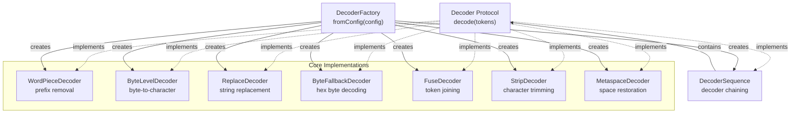
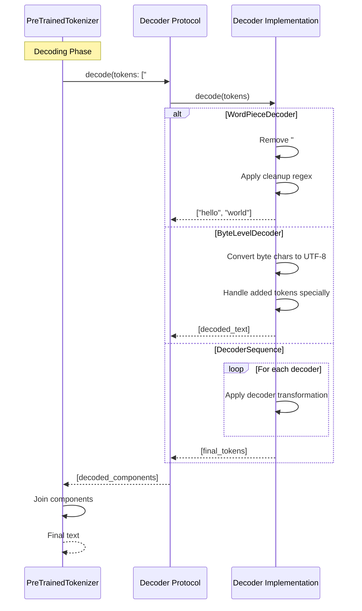
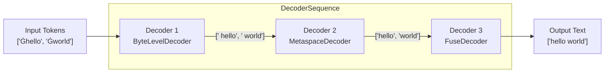

<!-- source: DeepWiki mcp.deepwiki.com · repo huggingface/swift-transformers · extra page Decoders · fetched 2026-10-26 -->

# Decoders

<details>
<summary>Relevant source files</summary>

The following files were used as context for generating this wiki page:

- [Sources/Tokenizers/Decoder.swift](Sources/Tokenizers/Decoder.swift)
- [Sources/Tokenizers/PreTokenizer.swift](Sources/Tokenizers/PreTokenizer.swift)

</details>


This document describes the Decoder system in swift-transformers, which converts token strings back into human-readable text. Decoders are the final stage in the tokenization pipeline, performing operations like removing special prefixes (e.g., `##` in WordPiece), converting byte-level encodings back to characters, and replacing metaspace characters with spaces.

For information about other tokenization pipeline stages, see:
- Pre-tokenization: [Pre-Tokenizers](#2.4.1)
- Normalization: [Normalizers](#2.4.2)
- Post-processing: [Post-Processors](#2.4.3)
- Overall tokenization: [Tokenizers](#2)

## Decoder Protocol

The `Decoder` protocol defines the interface for all decoding operations. It provides a simple abstraction: converting an array of token strings into an array of decoded text components.

```swift
protocol Decoder {
    func decode(tokens: [String]) -> [String]
    func callAsFunction(tokens: [String]) -> [String]
    init(config: Config)
}
```

Key characteristics:
- **Input**: Array of token strings (`[String]`)
- **Output**: Array of decoded text components (`[String]`)
- **Configuration-driven**: All decoders are instantiated from `Config` objects
- **Functional syntax**: Supports `decoder(tokens)` via `callAsFunction`

The protocol is intentionally simple, allowing decoders to focus on their specific transformation logic. Unlike pre-tokenizers which may split text into more pieces, decoders typically maintain or reduce the number of components by joining or transforming them.

**Sources:** [Sources/Tokenizers/Decoder.swift:11-39]()

## Decoder Architecture

The following diagram shows the relationship between the protocol, factory, and implementations:

**Decoder Type Hierarchy**



**Sources:** [Sources/Tokenizers/Decoder.swift:11-71]()

## Decoder Factory

The `DecoderFactory` uses a factory pattern to instantiate decoders based on configuration type. It maps configuration type names to concrete decoder implementations.

**Decoder Type Enumeration**

| Enum Value | Decoder Class | Primary Purpose |
|------------|---------------|-----------------|
| `WordPiece` | `WordPieceDecoder` | Remove WordPiece prefix and clean up punctuation |
| `ByteLevel` | `ByteLevelDecoder` | Convert byte-level encoding to UTF-8 text |
| `Replace` | `ReplaceDecoder` | Apply string replacement patterns |
| `ByteFallback` | `ByteFallbackDecoder` | Decode `<0xXX>` hex byte tokens |
| `Fuse` | `FuseDecoder` | Join all tokens into single string |
| `Strip` | `StripDecoder` | Remove characters from token boundaries |
| `Metaspace` | `MetaspaceDecoder` | Replace metaspace character with spaces |
| `Sequence` | `DecoderSequence` | Chain multiple decoders together |

The factory method `fromConfig(config:addedTokens:)` reads the `type` field from the configuration and instantiates the appropriate decoder:

```swift
static func fromConfig(config: Config?, addedTokens: Set<String>? = nil) -> Decoder?
```

The optional `addedTokens` parameter is used by `ByteLevelDecoder` to identify special tokens that should not be byte-decoded.

**Sources:** [Sources/Tokenizers/Decoder.swift:41-71]()

## Token Decoding Flow

The following diagram illustrates how tokens flow through the decoding process:

**Token-to-Text Decoding Pipeline**



**Sources:** [Sources/Tokenizers/Decoder.swift:11-39]()

## Decoder Implementations

### WordPieceDecoder

The `WordPieceDecoder` removes the WordPiece continuation prefix (typically `##`) and optionally applies cleanup transformations to fix spacing around punctuation.

**Configuration:**
- `prefix`: The prefix string to remove (e.g., `##`)
- `cleanup`: Boolean flag to apply cleanup regex

**Behavior:**
1. First token is kept as-is (after optional cleanup)
2. Subsequent tokens have prefix removed, or space prepended if no prefix
3. Cleanup regex fixes spacing: `" ."` → `"."`, `" n't"` → `"n't"`, etc.

Example transformation:
```
Input:  ["Hello", "##world", "!", "How", "##'s"]
Output: ["Hello", "world", " !", " How", "'s"]
```

**Sources:** [Sources/Tokenizers/Decoder.swift:73-101]()

### ByteLevelDecoder

The `ByteLevelDecoder` converts byte-level encoded text back to UTF-8 characters. It uses the `byteDecoder` mapping (inverse of `byteEncoder`) to transform special characters back to their original bytes.

**Configuration:**
- `addedTokens`: Set of special tokens that should not be byte-decoded

**Behavior:**
1. Groups consecutive tokens that are not in `addedTokens`
2. Concatenates grouped tokens and maps each character through `byteDecoder`
3. Decodes resulting bytes as UTF-8
4. Special tokens are preserved as-is

This is the inverse operation of `ByteLevelPreTokenizer`.

**Sources:** [Sources/Tokenizers/Decoder.swift:118-158]()

### ReplaceDecoder

The `ReplaceDecoder` applies string replacement patterns to each token. It uses `StringReplacePattern` which can be either a simple string replacement or a regex-based pattern.

**Configuration:**
- `pattern`: The replacement pattern (via `StringReplacePattern.from`)

**Behavior:**
Each token is independently transformed by the replacement pattern.

**Sources:** [Sources/Tokenizers/Decoder.swift:160-171]()

### ByteFallbackDecoder

The `ByteFallbackDecoder` handles tokens that represent raw bytes in hexadecimal format, typically `<0xXX>` where `XX` is a hex byte value.

**Behavior:**
1. Scans tokens for byte pattern: `<0xXX>` where XX is hexadecimal
2. Accumulates consecutive byte tokens
3. When non-byte token encountered, decodes accumulated bytes as UTF-8
4. Non-byte tokens are preserved as-is

Example transformation:
```
Input:  ["Hello", "<0x20>", "<0x77>", "<0x6f>", "<0x72>", "<0x6c>", "<0x64>"]
Output: ["Hello", " world"]
```

**Sources:** [Sources/Tokenizers/Decoder.swift:173-204]()

### FuseDecoder

The `FuseDecoder` is the simplest decoder: it joins all tokens into a single string without any separator.

**Behavior:**
```swift
func decode(tokens: [String]) -> [String] {
    [tokens.joined(separator: "")]
}
```

Example transformation:
```
Input:  ["Hello", "world", "!"]
Output: ["Helloworld!"]
```

**Sources:** [Sources/Tokenizers/Decoder.swift:206-212]()

### StripDecoder

The `StripDecoder` removes a specified number of characters from the start and/or end of each token.

**Configuration:**
- `content`: The character to strip (typically space)
- `start`: Number of characters to strip from start
- `stop`: Number of characters to strip from end

**Behavior:**
Each token is independently trimmed according to the configuration.

**Sources:** [Sources/Tokenizers/Decoder.swift:214-233]()

### MetaspaceDecoder

The `MetaspaceDecoder` reverses the transformation applied by `MetaspacePreTokenizer`, replacing the metaspace character (typically `▁` or `_`) back with spaces.

**Configuration:**
- `addPrefixSpace`: Whether to remove leading space
- `replacement`: The metaspace character to replace (default: `_`)

**Behavior:**
1. Replace all instances of `replacement` with space
2. If `addPrefixSpace` is true and result starts with space, remove it

This is the inverse operation of `MetaspacePreTokenizer`.

**Sources:** [Sources/Tokenizers/Decoder.swift:235-253]()

## Decoder Sequence

The `DecoderSequence` chains multiple decoders together, applying them sequentially. This enables complex decoding pipelines composed of simpler transformations.

**Configuration:**
- `decoders`: Array of decoder configurations

**Behavior:**
The sequence applies decoders using a functional fold operation:
```swift
func decode(tokens: [String]) -> [String] {
    decoders.reduce(tokens) { current, decoder in
        decoder(tokens: current)
    }
}
```

Example pipeline:
1. `ByteLevelDecoder` - convert bytes to characters
2. `StripDecoder` - remove boundary spaces
3. `FuseDecoder` - join into single string

**Decoder Sequence Execution Flow**



**Sources:** [Sources/Tokenizers/Decoder.swift:103-116]()

## Decoder Usage Patterns

### Configuration-Driven Instantiation

Decoders are typically instantiated through the factory pattern from JSON configuration:

```json
{
  "type": "WordPiece",
  "prefix": "##",
  "cleanup": true
}
```

The `DecoderFactory.fromConfig(config:)` method reads the `type` field and instantiates the appropriate decoder class.

### Integration with PreTrainedTokenizer

Decoders are used in the `PreTrainedTokenizer` as part of the decoding pipeline:

1. Token IDs → Token strings (via vocabulary lookup)
2. Post-processor (adds special tokens)
3. **Decoder** (converts tokens to text)
4. Join components into final string

The decoder receives an array of token strings and returns an array of decoded text components, which are then joined to produce the final output text.

**Tokenization Pipeline: Encoding vs Decoding**

```mermaid
graph TB
    subgraph "Encoding Direction"
        Text1["Raw Text"]
        Norm1["Normalizer"]
        PreTok1["PreTokenizer"]
        Model1["TokenizingModel<br/>(BPE/Unigram/BERT)"]
        Post1["PostProcessor"]
        Tokens1["Token IDs"]
        
        Text1 --> Norm1 --> PreTok1 --> Model1 --> Post1 --> Tokens1
    end
    
    subgraph "Decoding Direction"
        Tokens2["Token IDs"]
        Vocab["Vocabulary Lookup"]
        TokenStrs["Token Strings"]
        Decoder2["Decoder"]
        Join["Join Components"]
        Text2["Final Text"]
        
        Tokens2 --> Vocab --> TokenStrs --> Decoder2 --> Join --> Text2
    end
    
    style Decoder2 fill:#ffe1e1
```



**Sources:** [Sources/Tokenizers/Decoder.swift:11-39]()

## Common Decoder Combinations

Different tokenizer types use different decoder configurations:

### GPT-2 / RoBERTa (ByteLevel)
```
DecoderSequence:
  1. ByteLevelDecoder
```

### BERT / WordPiece
```
DecoderSequence:
  1. WordPieceDecoder (prefix: "##", cleanup: true)
```

### LLaMA / SentencePiece
```
DecoderSequence:
  1. MetaspaceDecoder (replacement: "▁")
  2. ByteFallbackDecoder (optional, for byte tokens)
```

### Custom Pipeline
```
DecoderSequence:
  1. ReplaceDecoder (pattern-based cleanup)
  2. StripDecoder (remove boundary characters)
  3. FuseDecoder (join into single string)
```

## Implementation Details

### Error Handling

Decoder initialization uses `fatalError` for invalid configurations, as decoders are instantiated during tokenizer loading when configuration errors should be caught immediately:

```swift
guard let prefix = config.prefix.string() else { 
    fatalError("Missing `prefix` configuration for WordPieceDecoder.") 
}
```

### Performance Considerations

- **ByteLevelDecoder**: Builds intermediate arrays to group tokens before decoding
- **WordPieceDecoder**: Uses precompiled regex (`NSRegularExpression`) for cleanup
- **DecoderSequence**: Sequential application means O(n * d) where n is tokens and d is decoder count
- **String operations**: Extensive use of `replacingOccurrences`, `hasPrefix`, and regex matching

### Thread Safety

Decoders are designed to be immutable after initialization, making them safe to use from multiple threads. All configuration is captured during `init(config:)` and stored in `let` properties.

**Sources:** [Sources/Tokenizers/Decoder.swift:1-277]()

---

