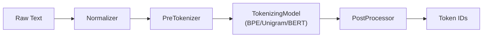
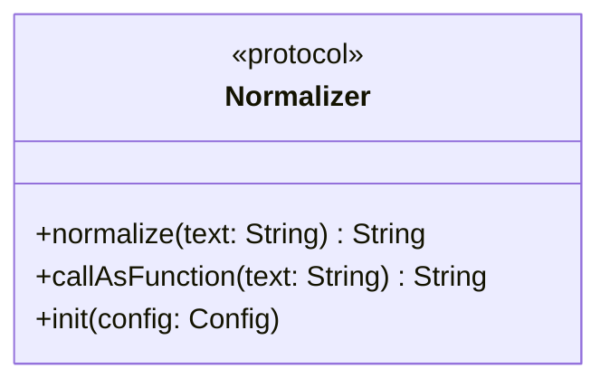
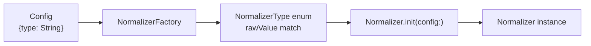
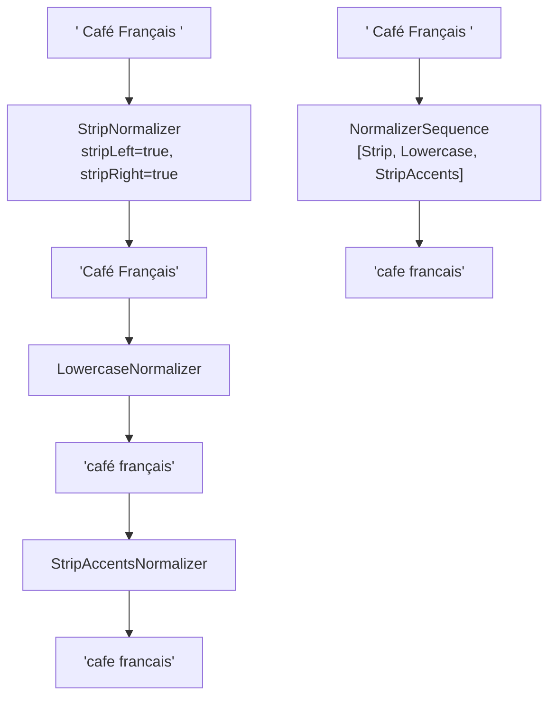
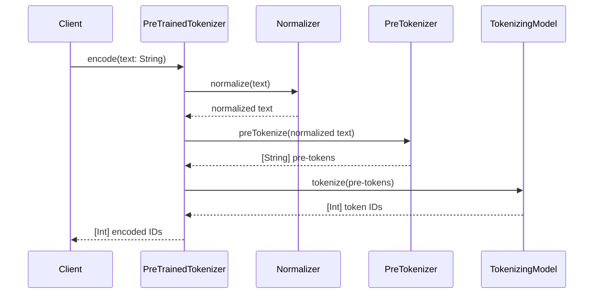

<!-- source: DeepWiki mcp.deepwiki.com · repo huggingface/swift-transformers · extra page Normalizers · fetched 2026-10-26 -->

# Normalizers

<details>
<summary>Relevant source files</summary>

The following files were used as context for generating this wiki page:

- [Sources/Tokenizers/Decoder.swift](Sources/Tokenizers/Decoder.swift)
- [Sources/Tokenizers/PreTokenizer.swift](Sources/Tokenizers/PreTokenizer.swift)
- [Tests/TokenizersTests/BertTokenizerTests.swift](Tests/TokenizersTests/BertTokenizerTests.swift)
- [Tests/TokenizersTests/NormalizerTests.swift](Tests/TokenizersTests/NormalizerTests.swift)
- [Tests/TokenizersTests/PostProcessorTests.swift](Tests/TokenizersTests/PostProcessorTests.swift)

</details>


Normalizers perform text preprocessing operations before tokenization. They transform raw input text into a standardized form by applying operations such as Unicode normalization, case conversion, accent removal, and whitespace handling. Normalizers are the first component in the tokenization pipeline.

Related components: [Pre-Tokenizers](#2.4.1), [Post-Processors](#2.4.3), [Decoders](#2.4.4).

## Pipeline Position

Normalizers execute as the first stage in the tokenization pipeline. Text flows through the following sequence:

**Tokenization Pipeline Flow**


Sources: [Sources/Tokenizers/Normalizer.swift:11-22]()

## Normalizer Protocol

The `Normalizer` protocol defines the interface for all normalizer implementations:

**Normalizer Protocol Definition**


Protocol requirements:
- `normalize(text:)`: Transforms input text and returns normalized output
- `callAsFunction(text:)`: Enables function-call syntax (e.g., `normalizer(text)`)
- `init(config:)`: Initializes from a `Config` object

Sources: [Sources/Tokenizers/Normalizer.swift:11-22]()

## Implementation Types

The library provides the following normalizer implementations:

**Normalizer Class Hierarchy**

```mermaid
classDiagram
    class Normalizer {
        <<protocol>>
        +normalize(text: String) String
        +init(config: Config)
    }
    
    class NormalizerSequence {
        -normalizers: [Normalizer]
    }
    
    class LowercaseNormalizer {
    }
    
    class BertNormalizer {
        -shouldCleanText: Bool
        -shouldHandleChineseChars: Bool
        -shouldStripAccents: Bool
        -shouldLowercase: Bool
    }
    
    class PrependNormalizer {
        -prepend: String
    }
    
    class ReplaceNormalizer {
        -pattern: StringReplacePattern?
    }
    
    class NFDNormalizer {
    }
    
    class NFCNormalizer {
    }
    
    class NFKDNormalizer {
    }
    
    class NFKCNormalizer {
    }
    
    class PrecompiledNormalizer {
        -precompiledCharsMap: [String: String]
    }
    
    class StripAccentsNormalizer {
    }
    
    class StripNormalizer {
        -stripLeft: Bool
        -stripRight: Bool
    }
    
    Normalizer <|.. NormalizerSequence
    Normalizer <|.. LowercaseNormalizer
    Normalizer <|.. BertNormalizer
    Normalizer <|.. PrependNormalizer
    Normalizer <|.. ReplaceNormalizer
    Normalizer <|.. NFDNormalizer
    Normalizer <|.. NFCNormalizer
    Normalizer <|.. NFKDNormalizer
    Normalizer <|.. NFKCNormalizer
    Normalizer <|.. PrecompiledNormalizer
    Normalizer <|.. StripAccentsNormalizer
    Normalizer <|.. StripNormalizer
```


Sources: [Sources/Tokenizers/Normalizer.swift:11-337]()

### LowercaseNormalizer

Converts all characters to lowercase using Swift's `lowercased()` method.

| Input | Output |
|-------|--------|
| `"Hello World"` | `"hello world"` |
| `"Café"` | `"café"` |
| `"Ωmega"` | `"ωmega"` |

Sources: [Sources/Tokenizers/Normalizer.swift:106-112](), [Tests/TokenizersTests/NormalizerTests.swift:9-31]()

### Unicode Normalizers

Four Unicode normalization forms are implemented, each applying Swift's `String.precomposedStringWith*` methods:

| Class | Normalization Form | Description |
|-------|-------------------|-------------|
| `NFDNormalizer` | NFD (Canonical Decomposition) | Decomposes characters to canonical form |
| `NFCNormalizer` | NFC (Canonical Composition) | Decomposes then recomposes to canonical form |
| `NFKDNormalizer` | NFKD (Compatibility Decomposition) | Decomposes to compatibility equivalents |
| `NFKCNormalizer` | NFKC (Compatibility Composition) | Decomposes to compatibility form then recomposes |

Example transformations:

| Input | NFD | NFKD |
|-------|-----|------|
| `"Å"` (`\u{00C5}`) | `"Å"` (`\u{0041}\u{030A}`) | `"Å"` |
| `"𝔄𝔅ℭ⓵⓶⓷"` | No change | `"ABC⓵⓶⓷"` |

Sources: [Sources/Tokenizers/Normalizer.swift:114-144](), [Tests/TokenizersTests/NormalizerTests.swift:33-127]()

### StripNormalizer

Removes whitespace from text boundaries. Configurable via `stripLeft` and `stripRight` boolean flags.

| stripLeft | stripRight | Input | Output |
|-----------|------------|-------|--------|
| `true` | `true` | `"  hello  "` | `"hello"` |
| `true` | `false` | `"  hello  "` | `"hello  "` |
| `false` | `true` | `"  hello  "` | `"  hello"` |
| `false` | `false` | `"  hello  "` | `"  hello  "` |

Both flags default to `true` when not specified.

Sources: [Sources/Tokenizers/Normalizer.swift:279-301](), [Tests/TokenizersTests/NormalizerTests.swift:242-266]()

### BertNormalizer

Specialized normalizer for BERT-style models with four configurable behaviors:

| Property | Default | Function |
|----------|---------|----------|
| `shouldCleanText` | `true` | Removes control characters, normalizes whitespace |
| `shouldHandleChineseChars` | `true` | Adds spaces around CJK characters |
| `shouldStripAccents` | `true` | Removes Unicode accent marks (combining characters) |
| `shouldLowercase` | `true` | Converts to lowercase |

Example with default settings:

| Input | Output |
|-------|--------|
| `"Café"` | `"cafe"` |
| `"Häagen\tDazs"` | `"haagen dazs"` |
| `"你好!"` | `" 你  好 !"` |

The normalizer applies operations in sequence: clean → handle Chinese → strip accents → lowercase.

Sources: [Sources/Tokenizers/Normalizer.swift:146-227](), [Tests/TokenizersTests/NormalizerTests.swift:144-190]()

### ReplaceNormalizer

Performs string substitutions using either literal string matching or regular expressions. Uses `StringReplacePattern` internally.

Configuration requires:
- `pattern`: Dictionary with either `"String"` or `"Regex"` key
- `content`: Replacement text

| Pattern Type | Config Example | Input | Output |
|--------------|----------------|-------|--------|
| String | `["String": "hello"]` | `"hello world"` | `"hi world"` |
| Regex | `["Regex": "\\d+"]` | `"I have 42 apples"` | `"I have [NUM] apples"` |

Sources: [Sources/Tokenizers/Normalizer.swift:93-104]()

### PrependNormalizer

Adds a fixed prefix string to the input text.

| Property | Type | Description |
|----------|------|-------------|
| `prepend` | `String` | Text to prepend |

Sources: [Sources/Tokenizers/Normalizer.swift:81-91]()

### PrecompiledNormalizer

Applies a precomputed character mapping for normalization. Uses a hardcoded dictionary `precompiledCharsMap` that maps specific characters to their normalized forms. This normalizer applies NFKC normalization followed by character-level replacements for special symbols.

Example mappings:
- `"™"` → `"TM"`
- Control characters (e.g., `\u{001e}`) → empty string
- Full-width characters remain unchanged

Sources: [Sources/Tokenizers/Normalizer.swift:229-277](), [Tests/TokenizersTests/NormalizerTests.swift:192-216]()

### StripAccentsNormalizer

Removes Unicode accent marks by:
1. Applying NFD decomposition
2. Filtering out combining characters (Unicode category Mn)
3. Reconstructing the string

| Input | Output |
|-------|--------|
| `"café"` | `"cafe"` |
| `"naïve"` | `"naive"` |

Sources: [Sources/Tokenizers/Normalizer.swift:303-337](), [Tests/TokenizersTests/NormalizerTests.swift:218-240]()

### NormalizerSequence

Chains multiple normalizers, applying them sequentially. Each normalizer receives the output of the previous one.

Configuration structure:
```
{
    "type": "Sequence",
    "normalizers": [
        {"type": "Lowercase"},
        {"type": "Strip", "stripLeft": true, "stripRight": true}
    ]
}
```

The `normalizers` array is processed left-to-right.

Sources: [Sources/Tokenizers/Normalizer.swift:64-79]()

## Factory Pattern

`NormalizerFactory.fromConfig(config:)` creates normalizer instances from configuration objects. The factory maps `NormalizerType` enum values to concrete classes.

**Factory Creation Flow**


The `NormalizerType` enum defines supported normalizer types:

| Enum Case | Raw Value | Class |
|-----------|-----------|-------|
| `.Sequence` | `"Sequence"` | `NormalizerSequence` |
| `.Lowercase` | `"Lowercase"` | `LowercaseNormalizer` |
| `.NFD` | `"NFD"` | `NFDNormalizer` |
| `.NFC` | `"NFC"` | `NFCNormalizer` |
| `.NFKD` | `"NFKD"` | `NFKDNormalizer` |
| `.NFKC` | `"NFKC"` | `NFKCNormalizer` |
| `.Bert` | `"Bert"` | `BertNormalizer` |
| `.Prepend` | `"Prepend"` | `PrependNormalizer` |
| `.Replace` | `"Replace"` | `ReplaceNormalizer` |
| `.Precompiled` | `"Precompiled"` | `PrecompiledNormalizer` |
| `.StripAccents` | `"StripAccents"` | `StripAccentsNormalizer` |
| `.Strip` | `"Strip"` | `StripNormalizer` |

The factory is used by `AutoTokenizer` when loading tokenizers from the Hub.

Sources: [Sources/Tokenizers/Normalizer.swift:24-62]()

## Configuration Structure

Normalizers are instantiated from `Config` objects containing type and parameter information:

| Normalizer | Required Config Keys | Example |
|------------|---------------------|---------|
| `LowercaseNormalizer` | `type` | `{"type": "Lowercase"}` |
| `BertNormalizer` | `type`, optional: `cleanText`, `handleChineseChars`, `stripAccents`, `lowercase` | `{"type": "Bert", "stripAccents": true}` |
| `StripNormalizer` | `type`, optional: `stripLeft`, `stripRight` | `{"type": "Strip", "stripLeft": true, "stripRight": true}` |
| `ReplaceNormalizer` | `type`, `pattern`, `content` | `{"type": "Replace", "pattern": {"String": "x"}, "content": "y"}` |
| `NormalizerSequence` | `type`, `normalizers` (array) | `{"type": "Sequence", "normalizers": [{"type": "Lowercase"}]}` |

Configuration objects are typically loaded from `tokenizer.json` files when using `AutoTokenizer.from(pretrained:)`.

Sources: [Sources/Tokenizers/Normalizer.swift:41-62](), [Tests/TokenizersTests/NormalizerTests.swift:1-267]()

## Processing Example

The following demonstrates sequential normalization transformations:

**Multi-Stage Normalization**


Both approaches produce identical results. `NormalizerSequence` simplifies configuration when multiple normalizations are required.

Sources: [Sources/Tokenizers/Normalizer.swift:64-79](), [Tests/TokenizersTests/NormalizerTests.swift:129-141]()

## Usage in Tokenization Pipeline

Normalizers are invoked by `PreTrainedTokenizer` during the `encode()` operation:

**Tokenization Sequence**


The normalizer is accessed via the tokenizer's `normalizer` property, which is initialized from configuration by `NormalizerFactory`.

Sources: [Sources/Tokenizers/Normalizer.swift:11-22](), [Sources/Tokenizers/PreTokenizer.swift:1-279]()

## Summary

Normalizers in swift-transformers provide a flexible and extensible way to preprocess text before tokenization. They help standardize text input and make tokenization more consistent across different types of text. By combining different normalizers, you can create complex normalization pipelines tailored to specific requirements.

Key points:
- Normalizers transform raw text into a standardized form
- Multiple normalizer types are available for different preprocessing needs
- The `NormalizerFactory` creates normalizers from configuration
- Normalizers can be chained together using `NormalizerSequence`
- They form the first step in the tokenization pipeline

---

