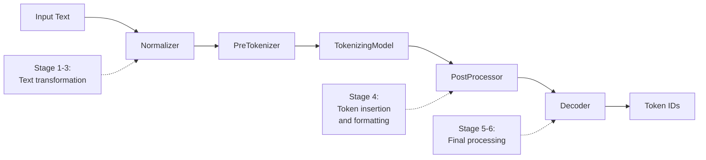
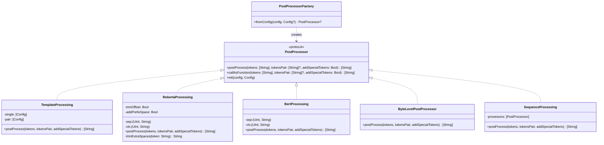
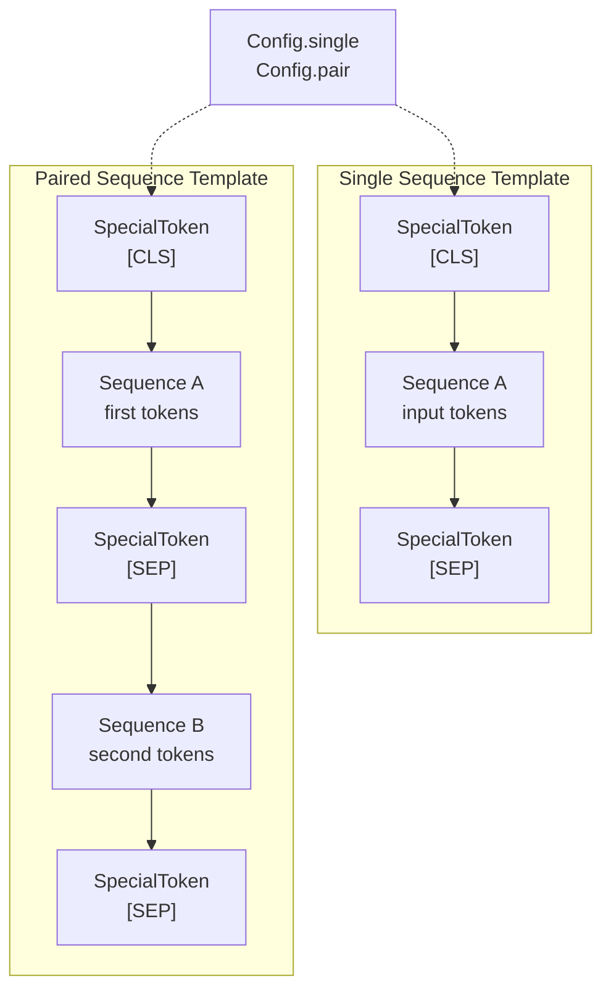
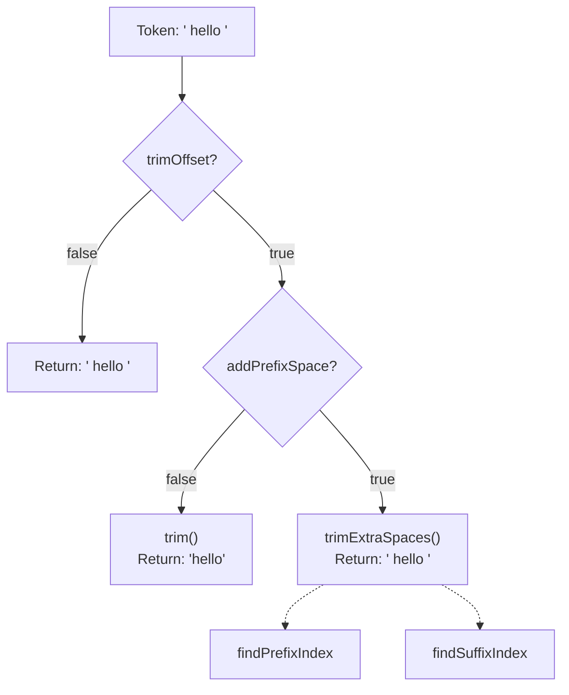
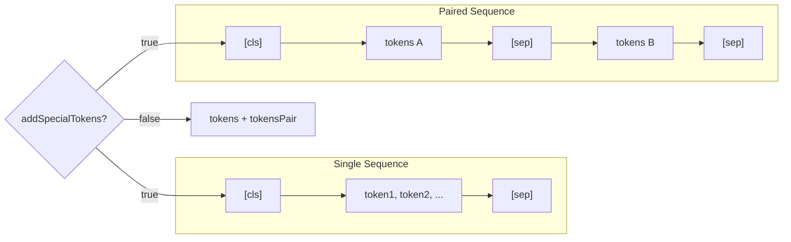
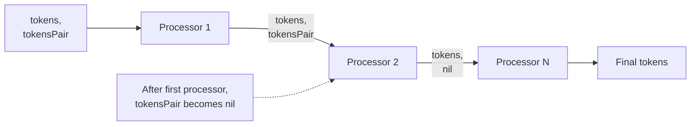
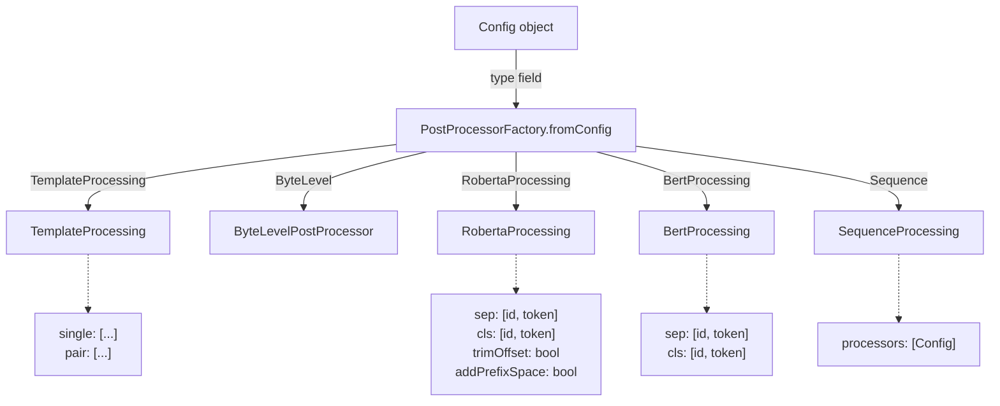
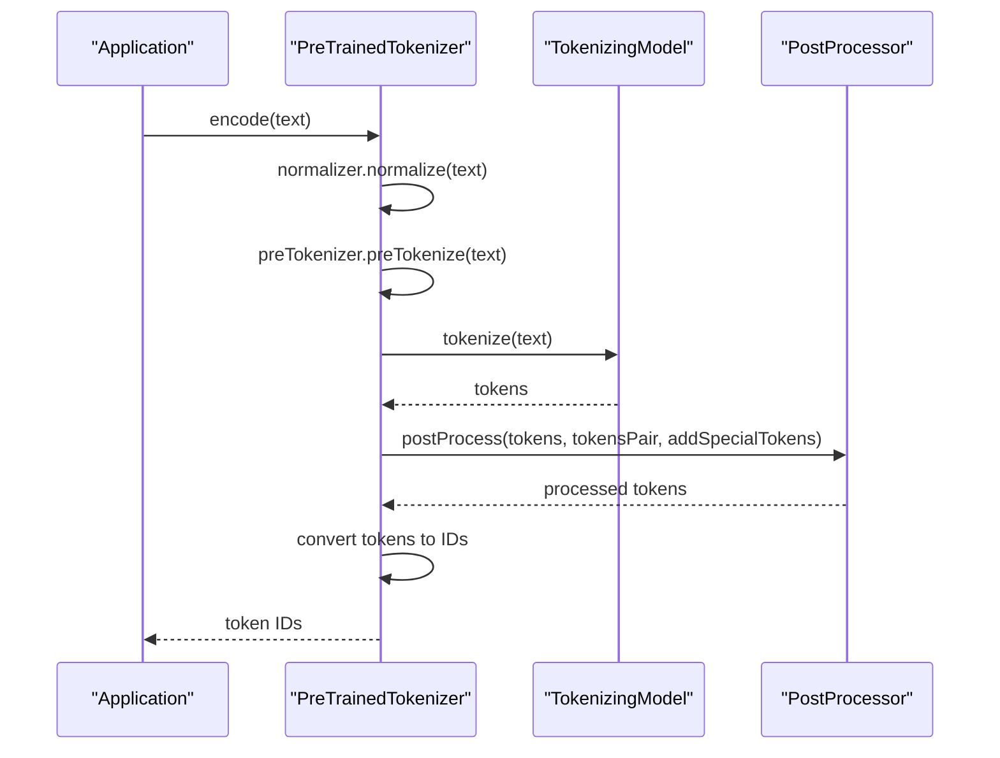

<!-- source: DeepWiki mcp.deepwiki.com · repo huggingface/swift-transformers · extra page Post-Processors · fetched 2026-10-26 -->

# Post-Processors

<details>
<summary>Relevant source files</summary>

The following files were used as context for generating this wiki page:

- [Sources/Tokenizers/BPETokenizer.swift](Sources/Tokenizers/BPETokenizer.swift)
- [Sources/Tokenizers/PostProcessor.swift](Sources/Tokenizers/PostProcessor.swift)
- [Sources/Tokenizers/UnigramTokenizer.swift](Sources/Tokenizers/UnigramTokenizer.swift)
- [Tests/TokenizersTests/BertTokenizerTests.swift](Tests/TokenizersTests/BertTokenizerTests.swift)
- [Tests/TokenizersTests/NormalizerTests.swift](Tests/TokenizersTests/NormalizerTests.swift)
- [Tests/TokenizersTests/PostProcessorTests.swift](Tests/TokenizersTests/PostProcessorTests.swift)

</details>


Post-processors are the final stage of the tokenization pipeline, responsible for adding special tokens (such as `[CLS]` and `[SEP]` for BERT) and formatting token sequences according to model-specific requirements. They operate after normalization, pre-tokenization, tokenizing model processing, and before decoding.

For information about other pipeline stages, see Normalizers ([2.4.2](#2.4.2)), Pre-Tokenizers ([2.4.1](#2.4.1)), and Decoders ([2.4.4](#2.4.4)). For the overall tokenization flow, see Tokenizers ([2](#2)).

## Pipeline Position

Post-processors execute after the core tokenizing model has produced tokens but before the final token IDs are returned. They modify the token sequence by inserting special tokens and applying formatting rules specific to each model architecture.



**Diagram: Post-processor position in tokenization pipeline**

Sources: [Sources/Tokenizers/PostProcessor.swift:1-215]()

## PostProcessor Protocol

The `PostProcessor` protocol defines the interface for all post-processing implementations. It provides a single method for transforming token sequences and supports both single-sequence and sequence-pair inputs.



**Diagram: PostProcessor protocol and implementations**

The protocol defines three key elements:
- **postProcess**: The primary method that transforms token sequences
- **callAsFunction**: Convenience method enabling function call syntax
- **init(config:)**: Required initializer for configuration-based instantiation

Sources: [Sources/Tokenizers/PostProcessor.swift:11-45]()

## TemplateProcessing

`TemplateProcessing` applies template-based formatting using configuration-defined patterns for single and paired sequences. It interprets template items as either special tokens or sequence references.

### Template Configuration Structure

Templates consist of arrays of configuration items that specify:
- **SpecialToken.id**: A special token string to insert (e.g., `"[CLS]"`)
- **Sequence.id**: A reference to input sequence "A" or "B"



**Diagram: Template structure for single and paired sequences**

The implementation iterates through the template configuration and constructs the output by:
1. Checking if `addSpecialTokens` is true before inserting special tokens
2. Appending the appropriate sequence (A or B) when referenced
3. Selecting between `single` and `pair` templates based on whether `tokensPair` is provided

Sources: [Sources/Tokenizers/PostProcessor.swift:71-100]()

### Example Transformation

| Input | Configuration | Output |
|-------|---------------|--------|
| `tokens: ["Hello", "world"]` | `single: [SpecialToken("[CLS]"), Sequence("A"), SpecialToken("[SEP]")]` | `["[CLS]", "Hello", "world", "[SEP]"]` |
| `tokens: ["Hello"]`<br/>`tokensPair: ["world"]` | `pair: [SpecialToken("[CLS]"), Sequence("A"), SpecialToken("[SEP]"), Sequence("B"), SpecialToken("[SEP]")]` | `["[CLS]", "Hello", "[SEP]", "world", "[SEP]"]` |

Sources: [Sources/Tokenizers/PostProcessor.swift:83-99]()

## RobertaProcessing

`RobertaProcessing` implements RoBERTa-specific post-processing, which includes special handling for whitespace trimming and prefix spaces. This processor adds `cls` and `sep` tokens with specific formatting rules.

### Token Insertion Pattern

RoBERTa uses a distinctive pattern where the separator token appears multiple times in paired sequences:

```
Single: [cls] tokens [sep]
Paired: [cls] tokens [sep] [sep] tokensPair [sep]
```

The doubled `sep` token between sequences is intentional and matches the behavior in the reference implementation.

Sources: [Sources/Tokenizers/PostProcessor.swift:124-144]()

### Whitespace Handling

The processor supports two modes controlled by `trimOffset` and `addPrefixSpace`:

| trimOffset | addPrefixSpace | Behavior |
|------------|----------------|----------|
| `false` | any | Preserve all whitespace unchanged |
| `true` | `false` | Remove all leading and trailing whitespace |
| `true` | `true` | Normalize to exactly one space on each side |



**Diagram: RobertaProcessing whitespace handling logic**

The `trimExtraSpaces` method normalizes whitespace by:
1. Finding the index where leading whitespace reduces to one space
2. Finding the index where trailing whitespace reduces to one space
3. Extracting the substring between these indices

Sources: [Sources/Tokenizers/PostProcessor.swift:107-166](), [Tests/TokenizersTests/PostProcessorTests.swift:12-106]()

## BertProcessing

`BertProcessing` provides BERT-specific formatting, which is simpler than RoBERTa processing with no special whitespace handling.

### Token Insertion Pattern

```
Single: [cls] tokens [sep]
Paired: [cls] tokens [sep] tokensPair [sep]
```

Unlike RoBERTa, BERT uses only one separator between sequences:



**Diagram: BertProcessing token insertion logic**

When `addSpecialTokens` is false, the processor simply concatenates tokens and tokensPair without adding special tokens.

Sources: [Sources/Tokenizers/PostProcessor.swift:168-189]()

## ByteLevelPostProcessor

`ByteLevelPostProcessor` is a pass-through implementation that returns tokens unchanged. It exists for models that perform byte-level encoding without requiring additional post-processing.

```swift
func postProcess(tokens: [String], tokensPair: [String]? = nil, addSpecialTokens: Bool = true) -> [String] {
    tokens
}
```

This processor is typically used in combination with `ByteLevelDecoder` when the model handles special tokens internally or doesn't require them.

Sources: [Sources/Tokenizers/PostProcessor.swift:102-105]()

## SequenceProcessing

`SequenceProcessing` chains multiple post-processors, allowing complex formatting by composing simpler processors. Each processor in the sequence operates on the output of the previous one.



**Diagram: SequenceProcessing chain execution**

Key behavior:
- The first processor receives both `tokens` and `tokensPair`
- Subsequent processors receive only `tokens` (with `tokensPair` set to nil)
- Each processor's output becomes the input for the next processor
- The `addSpecialTokens` flag is passed to all processors

Sources: [Sources/Tokenizers/PostProcessor.swift:191-214]()

### Example Use Case

A sequence processor might combine:
1. `ByteLevelPostProcessor` for byte-level handling
2. `TemplateProcessing` for adding model-specific special tokens

This allows models to reuse processing logic while customizing the final format.

Sources: [Sources/Tokenizers/PostProcessor.swift:194-213]()

## Factory Pattern and Configuration

Post-processors are instantiated using the factory pattern via `PostProcessorFactory.fromConfig`, which reads the configuration and creates the appropriate implementation.

### Configuration Structure



**Diagram: PostProcessorFactory configuration dispatch**

### PostProcessorType Enum

The `PostProcessorType` enum maps configuration strings to processor types:

| Type String | Implementation |
|-------------|----------------|
| `"TemplateProcessing"` | `TemplateProcessing` |
| `"ByteLevel"` | `ByteLevelPostProcessor` |
| `"RobertaProcessing"` | `RobertaProcessing` |
| `"BertProcessing"` | `BertProcessing` |
| `"Sequence"` | `SequenceProcessing` |

Sources: [Sources/Tokenizers/PostProcessor.swift:47-69]()

### Token Configuration Helper

Configurations that require special tokens use a tuple format `(UInt, String)` representing the token ID and token string. The `Config.token()` helper method extracts these tuples:

```swift
guard let sep = config.sep.token() else { 
    fatalError("Missing `sep` processor configuration") 
}
// sep: (UInt, String) = (token_id, token_string)
```

Sources: [Sources/Tokenizers/PostProcessor.swift:116-119](), [Sources/Tokenizers/PostProcessor.swift:173-176]()

## Integration with PreTrainedTokenizer

Post-processors are integrated into the tokenization pipeline through `PreTrainedTokenizer`, which applies them after the core tokenizing model produces tokens:



**Diagram: Post-processor invocation in encoding flow**

The `addSpecialTokens` parameter allows applications to control whether special tokens are added, which is useful when:
- Manually constructing sequences with pre-determined special token positions
- Concatenating multiple encoded sequences
- Testing or debugging tokenizer behavior

Sources: [Sources/Tokenizers/PostProcessor.swift:16-44]()

## Common Patterns and Examples

### BERT-Style Models

BERT and similar models use `BertProcessing` or `TemplateProcessing`:

```
Input: "Hello world"
Tokens: ["Hello", "world"]
Output: ["[CLS]", "Hello", "world", "[SEP]"]
```

For sentence pairs (e.g., question answering):

```
Input A: "What is AI?"
Input B: "Artificial Intelligence"
Tokens A: ["What", "is", "AI", "?"]
Tokens B: ["Artificial", "Intelligence"]
Output: ["[CLS]", "What", "is", "AI", "?", "[SEP]", "Artificial", "Intelligence", "[SEP]"]
```

Sources: [Sources/Tokenizers/PostProcessor.swift:168-189]()

### RoBERTa-Style Models

RoBERTa uses the doubled separator pattern with whitespace normalization:

```
Input: "  Hello   world  "
Tokens: ["  Hello  ", "  world  "]
Output (with trimOffset=true, addPrefixSpace=true): ["<s>", " Hello ", " world ", "</s>"]
```

For sentence pairs:

```
Output: ["<s>", " Hello ", "</s>", "</s>", " world ", "</s>"]
```

Sources: [Sources/Tokenizers/PostProcessor.swift:107-166](), [Tests/TokenizersTests/PostProcessorTests.swift:73-106]()

### GPT-Style Models

GPT models often use `ByteLevelPostProcessor` with no special tokens:

```
Input: "Hello world"
Tokens: ["Hello", "Ġworld"]  # Ġ represents a space in byte-level encoding
Output: ["Hello", "Ġworld"]  # Unchanged
```

Sources: [Sources/Tokenizers/PostProcessor.swift:102-105]()

## Testing and Validation

The test suite validates post-processor behavior across various scenarios:

| Test Category | Coverage |
|---------------|----------|
| Space handling | Multiple whitespace configurations and trimming behaviors |
| Token pairs | Empty pairs, non-empty pairs, single sequences |
| Special tokens | Presence/absence of special tokens based on `addSpecialTokens` |
| CJK text | Unicode handling and space normalization for Asian languages |

Key test patterns demonstrate expected behavior:
- RoBERTa space normalization with uneven whitespace
- BERT special token insertion with and without pairs
- Sequence processor chaining

Sources: [Tests/TokenizersTests/PostProcessorTests.swift:1-109]()

---

**Summary**: Post-processors transform tokenized sequences by adding model-specific special tokens and applying formatting rules. The system provides five implementations (`TemplateProcessing`, `RobertaProcessing`, `BertProcessing`, `ByteLevelPostProcessor`, `SequenceProcessing`) that handle different model requirements through a unified protocol interface and configuration-driven factory pattern.

---

