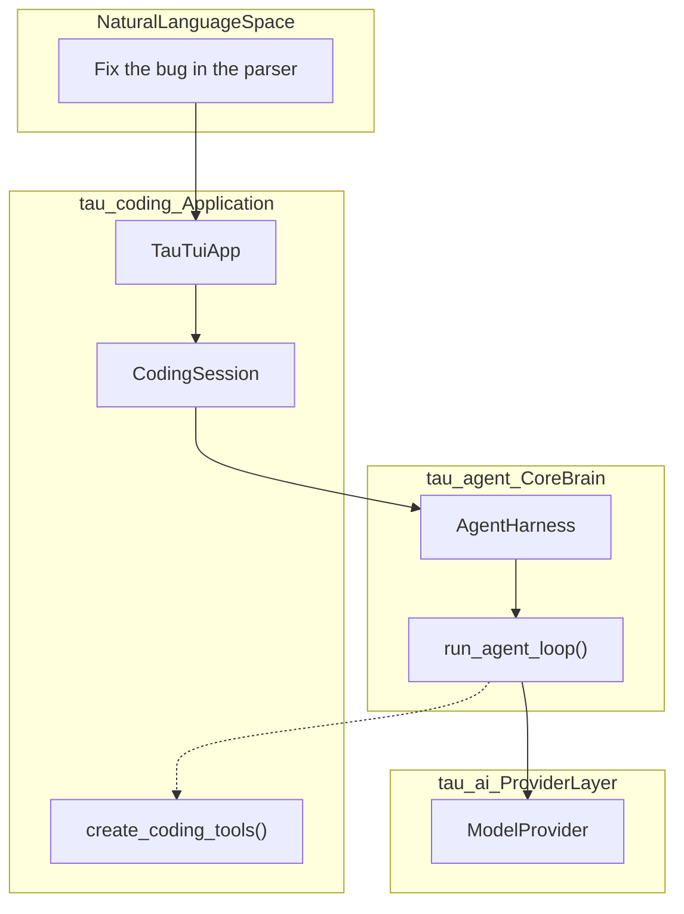
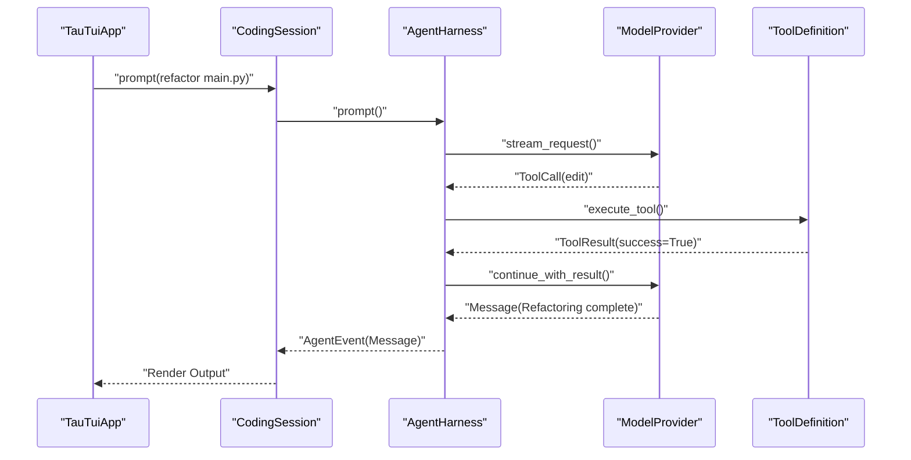

<!-- source: DeepWiki mcp.deepwiki.com · repo huggingface/tau · page 1 Overview · fetched 2026-10-26 -->

# Overview

<details>
<summary>Relevant source files</summary>

The following files were used as context for generating this wiki page:

- [AGENTS.md](AGENTS.md)
- [CONTRIBUTING.md](CONTRIBUTING.md)
- [README.md](README.md)
- [dev-notes/architecture/cli-bad-model-error.md](dev-notes/architecture/cli-bad-model-error.md)
- [dev-notes/release-process.md](dev-notes/release-process.md)
- [docs/assets/tau-header.svg](docs/assets/tau-header.svg)
- [landing.html](landing.html)
- [pyproject.toml](pyproject.toml)
- [src/tau_coding/data/release-notes/releases.json](src/tau_coding/data/release-notes/releases.json)
- [uv.lock](uv.lock)

</details>


Tau is a minimalist, terminal-based coding agent and a reference implementation for building agentic systems [README.md:27-36](), [CONTRIBUTING.md:3-3](). Distributed on PyPI as `tau-ai` [pyproject.toml:5-8](), it allows users to interact with their codebase using natural language to explain code, run tests, analyze stack traces, and perform complex edits [README.md:27-32](). 

The project is designed with a strict separation of concerns, ensuring that the reusable "brain" of the agent is portable and completely independent of any specific user interface, model provider, or file layout [README.md:35-58](), [CONTRIBUTING.md:15-27]().

For detailed instructions on setting up your environment, see [Getting Started](#1.1). For an in-depth breakdown of fundamental mechanisms, see [Core Concepts](#1.2).

---

## Three-Layer Architecture

Tau's design philosophy emphasizes small, readable layers over monolithic abstractions [README.md:187-191](), [CONTRIBUTING.md:25-25](). The codebase is partitioned into three distinct packages that communicate via a typed event stream [README.md:39-47](), [CONTRIBUTING.md:7-13](), [pyproject.toml:41-42]():

1. **`tau_ai`**: The provider abstraction layer. It translates various LLM provider APIs (OpenAI, Anthropic, Google, local endpoints) into a unified, provider-neutral stream [README.md:42](), [CONTRIBUTING.md:10-10]().
2. **`tau_agent`**: The core "brain" and portable harness. It manages the `AgentHarness`, `run_agent_loop()`, tool execution tracking, and session primitives [README.md:43-44](), [CONTRIBUTING.md:11-11]().
3. **`tau_coding`**: The application layer. It wraps the core harness with `CodingSession`, CLI commands, the Textual-based TUI, built-in coding tools (`read`, `write`, `edit`, `bash`), and project instruction discovery [README.md:45-46](), [CONTRIBUTING.md:12-12]().

### System Component Mapping

The following diagram bridges high-level architectural concepts to the specific code entities that implement them across the three packages.

**Architecture to Code Mapping**

Sources: [README.md:39-48](), [CONTRIBUTING.md:7-21](), [pyproject.toml:41-42]()

---

## Key Design Philosophy

* **Events are the Contract**: The core loop emits typed event objects (`AgentEvent`). Frontends like the TUI (`TauTuiApp`) or one-shot print mode consume these events to render output [README.md:192-194](), [CONTRIBUTING.md:26-26]().
* **Durable Sessions**: History is stored as append-only JSONL files under `~/.tau/sessions/`, supporting seamless session resumption, branching, and HTML/JSONL exports [README.md:178-180](), [CONTRIBUTING.md:29-29]().
* **Tools are Typed Functions**: Tools are defined as standard Python functions accompanied by a `ToolDefinition` schema and an asynchronous executor [README.md:195-197](), [CONTRIBUTING.md:28-28]().
* **Context Management**: Tau supports manual and automatic context compaction to handle long-running conversations within strict model token limits [README.md:183-184](), [README.md:198-199]().
* **Portable Core**: The reusable `AgentHarness` has zero dependencies on Textual, Rich, the CLI interface, or specific local config directories [README.md:191-195](), [CONTRIBUTING.md:27-27]().

Sources: [README.md:187-202](), [CONTRIBUTING.md:23-31]()

---

## Installation

Tau is published on PyPI as `tau-ai` and exposes a global `tau` command [README.md:59-62](), [pyproject.toml:5-32](). It requires Python 3.12 or newer [pyproject.toml:12]().

### Recommended Installers
For macOS and Linux:
```bash
curl -LsSf https://twotimespi.dev/install.sh | sh
```
For Windows PowerShell:
```powershell
irm https://twotimespi.dev/install.ps1 | iex
```

### Package Managers and Local Development
```bash
uv tool install tau-ai
tau --version
```
For local contribution or source inspection:
```bash
git clone https://github.com/huggingface/tau.git
cd tau
uv sync --dev
uv run tau --version
```
Sources: [README.md:65-117](), [pyproject.toml:12-39]()

---

## Quickstart

To launch an interactive terminal session inside your target project repository:
1. Navigate to your project directory: `cd my-project` [README.md:135-138]()
2. Run Tau: `tau` [README.md:137]()
3. Connect an AI provider using the `/login` command (e.g., `/login openai` or `/login openai-codex`) [README.md:160-162]()

For scripts, CI pipelines, or non-interactive use, Tau provides a **Print Mode**:
```bash
tau -p "Summarize the changes in the last commit"
```
Sources: [README.md:146-151]()

---

## Component Interaction

The following sequence diagram illustrates how a user prompt flows through the application orchestrator and core harness to execute tools and return a response, bridging natural language requests to specific code methods.

**Flow: User Prompt to Code Change**

Sources: [README.md:205-223](), [CONTRIBUTING.md:81-85]()

---

## Further Reading

* **[Getting Started](#1.1)**: Installation via PyPI/install scripts, local development setup, running the TUI and print mode, and connecting providers via `/login`.
* **[Core Concepts](#1.2)**: Comprehensive explanation of the agent loop, providers/models, tool definitions, session storage, `AGENTS.md`, and context window compaction.

---

