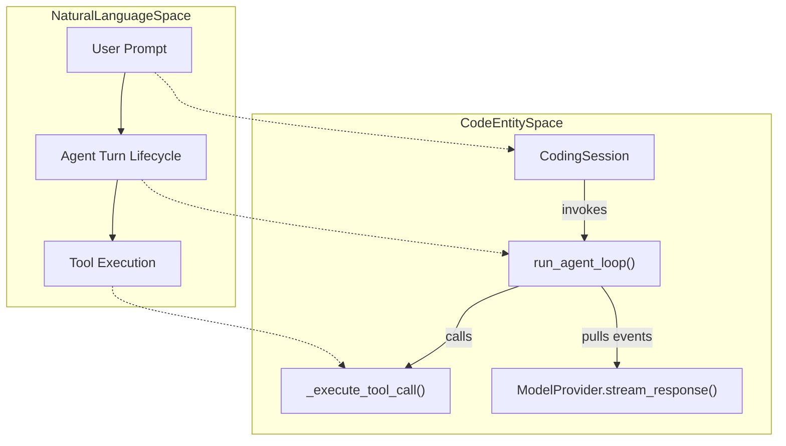
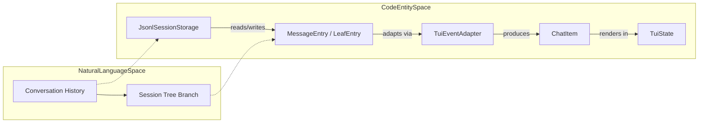

<!-- source: DeepWiki mcp.deepwiki.com · repo huggingface/tau · page 1.2 Core Concepts · fetched 2026-10-26 -->

# Core Concepts

Relevant source files

The following files were used as context for generating this wiki page:

- [dev-notes/architecture/auto-session-naming.md](dev-notes/architecture/auto-session-naming.md)
- [src/tau_agent/__init__.py](src/tau_agent/__init__.py)
- [src/tau_agent/loop.py](src/tau_agent/loop.py)
- [src/tau_agent/messages.py](src/tau_agent/messages.py)
- [tests/test_agent_loop.py](tests/test_agent_loop.py)
- [tests/test_agent_types.py](tests/test_agent_types.py)
- [website/content/guides/context.md](website/content/guides/context.md)
- [website/content/internals/agent-loop.md](website/content/internals/agent-loop.md)
- [website/content/internals/design-principles.md](website/content/internals/design-principles.md)
- [website/layouts/_default/why-tau.html](website/layouts/_default/why-tau.html)
- [website/layouts/partials/footer.html](website/layouts/partials/footer.html)

This page explains the fundamental concepts of the Tau codebase. Tau is structured as a three-layer system designed to separate concerns between AI model communication, agentic execution loops, and coding-specific application features.

## Purpose and Scope

The purpose of this page is to provide a comprehensive technical reference for Tau's core abstractions. It bridges conceptual ideas—such as the agent loop, session trees, context windows, compaction, thinking modes, project trust, and operational interfaces—directly to their implementation locations in the codebase.

Sources: [website/content/internals/design-principles.md:9-13](), [AGENTS.md:15-32]()

---

## The Three-Layer Architecture

Tau's design philosophy emphasizes small, readable layers where each package has a distinct responsibility, keeping the core agent harness decoupled from user interfaces and framework dependencies [AGENTS.md:15-32]().

| Package | Role | Key Responsibility |
| :--- | :--- | :--- |
| `tau_ai` | **Provider Layer** | Translates model-specific APIs into a neutral event stream [AGENTS.md:26-26](). |
| `tau_agent` | **Agent Brain** | Manages the loop, tool execution, and session primitives [AGENTS.md:27-27](). |
| `tau_coding` | **Application Layer** | Adds coding tools, CLI/TUI, and resource discovery [AGENTS.md:28-28](). |

Sources: [pyproject.toml:41-42](), [AGENTS.md:15-32](), [src/tau_coding/tui/adapter.py:1-16]()

---

## 1. The Agent Loop

The **Agent Loop** is the heart of the system. Implemented as the asynchronous generator function `run_agent_loop` [src/tau_agent/loop.py:52-68](), it is a stateful cycle where the agent processes prompts, streams responses, manages steering/follow-up queues, and executes tools.

### Execution Flow
1. **Turn Start**: The loop begins with a user prompt, prelude messages, steering messages, or follow-up inputs [src/tau_agent/loop.py:74-82](), [src/tau_agent/loop.py:96-110]().
2. **Model Streaming**: The LLM streams content (text, thinking blocks, or tool calls) via provider integration layers [src/tau_agent/loop.py:126-140]().
3. **Tool Execution**: If the model requests tool calls (`ToolCall`), the loop pauses model interaction to invoke tools via `_execute_tool_call` and yields execution events [src/tau_agent/loop.py:153-171]().
4. **Feedback**: Tool results (`ToolResultMessage`) are appended to the conversation history, and the loop continues until the assistant produces no more tool calls [src/tau_agent/loop.py:165-180]().

### Diagram: Agent Loop Architecture (Natural Language to Code Space)

Sources: [src/tau_agent/loop.py:52-68](), [src/tau_agent/loop.py:126-171](), [tests/test_agent_loop.py:56-82]()

---

## 2. Providers and Models

A **Provider** is a concrete implementation of the model provider interface (`ModelProvider`), handling API differences across vendors. Tau maintains a built-in provider and model catalog (`BUILTIN_PROVIDER_CATALOG`) containing metadata, cost tiers, and context windows [src/tau_coding/provider_catalog.py:71-93]().

* **Hot-swapping**: Users can switch models mid-session via slash commands or configuration changes.
* **Thinking Modes**: For reasoning-capable models, Tau manages a `ThinkingLevel` enum (`off`, `minimal`, `low`, `medium`, `high`, `xhigh`, `max`) [website/content/guides/context.md:93-100](). Reasoning blocks are preserved in assistant message structures [src/tau_agent/messages.py:102-107]().

Sources: [src/tau_coding/provider_catalog.py:71-103](), [src/tau_coding/thinking.py:9-15](), [website/content/guides/context.md:92-118]()

---

## 3. Tools and Skills

Tau distinguishes between **Tools** (executable Python functions) and **Skills** (Markdown-based prompt instructions).

### Built-in Coding Tools
* `read`: Reads file contents, supporting image MIME types for vision models [src/tau_agent/messages.py:109-113]().
* `write`: Overwrites or creates files.
* `edit`: Applies patch/diff modifications to files.
* `bash`: Executes non-interactive shell commands with timeout and signal handling.

### Skills
Skills are reusable instructions stored as `.md` files with YAML frontmatter. Invoking `/skill:<name>` expands the skill definition into the active conversation context.

Sources: [src/tau_coding/tui/state.py:25-25](), [src/tau_agent/messages.py:109-124](), [website/content/reference/slash-commands.md:31-32]()

---

## 4. Sessions and the Session Tree

A **Session** is a persistent record of conversation history maintained as an append-only JSONL file tree rather than a flat list, allowing branch exploration and rollbacks.

* **Persistence**: Stored as newline-delimited JSON objects representing various entry types (`MessageEntry`, `CompactionEntry`, `BranchSummaryEntry`, `ModelChangeEntry`, `SessionInfoEntry`) [src/tau_agent/__init__.py:45-59]().
* **TUI Mapping**: The TUI adapter converts underlying session entries into `ChatItem` structures for rendering in the transcript view [src/tau_coding/tui/adapter.py:1-24]().

### Diagram: Session Data Flow (Natural Language to Code Space)

Sources: [src/tau_agent/__init__.py:45-59](), [src/tau_coding/tui/state.py:39-63](), [src/tau_coding/tui/adapter.py:1-24]()

---

## 5. Context Windows and Compaction

LLMs operate within a finite **Context Window**. When sessions grow long, Tau manages token capacity via automatic and manual compaction [website/content/guides/context.md:6-8]().

* **Context Accounting**: Tau tracks active context using authoritative provider-reported usage where available (`Usage`), falling back to a deterministic token estimator (`characters / 4` plus metadata overhead) [website/content/guides/context.md:25-31](), [src/tau_agent/messages.py:46-57]().
* **Compaction**: When approaching token thresholds, automatic or manual compaction (`/compact`) summarizes older conversation history into a compaction entry, retaining a recent message suffix [website/content/guides/context.md:45-86]().

Sources: [src/tau_agent/messages.py:46-57](), [website/content/guides/context.md:6-91]()

---

## 6. Project Context (`AGENTS.md`) and System Prompts

Tau discovers project-specific instructions to ground the agent in the local development environment.

* **Discovery**: The harness scans for `AGENTS.md` and system prompt files (`SYSTEM.md`, `APPEND_SYSTEM.md`) in the working directory and project `.tau/` directories.
* **Precedence**: User-level and project-level configuration files compose in a deterministic order before injection into the system prompt.

Sources: [website/content/reference/configuration.md:57-88](), [AGENTS.md:1-3]()

---

## 7. Project Trust and Security

Tau implements a security model to govern ambient project resources and local execution permissions [website/content/reference/configuration.md:36-41]().

* **Trust Decisions**: The `defaultProjectTrust` setting (`ask`, `always`, `never`) controls whether project-local `.tau/` extensions, skills, and instructions are trusted upon startup.
* **Trust File**: Decisions are durably recorded in configuration trust storage (`~/.tau/trust.json`) [website/content/reference/configuration.md:21-21]().

Sources: [website/content/reference/configuration.md:36-41]()

---

## 8. The Three Interfaces: TUI, Print Mode, and RPC

Tau provides three operational interfaces built on top of the shared agent harness:

1. **Terminal User Interface (TUI)**: An interactive Textual application driven by `TuiEventAdapter` for real-time streaming, transcript windowing, and session management [src/tau_coding/tui/adapter.py:1-24]().
2. **Print Mode**: A non-interactive CLI mode (`-p` / `--print`) that renders output via pluggable `EventRenderer` implementations for scripting or piped execution.
3. **JSONL RPC Mode**: A machine-readable, Pi-compatible JSONL RPC protocol over `stdin`/`stdout` allowing external editors and subprocess hosts to drive Tau programmatically.

Sources: [src/tau_coding/tui/adapter.py:1-24](), [AGENTS.md:33-44]()

---

