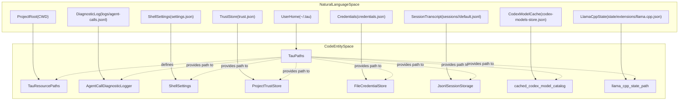

<!-- source: DeepWiki mcp.deepwiki.com · repo huggingface/tau · page 10 Filesystem Layout and Configuration Files · fetched 2026-10-26 -->

# Filesystem Layout and Configuration Files

Relevant source files

The following files were used as context for generating this wiki page:

- [dev-notes/codex-live-model-catalog.md](dev-notes/codex-live-model-catalog.md)
- [src/tau_coding/codex_model_store.py](src/tau_coding/codex_model_store.py)
- [src/tau_coding/data/docs/models.md](src/tau_coding/data/docs/models.md)
- [src/tau_coding/data/docs/tui.md](src/tau_coding/data/docs/tui.md)
- [src/tau_coding/paths.py](src/tau_coding/paths.py)
- [tests/test_codex_model_store.py](tests/test_codex_model_store.py)
- [tests/test_paths.py](tests/test_paths.py)
- [website/content/guides/tui.md](website/content/guides/tui.md)
- [website/content/reference/configuration.md](website/content/reference/configuration.md)
- [website/content/reference/slash-commands.md](website/content/reference/slash-commands.md)

Tau maintains a structured on-disk presence to manage durable user settings, session transcripts, model catalog caches, credentials, and project-specific resources. It follows a "Global Home + Project Local" philosophy, where global configurations in the user's home directory can be augmented or overridden by files within a specific project's directory.

This page provides a high-level overview of Tau's on-disk layout. For detailed specifications, see the child pages:
- [TauPaths and Resource Discovery](#10.1)
- [Shell Configuration and Diagnostics](#10.2)
- [Project Trust and Security](#10.3)

---

## Directory Structure Overview

Tau primarily operates out of two root locations: the global `~/.tau/` directory and project-local `.tau/` or `.agents/` folders [src/tau_coding/paths.py:30-36](). The `TAU_HOME` environment variable can override the default `~/.tau` location [src/tau_coding/paths.py:14-27]().

### Global Configuration (`~/.tau/`)
The global home directory, resolved by the `TauPaths` dataclass [src/tau_coding/paths.py:30-36](), stores application-wide data and caches:
*   **`catalog.toml`**: Optional user-level provider and model catalog overlay [website/content/reference/configuration.md:48-48]().
*   **`providers.json`**: Provider and model preferences [website/content/reference/configuration.md:49-49]().
*   **`models-store.json`**: Refreshed models.dev catalog cache [website/content/reference/configuration.md:50-50]().
*   **`codex-models-store.json`**: Account-scoped OpenAI Codex model snapshot [website/content/reference/configuration.md:51-51]().
*   **`credentials.json`**: Saved API keys and OAuth tokens stored with restrictive permissions [website/content/reference/configuration.md:52-52]().
*   **`state/extensions/`**: Built-in integration state, including `llama.cpp` [website/content/reference/configuration.md:53-53]().
*   **`settings.json`**: General settings (trust default, shell prefix) [website/content/reference/configuration.md:54-54]().
*   **`trust.json`**: Versioned project-input trust decisions [website/content/reference/configuration.md:55-55]().
*   **`tui.json`**: TUI theme, keybindings, and layout [website/content/reference/configuration.md:56-56]().
*   **`sessions/`**: Saved sessions, per project [website/content/reference/configuration.md:57-57]().
*   **`skills/`**: User-level skills [website/content/reference/configuration.md:58-58]().
*   **`prompts/`**: User-level prompt templates [website/content/reference/configuration.md:59-59]().
*   **`themes/`**: User-level TUI themes [website/content/reference/configuration.md:60-60]().
*   **`SYSTEM.md`**: Optional replacement system-prompt base [website/content/reference/configuration.md:61-61]().
*   **`APPEND_SYSTEM.md`**: Optional appended system-prompt instructions [website/content/reference/configuration.md:62-62]().
*   **`AGENTS.md`**: Global project instructions [website/content/reference/configuration.md:63-63]().
*   **`logs/`**: Diagnostics [website/content/reference/configuration.md:64-64]().

### Project-Local Resources
Tau automatically discovers project resources within the active working directory (CWD) when the project is trusted [website/content/reference/configuration.md:117-117]():
*   **`.tau/`**: Project-specific skills, prompts, themes, and system prompt files (`SYSTEM.md`, `APPEND_SYSTEM.md`) [src/tau_coding/paths.py:111-129]().
*   **`.agents/`**: Interoperable directory for agent-level skills and prompts [src/tau_coding/paths.py:103-109]().

### Filesystem Entity Mapping
The following diagram maps high-level filesystem components to their respective code entities.

**Filesystem to Code Entity Mapping**

Sources: [src/tau_coding/paths.py:30-144](), [website/content/reference/configuration.md:47-64](), [src/tau_coding/codex_model_store.py:30-34]()

---

## TauPaths and Resource Discovery

The `TauPaths` class provides a centralized mechanism for resolving file paths across home and project directories [src/tau_coding/paths.py:30-36](). Resource discovery combines global user directories (`~/.tau/`, `~/.agents/`) and project-local directories (`.tau/`, `.agents/`) following strict precedence rules. The `TAU_HOME` environment variable allows users to specify an alternative home directory for isolating configurations and sessions [website/content/reference/configuration.md:12-29]().

For details on path definitions, resource discovery, and precedence order, see [TauPaths and Resource Discovery](#10.1).

Sources: [src/tau_coding/paths.py:30-144](), [website/content/reference/configuration.md:12-29]()

---

## Shell Configuration and Diagnostics

Durable configuration options such as shell command prefixes and headless trust defaults are managed in `settings.json` [website/content/reference/configuration.md:54-54]() via `ShellSettings`. Additionally, Tau logs agent interaction failures and non-fatal resource loading diagnostics into structured diagnostic files, such as `agent-calls.jsonl` [src/tau_coding/paths.py:48-54]().

For details on shell settings, forward-compatible configuration parsing, and diagnostic logging, see [Shell Configuration and Diagnostics](#10.2).

Sources: [website/content/reference/configuration.md:54-54](), [src/tau_coding/paths.py:48-54]()

---

## Project Trust and Security

Tau enforces a project trust model to gate ambient local resources (such as project skills, prompts, and system prompt files) inside untrusted working directories [website/content/reference/configuration.md:117-122](). Trust decisions are persisted atomically in `trust.json` [website/content/reference/configuration.md:55-55]() and managed via TUI prompts or CLI flags (`--approve` / `--no-approve`). The default project trust policy is `ask` [website/content/reference/configuration.md:70-70]().

For details on the trust lifecycle and security boundaries, see [Project Trust and Security](#10.3).

Sources: [website/content/reference/configuration.md:55-55](), [website/content/reference/configuration.md:70-70](), [website/content/reference/configuration.md:117-122]()

---

## Summary of Configuration Components

| Component | File Path | Primary Class / Module |
| :--- | :--- | :--- |
| **Path Resolution** | `src/tau_coding/paths.py` | `TauPaths` [src/tau_coding/paths.py:30-36]() |
| **Diagnostic Log** | `~/.tau/logs/agent-calls.jsonl` | `agent_calls_log_path` [src/tau_coding/paths.py:51-54]() |
| **Session Storage** | `~/.tau/sessions/<project-slug>/default.jsonl` | `default_session_path` [src/tau_coding/paths.py:147-150]() |
| **Shell Config** | `~/.tau/settings.json` | `settings.json` [website/content/reference/configuration.md:54-54]() |
| **Trust Store** | `~/.tau/trust.json` | `trust.json` [website/content/reference/configuration.md:55-55]() |
| **Credentials** | `~/.tau/credentials.json` | `credentials.json` [website/content/reference/configuration.md:52-52]() |
| **Codex Model Cache** | `~/.tau/codex-models-store.json` | `cached_codex_model_catalog` [src/tau_coding/codex_model_store.py:30-34]() |
| **Llama.cpp State** | `~/.tau/state/extensions/llama.cpp.json` | `llama_cpp_state_path` [src/tau_coding/paths.py:77-80]() |

Sources: [src/tau_coding/paths.py:30-150](), [website/content/reference/configuration.md:52-57](), [src/tau_coding/codex_model_store.py:30-34]()

---

