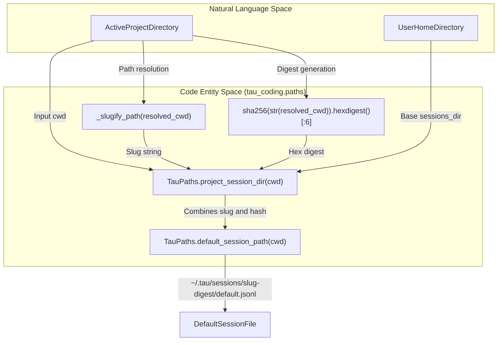
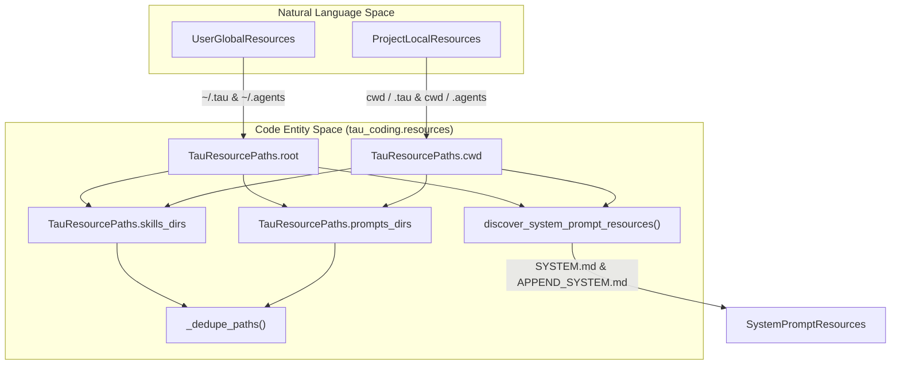

<!-- source: DeepWiki mcp.deepwiki.com · repo huggingface/tau · page 10.1 TauPaths and Resource Discovery · fetched 2026-10-26 -->

# TauPaths and Resource Discovery

Relevant source files

The following files were used as context for generating this wiki page:

- [dev-notes/codex-live-model-catalog.md](dev-notes/codex-live-model-catalog.md)
- [dev-notes/tau-home-profiles.md](dev-notes/tau-home-profiles.md)
- [src/tau_coding/codex_model_store.py](src/tau_coding/codex_model_store.py)
- [src/tau_coding/data/docs/README.md](src/tau_coding/data/docs/README.md)
- [src/tau_coding/data/docs/models.md](src/tau_coding/data/docs/models.md)
- [src/tau_coding/extension_installer.py](src/tau_coding/extension_installer.py)
- [src/tau_coding/paths.py](src/tau_coding/paths.py)
- [src/tau_coding/resources.py](src/tau_coding/resources.py)
- [src/tau_coding/system_prompt.py](src/tau_coding/system_prompt.py)
- [src/tau_coding/tui/themes/__init__.py](src/tau_coding/tui/themes/__init__.py)
- [tests/conftest.py](tests/conftest.py)
- [tests/test_codex_model_store.py](tests/test_codex_model_store.py)
- [tests/test_paths.py](tests/test_paths.py)
- [tests/test_resources.py](tests/test_resources.py)
- [tests/test_system_prompt.py](tests/test_system_prompt.py)

This page details Tau's filesystem organization, focusing on the `TauPaths` dataclass for canonical application data storage, `TauResourcePaths` for resource resolution, project-local `.tau` and `.agents` directories, and the discovery precedence order for skills, prompt templates, and system prompt files.

Sources: [src/tau_coding/paths.py:1-131](), [src/tau_coding/resources.py:49-137]()

## TauPaths: Canonical Filesystem Layout

The `TauPaths` dataclass serves as the central authority for all filesystem locations used by the `tau_coding` application [src/tau_coding/paths.py:11-17](). It manages persistent application state under the user's home directory alongside project-local resources [src/tau_coding/paths.py:15-17]().

### User-Level Directories and Stores
Tau initializes hidden directories in the user's home (`~/.tau/` and `~/.agents/`) to store configuration, transcripts, and caches [src/tau_coding/paths.py:19-20]().

| Property | Path Location | Purpose |
|:---|:---|:---|
| `home` | `Path.home() / ".tau"` | Primary user application data root [src/tau_coding/paths.py:38-38]() |
| `agents_home` | `Path.home() / ".agents"` | User-level shared agent resources root [src/tau_coding/paths.py:39-39]() |
| `sessions_dir` | `home / "sessions"` | Storage root for JSONL session transcripts [src/tau_coding/paths.py:43-45]() |
| `logs_dir` | `home / "logs"` | Storage for diagnostic logs [src/tau_coding/paths.py:48-50]() |
| `agent_calls_log_path` | `logs_dir / "agent-calls.jsonl"` | Detailed JSONL failure log for agent calls [src/tau_coding/paths.py:53-55]() |
| `models_store_path` | `home / "models-store.json"` | Persisted remote model-catalog cache [src/tau_coding/paths.py:58-60]() |
| `codex_version_store_path` | `home / "codex-version-store.json"` | Latest released Codex-version cache [src/tau_coding/paths.py:63-65]() |
| `codex_models_store_path` | `home / "codex-models-store.json"` | Account-scoped Codex model-catalog cache [src/tau_coding/paths.py:68-70]() |
| `extension_state_dir` | `home / "state" / "extensions"` | User-level state directory owned by extensions [src/tau_coding/paths.py:73-75]() |
| `llama_cpp_state_path` | `extension_state_dir / "llama.cpp.json"` | Safe built-in llama.cpp integration state [src/tau_coding/paths.py:78-80]() |
| `user_skills_dir` | `home / "skills"` | User-level markdown skills directory [src/tau_coding/paths.py:83-85]() |
| `user_prompts_dir` | `home / "prompts"` | User-level markdown prompt templates directory [src/tau_coding/paths.py:88-90]() |
| `user_themes_dir` | `home / "themes"` | User-level TUI themes directory [src/tau_coding/paths.py:93-95]() |
| `user_extensions_dir` | `home / "extensions"` | User-level extension installation directory [src/tau_coding/paths.py:98-100]() |
| `user_agents_skills_dir` | `agents_home / "skills"` | User-level `.agents/skills` directory [src/tau_coding/paths.py:103-105]() |
| `user_agents_prompts_dir` | `agents_home / "prompts"` | User-level `.agents/prompts` directory [src/tau_coding/paths.py:108-110]()

Sources: [src/tau_coding/paths.py:30-110]()

### Project-Local Methods and Session Isolation
Project-local paths are resolved relative to an active working directory (`cwd`) [src/tau_coding/paths.py:111-138](). Sessions are isolated per project by combining a slugified directory name with a 6-character SHA256 hash of the absolute resolved `cwd` path [src/tau_coding/paths.py:140-144]().

Sources: [src/tau_coding/paths.py:140-144](), [src/tau_coding/paths.py:153-179]()

## TauResourcePaths and Discovery Precedence

The `TauResourcePaths` dataclass manages the discovery of skills, prompt templates, TUI themes, and system prompt override files across multiple user and project locations [src/tau_coding/resources.py:50-138]().

### Precedence Order
When loading resources, Tau aggregates paths in **increasing precedence order** (later entries override earlier ones or act as cumulative append layers) [src/tau_coding/resources.py:86-133]().

1.  **User Tau**: `~/.tau/skills/`, `~/.tau/prompts/`, `~/.tau/themes/` [src/tau_coding/resources.py:67-69](), [src/tau_coding/resources.py:70-72](), [src/tau_coding/resources.py:113-113]()
2.  **User Agents**: `~/.agents/skills/`, `~/.agents/prompts/` [src/tau_coding/resources.py:95-96](), [src/tau_coding/resources.py:124-125]()
3.  **Project Tau**: `<cwd>/.tau/skills/`, `<cwd>/.tau/prompts/`, `<cwd>/.tau/themes/` [src/tau_coding/paths.py:120-121](), [src/tau_coding/paths.py:123-124](), [src/tau_coding/paths.py:126-127]()
4.  **Project Agents**: `<cwd>/.agents/skills/`, `<cwd>/.agents/prompts/` [src/tau_coding/paths.py:130-131](), [src/tau_coding/paths.py:133-134]()

Sources: [src/tau_coding/resources.py:86-133]()

### System Prompt Discovery
System prompt discovery (`discover_system_prompt_resources`) handles two distinct file types:
*   `SYSTEM.md`: Replacement base prompt file. Precedence selects project `.tau/SYSTEM.md` over user `~/.tau/SYSTEM.md`, unless explicitly overridden via CLI `--system-prompt` [src/tau_coding/resources.py:162-169](). Note that `.agents` directories are excluded from system prompt discovery [tests/test_resources.py:96-97]().
*   `APPEND_SYSTEM.md`: Cumulative append prompt files. These are loaded additively in order: user `~/.tau/APPEND_SYSTEM.md`, project `.tau/APPEND_SYSTEM.md`, followed by explicit CLI `--append-system-prompt` values [tests/test_resources.py:105-110]().

Sources: [src/tau_coding/resources.py:153-181](), [tests/test_resources.py:85-116]()

Sources: [src/tau_coding/resources.py:50-138](), [src/tau_coding/resources.py:153-181]()

## Resource Diagnostics and Tolerant Loading

Tau implements tolerant resource discovery via `ResourceDiagnostic` records rather than failing immediately on non-fatal issues (such as shadowed files, missing optional directories, or migration hints) [src/tau_coding/resources.py:29-47]().

### ResourceDiagnostic Structure
The `ResourceDiagnostic` dataclass captures metadata about discovery events:
*   `kind`: Categorization string (e.g. `"replacement"`, `"append"`, `"skill"`) [src/tau_coding/resources.py:32-32]().
*   `message`: Human-readable explanation [src/tau_coding/resources.py:33-33]().
*   `path`: Associated filesystem `Path` if applicable [src/tau_coding/resources.py:34-34]().
*   `name`: Resource or entity name [src/tau_coding/resources.py:35-35]().
*   `severity`: Diagnostic level, defaulting to `"warning"` or `"info"` [src/tau_coding/resources.py:36-36]().

Selected system prompt files and resource files must be valid UTF-8 strings; unreadable or binary files raise a `ResourceError` during startup or reload to prevent silent misconfiguration [tests/test_resources.py:153-170]().

Sources: [src/tau_coding/resources.py:12-47](), [tests/test_resources.py:153-170]()

---

