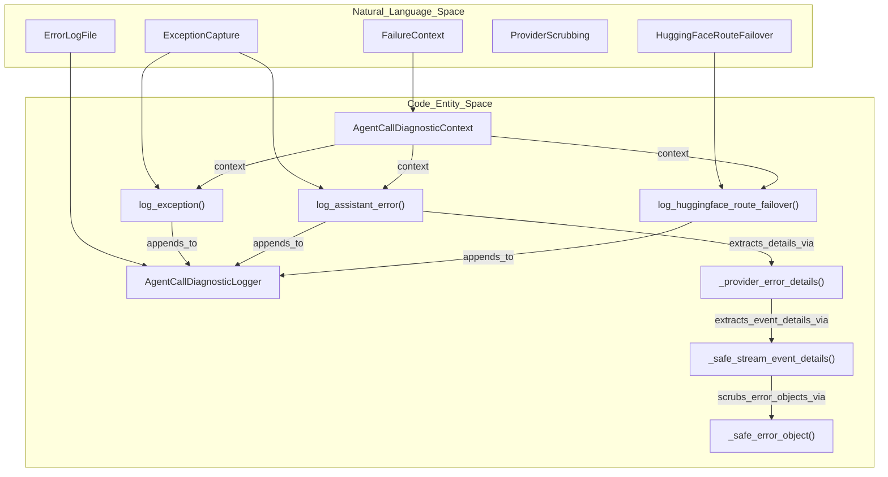
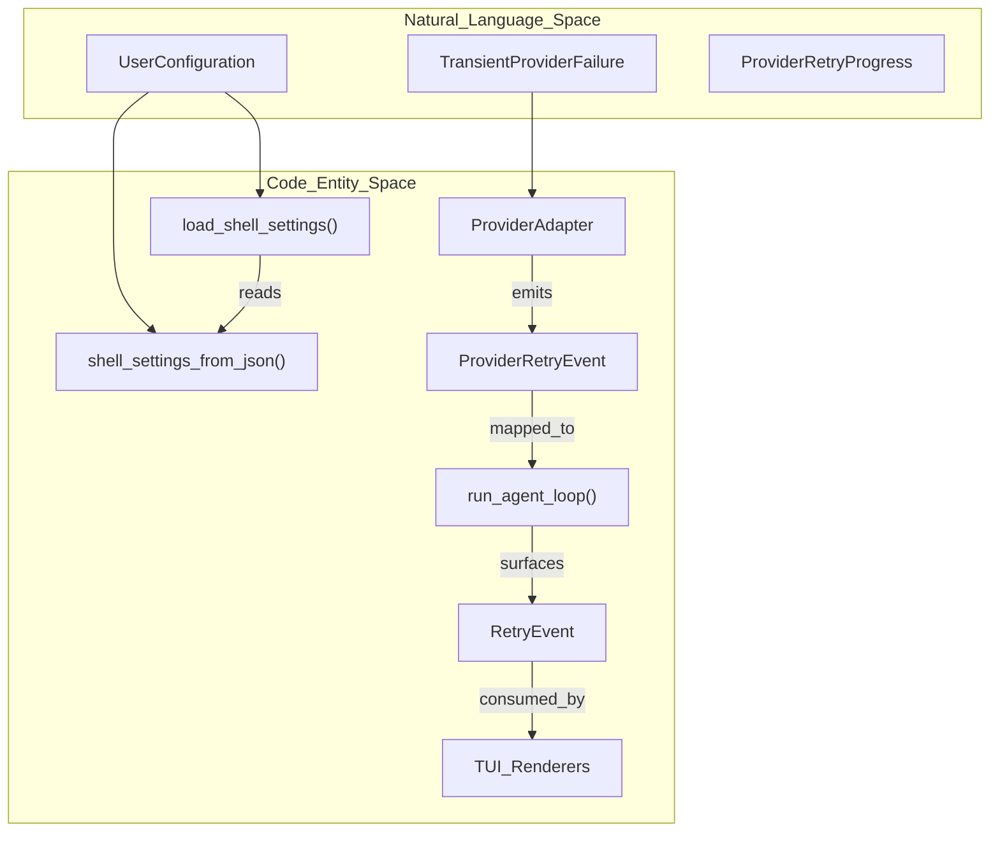

<!-- source: DeepWiki mcp.deepwiki.com · repo huggingface/tau · page 10.2 Shell Configuration and Diagnostics · fetched 2026-10-26 -->

# Shell Configuration and Diagnostics

Relevant source files

The following files were used as context for generating this wiki page:

- [dev-notes/anthropic-stream-error-recovery.md](dev-notes/anthropic-stream-error-recovery.md)
- [dev-notes/architecture/provider-retries.md](dev-notes/architecture/provider-retries.md)
- [dev-notes/architecture/user-config-forward-compatibility.md](dev-notes/architecture/user-config-forward-compatibility.md)
- [dev-notes/codex-stream-error-recovery.md](dev-notes/codex-stream-error-recovery.md)
- [src/tau_coding/diagnostics.py](src/tau_coding/diagnostics.py)
- [src/tau_coding/shell_config.py](src/tau_coding/shell_config.py)
- [tests/test_shell_config.py](tests/test_shell_config.py)

This page covers the configuration of the shell environment for tool execution, forward-compatible user configuration parsing, structured agent-call diagnostic logging, provider retry diagnostics, and non-fatal resource diagnostics for shadowed skills and prompt templates.

## Shell Configuration

Tau allows users to configure the shell environment used by the `bash` tool [src/tau_coding/shell_config.py:1-1](). This is managed via `shell_config.py`, which handles loading and parsing durable shell settings from the user's home directory [src/tau_coding/shell_config.py:1-12]().

### ShellSettings and Loading

The `ShellSettings` class stores configuration used during terminal command execution [src/tau_coding/shell_config.py:18-21](). Its primary field is `shell_command_prefix`, which injects initialization commands (such as aliases or environment exports) before any agent-requested command runs [src/tau_coding/shell_config.py:21-21](). It also manages `default_project_trust` settings to control whether Tau asks for permission before executing commands in specific project directories [src/tau_coding/shell_config.py:23-23]().

Settings are stored in `~/.tau/settings.json` [src/tau_coding/shell_config.py:35-37](). The `load_shell_settings()` function reads this file and returns a `ShellSettings` object, falling back to built-in defaults if the file is missing [src/tau_coding/shell_config.py:40-44]().

| Function / Class | Description |
| :--- | :--- |
| `load_shell_settings(paths)` | Loads settings from `settings.json` or returns default `ShellSettings` [src/tau_coding/shell_config.py:40-51](). |
| `shell_settings_from_json(data)` | Validates and parses a dictionary into `ShellSettings`. Supports both camelCase (`shellCommandPrefix`) and snake_case (`shell_command_prefix`) keys [src/tau_coding/shell_config.py:54-74](). |
| `ShellSettings.to_json()` | Serializes current settings back to a JSON-compatible dictionary using camelCase [src/tau_coding/shell_config.py:25-32](). |

**Sources:** [src/tau_coding/shell_config.py:1-74](), [tests/test_shell_config.py:1-49]()

## Forward-Compatible User Configuration

Tau enforces a strict forward-compatibility principle for user-level configuration files [dev-notes/architecture/user-config-forward-compatibility.md:1-10](). To prevent newer Tau releases from breaking older installations when writing new fields, parsers for durable user configuration ignore unknown or unrecognized fields [dev-notes/architecture/user-config-forward-compatibility.md:11-15]().

### Covered Files and Behaviors
*   **`~/.tau/settings.json`**: Handled by `shell_settings_from_json()`, which ignores unknown top-level keys while strictly validating recognized fields like `defaultProjectTrust` and `shellCommandPrefix` [src/tau_coding/shell_config.py:54-74](), [dev-notes/architecture/user-config-forward-compatibility.md:5-10]().
*   **`~/.tau/tui.json`**: Ignores unknown top-level settings and nested keybinding actions [dev-notes/architecture/user-config-forward-compatibility.md:5-10]().
*   **`~/.tau/providers.json`**: Ignores unknown top-level settings and nested provider-preference fields [dev-notes/architecture/user-config-forward-compatibility.md:5-10]().

Catalog configuration (`~/.tau/catalog.toml`) and custom theme JSON remain strictly validated because they govern provider security routing, endpoints, and rendering integrity [dev-notes/architecture/user-config-forward-compatibility.md:37-45]().

**Sources:** [src/tau_coding/shell_config.py:54-74](), [dev-notes/architecture/user-config-forward-compatibility.md:1-61]()

## Agent Call Diagnostic Logging

When an LLM call fails or an agent loop encounters an error, Tau records structured diagnostics to a central log file (`~/.tau/logs/agent-calls.jsonl`) [src/tau_coding/diagnostics.py:28-37](). This allows post-mortem analysis without exposing sensitive credentials or large request bodies [src/tau_coding/diagnostics.py:110-117]().

### AgentCallDiagnosticLogger and Context

The `AgentCallDiagnosticLogger` manages writing structured JSONL entries [src/tau_coding/diagnostics.py:28-33](). It is instantiated via `AgentCallDiagnosticLogger.from_paths()` [src/tau_coding/diagnostics.py:34-37]().

Context for a run is captured in `AgentCallDiagnosticContext`, which contains non-secret metadata: `provider_name`, `model`, `cwd`, `session_id`, and a unique `run_id` generated by `new_agent_call_run_id()` [src/tau_coding/diagnostics.py:18-27](), [src/tau_coding/diagnostics.py:102-104]().

### Logging Methods

*   `log_exception()`: Captures unexpected Python exceptions with traceback details [src/tau_coding/diagnostics.py:39-54]().
*   `log_assistant_error()`: Captures terminal `AssistantMessage` errors along with scrubbed provider error details [src/tau_coding/diagnostics.py:56-74]().
*   `log_huggingface_route_failover()`: Records automatic Hugging Face route failovers [src/tau_coding/diagnostics.py:76-94]().

### Payload Scrubbing

To keep log entries small and secure, `_provider_error_details()` and `_safe_stream_event_details()` strip large raw event payloads, preserving only scalar classification keys (`type`, `code`, `message`, `param`, `sequence_number`, `status_code`, `attempts`) [src/tau_coding/diagnostics.py:110-166]().

**Diagnostic Logging Architecture**

**Sources:** [src/tau_coding/diagnostics.py:1-183](), [dev-notes/codex-stream-error-recovery.md:1-58]()

## Provider Retry Diagnostics and Recovery

Tau distinguishes between transient and terminal provider failures. Transient failures (such as rate limits or server overloads) are retried inside `tau_ai` before surfacing an error to `tau_agent` [dev-notes/architecture/provider-retries.md:5-7]().

### Retry Mechanics

*   **HTTP Status Codes**: OpenAI-compatible, Anthropic, and OpenAI Codex providers retry transient status codes such as `408`, `409`, `429`, and `5xx` [dev-notes/architecture/provider-retries.md:20-23]().
*   **In-Stream Failures**: Anthropic and OpenAI Codex adapters also intercept transient in-stream Server-Sent Events (SSE) errors (such as Anthropic's `api_error`, `overloaded_error`, `rate_limit_error`, or Codex service unavailable errors) [dev-notes/anthropic-stream-error-recovery.md:5-8](), [dev-notes/codex-stream-error-recovery.md:16-19]().
*   **Progress Events**: Provider adapters emit `ProviderRetryEvent`, which `run_agent_loop()` maps to a portable `RetryEvent` consumed by UI renderers [dev-notes/architecture/provider-retries.md:11-17]().

**Configuration and Retry Flow**

**Sources:** [dev-notes/architecture/provider-retries.md:1-52](), [dev-notes/anthropic-stream-error-recovery.md:1-39](), [dev-notes/codex-stream-error-recovery.md:1-58]()

## Resource Diagnostics and Startup Alerts

Tau supports user and project resources under both `.tau` and `.agents` directories [dev-notes/resource-conflict-startup-alert.md:1-9](). When duplicate resource names occur across directories, precedence rules keep the duplication non-fatal, but diagnostics record the winning and shadowed paths [dev-notes/resource-conflict-startup-alert.md:5-9]().

### ResourceDiagnostic Handling

*   Discovery modules in `tau_coding.skills` and `tau_coding.prompt_templates` record conflicts as `ResourceDiagnostic` objects [dev-notes/resource-conflict-startup-alert.md:11-13]().
*   The Textual TUI adapter translates these resource diagnostics into a prominent red startup alert block inside the transcript view [dev-notes/resource-conflict-startup-alert.md:5-8]().
*   The sidebar groups loaded skills and prompt templates by resource directory, allowing users to inspect all active resources independently [dev-notes/resource-conflict-startup-alert.md:5-8]().

**Sources:** [dev-notes/resource-conflict-startup-alert.md:1-22]()

---

