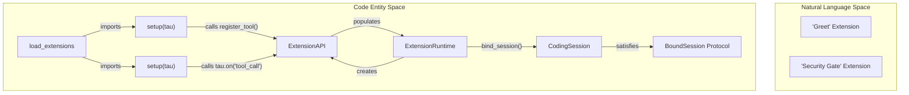
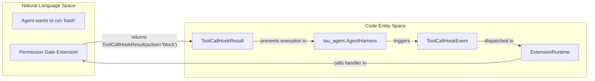

<!-- source: DeepWiki mcp.deepwiki.com · repo huggingface/tau · page 11 Extensions · fetched 2026-10-26 -->

# Extensions

Relevant source files

The following files were used as context for generating this wiki page:

- [dev-notes/architecture/phase-21-extensions.md](dev-notes/architecture/phase-21-extensions.md)
- [src/tau_coding/data/docs/extensions.md](src/tau_coding/data/docs/extensions.md)
- [src/tau_coding/extensions/api.py](src/tau_coding/extensions/api.py)
- [src/tau_coding/extensions/runtime.py](src/tau_coding/extensions/runtime.py)
- [tests/test_extensions.py](tests/test_extensions.py)
- [website/content/guides/extensions.md](website/content/guides/extensions.md)

Tau extensions are Python modules that customize a coding session. They allow developers to add custom tools, define new slash commands, observe the agent's event stream, and intercept lifecycle events such as tool calls or user input [website/content/guides/extensions.md:6-9]().

The extension system is designed to keep the core `tau_agent` package untouched by living entirely within `tau_coding`, utilizing existing seams like `AgentHarness.subscribe`, executor wrapping, and the `CommandRegistry` [dev-notes/architecture/phase-21-extensions.md:26-28]().

## System Overview

The extension architecture consists of a discovery mechanism, a loading process that isolates modules, and a runtime that bridges these extensions to an active `CodingSession`.

### Extension Discovery and Precedence
Extensions are discovered in three primary locations, with a specific precedence order where the first-registered name wins (project-first) [dev-notes/architecture/phase-21-extensions.md:61-63]():
1. **Project Extensions**: Located in `<cwd>/.tau/extensions/`. These are disabled by default and require both project approval and the `--project-extensions` flag [website/content/guides/extensions.md:86-88]().
2. **User Extensions**: Located in `~/.tau/extensions/`.
3. **Explicit Paths**: Provided via the `tau -e PATH` CLI flag.

### The Extension Lifecycle
Extensions are managed by the `ExtensionRuntime` [src/tau_coding/extensions/runtime.py:181-186](). A runtime is tied to a session's lifecycle; when a session is reloaded via `/reload`, the current `ExtensionGeneration` is invalidated, and all extension modules are re-imported and re-initialized to ensure a clean state [website/content/guides/extensions.md:149-153]().

For details on discovery logic, directory structures, and the runtime lifecycle, see [Extension Runtime and Discovery](#11.2).

Sources: [website/content/guides/extensions.md:6-88](), [src/tau_coding/extensions/runtime.py:181-186](), [dev-notes/architecture/phase-21-extensions.md:26-63]()

## Extension API

Every extension must define a `setup(tau: ExtensionAPI)` function [website/content/guides/extensions.md:42-43](). This function is a synchronous entry point where the extension registers its capabilities [dev-notes/architecture/phase-21-extensions.md:114-115]().

### Key Capabilities
*   **Tools**: Extensions can register `AgentTool` objects via `tau.register_tool()`, adding custom capabilities [website/content/guides/extensions.md:163-164]().
*   **Commands**: Custom slash commands are added via `tau.register_command()`, which integrates them into the TUI's command registry and autocomplete [dev-notes/architecture/phase-21-extensions.md:6-7]().
*   **Hooks**: Extensions can intercept and mutate events using `tau.on()`. Key lifecycle hooks include `input`, `tool_call`, and `tool_result` [src/tau_coding/extensions/api.py:51-60]().
*   **UI Components**: Extensions can mount Textual widgets into host-owned slots or open custom views [src/tau_coding/extensions/api.py:122-139]().
*   **Sticky Routing**: Extensions can pin specific inference providers using `tau.set_inference_provider()` [src/tau_coding/data/docs/extensions.md:8-9]().

For a full reference of available hooks, UI bridges, and API methods, see [Extension API and Hook Types](#11.1).

Sources: [website/content/guides/extensions.md:42-164](), [src/tau_coding/extensions/api.py:51-139](), [src/tau_coding/data/docs/extensions.md:8-9](), [dev-notes/architecture/phase-21-extensions.md:6-115]()

## Conceptual Mapping

The following diagrams illustrate how the extension system bridges high-level user concepts to the underlying code entities.

### Extension Registration Flow
This diagram shows how the `setup` entry point populates the `ExtensionRuntime`, which then binds to the `CodingSession` via the `BoundSession` protocol.

Sources: [src/tau_coding/extensions/runtime.py:91-147](), [src/tau_coding/extensions/runtime.py:181-200](), [src/tau_coding/extensions/loader.py:66-71](), [website/content/guides/extensions.md:26-40]()

### Event Interception Architecture
This diagram demonstrates how a `ToolCallHookEvent` flows from the `AgentHarness` through the `ExtensionRuntime` for interception before execution.

Sources: [src/tau_coding/extensions/runtime.py:1-10](), [src/tau_coding/extensions/api.py:51-60](), [dev-notes/architecture/phase-21-extensions.md:23-28]()

## Child Pages
*   [Extension API and Hook Types](#11.1) — Documents the `ExtensionAPI` surface (`register_tool`, `register_command`, `register_provider`, `register_local_backend`, `register_message_renderer`, prompt sections, `on()`), hook payload types, `ExtensionGeneration`, UI bridges, and `ComponentBridge`/sidebar slots.
*   [Extension Runtime and Discovery](#11.2) — Covers `ExtensionRuntime` lifecycle (`load`, `bind_session`, `reset_for_reload`, `shutdown`), `extension_dirs()` precedence, `pyproject [tool.tau]` manifests, `setup(tau)` convention, tool composition, and diagnostics isolation.
*   [Example Extensions and the Installer](#11.3) — Walks through `examples/extensions` and bundled data examples, plus `extension_installer.py` and the `tau install` command for trusted local/Git extension installation.

Sources: [website/content/guides/extensions.md:1-165](), [src/tau_coding/extensions/runtime.py:1-216](), [src/tau_coding/extensions/api.py:1-169](), [dev-notes/architecture/phase-21-extensions.md:1-135]()

---

