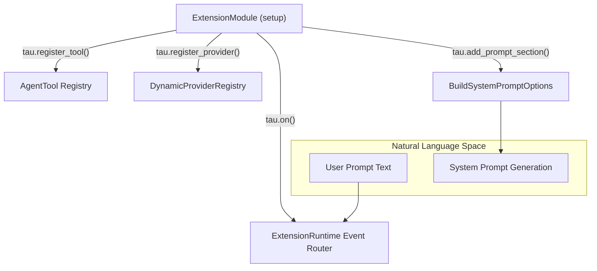
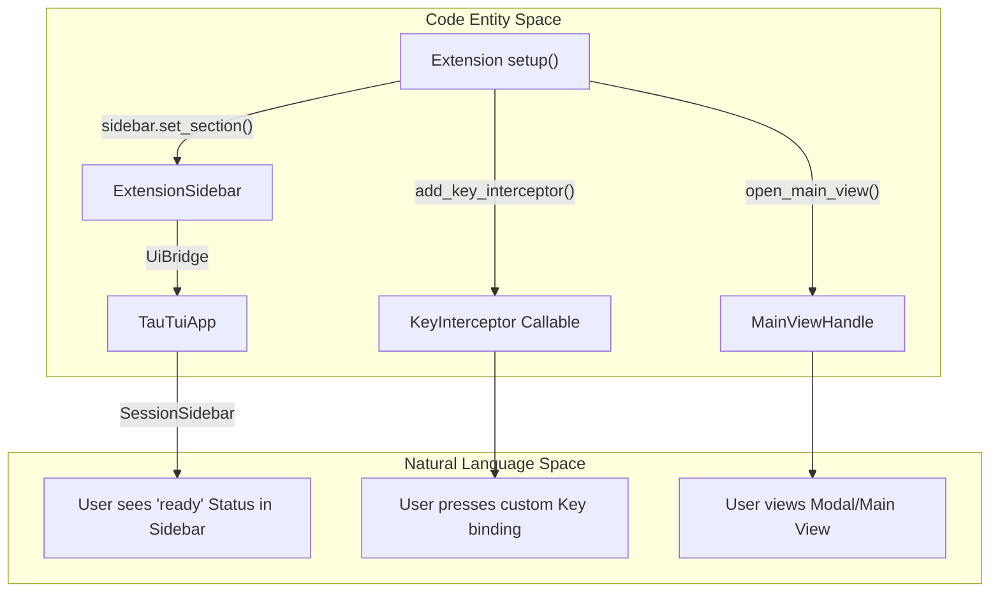
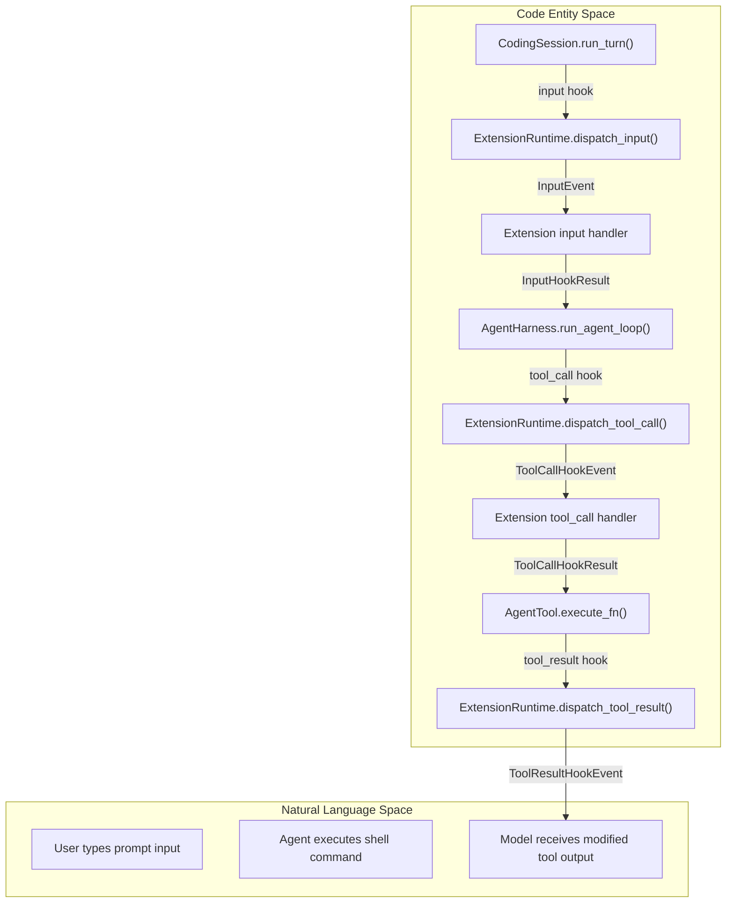

<!-- source: DeepWiki mcp.deepwiki.com · repo huggingface/tau · page 11.1 Extension API and Hook Types · fetched 2026-10-26 -->

# Extension API and Hook Types

<details>
<summary>Relevant source files</summary>

The following files were used as context for generating this wiki page:

- [dev-notes/architecture/phase-21-extensions.md](dev-notes/architecture/phase-21-extensions.md)
- [dev-notes/extension-session-metadata.md](dev-notes/extension-session-metadata.md)
- [dev-notes/extension-sidebar-sections.md](dev-notes/extension-sidebar-sections.md)
- [examples/extensions/sidebar_status.py](examples/extensions/sidebar_status.py)
- [src/tau_coding/data/docs/extensions.md](src/tau_coding/data/docs/extensions.md)
- [src/tau_coding/data/examples/extensions/sidebar_status.py](src/tau_coding/data/examples/extensions/sidebar_status.py)
- [src/tau_coding/extensions/__init__.py](src/tau_coding/extensions/__init__.py)
- [src/tau_coding/extensions/api.py](src/tau_coding/extensions/api.py)
- [src/tau_coding/extensions/runtime.py](src/tau_coding/extensions/runtime.py)
- [tests/test_extensions.py](tests/test_extensions.py)
- [tests/test_tui_components.py](tests/test_tui_components.py)
- [website/content/guides/extensions.md](website/content/guides/extensions.md)

</details>


This page documents the `ExtensionAPI` surface, hook payload types, `ExtensionGeneration` semantics, UI bridges, and the `ComponentBridge`/sidebar slot architecture in Tau [website/content/guides/extensions.md:6-10]().

## Overview of the Extension API

The `ExtensionAPI` protocol provides the primary integration surface for Python extensions. Every extension module defines a synchronous `setup(tau: ExtensionAPI)` function that executes during startup or session reload [website/content/guides/extensions.md:42-44](), [dev-notes/architecture/phase-21-extensions.md:111-116]().

### ExtensionAPI Registration Methods

| Method | Role / Description |
| :--- | :--- |
| `register_tool(tool)` | Registers an `AgentTool` instance (`tau_agent.tools.AgentTool`) [website/content/guides/extensions.md:164-164](). |
| `register_command(...)` | Adds a custom slash command to the command registry [website/content/guides/extensions.md:105-105](). |
| `register_provider(provider)` | Adds a process-local dynamic model provider (`DynamicProvider`) [website/content/guides/extensions.md:165-165](), [src/tau_coding/data/docs/extensions.md:101-105](). |
| `register_local_backend(...)` | Registers a local backend integration for model management or execution [src/tau_coding/extensions/__init__.py:97-97](). |
| `register_message_renderer(...)` | Registers a `MessageRenderer` callback for custom message cards [src/tau_coding/data/docs/extensions.md:4-6](). |
| `add_prompt_section(title, body)` | Appends structured, always-on Markdown instructions to the system prompt [src/tau_coding/data/docs/extensions.md:28-30](). |
| `add_prompt_guideline(text)` | Adds a single behavioral bullet point to the system prompt guidelines [src/tau_coding/data/docs/extensions.md:27-28](). |
| `on(event, handler)` | Subscribes an extension handler to lifecycle hooks or agent events [dev-notes/architecture/phase-21-extensions.md:20-22](). |

**Diagram: Extension Registration Architecture**

**Sources:** [website/content/guides/extensions.md:162-165](), [src/tau_coding/extensions/api.py:22-60](), [dev-notes/architecture/phase-21-extensions.md:20-28]()

---

## Hook Types and Event Payloads

Tau classifies extension hooks into two distinct categories: read-only **Agent Events** (`AGENT_EVENT_TYPES`) and intercepting **Lifecycle Hooks** (`LIFECYCLE_EVENT_TYPES`) [src/tau_coding/extensions/api.py:26-60]().

### Agent Event Types (`AGENT_EVENT_TYPES`)
Observed via `tau.on("agent_event", handler)` or specific event names like `agent_start`, `turn_start`, `message_update`, `tool_execution_start`, `compaction_start`, and `thinking_level_changed` [src/tau_coding/extensions/api.py:26-48](). These payloads are read-only notifications emitted by `AgentHarness` [dev-notes/architecture/phase-21-extensions.md:26-28]().

### Lifecycle Hook Types (`LIFECYCLE_EVENT_TYPES`)
These hooks allow extensions to intercept, mutate, or control agent actions:

| Hook Type | Payload / Handler Signature | Description |
| :--- | :--- | :--- |
| `input` | `Callable[[InputEvent], Awaitable[InputHookResult \| None]]` | Intercepts user prompt text before tokenization [src/tau_coding/extensions/api.py:55-55](). |
| `tool_call` | `Callable[[ToolCallHookEvent], Awaitable[ToolCallHookResult \| None]]` | Intercepts tool execution; can block or mutate arguments [src/tau_coding/extensions/api.py:56-56](). |
| `tool_result` | `Callable[[ToolResultHookEvent], Awaitable[ToolResultHookResult \| None]]` | Transforms tool execution output before LLM ingestion [src/tau_coding/extensions/api.py:57-57](). |
| `session_start` | `Callable[[SessionStartEvent], Awaitable[None]]` | Triggered when a session starts, resumes, or reloads [src/tau_coding/extensions/api.py:53-53](). |
| `session_shutdown` | `Callable[[SessionShutdownEvent], Awaitable[None]]` | Triggered during session teardown or reload cleanup [src/tau_coding/extensions/api.py:54-54](). |
| `project_trust` | `Callable[[ProjectTrustEvent], Awaitable[ExtensionTrustResult]]` | Evaluates trust approval for project-local extensions [src/tau_coding/extensions/api.py:58-58](). |

**Sources:** [src/tau_coding/extensions/api.py:26-60](), [src/tau_coding/extensions/runtime.py:30-65]()

---

## ExtensionGeneration and State Isolation

Each loaded set of extensions belongs to an immutable `ExtensionGeneration` managed by `ExtensionRuntime` [src/tau_coding/extensions/runtime.py:180-200]().

When `/reload` or a session branch occurs, Tau stages a fresh extension runtime generation. Once initialization succeeds, the outgoing generation is retired [src/tau_coding/extensions/runtime.py:180-186]():
*   **Stale Context Protection:** Accessing properties on a context captured from a retired generation raises an `ExtensionError` [src/tau_coding/data/docs/extensions.md:96-99]().
*   **Resource Cleanup:** Retiring a generation unregisters all tools, commands, prompt sections, and cancels generation-owned dynamic provider tasks [website/content/guides/extensions.md:108-110]().

**Sources:** [src/tau_coding/extensions/runtime.py:180-210](), [src/tau_coding/data/docs/extensions.md:96-99]()

---

## UI Bridges, Component Seam, and Sidebar Slots

The `UiBridge` protocol decouples the extension runtime from frontend presentation (`_TuiExtensionUiBridge` for TUI mode, `StderrUiBridge` for print mode) [src/tau_coding/extensions/api.py:214-230](), [src/tau_coding/extensions/runtime.py:50-65]().

### ComponentBridge and Slot Widgets
Extensions interact with the TUI layout via `context.ui.components` (`ComponentBridge`):
*   **Slot Widgets (`set_slot_widget`)**: Mounts widget factories or static lines into `"above_prompt"` or `"below_prompt"` slots [src/tau_coding/extensions/api.py:122-132](), [tests/test_tui_components.py:30-42]().
*   **Main Views (`open_main_view`)**: Opens full-screen interactive views in the main content pane via a `MainViewHandle` [src/tau_coding/extensions/api.py:136-170](), [tests/test_tui_components.py:69-90]().
*   **Key Interceptors (`add_key_interceptor`)**: Subscribes a `KeyInterceptor` callback to capture keystrokes pre-dispatch [src/tau_coding/extensions/api.py:143-145]().

### Sidebar Sections
Extensions can add host-framed sections to the session sidebar using `context.ui.sidebar`:
```python
sidebar = getattr(context.ui, "sidebar", None)
if sidebar is not None and sidebar.supported:
    sidebar.set_section("status", title="build", content=["[green]ready[/green]"])
```
Keys are scoped per extension, allowing multiple extensions to manage sidebar sections safely [dev-notes/extension-sidebar-sections.md:12-32]().

**Diagram: Natural Language to Code Entity Space (UI & Slots)**

**Sources:** [src/tau_coding/extensions/api.py:122-170](), [tests/test_tui_components.py:30-90](), [dev-notes/extension-sidebar-sections.md:10-55]()

---

## Data Flow: Interception and Eventing

The execution flow between the agent loop, runtime, and hooks is coordinated by `ExtensionRuntime`.

**Diagram: Natural Language to Code Entity Space (Event Hook Pipeline)**

**Sources:** [src/tau_coding/extensions/runtime.py:180-250](), [src/tau_coding/extensions/api.py:53-60]()

---

