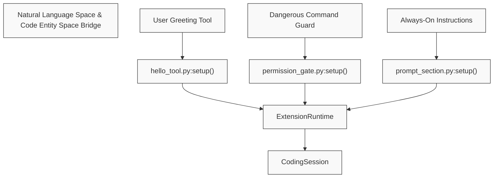
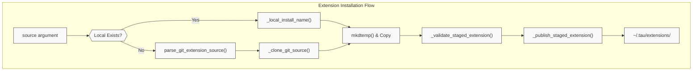

<!-- source: DeepWiki mcp.deepwiki.com · repo huggingface/tau · page 11.3 Example Extensions and the Installer · fetched 2026-10-26 -->

# Example Extensions and the Installer

Relevant source files

The following files were used as context for generating this wiki page:

- [dev-notes/architecture/extension-installer.md](dev-notes/architecture/extension-installer.md)
- [dev-notes/extension-prompt-sections.md](dev-notes/extension-prompt-sections.md)
- [examples/extensions/prompt_section.py](examples/extensions/prompt_section.py)
- [src/tau_coding/data/examples/extensions/prompt_section.py](src/tau_coding/data/examples/extensions/prompt_section.py)
- [tests/test_example_extensions.py](tests/test_example_extensions.py)
- [tests/test_extension_installer.py](tests/test_extension_installer.py)
- [tests/test_package_metadata.py](tests/test_package_metadata.py)

This page covers Tau's shipped example extensions in `examples/extensions/` and bundled package data, as well as the implementation of the extension installer (`src/tau_coding/extension_installer.py`) and the `tau install` command [dev-notes/architecture/extension-installer.md:7-12](). These utilities enable users to discover, test, and install trusted local or Git-based extensions into Tau's user extension directory (`~/.tau/extensions/`).

---

## 1. Shipped Example Extensions and Bundled Data

Tau ships with several reference extensions demonstrating different capabilities of the `ExtensionAPI`, such as registering custom tools, intercepting tool executions for permission gates, adding persistent system prompt sections, and contributing status badges to the TUI sidebar [tests/test_example_extensions.py:65-83]().

### Reference Implementations
- **`hello_tool.py`**: Registers a simple `hello` tool that takes an optional `who` parameter and returns a greeting [tests/test_example_extensions.py:68-100]().
- **`permission_gate.py`**: Intercepts tool calls (specifically wrapping the `bash` tool) to block dangerous shell patterns such as `rm -rf`, force-pushes, or hard resets, while passing through safe commands [tests/test_example_extensions.py:69-157]().
- **`prompt_section.py`**: Uses `tau.add_prompt_section()` to inject structured, always-on instructions (such as review procedures and test commands) into the system prompt [src/tau_coding/data/examples/extensions/prompt_section.py:1-19](), [dev-notes/extension-prompt-sections.md:7-16]().
- **`sidebar_status.py`**: Interacts with the TUI component bridge to display custom metrics or status badges in the sidebar.

These example files are duplicated in the repository root (`examples/extensions/`) for developers and bundled in package data (`src/tau_coding/data/examples/extensions/`) so they remain accessible to installed packages [tests/test_package_metadata.py:10-16]().

**Sources:** `tests/test_example_extensions.py:65-158]`, `src/tau_coding/data/examples/extensions/prompt_section.py:1-20]`, `dev-notes/extension-prompt-sections.md:7-38]`

---

## 2. The Extension Installer Architecture

The extension installer is implemented in `src/tau_coding/extension_installer.py` [dev-notes/architecture/extension-installer.md:84-84](). It provides a robust, atomic installation flow for local files, local package directories, and remote Git repositories.

### Key Functions and Data Structures
- **`install_extension()`**: Main entry point that parses sources, stages files in a temporary directory, validates the package layout, and publishes it to `destination_root` (`~/.tau/extensions/`) [tests/test_extension_installer.py:22-22]().
- **`GitExtensionSource`**: Dataclass holding the normalized Git repository `url`, optional checkout `ref`, and repository `name` [tests/test_extension_installer.py:96-100]().
- **`parse_git_extension_source()`**: Parses Pi-style Git sources (e.g., `git:github.com/owner/repo@ref` or direct URLs) [tests/test_extension_installer.py:116-119]().
- **`ExtensionInstallError`**: Custom exception raised when an extension source cannot be parsed, cloned, validated, or published safely [tests/test_extension_installer.py:9-9]().

**Sources:** `tests/test_extension_installer.py:17-182]`, `dev-notes/architecture/extension-installer.md:84-84]`

---

## 3. Validation, Staging, and Security Boundary

To prevent malformed or improperly structured packages from breaking Tau at startup, `install_extension()` enforces strict layout validation during staging [dev-notes/architecture/extension-installer.md:52-68]().

### Staging and Validation Rules
1. **Local Files**: Single Python files must end with a `.py` extension [tests/test_extension_installer.py:18-29]().
2. **Local Directories**: Directories must contain an `extension.py` file or explicitly declare entrypoints via `[tool.tau].extensions` in `pyproject.toml` [tests/test_extension_installer.py:31-50](). Loose directories of Python files without manifests are rejected to guarantee compatibility with normal user-directory discovery [dev-notes/architecture/extension-installer.md:60-64]().
3. **Atomic Publication**: Staging occurs within a temporary directory located on the same filesystem as the destination, allowing a safe, atomic rename (`shutil.move` / publication) [dev-notes/architecture/extension-installer.md:64-68](). If `--force` is specified, existing extensions are overwritten; otherwise, `ExtensionInstallError` is raised [tests/test_extension_installer.py:65-90]().

### Security Model
The installer acts as a convenience mechanism rather than a sandbox [dev-notes/architecture/extension-installer.md:74-79](). Installed extension code executes directly inside the Tau process with the user's ambient privileges, filesystem access, network permissions, and API credentials [dev-notes/architecture/extension-installer.md:75-79](). Users must audit third-party sources prior to invocation.

**Sources:** `tests/test_extension_installer.py:18-90]`, `dev-notes/architecture/extension-installer.md:44-79]`

---

