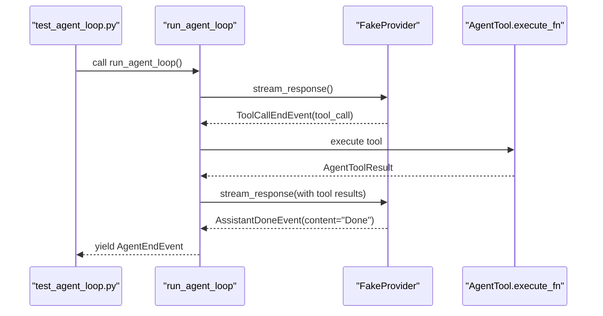
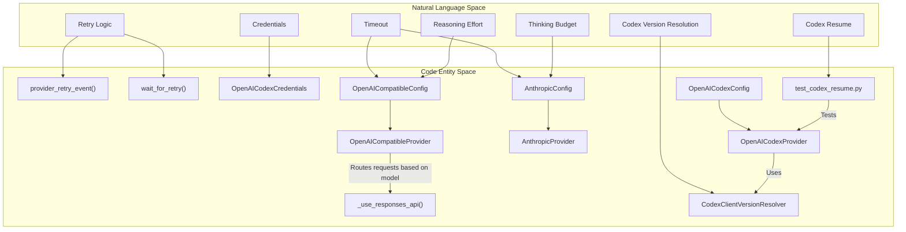

<!-- source: DeepWiki mcp.deepwiki.com · repo huggingface/tau · page 12.1 Agent and Provider Tests · fetched 2026-10-26 -->

# Agent and Provider Tests

Relevant source files

The following files were used as context for generating this wiki page:

- [src/tau_agent/harness.py](src/tau_agent/harness.py)
- [src/tau_ai/__init__.py](src/tau_ai/__init__.py)
- [src/tau_ai/anthropic.py](src/tau_ai/anthropic.py)
- [src/tau_ai/env.py](src/tau_ai/env.py)
- [src/tau_ai/model_catalog.py](src/tau_ai/model_catalog.py)
- [src/tau_ai/openai_codex.py](src/tau_ai/openai_codex.py)
- [src/tau_ai/openai_compatible.py](src/tau_ai/openai_compatible.py)
- [src/tau_coding/codex_version.py](src/tau_coding/codex_version.py)
- [tests/test_agent_harness.py](tests/test_agent_harness.py)
- [tests/test_anthropic_sse.py](tests/test_anthropic_sse.py)
- [tests/test_anthropic_usage.py](tests/test_anthropic_usage.py)
- [tests/test_codex_resume.py](tests/test_codex_resume.py)
- [tests/test_codex_version.py](tests/test_codex_version.py)
- [tests/test_tau_ai.py](tests/test_tau_ai.py)

The testing infrastructure for the agent and provider layers ensures the reliability of the core "brain" and its communication with Large Language Models (LLMs). These tests focus on the state machine of the agent loop, the protocol-level correctness of provider adapters, strict message schema validation, usage and streaming (SSE) parsing, Codex version resolution, and the robustness of the `AgentHarness`.

## FakeProvider and Scripted Replays

The `FakeProvider` class is the primary utility for testing the agent layer without making actual network requests. It allows developers to define a sequence of `AssistantMessageEvent` streams that are "replayed" in order as the agent makes calls to the model [src/tau_ai/fake.py:11-16]().

### Data Flow in FakeProvider
The `FakeProvider` records every call made to `stream_response` in its `calls` list, capturing the model name, system prompt, message history, and available tools [src/tau_ai/fake.py:20-32](). This allows assertions on whether the agent is correctly updating its transcript before the next turn [tests/test_tau_ai.py:90-91]().

| Feature | Implementation |
| :--- | :--- |
| **Scripting** | Accepts an iterable of event streams (iterables of `AssistantMessageEvent`) [src/tau_ai/fake.py:18-19](). |
| **Call Tracking** | Stores every request payload for inspection in `self.calls` [src/tau_ai/fake.py:32](). |
| **Cancellation** | Respects the `CancellationToken` by terminating the stream if `is_cancelled()` is true [src/tau_ai/fake.py:37-38](). |

Sources: [src/tau_ai/fake.py:1-41](), [tests/test_tau_ai.py:70-92]()

## Agent Loop Verification

The `test_agent_loop.py` suite validates the logic in `run_agent_loop`. It ensures that the loop correctly transforms provider-specific events into canonical `AgentEvent` types and manages the turn lifecycle [tests/test_agent_loop.py:54-80]().

### Turn Lifecycle and Tool Execution
The agent loop is tested for its ability to handle multi-turn interactions, specifically tool calling. When a provider returns a `ToolCallEndEvent`, the loop must execute the tool and start a new turn with the results [tests/test_agent_loop.py:125-172](). The loop also handles "repairing" tool history, ensuring that if a run is interrupted, synthetic `ToolResultMessage` entries are created to maintain provider protocol validity [src/tau_agent/loop.py:178-194](), [dev-notes/push-based-persistence.md:10-14]().

**Agent Loop Sequence Diagram**

Sources: [src/tau_agent/loop.py:45-175](), [tests/test_agent_loop.py:125-172](), [dev-notes/push-based-persistence.md:1-38]()

## Agent Types and Strict Message Serialization

The `test_agent_types.py` suite checks message serialization, Pi-compatible wire shapes, and content block structures [tests/test_agent_types.py:26-100](). It guarantees that models inherit from `WireModel` to strictly forbid unknown fields and automatically convert snake_case attributes to camelCase wire keys [src/tau_agent/messages.py:23-32]().

Key behaviors validated include:
*   **Assistant Messages:** Maintaining ordered content blocks (text, thinking blocks with signatures, and tool calls) [tests/test_agent_types.py:32-99]().
*   **Tool Results:** Ensuring canonical representations and correct camel-case payload mapping [tests/test_agent_types.py:102-135]().
*   **Strictness:** Rejecting unexpected properties at runtime via Pydantic validators [tests/test_agent_types.py:137-140]().

Sources: [src/tau_agent/messages.py:23-224](), [tests/test_agent_types.py:1-199]()

## AgentHarness and State Management

`test_agent_harness.py` covers the stateful `AgentHarness`, which wraps the pure loop. Key areas tested include:
*   **Transcript Persistence:** Ensuring messages are correctly appended to the internal `_messages` list after each prompt or continuation [tests/test_agent_harness.py:28-52]().
*   **Steering and Follow-up:** Testing the message queues (`_steering_queue` and `_follow_up_queue`) that allow injecting user messages during or after an active run [src/tau_agent/harness.py:76-77](), [tests/test_agent_harness.py:86-117]().
*   **Push-based Persistence:** The harness uses a subscriber model where `message_end` notifications trigger persistence [dev-notes/push-based-persistence.md:5-8](). Tests verify that even if a consumer is cancelled (e.g., via `Esc` in the TUI), the harness still notifies subscribers of final message states [src/tau_agent/harness.py:193-203](), [tests/test_agent_harness.py:56-83]().

Sources: [src/tau_agent/harness.py:62-205](), [tests/test_agent_harness.py:1-214](), [dev-notes/push-based-persistence.md:1-38]()

## SSE, Token Usage, and Codex Version Tests

Specialized test files examine streaming protocol details and provider-specific payload mechanics:
*   **Anthropic SSE & Usage Tests:** `test_anthropic_sse.py` verifies that Server-Sent Events (SSE) parsing correctly handles empty data frames and canonicalizes assistant completion streams [tests/test_anthropic_sse.py:15-49](). Meanwhile, `test_anthropic_usage.py` checks token accumulator logic under various input/cache delta arrival orders and malformed token inputs [tests/test_anthropic_usage.py:22-145]().
*   **Codex Version Resolution Tests:** `test_codex_version.py` validates `CodexClientVersionResolver`, checking network caching, `If-None-Match` revalidation, offline fallback using `TAU_OFFLINE`, and malformed version rejection [src/tau_coding/codex_version.py:43-77](), [tests/test_codex_version.py:15-127]().

Sources: [tests/test_anthropic_sse.py:1-49](), [tests/test_anthropic_usage.py:1-145](), [src/tau_coding/codex_version.py:1-146](), [tests/test_codex_version.py:1-127]()

## Provider Implementation Tests

The `test_tau_ai.py` file contains tests for the concrete LLM adapters. It verifies that configurations (timeouts, retries, headers) are correctly passed to the underlying HTTP clients.

### OpenAI Compatible Provider
Tests for `OpenAICompatibleProvider` ensure that the payload sent to the `/chat/completions` endpoint matches the expected schema, including the handling of `reasoning_effort` [tests/test_tau_ai.py:201-212](). The `_use_responses_api` function [src/tau_ai/openai_compatible.py:64-69]() determines whether to route requests to `/chat/completions` or `/v1/responses` based on the model name. Configuration loading from environment variables is also tested, including validation of `timeout_seconds`, `max_retries`, and `max_retry_delay_seconds` [tests/test_tau_ai.py:97-130]().

### Anthropic Provider
The `AnthropicProvider` is tested to ensure it correctly formats requests for the Anthropic Messages API, including the `anthropic-version` header and `thinking_budget_tokens` [src/tau_ai/anthropic.py:149-154](). It also verifies the parsing of Anthropic's SSE stream via `canonicalize_provider_stream` [src/tau_ai/anthropic.py:107-109]().

### OpenAI Codex Provider
The `OpenAICodexProvider` is tested for its ability to discover models and their limits [src/tau_ai/openai_codex.py:121-131](). The `test_codex_resume.py` suite specifically focuses on ensuring that Codex models, particularly "gpt-6-astra", are correctly restored and selected during session resume, even if the model was not initially available or if there's a stale index [tests/test_codex_resume.py:76-172](). This involves mocking `create_model_provider` to simulate catalog responses and verifying the `CodingSession`'s model state and the TUI's model picker [tests/test_codex_resume.py:100-121]().

### Provider Retry Logic
Custom retry logic is implemented in `tau_ai/retry.py`. This is tested by mocking `httpx.Response` with error codes and asserting that the provider yields a retry event before eventually succeeding or failing [src/tau_ai/openai_compatible.py:55](), [src/tau_ai/anthropic.py:182-191]().

**Provider Entity Mapping**

Sources: [src/tau_ai/openai_codex.py:58-82](), [tests/test_tau_ai.py:94-146](), [src/tau_ai/openai_compatible.py:64-76](), [src/tau_ai/anthropic.py:73-109](), [src/tau_ai/retry.py:1-55](), [src/tau_ai/openai_codex.py:121-131](), [tests/test_codex_resume.py:1-176]()

## Event Stream Assertions

Tests frequently use a helper `_collect` function to drain the `AsyncIterator` from the agent or provider and perform assertions on the resulting list of events [tests/test_agent_loop.py:36-37]().

### Key Event Types Tested
| Layer | Event Type | Purpose |
| :--- | :--- | :--- |
| **Provider** | `ThinkingDeltaEvent` | Validates streaming of hidden reasoning tokens [src/tau_ai/_provider_events.py:40](). |
| **Provider** | `ProviderToolCallEvent` | Validates structured tool call detection [src/tau_ai/_provider_events.py:41](). |
| **Agent** | `MessageUpdateEvent` | Validates nested provider events are passed through [src/tau_agent/events.py:14](). |
| **Agent** | `TurnStartEvent` | Validates turn boundaries in multi-turn loops [src/tau_agent/events.py:19](). |

Sources: [src/tau_ai/_provider_events.py:26-42](), [src/tau_agent/events.py:8-20](), [tests/test_agent_loop.py:86-123](), [tests/test_agent_types.py:158-182]()

---

