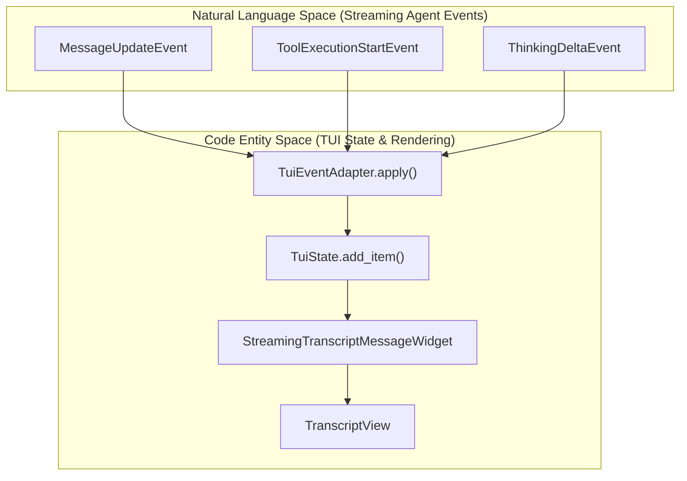
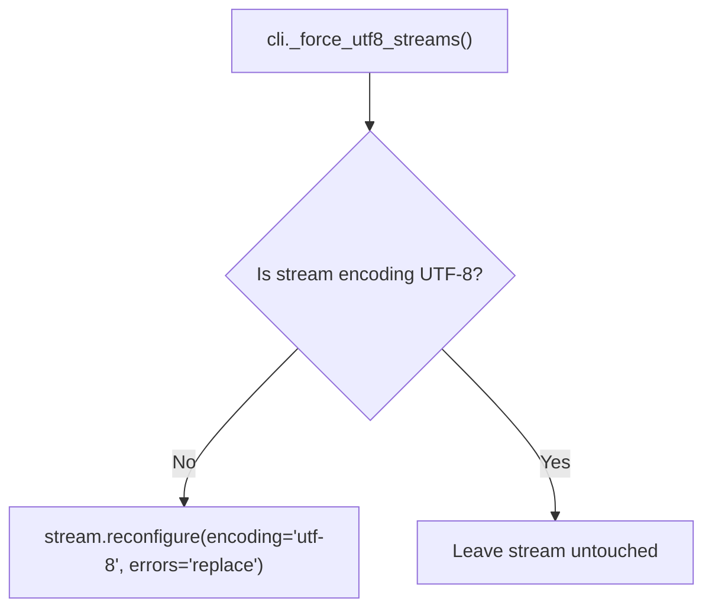
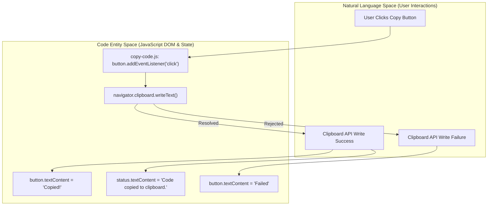

<!-- source: DeepWiki mcp.deepwiki.com · repo huggingface/tau · page 12.3 TUI, CLI, and Tooling Tests · fetched 2026-10-26 -->

# TUI, CLI, and Tooling Tests

Relevant source files

The following files were used as context for generating this wiki page:

- [src/tau_coding/cli.py](src/tau_coding/cli.py)
- [src/tau_coding/data/docs/cli.md](src/tau_coding/data/docs/cli.md)
- [src/tau_coding/tools.py](src/tau_coding/tools.py)
- [src/tau_coding/tui/app.py](src/tau_coding/tui/app.py)
- [src/tau_coding/tui/autocomplete.py](src/tau_coding/tui/autocomplete.py)
- [src/tau_coding/tui/widgets.py](src/tau_coding/tui/widgets.py)
- [tests/test_cli.py](tests/test_cli.py)
- [tests/test_coding_tools.py](tests/test_coding_tools.py)
- [tests/test_tui_app.py](tests/test_tui_app.py)
- [tests/test_tui_autocomplete.py](tests/test_tui_autocomplete.py)
- [tests/website/copy-code.test.mjs](tests/website/copy-code.test.mjs)
- [website/assets/css/main.css](website/assets/css/main.css)
- [website/assets/js/copy-code.js](website/assets/js/copy-code.js)
- [website/content/contributing.md](website/content/contributing.md)
- [website/content/reference/cli.md](website/content/reference/cli.md)
- [website/layouts/doc/single.html](website/layouts/doc/single.html)

This section covers the testing infrastructure for Tau's user interfaces, command-line tools, resource loaders, and documentation scripts. The test suite ensures that the **Textual-based TUI** [tests/test_tui_app.py:108-110](), the **Typer-based CLI** [src/tau_coding/cli.py:104-123](), slash commands, coding tools, skills, prompt templates, resource discovery, extensions, and the website's copy-code JavaScript functionality [tests/website/copy-code.test.mjs:1-132]() function reliably.

---

## Overview of UI and Tooling Testing Strategy

Tau tests user interfaces and tooling domains using isolated unit tests and integration suites. The TUI tests frequently use `FakeSession` [tests/test_tui_app.py:191-213]() to simulate `CodingSession` behavior without invoking external LLMs or modifying complex filesystem states.

### Key Test Domains
*   **TUI Application (`test_tui_*.py`)**: Tests `TauTuiApp` lifecycle, modals (`ModelPickerScreen`, `SessionPickerScreen`), and widget updates [tests/test_tui_app.py:108-110]().
*   **CLI and Streams (`test_cli.py`)**: Validates Typer command dispatch, flag parsing, and UTF-8 stream enforcement [tests/test_cli.py:66-108]().
*   **Slash Commands (`test_commands.py`)**: Tests `CommandRegistry` execution flows and result parsing [src/tau_coding/commands.py:70-75]().
*   **Tooling and Resources (`test_coding_tools.py`, `test_skills.py`, `test_prompt_templates.py`, `test_resources.py`)**: Verifies filesystem tool execution, YAML frontmatter parsing, and prompt template expansions.
*   **Extensions (`test_extensions.py`)**: Tests extension runtime discovery, hooks, and sandboxed bindings.
*   **Website JavaScript (`tests/website/copy-code.test.mjs`)**: Node.js tests for the documentation site's copy-to-clipboard button injection and accessibility announcements [tests/website/copy-code.test.mjs:134-210]().

Sources: [tests/test_tui_app.py:191-213](), [tests/test_cli.py:66-108](), [tests/website/copy-code.test.mjs:134-210](), [src/tau_coding/cli.py:104-123]()

---

## TUI Application, Widgets, and State Tests (`test_tui_app.py`)

The TUI tests verify that `TauTuiApp` correctly reflects agent states, handles asynchronous workers [src/tau_coding/tui/app.py:45-45](), and renders streaming transcripts.

### TUI Event Adaptation
The `TuiEventAdapter` processes low-level agent events like `MessageUpdateEvent` and `ToolExecutionStartEvent`, updating the high-level `TuiState` [src/tau_coding/tui/adapter.py:1-11]().

### Diagram: Natural Language Space to Code Entity Space (TUI Event Flow)

Sources: [src/tau_coding/tui/app.py:47-55](), [src/tau_coding/tui/adapter.py:1-11](), [src/tau_coding/tui/widgets.py:169-175]()

Sources: [tests/test_tui_app.py:1-126](), [src/tau_coding/tui/app.py:45-147]()

---

## CLI and Stream Encoding Tests (`test_cli.py`)

The CLI test suite in `test_cli.py` covers option parsing, print mode dispatch [src/tau_coding/cli.py:192-193](), and environment safety guards.

### Stream Reconfiguration
Windows consoles often default standard streams to legacy code pages (e.g., `cp1252`), risking `UnicodeEncodeError` when models stream UTF-8 output. `cli._force_utf8_streams()` inspects `sys.stdout` and `sys.stderr` and reconfigures them when necessary [src/tau_coding/cli.py:87-99]().

Sources: [src/tau_coding/cli.py:87-99](), [tests/test_cli.py:66-108]()

Sources: [tests/test_cli.py:1-112](), [src/tau_coding/cli.py:87-99](), [src/tau_coding/cli.py:192-193]()

---

## Slash Command Registry Tests (`test_commands.py`)

The command registry manages slash commands such as `/compact`, `/export`, and `/model` [src/tau_coding/commands.py:70-75](). Tests verify that registry execution correctly parses arguments and returns control flags via `CommandResult`.

Sources: [tests/test_commands.py:1-146](), [src/tau_coding/commands.py:70-75]()

---

## Rendering and Print Mode Tests (`test_rendering.py`)

Print mode uses an `EventRenderer` (`TranscriptRenderer`, `PlainRenderer`, or `JsonRenderer`) to format non-interactive outputs [src/tau_coding/rendering.py:1-11](). Tests in `test_rendering.py` ensure that events format consistently across output modes.

Sources: [src/tau_coding/rendering.py:1-11](), [src/tau_coding/cli.py:62-66]()

---

## Coding Tools Tests (`test_coding_tools.py`)

Tests in `test_coding_tools.py` validate the file editing diff algorithms, file locking, and execution timeouts for the `read`, `write`, `edit`, and `bash` tools created by `create_coding_tools()` [src/tau_coding/tools.py:164-185]().

Sources: [tests/test_coding_tools.py:1-25](), [src/tau_coding/tools.py:164-185]()

---

## Skills, Prompt Templates, and Resources Tests (`test_skills.py`, `test_prompt_templates.py`, `test_resources.py`)

*   **Skills (`test_skills.py`)**: Ensures `load_skills()` parses YAML frontmatter and formats tool invocations [src/tau_coding/skills.py:1-11]().
*   **Prompt Templates (`test_prompt_templates.py`)**: Validates template discovery, argument substitution, and interactive modal pickers.
*   **Resources (`test_resources.py`)**: Tests directory scanning, precedence rules, and `ResourceDiagnostic` generation for non-fatal configuration issues [src/tau_coding/resources.py:1-11]().

Sources: [src/tau_coding/skills.py:1-11](), [src/tau_coding/resources.py:1-11]()

---

## Extension System Tests (`test_extensions.py`)

Tests in `test_extensions.py` cover extension discovery, schema validation, hook binding via `ExtensionAPI`, and sandbox isolation.

Sources: [src/tau_coding/extensions/api.py:1-93]()

---

## Website Documentation JavaScript Test (`tests/website/copy-code.test.mjs`)

The documentation site features a client-side copy-to-clipboard script (`website/assets/js/copy-code.js`) that injects copy buttons into code blocks [website/assets/js/copy-code.js:1-52](). It is tested via Node.js native test runner and virtual DOM stubs in `tests/website/copy-code.test.mjs` [tests/website/copy-code.test.mjs:1-132]().

### Diagram: Natural Language Space to Code Entity Space (Website Copy Code Workflow)

Sources: [website/assets/js/copy-code.js:23-47](), [tests/website/copy-code.test.mjs:134-210]()

Sources: [tests/website/copy-code.test.mjs:1-210](), [website/assets/js/copy-code.js:1-52]()

---

