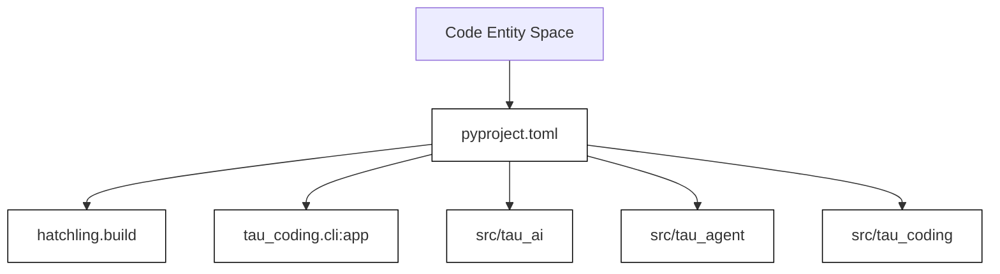
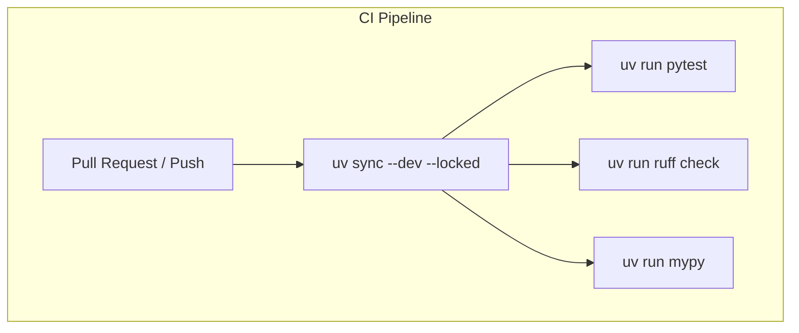
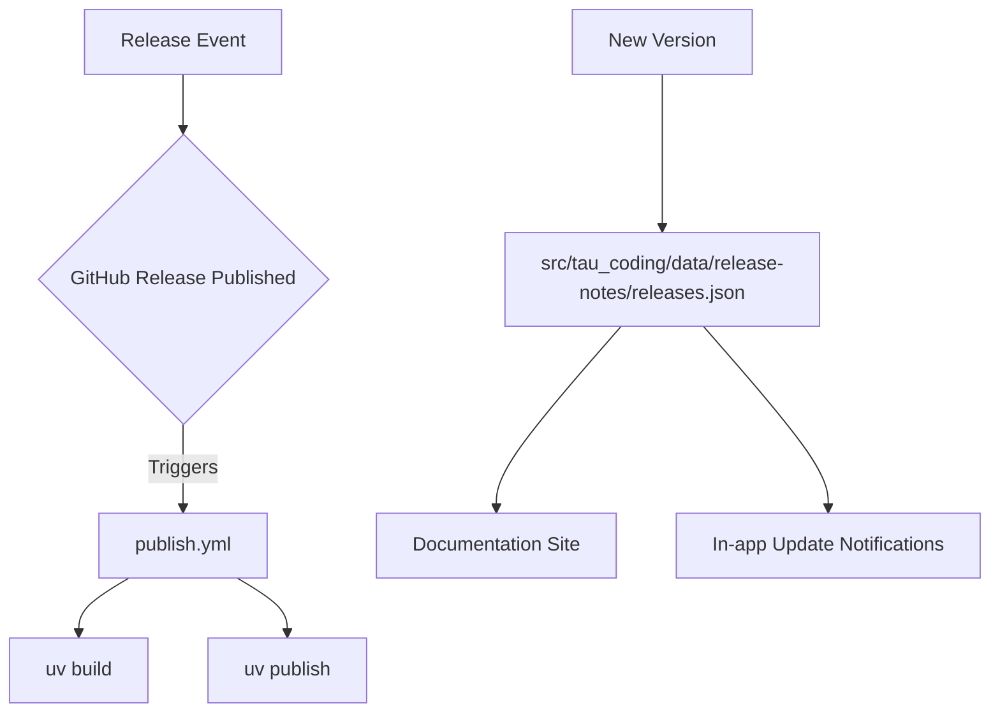

<!-- source: DeepWiki mcp.deepwiki.com · repo huggingface/tau · page 13 Project Infrastructure: Build, CI, and Docs Site · fetched 2026-10-26 -->

# Project Infrastructure: Build, CI, and Docs Site

Relevant source files

The following files were used as context for generating this wiki page:

- [.github/workflows/ci.yml](.github/workflows/ci.yml)
- [.github/workflows/docs.yml](.github/workflows/docs.yml)
- [.github/workflows/publish.yml](.github/workflows/publish.yml)
- [pyproject.toml](pyproject.toml)
- [src/tau_coding/data/release-notes/releases.json](src/tau_coding/data/release-notes/releases.json)
- [uv.lock](uv.lock)
- [website/content/_index.md](website/content/_index.md)

This page provides an overview of Tau's repository-level infrastructure, including package configuration, dependency management via Hatch and uv, automated Continuous Integration and publishing workflows, release notes tracking, update checks, and the Hugo-based documentation website.

For deep technical details, configuration files, versioning logic, and developer notes, see the child pages:
- [Packaging, Releases, and CI](#13.1)
- [Documentation Website and Dev Notes](#13.2)

---

## 1. Packaging, Hatchling, and Dependency Management

Tau uses Hatchling as its build backend and `uv` for lightning-fast dependency resolution and environment management. The core packaging metadata, build targets, python version constraints (`>=3.12`), project dependencies, and development groups are defined centrally in `pyproject.toml` [pyproject.toml:1-40]().

The package exposes a console script entry point (`tau = "tau_coding.cli:app"`) which hooks the command-line interface directly into the application layer [pyproject.toml:31-33](). Hatch packages the three core namespaces (`src/tau_ai`, `src/tau_agent`, and `src/tau_coding`) into a unified distribution wheel [pyproject.toml:41-43]().

*Figure 1: Packaging configuration bridging project settings to build targets and entry points.*

For details on configuration specifications, linting tools (`ruff`), and type checking (`mypy`), see [Packaging, Releases, and CI](#13.1).

Sources:
- `pyproject.toml` [pyproject.toml:1-67]()

---

## 2. Continuous Integration and Publishing Workflows

Automated verification is handled via GitHub Actions workflows residing in `.github/workflows/`. The primary CI pipeline (`ci.yml`) runs on pull requests and pushes to `main` [.github/workflows/ci.yml:1-9](). It sets up the python environment, synchronizes dependencies using `uv sync --dev --locked` [.github/workflows/ci.yml:30-37](), and executes pytest suites, ruff checks, formatting validation, and mypy static analysis [.github/workflows/ci.yml:38-49]().

*Figure 2: Automated CI validation steps.*

Publishing packages to PyPI is automated via `.github/workflows/publish.yml` which triggers upon GitHub release publication, leveraging `uv build` and `uv publish` [.github/workflows/publish.yml:1-28](). Documentation deployments are managed through `.github/workflows/docs.yml` [.github/workflows/docs.yml:1-55]().

For deeper insights into workflow definitions and permissions, see [Packaging, Releases, and CI](#13.1).

Sources:
- `.github/workflows/ci.yml` [.github/workflows/ci.yml:1-70]()
- `.github/workflows/publish.yml` [.github/workflows/publish.yml:1-28]()
- `.github/workflows/docs.yml` [.github/workflows/docs.yml:1-55]()

---

## 3. Release Process, Release Notes, and Update Checks

Releases are structured around version tags and a version-controlled release ledger (`releases.json`) located under `src/tau_coding/data/release-notes/releases.json` [src/tau_coding/data/release-notes/releases.json:1-121](). This ledger catalogs changes across versions under distinct semantic categories (`New`, `Changed`, `Fixed`), which power both the documentation site and in-app update notifications.

Update checks and updater flows query remote release metadata to inform users of newer versions or schema updates.

*Figure 3: Release process and how release notes are consumed.*

For complete documentation on version synchronization, updater flows, and schema definitions, see [Packaging, Releases, and CI](#13.1).

Sources:
- `src/tau_coding/data/release-notes/releases.json` [src/tau_coding/data/release-notes/releases.json:1-121]()

---

## 4. Documentation Website and Developer Notes

Tau maintains a dedicated documentation website built with Hugo, located under the `website/` directory. The site defines layouts, partials, assets, and markdown guides covering architecture, reference implementations, and release roadmaps. The CI environment validates documentation builds and compiles search indexes using `pagefind` [.github/workflows/ci.yml:50-70](). The `docs.yml` workflow then deploys this built documentation to GitHub Pages [.github/workflows/docs.yml:1-55]().

Additionally, the codebase bundles in-app documentation under `src/tau_coding/data/docs` and preserves developer design records as architecture notes.

For comprehensive guides on updating the Hugo site, working with partials, and reviewing design records, see [Documentation Website and Dev Notes](#13.2).

Sources:
- `.github/workflows/ci.yml` [.github/workflows/ci.yml:50-70]()
- `.github/workflows/docs.yml` [.github/workflows/docs.yml:1-55]()
- `website/content/_index.md` [website/content/_index.md:1-6]()

---

