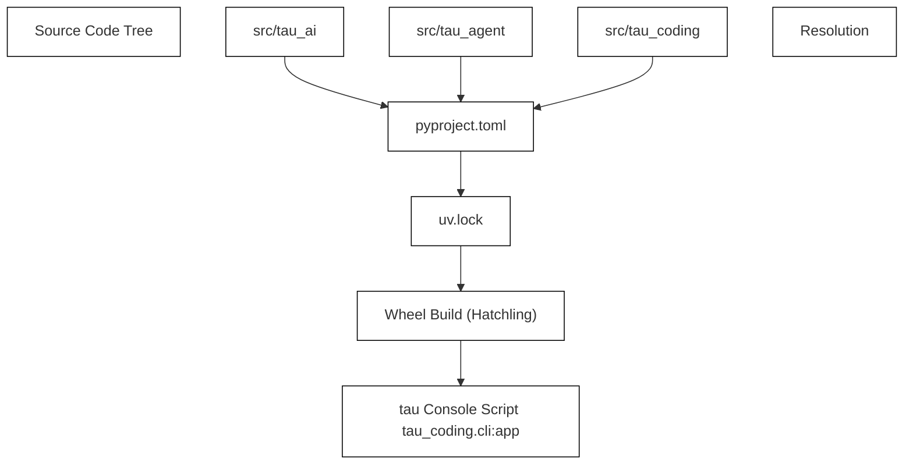
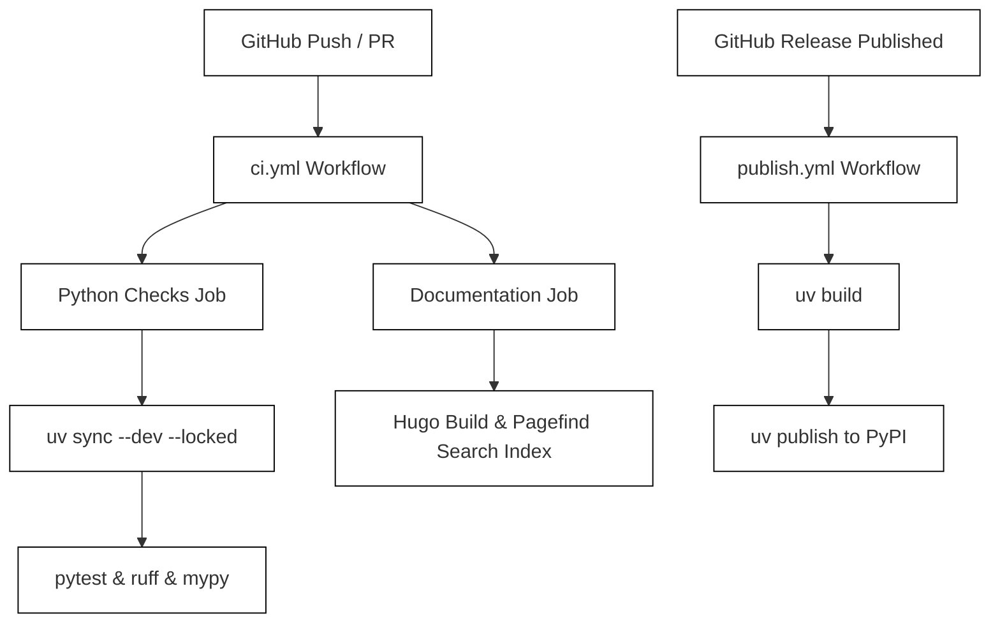
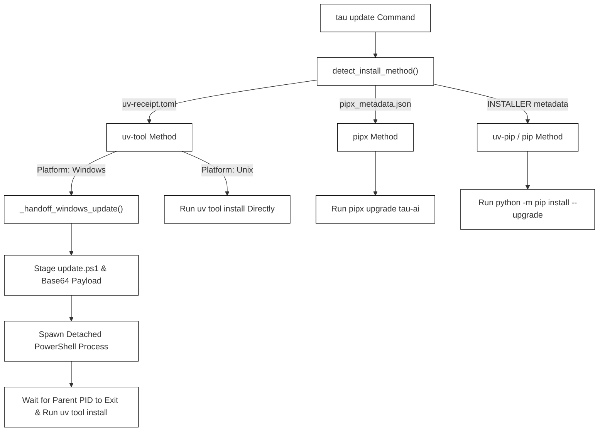

<!-- source: DeepWiki mcp.deepwiki.com · repo huggingface/tau · page 13.1 Packaging, Releases, and CI · fetched 2026-10-26 -->

# Packaging, Releases, and CI

Relevant source files

The following files were used as context for generating this wiki page:

- [.github/workflows/ci.yml](.github/workflows/ci.yml)
- [.github/workflows/docs.yml](.github/workflows/docs.yml)
- [.github/workflows/publish.yml](.github/workflows/publish.yml)
- [dev-notes/architecture/startup-update-check.md](dev-notes/architecture/startup-update-check.md)
- [dev-notes/install-scripts.md](dev-notes/install-scripts.md)
- [dev-notes/release-notes-startup.md](dev-notes/release-notes-startup.md)
- [pyproject.toml](pyproject.toml)
- [src/tau_coding/data/release-notes/releases.json](src/tau_coding/data/release-notes/releases.json)
- [src/tau_coding/update_check.py](src/tau_coding/update_check.py)
- [src/tau_coding/updater.py](src/tau_coding/updater.py)
- [tests/test_update_check.py](tests/test_update_check.py)
- [tests/test_updater.py](tests/test_updater.py)
- [uv.lock](uv.lock)
- [website/content/_index.md](website/content/_index.md)
- [website/static/install.ps1](website/static/install.ps1)
- [website/static/install.sh](website/static/install.sh)
- [website/static/landing.js](website/static/landing.js)

## Purpose and Scope
This document covers the repository-level infrastructure for Tau, detailing its packaging specification (`pyproject.toml` and `uv.lock`), static analysis and linting rules (`mypy`, `ruff`, and `pytest`), continuous integration and publishing workflows (GitHub Actions), version identification (`version.py`), structured release notes (`releases.json`), and the self-contained update check and upgrade mechanism (`update_check.py` and `updater.py`).

---

## Packaging Metadata and Dependency Management
Tau packages its three-layer architecture (`tau_ai`, `tau_agent`, and `tau_coding`) as a single distributable distribution named `tau-ai` using the Hatchling build backend [pyproject.toml:1-7, 41-42]().

### `pyproject.toml` Configuration
The project targets Python `>=3.12` and declares strict metadata, project URLs, and runtime dependencies [pyproject.toml:5-23]():
- **Core Dependencies:** `anyio`, `httpx[socks]`, `packaging`, `pillow`, `pydantic`, `pygments`, `rich`, `textual`, and `typer` [pyproject.toml:13-23]().
- **Console Script Entrypoint:** Exposes the command-line interface under the `tau` command, mapped to `tau_coding.cli:app` [pyproject.toml:31-33]().
- **Build Target:** Configures Hatchling wheel targets to bundle package directories from `src/` (`tau_ai`, `tau_agent`, `tau_coding`) [pyproject.toml:41-42]().

### Deterministic Locks with `uv.lock`
Dependency versions and hashes are pinned deterministically across environments using `uv.lock` [uv.lock:1-59]() (and beyond), enforcing reproducible builds in local development and GitHub Actions pipelines.

*Figure 1: Packaging and Build Architecture mapping `pyproject.toml` entries to the Hatchling build backend and `tau` console script.*

**Sources:** `pyproject.toml`, `uv.lock`

---

## Code Quality and Linting Toolchain
Tau enforces high code quality standards through strict static analysis configuration and automated formatting policies.

### Ruff Linting and Formatting
Configured in `pyproject.toml` [pyproject.toml:44-55](), Ruff targets Python 3.12 with a line length of 100 characters [pyproject.toml:45-46]():
- **Lint Selectors (`[tool.ruff.lint]`):** Enforces rules under categories `E` (pycodestyle errors), `F` (Pyflakes), `I` (isort imports), `UP` (pyupgrade), `B` (flake8-bugbear), and `SIM` (flake8-simplify) [pyproject.toml:49-50]().
- **Formatters (`[tool.ruff.format]`):** Enforces double quotes and space indentation [pyproject.toml:52-54]().

### Mypy Type Checking
Type checking runs in `strict = true` mode across packages `tau_ai`, `tau_agent`, and `tau_coding` under Python 3.12 [pyproject.toml:56-60](). Missing library stubs (e.g., `pygments.*`) are explicitly ignored via module overrides [pyproject.toml:61-64]().

### Pytest Configuration
Test runs are rooted at `tests/` with the `-ra` option enabled to display summary reports for all test outcomes [pyproject.toml:65-67]().

**Sources:** `pyproject.toml`

---

## GitHub Actions CI/CD Workflows
GitHub Actions automate code validation, test execution, documentation builds, and artifact publication.

### Continuous Integration (`ci.yml`)
The `CI` workflow triggers on pull requests and pushes to `main` [.github/workflows/ci.yml:1-9]() with concurrent job cancellation enabled [.github/workflows/ci.yml:13-15]():
- **Python Checks (`python`):** Sets up Python `.python-version` [.github/workflows/ci.yml:25-28](), configures `astral-sh/setup-uv` with caching [.github/workflows/ci.yml:30-33](), synchronizes development dependencies via `uv sync --dev --locked` [.github/workflows/ci.yml:35-37](), runs tests (`pytest`) [.github/workflows/ci.yml:38-39](), lints (`ruff check`) [.github/workflows/ci.yml:41-42](), checks formatting (`ruff format --check`) [.github/workflows/ci.yml:44-45](), and type-checks (`mypy`) [.github/workflows/ci.yml:47-48]().
- **Documentation Build (`docs`):** Installs Hugo (extended version `0.152.2`) inside the `website` working directory, builds the site (`hugo --minify`), and generates the search index using `pagefind` [.github/workflows/ci.yml:50-70]().

### Package Publishing (`publish.yml`)
Triggered on published GitHub releases [.github/workflows/publish.yml:1-7](), the `publish` workflow authenticates with PyPI using OIDC token permissions (`id-token: write`) [.github/workflows/publish.yml:8-16](), builds packages with `uv build` [.github/workflows/publish.yml:24-25](), and publishes to PyPI using `uv publish` [.github/workflows/publish.yml:27-28]().

### Documentation Deployment (`docs.yml`)
Builds and deploys the Hugo documentation site to GitHub Pages whenever changes hit `main` or via manual dispatch [.github/workflows/docs.yml:1-16](), uploading the generated site artifact to GitHub Pages [.github/workflows/docs.yml:41-55]().

*Figure 2: CI/CD Pipeline Data Flow illustrating execution paths for validation, building, and PyPI publishing.*

**Sources:** `.github/workflows/ci.yml`, `.github/workflows/publish.yml`, `.github/workflows/docs.yml`

---

## Repository Maintenance and Versioning
Tau manages release metadata and package versioning through dedicated code helpers and structured storage.

### Package Versioning (`version.py`)
Installed package versions are retrieved dynamically at runtime via `src/tau_coding/version.py` (not shown in full) using `importlib.metadata.version` for `tau-ai`. If the package is not installed (e.g., running from an uninstalled checkout), it falls back to `0+unknown`.

### Structured Release Notes (`releases.json`)
Release histories are maintained in `src/tau_coding/data/release-notes/releases.json` [src/tau_coding/update_check.py:24](). Structured entries record versions, dates, and categorized change sections (`New`, `Changed`, `Fixed`) [src/tau_coding/data/release-notes/releases.json:1-121]() (and beyond). These are loaded into memory via `load_release_notes()` [src/tau_coding/update_check.py:193-199]() to display upgrade notes on startup [src/tau_coding/update_check.py:148-190]().

### Maintenance Configurations
- **Dependabot (`.github/dependabot.yml`):** Automatically monitors GitHub Actions and Python dependencies for security advisories and updates.
- **Code Ownership (`CODEOWNERS`):** Establishes review requirements across core modules.

**Sources:** `src/tau_coding/version.py`, `src/tau_coding/data/release-notes/releases.json`, `src/tau_coding/update_check.py`

---

## Update Check and Self-Upgrade System
Tau incorporates a best-effort update check at startup and a multi-backend upgrade mechanism.

### Update Check Flow (`update_check.py`)
`tau_coding.update_check` queries PyPI's JSON metadata endpoint (`https://pypi.org/pypi/tau-ai/json`) with a strict timeout (`1.5s`) [src/tau_coding/update_check.py:18-21, 22]().
- **Caching:** Results are cached in `~/.tau/cache/update-check.json` and refreshed at most once per day [dev-notes/architecture/startup-update-check.md:9](). The `UpdateCheckResult` dataclass stores the `checked_at` timestamp and `latest_version` [src/tau_coding/update_check.py:48-53]().
- **Resilience:** Network failures, invalid version strings, missing JSON fields, and offline states are caught and handled as quiet no-ops so CLI startup is never blocked [src/tau_coding/update_check.py:118-132]().
- **Disabling:** The check can be suppressed via the `TAU_NO_UPDATE_CHECK=1` environment variable or when `CI` is set [src/tau_coding/update_check.py:121-122](), [dev-notes/architecture/startup-update-check.md:11]().
- **Release Notes Notice:** The `startup_release_notes_notice()` function [src/tau_coding/update_check.py:148-190]() checks if the current version is newer than the `last_seen_version` stored in `~/.tau/cache/release-notes-state.json` [dev-notes/release-notes-startup.md:11](). If so, it loads `ReleaseNotesEntry` objects [src/tau_coding/update_check.py:63-70]() from `releases.json` and constructs a `ReleaseNotesNotice` [src/tau_coding/update_check.py:78-84]() to display relevant changes [src/tau_coding/update_check.py:91-98]().

### Upgrade Mechanics (`updater.py`)
`tau_coding.updater` (`update_tau()`) inspects the active Python environment prefix and distribution receipts to determine ownership [src/tau_coding/updater.py:44-76]():
1. **Detection (`detect_install_method()`):** Identifies package managers from receipts like `uv-receipt.toml` (`uv-tool`), `pipx_metadata.json` (`pipx`), or standard `INSTALLER` metadata (`uv-pip`, `pip`) [src/tau_coding/updater.py:121-132]().
2. **Execution:** Dispatches the appropriate upgrade command (`uv tool install tau-ai@<latest>`, `pipx upgrade tau-ai`, or `pip install --upgrade tau-ai`) [src/tau_coding/updater.py:135-157]().
3. **Windows PowerShell Deferred Handoff (`_handoff_windows_update()`):** On Windows (`win32`) for `uv-tool` environments, upgrading the running executable directly fails because files are locked. Tau stages a detached PowerShell script (`update.ps1`) that waits for the parent Tau process ID to exit before invoking `uv tool install`, writing output to an execution log (`update.log`) [dev-notes/architecture/startup-update-check.md:29-42](), [src/tau_coding/updater.py:100-107, 160-187]() (and beyond). The `_quote_windows_argument` function [tests/test_updater.py:126]() ensures arguments are correctly quoted for PowerShell execution.

*Figure 3: Update Check and Self-Upgrade Sequence showing installation method detection and Windows detached PowerShell handoff.*

**Sources:** `src/tau_coding/update_check.py`, `src/tau_coding/updater.py`, `tests/test_update_check.py`, `tests/test_updater.py`, `dev-notes/architecture/startup-update-check.md`, `dev-notes/release-notes-startup.md`

---

