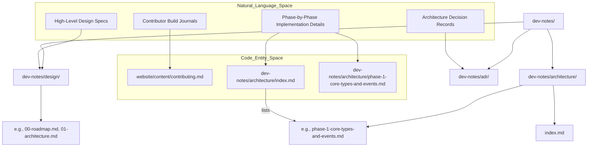

<!-- source: DeepWiki mcp.deepwiki.com · repo huggingface/tau · page 13.2 Documentation Website and Dev Notes · fetched 2026-10-26 -->

# Documentation Website and Dev Notes

<details>
<summary>Relevant source files</summary>

The following files were used as context for generating this wiki page:

- [dev-notes/architecture/index.md](dev-notes/architecture/index.md)
- [tests/website/copy-code.test.mjs](tests/website/copy-code.test.mjs)
- [website/assets/css/main.css](website/assets/css/main.css)
- [website/assets/js/copy-code.js](website/assets/js/copy-code.js)
- [website/content/contributing.md](website/content/contributing.md)
- [website/content/roadmap.md](website/content/roadmap.md)
- [website/data/roadmap.yaml](website/data/roadmap.yaml)
- [website/data/sidebar.yaml](website/data/sidebar.yaml)
- [website/hugo.toml](website/hugo.toml)
- [website/layouts/_default/releases.html](website/layouts/_default/releases.html)
- [website/layouts/_default/roadmap.html](website/layouts/_default/roadmap.html)
- [website/layouts/doc/single.html](website/layouts/doc/single.html)
- [website/layouts/index.html](website/layouts/index.html)
- [website/layouts/partials/head.html](website/layouts/partials/head.html)
- [website/layouts/partials/navbar.html](website/layouts/partials/navbar.html)
- [website/public/landing.js](website/public/landing.js)
- [website/static/android-chrome-192x192.png](website/static/android-chrome-192x192.png)
- [website/static/android-chrome-512x512.png](website/static/android-chrome-512x512.png)
- [website/static/apple-touch-icon.png](website/static/apple-touch-icon.png)
- [website/static/favicon-16x16.png](website/static/favicon-16x16.png)
- [website/static/favicon-32x32.png](website/static/favicon-32x32.png)
- [website/static/favicon.ico](website/static/favicon.ico)
- [website/static/images/og-image.png](website/static/images/og-image.png)
- [website/static/site.webmanifest](website/static/site.webmanifest)

</details>


## Purpose and Scope
This page details the documentation infrastructure, Hugo-based public website (`website/`), bundled in-app documentation (`src/tau_coding/data/docs`), and the contributor build logs and architecture decision records (`dev-notes/`). It explains how content is structured, mounted, rendered, and maintained across the repository.

---

## 1. Hugo Documentation Website Architecture (`website/`)

The public documentation website is a [Hugo](https://gohugo.io/) static site located in the `website/` directory [website/hugo.toml:1-55](). It uses a custom notebook grid theme defined in CSS [website/assets/css/main.css:1-212]() and mounts live project data directly from the Python codebase via Hugo's module mount configuration [website/hugo.toml:31-55]().

Key configuration aspects in `website/hugo.toml`:
- **Base URL and Markup**: Configured with Goldmark markdown rendering (`unsafe = true`) and Monokai code highlighting [website/hugo.toml:1-16]().
- **Module Mounts**: Binds local directories (`content`, `static`, `data`, `layouts`, `assets`) as well as external repository files like release notes (`../src/tau_coding/data/release-notes`) and package metadata (`../pyproject.toml`) [website/hugo.toml:31-55]().
- **Content Structure**: User-facing documentation lives in `website/content/`, with the landing page at `website/content/_index.md` and other pages like "Why Tau?" at `website/content/why-tau.md`. These are rendered by templates in `website/layouts/` [website/content/contributing.md:58-60]().
- **Copy Button**: Code blocks on documentation pages include a keyboard-focusable "Copy" button. This functionality is implemented in `website/assets/js/copy-code.js` [website/assets/js/copy-code.js:1-52]() and tested in `tests/website/copy-code.test.mjs` [tests/website/copy-code.test.mjs:1-213](). The button provides visual feedback and announces success or failure to assistive technology [website/assets/js/copy-code.js:33-38]().

```text
website/
├── hugo.toml             # Hugo configuration and path mounts
├── assets/css/main.css   # Notebook grid styling and variables
├── assets/js/copy-code.js# JavaScript for code block copy buttons
├── layouts/              # HTML templates, single docs, and index
│   ├── index.html        # Landing page layout
│   ├── doc/single.html   # Documentation page layout
│   └── partials/         # Reusable navigation and sidebar partials
├── content/              # Markdown content for documentation pages
└── data/                 # YAML data files (e.g. roadmap.yaml)
```

Sources: [website/hugo.toml:1-55](), [website/assets/css/main.css:1-212](), [website/layouts/doc/single.html:1-25](), [website/content/contributing.md:58-60](), [website/assets/js/copy-code.js:1-52](), [tests/website/copy-code.test.mjs:1-213]()

---

## Diagram 1: Documentation Site Architecture to Code Entities
This diagram maps documentation concepts and site components to their underlying file paths and code entities.

```mermaid
graph TD
    SiteRoot["website/"] --> HugoConfig["hugo.toml"]
    SiteRoot --> AssetStyles["assets/css/main.css"]
    SiteRoot --> AssetJS["assets/js/copy-code.js"]
    SiteRoot --> LayoutsDir["layouts/"]
    SiteRoot --> ContentDir["content/"]
    SiteRoot --> DataDir["data/"]
    
    HugoConfig --> MountPyProject["pyproject.toml mounted as data/project.toml"]
    HugoConfig --> MountReleases["src/tau_coding/data/release-notes mounted as data/release-notes"]
    
    LayoutsDir --> NavbarPart["layouts/partials/navbar.html"]
    LayoutsDir --> DocSingle["layouts/doc/single.html"]
    DocSingle --> CopyScriptInclude["layouts/doc/single.html:19-24"]
    
    ContentDir --> ContributingMD["content/contributing.md"]
    ContentDir --> RoadmapMD["content/roadmap.md"]
    
    DataDir --> RoadmapYAML["data/roadmap.yaml"]
    
    subgraph Natural_Language_Space
        NL_Site["Public Documentation Website"]
        NL_Config["Project Configuration Mounts"]
        NL_CodeCopy["Code Block Copy Functionality"]
        NL_Roadmap["Roadmap Data"]
    end
    
    subgraph Code_Entity_Space
        CE_HugoConfig["website/hugo.toml"]
        CE_Nav["website/layouts/partials/navbar.html"]
        CE_Single["website/layouts/doc/single.html"]
        CE_CopyJS["website/assets/js/copy-code.js"]
        CE_RoadmapYAML["website/data/roadmap.yaml"]
    end
    
    NL_Site --> CE_Single
    NL_Config --> CE_HugoConfig
    NL_CodeCopy --> CE_CopyJS
    NL_Roadmap --> CE_RoadmapYAML
    
    CE_Single --"includes"--> CE_CopyJS
    CE_Nav --"uses"--> CE_HugoConfig
    CE_Single --"uses"--> CE_HugoConfig
    CE_RoadmapYAML --"powers"--> RoadmapMD
```


Sources: [website/hugo.toml:1-55](), [website/layouts/partials/navbar.html:1-42](), [website/layouts/doc/single.html:1-25](), [website/assets/js/copy-code.js:1-52](), [website/data/roadmap.yaml:1-164](), [website/content/roadmap.md]()

---

## 2. Bundled In-App Documentation (`src/tau_coding/data/docs`)

In addition to the static web site, Tau bundles a subset of user-facing reference markdown files directly inside the Python package under `src/tau_coding/data/docs`. These files are accessible offline via command-line helpers or agent-side self-documentation tools, ensuring that users running the terminal interface have immediate access to reference materials without requiring an active internet connection.

Sources: [website/content/contributing.md:1-69]()

---

## 3. Contributor Build Logs and Architecture Decision Records (`dev-notes/`)

Detailed, phase-by-phase implementation journals, design documents, and architecture decision records are maintained in the repository root under `dev-notes/`. These records are intentionally excluded from the public Hugo site build, serving exclusively as internal contributor references [website/content/contributing.md:10-22]().

Structure of `dev-notes/`:
- **`design/`**: High-level architectural specifications (e.g., roadmap, agent loop design, tool mechanics, session persistence) [website/content/contributing.md:15]().
- **`architecture/`**: Per-phase build notes (`phase-1` through `phase-24`), each answering what was added, why it exists, and how subsequent phases rely on it [website/content/contributing.md:16-17](), [dev-notes/architecture/index.md:1-70]().
- **`adr/`**: Formal Architecture Decision Records [website/content/contributing.md:18]().

Sources: [website/content/contributing.md:10-22](), [dev-notes/architecture/index.md:1-70]()

---

## Diagram 2: Contributor Build Logs to Architecture Files
This diagram connects conceptual build documentation and design records to their respective file paths in the repository.


Sources: [website/content/contributing.md:10-22](), [dev-notes/architecture/index.md:1-70]()

---

