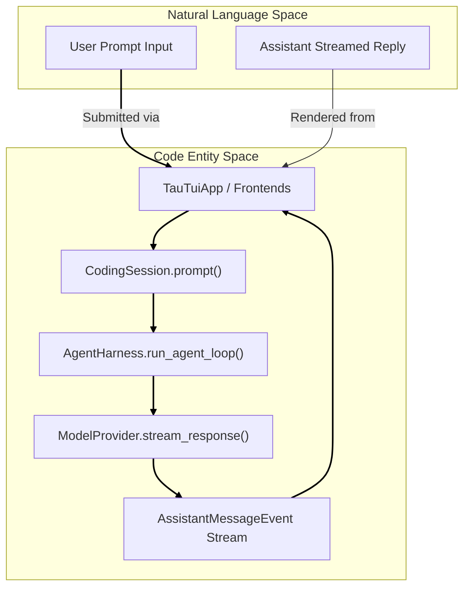
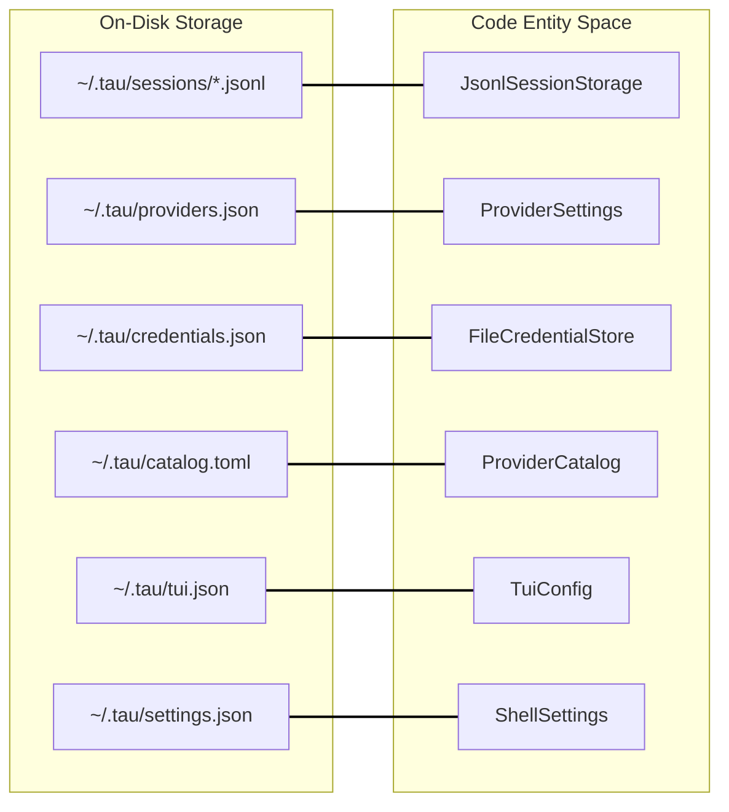

<!-- source: DeepWiki mcp.deepwiki.com · repo huggingface/tau · page 14 Glossary · fetched 2026-10-26 -->

# Glossary

Relevant source files

The following files were used as context for generating this wiki page:

- [src/tau_ai/__init__.py](src/tau_ai/__init__.py)
- [src/tau_ai/anthropic.py](src/tau_ai/anthropic.py)
- [src/tau_ai/env.py](src/tau_ai/env.py)
- [src/tau_ai/openai_codex.py](src/tau_ai/openai_codex.py)
- [src/tau_ai/openai_compatible.py](src/tau_ai/openai_compatible.py)
- [src/tau_coding/__init__.py](src/tau_coding/__init__.py)
- [src/tau_coding/data/docs/tui.md](src/tau_coding/data/docs/tui.md)
- [src/tau_coding/provider_config.py](src/tau_coding/provider_config.py)
- [src/tau_coding/session.py](src/tau_coding/session.py)
- [tests/test_coding_session.py](tests/test_coding_session.py)
- [tests/test_provider_config.py](tests/test_provider_config.py)
- [tests/test_tau_ai.py](tests/test_tau_ai.py)
- [website/content/guides/tui.md](website/content/guides/tui.md)
- [website/content/reference/configuration.md](website/content/reference/configuration.md)
- [website/content/reference/slash-commands.md](website/content/reference/slash-commands.md)

This glossary defines codebase-specific terms, jargon, abbreviations, and domain concepts an onboarding engineer needs to know when working with Tau. It bridges high-level architectural ideas with specific code pointers and implementations across the three-layer package architecture.

## Core Architectural Concepts

### Agent Loop
The fundamental state machine that orchestrates the interaction between the LLM and the local environment. It manages sending prompts, receiving streamed text and thinking tokens, and executing tools.
*   **Implementation:** `run_agent_loop` manages turn lifecycle, tool execution, and event streaming [tests/test_tau_ai.py:19-19]().
*   **Data Flow:** The loop yields `AgentEvent` objects that frontends consume to render state updates [src/tau_coding/session.py:14-14]().

### AgentHarness
The portable, UI-agnostic core ("brain") of the agent. It encapsulates configuration such as model selection, system prompts, and available tools, while managing execution of the agent loop.
*   **Implementation:** `AgentHarness` and `AgentHarnessConfig` [src/tau_coding/session.py:15-15]().
*   **Role:** Embedded across frontends (CLI, TUI, RPC) and manages message queues for steering and follow-ups.

### CodingSession
The application-level orchestrator wrapping `AgentHarness`. It manages world state relevant to coding tasks, including the working directory, durable persistence, context compaction, resource discovery, and extension runtimes.
*   **Implementation:** `CodingSession` [src/tau_coding/__init__.py:109-109]() and `CodingSessionConfig` [src/tau_coding/__init__.py:110-110]().
*   **Key Responsibilities:** Managing session trees, handling token compaction, coordinating slash commands via `CommandRegistry`, and integrating extension runtimes.

### Three-Layer Architecture
Tau is organized into three distinct packages to cleanly separate provider abstractions, core agent logic, and application frontends:
1.  **`tau_ai`**: Provider abstraction layer handling protocol normalization, streaming, and error handling.
2.  **`tau_agent`**: Portable agent brain, session primitives, tool definitions, and loop logic.
3.  **`tau_coding`**: Application layer wrapping `AgentHarness` with `CodingSession`, CLI, TUI (`TauTuiApp`), file/shell tools, and extensions.

Sources: [src/tau_coding/session.py:14-85](), [src/tau_coding/__init__.py:109-110]()

---

## Technical Jargon & Abbreviations

| Term | Definition | Code Pointer |
| :--- | :--- | :--- |
| **CWD** | Current Working Directory. The project root path where the agent executes tools and reads resources. | `CodingSessionConfig` [tests/test_coding_session.py:126-128]() |
| **JSONL** | JSON Lines format used for append-only session persistence and tree history. | `JsonlSessionStorage` [src/tau_coding/session.py:32-32]() |
| **TUI** | Terminal User Interface. The interactive Textual-based application frontend. | `tau_coding.tui` |
| **Thinking Level** | Model setting controlling reasoning effort and budget for models emitting internal thoughts. | `ThinkingLevel` [src/tau_coding/thinking.py:10-10]() |
| **Steering** | Injecting a message into an active run to guide the agent's behavior mid-turn. | `StreamingBehavior` [src/tau_coding/session.py:172-172]() |
| **Compaction** | Summarizing older conversation entries to stay within token context limits. | `estimate_context_usage` [src/tau_coding/context_window.py:10-10]() |
| **RPC** | JSONL-over-stdio RPC protocol allowing external editors or host processes to drive Tau. | `src/tau_coding/` |

Sources: [src/tau_coding/session.py:32-172](), [tests/test_coding_session.py:126-128](), [src/tau_coding/thinking.py:10-10](), [src/tau_coding/context_window.py:10-10]()

---

## Domain Concepts

### Context Compaction and Token Accounting
The process of estimating token usage and summarizing old conversation history when usage exceeds thresholds, while preserving recent context and structural entry trees.
*   **Implementation:** Handled via `estimate_context_usage()`, auto-compaction threshold calculations, and compaction summarization prompts [src/tau_coding/context_window.py:10-10]().
*   **Data Structures:** `ContextUsageEstimate`, `CompactionPlan`, and compaction events [src/tau_coding/session.py:76-78]().

### Session Tree and Persistence
A tree-structured representation of conversation history supporting branching (reverting or exploring alternative prompts from past points in time) backed by append-only JSONL files.
*   **Implementation:** `JsonlSessionStorage`, `SessionState`, and tree traversal utilities [src/tau_coding/session.py:32-43]().
*   **Entries:** Includes `MessageEntry`, `CompactionEntry`, `BranchSummaryEntry`, `ModelChangeEntry`, and `CustomEntry` [src/tau_coding/session.py:28-40]().

### Extensions and Runtime
Python modules that customize Tau sessions by registering custom tools, slash commands, dynamic providers, message renderers, and widget components.
*   **Implementation:** `ExtensionRuntime`, `ExtensionAPI`, and `BoundSession` [src/tau_coding/extensions/runtime.py:85-92]().
*   **Lifecycle:** Discovered from user and project directories or explicit paths, managing generation retirement and hook dispatches [src/tau_coding/extensions/runtime.py:179-186]().

### Project Trust and Security
A security model that gates ambient project resources (like local `.tau/` directories and project extensions) based on user trust decisions.
*   **Implementation:** `ProjectTrustCoordinator`, `ProjectTrustStore`, and trust resolution flows [src/tau_coding/session.py:91-98]().

Sources: [src/tau_coding/session.py:28-98](), [src/tau_coding/extensions/runtime.py:85-186](), [src/tau_coding/context_window.py:10-10]()

---

## System Diagrams

### Natural Language Space to Code Entity Space: Agent Turn Lifecycle
This diagram maps natural language interactions to the underlying code entities during a prompt execution turn.

Sources: [src/tau_coding/session.py:50-51](), [src/tau_coding/extensions/runtime.py:91-146](), [tests/test_tau_ai.py:83-89]()

### Storage and Configuration Entity Mapping
This diagram maps durable on-disk configurations and session records to their respective runtime code entities.

Sources: [src/tau_coding/session.py:32-32](), [src/tau_coding/provider_config.py:53-53](), [src/tau_coding/credentials.py:10-10](), [src/tau_coding/catalog_loader.py:10-10](), [website/content/reference/configuration.md:47-56]()

---

## Event Types Reference

Communication between core logic, extensions, and frontends relies on strongly typed events.

| Event Class / Type | Purpose | Source / Module |
| :--- | :--- | :--- |
| `AgentStartEvent` / `AgentEndEvent` | Signals start and completion of agent execution runs. | `tau_agent.events` [src/tau_coding/extensions/runtime.py:17-19]() |
| `TurnStartEvent` / `TurnEndEvent` | Marks individual conversational turns within an agent run. | `tau_agent.events` [src/tau_coding/extensions/runtime.py:18-19]() |
| `ToolExecutionStartEvent` / `ToolExecutionEndEvent` | Signals invocation and completion of tools (e.g., `read`, `write`, `bash`). | `tau_agent.events` [src/tau_coding/session.py:14-14]() |
| `CompactionStartEvent` / `CompactionEndEvent` | Marks initiation and completion of context compaction runs. | `tau_coding.events` [src/tau_coding/session.py:76-78]() |
| `SessionInfoChangedEvent` | Notifies listeners of changes to session metadata or active state. | `tau_coding/events.py` [src/tau_coding/session.py:80-80]() |
| `SessionShutdownEvent` / `SessionStartEvent` | Lifecycle hooks for extensions during session startup and teardown. | `tau_coding.extensions.api` [src/tau_coding/extensions/runtime.py:56-57]() |

Sources: [src/tau_coding/session.py:14-82](), [src/tau_coding/extensions/runtime.py:17-64]()