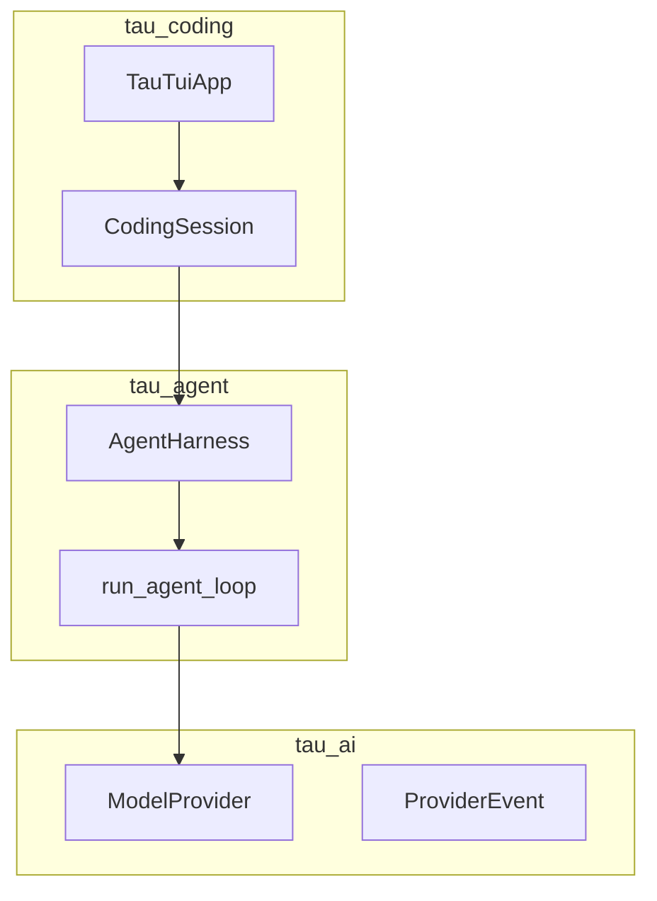
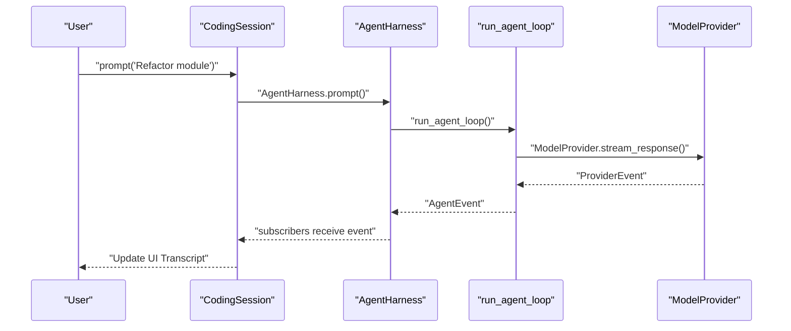

<!-- source: DeepWiki mcp.deepwiki.com · repo huggingface/tau · page 2 Architecture: Three-Layer Design · fetched 2026-10-26 -->

# Architecture: Three-Layer Design

Relevant source files

The following files were used as context for generating this wiki page:

- [dev-notes/architecture/index.md](dev-notes/architecture/index.md)
- [src/tau_agent/harness.py](src/tau_agent/harness.py)
- [tests/test_agent_harness.py](tests/test_agent_harness.py)
- [website/content/internals/custom-frontend.md](website/content/internals/custom-frontend.md)

Tau is built on a modular, three-layer architecture designed to separate low-level LLM communication from high-level coding application logic. This separation ensures that the core agent brain remains portable, testable, and independent of specific providers or user interfaces.

For detailed exploration of each individual layer, refer to the child pages:
- [tau_ai: Provider Abstraction Layer](#2.1)
- [tau_agent: Portable Agent Brain](#2.2)
- [tau_coding: Coding Agent Application](#2.3)

---

## High-Level Dependency Flow

The system follows a strict unidirectional dependency rule: the application layer depends on the agent layer, which in turn depends on the AI provider layer [dev-notes/architecture/index.md:13-19]().

Title: "Package Dependency Hierarchy"

**Sources:** [dev-notes/architecture/index.md:13-19](), [src/tau_agent/harness.py:62-64]()

---

## The Three Packages

### 1. `tau_ai`: Provider Abstraction Layer
The `tau_ai` package handles the complexities of provider-specific APIs (OpenAI, Anthropic, Google, Mistral, etc.). It translates raw model streams into a normalized stream of provider events, manages retries, handles credentials, and supports provider-specific thinking modes.

For details, see [tau_ai: Provider Abstraction Layer](#2.1).
**Sources:** [dev-notes/architecture/index.md:16-16]()

### 2. `tau_agent`: Portable Agent Brain
This is the core reasoning engine of Tau. It defines fundamental types for the transcript, tools, events, and the execution loop. It remains strictly UI-neutral and provider-neutral [dev-notes/architecture/index.md:17-17](), [dev-notes/architecture/index.md:21-22]().

- **`AgentHarness`**: The primary stateful wrapper that maintains session transcripts, queues steering/follow-up messages, handles cancellation, and manages turn execution [src/tau_agent/harness.py:62-64]().
- **`run_agent_loop`**: A pure asynchronous generator function that orchestrates the turn lifecycle and tool execution [src/tau_agent/harness.py:174-189]().
- **Session Primitives**: Low-level session entry types and append-only JSONL storage mechanics.

For details, see [tau_agent: Portable Agent Brain](#2.2).
**Sources:** [dev-notes/architecture/index.md:17-17](), [dev-notes/architecture/index.md:21-22](), [src/tau_agent/harness.py:62-64](), [src/tau_agent/harness.py:174-189]()

### 3. `tau_coding`: Coding Agent Application
The `tau_coding` package turns the generic agent into a specialized coding assistant. It wraps `AgentHarness` to provide durable session management, filesystem/shell tools, resource loading, and frontends [website/content/internals/custom-frontend.md:16-28]().

- **`CodingSession`**: The central orchestrator uniting persistence, tools, compaction, and configuration [website/content/internals/custom-frontend.md:16-20]().
- **Frontends**: Textual TUI app, Typer-based CLI, and stdin/stdout RPC server [dev-notes/architecture/index.md:18-18]().
- **Resources**: Discovery of project contexts, skills, and system prompt formatting.

For details, see [tau_coding: Coding Agent Application](#2.3).
**Sources:** [dev-notes/architecture/index.md:18-18](), [website/content/internals/custom-frontend.md:16-28]()

---

## Event-Driven Communication and Data Flow

Communication between layers relies on normalized event streams. Lower layers emit provider-neutral events that bubble up through the harness into application session handlers and frontends [website/content/internals/custom-frontend.md:37-45]().

Title: "Natural Language to Code Entity Execution Flow"

**Sources:** [src/tau_agent/harness.py:147-191](), [website/content/internals/custom-frontend.md:37-45]()

### Core Data Structures

| Concept | Code Entity | Role |
| :--- | :--- | :--- |
| **Agent Message** | `AgentMessage` | Base class for user, assistant, and tool messages [src/tau_agent/harness.py:14-20]() |
| **Agent Harness** | `AgentHarness` | Stateful session transcript and queue manager [src/tau_agent/harness.py:62-64]() |
| **Agent Event** | `AgentEvent` | Union type emitted during turn execution [src/tau_agent/harness.py:12-12]() |
| **Coding Session** | `CodingSession` | Application orchestrator linking storage, tools, and UI [website/content/internals/custom-frontend.md:16-20]() |

**Sources:** [src/tau_agent/harness.py:12-20](), [src/tau_agent/harness.py:62-64](), [website/content/internals/custom-frontend.md:16-20]()

---

## Key Boundaries

### The AgentHarness Boundary
The `AgentHarness` is the clean-room boundary inside `tau_agent`. It contains no knowledge of the filesystem, shell tools, terminal rendering libraries, or project configuration paths [dev-notes/architecture/index.md:21-22](). It focuses purely on managing message sequences, driving tool execution via callbacks, and invoking the underlying `ModelProvider`.

### The CodingSession Boundary
The `CodingSession` in `tau_coding` introduces the "real-world" environment [website/content/internals/custom-frontend.md:25-28](). It binds the portable harness to concrete file and shell tools (`read`, `write`, `edit`, `bash`), manages append-only JSONL persistence (`JsonlSessionStorage`), handles context compaction, and exposes commands to interactive frontends [website/content/internals/custom-frontend.md:25-28]().

**Sources:** [dev-notes/architecture/index.md:21-22](), [website/content/internals/custom-frontend.md:25-28]()

---

