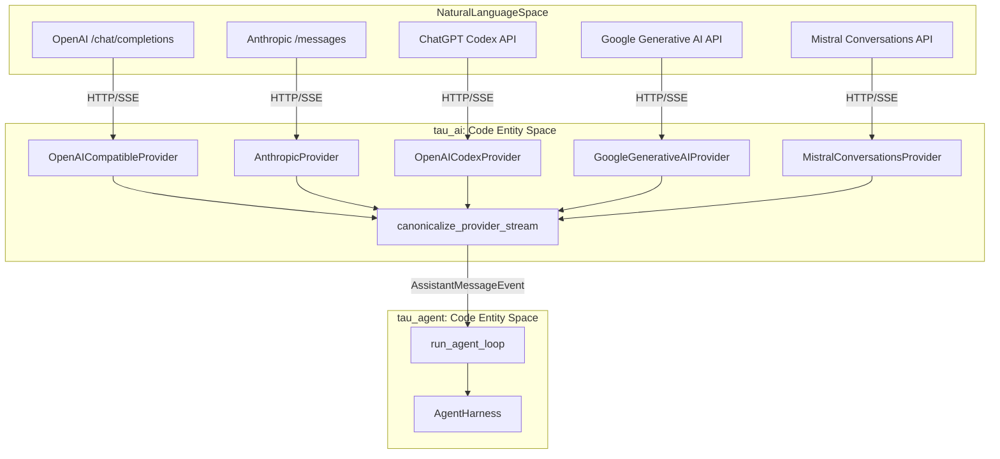
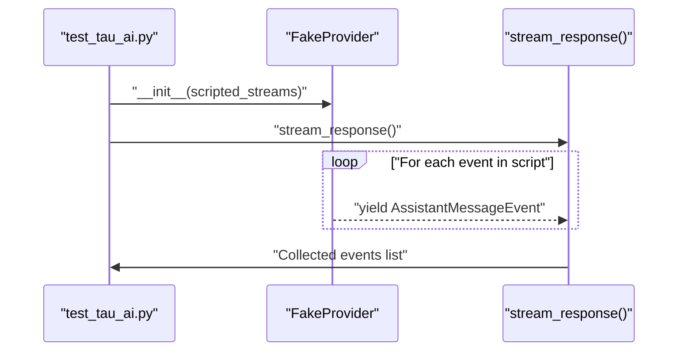

<!-- source: DeepWiki mcp.deepwiki.com · repo huggingface/tau · page 2.1 tau_ai: Provider Abstraction Layer · fetched 2026-10-26 -->

# tau_ai: Provider Abstraction Layer

Relevant source files

The following files were used as context for generating this wiki page:

- [dev-notes/README.md](dev-notes/README.md)
- [dev-notes/catalog-model-safety.md](dev-notes/catalog-model-safety.md)
- [dev-notes/chat-stream-channels.md](dev-notes/chat-stream-channels.md)
- [dev-notes/google-stream-completion.md](dev-notes/google-stream-completion.md)
- [dev-notes/hugging-face-response-provider-metadata.md](dev-notes/hugging-face-response-provider-metadata.md)
- [dev-notes/portable-tool-call-ids.md](dev-notes/portable-tool-call-ids.md)
- [src/tau_agent/tools.py](src/tau_agent/tools.py)
- [src/tau_ai/__init__.py](src/tau_ai/__init__.py)
- [src/tau_ai/_provider_events.py](src/tau_ai/_provider_events.py)
- [src/tau_ai/anthropic.py](src/tau_ai/anthropic.py)
- [src/tau_ai/env.py](src/tau_ai/env.py)
- [src/tau_ai/events.py](src/tau_ai/events.py)
- [src/tau_ai/fake.py](src/tau_ai/fake.py)
- [src/tau_ai/google.py](src/tau_ai/google.py)
- [src/tau_ai/mistral.py](src/tau_ai/mistral.py)
- [src/tau_ai/openai_codex.py](src/tau_ai/openai_codex.py)
- [src/tau_ai/openai_compatible.py](src/tau_ai/openai_compatible.py)
- [src/tau_ai/provider.py](src/tau_ai/provider.py)
- [src/tau_ai/stream.py](src/tau_ai/stream.py)
- [src/tau_ai/tool_call_ids.py](src/tau_ai/tool_call_ids.py)
- [tests/test_chat_channels.py](tests/test_chat_channels.py)
- [tests/test_cross_provider_history.py](tests/test_cross_provider_history.py)
- [tests/test_tau_ai.py](tests/test_tau_ai.py)
- [tests/test_tui_chat_channels.py](tests/test_tui_chat_channels.py)

The `tau_ai` package serves as the foundational communication layer for Tau. It provides a provider-neutral abstraction for interacting with various Large Language Model (LLM) APIs, ensuring that provider-specific details (request formats, authentication, SSE chunking) do not leak into the higher-level agent logic.

## Purpose and Scope

`tau_ai` translates raw API payloads into a unified stream of `AssistantMessageEvent` objects (re-exported from `tau_agent`). This design allows the `tau_agent` loop to remain backend-agnostic, consuming the same event types whether the model is hosted by OpenAI, Anthropic, or a local server.

Key responsibilities include:
*   **Protocol Definition**: Defining the `ModelProvider` and `CancellationToken` interfaces [src/tau_ai/provider.py:1-5]().
*   **Event Normalization**: Mapping disparate streaming formats (OpenAI SSE, Anthropic Messages, Google Generative AI) into standard events like `TextDeltaEvent` and `ToolCallDeltaEvent` [src/tau_ai/events.py:1-37]().
*   **Stream Canonicalization**: Normalizing transitional provider events through `canonicalize_provider_stream`, supporting independent channels for Chat Completions [src/tau_ai/stream.py:88-122](), [dev-notes/chat-stream-channels.md:1-20]().
*   **Resiliency**: Implementing exponential backoff and retry logic for transient HTTP failures [src/tau_ai/retry.py:1-43]().
*   **Reasoning Support**: Handling "thinking" or "reasoning" blocks emitted by modern models [src/tau_ai/events.py:13-26]().
*   **Safety and Diagnostics**: Extracting safe, secret-free error messages from provider responses [src/tau_ai/http_errors.py:1-26]().
*   **Tool ID Portability**: Ensuring tool call identifiers are compatible when switching providers mid-session [src/tau_ai/tool_call_ids.py:1-24]().

Sources: [src/tau_ai/provider.py:1-5](), [src/tau_ai/events.py:1-37](), [src/tau_ai/stream.py:88-122](), [dev-notes/chat-stream-channels.md:1-20](), [src/tau_ai/retry.py:1-43](), [src/tau_ai/http_errors.py:1-26](), [src/tau_ai/tool_call_ids.py:1-24]()

## Architecture: Data Flow

The following diagram illustrates how `tau_ai` bridges the gap between raw HTTP streams and the `AgentHarness` by mapping external LLM endpoints to concrete Python provider classes.

### Provider Event Mapping Architecture

Sources: [src/tau_ai/provider.py:1-5](), [src/tau_ai/openai_compatible.py:72-76](), [src/tau_ai/anthropic.py:73-74](), [src/tau_ai/openai_codex.py:94-96](), [src/tau_ai/google.py:47-49](), [src/tau_ai/mistral.py:47-49]()

## Key Interfaces

### ModelProvider Protocol
The `ModelProvider` is a Python `Protocol` that defines the standard interface for all adapters [src/tau_ai/provider.py:1-5]().

| Method | Role |
| :--- | :--- |
| `stream_response` | Takes a model name, system prompt, messages, and tools; returns an `AsyncIterator[AssistantMessageEvent]` [src/tau_ai/provider.py:1-5](). |

### AssistantMessageEvent Types
Adapters emit a sequence of events canonicalized by `canonicalize_provider_stream` [src/tau_ai/stream.py:88-122]():

*   `AssistantStartEvent`: Signals the beginning of a model turn [src/tau_ai/events.py:17-20]().
*   `TextDeltaEvent`: Contains a fragment of generated text [src/tau_ai/events.py:21]().
*   `ThinkingDeltaEvent`: Contains a fragment of internal reasoning (e.g., for `o1` or `Claude`) [src/tau_ai/events.py:24]().
*   `ToolCallStartEvent` / `ToolCallDeltaEvent`: Emitted as tool calls are streamed from the provider [src/tau_ai/events.py:27-29]().
*   `AssistantDoneEvent`: Finalizes the turn with the complete `AssistantMessage` [src/tau_ai/events.py:17]().
*   `AssistantErrorEvent`: Terminal failure notification containing diagnostic data [src/tau_ai/events.py:18]().

Sources: [src/tau_ai/provider.py:1-5](), [src/tau_ai/stream.py:88-122](), [src/tau_ai/events.py:1-37]()

## Concrete Provider Implementations

### OpenAICompatibleProvider
Supports any API following the OpenAI `/chat/completions` standard. It also includes logic to transparently route specific models to the newer `/v1/responses` API [src/tau_ai/openai_compatible.py:1-9]().
*   **Routing Logic**: Models like `gpt-5.5` or `gpt-5.4` are routed to the Responses API via `_use_responses_api` [src/tau_ai/openai_compatible.py:64-69]().
*   **Prompt Caching**: Utilizes `openai_prompt_cache_key` to manage session affinity and caching [src/tau_ai/openai_compatible.py:160-181]().

### AnthropicProvider
Targets the Anthropic Messages API [src/tau_ai/anthropic.py:1-1]().
*   **Versioning**: Hardcoded to version `2023-06-01` [src/tau_ai/anthropic.py:55]().
*   **Thinking Support**: Handles `thinking_budget_tokens`, `thinking_effort`, and `thinking_mode` in the request payload [src/tau_ai/anthropic.py:140-145]().
*   **Cache Breakpoints**: Manages up to 4 cache breakpoints (system, tools, and recent messages) to optimize performance [src/tau_ai/anthropic.py:59-67]().

### OpenAICodexProvider
A specialized provider for the ChatGPT Codex backend, typically used with subscription-based accounts [src/tau_ai/openai_codex.py:1-1]().
*   **Authentication**: Uses `OpenAICodexCredentials` consisting of an `access_token` and `account_id` [src/tau_ai/openai_codex.py:60-64]().
*   **Model Discovery**: Implements `discover_model_limits` and `discover_models` to fetch usage limits from the authenticated Codex model catalog [src/tau_ai/openai_codex.py:121-132]().

### Google and Mistral Providers
*   **GoogleGenerativeAIProvider**: Adapter for Google's `streamGenerateContent` API, using SSE format [src/tau_ai/google.py:47-49](). Requires a valid Google `finishReason` before reporting successful completion [src/tau_ai/google.py:165-173](), [dev-notes/google-stream-completion.md:5-8]().
*   **MistralConversationsProvider**: Adapter for Mistral's streaming chat API [src/tau_ai/mistral.py:47-49]().

Sources: [src/tau_ai/openai_compatible.py:1-181](), [src/tau_ai/anthropic.py:1-145](), [src/tau_ai/openai_codex.py:60-132](), [src/tau_ai/google.py:47-173](), [src/tau_ai/mistral.py:47-49](), [dev-notes/google-stream-completion.md:1-25]()

## Stream Canonicalization and Independent Channels

Provider parsers emit raw internal events (`ProviderEvent`) that are translated by `canonicalize_provider_stream` into `AssistantMessageEvent` streams [src/tau_ai/stream.py:88-122]().

*   **Independent Channels**: For Chat Completions (e.g., models that interleave `content` and `reasoning_content` in the same chunk), `independent_channels=True` ensures that switches between text and thinking channels do not prematurely close blocks [src/tau_ai/openai_compatible.py:118-122](), [dev-notes/chat-stream-channels.md:1-20]().
*   **Channel Lifecycle**: Each channel maintains its own content index and emits independent start and end events while preserving first-seen channel order [src/tau_ai/stream.py:125-171](), [dev-notes/chat-stream-channels.md:1-20]().

Sources: [src/tau_ai/stream.py:88-171](), [src/tau_ai/openai_compatible.py:118-122](), [dev-notes/chat-stream-channels.md:1-20]()

## Portable Tool-Call IDs

When switching providers (e.g., from OpenAI to Anthropic), tool call IDs must be translated to a format acceptable by the new provider.
*   **`portable_tool_call_id`**: Converts provider-specific IDs (like Codex's piped IDs) into a deterministic 40-character hex string if they don't meet the standard `[A-Za-z0-9_-]` format [src/tau_ai/tool_call_ids.py:1-24]().
*   **Deterministic Hashing**: Uses SHA-256 to ensure that the same native ID always maps to the same portable ID across different provider adapters [src/tau_ai/tool_call_ids.py:1-24]().

Sources: [src/tau_ai/tool_call_ids.py:1-24]()

## HTTP/Proxy Handling and Retry Logic

### HTTP Client Management
Providers manage underlying network connections using `httpx.AsyncClient` instances, with automatic client lifecycle cleanup via `aclose()` [src/tau_ai/openai_compatible.py:88-92](), [src/tau_ai/anthropic.py:86-90]().

### Retry Mechanism
Providers use a centralized retry utility in `tau_ai.retry`.
*   **Backoff**: Implements exponential backoff via `retry_delay_seconds`, capped by `max_retry_delay_seconds` [src/tau_ai/retry.py:1-43]().
*   **Wait**: Uses `wait_for_retry`, which performs non-blocking sleeps while polling the `CancellationToken`.
*   **Retry Event**: Emits `ProviderRetryEvent` to notify the system of progress [src/tau_ai/retry.py:1-43]().

### Cancellation
The `CancellationToken` protocol allows the agent layer to interrupt a provider stream mid-flight [src/tau_ai/provider.py:1-5]().
*   **Checkpoints**: Providers check `signal.is_cancelled()` inside their SSE loops and within backoff periods [src/tau_ai/mistral.py:164-165]().

Sources: [src/tau_ai/openai_compatible.py:88-92](), [src/tau_ai/anthropic.py:86-90](), [src/tau_ai/retry.py:1-43](), [src/tau_ai/provider.py:1-5](), [src/tau_ai/mistral.py:164-165]()

## The Fake Provider

The `FakeProvider` is used throughout the test suite to simulate model behavior without network overhead [src/tau_ai/fake.py:1-41](), [tests/test_tau_ai.py:73-95]().

### FakeProvider Scripting Flow

Sources: [src/tau_ai/fake.py:1-41](), [tests/test_tau_ai.py:70-95]()

The `FakeProvider` maintains a `calls` list that records every request made by the agent, allowing tests to assert that the correct system prompt, messages, and tools were sent [src/tau_ai/fake.py:1-41]().

Sources: [src/tau_ai/fake.py:1-41](), [tests/test_tau_ai.py:70-95]()

---

