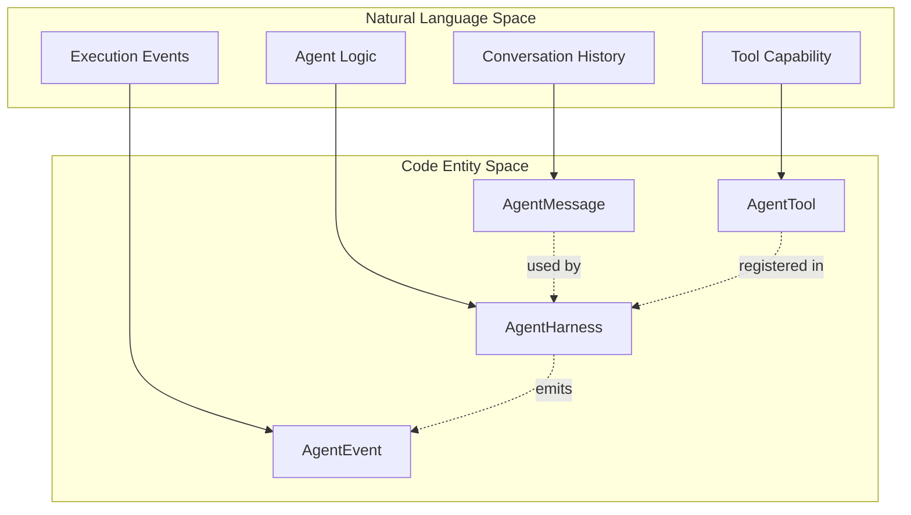
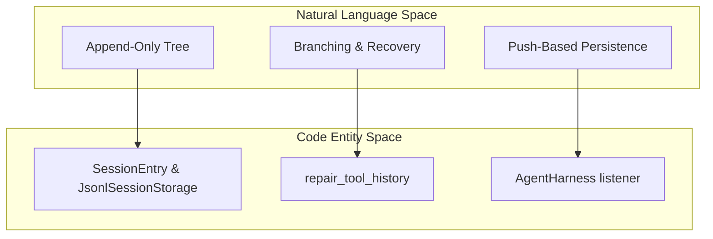

<!-- source: DeepWiki mcp.deepwiki.com · repo huggingface/tau · page 2.2 tau_agent: Portable Agent Brain · fetched 2026-10-26 -->

# tau_agent: Portable Agent Brain

Relevant source files

The following files were used as context for generating this wiki page:

- [dev-notes/tool-history-recovery.md](dev-notes/tool-history-recovery.md)
- [src/tau_agent/__init__.py](src/tau_agent/__init__.py)
- [src/tau_agent/harness.py](src/tau_agent/harness.py)
- [src/tau_agent/loop.py](src/tau_agent/loop.py)
- [src/tau_agent/messages.py](src/tau_agent/messages.py)
- [src/tau_agent/tool_history.py](src/tau_agent/tool_history.py)
- [tests/test_agent_harness.py](tests/test_agent_harness.py)
- [tests/test_agent_loop.py](tests/test_agent_loop.py)
- [tests/test_agent_types.py](tests/test_agent_types.py)
- [tests/test_tool_history.py](tests/test_tool_history.py)
- [website/content/internals/agent-loop.md](website/content/internals/agent-loop.md)

The `tau_agent` package serves as the core orchestration layer of Tau. It defines the "brain" of the agent—a stateful, reusable harness that manages conversational history (transcripts), tool execution, tool history recovery, and session persistence while remaining decoupled from specific UI implementations or coding-specific logic.

For details on the agent loop, turn lifecycles, and event types, see [Agent Loop and Events](#2.2.1). For session models and JSONL persistence, see [Session Tree and JSONL Persistence](#2.2.2).

## High-Level Architecture

The package bridges the gap between raw LLM providers (`tau_ai`) and application-specific environments (`tau_coding`). It provides a provider-neutral representation of messages, tools, and events.

### Entity Mapping: Logic to Code

**Agent Brain Entity Mapping**

Sources: [src/tau_agent/messages.py:130-215](), [src/tau_agent/tools.py:1-67](), [src/tau_agent/harness.py:62-82](), [src/tau_agent/events.py:1-20]()

---

## Core Components

### AgentHarness and Config
The `AgentHarness` is the primary stateful entry point [src/tau_agent/harness.py:62-63](). It maintains the message transcript and manages two distinct queues for message injection:
*   **Steering Queue:** For messages injected immediately during the current turn, used for user interruptions or automated corrections [src/tau_agent/harness.py:76](), [src/tau_agent/harness.py:121-126]().
*   **Follow-up Queue:** For messages processed once the current run naturally concludes [src/tau_agent/harness.py:77](), [src/tau_agent/harness.py:128-133]().

Configuration is handled via `AgentHarnessConfig`, which defines the provider, model, system prompt, and available tools [src/tau_agent/harness.py:39-49]().

### The Pure Agent Loop and Tool History Recovery
At the heart of the harness is `run_agent_loop`, a stateless function that iterates through LLM turns [src/tau_agent/loop.py:52-68](). It handles streaming provider deltas, transcript management, tool execution, queue draining, and invoking tool history repair (`repair_tool_history`) to guarantee provider compatibility [src/tau_agent/loop.py:42](), [src/tau_agent/loop.py:174-190]().

For a deep dive into turn lifecycles, tool execution, queuing modes, cancellation, and event types, see [Agent Loop and Events](#2.2.1).

Sources: [src/tau_agent/harness.py:39-200](), [src/tau_agent/loop.py:52-190](), [src/tau_agent/messages.py:130-215](), [src/tau_agent/events.py:1-20]()

---

## Session Primitives and Storage

Tau treats sessions as append-only trees of entries rather than flat message lists, enabling features like branching, compaction, and metadata tracking.

### Session Persistence Mapping

**Session Storage Entity Mapping**

Sources: [src/tau_agent/session/storage.py:1-60](), [src/tau_agent/tool_history.py:40-60]()

### Persistence and Tree Traversal
Entries are persisted via `JsonlSessionStorage`, which writes each entry as a JSON line [src/tau_agent/session/storage.py:1-60](). Tau uses **push-based persistence**, subscribing listeners to the harness so every notification writes immediately to disk before events reach frontends [src/tau_agent/harness.py:108-115]().

For details on entry models (`MessageEntry`, `CompactionEntry`, `LeafEntry`, etc.), tree traversal, and JSONL storage, see [Session Tree and JSONL Persistence](#2.2.2).

Sources: [src/tau_agent/session/storage.py:1-60](), [src/tau_agent/tool_history.py:40-165](), [src/tau_agent/harness.py:108-115]()

---

