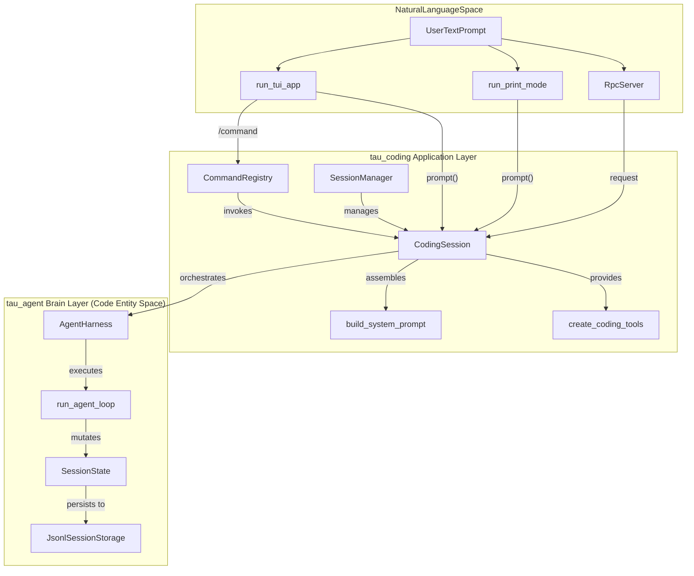
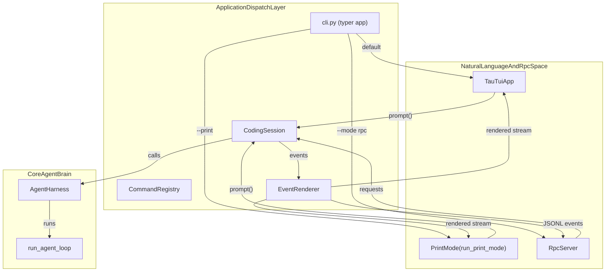

<!-- source: DeepWiki mcp.deepwiki.com · repo huggingface/tau · page 2.3 tau_coding: Coding Agent Application · fetched 2026-10-26 -->

# tau_coding: Coding Agent Application

Relevant source files

The following files were used as context for generating this wiki page:

- [src/tau_coding/cli.py](src/tau_coding/cli.py)
- [src/tau_coding/data/docs/cli.md](src/tau_coding/data/docs/cli.md)
- [src/tau_coding/session.py](src/tau_coding/session.py)
- [tests/test_cli.py](tests/test_cli.py)
- [tests/test_coding_session.py](tests/test_coding_session.py)
- [website/content/reference/cli.md](website/content/reference/cli.md)

The `tau_coding` package serves as the application and orchestration layer of the Tau architecture [src/tau_coding/session.py:1](). While `tau_ai` provides model connectivity [src/tau_ai/__init__.py:1]() and `tau_agent` provides the portable agent "brain" (loop and state management) [src/tau_agent/__init__.py:1](), `tau_coding` defines the specific environment for a coding assistant. It integrates filesystem tools, session persistence, resource discovery (skills/prompts), command parsing, project trust, extension runtimes, and provides CLI, TUI, and JSONL RPC frontends [src/tau_coding/cli.py:1](), [src/tau_coding/tui.py:1](), [src/tau_coding/rpc.py:1]().

---

## 1. CodingSession Orchestration and Lifecycle

`CodingSession` is the central orchestrator that wraps an `AgentHarness` and manages the lifecycle of a coding task [src/tau_coding/session.py:1](). It handles the translation between high-level application intent (e.g., executing prompts, switching models, compacting history, branching) and low-level agent events.

### Implementation and Data Flow
When a session is initialized via `CodingSession.load()`, or configured via `CodingSessionConfig`, it performs the following sequence:
1. **State Reconstruction**: Reads entries from a `SessionStorage` instance (typically `JsonlSessionStorage`) and replays them into a `SessionState` object [src/tau_coding/session.py:38]().
2. **Harness Creation**: Initializes an `AgentHarness` using the restored message transcript and the configured `ModelProvider` [src/tau_agent/harness.py:15]().
3. **Tool Attachment**: Injects standard coding tools (`read`, `write`, `edit`, `bash`) into the session via `create_coding_tools` and `create_bash_tool` [src/tau_coding/tools/__init__.py:170]().
4. **Resource Loading**: Discovers project context files like `AGENTS.md`, skills, and prompt templates using resource discovery modules [src/tau_coding/context.py:55](), [src/tau_coding/skills.py:153]().

**Figure 1: CodingSession Orchestration Flow**

**Sources:** [src/tau_coding/session.py:1](), [src/tau_coding/session_manager.py:147](), [src/tau_coding/commands/__init__.py:1](), [src/tau_coding/system_prompt.py:160]()

---

## 2. Built-in Tools and Resource Management

`tau_coding` implements concrete filesystem and execution tools along with resource discovery engines for skills, prompt templates, and system prompts.

### Tool Integration
Tools are instantiated via `create_coding_tools()` and `create_bash_tool()` [src/tau_coding/tools/__init__.py:170]():
- **`read`, `write`, `edit`**: Direct filesystem manipulation with safety checks, diff-based editing, and file locking mechanisms.
- **`bash`**: Shell command execution within the working directory (`cwd`) featuring timeout management and signal handling.

### System Prompt Assembly
The system prompt is dynamically assembled via `build_system_prompt()` [src/tau_coding/system_prompt.py:160](). It merges:
- Base system prompts or CLI overrides (`--system-prompt`, `--append-system-prompt`) [website/content/reference/cli.md:55-56]()
- Discovered project context files (`AGENTS.md`, `SYSTEM.md`) [src/tau_coding/system_prompt.py:154]()
- Available skills and tool descriptions
- Date and working directory metadata

**Sources:** [src/tau_coding/tools/__init__.py:170](), [src/tau_coding/system_prompt.py:154-162](), [website/content/reference/cli.md:55-56]()

---

## 3. Session Management, Persistence, and Compaction

Sessions are recorded as append-only sequences of `SessionEntry` objects in JSONL files via `JsonlSessionStorage` [src/tau_coding/session.py:32]().

### Key Session Features
- **Branching**: Moving the active leaf to an earlier point in the session tree using branch utilities [src/tau_coding/session.py:43]().
- **Compaction**: Summarizing token-heavy message histories into a `CompactionEntry` when exceeding `auto_compact_token_threshold` [src/tau_coding/context_window.py:61]() using `summarize_messages_for_compaction()` [src/tau_coding/context_window.py:65]().
- **Statistics & Usage**: Tracking token consumption, cost accumulation, tokens per second (TPS), time to first token (TTFT), and wait times via `calculate_session_stats()` [src/tau_coding/session_stats.py:152]().

**Table 1: Session Management Entities**

| Feature | Code Entity | File Path |
| :--- | :--- | :--- |
| **Session Orchestration** | `CodingSession` | [src/tau_coding/session.py:1]() |
| **Storage Backend** | `JsonlSessionStorage` | [src/tau_coding/session.py:32]() |
| **Session Discovery & CRUD** | `SessionManager` | [src/tau_coding/session_manager.py:148]() |
| **Context Compaction** | `summarize_messages_for_compaction` | [src/tau_coding/context_window.py:65]() |
| **Session Statistics** | `calculate_session_stats` | [src/tau_coding/session_stats.py:152]() |

**Sources:** [src/tau_coding/session.py:1](), [src/tau_coding/session_manager.py:148](), [src/tau_coding/context_window.py:61-65](), [src/tau_coding/session_stats.py:152]()

---

## 4. Frontends: CLI, TUI, Print Mode, and RPC

`tau_coding` supports multiple operational interfaces built around the `CodingSession` abstraction [src/tau_coding/cli.py:1]().

### Operational Modes
1. **Interactive TUI**: Launched via `run_tui_app()` [src/tau_coding/cli.py:71](); provides a rich terminal user interface using Textual, streaming responses, markdown rendering, and modal pickers.
2. **Print Mode**: Executed via `run_print_mode()` [src/tau_coding/cli.py:51](); a non-interactive output mode for single prompts or CI pipelines that formats events via `create_event_renderer()` [src/tau_coding/cli.py:52]().
3. **JSONL RPC Mode**: Implemented by `RpcServer` [src/tau_coding/cli.py:54](); provides a Pi-compatible JSONL subprocess protocol over `stdin`/`stdout` for IDE integration.

**Figure 2: Frontend to Application Dispatch Flow**

**Sources:** [src/tau_coding/cli.py:51-78](), [src/tau_coding/session.py:1](), [src/tau_coding/rendering.py:52]()

---

## 5. Provider Configuration, Credentials, Extensions, and Project Trust

Managing LLM endpoints, authentication, execution security, and custom extensions is handled through a set of configuration stores and coordinators within `tau_coding`.

- **Provider Settings & Catalog**: Managed through `ProviderSettings`, `load_provider_settings()`, and catalog loaders that query `models.dev` overlays and local overrides [src/tau_coding/provider_config.py:112]().
- **Credentials & OAuth**: Stored securely via `FileCredentialStore` supporting API keys and OAuth flows [src/tau_coding/credentials.py:67]().
- **Project Trust**: Gated by `ProjectTrustCoordinator` and `ProjectTrustStore`, evaluating whether ambient project files (like extensions or custom system prompts) are safe to load [src/tau_coding/project_trust.py:93]().
- **Extension Runtime**: Managed via `ExtensionRuntime` which handles dynamic tool registration, command injection, and hook payloads [src/tau_coding/extensions/runtime.py:1]().

**Sources:** [src/tau_coding/provider_config.py:112](), [src/tau_coding/credentials.py:67](), [src/tau_coding/project_trust.py:93](), [src/tau_coding/extensions/runtime.py:1]()

---

