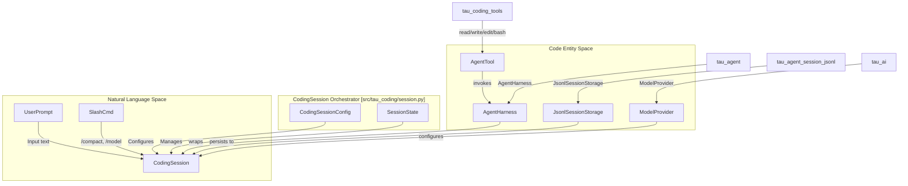
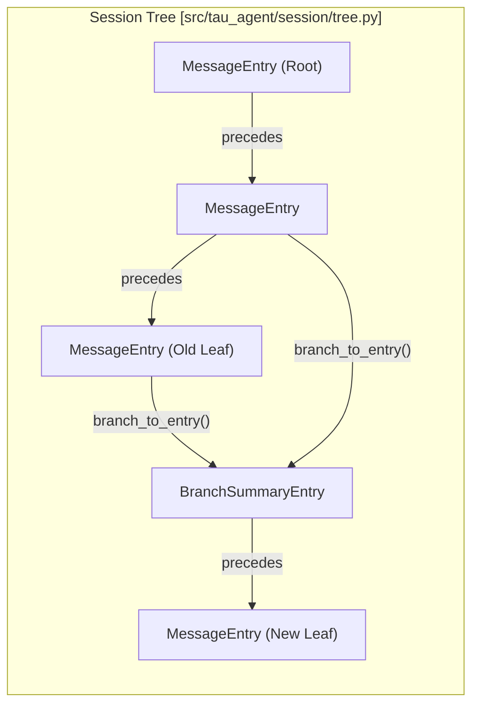

<!-- source: DeepWiki mcp.deepwiki.com · repo huggingface/tau · page 3 CodingSession: Session Lifecycle · fetched 2026-10-26 -->

# CodingSession: Session Lifecycle

Relevant source files

The following files were used as context for generating this wiki page:

- [src/tau_coding/session.py](src/tau_coding/session.py)
- [tests/test_coding_session.py](tests/test_coding_session.py)

The `CodingSession` class is the central orchestrator of the `tau_coding` package [src/tau_coding/session.py:1](). It wraps the core `AgentHarness` execution engine [src/tau_agent/harness.py:15-15]() and provides the necessary infrastructure for a persistent coding environment, including tool management, context window optimization, usage accounting, and session history management [src/tau_coding/session.py:226-258]().

## Overview

While `AgentHarness` manages the raw agent loop, `CodingSession` handles application-level concerns:
- **Persistence**: Loading and saving session state via `SessionStorage` (typically `JsonlSessionStorage`) [src/tau_coding/session.py:233-233]().
- **Environment**: Managing the current working directory (`cwd`), coding tools (`read`, `write`, `edit`, `bash`), and project context [src/tau_coding/session.py:234-241]().
- **Commands**: Providing a `CommandRegistry` for slash commands like `/compact`, `/model`, or `/skill` [src/tau_coding/session.py:246-246]().
- **Optimization**: Monitoring token usage and executing compaction plans to stay within model context limits [src/tau_coding/session.py:251-253]().

### Session State Mapping
The following diagram illustrates how `CodingSession` bridges high-level user interactions to the underlying session entries and model providers.

**Diagram: Session Lifecycle Flow**

Sources: [src/tau_coding/session.py:226-258](), [src/tau_agent/session/state.py:11-25](), [src/tau_coding/tools.py:164-164]()

---

## Session Initialization and State
Sessions are initialized via `CodingSession.load()`, which reconstructs the `SessionState` from a JSONL storage file [src/tau_coding/session.py:311-316](). If storage is empty, a new session tree is created. The `CodingSessionConfig` defines the initial provider, model, and system prompt parameters [src/tau_coding/session.py:226-258]().

Key initialization steps include resource discovery, state reconstruction from `SessionEntry` streams, and system prompt assembly [src/tau_coding/session.py:311-392]().

For details, see [Session Initialization and State](#3.1).

Sources: [src/tau_coding/session.py:311-392](), [src/tau_agent/session/storage.py:17-29]()

---

## Context Compaction and Token Accounting
To prevent the LLM from exceeding its context window, `CodingSession` tracks token usage via estimation utilities [src/tau_coding/context_window.py:54-54](). When thresholds are reached, the session executes compaction plans to summarize historical messages while retaining recent context [src/tau_coding/session.py:209-215]().

Compaction replaces sequences of message entries with `CompactionEntry` objects in the append-only session history [src/tau_agent/session/entries.py:26-26]().

For details, see [Context Compaction and Token Accounting](#3.2).

Sources: [src/tau_coding/session.py:770-785](), [src/tau_coding/context_window.py:47-57]()

---

## Session Branching and Export
Tau supports non-linear session histories through branching. Users can jump to a previous point in the session tree using `branch_to_entry()`, generating a `BranchSummaryEntry` and updating the active leaf [src/tau_agent/session/entries.py:25-25]().

**Diagram: Session Tree Branching**

Sources: [src/tau_agent/session/tree.py:39-39](), [src/tau_coding/session.py:905-925]()

Exporting sessions is handled by `export_session_artifact`, enabling users to save their work as readable HTML transcripts or portable JSONL files [src/tau_coding/session_export.py:119-123]().

For details, see [Session Branching and Export](#3.3).

Sources: [src/tau_coding/session.py:905-945](), [src/tau_coding/session_export.py:119-123]()

---

## Usage, Stats, and Response Timing
`CodingSession` tracks operational metrics across its lifecycle using `session_usage.py` and `session_stats.py` [src/tau_coding/session_stats.py:1-150](). These modules accumulate token counts, compute estimated API costs, measure average tokens per second (TPS), time-to-first-token (TTFT), and track provider-wait durations.

These statistics surface dynamically in the TUI sidebar and populate the usage tab of HTML exports [website/content/guides/sessions.md:117-122]().

For details, see [Usage, Stats, and Response Timing](#3.4).

Sources: [src/tau_coding/session_stats.py:1-150](), [website/content/guides/sessions.md:117-122]()

---

