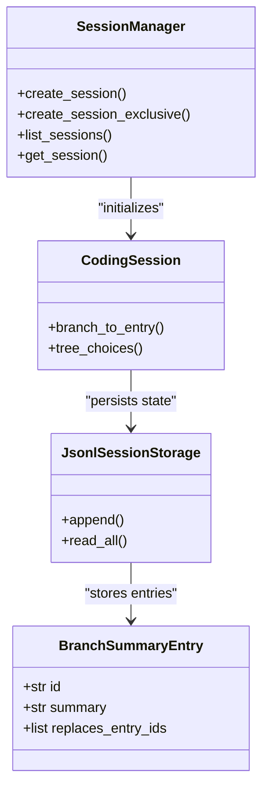
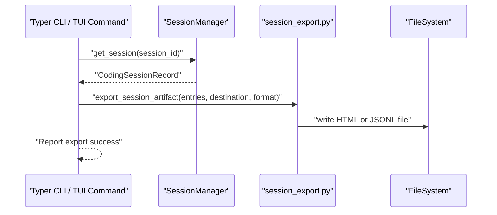

<!-- source: DeepWiki mcp.deepwiki.com · repo huggingface/tau · page 3.3 Session Branching and Export · fetched 2026-10-26 -->

# Session Branching and Export

<details>
<summary>Relevant source files</summary>

The following files were used as context for generating this wiki page:

- [dev-notes/architecture/phase-20-4-session-export.md](dev-notes/architecture/phase-20-4-session-export.md)
- [dev-notes/export-usage-event-markers.md](dev-notes/export-usage-event-markers.md)
- [dev-notes/print-mode-session-ids.md](dev-notes/print-mode-session-ids.md)
- [dev-notes/print-mode-session-resume.md](dev-notes/print-mode-session-resume.md)
- [dev-notes/session-export-usage-tab.md](dev-notes/session-export-usage-tab.md)
- [src/tau_agent/session/storage.py](src/tau_agent/session/storage.py)
- [src/tau_agent/session/tree.py](src/tau_agent/session/tree.py)
- [src/tau_coding/session_export.py](src/tau_coding/session_export.py)
- [src/tau_coding/session_manager.py](src/tau_coding/session_manager.py)
- [src/tau_coding/session_usage.py](src/tau_coding/session_usage.py)
- [tests/test_session_export.py](tests/test_session_export.py)
- [tests/test_session_manager.py](tests/test_session_manager.py)
- [tests/test_session_usage.py](tests/test_session_usage.py)
- [website/content/guides/print-mode.md](website/content/guides/print-mode.md)
- [website/content/guides/sessions.md](website/content/guides/sessions.md)

</details>


This page covers session persistence, branching mechanics, model-assisted branch summarization, session metadata management via `SessionManager` [src/tau_coding/session_manager.py:122-123](), and exporting transcripts to HTML and JSONL formats [src/tau_coding/session_export.py:74-128]().

## Session Management, CRUD, and Auto Session Naming

The `SessionManager` class handles the lifecycle, indexing, and auto-naming of user-home coding sessions [src/tau_coding/session_manager.py:122-123](). It maintains a hierarchical index per project and globally [src/tau_coding/session_manager.py:129-136]().

### Key Data Structures and Validation
- **`CodingSessionRecord`**: Durable metadata representing a coding session, including its unique `id`, filesystem `path`, working directory (`cwd`), `model`, optional `title`, and timestamps [src/tau_coding/session_manager.py:73-86]().
- **`SessionRecordModel`**: A Pydantic model (`extra="ignore"`) used for serializing records to JSONL indexes [src/tau_coding/session_manager.py:55-70]().
- **Session Naming and ID Rules**: `normalize_session_name()` cleans and validates human-readable session names (rejecting empty or multi-line strings) [src/tau_coding/session_manager.py:29-36](). `validate_session_id()` ensures session IDs are safe for cross-platform filenames, checking length (`_MAX_SESSION_ID_BYTES`), reserved words (`_RESERVED_SESSION_IDS` like `default`, `index`), Windows reserved stems, and regex compliance [src/tau_coding/session_manager.py:39-53]().

### CRUD Implementation Details
- **Create**: `create_session()` builds a session record, assigns an ID or uses a provided one, creates the transcript file, and records it in the project index [src/tau_coding/session_manager.py:159-181]().
- **Exclusive Creation**: `create_session_exclusive()` safely reserves transcript IDs atomically to prevent race conditions during parallel worker initialization (e.g., in print mode) [src/tau_coding/session_manager.py:183-199]().
- **Listing and Reading**: `list_sessions()` aggregates records from project indexes or global indexes, sorting them by `updated_at` descending [src/tau_coding/session_manager.py:137-146](). `get_session()` retrieves a specific record by ID [src/tau_coding/session_manager.py:147-152]().

Sources: [src/tau_coding/session_manager.py:1-251](), [tests/test_session_manager.py:1-163]()

## Session Branching and BranchSummaryEntry Generation

Tau sessions are structured as append-only trees of `SessionEntry` objects [src/tau_agent/session/storage.py:17-37](). Users can explore alternative hypotheses or forks without losing past context.

### Branch Navigation
- **`tree_choices()`**: Traverses the session tree to return a list of branchable nodes (such as user prompts and tool responses) for UI selection [src/tau_coding/session.py:1220-1252]().
- **`branch_to_entry()`**: Relocates the active session leaf to a specified `entry_id` by appending a new `LeafEntry` to the JSONL log, updating the active conversation path [src/tau_coding/session.py:1254-1311]().

### Branch Summary Generation
When abandoning a branch to return to an earlier node, Tau can synthesize a `BranchSummaryEntry` using `summarize_branch_messages_with_model()` in `branch_summary.py` [src/tau_coding/branch_summary.py:66-73]().

1. **Serialization**: Branch messages are formatted into a text representation, truncating long tool results to fit within length limits (`MAX_SUMMARY_SOURCE_MESSAGE_CHARS`, `MAX_SUMMARY_SOURCE_TOTAL_CHARS`) [src/tau_coding/branch_summary.py:61-63](), [src/tau_coding/branch_summary.py:122-138]().
2. **Model Request**: An LLM request is executed with `BRANCH_SUMMARY_SYSTEM_PROMPT` and `BRANCH_SUMMARY_PROMPT` to produce a structured markdown breakdown (Goal, Constraints, Progress, Key Decisions, Next Steps) [src/tau_coding/branch_summary.py:18-59](), [src/tau_coding/branch_summary.py:79-97]().
3. **Context Enrichment**: File read/write operations performed during the abandoned exploration are appended as `<read-files>` and `<modified-files>` blocks [src/tau_coding/branch_summary.py:187-196]().

### Code-to-System Mapping: Branching & Session Management


Sources: [src/tau_coding/session_manager.py:122-199](), [src/tau_coding/session.py:1220-1311](), [src/tau_coding/branch_summary.py:66-103](), [src/tau_agent/session/entries.py:91-95]()

## Session Export: HTML and JSONL

Sessions can be exported to standalone artifacts via `session_export.py` [src/tau_coding/session_export.py:1-127]().

### Export Formats and Functions
- **`export_session_jsonl()`**: Dumps all session entries line-by-line into a standard JSONL file [src/tau_coding/session_export.py:74-78]().
- **`export_session_html()`**: Generates a self-contained HTML document containing a sidebar tree, detailed entry stream, theme toggles, and an embedded base64 copy for JSONL round-tripping [src/tau_coding/session_export.py:87-106](), [src/tau_coding/session_export.py:177-201]().
- **`export_session_artifact()`**: Dispatches to either HTML or JSONL export based on the requested format or file extension [src/tau_coding/session_export.py:109-128]().

### HTML Export Architecture and Usage Tab
The generated HTML file includes two interactive tabs:
1. **Transcript Tab**: Features an interactive tree sidebar reflecting parent-child branches and an entry stream with collapsible accordions for messages, tools, and events [src/tau_coding/session_export.py:187-198](), [dev-notes/architecture/phase-20-4-session-export.md:27-33]().
2. **Usage Tab**: Renders charts for token consumption, cache hit rates, estimated costs (via provider catalog rates), tool call counts, and notable session events (compactions, model changes, thinking changes) [src/tau_coding/session_usage.py:117-207](), [dev-notes/session-export-usage-tab.md:5-10]().

Sources: [src/tau_coding/session_export.py:1-204](), [src/tau_coding/session_usage.py:1-224](), [dev-notes/architecture/phase-20-4-session-export.md:1-82]()

## The Export CLI Command and TUI Integration

The CLI exposes session exporting through the `tau export` command [dev-notes/architecture/phase-20-4-session-export.md:9-17](). Users can export sessions by ID or direct file path:

```bash
tau export <session-id>
tau export <session-id> session.html
tau export <session-id> --format jsonl
```

Inside the interactive TUI, the same functionality is accessible via the slash command `/export [--format html|jsonl] [destination]` [dev-notes/architecture/phase-20-4-session-export.md:21-25]().

### Code Entity Mapping: Export Flow


Sources: [src/tau_coding/session_manager.py:122-153](), [src/tau_coding/session_export.py:107-128](), [dev-notes/architecture/phase-20-4-session-export.md:9-25]()

---

