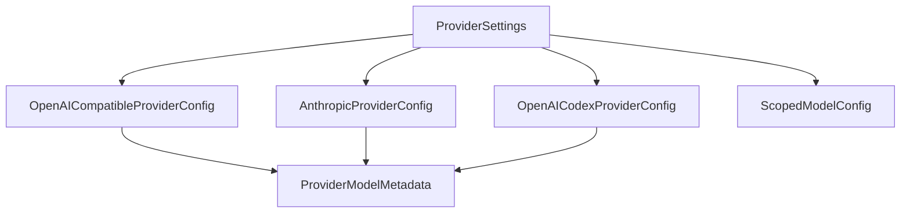
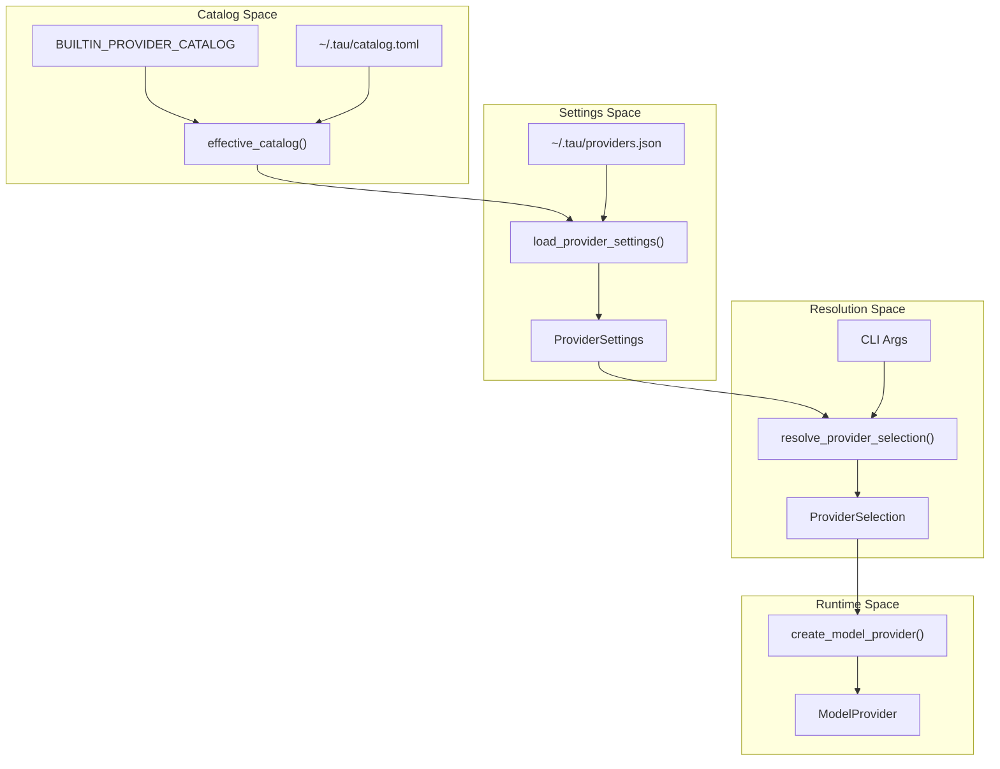

<!-- source: DeepWiki mcp.deepwiki.com · repo huggingface/tau · page 4.1 Provider Settings and Catalog · fetched 2026-10-26 -->

# Provider Settings and Catalog

Relevant source files

The following files were used as context for generating this wiki page:

- [dev-notes/architecture/config-driven-provider-catalog.md](dev-notes/architecture/config-driven-provider-catalog.md)
- [src/tau_coding/__init__.py](src/tau_coding/__init__.py)
- [src/tau_coding/provider_config.py](src/tau_coding/provider_config.py)
- [tests/test_provider_config.py](tests/test_provider_config.py)

Tau manages Large Language Model (LLM) connectivity through a durable configuration system located in the `tau_coding` package. This system abstracts the differences between providers (OpenAI, Anthropic, etc.) while allowing users to customize endpoints, models, and thinking capabilities through a hierarchical catalog and settings model.

For detailed information on the underlying catalog schemas, model metadata, cost tiers, and user overlays, see [Catalog Loader and models.dev Overlays](#4.1.1).

## Overview and Purpose

The provider configuration system bridges high-level user preferences with low-level runtime configurations needed by `tau_ai`. It coordinates durable persistence to disk, credential handling, and the lifecycle required to initialize active models.

### Key Data Entities

| Entity | Role | Source |
| :--- | :--- | :--- |
| `ProviderSettings` | Root container for user-defined provider configurations and preferences. | `[src/tau_coding/provider_config.py:258-283]()` |
| `ScopedModelConfig` | Tracks user session favorites for specific provider and model pairs. | `[src/tau_coding/provider_config.py:249-256]()` |
| `OpenAICompatibleProviderConfig` | Durable settings for OpenAI-compatible providers. | `[src/tau_coding/provider_config.py:113-135]()` |
| `AnthropicProviderConfig` | Specialized configuration for Anthropic models. | `[src/tau_coding/provider_config.py:187-209]()` |
| `OpenAICodexProviderConfig` | OAuth-based subscription settings for Codex/ChatGPT models. | `[src/tau_coding/provider_config.py:218-246]()` |

Sources: `[src/tau_coding/provider_config.py:113-283]`, `[src/tau_coding/__init__.py:66-98]()`

---

## Provider Configuration Class Hierarchy

The configuration data model links persistent user preferences to strongly-typed dataclasses representing each provider family and its associated model metadata.

Provider Configuration Class Hierarchy

Sources: `[src/tau_coding/provider_config.py:68-283]`, `[tests/test_provider_config.py:10-35]()`

---

## Load-Merge-Resolve Lifecycle

Tau follows a multi-stage resolution pipeline to construct runtime provider instances from persistent disk storage and built-in defaults.

Provider Configuration Resolution Lifecycle

Sources: `[src/tau_coding/catalog_loader.py:128-150]`, `[src/tau_coding/provider_config.py:539-558]`, `[src/tau_coding/provider_runtime.py:51-152]()`

---

## Persistence: Load, Save, and Legacy Migration

Durable provider settings are serialized into JSON format under the user's home directory. The function `load_provider_settings()` reads `providers.json`, falling back to built-in defaults if the file is absent (`[src/tau_coding/provider_config.py:539-558]()`). Conversely, `save_provider_settings()` writes configuration atomically using temporary files and automatic `.bak` backups (`[src/tau_coding/provider_config.py:605-625]()`).

Legacy schema versions or stale model references (such as removed Codex aliases) are pruned or migrated automatically during loading to ensure runtime compatibility (`[tests/test_provider_config.py:39-64]()`).

Sources: `[src/tau_coding/provider_config.py:539-625]`, `[tests/test_provider_config.py:39-64]()`

---

## Child Page Details

For deep dives into the underlying catalog schema and overlay loading mechanisms, refer to the child page:
- [Catalog Loader and models.dev Overlays](#4.1.1)

Sources: `[src/tau_coding/catalog_loader.py:1-183]()`

---

