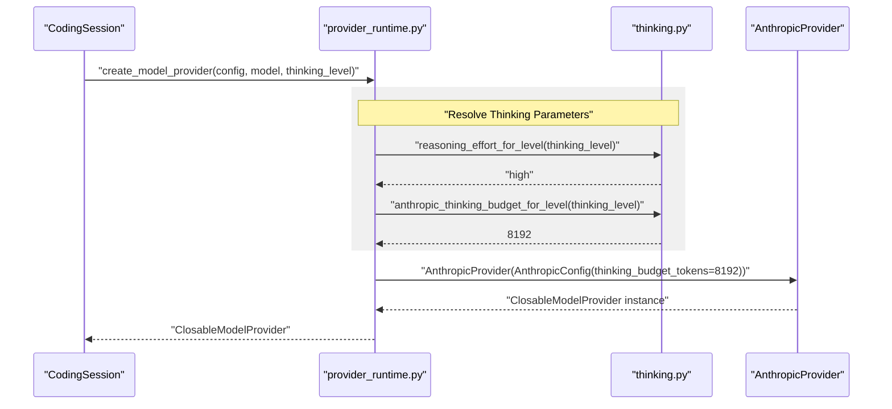
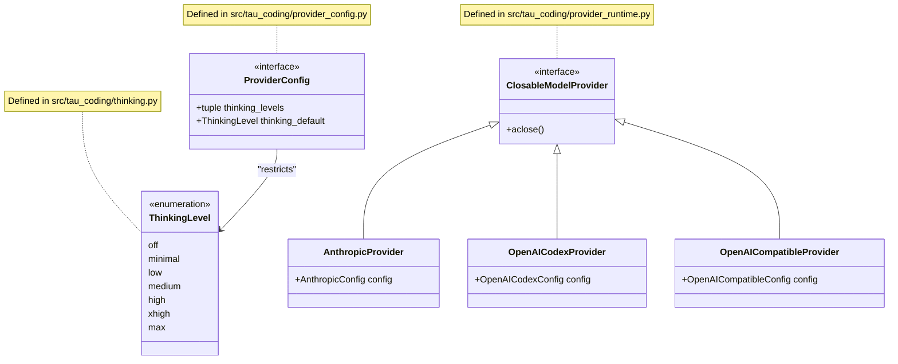

<!-- source: DeepWiki mcp.deepwiki.com · repo huggingface/tau · page 4.2 Runtime Provider Construction and Thinking Levels · fetched 2026-10-26 -->

# Runtime Provider Construction and Thinking Levels

Relevant source files

The following files were used as context for generating this wiki page:

- [dev-notes/architecture/zai-thinking-serialization.md](dev-notes/architecture/zai-thinking-serialization.md)
- [dev-notes/hugging-face-sticky-routing.md](dev-notes/hugging-face-sticky-routing.md)
- [src/tau_coding/provider_runtime.py](src/tau_coding/provider_runtime.py)
- [src/tau_coding/thinking.py](src/tau_coding/thinking.py)
- [tests/test_provider_runtime.py](tests/test_provider_runtime.py)
- [tests/test_thinking.py](tests/test_thinking.py)

This page covers the core runtime construction mechanics for LLM providers in Tau, the `ThinkingLevel` abstraction and its mapping to provider-specific reasoning controls (such as OpenAI reasoning effort and Anthropic thinking budgets), provider hot-swapping via `ClosableModelProvider`, and advanced routing patterns like Hugging Face sticky routing.

Sources: `[src/tau_coding/provider_runtime.py:1-158](), [src/tau_coding/thinking.py:1-79](), [dev-notes/hugging-face-sticky-routing.md:1-79]()`

---

## Runtime Provider Construction

The primary entry point for turning a static configuration into an active LLM client is `create_model_provider()` [tests/test_provider_runtime.py:17-27](). This function resolves credentials, validates model compatibility, applies thinking settings, and returns a `ClosableModelProvider`. For dynamic or extension-defined providers, Tau provides `create_dynamic_model_provider()` to instantiate runtime candidates safely from process-local definitions [src/tau_coding/provider_runtime.py:74-86]().

### ClosableModelProvider Protocol
The `ClosableModelProvider` protocol extends the base `ModelProvider` from `tau_agent.provider` by adding an asynchronous `aclose()` method `[src/tau_coding/provider_runtime.py:66-72]()`. This allows the `CodingSession` to cleanly shut down network clients or file handles when a provider is hot-swapped or the session terminates.

### Provider Dispatch Logic
`create_model_provider` performs dispatch across concrete backend configurations to instantiate the appropriate runtime client:
* **Anthropic:** `AnthropicProviderConfig` constructs `AnthropicProvider` [src/tau_ai/anthropic.py]() with proper OAuth or API key headers and cache retention tiers [tests/test_provider_runtime.py:112-144]().
* **OpenAI Codex:** `OpenAICodexProviderConfig` constructs `OpenAICodexProvider` [src/tau_ai/openai_codex.py]() with version resolution [src/tau_coding/codex_version.py]() and model-specific image capabilities [tests/test_provider_runtime.py:20-51]().
* **OpenAI Compatible:** `OpenAICompatibleProviderConfig` constructs `OpenAICompatibleProvider` [src/tau_ai/openai_compatible.py]() supporting custom headers, prompt caching keys, session affinity settings, and model aliasing for gateways [tests/test_provider_runtime.py:53-67]().

Sources: `[src/tau_coding/provider_runtime.py:66-158](), [tests/test_provider_runtime.py:20-144]()`

---

## Thinking Levels and Reasoning

Tau provides a unified abstraction for reasoning or thinking modes (`ThinkingLevel`), which map to provider-specific request parameters depending on the target model family.

### The ThinkingLevel Enum
The `ThinkingLevel` type defines seven standard intensities [src/tau_coding/thinking.py:8-20]():
* `off`: No reasoning tokens.
* `minimal`: Very brief reasoning.
* `low`: Light reasoning.
* `medium`: Moderate reasoning (Default) [src/tau_coding/thinking.py:21]().
* `high`: Deep reasoning.
* `xhigh`: Very deep reasoning.
* `max`: Maximum reasoning.

### Provider-Specific Mappings
Tau maps these abstract levels into provider parameters [src/tau_coding/thinking.py:9]():
1. **`reasoning_effort` (OpenAI & Compatible):** Maps `ThinkingLevel` directly to OpenAI-compatible `reasoning_effort` fields (`none`, `minimal`, `low`, `medium`, `high`, `xhigh`, `max`) via `reasoning_effort_for_level()` [src/tau_coding/thinking.py:57-62]().
2. **`anthropic.thinking` (Anthropic):** Maps levels to explicit `budget_tokens` integers via `anthropic_thinking_budget_for_level()` [src/tau_coding/thinking.py:65-77]():
   * `minimal`: `1024`
   * `low`: `2048`
   * `medium`: `4096`
   * `high`: `8192`
   * `xhigh`: `16384`
   * `max`: `32768`
3. **Z.AI Thinking Serialization:** For Z.AI compatible endpoints, Tau preserves logical thinking state when `supportsReasoningEffort` is false by serializing a `thinking` object (`{"thinking": {"type": "enabled"}}` or `{"type": "disabled"}`), and emits `reasoning_effort` only when model catalog metadata explicitly supports it [dev-notes/architecture/zai-thinking-serialization.md:1-37]().

Sources: `[src/tau_coding/thinking.py:1-79](), [dev-notes/architecture/zai-thinking-serialization.md:1-37](), [tests/test_thinking.py:1-43]()`

---

## Hugging Face Sticky Routing and Failover

Tau pins a logical model from its built-in `huggingface` provider to one explicit Hugging Face Inference Provider `[dev-notes/hugging-face-sticky-routing.md:1-12]().`

### Session-Scoped Routing Mechanics
1. **Automatic Routing:** Without a configured preference, the first request uses automatic routing through the Hugging Face Router [dev-notes/hugging-face-sticky-routing.md:7-11]().
2. **Header Pinning:** After a successful request, Tau reads the `x-inference-provider` response header and rebuilds the runtime with that explicit provider suffix (e.g., `zai-org/GLM-5.2:deepinfra`) [dev-notes/hugging-face-sticky-routing.md:7-11]().
3. **Model Aliasing:** The OpenAI-compatible runtime uses an internal logical-to-wire model alias mapping [dev-notes/hugging-face-sticky-routing.md:13-19]() so that the harness and persisted assistant messages continue using the clean logical model ID while wire payloads incorporate the backing inference provider suffix.

Sources: `[dev-notes/hugging-face-sticky-routing.md:1-79](), [tests/test_provider_runtime.py:69-96]()`

---

## Data Flow: Config to Runtime Construction

The following sequence diagram illustrates how a `ProviderConfig`, model selection, and `ThinkingLevel` are transformed into a functional `ClosableModelProvider`.

Sources: `[src/tau_coding/provider_runtime.py:1-158](), [src/tau_coding/thinking.py:57-77]()`

---

## Entity Relationship: Thinking and Providers

This class diagram maps the structural relationships between provider configuration classes, thinking enums, and runtime provider implementations in code.

Sources: `[src/tau_coding/provider_config.py:1-100](), [src/tau_coding/thinking.py:1-35](), [src/tau_coding/provider_runtime.py:66-72]()`

---

