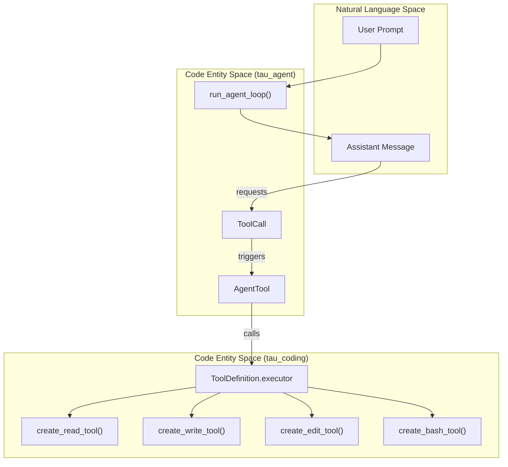
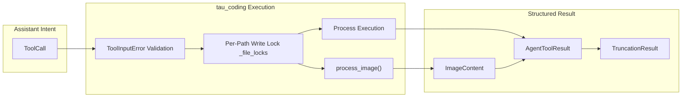

<!-- source: DeepWiki mcp.deepwiki.com · repo huggingface/tau · page 5 Built-in Coding Tools · fetched 2026-10-26 -->

# Built-in Coding Tools

Relevant source files

The following files were used as context for generating this wiki page:

- [dev-notes/architecture/multimodal-read-results.md](dev-notes/architecture/multimodal-read-results.md)
- [dev-notes/architecture/read-image-processing.md](dev-notes/architecture/read-image-processing.md)
- [src/tau_ai/content.py](src/tau_ai/content.py)
- [src/tau_coding/image_processing.py](src/tau_coding/image_processing.py)
- [src/tau_coding/tools.py](src/tau_coding/tools.py)
- [tests/test_coding_tools.py](tests/test_coding_tools.py)
- [tests/test_multimodal_provider_payloads.py](tests/test_multimodal_provider_payloads.py)
- [website/content/reference/tools.md](website/content/reference/tools.md)

Tau provides a set of four built-in tools—`read`, `write`, `edit`, and `bash`—that enable the agent to interact with a local filesystem and shell environment [website/content/reference/tools.md:6-8](). These tools are defined in the `tau_coding` package (`src/tau_coding/tools.py`), keeping the core `tau_agent` loop platform-agnostic while providing the necessary primitives for software engineering tasks [src/tau_coding/tools.py:1-8]().

The tools are designed to be provider-neutral, returning structured `AgentToolResult` objects that the agent loop can process and persist in the session transcript [src/tau_agent/tools.py:25-30]().

### Architecture and Integration

The tools are separated into two layers: the abstract definition and the concrete implementation. The `tau_agent` package defines the `AgentTool` protocol, while `tau_coding` implements the specific logic for local development using `ToolDefinition` to bridge the gap [src/tau_coding/tools.py:96-103]().

#### Tool Lifecycle Diagram
This diagram shows how a natural language request from a user is transformed into a concrete filesystem or shell action via the tool infrastructure, mapping natural language concepts to concrete code entities.

Sources: [src/tau_agent/tools.py:25-30](), [src/tau_coding/tools.py:96-134](), [src/tau_coding/tools.py:164-185]()

### The Core Toolset

Tau exposes these tools through the `create_coding_tools()` factory function, which initializes them relative to a specific working directory (`cwd`) [src/tau_coding/tools.py:164-178]().

| Tool | Purpose | Key Features |
| :--- | :--- | :--- |
| `read` | File inspection | Supports line-based slicing (`offset`, `limit`) and multimodal image detection (JPEG, static PNG, GIF, WebP, and BMP) with auto-normalization [src/tau_coding/tools.py:188-200](), [website/content/reference/tools.md:33-43](). |
| `write` | File creation | Creates parent directories and overwrites existing files with complete UTF-8 content [website/content/reference/tools.md:73-75](). |
| `edit` | Precise modification | Uses exact string replacement with mandatory unique matches and full rollback on failure [website/content/reference/tools.md:95-98](). |
| `bash` | Shell execution | Runs commands in the `cwd` with support for timeouts, signal handling, output tailing, and present-participle display descriptions [website/content/reference/tools.md:114-117](). |

#### Data Flow: Tool Call to Result
The following diagram maps the transition from an assistant's intent to the structured data returned by the environment, including validation, file locks, and image processing.

Sources: [src/tau_agent/tools.py:25-27](), [src/tau_coding/tools.py:47-48](), [src/tau_coding/tools.py:137](), [src/tau_coding/tools.py:69-90](), [src/tau_coding/image_processing.py:32-39]()

### Tool Configuration, Safety, and Multimodal Support

*   **File Locking**: To prevent race conditions, the tools share per-path write/edit locks (`_file_locks`) within the process, ensuring concurrent mutations do not interleave [src/tau_coding/tools.py:137](), [src/tau_coding/tools.py:175-177]().
*   **Output Management**: Results are automatically truncated if they exceed `DEFAULT_MAX_OUTPUT_LINES` (2,000) or `DEFAULT_MAX_OUTPUT_BYTES` (50 KB) to prevent context window overflow [src/tau_coding/tools.py:41-42]().
*   **Multimodal Processing**: The `read` tool detects images by content (magic bytes) rather than extension [tests/test_coding_tools.py:128-136](). It normalizes images to fit provider limits, such as converting BMP to PNG or resizing large dimensions via `process_image()` [src/tau_coding/image_processing.py:85-121](), [website/content/reference/tools.md:36-43]().
*   **Input Validation**: Tools raise `ToolInputError` for malformed arguments, which are reported back to the agent as text results [src/tau_coding/tools.py:47-48]().
*   **Shell Customization & Display**: The `bash` tool requires a present-participle `description` argument to power clean, compact TUI rendering while supporting execution prefixes via `shell_command_prefix` [src/tau_coding/tools.py:167](), [website/content/reference/tools.md:111-117]().

Sources: [src/tau_coding/tools.py:41-177](), [src/tau_coding/image_processing.py:85-121](), [tests/test_coding_tools.py:128-136]()

### Further Reading

For detailed technical specifications, implementation details, and the prompt assembly logic, see the following child pages:

*   **[Tool Definitions: read, write, edit, bash](#5.1)**: Deep dive into the `ToolDefinition` class, the `TruncationResult` metadata, the edit diff algorithm, bash timeout/signal handling, image MIME support and the image processing pipeline, and `ToolInputError`.
*   **[System Prompt Assembly](#5.2)**: Covers `build_system_prompt()`, `BuildSystemPromptOptions`, project context files, tool/skill formatting, `AGENTS.md` discovery, `SYSTEM.md`/`APPEND_SYSTEM.md` precedence, bundled self-docs, and `TauResourcePaths`.

Sources: [src/tau_coding/tools.py:96-134](), [src/tau_coding/image_processing.py:1-50](), [src/tau_agent/messages.py:24-25]()

---

