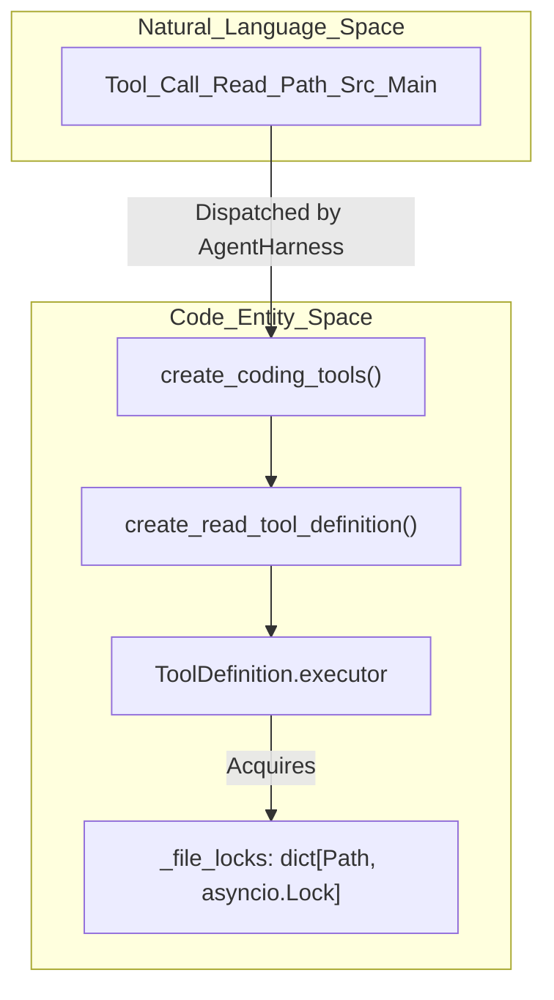
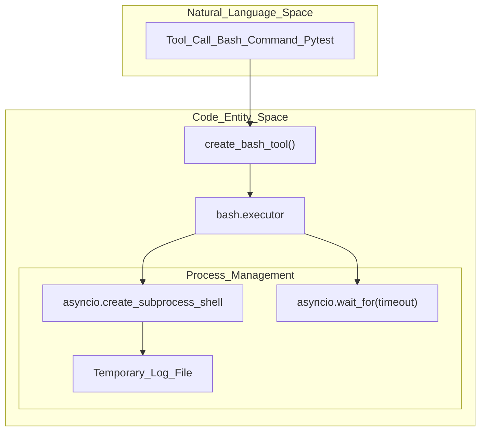

<!-- source: DeepWiki mcp.deepwiki.com · repo huggingface/tau · page 5.1 Tool Definitions: read, write, edit, bash · fetched 2026-10-26 -->

# Tool Definitions: read, write, edit, bash

Relevant source files

The following files were used as context for generating this wiki page:

- [dev-notes/architecture/multimodal-read-results.md](dev-notes/architecture/multimodal-read-results.md)
- [dev-notes/architecture/read-image-processing.md](dev-notes/architecture/read-image-processing.md)
- [src/tau_ai/content.py](src/tau_ai/content.py)
- [src/tau_coding/image_processing.py](src/tau_coding/image_processing.py)
- [src/tau_coding/tools.py](src/tau_coding/tools.py)
- [tests/test_coding_tools.py](tests/test_coding_tools.py)
- [tests/test_multimodal_provider_payloads.py](tests/test_multimodal_provider_payloads.py)
- [website/content/reference/tools.md](website/content/reference/tools.md)

## Purpose and Scope

This page provides a deep technical dive into Tau's built-in coding tools (`read`, `write`, `edit`, and `bash`), implemented in the `tau_coding` package [src/tau_coding/tools.py:1-8](). It details tool definition factories (`create_coding_tools()`), schema wrappers (`ToolDefinition`), exception handling via `ToolInputError`, process-wide file locking, output truncation mechanics, the edit diff validation algorithm, bash process execution with timeout and signal handling, and the multimodal image processing pipeline.

---

## 1. Tool Infrastructure and Lifecycle

The coding tools bridge provider-neutral agent interfaces (`tau_agent`) with local environment interactions (`tau_coding`) [src/tau_coding/tools.py:3-7](). 

### Key Classes and Data Flow

*   **`AgentTool`**: The core execution primitive consumed by the provider-neutral agent loop (`run_agent_loop`), containing parameter schemas and execute functions [src/tau_coding/tools.py:126-134]().
*   **`ToolDefinition`**: A rich wrapper class defined in `tau_coding` holding metadata such as `prompt_snippet`, `prompt_guidelines`, JSON input schemas, and async executors [src/tau_coding/tools.py:96-113](). Its `to_agent_tool()` method adapts it into an `AgentTool` [src/tau_coding/tools.py:114-135]().
*   **`ToolInputError`**: A subclass of `ValueError` raised when a tool receives invalid structured arguments (e.g., missing parameters or bad types) [src/tau_coding/tools.py:47-48]().
*   **File Locking**: To prevent race conditions during concurrent tool calls or steering turns, Tau maintains a process-wide mapping of paths to `asyncio.Lock` instances (`_file_locks`) [src/tau_coding/tools.py:137]().

### Natural Language to Code Entity Mapping: Tool Registration

Sources: [src/tau_coding/tools.py:96-137](), [src/tau_coding/tools.py:164-185]()

---

## 2. The `read` Tool and Image Pipeline

The `read` tool handles file inspection, text slicing, truncation, and multimodal attachment processing.

### Text Implementation and Slicing
*   **Slicing**: Supports 1-indexed `offset` and positive integer `limit` arguments [src/tau_coding/tools.py:196-200]().
*   **Truncation**: Enforces `DEFAULT_MAX_OUTPUT_BYTES` (50 KB) and `DEFAULT_MAX_OUTPUT_LINES` (2,000 lines), appending continuation hints when content is cut [src/tau_coding/tools.py:41-42]().

### Image Processing Pipeline
Images are detected from magic bytes and normalized via `tau_coding/image_processing.py`:
1.  **Detection**: `detect_supported_image_mime_type()` identifies JPEGs, static PNGs, GIFs, WebPs, and BMPs while rejecting unsupported formats like animated PNGs or JPEG XL [src/tau_coding/image_processing.py:65-82]().
2.  **Validation**: Source files are checked against `DEFAULT_MAX_SOURCE_IMAGE_BYTES` (50 MB) and `DEFAULT_MAX_SOURCE_PIXELS` (40 million) [src/tau_coding/image_processing.py:12-15]().
3.  **Normalization**: BMPs are converted to PNG. Images exceeding 2,000 pixels or 5 MB are downscaled using LANCZOS resampling while preserving aspect ratios [src/tau_coding/image_processing.py:118-178]().
4.  **Model Capabilities**: Checked against `ImageSupportState`. If the active model lacks vision support, a text-only placeholder is returned to prevent malformed API requests [src/tau_coding/tools.py:52-55](), [src/tau_ai/content.py:9-16]().

Sources: [src/tau_coding/tools.py:188-208](), [src/tau_coding/image_processing.py:1-178](), [src/tau_ai/content.py:29-45]()

---

## 3. The `write` Tool

The `write` tool creates or completely overwrites UTF-8 text files [website/content/reference/tools.md:60-62]().
*   **Path Resolution**: Resolves target paths relative to the session working directory (`cwd`) [src/tau_coding/tools.py:179]().
*   **Directory Creation**: Automatically creates missing parent directories before writing.
*   **Concurrency Control**: Acquires the path-based `asyncio.Lock` from `_file_locks` to ensure atomic file overwrites [src/tau_coding/tools.py:137]().

Sources: [src/tau_coding/tools.py:164-185](), [website/content/reference/tools.md:60-76]()

---

## 4. The `edit` Tool (Diff Algorithm)

The `edit` tool performs precise multi-location file updates using `oldText`/`newText` replacement blocks [website/content/reference/tools.md:77-88]().

### Replacement Logic
1.  **Match Validation**: Every `oldText` block must exist **exactly once** in the target file and cannot overlap with other edits [website/content/reference/tools.md:95-96]().
2.  **Atomic Rollback**: All replacements are validated in memory before writing to disk. If any single edit fails, the entire file remains untouched [website/content/reference/tools.md:96-97]().
3.  **Normalization**: Line endings are normalized during matching, and the file's original dominant line ending is restored upon writing [website/content/reference/tools.md:98]().
4.  **Diff Generation**: Successful edits return a unified diff patch and the line number of the first modification [website/content/reference/tools.md:98-99]().

Sources: [src/tau_coding/tools.py:12-13](), [website/content/reference/tools.md:77-100]()

---

## 5. The `bash` Tool and Process Management

The `bash` tool executes shell commands within the project working directory [website/content/reference/tools.md:101-104]().

### Execution Control
*   **Timeout & Signals**: Commands accept an optional `timeout` argument. When exceeded on POSIX systems, `os.killpg` terminates the entire spawned process group [website/content/reference/tools.md:112, 116-117]().
*   **Output Management**: Combines `stdout` and `stderr`. Large outputs are truncated to 2,000 lines / 50 KB in the tool result, while the full stream is written to a temporary `.log` file referenced in the response details [website/content/reference/tools.md:114-116]().
*   **TUI Compactness**: Requires a present-participle `description` argument to render a concise single-line preview in the TUI, expandable via `Ctrl+O` [tests/test_coding_tools.py:62-70]().

### Natural Language to Code Entity Mapping: Shell Execution

Sources: [src/tau_coding/tools.py:184](), [website/content/reference/tools.md:101-118](), [tests/test_coding_tools.py:62-70]()

---

## 6. Truncation and Metadata

When outputs exceed context thresholds, tools package metadata using `TruncationResult` [src/tau_coding/tools.py:69-77]():

| Field | Description |
| :--- | :--- |
| `content` | The returned output slice string [src/tau_coding/tools.py:79]() |
| `truncated` | Boolean flag indicating if truncation occurred [src/tau_coding/tools.py:80]() |
| `truncated_by` | Reason or limit responsible for truncation [src/tau_coding/tools.py:81]() |
| `total_lines` | Original line count before truncation [src/tau_coding/tools.py:82]() |
| `total_bytes` | Original size in bytes [src/tau_coding/tools.py:83]() |
| `output_lines` | Returned line count [src/tau_coding/tools.py:84]() |
| `output_bytes` | Returned size in bytes [src/tau_coding/tools.py:85]() |
| `last_line_partial` | Whether the final line was cut mid-string [src/tau_coding/tools.py:86]() |

Sources: [src/tau_coding/tools.py:69-93]()

---

