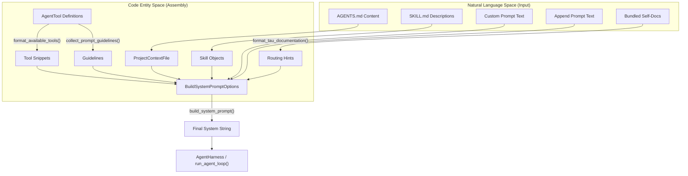
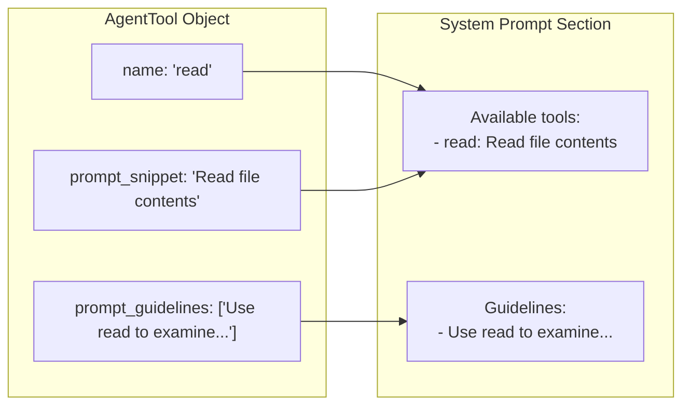

<!-- source: DeepWiki mcp.deepwiki.com · repo huggingface/tau · page 5.2 System Prompt Assembly · fetched 2026-10-26 -->

# System Prompt Assembly

<details>
<summary>Relevant source files</summary>

The following files were used as context for generating this wiki page:

- [dev-notes/system-prompt-files.md](dev-notes/system-prompt-files.md)
- [dev-notes/system-prompt-sidebar.md](dev-notes/system-prompt-sidebar.md)
- [src/tau_coding/resources.py](src/tau_coding/resources.py)
- [src/tau_coding/system_prompt.py](src/tau_coding/system_prompt.py)
- [tests/test_resources.py](tests/test_resources.py)
- [tests/test_system_prompt.py](tests/test_system_prompt.py)

</details>


The system prompt assembly layer in Tau is responsible for constructing the deterministic instructions that define the agent's identity, capabilities, and project-specific constraints. It bridges the gap between static resource files (skills, `AGENTS.md`, `SYSTEM.md`, bundled self-docs) and dynamic session state (available tools, current working directory, current date).

## Overview

Tau uses a "Pi-style" system prompt structure, characterized by clear section headers and XML-like tags for structured data such as project context and skill indexes [src/tau_coding/system_prompt.py:73-160](). The assembly process is managed by `tau_coding`, ensuring that the core `tau_agent` remains agnostic of the filesystem and resource discovery logic.

### Key Components
- **`build_system_prompt()`**: The primary entry point for generating the system string [src/tau_coding/system_prompt.py:73-76]().
- **`build_system_prompt_inspection()`**: Inspects and attributes every contiguous section of the prompt for debugging or the `/system` command [src/tau_coding/system_prompt.py:78-159]().
- **`BuildSystemPromptOptions`**: A dataclass containing all inputs for the prompt, including tools, skills, context files, and custom overrides [src/tau_coding/system_prompt.py:56-71]().
- **`ProjectContextFile`**: Represents a discovered instruction file (like `AGENTS.md`) to be injected into the prompt [src/tau_coding/system_prompt.py:21-27]().
- **`TauResourcePaths`**: Manages the discovery of Tau-native and `.agents` resources across user and project directories [src/tau_coding/resources.py:50-64]().

Sources: [src/tau_coding/system_prompt.py:21-76](), [src/tau_coding/resources.py:50-64]()

## Prompt Assembly Flow

The following diagrams illustrate how various data sources are aggregated into the final system prompt and how code entities map to the natural language prompt.

### System Prompt Construction Pipeline

Sources: [src/tau_coding/system_prompt.py:56-160](), [src/tau_coding/resources.py:50-181]()

### Tool-to-Prompt Mapping

Sources: [src/tau_coding/system_prompt.py:103-106](), [tests/test_system_prompt.py:30-47]()

## Discovery and Precedence

### TauResourcePaths and System Prompt Files
The `TauResourcePaths` class manages filesystem locations for resources [src/tau_coding/resources.py:50-64](). It resolves paths in an increasing order of precedence (User -> Project), allowing project-local configurations to override or supplement global user settings [src/tau_coding/resources.py:86-133]().

| Resource Type | Precedence Order | Discovery Logic |
| :--- | :--- | :--- |
| **Skills** | User `~/.tau/skills` -> User `~/.agents/skills` -> Project `.tau/skills` -> Project `.agents/skills` | `TauResourcePaths.skills_dirs` [src/tau_coding/resources.py:86-104]() |
| **Replacement System Prompts** | Project `.tau/SYSTEM.md` -> User `~/.tau/SYSTEM.md` (Explicit `--system-prompt` overrides both) | `discover_system_prompt_resources()` [src/tau_coding/resources.py:152-181]() |
| **Append System Prompts** | User `~/.tau/APPEND_SYSTEM.md` -> Project `.tau/APPEND_SYSTEM.md` -> Explicit `--append-system-prompt` | `discover_system_prompt_resources()` [src/tau_coding/resources.py:152-181]() |
| **Project Context** | `.agents/AGENTS.md` / `AGENTS.md` | `discover_project_context()` |

Sources: [src/tau_coding/resources.py:50-181](), [dev-notes/system-prompt-files.md:1-21]()

Tau automatically discovers optional replacement (`SYSTEM.md`) and append (`APPEND_SYSTEM.md`) files under user and project `.tau` directories [dev-notes/system-prompt-files.md:7-14](). Replacement files use strict precedence where project overrides user [dev-notes/system-prompt-files.md:16-17](). Append files are cumulative layers applied in order: user, project, then explicit CLI values [dev-notes/system-prompt-files.md:17-20]().

Sources: [src/tau_coding/resources.py:152-181](), [dev-notes/system-prompt-files.md:1-25]()

## Formatting Logic

### Tool and Guideline Integration
The default prompt includes an "Available tools" section and a "Guidelines" section derived from `AgentTool` objects [src/tau_coding/system_prompt.py:93-110]().
- **Tool Snippets**: `format_available_tools()` iterates through registered tools, filtering and formatting those that supply a valid prompt snippet [src/tau_coding/system_prompt.py:103]().
- **Guideline De-duplication**: `collect_prompt_guidelines()` aggregates guidelines from tools and built-in rules, deduplicating them to avoid repetitive instructions [tests/test_system_prompt.py:66-73]().

Sources: [src/tau_coding/system_prompt.py:93-110](), [tests/test_system_prompt.py:66-73]()

### Bundled Self-Docs
Tau injects routing hints pointing to installed reference material (`README.md`, `docs/`, examples) so the model knows when and how to reference internal self-documentation [src/tau_coding/system_prompt.py:189-210]().

Sources: [src/tau_coding/system_prompt.py:189-210](), [tests/test_system_prompt.py:48-50]()

### XML-Style Structured Data
Tau uses specific XML tags to help the LLM parse complex instructions.

#### Skills Index
Skills are formatted into an `<available_skills>` block [tests/test_system_prompt.py:175-190](). This is only included if the `read` tool is available, as the model must use `read` to access full skill content at the provided `<location>` [src/tau_coding/system_prompt.py:138-139]().

```xml
<available_skills>
  <skill>
    <name>review-code</name>
    <description>Review &lt;code&gt;</description>
    <location>/path/to/SKILL.md</location>
  </skill>
</available_skills>
```
Sources: [src/tau_coding/system_prompt.py:138-139](), [tests/test_system_prompt.py:175-190]()

#### Project Context
Context files (like `AGENTS.md`) are wrapped in `<project_context>` tags with individual `<project_instructions>` entries mapping to their file paths [tests/test_system_prompt.py:75-93]().

```xml
<project_context>
Project-specific instructions and guidelines:

<project_instructions path="/repo/AGENTS.md">
Follow these project rules.
</project_instructions>
</project_context>
```
Sources: [tests/test_system_prompt.py:75-93]()

## Customization, Inspection, and TUI Sidebar Integration

If a `custom_prompt` is provided in `BuildSystemPromptOptions`, it replaces the default Tau identity, tools, and guidelines sections [src/tau_coding/system_prompt.py:84-92](). However, Tau still appends the following to maintain essential operational context [src/tau_coding/system_prompt.py:112-155]():
1. Append system prompt sections and cumulative `APPEND_SYSTEM.md` files [src/tau_coding/system_prompt.py:112-134]().
2. Extension-provided extra sections [src/tau_coding/system_prompt.py:135]().
3. Project context blocks (`<project_context>`) [src/tau_coding/system_prompt.py:137]().
4. Skills index (if `read` tool exists) [src/tau_coding/system_prompt.py:138-139]().
5. Current date (ISO format) [src/tau_coding/system_prompt.py:140-147]().
6. Current working directory [src/tau_coding/system_prompt.py:148-155]().

### Inspection and Provenance
`build_system_prompt_inspection()` pairs the final text with an ordered tuple of `SystemPromptSource` objects [src/tau_coding/system_prompt.py:48-54](). This provenance map supports local inspection commands (e.g., `/system`) by displaying exact file paths and source kinds for every segment [src/tau_coding/system_prompt.py:162-180]().

### TUI Sidebar Integration
`CodingSession` exposes selected replacement and append source paths through `.system_prompt_files` [dev-notes/system-prompt-sidebar.md:19-20](). The TUI sidebar consumes this metadata to display an active **system prompt** section when user or project `.tau` prompt files contribute to the session [dev-notes/system-prompt-sidebar.md:5-7]().

Sources: [src/tau_coding/system_prompt.py:78-180](), [dev-notes/system-prompt-sidebar.md:1-36]()

---

