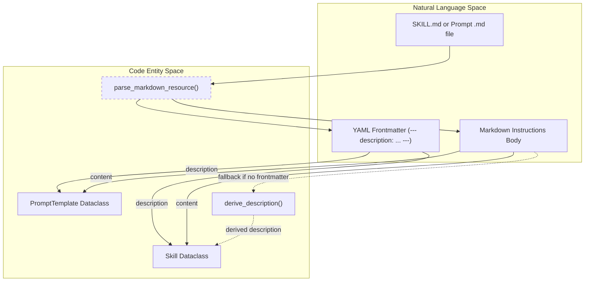
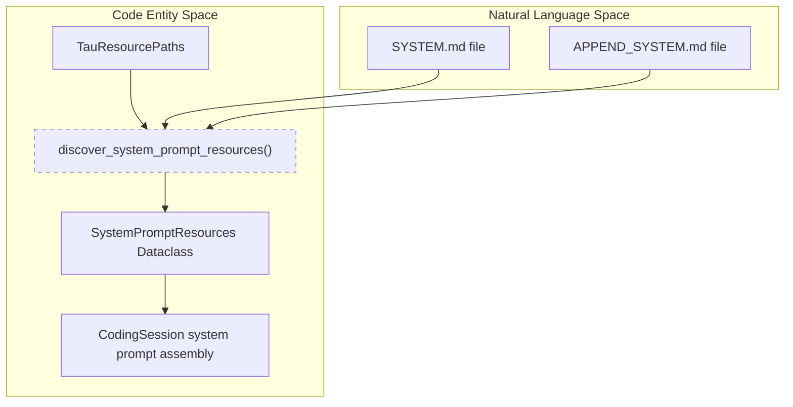

<!-- source: DeepWiki mcp.deepwiki.com · repo huggingface/tau · page 6 Skills, Prompt Templates, and Resources · fetched 2026-10-26 -->

# Skills, Prompt Templates, and Resources

Relevant source files

The following files were used as context for generating this wiki page:

- [dev-notes/architecture/phase-9-skills-prompts.md](dev-notes/architecture/phase-9-skills-prompts.md)
- [src/tau_coding/data/docs/skills.md](src/tau_coding/data/docs/skills.md)
- [src/tau_coding/prompt_templates.py](src/tau_coding/prompt_templates.py)
- [src/tau_coding/resources.py](src/tau_coding/resources.py)
- [src/tau_coding/skills.py](src/tau_coding/skills.py)
- [src/tau_coding/system_prompt.py](src/tau_coding/system_prompt.py)
- [tests/test_prompt_templates.py](tests/test_prompt_templates.py)
- [tests/test_resources.py](tests/test_resources.py)
- [tests/test_skills.py](tests/test_skills.py)
- [tests/test_system_prompt.py](tests/test_system_prompt.py)
- [website/content/guides/skills-and-prompts.md](website/content/guides/skills-and-prompts.md)

## Purpose and Scope

Tau features a flexible, precedence-ordered resource system that allows users and projects to define reusable behaviors, system prompt overrides, and prompt templates. These resources are authored in Markdown and can include YAML frontmatter for metadata [website/content/guides/skills-and-prompts.md:6-9](). 

This page provides a high-level overview of how Tau discovers, loads, and injects these resources. For deep technical details, refer to the child pages:
- [Skills](#6.1) — Covers the `Skill` dataclass, loading logic, diagnostics, frontmatter, and model invocation boundaries.
- [Prompt Templates](#6.2) — Covers `PromptTemplate`, variable substitution (`$1`, `$@`, `{{ variable }}`), slash-command expansion, and the edit modal.

Sources: [website/content/guides/skills-and-prompts.md:6-9]()

---

## Resource Discovery and Paths

Tau manages filesystem locations through the `TauResourcePaths` class [src/tau_coding/resources.py:49-61](). Resources are discovered across user-level and project-local directories, with project-local configurations taking higher precedence [src/tau_coding/resources.py:84-131]().

| Resource Type | Default Directories (Low to High Precedence) |
| :--- | :--- |
| **Skills** | `~/.tau/skills/` → `~/.agents/skills/` → `<cwd>/.tau/skills/` → `<cwd>/.agents/skills/` [src/tau_coding/resources.py:84-102]() |
| **Prompts** | `~/.tau/prompts/` → `~/.agents/prompts/` → `<cwd>/.tau/prompts/` → `<cwd>/.agents/prompts/` [src/tau_coding/resources.py:118-131]() |
| **System Prompts** | `~/.tau/SYSTEM.md` → `<cwd>/.tau/SYSTEM.md` [src/tau_coding/resources.py:190-192]() |

When name collisions occur across precedence tiers, Tau surfaces non-fatal `ResourceDiagnostic` entries rather than failing outright [website/content/guides/skills-and-prompts.md:31-36](). Users can reload resources dynamically in the TUI using `/reload`.

Sources: [src/tau_coding/resources.py:49-131](), [src/tau_coding/resources.py:190-192](), [website/content/guides/skills-and-prompts.md:31-36]()

---

## Markdown Resource Format

Both skills and prompt templates rely on Markdown files parsed via `parse_markdown_resource()` [src/tau_coding/resources.py:10-15](). YAML frontmatter provides metadata like `description`, while the file body supplies the core instruction text.

Diagram: Markdown Resource Parsing Pipeline

Sources: [src/tau_coding/resources.py:10-15](), [tests/test_resources.py:136-156]()

---

## Skills

A skill is a directory containing a `SKILL.md` file following the Agent Skills specification [website/content/guides/skills-and-prompts.md:40-41](). Skills provide reference know-how that the agent can inspect or that users can invoke via `/skill:<name>` [website/content/guides/skills-and-prompts.md:83-88](). 

Loaded skills are indexed into the system prompt so the model is aware of available specialized capabilities [website/content/guides/skills-and-prompts.md:79-81](). For comprehensive documentation on skill loading diagnostics, frontmatter flags like `disable-model-invocation`, and invocation mechanics, see [Skills](#6.1).

Sources: [website/content/guides/skills-and-prompts.md:40-116]()

---

## Prompt Templates

Prompt templates are stored as flat `.md` files under prompt directories and act as saved prompt macros [website/content/guides/skills-and-prompts.md:121-124](). They support both modern Pi-style positional variables (`$1`, `$@`, `$ARGUMENTS`) and legacy `{{ variable }}` syntax [website/content/guides/skills-and-prompts.md:129-148]().

Templates are invoked via slash commands matching their filename stem [src/tau_coding/prompt_templates.py:161-186](). Certain filenames like `prompts.md` and `skills.md` are reserved for built-in TUI pickers and trigger diagnostics if shadowed [website/content/guides/skills-and-prompts.md:127-128](). For complete details on template execution and editing, see [Prompt Templates](#6.2).

Sources: [src/tau_coding/prompt_templates.py:20-23](), [src/tau_coding/prompt_templates.py:161-186](), [website/content/guides/skills-and-prompts.md:121-155]()

---

## System Prompt Resources

Tau supports special system-level Markdown configuration files discovered via `discover_system_prompt_resources()` [src/tau_coding/resources.py:150-156](). 
- `SYSTEM.md` acts as a base prompt replacement file [dev-notes/system-prompt-files.md:7-11]().
- `APPEND_SYSTEM.md` acts as a cumulative extension layer appended to the base prompt [dev-notes/system-prompt-files.md:11-17]().

Unlike portable skills, system prompt files are strictly Tau-specific and are not discovered within `.agents` directories [dev-notes/system-prompt-files.md:26-32]().

Diagram: System Prompt Resource Discovery Flow

Sources: [src/tau_coding/resources.py:150-178](), [dev-notes/system-prompt-files.md:7-32]()

---

